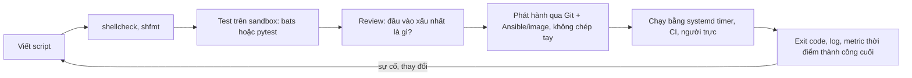
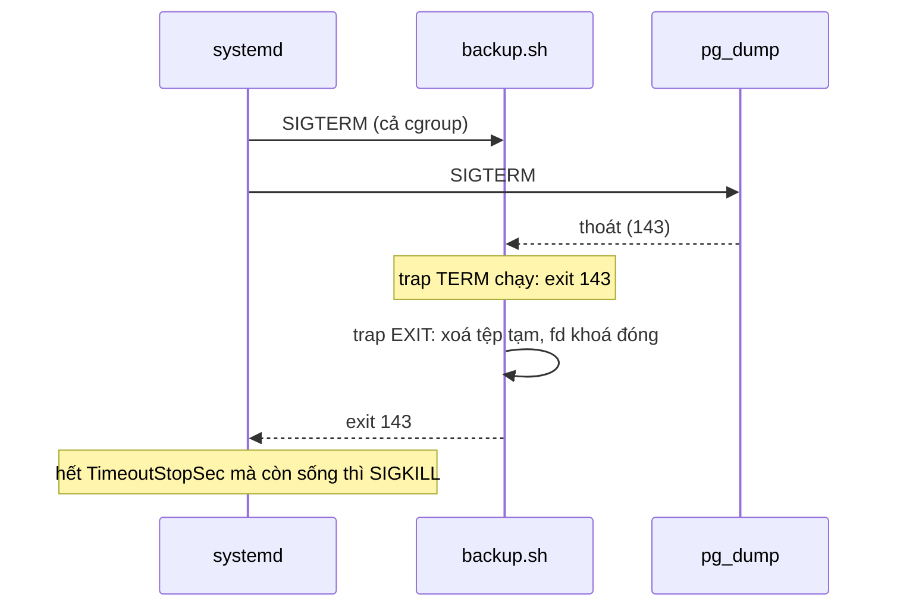
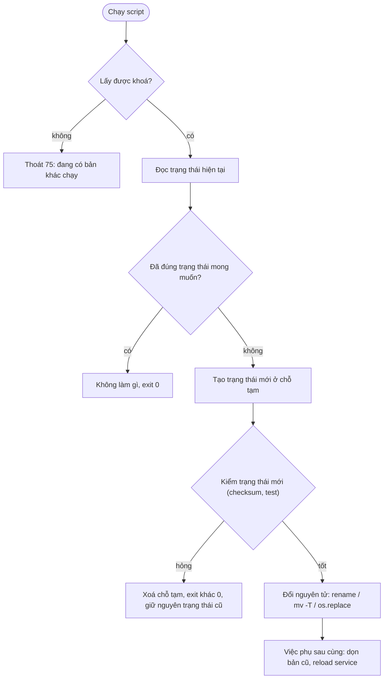
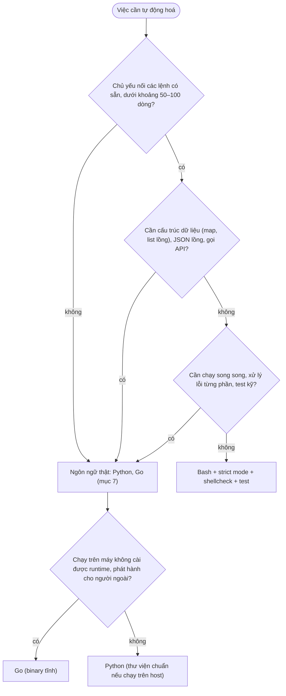

# Scripting & lập trình

Phần lớn sự cố do con người gây ra mà bạn sẽ gặp không đến từ Kubernetes hay Terraform, mà từ một script 30 dòng chạy
bằng cron: biến rỗng làm `rm -rf "$DIR/"` thành `rm -rf /`, backup "thành công" mỗi đêm nhưng tệp rỗng, script deploy
chạy tiếp sau khi một máy lỗi. Người phỏng vấn senior vì vậy hỏi rất kỹ phần này: "`set -e` không dừng script trong
trường hợp nào", "làm sao để script chạy hai lần không hỏng", "khi nào bạn bỏ Bash sang Python".

Module này đi tiếp từ [module 01](../01-linux-terminal/README.md) (xử lý text, signal, dừng tiến trình đúng cách,
systemd timer) và từ track Data Engineer (phần nhắc lại ở mục 1). Trọng tâm là **script vận hành**: chạy không người
trông, trên nhiều máy, thường với quyền cao, và phải an toàn khi đầu vào lệch đi một chút.

Sau module này bạn sẽ:

- Dùng strict mode của Bash mà biết rõ chỗ nó **không** bảo vệ bạn; viết quoting đúng theo phản xạ.
- Thiết kế exit code, log và `trap` để script dừng sạch và người gọi (cron, systemd, CI, Nagios) hiểu đúng kết quả.
- Viết script idempotent: ghi nguyên tử, khoá chống chạy chồng, retry có backoff chỉ cho lỗi tạm thời, có dry-run.
- Kiểm thử script Bash bằng shellcheck và test tự động có sandbox, và biết bats khác pytest ở đâu.
- Viết công cụ vận hành bằng Python an toàn (`subprocess` không qua shell, `pathlib`, `argparse`, `logging`).
- Chọn ngôn ngữ cho một công cụ vận hành (Bash, Python, Go, Node, Ruby, Rust, PowerShell) và bảo vệ được lựa chọn.

## 0. Cài đặt

Bài tập dùng `shellcheck` và `jq` đã cài ở [module 01](../01-linux-terminal/README.md#0-cài-đặt), cộng `curl`,
`flock` (gói util-linux) và `sha256sum` (coreutils) có sẵn trên mọi distro Linux. Công cụ mới duy nhất là
**bubblewrap** (`bwrap`): test chạy script của bạn trong một sandbox, vì script dọn dẹp hay backup viết dở có thể xoá
nhầm tệp thật trên máy bạn. Kiểm thử script Bash trong khoá này dùng pytest (đã có qua `uv`), nên bats chỉ được giới
thiệu ở mục 5, không cần cài.

| Công cụ | Phiên bản đã kiểm | Tối thiểu cho bài tập | Bài dùng |
| --- | --- | --- | --- |
| bubblewrap (`bwrap`) | 0.11.0 (Pop!_OS 24.04), 0.9.0 là bản của Ubuntu 24.04 | 0.5.0 (cần `--clearenv`) | Mọi bài chạy script của bạn; thiếu thì test skip, không bao giờ chạy script ngoài sandbox |
| flock, sha256sum | util-linux 2.39, coreutils 9.4 | Bản có sẵn | Intermediate 01 |

### bubblewrap

bubblewrap là công cụ tạo sandbox không cần root mà Flatpak dùng: nó đặt tiến trình vào user namespace và mount
namespace riêng. Test của module dựng sandbox như sau: toàn bộ `/` chỉ đọc, `/tmp` là một tmpfs rỗng (`/tmp` thật
của máy không nhìn thấy), chỉ thư mục tạm của chính test ghi được, môi trường biến dựng lại từ đầu (không mang theo
`BASH_ENV` hay hàm Bash được export). Script của bạn có đổi `PATH`, gọi `/bin/rm`, `env -i rm` hay Python để xoá thì
cũng chỉ chạm được vào thư mục tạm đó. `/run` cũng là tmpfs rỗng và `~/.docker` bị che, nên socket của Docker và D-Bus không
nhìn thấy được: script không thể nhờ `docker run -v /:/h` để thoát ra. `~/.kube`, `~/.aws`, `~/.ssh`,
`~/.config/gcloud` và `~/.azure` cũng bị che, nên script không đọc được thông tin đăng nhập thật của bạn. Sandbox **không** tách mạng: test healthcheck
cần gọi server giả trên `127.0.0.1` của máy. Điều đó chấp nhận được vì thứ cần chặn là script viết sai vô tình xoá hay
sửa tệp thật, không phải mã độc cố ý; đừng dùng sandbox này để chạy mã không tin cậy.

Cài bằng package manager, không tải binary rời: gói của distro đã được ký và kiểm, và trên các distro hạn chế user
namespace không đặc quyền (Ubuntu 24.04 có cơ chế AppArmor cho việc này), gói `bubblewrap` của distro là bản được cho
phép, còn một binary tự build đặt trong `~/.local/bin` có thể bị chặn.

```bash
sudo apt install bubblewrap
```

Fedora, RHEL: `sudo dnf install bubblewrap`. Arch: `sudo pacman -S bubblewrap`. WSL2 với Ubuntu: như Ubuntu. macOS
không có user namespace, nên các bài chạy script của module này cần Linux hoặc WSL2.

Xác nhận, gồm một lần tạo sandbox thật. Kết quả trên máy xây khoá:

```text
$ bwrap --version
bubblewrap 0.11.0
$ bwrap --ro-bind / / --proc /proc --unshare-user --unshare-pid --clearenv -- /bin/sh -c 'touch /etc/x'
touch: cannot touch '/etc/x': Read-only file system
```

Dòng thứ hai phải báo `Read-only file system`. Nếu nó báo `setting up uid map: Permission denied` hoặc
`No permissions to creating new namespace`, kernel đang chặn user namespace không đặc quyền: kiểm
`sysctl kernel.unprivileged_userns_clone` (Debian cũ) hoặc `sysctl kernel.apparmor_restrict_unprivileged_userns`
(Ubuntu 24.04) và dùng gói `bubblewrap` của distro thay vì bản tự build. Test của module khi đó skip kèm lý do, không
chạy script của bạn ngoài sandbox.

Gỡ: `sudo apt remove bubblewrap` (giữ lại nếu máy có Flatpak, vì Flatpak phụ thuộc vào nó).

## 1. Script vận hành: nhắc lại và điều thay đổi

Track Data Engineer đã dạy phần nền, đọc lại nếu cần:
[module 01, mục 3 Linux và Bash](../../../data-engineer/modules/01-foundations/README.md) (lệnh thường dùng, `set -euo
pipefail`, kiểm tham số, cron) và mục 1.5–1.6 của cùng module (CLI bằng `argparse`, exit code, idempotency của một
script ingest). Module này giả định bạn đã viết được script Bash có kiểm tham số và hàm Python có `argparse`.

Thứ thay đổi khi script chuyển từ máy bạn sang vận hành:

| Tính chất | Script cá nhân | Script vận hành |
| --- | --- | --- |
| Ai chạy | Bạn, nhìn output | cron, systemd timer, CI, Ansible, người trực lúc 3 giờ sáng |
| Khi lỗi | Bạn thấy và sửa | Không ai thấy, trừ khi exit code và log được giám sát |
| Đầu vào | Bạn biết nó đúng | Biến rỗng, đường dẫn có dấu cách, tệp đã bị xoá, máy khác distro |
| Chạy lại | Hiếm khi | Thường xuyên: timer bù giờ, retry của CI, người trực "chạy lại cho chắc" |
| Chạy chồng | Không | Lần trước chưa xong thì lần sau đã tới |
| Bị dừng giữa chừng | Ctrl+C, tự dọn | `SIGTERM` khi deploy, OOM, máy reboot |
| Quyền | User thường | Thường là root hoặc service account có quyền xoá dữ liệu |

Từ đó ra sáu tính chất mọi script vận hành cần, và cũng là khung của module này:

1. **Fail closed**: gặp điều không lường trước thì dừng, không đoán (mục 2).
2. **Nói rõ kết quả**: exit code đúng hợp đồng, log ra stderr, dữ liệu ra stdout (mục 3).
3. **Dọn sạch khi bị dừng**: `trap` (mục 3).
4. **Idempotent và nguyên tử**: chạy lại không hỏng, người khác không bao giờ thấy trạng thái dở dang (mục 4).
5. **Có test và lint**: shellcheck trong CI, test trên sandbox (mục 5).
6. **Đúng ngôn ngữ**: biết lúc phải rời Bash (mục 6, 7).



Một quy tắc thực tế từ Google Shell Style Guide: script Bash dài quá khoảng 100 dòng, hoặc có luồng điều khiển phức
tạp, thì nên viết lại bằng ngôn ngữ khác **ngay bây giờ**, vì càng để lâu càng đắt. Mục 6 bàn kỹ.

## 2. Bash strict mode, quoting và các bẫy

### `set -euo pipefail` làm gì

| Option | Tác dụng | Không có nó thì |
| --- | --- | --- |
| `-e` (`errexit`) | Lệnh trả khác `0` thì shell thoát | Lỗi ở dòng 5, dòng 6 xoá dữ liệu vẫn chạy |
| `-u` (`nounset`) | Dùng biến chưa đặt là lỗi | Biến gõ sai tên thành chuỗi rỗng: `rm -rf "$DEPLOY_ROTO/"` thành `rm -rf /` |
| `-o pipefail` | Exit code của pipeline là của lệnh hỏng cuối cùng (khác `0`) | `pg_dump db \| gzip > x.gz` "thành công" dù `pg_dump` lỗi, vì `gzip` trả `0` |

Thêm hai dòng nên có trong script Bash từ 4.4 trở lên: `shopt -s inherit_errexit` (lệnh bên trong `$(...)` cũng dừng ở lỗi
đầu tiên thay vì chạy tiếp) và `set -E` nếu dùng `trap ... ERR` (trap đi vào cả hàm và subshell).

### Những chỗ `set -e` **không** dừng script

Đây là câu hỏi phỏng vấn yêu thích, vì nó cho thấy bạn đã từng bị cắn.

| Trường hợp | Ví dụ | Vì sao |
| --- | --- | --- |
| Lệnh là điều kiện | `if grep -q x f; then`, `while read`, `until` | Thất bại là kết quả hợp lệ của điều kiện |
| Bên trái `&&` hoặc `\|\|` | `cmd \|\| true`, `[[ -f x ]] && rm x` | Như trên. Nhưng nếu `[[ -f x ]] && rm x` là **dòng cuối** của hàm, hàm trả `1` khi tệp không có |
| Có `!` phía trước | `! cmd` | Đảo kết quả, không bao giờ kích hoạt `-e` |
| Không phải lệnh cuối pipeline | `false \| true` | Chỉ lệnh cuối tính, trừ khi có `pipefail` |
| Gán kèm khai báo | `local x=$(cmd)`, `export y=$(cmd)` | Exit code là của `local`/`export` (luôn `0`); shellcheck báo SC2155 |
| Hàm gọi trong ngữ cảnh điều kiện | `if deploy; then`, `deploy \|\| rollback` | `-e` bị tắt **trong toàn bộ thân hàm**, lỗi giữa hàm bị bỏ qua |
| Lỗi giữa command substitution | `x="$(false; echo tiếp)"` | Không có `inherit_errexit`, subshell bên trong bỏ `-e` nên chạy tiếp sau `false`, exit code là của `echo` (`0`). `inherit_errexit` chỉ bật `-e` **bên trong** subshell |
| Command substitution làm tham số | `echo "$(false)"`, `log "$(cmd)"` | Exit code là của `echo`/`log`, không bao giờ của `cmd`, kể cả có `inherit_errexit`. Chỉ phép gán trơn `x="$(cmd)"` mang exit code của `cmd` ra ngoài |
| Process substitution | `while read l; do ...; done < <(cmd)` | Exit code của `cmd` bị mất hẳn |
| Số học trả 0 | `((count++))` khi `count=0` | `(( 0 ))` có exit `1`: script **chết** ở dòng tăng biến đếm. Viết `count=$((count + 1))` |

Hệ quả: `set -e` là lưới an toàn, không phải cơ chế xử lý lỗi. Chỗ nào lỗi có nghĩa (curl, pg_dump, ssh), kiểm tường
minh:

```bash
rc=0
output="$(curl -sS --max-time 5 "$url")" || rc=$?
if ((rc != 0)); then
  log ERROR "curl lỗi $rc khi gọi $url"
  exit 2
fi
```

### `pipefail` và SIGPIPE

`cmd | head -n1` với `pipefail`: `head` đọc xong một dòng thì đóng pipe, `cmd` ghi tiếp nhận `SIGPIPE` và chết với
mã `141`, pipeline thành lỗi dù bạn đã có thứ cần. Gặp với `yes`, `find`, `zcat log | head`. Cách xử lý: cho lệnh tự
giới hạn (`grep -m1`, `find -quit`, `awk 'NR==1{print; exit}'`), hoặc chấp nhận `141` một cách tường minh.

### `-u` và mảng, biến tuỳ chọn

- Biến có thể không có: `${VAR:-}` (rỗng) hoặc `${VAR:-mặc_định}`. Bắt buộc phải có: `: "${DB_URL:?cần đặt DB_URL}"`
  dừng với thông điệp rõ.
- Mảng rỗng: Bash 4.4+ cho `"${arr[@]}"` mở thành không gì cả; Bash 4.3 trở xuống (CentOS 7, macOS dùng Bash 3.2) báo
  `unbound variable`. Script phải chạy trên Bash cũ dùng `${arr[@]+"${arr[@]}"}`.
- `$1` trong hàm là tham số của hàm, không phải của script.

### Quoting và word splitting

Bash mở rộng một dòng lệnh theo thứ tự: brace (`{a,b}`), tilde, tham số/số học/command substitution, **word
splitting** (tách theo `IFS`), **pathname expansion** (glob), rồi bỏ dấu nháy. Hai bước in đậm chỉ áp lên phần
**không** nằm trong ngoặc kép. Mọi lỗi quoting đến từ đó.

| Viết | Với `f="my file*.log"` | Đúng/sai |
| --- | --- | --- |
| `rm $f` | Tách thành `my` và `file*.log`, rồi glob mở `file*.log` | Sai: xoá nhầm, hoặc lỗi |
| `rm "$f"` | Một tham số `my file*.log` | Đúng |
| `rm -- "$f"` | Như trên, và `f="-rf"` không thành option | Đúng nhất |
| `for x in $(ls)` | Tách tên tệp theo khoảng trắng | Sai: dùng glob `for x in ./*` hoặc `find -print0` |
| `cmd $@`, `cmd $*`, `cmd "$*"` | Tách lại hoặc gộp thành một chuỗi | Sai: luôn `"$@"` |
| `args="-h $host -p $port"; psql $args` | Chuỗi bị tách lại, host có dấu cách hỏng | Sai: dùng mảng `args=(-h "$host" -p "$port"); psql "${args[@]}"` |
| `eval "$cmd"` | Chạy lại mọi ký tự đặc biệt trong dữ liệu | Gần như luôn sai: dùng mảng |
| `echo "$data"` | `data="-n"` hay `data='a\nb'` khác nhau giữa các shell | Dùng `printf '%s\n' "$data"` |
| `[ $x = y ]` | `x` rỗng thành `[ = y ]`, lỗi cú pháp | Dùng `[[ $x == y ]]` (không tách từ bên trong) |
| `read line` | Mất dấu `\` và khoảng trắng đầu | `IFS= read -r line` |
| `cat <<EOF` có `$PGPASSWORD` | Biến bị mở rộng trong here-doc | `<<'EOF'` khi muốn giữ nguyên chữ |

Đặt `IFS=$'\n\t'` toàn cục (một phần của "unofficial strict mode" hay được chép trên mạng) giảm hậu quả của việc quên
ngoặc kép với dấu cách, nhưng không với glob, và làm code khó đọc hơn với người không biết. Cách bền là quote đúng và
để shellcheck bắt chỗ sót.

## 3. Exit code, lỗi, log và trap

### Exit code là hợp đồng

| Mã | Nghĩa theo quy ước | Ai dùng |
| --- | --- | --- |
| `0` | Thành công | Mọi nơi |
| `1` | Lỗi chung | Mọi nơi; `grep` dùng `1` cho "không tìm thấy" |
| `2` | Dùng sai (tham số) | Builtin của Bash, nhiều lệnh Unix |
| `64`–`78` | `sysexits.h`: `64` EX_USAGE, `65` dữ liệu sai, `69` dịch vụ không có, `74` lỗi I/O, `75` EX_TEMPFAIL (thử lại sau), `78` cấu hình sai | sendmail, Postfix, công cụ BSD; hợp cho wrapper cần tách mã của mình khỏi mã của lệnh được bọc |
| `124` | Hết giờ | `timeout` |
| `125`, `126`, `127` | Lỗi của chính wrapper; không chạy được; không thấy lệnh | `timeout`, `env`, shell |
| `128 + n` | Chết vì tín hiệu `n`: `130` SIGINT, `137` SIGKILL (thường là OOM killer), `143` SIGTERM | Shell, Docker (`docker ps` hiện `Exited (137)`) |
| `0`/`1`/`2`/`3` | OK / WARNING / CRITICAL / UNKNOWN | Nagios, Icinga, Sensu, Checkmk |

Exit code chỉ có 8 bit: `exit 256` là `0`. Đừng trả số lượng lỗi làm exit code. Chọn bảng mã theo **người gọi**: bài
Basic 01 trả mã Nagios vì hệ thống giám sát đọc nó, bài Basic 03 trả `64` cho lỗi cách dùng vì `2` có thể là mã của
lệnh nó bọc. Ghi bảng mã trong `--help` và README.

### Log

- **stdout là dữ liệu, stderr là chẩn đoán.** `backup.sh | tee` hay `ids=$(list_hosts.sh)` chỉ hoạt động khi log
  không lẫn vào stdout.
- Mỗi dòng log có thời điểm (UTC, ISO 8601), mức, tên script. Hệ thống log tập trung (Loki, module 13) đọc tốt hơn
  nếu là JSON: `jq -cn --arg msg "$msg" --arg level "$level" '{ts: (now | todate), level: $level, msg: $msg}' >&2`.
- Chạy dưới systemd thì stderr tự vào journald; ngoài systemd, `logger -t olist-backup "..."` gửi vào syslog.
- **Không log bí mật.** `set -x` in mọi lệnh kèm giá trị biến, kể cả token. Tắt quanh đoạn nhạy cảm (`set +x`), hoặc
  đưa trace ra tệp riêng bằng `BASH_XTRACEFD`.

```bash
log() {
  local level="$1"
  shift
  printf '%s %s %s: %s\n' "$(date -u +%FT%TZ)" "$level" "${0##*/}" "$*" >&2
}
die() {
  log ERROR "$*"
  exit 1
}
```

### trap

| Trap | Chạy khi | Dùng cho |
| --- | --- | --- |
| `EXIT` | Shell thoát vì bất cứ lý do gì (kể cả `exit` trong trap khác) | Dọn tệp tạm, nhả tài nguyên |
| `ERR` | Một lệnh lỗi trong ngữ cảnh mà `-e` sẽ dừng | In dòng lỗi: `trap 'log ERROR "dòng $LINENO: $BASH_COMMAND"' ERR` (cần `set -E`) |
| `INT`, `TERM`, `HUP` | Nhận tín hiệu | Chuyển thành `exit 130`/`143` để chạy qua trap `EXIT` |

```bash
work="$(mktemp -d)"
cleanup() {
  rm -rf -- "$work"
}
trap cleanup EXIT
trap 'exit 130' INT
trap 'exit 143' TERM
```

Ba điều hay bị bỏ sót:

- **Bash hoãn trap khi đang chờ lệnh foreground.** Script đang chạy `pg_dump` (mất 20 phút) mà chỉ script nhận
  `SIGTERM` thì trap chạy sau khi `pg_dump` xong. systemd, Docker và Ctrl+C gửi tín hiệu cho cả cgroup hoặc process
  group nên thường ổn; nếu cần phản ứng ngay, chạy lệnh dài ở nền rồi `wait "$!"`, vì `wait` bị tín hiệu ngắt.
- **Script chỉ để khởi động chương trình khác thì dùng `exec`** (module 01, bài graceful stop): shell được thay bằng
  chương trình, tín hiệu đi thẳng tới nó.
- **Cleanup phải idempotent và chịu được trạng thái dở dang**: biến có thể chưa được gán khi trap chạy. Khởi tạo
  `tmp=""` trước khi đặt trap và kiểm `[[ -n $tmp ]]`.



## 4. Idempotency, nguyên tử, khoá và retry

### Idempotent nghĩa là gì trong vận hành

Chạy một lần hay mười lần ra **cùng trạng thái cuối**, và lần thứ hai trở đi không làm gì thừa (không tạo bản backup
thừa, không restart service khi không có gì đổi). Có hai cách viết:

- **Mệnh lệnh** ("làm X"): `useradd olist`, `echo line >> file`, `ln -s`. Chạy lần hai thì lỗi hoặc nhân đôi.
- **Hội tụ** ("đảm bảo trạng thái X"): kiểm trạng thái hiện tại, chỉ thay đổi phần lệch. Đây là cách Ansible, Puppet,
  Kubernetes controller làm việc (module 09–11), và là cách script vận hành nên viết.

| Việc | Mệnh lệnh (không idempotent) | Hội tụ |
| --- | --- | --- |
| Tạo thư mục | `mkdir /srv/olist` | `mkdir -p /srv/olist` (cộng `install -d -m 0750 -o olist`) |
| Thêm dòng cấu hình | `echo "$line" >> f` | `grep -qxF -- "$line" f \|\| echo "$line" >> f` |
| Tạo user | `useradd olist` | `id -u olist >/dev/null 2>&1 \|\| useradd --system olist` |
| Cài tệp | `cp a /etc/x` | `install -m 0644 a /etc/x`, chỉ reload khi `cmp -s` thấy khác |
| Tạo DB | `CREATE DATABASE` | `CREATE ... IF NOT EXISTS`, migration có version |
| Backup hằng ngày | `pg_dump > $(date +%s).dump` | Tên theo ngày, bỏ qua nếu đã có bản hợp lệ (bài Intermediate 01) |



### Thao tác nguyên tử

- **Ghi tệp**: ghi vào tệp tạm **cùng thư mục** (cùng filesystem) rồi `mv`. `rename(2)` thay đích trong một bước,
  người đọc không bao giờ thấy tệp ghi dở. Cần bền qua mất điện thì `sync` tệp trước khi `mv` (Python: `os.fsync`).
- **Đổi symlink**: `ln -sfn new current` **không** nguyên tử (nó xoá rồi tạo). Dùng `ln -s new current.tmp && mv -T
  current.tmp current`; trong Python, `os.replace` (bài Intermediate 02).
- **Tải tệp**: `curl -fsSL -o x.part URL && sha256sum -c x.sha256 && mv x.part x`; tệp `.part` còn lại nghĩa là lần
  trước hỏng.

### Khoá

| Cách | Ưu | Nhược |
| --- | --- | --- |
| `flock -n` trên fd (`exec 9>lock; flock -n 9`) | Kernel nhả khi tiến trình chết; không có khoá "mồ côi" | Chỉ trong một máy; NFS cũ không tin được |
| `flock -n /run/lock/x.lock cmd` trong crontab | Không phải sửa script | Như trên |
| `mkdir lockdir` | Nguyên tử, có mọi nơi (kể cả macOS) | Tiến trình chết là khoá còn mãi, phải tự dọn |
| PID file | Quen thuộc | PID bị tái sử dụng; kiểm "PID còn sống" có race |
| systemd timer + service `Type=oneshot` | Service đang chạy thì timer không khởi động lần nữa | Chỉ khi chạy qua systemd |
| Khoá phân tán (`pg_try_advisory_lock`, etcd, Consul, Kubernetes Lease) | Nhiều máy cùng chạy một job | Thêm phụ thuộc; phải xử lý mất kết nối khi đang giữ khoá |

Cron trên 3 máy app cùng chạy job "gửi email nhắc đơn hàng" thì `flock` không giúp được gì: đó là lúc cần khoá phân
tán, hoặc tốt hơn là chỉ chạy job ở một chỗ (Kubernetes CronJob với `concurrencyPolicy: Forbid`).

### Retry

Retry đúng gồm bốn phần: **chỉ lỗi tạm thời** (timeout, connection refused, `429`, `503`; không retry `400`, `401`,
`404`), **exponential backoff có trần** (`min(cap, base * 2^n)`), **jitter** (tránh hàng trăm client thử lại cùng một
nhịp), và **giới hạn** số lần hoặc tổng thời gian. Retry một thao tác không idempotent (tạo đơn hàng, chuyển tiền) chỉ
an toàn khi có idempotency key. Retry ở nhiều tầng nhân số lần gọi lên: chọn một tầng. Bài Basic 03 viết wrapper
`retry.sh`; `curl --retry` và `tenacity` (Python) là bản có sẵn.

### Dry-run

Mọi script xoá hay sửa dữ liệu nên có `-n`/`--dry-run`: chạy **cùng đường code**, chỉ dừng trước tác dụng phụ, và in
chính xác những gì sẽ làm. Dry-run viết thành nhánh riêng thì lệch dần khỏi chạy thật. `find` có cách dry-run tự
nhiên: chạy với `-print` trước, `-delete` sau.

## 5. getopts, cấu trúc script và kiểm thử

### Khung một script vận hành

```bash
#!/usr/bin/env bash
set -Eeuo pipefail
shopt -s inherit_errexit

readonly SCRIPT="${0##*/}"

usage() {
  cat >&2 <<EOF
Usage: $SCRIPT [-n] [-k số_bản] <thư_mục>
  -n  dry-run: chỉ in việc sẽ làm
  -k  số bản giữ lại (mặc định 7)
EOF
  exit 2
}

log() {
  printf '%s %s: %s\n' "$(date -u +%FT%TZ)" "$SCRIPT" "$*" >&2
}

main() {
  local dry_run=0 keep=7 opt
  while getopts ":nk:h" opt; do
    case "$opt" in
      n) dry_run=1 ;;
      k) keep="$OPTARG" ;;
      h | *) usage ;;
    esac
  done
  shift $((OPTIND - 1))
  [[ $# -eq 1 ]] || usage
  [[ $keep =~ ^[1-9][0-9]*$ ]] || usage
  local dir="$1"
  log "bắt đầu dir=$dir keep=$keep dry_run=$dry_run"
}

main "$@"
```

Đặt logic trong `main` và gọi ở dòng cuối giúp shell đọc hết tệp trước khi chạy: sửa script trong lúc nó đang chạy
(deploy đè lên tệp) không làm shell đọc nửa cũ nửa mới.

| Cách đọc option | Long option (`--dry-run`) | Có sẵn | Ghi chú |
| --- | --- | --- | --- |
| `getopts` (builtin) | Không | Mọi shell POSIX | Chuẩn, đủ cho phần lớn script vận hành |
| `getopt` (util-linux) | Có | Linux; macOS có bản BSD không tương thích | Tiện nhưng làm script phụ thuộc Linux |
| Vòng `while (($#)); case "$1" in --dry-run) ...` | Có | Mọi nơi | Tự viết, dễ sai với `--opt=value` |
| Python `argparse`, Go `cobra` | Có, kèm `--help`, subcommand | | Dấu hiệu nên rời Bash khi cần nhiều option |

### shellcheck

shellcheck đọc script và bắt phần lớn lỗi ở mục 2 trước khi chúng chạy. Chạy trong editor, trong pre-commit hook và
trong CI (`shellcheck -S style scripts/*.sh`); `shfmt -d` giữ định dạng thống nhất.

| Mã | Lỗi | Ví dụ |
| --- | --- | --- |
| SC2086 | Biến không ngoặc kép, bị tách từ và glob | `rm $f` |
| SC2046 | Command substitution không ngoặc kép | `rm $(find ...)` |
| SC2068 | `$@` không ngoặc kép | `cmd $@` |
| SC2155 | Khai báo và gán cùng lúc che exit code | `local x=$(cmd)` |
| SC2164 | `cd` không kiểm lỗi | `cd "$dir"` rồi `rm -rf ./*` |
| SC2012, SC2045 | Parse `ls` | `for f in $(ls)` |
| SC2115 | `rm -rf "$dir/"` khi `dir` có thể rỗng | Dùng `"${dir:?}/"` |
| SC2181 | Kiểm `$?` gián tiếp | `cmd; if [ $? -ne 0 ]` thay vì `if ! cmd` |

Tắt một cảnh báo chỉ khi bạn hiểu nó và ghi lý do bên cạnh directive `# shellcheck disable=SC2016`.

### Kiểm thử script

Script vận hành cần test như mọi code khác, và khó hơn vì nó đụng tới hệ thống. Nguyên tắc chung cho mọi bài của
module:

- **Sandbox**: mọi đường dẫn nằm trong thư mục tạm của test; script nhận thư mục qua tham số hoặc biến, không hardcode
  `/var/backups`. Script có thể xoá dữ liệu thì chạy nó trong sandbox của hệ điều hành (bubblewrap, container dùng một
  lần), không chỉ dựa vào bản giả trên `PATH`: script chỉ cần đặt lại `PATH` hay gọi `/bin/rm` là vượt qua bản giả.
  Test của module này chạy mọi script của bạn qua `testkit.run_sandboxed` (xem mục 0).
- **Seam**: chỗ để thay phụ thuộc thật. Đặt bản giả của `pg_dump`, `curl`, `rm` lên đầu `PATH`; nhận thời gian qua
  biến (`BACKUP_DATE`), lệnh ngủ qua biến (`RETRY_SLEEP_CMD`); chạy một HTTP server giả trên `127.0.0.1`.
- **Chứng minh test bắt được lỗi**: chạy test lên bản lỗi (bản gốc trước khi sửa) và thấy nó đỏ. Bài Advanced 01 làm
  đúng như vậy.

| Công cụ | Viết test bằng | Mạnh | Yếu | Hợp khi |
| --- | --- | --- | --- | --- |
| bats-core | Bash (`@test`, `run`, `assert_output` từ bats-assert) | Gần với script, người chỉ biết Bash viết được; TAP output | Logic test phức tạp (HTTP server giả, JSON) khó viết; thêm một công cụ phải cài | Repo toàn Bash, team không dùng Python |
| pytest + `subprocess` | Python | Fixture, `tmp_path`, parametrize, server giả, kiểm JSON dễ; một bộ chạy cho cả repo | Người đọc phải biết Python | Repo đã có Python (như khoá này) |
| ShellSpec | DSL kiểu BDD trên shell | Mock hàm, đo coverage (qua kcov) | Ít người biết | Thư viện shell lớn, cần coverage |
| Container dùng một lần | Bất kỳ | Thử thật trên distro đích | Chậm hơn | Test tích hợp, script cài đặt |

Khoá này chấm bằng pytest để mọi bài dùng chung một bộ chạy. Một test bats tương đương bài Basic 03, để bạn đọc được
khi gặp:

```bash
#!/usr/bin/env bats

setup() {
  export RETRY_SLEEP_CMD="$BATS_TEST_TMPDIR/fake_sleep"
  printf '#!/usr/bin/env bash\necho "$1" >> "%s/sleeps"\n' "$BATS_TEST_TMPDIR" > "$RETRY_SLEEP_CMD"
  chmod +x "$RETRY_SLEEP_CMD"
}

@test "lỗi không tạm thời thì không thử lại" {
  run ./retry.sh -- bash -c 'exit 1'
  [ "$status" -eq 1 ]
  [ ! -e "$BATS_TEST_TMPDIR/sleeps" ]
}
```

bats có trong gói của Debian/Ubuntu (`bats`) và Homebrew (`bats-core`); hoặc `git clone --depth 1 --branch <tag>` repo
`bats-core/bats-core` rồi chạy `./install.sh "$HOME/.local"`. Không cài bằng cách pipe script tải về vào shell.

## 6. Python cho automation

### Khi nào rời Bash



Bash giỏi nhất ở việc gọi chương trình khác và nối output của chúng. Nó tệ ở mọi thứ còn lại: không có kiểu dữ liệu
ngoài chuỗi và mảng, xử lý lỗi bằng exit code dễ sót, parse JSON phải nhờ `jq`, chạy song song có kiểm lỗi (`wait -n`,
`xargs -P`) khó đọc.

### `subprocess`

```python
import logging
import os
import subprocess
from pathlib import Path

log = logging.getLogger("olist-backup")


def dump(database: str, target: Path, timeout: float = 3600) -> None:
    tmp = target.with_name(f".{target.name}.part")
    argv = ["pg_dump", "--format=custom", f"--file={tmp}", database]
    log.info("chạy %s", " ".join(argv))
    try:
        subprocess.run(argv, check=True, timeout=timeout, capture_output=True, text=True, env={**os.environ, "PGCONNECT_TIMEOUT": "10"})
    except subprocess.CalledProcessError as exc:
        tmp.unlink(missing_ok=True)
        raise RuntimeError(f"pg_dump thoát {exc.returncode}: {exc.stderr.strip()}") from exc
    except subprocess.TimeoutExpired:
        tmp.unlink(missing_ok=True)
        raise
    os.replace(tmp, target)
```

| Quy tắc | Vì sao |
| --- | --- |
| Truyền **list**, không `shell=True` | Dữ liệu (`database = "x; rm -rf ~"`) không bao giờ thành lệnh |
| Luôn có `timeout=` | Lệnh treo không kéo công cụ treo theo |
| `check=True` hoặc kiểm `returncode` | Không nuốt lỗi; `returncode < 0` nghĩa là chết vì tín hiệu `-returncode` |
| `env={**os.environ, ...}` | Thêm biến mà không xoá `PATH`, `HOME` |
| `shlex.split` cho chuỗi cấu hình, `shlex.join` để log | Tách đúng quy tắc shell mà không chạy shell |
| Output lớn thì `stdout=fh` | `capture_output` giữ mọi thứ trong RAM |

### `pathlib`, `argparse`, `logging`

- **`pathlib`**: `Path("/srv") / "olist" / name`, `.glob("olist-*.dump")`, `.resolve()`, `.is_relative_to(root)` để
  chặn path traversal sau khi resolve (tên `../../etc/passwd`). Ghi nguyên tử: `tempfile.NamedTemporaryFile(dir=thư
  mục đích, delete=False)`, ghi, `os.fsync`, rồi `os.replace`.
- **`argparse`**: subcommand (`add_subparsers(required=True)`), `--dry-run`, lỗi tham số tự thoát `2` kèm usage. Typer
  và Click gọn hơn cho CLI lớn nhưng là phụ thuộc ngoài.
- **`logging`**: ra stderr, có mức; `print` chỉ cho dữ liệu stdout. JSON log qua một `Formatter` nhỏ hoặc thư viện
  `python-json-logger`.

### Chạy và phân phối

- Công cụ cho laptop và CI: project `uv` có lockfile, hoặc script đơn có khai báo phụ thuộc ngay trong tệp theo
  PEP 723, chạy bằng `uv run script.py`.
- Script chạy **trên host**: chỉ dùng thư viện chuẩn của Python có sẵn trong distro. Python hệ thống thuộc về distro;
  `pip install` vào đó bị chặn theo PEP 668 (`externally-managed-environment`), và đúng là không nên.
- Python khởi động mất vài chục tới vài trăm mili giây: không sao với công cụ vận hành, đáng kể nếu bị gọi hàng nghìn
  lần mỗi phút.

## 7. Chọn ngôn ngữ cho công cụ vận hành

| Ngôn ngữ | Mạnh ở | Yếu ở | Phân phối | Công cụ ops nổi tiếng | Dùng khi |
| --- | --- | --- | --- | --- | --- |
| Bash | Có sẵn mọi nơi, nối lệnh nhanh nhất | Kiểu dữ liệu, xử lý lỗi, quoting, khác biệt GNU/BSD | Tệp text | Entrypoint container, script cài đặt, git hook | Dưới khoảng 100 dòng, chủ yếu gọi lệnh khác |
| Python | Viết nhanh, thư viện cho mọi API (boto3, kubernetes, httpx), dễ đọc | Phải có runtime đúng phiên bản; phụ thuộc rối nếu không khoá | Script + `uv`, wheel, image | Ansible, SaltStack, AWS CLI v1, OpenStack | Công cụ nội bộ, glue code, xử lý dữ liệu, team đã biết Python |
| Go | Binary tĩnh, cross-compile, khởi động nhanh, song song tốt, hệ sinh thái cloud native | Dài dòng hơn cho việc nhỏ; phải build để sửa | Một binary | Docker, Kubernetes, Terraform, Prometheus, Helm, kubectl plugin | Agent trên nhiều máy, CLI phát hành cho người khác, operator Kubernetes |
| Node.js / TypeScript | npm khổng lồ, async I/O, cùng ngôn ngữ với team frontend | Runtime và `node_modules` nặng, chuỗi cung ứng npm rủi ro | Script + runtime, image | AWS CDK, Pulumi (một trong các ngôn ngữ), GitHub Actions (action JavaScript), Zx | Team web, IaC bằng CDK, action cho GitHub |
| Ruby | DSL đẹp, viết nhanh | Ít được chọn cho công cụ mới; runtime | Gem | Chef, Puppet (một phần), Vagrant, Capistrano, Homebrew | Bảo trì hệ thống đã dùng Chef/Capistrano |
| Rust | Hiệu năng và an toàn bộ nhớ, binary tĩnh | Học lâu, biên dịch chậm, ít người trong team ops biết | Một binary | ripgrep, fd, bottom, Vector, một phần Firecracker | Công cụ hiệu năng cao, agent chạy khắp nơi cần nhẹ và an toàn |
| PowerShell 7 | Pipeline truyền **object** thay vì text, quản trị Windows, AD, Azure | Ngoài Windows ít người dùng; khởi động chậm | Script + runtime (`pwsh` chạy cả Linux, macOS) | Azure PowerShell, DSC, Exchange/AD admin | Môi trường Windows, Azure, Microsoft 365 |

Ba điều người phỏng vấn muốn nghe khi hỏi "bạn chọn ngôn ngữ gì":

- **Ràng buộc trước, sở thích sau**: chạy ở đâu (có runtime không), ai bảo trì (team biết gì), gọi gì (có SDK chính
  thức không), sửa nóng thế nào.
- **Ranh giới, không phải thay thế toàn bộ**: Bash vẫn đúng cho entrypoint và hook; ngôn ngữ thật cho logic.
- **Chi phí chuyển đổi**: viết lại 3.000 dòng Bash đang chạy ổn là rủi ro, chuyển dần theo mức đau (script gây sự cố
  trước). Bài Advanced 02 luyện đúng quyết định này.

Perl từng là ngôn ngữ ops mặc định và vẫn còn trong nhiều hệ thống cũ (`logwatch`, script Nagios); Lua sống trong
Nginx/OpenResty, HAProxy, Redis. Gặp thì đọc được là đủ, không chọn cho công cụ mới.

## 8. Tài liệu tham khảo

- [roadmap.sh/devops](https://roadmap.sh/devops): mục Learn a Programming Language (Python, Go, Ruby, Rust, JavaScript,
  PowerShell) và Scripting (Bash, PowerShell).
- [GNU Bash Reference Manual](https://www.gnu.org/software/bash/manual/bash.html): Shell Expansions, The Set Builtin,
  Signals, Bash Conditional Expressions.
- [Google Shell Style Guide](https://google.github.io/styleguide/shellguide.html).
- Greg Wooledge, [BashFAQ/105: Why doesn't set -e do what I expected?](https://mywiki.wooledge.org/BashFAQ/105),
  [BashPitfalls](https://mywiki.wooledge.org/BashPitfalls), [Quotes](https://mywiki.wooledge.org/Quotes),
  [ParsingLs](https://mywiki.wooledge.org/ParsingLs).
- [ShellCheck wiki](https://www.shellcheck.net/wiki/) (mỗi mã SCxxxx có một trang giải thích), [shfmt](https://github.com/mvdan/sh).
- [bats-core](https://bats-core.readthedocs.io/), [ShellSpec](https://shellspec.info/).
- [sysexits(3)](https://man.freebsd.org/cgi/man.cgi?query=sysexits), [Nagios Plugin Development Guidelines](https://nagios-plugins.org/doc/guidelines.html),
  [flock(1)](https://man7.org/linux/man-pages/man1/flock.1.html), [rename(2)](https://man7.org/linux/man-pages/man2/rename.2.html).
- Marc Brooker, [Exponential Backoff And Jitter](https://aws.amazon.com/blogs/architecture/exponential-backoff-and-jitter/)
  (AWS Architecture Blog) và [Timeouts, retries, and backoff with jitter](https://aws.amazon.com/builders-library/timeouts-retries-and-backoff-with-jitter/)
  (Amazon Builders' Library).
- Python docs: [subprocess](https://docs.python.org/3/library/subprocess.html) (mục Security Considerations),
  [pathlib](https://docs.python.org/3/library/pathlib.html), [argparse](https://docs.python.org/3/library/argparse.html),
  [logging HOWTO](https://docs.python.org/3/howto/logging.html), [shlex](https://docs.python.org/3/library/shlex.html).
- [PEP 668: externally managed environments](https://peps.python.org/pep-0668/), [PEP 723: inline script metadata](https://peps.python.org/pep-0723/),
  [uv: running scripts](https://docs.astral.sh/uv/guides/scripts/).
- [PostgreSQL: pg_dump](https://www.postgresql.org/docs/16/app-pgdump.html), [libpq environment variables](https://www.postgresql.org/docs/16/libpq-envars.html).
- [Go](https://go.dev/doc/), [PowerShell documentation](https://learn.microsoft.com/powershell/), [The Rust Book](https://doc.rust-lang.org/book/).
- Thomas A. Limoncelli và cộng sự, *The Practice of System and Network Administration*, 3rd ed. (Addison-Wesley, 2016),
  chương về tự động hoá.
