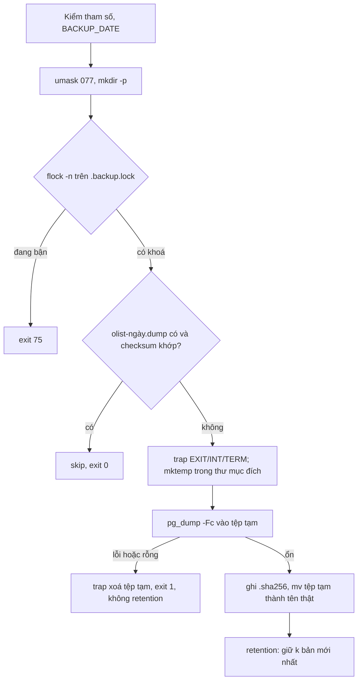

# Lời giải: backup Postgres idempotent

Script đầy đủ ở `backup.sh` cạnh tệp này.

## Thứ tự các bước và vì sao

1. **Kiểm đầu vào trước mọi tác dụng phụ.** `BACKUP_DATE` đi vào tên tệp, nên chỉ nhận đúng `[0-9]{4}-[0-9]{2}-[0-9]{2}`;
   chuỗi kiểu `../../x` không bao giờ tới được `mktemp` hay `rm`.
2. **`umask 077` trước khi tạo bất cứ thứ gì.** Dump chứa toàn bộ dữ liệu khách hàng. `chmod` sau khi tạo để lại một
   khoảng thời gian tệp đọc được bởi mọi người.
3. **Khoá trước khi kiểm idempotent.** Nếu kiểm "đã có bản chưa" rồi mới khoá, hai tiến trình cùng thấy "chưa có" và
   cùng dump (lỗi check-then-act). Khoá bằng `flock` trên fd: tiến trình chết là khoá nhả, không cần dọn.
4. **Idempotent theo ngày, có kiểm toàn vẹn.** Timer chạy lại sau khi máy khởi động (`Persistent=true`), hay người trực
   chạy tay "cho chắc", đều không tạo bản thừa. Nhưng "tệp tồn tại" chưa đủ: tệp có thể bị cắt cụt (đĩa đầy giữa chừng ở
   một bản script cũ), nên kiểm checksum.
5. **Ghi vào tệp tạm cùng thư mục, rồi `mv`.** `rename(2)` trong cùng filesystem là nguyên tử: người đọc (job đồng bộ
   lên S3, người restore) chỉ thấy hoặc không có tệp, hoặc tệp đầy đủ. Tệp tạm ở `/tmp` rồi `mv` sang thư mục backup
   khác filesystem thì `mv` thành chép rồi xoá, mất tính nguyên tử, và `/tmp` có thể là tmpfs nhỏ.
6. **Trap.** `EXIT` để dọn ở mọi đường thoát; `INT`, `TERM` chuyển thành `exit 130`/`exit 143` để chạy qua trap `EXIT`
   và trả đúng quy ước `128 + số tín hiệu`. Bash chỉ chạy trap sau khi lệnh foreground (`pg_dump`) kết thúc; ở đây
   systemd hoặc Ctrl+C gửi tín hiệu cho cả process group nên `pg_dump` dừng trước. Nếu chỉ script nhận `TERM` (ví dụ
   `kill <pid>`), muốn phản ứng ngay thì chạy `pg_dump ... &` rồi `wait $!`: `wait` bị tín hiệu ngắt ngay.
7. **Checksum ghi tên không kèm thư mục**, để `cd backups && sha256sum -c *.sha256` chạy được ở bất cứ đâu bạn chép bộ
   backup tới (S3, máy khác).
8. **Retention chạy sau cùng và chỉ khi thành công.** Đảo thứ tự là kịch bản kinh điển: dump lỗi nhiều ngày liền (mật
   khẩu đổi, đĩa đầy) trong khi retention vẫn xoá bản cũ đều đặn; tới ngày cần restore thì không còn bản nào.

## Bẫy strict mode đã gặp trong bài

- `mapfile -t old < <(...)` rồi `for f in "${old[@]}"`: với Bash từ 4.4, mảng rỗng mở ra thành không gì cả dù có
  `set -u`; Bash 4.3 trở xuống (CentOS 7) báo `unbound variable`. Viết `"${old[@]+"${old[@]}"}"` nếu phải chạy trên
  Bash cũ.
- `[[ -f a && -f b ]] && (...)` đặt trong `if` thì lỗi không kích hoạt `set -e`, đúng ý; đặt đứng một mình ở cuối hàm
  thì hàm trả mã lỗi và có thể làm script dừng ở chỗ gọi.
- Lỗi trong `<(...)` (process substitution) không làm script dừng kể cả với `pipefail`. Với dữ liệu quan trọng, chạy
  lệnh riêng, kiểm exit code, rồi mới đọc kết quả.

## Backup này còn thiếu gì

| Thiếu | Vì sao cần | Cách làm |
| --- | --- | --- |
| Bản sao ngoài máy | Máy chết hoặc bị mã hoá tống tiền thì backup cùng máy mất theo | Đồng bộ lên object storage (MinIO, S3) với versioning và object lock |
| Mã hoá | Dump nằm trên S3, trong tay bên thứ ba | `age` hoặc `gpg` mã hoá trước khi đẩy; hoặc SSE-KMS |
| Kiểm restore | Backup chưa từng restore là chưa có backup | Job hằng tuần restore vào Postgres tạm, chạy vài truy vấn kiểm số dòng |
| Giám sát | Backup lỗi im lặng nhiều tuần | Ghi thời điểm thành công cuối vào metric (`textfile` collector của node_exporter), alert khi cũ hơn 26 giờ |
| RPO nhỏ hơn 24 giờ | Dump hằng ngày mất tới một ngày dữ liệu | WAL archiving, pgBackRest hoặc WAL-G cho point-in-time recovery |

Với capstone m01, `backup.sh` của bạn nên giữ đúng các tính chất của bài này; module 08, 13 và 16 lần lượt thêm
storage ngoài máy, giám sát và diễn tập restore.
