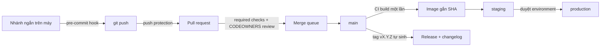
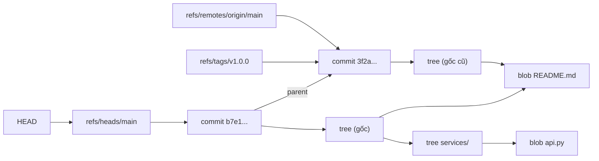
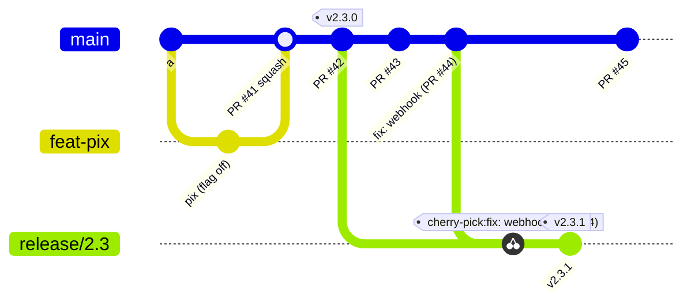
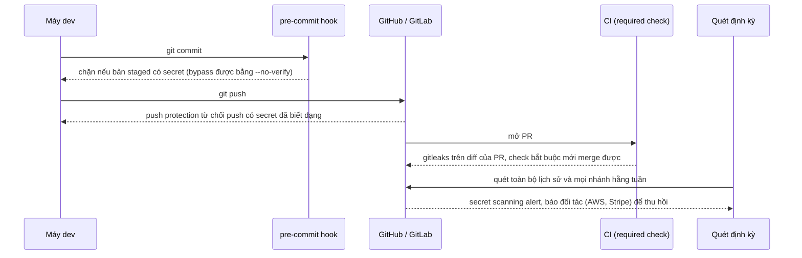

# Git & VCS hosting

Với DevOps engineer, Git không chỉ là chỗ lưu code. Nó là **nguồn sự thật** cho mọi thứ được deploy: code ứng dụng,
Dockerfile, pipeline CI, hạ tầng OpenTofu, manifest Kubernetes mà ArgoCD đồng bộ. Ai merge được vào `main` là người
thay đổi được production. Vì vậy câu hỏi phỏng vấn senior về Git hiếm khi là "lệnh nào để tạo nhánh", mà là "team
bạn nên dùng branching strategy nào và vì sao", "ai đó vừa force-push đè `main`, bạn làm gì", "một AWS key vừa lên repo
public, làm gì trước".

Module này giả định bạn đã dùng Git hằng ngày (phần nhắc lại ở mục 1). Trọng tâm là các quyết định ở mức team và tổ
chức: mô hình nhánh và quan hệ của nó với DORA metrics, viết lại lịch sử mà không làm mất việc của người khác, khôi phục
sau sự cố, tự động hoá phát hành, chặn secret nhiều lớp, cấu trúc repo, và cách cấu hình nền tảng hosting (CODEOWNERS,
ruleset, required checks) để quy trình được thực thi bằng máy chứ không bằng lời nhắc.

Sau module này bạn sẽ:

- Đọc được Git ở mức object và ref, nhờ đó cứu được dữ liệu bằng reflog và hiểu vì sao rebase "đổi SHA".
- Chọn branching strategy và cách merge từ ràng buộc thật, giải thích được tác động lên lead time và change failure rate.
- Viết lại lịch sử an toàn với `--force-with-lease`, và tìm commit gây lỗi bằng `git bisect run`.
- Tự động hoá phiên bản và changelog bằng Conventional Commits và semver, biết khi nào ký commit.
- Dựng lớp chặn secret từ hook trên máy tới push protection trên server, và xử lý đúng thứ tự khi secret đã lộ.
- Thiết kế cấu trúc repo (monorepo, polyrepo, lai), xử lý tệp lớn, và cấu hình GitHub/GitLab/Bitbucket cho team.

## 0. Cài đặt

Bài tập chỉ cần `git` (có sẵn trên mọi distro), cộng `bwrap` từ [module 02](../02-scripting/README.md#0-cài-đặt) và
`shellcheck` từ [module 01](../01-linux-terminal/README.md#0-cài-đặt). Ba công cụ cuối bảng là tuỳ chọn, để thử những
gì lý thuyết nhắc tới; không bài tập nào cần chúng.

| Công cụ | Phiên bản tham chiếu | Tối thiểu cho bài tập | Dùng ở |
| --- | --- | --- | --- |
| git | 2.43.0 (Ubuntu 24.04) | 2.30 (`--force-if-includes`) | Mọi bài |
| bubblewrap (`bwrap`) | 0.11.0 | 0.5.0 | Mọi bài chạy script của bạn |
| shellcheck | 0.10.0 | 0.9.0 | Bài Basic 01, 02, Intermediate 01, 02 |
| gitleaks (tuỳ chọn) | 8.30.1 | Không | Mục 6 |
| pre-commit (tuỳ chọn) | Bản mới nhất qua `uv tool` | Không | Mục 6 |
| git-filter-repo (tuỳ chọn) | 2.47.0 | Không | Mục 4, 7 |

Kiểm phiên bản Git:

```bash
git --version
```

Cũ hơn 2.30 (Ubuntu 20.04 có 2.25): nâng bằng package manager, ví dụ PPA chính thức của nhóm bảo trì Git cho Ubuntu
(`sudo add-apt-repository ppa:git-core/ppa && sudo apt update && sudo apt install git`), hoặc dùng distro mới hơn.

**Test không đọc cấu hình Git của bạn.** Mọi lệnh `git` trong test chạy với `HOME` tạm, `GIT_CONFIG_GLOBAL=/dev/null`,
`GIT_CONFIG_SYSTEM=/dev/null`, tác giả và ngày commit cố định, trong repo dựng ở thư mục tạm. `core.hooksPath`,
`commit.gpgsign`, credential helper hay alias trong `~/.gitconfig` không làm bài fail, và test không bao giờ chạm vào
repo thật hay `~/.gitconfig` của bạn. Lệnh nào chạy script của bạn (kể cả `git commit` gọi hook, `git bisect run`)
đều nằm trong sandbox bubblewrap.

### gitleaks (tuỳ chọn)

Binary tĩnh, tải từ GitHub Releases, kiểm checksum rồi mới cài. Khối lệnh nối bằng `&&`: bước nào lỗi (tải hỏng,
checksum sai) thì dừng, không cài.

```bash
VERSION=8.30.1
cd "$(mktemp -d)" &&
curl -fsSLO "https://github.com/gitleaks/gitleaks/releases/download/v${VERSION}/gitleaks_${VERSION}_linux_x64.tar.gz" &&
curl -fsSLO "https://github.com/gitleaks/gitleaks/releases/download/v${VERSION}/gitleaks_${VERSION}_checksums.txt" &&
grep " gitleaks_${VERSION}_linux_x64.tar.gz\$" "gitleaks_${VERSION}_checksums.txt" | sha256sum -c - &&
tar -xzf "gitleaks_${VERSION}_linux_x64.tar.gz" gitleaks &&
install -m 0755 gitleaks ~/.local/bin/gitleaks &&
gitleaks version
```

Dòng `sha256sum -c` phải in `gitleaks_8.30.1_linux_x64.tar.gz: OK`. Tệp checksum nằm cùng chỗ với binary, nên nó chỉ
chống tải hỏng, không chống release bị thay; muốn chắc hơn thì kiểm chữ ký cosign của release (xem trang release của
dự án). Gỡ: `rm ~/.local/bin/gitleaks`.

### pre-commit và git-filter-repo (tuỳ chọn)

Cả hai là công cụ Python, cài như một tool riêng bằng `uv`, không đụng Python hệ thống:

```bash
uv tool install pre-commit && pre-commit --version
uv tool install git-filter-repo && git filter-repo --version
```

Gỡ: `uv tool uninstall pre-commit`, `uv tool uninstall git-filter-repo`.

## 1. Git: nhắc lại và điều thay đổi khi làm DevOps

Track Data Engineer đã dạy phần dùng hằng ngày, đọc lại nếu cần:
[module 01, mục 4 Git workflow cho nhóm data](../../../data-engineer/modules/01-foundations/README.md) (nhánh ngắn +
PR, `switch`, `add -p`, `rebase origin/main`, `revert`, `stash`, bảng merge vs rebase, `.gitignore` dữ liệu, xử lý khi
lỡ commit bí mật, Conventional Commits). Module này giả định bạn đã quen các lệnh đó.

Thứ thay đổi khi bạn chịu trách nhiệm cho cả quy trình chứ không chỉ cho nhánh của mình:

| Câu hỏi | Người dùng Git | DevOps / platform engineer |
| --- | --- | --- |
| Nhánh nào sống lâu? | Làm theo quy ước có sẵn | Chọn mô hình, đo tác động lên lead time |
| Ai được merge vào `main`? | Người có quyền write | Ruleset, CODEOWNERS, required checks, ai được bypass |
| Commit có đáng tin không? | Tin đồng nghiệp | Ký commit, chặn force-push, audit log |
| Secret có lọt không? | Cố gắng cẩn thận | Hook, quét trong CI, push protection, quy trình khi lộ |
| Phát hành bản nào? | Ai đó tag tay | Phiên bản tự sinh từ commit, artifact bất biến, changelog |
| Repo chậm, CI chậm? | Chờ | Partial clone, sparse checkout, LFS, CI theo đường dẫn, cache |
| Mất dữ liệu? | Hoảng | Reflog, `fsck`, server, quy trình khôi phục |



Mỗi mũi tên trong sơ đồ là một chỗ máy thực thi quy tắc. Phần còn lại của module đi qua từng chỗ.

## 2. Bên trong Git: object, ref, reflog

Hiểu cách Git lưu dữ liệu đủ để trả lời ba câu hỏi vận hành: vì sao rebase đổi SHA, vì sao commit "đã xoá" vẫn cứu được,
và vì sao xoá secret khỏi lịch sử khó như vậy.

### Object

Git là một kho **content-addressed**: mỗi object được đặt tên bằng hash của chính nội dung nó (SHA-1 mặc định; Git
2.29+ hỗ trợ `--object-format=sha256`, nhưng nhiều nền tảng hosting chưa hỗ trợ đầy đủ nên hầu như chưa ai dùng).

| Object | Chứa | Xem bằng |
| --- | --- | --- |
| blob | Nội dung một tệp, không có tên tệp | `git cat-file -p <sha>` |
| tree | Danh sách (mode, tên, sha) của blob và tree con: một thư mục | `git cat-file -p HEAD^{tree}` |
| commit | sha của tree gốc, sha của parent, author, committer, message, chữ ký nếu có | `git cat-file -p HEAD` |
| tag (annotated) | sha của object được tag, tên, người tag, message, chữ ký nếu có | `git cat-file -p v1.0.0` |

Vì commit chứa sha của parent, đổi một byte ở commit cũ làm đổi sha của nó, rồi của mọi commit sau. Đó là lý do
rebase, `commit --amend`, `filter-repo` đều tạo commit **mới**, và người khác đang dựa vào commit cũ phải tự điều chỉnh.
Cũng vì vậy, một sha commit cam kết toàn bộ lịch sử phía trước nó: ký một commit là ký cả cây nội dung lẫn lịch sử.



Blob không đổi giữa hai commit được dùng chung (`README.md` ở trên), nên Git rẻ khi lưu nhiều phiên bản của tệp text.
Object được nén riêng (loose object) rồi gom vào **packfile** với delta giữa các phiên bản khi `git gc` chạy. Tệp nhị
phân lớn (ảnh, model, dump) không delta tốt: mỗi phiên bản là một bản đầy đủ, và vì mọi clone nhận toàn bộ lịch sử, repo
phình mãi. Mục 7 bàn cách xử lý.

### Ref

Ref là tên trỏ tới một sha, lưu trong `.git/refs/` hoặc `.git/packed-refs`:

- `refs/heads/<nhánh>`: nhánh local. Nhánh chỉ là một con trỏ 41 byte, tạo và xoá gần như miễn phí.
- `refs/tags/<tag>`: lightweight tag trỏ thẳng vào commit; annotated tag trỏ vào object tag (có người tạo, message, chữ
  ký). Release nên dùng annotated tag, và tag đã công bố không bao giờ được dời.
- `refs/remotes/origin/<nhánh>`: **bản sao lần cuối bạn thấy** nhánh trên remote, chỉ đổi khi `fetch`. Đây là thứ mà
  `--force-with-lease` so sánh (mục 4).
- `HEAD`: thường là ref tượng trưng trỏ tới một nhánh (`ref: refs/heads/main`); trỏ thẳng sha là trạng thái detached.
- Ref đặc biệt: `ORIG_HEAD` (giá trị trước `reset`, `merge`, `rebase`), `FETCH_HEAD`, `MERGE_HEAD`, `refs/bisect/*`,
  `refs/stash`. GitHub giữ thêm `refs/pull/<n>/head` cho mọi PR, kể cả PR đã đóng.

### Reflog và vòng đời của object

Mỗi lần một ref đổi, Git ghi một dòng vào **reflog** của ref đó (`.git/logs/`): giá trị cũ, giá trị mới, ai, lúc nào,
lý do. Reflog chỉ có trên máy của bạn, không được push hay clone.

```bash
git reflog show main --format='%h %gd %gs'
git log -g --oneline HEAD
git rev-parse 'main@{2}' 'main@{yesterday}' '@{-1}'
```

Một commit không còn ref nào trỏ tới (sau `reset --hard`, `branch -D`, rebase) vẫn nằm trong kho. `git gc` chỉ xoá
object không reachable từ ref **và** từ reflog, và chỉ khi chúng cũ hơn `gc.pruneExpire` (mặc định 2 tuần). Mục reflog
hết hạn sau 90 ngày (`gc.reflogExpire`), hoặc 30 ngày nếu commit không còn reachable từ nhánh
(`gc.reflogExpireUnreachable`). Thực tế: trên máy đã làm thao tác, bạn có khoảng một tháng để cứu.

| Tình huống | Cách cứu |
| --- | --- |
| Vừa `reset --hard`, `rebase`, `merge` nhầm | `git reset --hard ORIG_HEAD` |
| `reset --hard` từ vài thao tác trước | `git reflog show <nhánh>`, tìm mục `reset:`, lấy giá trị ngay trước nó (bài Basic 02) |
| Xoá nhánh chưa merge | Reflog của `HEAD`: mục `checkout: moving from <nhánh> to ...` |
| Mất `stash` đã `drop` | `git fsck --unreachable \| grep commit`, tìm commit có message `WIP on` |
| Reflog cũng mất (clone khác) | `git fsck --lost-found`; hoặc lấy từ remote, CI cache, máy đồng nghiệp |
| Force-push đè nhánh trên GitHub | Reflog của người đã push trước đó; GitHub activity / API events; ruleset chặn force-push để không lặp lại |

Hệ quả ngược lại quan trọng không kém: **xoá một tệp trong commit mới không xoá nó khỏi lịch sử**. Secret đã commit nằm
trong mọi clone, mọi fork, `refs/pull/*`, cache của nền tảng, cho tới khi được viết lại khỏi lịch sử ở mọi nơi. Vì vậy
quy trình xử lý secret lộ bắt đầu bằng thu hồi secret, không phải bằng sửa lịch sử (mục 6).

## 3. Branching strategy và cách merge

### Các mô hình



Sơ đồ là trunk-based có nhánh release: mọi thay đổi vào `main` qua PR ngắn; khi cần ổn định một phiên bản (app phải qua
store duyệt, bản on-prem), cắt `release/2.3` và **sửa trên `main` trước rồi cherry-pick** sang nhánh release.

| Mô hình | Nhánh sống lâu | Phát hành | Hợp khi | Cái giá |
| --- | --- | --- | --- | --- |
| Trunk-based | Chỉ `main`; nhánh PR sống dưới 1–2 ngày | Mỗi commit trên `main` đều phát hành được; deploy liên tục hoặc theo nhịp | Một bản production, CI nhanh và tin được, có feature flag | Cần kỷ luật PR nhỏ, test tự động tốt, flag và việc dọn flag |
| GitHub flow | `main` + nhánh feature ngắn, deploy từ nhánh hoặc sau merge | Sau mỗi PR | Web app, team nhỏ đến vừa | Gần như trunk-based; không nói gì về nhiều phiên bản |
| Trunk-based + release branch | `main` + `release/x.y` cho từng phiên bản cần hỗ trợ | Cắt nhánh khi phát hành, vá bằng cherry-pick | App mobile, SDK, bản on-prem, nhiều phiên bản cùng sống | Backport tốn công; dễ quên đưa bản sửa về `main` nếu sửa sai chiều |
| GitLab flow (nhánh môi trường) | `main`, `pre-production`, `production` | Merge xuôi theo môi trường | Môi trường có nhịp deploy khác nhau, không có công cụ promote | Dễ lệch giữa nhánh; build lại ở mỗi môi trường. Thường nên thay bằng promote artifact |
| GitFlow | `master` + `develop`, cùng `feature/*`, `release/*`, `hotfix/*` | Theo lịch, qua giai đoạn ổn định hoá trên `release/*` | Phần mềm phát hành theo phiên bản, QA dài (firmware, desktop đóng gói) | Lead time dài, merge phức tạp, `develop` và `master` lệch nhau; chính tác giả (2020) khuyên web app dùng mô hình đơn giản hơn |

### Quan hệ với DORA

Nghiên cứu DORA (Accelerate, State of DevOps) coi **trunk-based development** là một capability dự báo hiệu suất giao
phần mềm: team hiệu suất cao có ít hơn ba nhánh hoạt động, nhánh merge vào trunk ít nhất mỗi ngày, và gần như không có
code freeze. Cơ chế rất trực tiếp:

- **Lead time for changes** gồm cả thời gian code nằm chờ trên nhánh. Nhánh sống hai tuần là lead time ít nhất hai tuần.
- **Deployment frequency** bị chặn trên bởi tần suất có được một `main` phát hành được.
- **Change failure rate**: merge lớn hiếm hoi tích luỹ xung đột và rủi ro; thay đổi nhỏ dễ review, dễ rollback.
- **Failed deployment recovery time**: khi mọi thay đổi đi một đường (`main` → pipeline), rollback và fix-forward đều
  dùng đường đó. Mô hình có `hotfix/*` đi đường riêng tạo ra bản production chưa từng nằm trên `main`.

Điều kiện để trunk-based an toàn: CI chạy trên mọi PR đủ nhanh (dưới khoảng 10 phút), test tự động đáng tin, review
trong ngày, và cách giấu việc dở dang. **Feature flag** tách **deploy** (code lên production, đang tắt) khỏi **release**
(bật cho người dùng, có thể theo phần trăm). Việc lớn dùng **branch by abstraction**: đặt một interface trước code cũ,
viết bản mới phía sau từng phần, chuyển dần, rồi xoá bản cũ. Flag là nợ kỹ thuật: mỗi flag cần chủ sở hữu và hạn xoá.

**Nhánh theo môi trường** (`dev`, `staging`, `prod`, promote bằng merge) là anti-pattern hay gặp: mỗi nhánh build lại
artifact, nên thứ chạy ở prod chưa từng được test; hotfix vào thẳng `prod` thì các nhánh lệch nhau. Cách thay thế:
build một lần từ `main`, **promote cùng artifact** (cùng digest image) qua môi trường, khác biệt nằm ở cấu hình
(module 07, 12).

### Merge, rebase hay squash

| Cách merge PR | Lịch sử `main` | Ưu | Nhược | Hợp khi |
| --- | --- | --- | --- | --- |
| Merge commit (`--no-ff`) | Giữ mọi commit của nhánh + một merge commit | Truy vết đầy đủ, biết commit nào thuộc PR nào | Lịch sử rối; commit `wip` trên `main` làm bisect vấp (dùng `bisect --first-parent`) | Nhánh có commit sạch, có ý nghĩa riêng; nhánh release merge ngược |
| Squash | Mỗi PR một commit, message là tiêu đề PR | Lịch sử thẳng, mỗi commit đã qua CI, changelog từ tiêu đề PR | Mất chi tiết nhánh; nhánh chồng lên nhánh khác phải rebase sau khi nhánh dưới squash | Phần lớn team sản phẩm, PR nhỏ |
| Rebase and merge | Các commit của nhánh xếp thẳng lên `main` | Thẳng, giữ từng commit | Mỗi commit phải tự build được; SHA đổi so với nhánh | Team có kỷ luật commit nguyên tử (kernel-style) |

Hai cơ chế đi kèm: **"Require branches to be up to date"** bắt PR rebase/merge `main` mới nhất trước khi merge (an
toàn nhưng tốn CI khi nhiều PR); **merge queue** (GitHub) hoặc **merge train** (GitLab) xếp PR thành hàng, test từng PR
trên đỉnh của các PR đứng trước, rồi merge tự động. Với repo bận, merge queue là thứ cho phép vừa an toàn vừa nhanh.

## 4. Viết lại lịch sử an toàn, bisect và khôi phục

### Quy tắc vàng

Viết lại lịch sử (rebase, amend, squash, filter) là bình thường trên nhánh **chỉ mình bạn dùng**. Trên nhánh người
khác đã dựa vào (`main`, `release/*`, nhánh chung), dùng `git revert` để đảo thay đổi bằng một commit mới, và để
ruleset chặn force-push.

### Dọn nhánh trước khi merge

```bash
git commit --fixup=<sha>
GIT_SEQUENCE_EDITOR=true git rebase -i --autosquash origin/main
```

`--fixup` tạo commit `fixup! <message gốc>`; `--autosquash` xếp nó ngay sau commit gốc với lệnh `fixup`.
`GIT_SEQUENCE_EDITOR=true` chấp nhận danh sách todo không cần mở editor, nên dùng được trong script và CI. Đặt
`rebase.autoSquash=true` và `rebase.updateRefs=true` (Git 2.38+, tự cập nhật các nhánh xếp chồng) nếu bạn làm việc
này thường xuyên. `git rerere` (reuse recorded resolution) nhớ cách bạn giải một xung đột để không phải giải lại khi
rebase nhiều lần.

### Force push có điều kiện

| Lệnh | Server cập nhật khi | Rủi ro |
| --- | --- | --- |
| `git push --force` | Luôn luôn | Ghi đè mọi commit người khác vừa push |
| `git push --force-with-lease` | Nhánh trên server bằng `origin/<nhánh>` **hiện tại** của bạn | `git fetch` (hay IDE tự fetch nền) cập nhật `origin/<nhánh>`, và lease "khớp" dù bạn chưa xem commit mới: ghi đè như `--force` |
| `git push --force-with-lease=<nhánh>:<sha>` | Nhánh trên server bằng đúng `sha` bạn ghi lại | An toàn trong script: ghi `sha` trước mọi fetch (bài Intermediate 02) |
| `--force-with-lease --force-if-includes` (Git 2.30+) | Như trên, **và** tip trên server từng nằm trong reflog nhánh local của bạn (bạn đã tích hợp nó) | Lựa chọn tốt cho người dùng tương tác: `git config --global push.useForceIfIncludes true` |

### git bisect

Bisect tìm commit đầu tiên gây ra một thay đổi hành vi bằng tìm kiếm nhị phân: khoảng 10 lần kiểm cho 1.000 commit.

```bash
git bisect start <bad> <good>
git bisect run ./check.sh
git rev-parse refs/bisect/bad
git bisect reset
```

Script kiểm phải phân loại đúng: exit `0` là good, `1`–`127` (trừ `125`) là bad, `125` là "commit này không kiểm được,
bỏ qua", `128` trở lên làm bisect dừng. Script trả `1` cho cả lỗi build lẫn lỗi thật sẽ chỉ sai thủ phạm (bài Basic 01
chứng minh trên một repo dựng sẵn). Các tuỳ chọn hay dùng: `--first-parent` (Git 2.29+) chỉ đi theo first-parent của
`main`, trả lời "PR nào gây lỗi" khi team dùng merge commit; `--term-old=fast --term-new=slow` để tìm thay đổi không
phải bug (hiệu năng); `git bisect skip` cho commit không build được. Bisect hiệu quả nhất khi **mỗi commit trên `main`
đều build và chạy test được**: thêm một lý do cho squash merge và required checks.

### revert, reset, cherry-pick

| Lệnh | Làm gì | Dùng khi |
| --- | --- | --- |
| `git revert <sha>` | Commit mới đảo thay đổi của `sha` | Đảo thay đổi đã push; với merge commit cần `-m 1` |
| `git reset --soft/--mixed/--hard <sha>` | Dời nhánh hiện tại; `--hard` bỏ cả thay đổi trong working tree | Chỉ trên nhánh local chưa ai dùng |
| `git cherry-pick -x <sha>` | Áp thay đổi của `sha` lên nhánh hiện tại, `-x` ghi lại sha nguồn | Backport bản sửa từ `main` sang `release/*` |
| `git restore`, `git switch` | Tách việc của `checkout` cũ: khôi phục tệp, đổi nhánh | Thay cho `checkout` trong script mới, ít mơ hồ hơn |

### Xoá dữ liệu khỏi lịch sử

`git filter-branch` đã bị chính tài liệu Git khuyên không dùng (chậm, nhiều bẫy). Dùng **git-filter-repo**:

```bash
git filter-repo --invert-paths --path secrets/prod.env
git filter-repo --replace-text expressions.txt
git filter-repo --strip-blobs-bigger-than 50M
```

Nó viết lại toàn bộ lịch sử: mọi sha đổi, mọi người phải clone lại, PR đang mở phải tạo lại, fork và `refs/pull/*`
trên GitHub vẫn giữ bản cũ cho tới khi support xoá. Đây là thao tác có kế hoạch, thông báo trước, đóng băng repo trong
lúc làm, không phải lệnh chạy vội. BFG Repo-Cleaner là lựa chọn cũ hơn (Java) cho đúng hai việc: xoá tệp lớn và thay
chuỗi.

## 5. Commit message, semver, release tự động và ký commit

### Conventional Commits và semver

[Conventional Commits 1.0.0](https://www.conventionalcommits.org/en/v1.0.0/): `<type>[(<scope>)][!]: <description>`,
body, và footer như `BREAKING CHANGE: ...`. `feat` và `fix` có nghĩa trong spec; `docs`, `chore`, `ci`, `refactor`,
`perf`, `test`, `build` là quy ước phổ biến (Angular, commitlint). Giá trị thật không nằm ở hình thức mà ở việc message
trở thành **dữ liệu máy đọc được**: sinh changelog, quyết định bump phiên bản, lọc commit khi bisect hay viết release
note.

[Semantic Versioning 2.0.0](https://semver.org/): `MAJOR.MINOR.PATCH`. Thay đổi phá vỡ tương thích tăng major, tính
năng mới tương thích tăng minor, sửa lỗi tăng patch. `0.y.z` là giai đoạn phát triển ban đầu, "mọi thứ có thể đổi";
nhiều công cụ cho breaking chỉ bump minor ở giai đoạn này. Pre-release (`2.0.0-rc.1`) xếp **trước** `2.0.0`; build
metadata (`+sha.3f2a9c1`) không ảnh hưởng thứ tự.

| Phiên bản hoá | Hợp với | Ví dụ |
| --- | --- | --- |
| SemVer | Thư viện, API có người dùng bên ngoài cần biết khi nào bị phá vỡ | `requests 2.32.3`, Helm chart |
| CalVer | Phần mềm phát hành theo lịch, người dùng quan tâm "mới tới đâu" | Ubuntu `24.04`, `pip 24.2` |
| SHA / số build | Dịch vụ nội bộ deploy liên tục, không ai "nâng cấp" nó | image `olist-api:sha-3f2a9c1` |

Một dịch vụ web như Olist Shop API thường không cần semver cho chính nó (định danh là sha của image), nhưng **hợp
đồng API** của nó cần phiên bản (`/v1`, `/v2`) và chính sách giữ bản cũ. Thư viện dùng chung như `olist-common` thì
cần semver.

| Công cụ | Cách làm |
| --- | --- |
| release-please | Bot mở "release PR" gom changelog và phiên bản; merge PR đó là phát hành. Hỗ trợ monorepo nhiều package |
| semantic-release | Phát hành ngay trong CI sau mỗi lần merge, không có bước duyệt |
| commitizen | CLI Python: kiểm message, `cz bump`, sinh changelog |
| changesets | Người viết PR thêm tệp mô tả thay đổi; không phụ thuộc message commit (monorepo JS) |
| commitlint | Kiểm message trong hook `commit-msg` hoặc CI |

Với squash merge, **tiêu đề PR** là message trên `main`: kiểm tiêu đề PR trong CI hiệu quả hơn bắt từng commit trên
máy. Bài Intermediate 03 cho bạn viết phần lõi của các công cụ trên để biết chúng sai ở đâu (tag pre-release, tag chưa
merge, sắp xếp chữ thay vì số).

### Ký commit và tag

Trường `author` của commit là chữ do người commit tự khai: ai cũng commit được dưới tên bạn. Ký commit chứng minh
commit do người giữ khoá tạo ra, và vì commit trỏ tới tree và parent, chữ ký phủ cả nội dung lẫn lịch sử.

| Cách ký | Thiết lập | Ưu | Nhược |
| --- | --- | --- | --- |
| GPG (OpenPGP) | `user.signingkey`, `commit.gpgsign=true` | Lâu đời, mọi nền tảng hỗ trợ, có web of trust | Quản lý khoá, hết hạn, thu hồi phiền; ít người thật sự dùng tốt |
| SSH (Git 2.34+) | `gpg.format=ssh`, `user.signingkey=~/.ssh/id_ed25519.pub`, `gpg.ssh.allowedSignersFile` để kiểm cục bộ | Dùng lại khoá SSH đã có; GitHub, GitLab hiển thị "Verified" | Không có hạn dùng hay thu hồi chuẩn; mất khoá phải gỡ khỏi tài khoản |
| Sigstore gitsign | Ký keyless bằng danh tính OIDC, chứng chỉ ngắn hạn, ghi vào transparency log (Rekor) | Không có khoá dài hạn để mất; hợp CI | GitHub chưa hiện "Verified" cho chữ ký này; cần kiểm bằng công cụ riêng |

Quyết định thực tế: bắt buộc ký (ruleset "Require signed commits") có ích nhất cho repo hạ tầng và repo phát hành, nơi
câu hỏi "ai đã đổi cái này" có hậu quả. Lưu ý các tương tác: rebase và squash tạo commit mới nên chữ ký cũ mất (squash
và rebase qua giao diện web của GitHub được GitHub ký bằng khoá của nó); bot và CI cần cách ký riêng. Tag phát hành nên
là annotated tag có chữ ký (`git tag -s`), và artifact build ra nên có chứng thực nguồn gốc riêng (SLSA provenance,
module 07), vì ký commit không chứng minh gì về binary.

## 6. Hooks và chặn secret

### Client hook và server hook

| Loại | Hook | Chạy ở | Dùng cho | Bypass được? |
| --- | --- | --- | --- | --- |
| Client | `pre-commit` | Máy dev, trước khi tạo commit | Lint, format, quét secret trên bản staged | Có: `git commit --no-verify` |
| Client | `commit-msg` | Máy dev, sau khi viết message | Kiểm Conventional Commits | Có |
| Client | `pre-push` | Máy dev, trước khi push | Test nhanh, chặn push lên `main` | Có: `git push --no-verify` |
| Client | `post-checkout`, `post-merge` | Máy dev | Cài lại phụ thuộc, nhắc migration | Không cần |
| Server | `pre-receive`, `update` | Server Git, trước khi nhận ref | Chặn force-push, chặn secret, kiểm chữ ký | Không, với người không có quyền admin server |
| Server | `post-receive` | Server Git, sau khi nhận | Kích hoạt CI, thông báo | Không áp dụng |

Hook client nằm trong `.git/hooks/`, **không được clone**: mỗi người phải tự cài. `core.hooksPath` cho phép trỏ tới
một thư mục trong repo (ví dụ `.githooks/`), nhưng vẫn cần mỗi người chạy một lệnh cấu hình. Server hook chỉ có trên
server tự host: GitLab self-managed (server hooks), GitHub Enterprise Server (pre-receive hooks), Bitbucket Data Center
(qua app), Gitea/Forgejo. GitHub.com và GitLab.com không cho chạy hook tuỳ ý; thay vào đó là ruleset, push protection
và required checks.

Hệ quả thiết kế: **hook client là tiện ích cho người dùng, không phải kiểm soát**. Mọi kiểm tra quan trọng phải chạy lại
ở nơi không bypass được (CI với required check, push protection), và hook trên máy chỉ để người dùng biết lỗi sớm hơn.

### Framework pre-commit

[pre-commit](https://pre-commit.com/) quản lý hook bằng một tệp cấu hình trong repo, cài mỗi công cụ vào môi trường
riêng với phiên bản ghim:

```yaml
repos:
  - repo: https://github.com/gitleaks/gitleaks
    rev: v8.30.1
    hooks:
      - id: gitleaks
  - repo: https://github.com/astral-sh/ruff-pre-commit
    rev: v0.17.3
    hooks:
      - id: ruff
  - repo: https://github.com/shellcheck-py/shellcheck-py
    rev: v0.10.0.1
    hooks:
      - id: shellcheck
```

`pre-commit install` gắn hook vào repo; `pre-commit run --all-files` chạy đúng các kiểm tra đó trong CI, nên máy dev và
CI không lệch nhau. `rev` ghim phiên bản, và `pre-commit autoupdate` nâng có kiểm soát (qua PR). Chạy hook từ repo bên
ngoài là chạy code của bên thứ ba trên máy mọi người: ghim theo tag (hoặc sha), và review khi nâng. Các lựa chọn khác:
lefthook (binary Go, nhanh, chạy song song), husky (hệ JavaScript), hoặc script tự viết trong `.githooks/`.

### Chặn secret nhiều lớp



| Công cụ | Mạnh | Yếu |
| --- | --- | --- |
| gitleaks | Nhanh, nhiều rule có sẵn, quét diff hoặc cả lịch sử, allowlist bằng TOML | Dựa trên regex và entropy: vẫn có false positive |
| trufflehog | Xác minh secret còn sống bằng cách gọi API của nhà cung cấp | Cần mạng; chậm hơn |
| detect-secrets | Baseline cho repo cũ: chấp nhận secret đã biết, chặn secret mới | Phải bảo trì baseline |
| GitHub secret scanning + push protection | Chạy trên server, không bypass bằng `--no-verify`, đối tác được báo để thu hồi | Chỉ mẫu nền tảng hỗ trợ; một số tính năng cho repo private cần gói trả phí |
| GitLab secret detection + secret push protection | Tích hợp pipeline và merge request | Push protection ở gói Ultimate |

Bài Intermediate 01 cho bạn viết một hook như vậy, gồm phần khó nhất: đọc **bản staged** thay vì working tree, và
allowlist có kiểm soát để team không tắt hook vì chặn nhầm. Thứ tự xử lý khi secret đã lộ nằm trong `interview.md`:
**thu hồi trước, dọn lịch sử sau**.

## 7. Repo ở quy mô lớn và nền tảng hosting

### Monorepo hay polyrepo

| Khía cạnh | Monorepo | Polyrepo |
| --- | --- | --- |
| Thay đổi xuyên dịch vụ | Một PR nguyên tử | Nhiều PR, phối hợp thứ tự, hợp đồng có phiên bản |
| Thư viện nội bộ | Dùng mã nguồn trực tiếp, một phiên bản | Gói có phiên bản, lệch phiên bản giữa dịch vụ |
| Quyền truy cập | Quyền đọc cho cả repo (GitHub, GitLab, Bitbucket không giới hạn đọc theo thư mục) | Theo từng repo |
| CI | Phải chạy theo phần bị ảnh hưởng, cần cache; nếu không thì chậm dần | Đơn giản từng repo, cấu hình bị nhân bản |
| Công cụ | Lọc `paths` trong CI cho repo vừa; Bazel, Pants, Nx, Turborepo khi lớn | Renovate/Dependabot, reusable workflow, template repo |
| Ai dùng | Google, Meta, nhiều startup dùng Nx/Turborepo | Amazon, Netflix, phần lớn tổ chức microservice |

Quyết định đúng thường là **ranh giới repo khớp ranh giới thay đổi và ranh giới quyền**: thứ hay đổi cùng nhau, do cùng
nhóm người sở hữu, nằm cùng repo. Mô hình lai (một repo cho nhóm dịch vụ backend, repo riêng cho phần có quyền khác
hoặc vòng đời khác) rất phổ biến. Bài Advanced 02 luyện quyết định này.

Khi repo lớn: **partial clone** (`git clone --filter=blob:none`, tải blob khi cần), **sparse checkout**
(`git sparse-checkout set services/api`, chỉ đưa một phần cây ra working tree), `scalar` (đi kèm Git, bật sẵn các tối
ưu cho repo lớn), và trong CI là **shallow clone** (`fetch-depth: 1` của `actions/checkout`). Shallow clone có bẫy: không
có tag và lịch sử thì `git describe`, công cụ sinh changelog, hay `git diff origin/main...HEAD` đều sai hoặc lỗi; job cần
lịch sử thì đặt `fetch-depth: 0` hoặc fetch thêm có chủ đích.

### Tệp lớn và Git LFS

Git LFS thay tệp lớn trong repo bằng **tệp con trỏ** nhỏ (oid sha256 + kích thước), còn nội dung lưu ở LFS server của
nền tảng và chỉ tải phiên bản cần cho checkout hiện tại.

```bash
git lfs install
git lfs track "*.psd" "assets/video/*.mp4"
git add .gitattributes
git lfs migrate import --include="*.psd" --everything
```

| Lựa chọn | Hợp với | Lưu ý |
| --- | --- | --- |
| Git LFS | Tài sản nhị phân gắn với phiên bản code (ảnh thiết kế, font, mô hình nhỏ) | Quota lưu trữ và băng thông riêng, vượt thì trả tiền; CI phải `lfs pull`; `migrate import --everything` viết lại lịch sử |
| Object storage + đường dẫn trong code | Dữ liệu lớn, thay đổi thường xuyên | Không có phiên bản gắn commit trừ khi tự đặt tên theo hash |
| DVC | Dữ liệu và model của ML gắn với commit | Thêm một công cụ; lưu ở S3/GCS |
| Artifact registry | Binary build ra (wheel, jar, image) | Không bao giờ commit artifact build vào Git |

GitHub cảnh báo tệp trên 50 MiB và chặn tệp trên 100 MiB khi push thường. Ngăn từ đầu bằng hook kiểm kích thước, vì
gỡ tệp lớn khỏi lịch sử là một lần viết lại lịch sử (mục 4).

### GitHub, GitLab, Bitbucket

| Tiêu chí | GitHub | GitLab | Bitbucket |
| --- | --- | --- | --- |
| Mô hình | SaaS (github.com), GitHub Enterprise Server tự host | SaaS (gitlab.com) và self-managed, bản CE mã nguồn mở | Cloud; Data Center tự host (Server đã ngừng 2/2024) |
| CI/CD | GitHub Actions, marketplace lớn nhất | GitLab CI tích hợp sâu, runner tự host phổ biến, environments, merge train | Bitbucket Pipelines; nhiều nơi dùng thêm Jenkins/Bamboo |
| Quy tắc nhánh | Branch protection và rulesets (tầng repo và organization), merge queue | Protected branches, approval rules, push rules | Branch permissions, merge checks |
| Review | CODEOWNERS, required reviewers | CODEOWNERS có section, approval rule theo nhóm (một số ở gói trả phí) | Default reviewers, CODEOWNERS qua app hoặc Data Center |
| Bảo mật | Dependabot, secret scanning + push protection, code scanning (CodeQL) | SAST, DAST, dependency và secret detection trong pipeline (nhiều ở Ultimate) | Ít tính năng có sẵn, thường qua app (Snyk) |
| Hệ sinh thái | Cộng đồng mã nguồn mở, Copilot, Packages, Codespaces | "Một ứng dụng cho cả vòng đời": registry, issue, wiki, package, IaC state | Jira, Confluence, Atlassian |
| Hay gặp ở | Đa số startup và dự án mã nguồn mở | Tổ chức cần tự host, ngân hàng, chính phủ, nơi muốn một nền tảng | Công ty đã dùng Jira/Confluence |

Ngoài ba cái tên lớn: **Azure DevOps Repos** (tổ chức Microsoft), **Gitea/Forgejo** (tự host nhẹ, một binary Go,
Forgejo Actions tương thích phần lớn cú pháp GitHub Actions), **Gerrit** (review theo từng commit, Android, Chromium).
Chọn nền tảng ít khi vì Git: nó là chọn CI, quản lý quyền, mô hình tự host hay SaaS, và hệ sinh thái mà team đã có.

### CODEOWNERS, branch protection, rulesets, required checks

**CODEOWNERS** (`.github/CODEOWNERS`, `CODEOWNERS`, hoặc `docs/CODEOWNERS`) gán người duyệt bắt buộc theo đường dẫn.
Dòng khớp **sau cùng** thắng, nên dòng mặc định `*` đứng đầu. Owner phải có quyền write; CODEOWNERS chỉ quyết định ai
**phải duyệt**, không quyết định ai **đọc được**. Bảo vệ chính tệp CODEOWNERS và `.github/workflows/`: ai sửa được
chúng là sửa được luật.

**Branch protection** là cơ chế cũ, gắn từng mẫu nhánh với một bộ quy tắc. **Rulesets** (GitHub) là cơ chế mới: nhiều
ruleset xếp chồng lên cùng nhánh (quy tắc chặt nhất thắng), đặt được ở tầng organization cho mọi repo, có danh sách
bypass tường minh, có chế độ "Evaluate" để thử trước khi bật, áp cho cả tag, và người chỉ có quyền đọc cũng xem được
luật. Bộ quy tắc tối thiểu cho `main` của một dịch vụ production:

- Bắt buộc PR, ít nhất một review, review của code owner, bỏ duyệt cũ khi có commit mới.
- Required status checks theo **tên job** cụ thể (test, lint, secret-scan); bật up to date hoặc merge queue.
- Chặn force-push và xoá nhánh; lịch sử thẳng nếu team dùng squash.
- Không ai bypass, kể cả admin; nếu cần ngoại lệ thì qua danh sách bypass có audit.
- Tag `v*` được bảo vệ để không ai dời tag phát hành.

Bẫy hay gặp với required checks: workflow có bộ lọc `paths` không chạy với PR không đụng tới đường dẫn đó, và check bắt
buộc nằm "Expected — Waiting for status" mãi, PR không merge được. Cách sửa: workflow luôn chạy nhưng job tự bỏ qua
bước nặng khi không có thay đổi liên quan, hoặc một job tổng hợp luôn báo kết quả. Bẫy thứ hai: hai workflow có job
cùng tên, check bắt buộc gắn với tên nên bị thoả bởi job sai.

**Environments** (GitHub) hay **protected environments** (GitLab) đặt quy tắc cho việc deploy: người duyệt bắt buộc,
chỉ nhánh nào được deploy, thời gian chờ, secret riêng cho từng môi trường. Đây là chỗ thực thi tách quyền
(separation of duties) cho production, không phải nhánh riêng. Bài Advanced 01 ghép tất cả thành một thiết kế cho Olist
Shop.

## 8. Tài liệu tham khảo

- [roadmap.sh/devops](https://roadmap.sh/devops): mục Version Control Systems (Git) và VCS Hosting (GitHub, GitLab,
  Bitbucket).
- Scott Chacon, Ben Straub, [Pro Git](https://git-scm.com/book/en/v2), 2nd ed.: chương 3 (Branching), 7.6 (Rewriting
  History), 7.7 (Reset Demystified), 8.3 (Git Hooks), 10 (Git Internals).
- Tài liệu Git: [git-bisect](https://git-scm.com/docs/git-bisect), [git-rebase](https://git-scm.com/docs/git-rebase),
  [git-push (`--force-with-lease`, `--force-if-includes`)](https://git-scm.com/docs/git-push),
  [git-reflog](https://git-scm.com/docs/git-reflog), [git-gc](https://git-scm.com/docs/git-gc),
  [githooks](https://git-scm.com/docs/githooks), [gitrevisions](https://git-scm.com/docs/gitrevisions),
  [git-sparse-checkout](https://git-scm.com/docs/git-sparse-checkout), [scalar](https://git-scm.com/docs/scalar).
- [git-filter-repo](https://github.com/newren/git-filter-repo), [Git LFS](https://git-lfs.com/).
- DORA: [Trunk-based development](https://dora.dev/capabilities/trunk-based-development/),
  [Continuous delivery](https://dora.dev/capabilities/continuous-delivery/); Nicole Forsgren, Jez Humble, Gene Kim,
  *Accelerate* (IT Revolution, 2018).
- [trunkbaseddevelopment.com](https://trunkbaseddevelopment.com/) (Paul Hammant), Martin Fowler,
  [Patterns for Managing Source Code Branches](https://martinfowler.com/articles/branching-patterns.html) và
  [Feature Toggles](https://martinfowler.com/articles/feature-toggles.html) (Pete Hodgson).
- Vincent Driessen, [A successful Git branching model](https://nvie.com/posts/a-successful-git-branching-model/) (kèm
  ghi chú năm 2020); [GitHub flow](https://docs.github.com/en/get-started/using-github/github-flow);
  [GitLab flow](https://about.gitlab.com/topics/version-control/what-is-gitlab-flow/).
- [Conventional Commits 1.0.0](https://www.conventionalcommits.org/en/v1.0.0/), [Semantic Versioning 2.0.0](https://semver.org/),
  [CalVer](https://calver.org/), [release-please](https://github.com/googleapis/release-please),
  [semantic-release](https://semantic-release.gitbook.io/), [commitizen](https://commitizen-tools.github.io/commitizen/).
- GitHub Docs: [About code owners](https://docs.github.com/en/repositories/managing-your-repositorys-settings-and-features/customizing-your-repository/about-code-owners),
  [About rulesets](https://docs.github.com/en/repositories/configuring-branches-and-merges-in-your-repository/managing-rulesets/about-rulesets),
  [Managing a merge queue](https://docs.github.com/en/repositories/configuring-branches-and-merges-in-your-repository/configuring-pull-request-merges/managing-a-merge-queue),
  [Push protection](https://docs.github.com/en/code-security/secret-scanning/introduction/about-push-protection),
  [About commit signature verification](https://docs.github.com/en/authentication/managing-commit-signature-verification/about-commit-signature-verification).
- GitLab Docs: [Protected branches](https://docs.gitlab.com/user/project/repository/branches/protected/),
  [Code Owners](https://docs.gitlab.com/user/project/codeowners/), [Server hooks](https://docs.gitlab.com/administration/server_hooks/),
  [Merge trains](https://docs.gitlab.com/ci/pipelines/merge_trains/).
- [Bitbucket Cloud documentation](https://support.atlassian.com/bitbucket-cloud/).
- [pre-commit](https://pre-commit.com/), [gitleaks](https://github.com/gitleaks/gitleaks),
  [trufflehog](https://github.com/trufflesecurity/trufflehog), [detect-secrets](https://github.com/Yelp/detect-secrets),
  [Sigstore gitsign](https://docs.sigstore.dev/cosign/signing/gitsign/).
- Rachel Potvin, Josh Levenberg, [Why Google Stores Billions of Lines of Code in a Single Repository](https://cacm.acm.org/research/why-google-stores-billions-of-lines-of-code-in-a-single-repository/)
  (Communications of the ACM, 2016).
