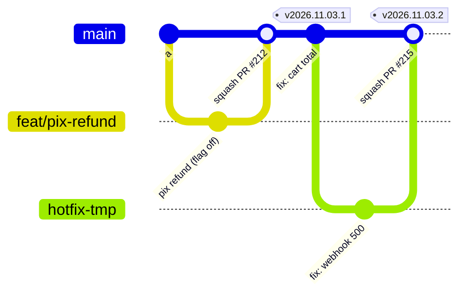

# Lời giải: chiến lược nhánh, phát hành và CODEOWNERS cho Olist Shop

Bài Advanced không có một đáp án duy nhất. Dưới đây là hướng làm, các quyết định cần cân nhắc, rubric, và một bài mẫu
đã chạy qua test (đặt `STRATEGY.md` và `CODEOWNERS` mẫu vào `starter/` thì `test_strategy_document` và
`test_codeowners` pass).

## Hướng làm

1. **Đếm số phiên bản đang chạy.** Olist Shop có một production, nên trunk-based là điểm xuất phát tự nhiên. Nhánh
   release chỉ còn lý do khi có thứ phát hành theo phiên bản (app mobile, SDK), và ở đây app mobile là repo khác: thứ
   nó cần là API tương thích ngược, không phải nhánh.
2. **Tách "deploy" khỏi "release".** Deploy là đưa code lên production (sau flag, tắt). Release là bật cho người dùng.
   Khi hai việc này tách nhau, deploy hằng ngày không còn đáng sợ, và QA chuyển từ "2 ngày trên nhánh release" thành
   test tự động cộng bật flag dần.
3. **Build once, promote many.** Một image cho mỗi commit trên `main`, cùng digest đi từ staging lên prod. Đây là cách
   trả lời câu "bản chạy ở prod có đúng là bản đã test không" mà auditor PCI sẽ hỏi.
4. **Tách quyền bằng environment, không bằng nhánh.** Required reviewers trên environment `production` (GitHub) hoặc
   protected environment (GitLab) ghi lại ai duyệt deploy nào, đúng thứ audit cần.
5. **Hotfix không đi đường tắt.** Sửa thẳng trên server là nguyên nhân của change failure rate và của việc không ai
   biết production đang chạy gì. Khôi phục bằng rollback hoặc tắt flag; bản sửa đi qua pipeline như mọi thay đổi khác.
6. **Migration theo expand/contract** (thêm cột mới, ghi cả hai, chuyển đọc, xoá cột cũ ở bản sau) là điều kiện để
   rollback ứng dụng không cần rollback database.

## Quyết định cần cân nhắc

| Quyết định | Phương án | Đánh đổi |
| --- | --- | --- |
| Cách merge | Squash / merge commit / rebase | Squash: lịch sử sạch, mất chi tiết nhánh. Merge commit: giữ chi tiết, bisect cần `--first-parent` |
| Cập nhật PR với `main` | Bắt buộc "up to date" / merge queue | Bắt buộc up to date: an toàn, tốn CI và thời gian khi nhiều PR. Merge queue: an toàn và nhanh, phụ thuộc gói (GitHub: repo public của organization, repo private cần Enterprise Cloud; GitLab: merge train ở gói Premium) |
| Người duyệt prod | Một người / hai người / tự động theo tiêu chí | Hai người an toàn hơn nhưng thành hàng chờ; tiêu chí tự động (error budget, canary) là đích dài hạn |
| Hotfix khi `main` có thay đổi chưa sẵn sàng | Flag / nhánh tạm từ tag | Flag giữ một đường duy nhất; nhánh tạm cần kỷ luật cherry-pick về `main` trước |
| Ai sở hữu CODEOWNERS | platform + security | Ai sửa được CODEOWNERS và workflow là sửa được luật, nên tệp đó phải có owner khắt khe nhất |

## Rubric (100 điểm)

| Tiêu chí | Điểm | Đạt đủ điểm khi |
| --- | --- | --- |
| Mô hình nhánh khớp ràng buộc | 15 | Chọn trunk-based (hoặc biện luận được lựa chọn khác) từ số phiên bản đang chạy và mục tiêu deploy hằng ngày; nói rõ thời gian sống của nhánh, cách merge, cách giấu việc dở dang |
| Promote artifact | 15 | Một artifact build một lần, promote cùng digest; khác biệt giữa môi trường nằm ở cấu hình; nói rõ ai/cái gì kích hoạt mỗi bước |
| Tách quyền và PCI | 15 | Required reviewers trên environment prod khác người viết; payments + security review code thanh toán qua CODEOWNERS; không ai bypass, kể cả admin |
| Hotfix | 15 | Khôi phục trước (rollback, flag), bản sửa vẫn qua pipeline; có phương án khi `main` chưa sẵn sàng; có postmortem; không còn sửa trên server |
| Ruleset cụ thể | 10 | Required checks có tên, chặn force-push và xoá, code owner review, bỏ duyệt cũ, merge queue hoặc up to date, bảo vệ tag |
| Migration và tương thích API | 10 | Expand/contract, giữ endpoint cũ 2 tuần, rollback ứng dụng không cần rollback DB |
| DORA | 10 | Có giá trị hiện tại, mục tiêu, và cách đo được từ dữ liệu có sẵn (lịch sử deploy, PR) cho ít nhất 3 chỉ số |
| Đánh đổi và tín hiệu xem lại | 10 | Nêu cái giá thật (nợ flag, nút cổ chai duyệt, mất lịch sử nhánh) và tín hiệu cụ thể để đổi hướng |

Trừ điểm: chọn GitFlow chỉ vì "an toàn hơn" mà không gắn với ràng buộc nào (−10); dùng nhánh theo môi trường
(`dev`/`staging`/`prod`) và build lại ở mỗi môi trường (−15); không bảo vệ CODEOWNERS và `.github/workflows` (−5).

## Bài mẫu: `CODEOWNERS`

```text
* @olist-shop/backend
/services/api/app/payments/ @olist-shop/payments @olist-shop/security
/services/api/migrations/ @olist-shop/backend @olist-shop/data
/analytics/ @olist-shop/data
/infra/ @olist-shop/platform
*.tf @olist-shop/platform
/deploy/ @olist-shop/platform
Dockerfile @olist-shop/backend @olist-shop/platform
/.github/ @olist-shop/platform @olist-shop/security
```

Dòng `*` đứng đầu, nên mọi dòng sau đè lên nó. `/.github/` đứng cuối nên `.github/CODEOWNERS` thuộc platform và
security. `Dockerfile` (không có `/`) khớp ở mọi thư mục; nếu cần owner khác cho một Dockerfile cụ thể, thêm một dòng
cụ thể hơn **sau** nó. GitHub chỉ áp CODEOWNERS khi team có quyền write trên repo, và review của code owner chỉ bắt
buộc khi ruleset bật "Require review from Code Owners".

## Bài mẫu: `STRATEGY.md`

`````markdown
# Chiến lược nhánh và phát hành cho Olist Shop

## 1. Bối cảnh và ràng buộc

Hiện trạng: nhánh `develop` và `release/*` kiểu GitFlow, deploy production thứ Năm hằng tuần, QA hai ngày trên nhánh
release, lead time khoảng 9 ngày, change failure rate 20%, hotfix hai lần mỗi tháng bằng cách sửa thẳng trên server.
Ràng buộc bắt buộc: code thanh toán thuộc phạm vi PCI DSS nên mọi thay đổi cần review của payments và security; deploy
production cần người duyệt khác người viết (tách quyền); migration phải tương thích ngược vì bản cũ và bản mới chạy
song song khi rolling deploy; app mobile cần API cũ chạy ít nhất 2 tuần. Mục tiêu: deploy hằng ngày trong hai quý mà
change failure rate không tăng.

## 2. Mô hình nhánh



Trunk-based: `main` là nhánh sống lâu duy nhất. Nhánh của PR sống dưới hai ngày, merge bằng squash để mỗi commit trên
`main` đã qua CI và mang tiêu đề PR theo Conventional Commits. Việc lớn (đổi cổng thanh toán) đi sau feature flag theo
kiểu branch by abstraction. Bỏ `develop` và `release/*`: một bản production nên không cần nhánh bảo trì. Mỗi commit trên
`main` build một image duy nhất, gắn tag theo SHA, và cùng image đó được promote qua các môi trường.

## 3. Đường đi tới dev, staging, prod

| Môi trường | Kích hoạt bởi | Artifact | Kiểm tra trước khi lên | Ai duyệt |
| --- | --- | --- | --- | --- |
| dev (preview mỗi PR) | Mở hoặc cập nhật PR | Image build từ commit của PR | Unit test, lint, quét secret, quét image | Không cần duyệt |
| staging | Merge vào `main` | Image `sha-<commit>` build một lần | Toàn bộ test, migration chạy thử trên bản sao dữ liệu, smoke test | Tự động |
| prod | Bấm duyệt trong environment `production` | Đúng digest image đã chạy ở staging | Staging xanh 30 phút, error budget còn | Một người trong platform hoặc backend, khác người merge |

## 4. Hotfix

1. Khôi phục trước: rollback về digest trước đó hoặc tắt flag, không chờ bản sửa.
2. Sửa trên nhánh ngắn từ `main`, PR có nhãn `hotfix`, vẫn qua required checks và review.
3. Merge, pipeline đưa lên staging rồi prod với người duyệt trực; không bỏ bước staging, chỉ rút thời gian quan sát.
4. Nếu `main` có thay đổi chưa sẵn sàng mà không giấu được bằng flag: cắt `release/hotfix-<ngày>` từ tag đang chạy, cherry-pick commit sửa từ `main`, xoá nhánh sau khi deploy.
5. Postmortem không đổ lỗi trong 5 ngày làm việc, thêm test bắt được lỗi đó.

## 5. Bảo vệ nhánh và rulesets

| Quy tắc | Áp dụng cho | Vì sao |
| --- | --- | --- |
| Bắt buộc PR, 1 review, review của code owner, bỏ duyệt cũ khi có commit mới | `main` | Không ai push thẳng; PCI cần payments và security duyệt code thanh toán |
| Required checks: test, lint, secret-scan, image-scan; nhánh phải cập nhật hoặc dùng merge queue | `main` | Mỗi commit trên main chạy được, bisect và rollback tin được |
| Chặn force-push và xoá nhánh, lịch sử thẳng (chỉ squash) | `main`, tag `v*` | Không viết lại lịch sử đã deploy |
| Environment `production` cần người duyệt khác người kích hoạt, chỉ deploy từ `main` | Deploy prod | Tách quyền theo PCI DSS |
| Không ai được bypass, kể cả admin; ngoại lệ ghi vào audit log | Toàn bộ ruleset | Quy tắc có ngoại lệ ngầm là không có quy tắc |

## 6. Đo bằng DORA

- Deployment frequency: từ 1 lần mỗi tuần lên ít nhất 1 lần mỗi ngày làm việc, đếm từ lịch sử deploy của environment `production`.
- Lead time for changes: từ khoảng 9 ngày xuống dưới 1 ngày, đo từ commit đầu tiên của PR tới lúc lên prod.
- Change failure rate: giữ dưới 15%, đếm deploy phải rollback hoặc hotfix.
- Failed deployment recovery time: dưới 1 giờ nhờ rollback bằng digest và flag.

## 7. Đánh đổi và khi nào xem lại

- Squash làm mất lịch sử chi tiết của nhánh; chấp nhận vì PR nhỏ, đổi lại lịch sử main sạch cho bisect và changelog.
- Feature flag là nợ: mỗi flag có chủ sở hữu và hạn xoá, xem lại hằng tháng.
- Một người duyệt prod có thể thành nút cổ chai; nếu thời gian chờ duyệt vượt 2 giờ, thêm người hoặc tự động hoá bằng tiêu chí.
- Xem lại khi có app phát hành theo phiên bản (cần nhánh release cho store) hoặc khi phải hỗ trợ nhiều phiên bản API song song lâu dài.
`````
