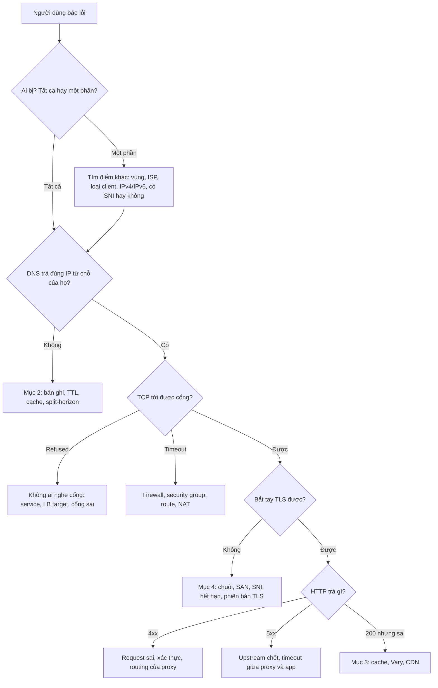
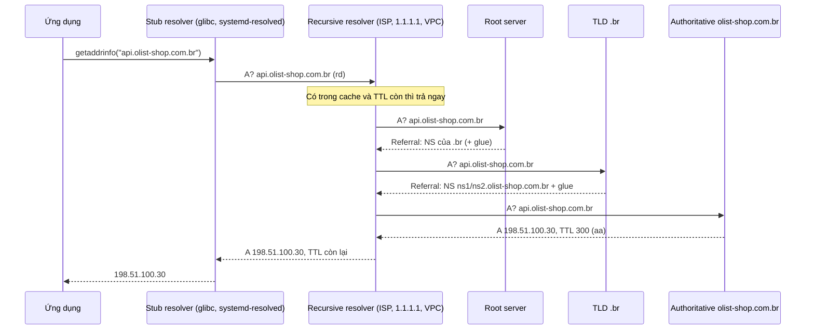
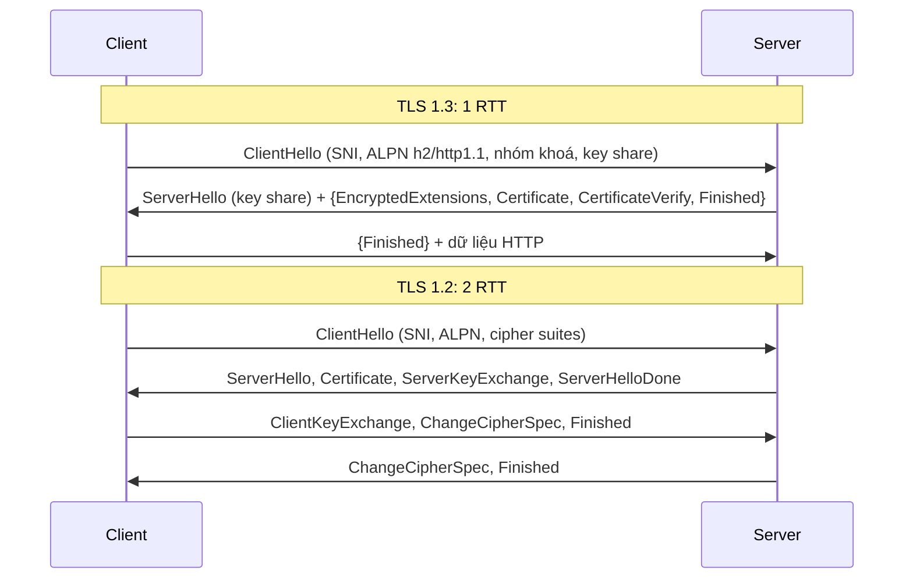
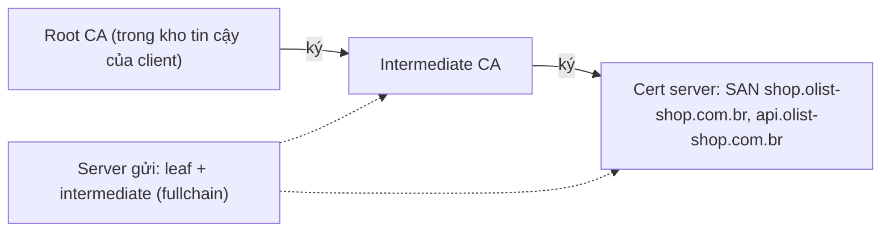
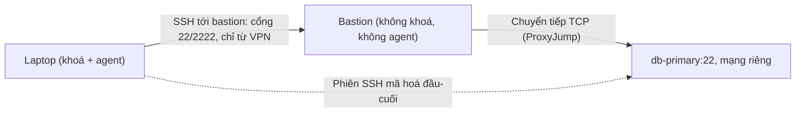
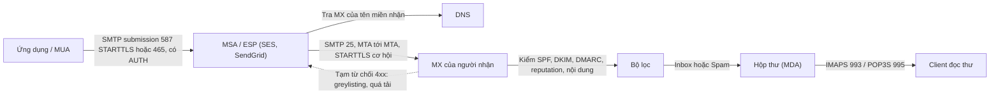

# Networking & protocols

Phần lớn sự cố "ứng dụng chết" mà DevOps engineer nhận được thật ra là sự cố giao thức: một bản ghi DNS sai hoặc còn
nằm trong cache, một cert thiếu intermediate, một CDN cache nhầm response có đăng nhập, một khoá SSH bị mượn qua bastion,
một luồng email marketing kéo theo thư đặt lại mật khẩu vào spam. Những lỗi này không nằm trong code ứng dụng, không có
stack trace, và thường chỉ xảy ra với **một phần** người dùng, nên người đọc được giao thức ở mức byte sẽ tìm ra trong vài
phút còn người khác mất vài giờ.

Track Data Engineer đã dạy mạng ở mức "pipeline gọi API được" (mục 1 nhắc lại). Module này đi tiếp ở góc của người vận
hành: các quyết định (TTL bao nhiêu, HTTP/2 hay HTTP/3, cert sống bao lâu, ai được đi qua bastion, gửi thư từ tên miền
nào), cái giá của từng lựa chọn, và cách đọc bằng chứng khi có sự cố.

Sau module này bạn sẽ:

- Khoanh vùng một sự cố mạng theo tầng, bằng đúng công cụ cho từng tầng.
- Đọc output `dig` và trả lời: tên có tồn tại không, ai trả lời, sửa xong bao lâu thì mọi người thấy; lập kế hoạch TTL
  cho một lần chuyển hạ tầng.
- Chọn HTTP/1.1, 2 hay 3 cho từng chặng; viết header cache đúng cho asset, API công khai và API có đăng nhập.
- Giải thích bắt tay TLS 1.2 và 1.3, dựng và kiểm một chuỗi CA, chẩn đoán lỗi chuỗi, SAN, SNI, hết hạn.
- Cấu hình SSH qua bastion an toàn, biết khi nào dùng SSH certificate; chọn giao thức truyền tệp với đối tác.
- Đọc header thư và nói vì sao nó pass hay fail DMARC; thiết kế SPF/DKIM/DMARC cho một tên miền mới và đưa nó tới
  `p=reject` mà không mất thư.

## 0. Cài đặt

Bài tập dùng `openssl` (bài Intermediate 03), `ssh` client (Basic 03), Mailpit (Intermediate 02), `bwrap` từ
[module 02](../02-scripting/README.md#0-cài-đặt) để chạy script của bạn trong sandbox, và `shellcheck` từ
[module 01](../01-linux-terminal/README.md#0-cài-đặt). `dig` **không** bắt buộc cho bài nào: các bài DNS chấm trên output
đã thu sẵn và zone file, chạy offline. `dig` là công cụ để bạn tự khám phá các lệnh trong mục 2.

| Công cụ | Phiên bản tham chiếu | Tối thiểu | Dùng ở |
| --- | --- | --- | --- |
| openssl | 3.0.13 (Ubuntu 24.04) | 1.1.1 (`-addext`, `-verify_hostname`) | Intermediate 03, mục 4 |
| OpenSSH client (`ssh`) | 9.6p1 (Ubuntu 24.04) | 8.0 | Basic 03, mục 5 |
| dig (BIND 9) | 9.18 (gói `bind9-dnsutils` của Ubuntu 24.04) | 9.16 | Mục 2 (tuỳ chọn, không bài nào cần) |
| Mailpit (image Docker) | `axllent/mailpit:v1.21.8` | Đúng bản ghim trong compose | Intermediate 02 |

### openssl và ssh

Có sẵn trên gần như mọi distro Linux. Kiểm:

```bash
openssl version && ssh -V
```

`openssl version` phải in `OpenSSL 1.1.1` trở lên (ví dụ `OpenSSL 3.0.13 30 Jan 2024`). Đừng gỡ hay thay `openssl` của
hệ thống: rất nhiều gói phụ thuộc vào nó. Distro quá cũ (CentOS 7 có 1.0.2) thì làm bài trong một máy hoặc container mới
hơn. macOS đi kèm LibreSSL (`openssl version` in `LibreSSL ...`), khác OpenSSL ở nhiều cờ: cài OpenSSL bằng Homebrew
(`brew install openssl@3`) và đặt đường dẫn của nó lên đầu `PATH` khi làm bài.

**Test không đọc cấu hình OpenSSL và kho CA của bạn.** Mọi lệnh `openssl` của bài chạy với `OPENSSL_CONF=/dev/null`,
`SSL_CERT_FILE`/`SSL_CERT_DIR` trỏ vào thư mục tạm, và `openssl verify -no-CApath`; client TLS trong test chỉ tin CA bạn
tạo. Tương tự, `ssh -G -F <tệp>` bỏ qua cả `/etc/ssh/ssh_config` lẫn `~/.ssh/config` của bạn.

### dig (tuỳ chọn)

`dig` nằm trong gói công cụ client của BIND. Cài bằng package manager của distro: gói được ký bằng khoá GPG của kho, `apt`
và `dnf` tự kiểm chữ ký và checksum trước khi cài, nên đây là đường cài có kiểm chứng (không cần tự tải binary):

```bash
sudo apt update && sudo apt install bind9-dnsutils && dig -v
```

Fedora, RHEL, Rocky: `sudo dnf install bind-utils && dig -v`. Debian 10 / Ubuntu 20.04 trở về trước tên gói là
`dnsutils`. `dig -v` in ra stderr dạng `DiG 9.18.30-0ubuntu0.24.04.2-Ubuntu`. Gỡ: `sudo apt remove bind9-dnsutils`
(hoặc `sudo dnf remove bind-utils`).

Không có quyền sudo: `getent hosts <tên>` (đi qua `/etc/hosts` và NSS như ứng dụng của bạn), hoặc dnspython có sẵn trong
môi trường của repo:

```bash
uv run python -c "import dns.resolver; print([r.to_text() for r in dns.resolver.resolve('example.com', 'MX')])"
```

### Mailpit

SMTP giả cho bài Intermediate 02, chạy bằng compose của repo (profile `devops`, ghim CPU theo `DEVOPS_CPUSET`, xem
[setup/DEVOPS-TOOLS.md](../../../../setup/DEVOPS-TOOLS.md)):

```bash
docker compose -f setup/docker-compose.yml --profile devops up -d mailpit &&
curl -fsS --retry 10 --retry-connrefused --retry-delay 1 http://localhost:18025/api/v1/info
```

SMTP ở `localhost:11025`, giao diện web và API ở `http://localhost:18025`; đổi cổng bằng `MAILPIT_SMTP_PORT`,
`MAILPIT_HTTP_PORT` trong `setup/.env`. Tắt khi xong:
`docker compose -f setup/docker-compose.yml --profile devops stop mailpit`. Gỡ hẳn container:
`docker compose -f setup/docker-compose.yml --profile devops rm -f mailpit`.

## 1. Nhắc lại và mô hình tầng: sự cố thật nằm ở đâu

Track Data Engineer đã dạy phần nền, đọc lại nếu cần:
[module 01, mục 5 Networking cho Data Engineer](../../../data-engineer/modules/01-foundations/README.md) (bốn tầng TCP/IP,
một request HTTPS đi qua DNS, TCP, TLS, HTTP; ý nghĩa của `Connection refused` và timeout; bảng mã HTTP cho pipeline;
retry có backoff và jitter). Công cụ chẩn đoán theo tầng (`ip`, `ss`, `mtr`, `nc`, `curl -w`, `tcpdump`) ở
[module 01 của track này, mục 5](../01-linux-terminal/README.md). Phần dưới chỉ thêm điều thay đổi khi bạn vận hành.

### OSI hay TCP/IP

OSI có 7 tầng, TCP/IP có 4. Trong công việc, người ta dùng **tên tầng của OSI** làm từ vựng ("L4 load balancer", "L7
proxy", "lỗi L2") nhưng hệ thống thật chạy theo TCP/IP:

| OSI | TCP/IP | Ví dụ | Sự cố thật hay gặp |
| --- | --- | --- | --- |
| 7 Application, 6 Presentation, 5 Session | Application | HTTP, DNS, SMTP, SSH, TLS (thường xếp ở đây) | Header sai, cert sai, cache sai, timeout ứng dụng |
| 4 Transport | Transport | TCP, UDP, QUIC (trên UDP) | Hết cổng nguồn khi NAT, `TIME_WAIT`, backlog `listen` đầy, keep-alive bị cắt im lặng |
| 3 Network | Internet | IP, ICMP, routing | Route sai, security group/NACL, MTU và PMTUD bị chặn ICMP, NAT gateway quá tải |
| 2 Data link, 1 Physical | Link | Ethernet, Wi-Fi, VLAN, ARP | Hiếm với cloud; trên bare metal: duplex sai, ARP cache cũ sau failover IP |

"L4 load balancer" chỉ nhìn IP và cổng (AWS NLB, IPVS, HAProxy chế độ TCP); "L7" đọc được HTTP (AWS ALB, Nginx, Envoy) nên
định tuyến theo đường dẫn, header, và **phải** có cert để kết thúc TLS. Đó là quyết định đầu tiên khi đặt một LB: cần đọc
request hay chỉ cần chia kết nối.

### Ba loại lỗi tầng thấp mà người làm ứng dụng ít nghĩ tới

- **MTU và PMTUD**: kết nối thiết lập được, request nhỏ chạy, request lớn (upload, response dài, bắt tay TLS với chuỗi cert
  lớn) treo. Thường gặp qua VPN, overlay network của container (VXLAN thêm 50 byte), khi ICMP "fragmentation needed" bị
  chặn. Thử bằng `ping -M do -s 1472 <host>` (1472 + 28 byte header = 1500).
- **Hết cổng nguồn ở NAT**: mỗi kết nối ra ngoài qua NAT gateway chiếm một cặp (IP nguồn, cổng nguồn) cho mỗi đích. Hàng
  nghìn worker không dùng connection pool gọi cùng một API sẽ cạn khoảng 64.000 cổng; triệu chứng là timeout ngẫu nhiên khi
  kết nối mới. Giải bằng pool và keep-alive, không bằng tăng timeout.
- **Kết nối nhàn rỗi bị cắt im lặng**: NAT, firewall, LB xoá trạng thái của kết nối TCP không có gói nào sau một khoảng
  (AWS NLB 350 giây, ALB mặc định 60 giây, nhiều firewall 1 giờ). Pool trong ứng dụng vẫn nghĩ kết nối còn sống, request
  đầu tiên sau đó lỗi `connection reset`. Giải bằng keep-alive ngắn hơn timeout của thiết bị giữa đường, hoặc kiểm kết
  nối trước khi dùng (`pool_pre_ping` của SQLAlchemy).

### Khoanh vùng theo tầng



Câu hỏi đầu tiên luôn là "ai bị và ai không". Sự cố chỉ một phần người dùng gặp gần như luôn nằm ở thứ khác nhau giữa hai
nhóm: resolver khác nhau (cache cũ), client khác nhau (mức khoan dung với cert), đường mạng khác nhau (IPv6, một vùng CDN).

## 2. DNS

### Bản ghi và quyết định đi kèm

| Bản ghi | Dùng cho | Quyết định / bẫy |
| --- | --- | --- |
| `A`, `AAAA` | Tên → IPv4, IPv6 | Có `AAAA` mà dịch vụ không nghe IPv6 là lỗi chỉ người dùng IPv6 gặp (client thử IPv6 trước) |
| `CNAME` | Tên → tên khác | Không được cùng tồn tại với bản ghi khác ở cùng tên, nên **không đặt ở apex** (apex luôn có SOA, NS). Dùng `ALIAS`/`ANAME`/CNAME flattening của nhà cung cấp, hoặc `A` alias của Route 53. CNAME trỏ tới tài nguyên đã xoá (bucket, app PaaS) là lỗ hổng subdomain takeover |
| `MX` | Máy nhận thư của tên miền | Trỏ tới tên có `A`/`AAAA`, không trỏ tới CNAME hay IP. Số nhỏ ưu tiên trước |
| `TXT` | SPF, DKIM, DMARC, xác minh tên miền | Mỗi chuỗi tối đa 255 byte, bản ghi dài tách thành nhiều chuỗi. Chỉ một bản ghi SPF mỗi tên |
| `NS` | Uỷ quyền zone | NS ở zone cha và zone con phải khớp; NS nằm trong zone con cần **glue** ở zone cha |
| `SOA` | Thông tin zone | Trường cuối (MINIMUM) điều khiển TTL của câu trả lời phủ định |
| `SRV` | Dịch vụ + cổng (`_sip._tcp`, LDAP, Kubernetes headless service) | Ít client HTTP hỗ trợ |
| `CAA` | CA nào được cấp cert cho tên miền | Đặt `0 issue "letsencrypt.org"` chặn CA khác cấp nhầm. CA bắt buộc kiểm CAA |
| `HTTPS`, `SVCB` | Quảng bá HTTP/3, ECH, và alias ở apex | Trình duyệt mới dùng để thử HTTP/3 ngay lần đầu |
| `PTR` | IP → tên (reverse DNS) | Do chủ dải IP (nhà cung cấp cloud) quản lý; máy chủ gửi thư cần PTR khớp HELO |

### Đường đi của một truy vấn



Có **nhiều tầng cache**: trong ứng dụng (JVM cache theo `networkaddress.cache.ttl`, có bản cũ cache vĩnh viễn), stub
resolver (`systemd-resolved`, `nscd`), recursive resolver, và cả trình duyệt. "Đã đổi DNS mà vẫn thấy IP cũ" thường là
một trong các tầng đó, không phải DNS "chưa lan truyền". DNS không lan truyền: mỗi cache hết hạn theo TTL lúc nó nhận câu
trả lời.

Lệnh để đọc từng chặng (mỗi dòng một lệnh độc lập):

| Lệnh | Trả lời câu hỏi |
| --- | --- |
| `dig +short api.olist-shop.com.br A` | Resolver mặc định của máy đang trả gì |
| `dig api.olist-shop.com.br A @1.1.1.1` | Một resolver cụ thể trả gì; so nhiều resolver để biết thay đổi đã tới đâu |
| `dig +norecurse @ns1.olist-shop.com.br api.olist-shop.com.br A` | Authoritative đang có gì, bỏ qua mọi cache: sự thật hiện tại |
| `dig +trace api.olist-shop.com.br` | Đi từ root xuống, delegation đứt ở chặng nào |
| `dig -x 203.0.113.25` | Reverse DNS (PTR) của một IP, quan trọng với máy gửi thư |

Bài Basic 01 luyện đọc output của các lệnh này.

### TTL: chiến lược cho một lần chuyển hạ tầng

TTL là đánh đổi giữa tốc độ thay đổi và độ bền: TTL cao giảm tải lên authoritative, giảm độ trễ, và giữ dịch vụ chạy khi
nhà cung cấp DNS gặp sự cố (resolver còn cache); TTL thấp cho phép đổi nhanh và failover bằng DNS.

| Bản ghi | TTL thường dùng | Vì sao |
| --- | --- | --- |
| NS, MX, bản ghi ít đổi | 3600–86400 | Ổn định, chịu được sự cố của nhà cung cấp DNS |
| A/AAAA/CNAME của dịch vụ | 300–3600 | Đủ nhanh để đổi có kế hoạch |
| Bản ghi dùng cho failover bằng DNS | 30–60 | Đổi nhanh; nhiều client vẫn không tôn trọng, nên failover DNS không thay được health check của LB |
| `_dmarc`, `_acme-challenge` trong lúc thay đổi | 60–300 | Lùi được nhanh |

Quy trình chuyển `api` sang hạ tầng mới:

1. Ít nhất **một TTL cũ** trước giờ chuyển (TTL 86400 thì từ hôm trước), hạ TTL xuống 60–300.
2. Hạ tầng mới chạy song song, kiểm bằng `curl --resolve api.olist-shop.com.br:443:<IP mới> https://...` trước khi đổi
   DNS.
3. Đổi bản ghi. Theo dõi lưu lượng ở **cả hai** nơi: hạ tầng cũ phải giảm dần về gần 0.
4. Giữ hạ tầng cũ chạy ít nhất bằng TTL cũ, lâu hơn nếu có client không tôn trọng TTL. Nâng TTL lại khi ổn định.

### Câu trả lời phủ định và negative caching

`NXDOMAIN` là "tên không tồn tại"; **NODATA** là `NOERROR` không có câu trả lời: "tên có, nhưng không có loại bản ghi
này" (ví dụ có `A` mà không có `AAAA`). Cả hai đều được cache, trong `min(TTL của SOA, MINIMUM của SOA)` (RFC 2308). Hệ
quả vận hành: nếu ai đó (hay health check) hỏi một tên **trước khi** bạn tạo nó, resolver sẽ trả NXDOMAIN tới hết thời gian
đó dù bạn đã tạo bản ghi. Với `MINIMUM` 86400 là một ngày. Giữ MINIMUM ở 300–3600.

### Split-horizon, DNS nội bộ và container

- **Split-horizon**: cùng một tên trả IP khác nhau cho client trong và ngoài mạng (Route 53 private hosted zone, view của
  BIND). Lợi: không lộ IP nội bộ, đi đường ngắn. Hại: "trên máy tôi được" vì máy bạn đang ở trong VPN; khó gỡ lỗi. Luôn ghi
  rõ một tên được trả lời bởi những zone nào.
- **Resolver trong container và Kubernetes**: `/etc/resolv.conf` của pod có `search <ns>.svc.cluster.local svc.cluster.local
  cluster.local` và `ndots:5`. Một tên có ít hơn 5 dấu chấm như `api.olist-shop.com.br` (3 dấu) bị thử lần lượt với từng
  search domain trước, mỗi lần cho cả A và AAAA: một lần gọi API thành 8 truy vấn, CoreDNS quá tải. Viết FQDN có dấu chấm
  cuối (`api.olist-shop.com.br.`) hoặc giảm `ndots` cho pod gọi ra ngoài nhiều (module 10).
- **DNSSEC** ký các bản ghi để resolver kiểm được tính toàn vẹn. Lợi ích chống giả mạo cache; cái giá là thêm một cách làm
  sập tên miền: đổi nhà cung cấp DNS hay xoay khoá mà quên cập nhật bản ghi `DS` ở registrar thì mọi resolver có validate
  trả `SERVFAIL` (bài Basic 01, fixture `servfail_dnssec.txt`).

### So sánh nhà cung cấp DNS

| Lựa chọn | Mạnh | Yếu | Hay gặp ở |
| --- | --- | --- | --- |
| Route 53 | Alias ở apex, health check, private zone, IaC tốt | Chỉ trong AWS mới phát huy hết | Công ty chạy trên AWS |
| Cloudflare DNS | Nhanh, miễn phí, CNAME flattening, gắn với CDN/WAF | Proxy mặc định đổi IP trả về, dễ nhầm khi gỡ lỗi | Startup, site công khai |
| Cloud DNS (GCP), Azure DNS | Tích hợp cloud tương ứng | Tính năng ít hơn | Công ty theo cloud đó |
| NS1, Akamai Edge DNS | Định tuyến theo lưu lượng, nhiều nhà cung cấp song song | Đắt | Quy mô lớn, cần multi-provider |
| BIND, PowerDNS, CoreDNS tự vận hành | Toàn quyền, DNS nội bộ, split-horizon | Tự vá, tự chống DDoS | DNS nội bộ, Kubernetes (CoreDNS) |

Quản lý bản ghi bằng IaC (OpenTofu provider của nhà cung cấp, octoDNS, DNSControl) để có review và lịch sử: một bản ghi
sửa tay trên console là một sự cố đang chờ.

## 3. HTTP: phiên bản, cache và những mã trạng thái quan trọng với vận hành

### HTTP/1.1, HTTP/2, HTTP/3

| | HTTP/1.1 | HTTP/2 | HTTP/3 |
| --- | --- | --- | --- |
| Vận chuyển | TCP (+TLS) | TCP + TLS (trình duyệt đòi TLS, ALPN `h2`) | QUIC trên UDP, TLS 1.3 tích hợp |
| Song song | Một request mỗi lúc trên một kết nối; trình duyệt mở ~6 kết nối mỗi host | Nhiều stream multiplex trên một kết nối | Như HTTP/2, stream độc lập |
| Head-of-line blocking | Ở tầng HTTP | Hết ở HTTP, **còn ở TCP**: một gói mất làm mọi stream chờ | Không: mất gói chỉ ảnh hưởng stream đó |
| Header | Text, lặp lại mỗi request | Nhị phân, nén HPACK | Nén QPACK |
| Thiết lập kết nối | TCP + TLS: 2–3 RTT | Như HTTP/1.1 | 1 RTT, 0-RTT khi nối lại (có rủi ro replay) |
| Đổi mạng (Wi-Fi sang 4G) | Kết nối mới | Kết nối mới | Connection ID giữ phiên |
| Hợp ở | Chặng proxy ↔ backend đơn giản, công cụ cũ | Mặc định cho trình duyệt ↔ edge, và gRPC | Mobile, mạng mất gói, người dùng xa |

Quyết định thật thường là theo **chặng**: client → CDN/LB dùng HTTP/2 và HTTP/3 (bật trên CDN là xong), LB → backend vẫn
HTTP/1.1 với keep-alive (đơn giản, dễ gỡ lỗi), trừ gRPC cần HTTP/2 cả đường. Bật HTTP/3 không làm mất ai: trình duyệt chỉ
thử QUIC sau khi thấy `Alt-Svc` hoặc bản ghi `HTTPS`, và rơi về TCP khi UDP 443 bị chặn. Cái giá của HTTP/3: tốn CPU hơn ở
server (mã hoá trong user space), khó quan sát hơn (`tcpdump` không còn đọc được gì), một số firewall doanh nghiệp chặn.

### Mã trạng thái mà người trực ca phải phân biệt

| Mã | Ai sinh ra | Đọc là |
| --- | --- | --- |
| 301 / 308 | App, proxy | Chuyển vĩnh viễn, trình duyệt cache lâu: một 301 sai rất khó rút lại. 308 giữ nguyên method (POST vẫn là POST) |
| 302 / 307 | App | Tạm thời; 307 giữ method |
| 304 | App, cache | Không đổi, dùng bản cache (sau `If-None-Match`/`If-Modified-Since`) |
| 401 / 403 | App, gateway | Chưa xác thực / không có quyền. 403 từ CDN hoặc WAF thường là luật chặn, không phải app |
| 404 | App, proxy | Nếu chỉ sau deploy: route mới, đường dẫn proxy (`proxy_pass` thiếu `/`, module 05) |
| 408 | Server | Client gửi request quá chậm |
| 413 / 414 / 431 | Proxy | Body, URL, header quá lớn: giới hạn của Nginx/LB (`client_max_body_size`), không phải app |
| 429 | App, gateway | Rate limit; tôn trọng `Retry-After` |
| 499 | Nginx (không chuẩn) | Client đóng kết nối trước khi có response: client timeout ngắn hơn thời gian xử lý |
| 500 | App | Bug, exception |
| 502 | Proxy | Upstream trả rác, đóng kết nối, hoặc không kết nối được |
| 503 | Proxy, app | Không có upstream khoẻ, hoặc app tự báo quá tải/bảo trì |
| 504 | Proxy | Upstream không trả lời trong timeout của proxy |

Ba mã 502, 503, 504 nói **chặng nào** hỏng: proxy vẫn sống và đang báo về upstream của nó. Đọc thêm log của proxy
(`upstream_status`, `upstream_response_time` trong Nginx) để biết upstream nào.

### Cache

Một response đi qua nhiều cache: trình duyệt (riêng), CDN và reverse proxy (dùng chung). `Cache-Control` là hợp đồng giữa
server và mọi cache đó:

| Loại nội dung | Header gợi ý | Vì sao |
| --- | --- | --- |
| Asset có hash trong tên (`app.3f9a1c.js`) | `public, max-age=31536000, immutable` | Tên đổi khi nội dung đổi, nên cache mãi được |
| HTML trỏ tới asset | `no-cache` + `ETag` | Luôn hỏi lại, nhận 304 khi không đổi: deploy có hiệu lực ngay |
| API công khai (danh mục sản phẩm) | `public, max-age=60, s-maxage=600` + `stale-while-revalidate=30` | CDN chịu tải, trình duyệt thấy dữ liệu khá mới |
| API có đăng nhập | `private, no-store` hoặc `private, max-age=...` | Cache dùng chung không bao giờ được giữ dữ liệu của một người |
| Thanh toán, checkout | `no-store` | Không lưu ở đâu cả |

Hai lỗi kinh điển: CDN cấu hình "cache mọi thứ" bỏ qua `Authorization` hay `Set-Cookie` và trả trang của người này cho
người khác; và quên `Vary` khi response khác nhau theo `Accept-Encoding` hay `Accept-Language`. Header `Age` và
`X-Cache`/`CF-Cache-Status` cho biết response đến từ cache hay từ origin. Bài Basic 02 luyện đọc các quy tắc này trên
transcript `curl -v`.

### Kết nối, timeout và proxy

- **Keep-alive và connection pool** ở mọi chặng: client → LB, LB → backend. Thiếu nó, mỗi request trả thêm bắt tay TCP
  và TLS, và NAT cạn cổng (mục 1).
- **Timeout phải giảm dần từ ngoài vào trong**: client 30s > LB 25s > app 20s > DB 15s. Ngược lại, lớp ngoài bỏ cuộc trước
  trong khi lớp trong vẫn làm (Nginx ghi 499, DB vẫn chạy query).
- **Header của proxy**: `X-Forwarded-For`, `X-Forwarded-Proto`, chuẩn mới `Forwarded`. App chỉ được tin header này từ
  proxy của mình (danh sách IP tin cậy), nếu không client tự đặt `X-Forwarded-For` để giả IP và vượt rate limit.

## 4. TLS và chứng chỉ

### Bắt tay TLS 1.2 và 1.3



| | TLS 1.2 | TLS 1.3 |
| --- | --- | --- |
| Số vòng bắt tay | 2 RTT | 1 RTT, 0-RTT khi nối lại |
| Trao đổi khoá | RSA (không forward secrecy) hoặc ECDHE | Chỉ (EC)DHE: luôn forward secrecy |
| Cipher | Rất nhiều tổ hợp, có cái yếu (CBC, RC4, 3DES) | 5 suite AEAD |
| Cert gửi đi | Dạng rõ | Mã hoá |
| Ghi chú vận hành | Vẫn cần cho client cũ (Android < 10 với một số thư viện, Java 8 cũ, thiết bị nhúng) | Mặc định nên bật; 0-RTT chỉ cho request idempotent |

Cấu hình hợp lý hôm nay: bật TLS 1.2 và 1.3, tắt 1.0/1.1 (trình duyệt đã bỏ từ 2020), dùng bộ cipher "intermediate" của
Mozilla SSL Configuration Generator. **SNI** (Server Name Indication) là tên host client gửi trong `ClientHello` để server
có nhiều cert trên cùng IP chọn đúng cert; client không gửi SNI (thiết bị rất cũ, một số script) nhận cert của
`default_server` (bài Advanced 01).

### Chuỗi chứng chỉ, SAN và lý do "trình duyệt được mà curl không"



- Client chỉ có **root**. Server phải gửi leaf **và** intermediate. Thiếu intermediate: trình duyệt desktop và iOS thường
  tự bù (tải theo URL AIA trong cert, cache intermediate đã gặp), còn OpenSSL (curl, Python), Java, Android thì báo
  `unable to get local issuer certificate`. Kiểm sau mỗi lần đổi cert bằng client nghiêm ngặt, không bằng trình duyệt.
- **SAN** (subjectAltName) là nơi duy nhất client hiện đại đọc tên host; CN bị bỏ qua. Wildcard `*.olist-shop.com.br` khớp
  đúng một nhãn: không khớp `olist-shop.com.br` cũng không khớp `a.b.olist-shop.com.br`.
- **Thu hồi**: CRL (danh sách tải về) và OCSP (hỏi CA từng cert) đều chậm và hay bị bỏ qua khi lỗi mạng (soft-fail).
  **OCSP stapling** để server tự gắn phản hồi OCSP vào bắt tay. Xu hướng hiện tại đi theo hướng ngược: cert sống ngắn để
  thu hồi bớt quan trọng; Let's Encrypt đã dừng OCSP năm 2025 và chỉ còn CRL, CA/Browser Forum đã thông qua lộ trình rút
  thời hạn tối đa của cert công khai xuống 47 ngày vào năm 2029.

### ACME và Let's Encrypt

ACME (RFC 8555) tự động hoá việc chứng minh quyền kiểm soát tên miền và cấp cert:

| Challenge | Cách chứng minh | Hợp khi | Không làm được |
| --- | --- | --- | --- |
| HTTP-01 | Đặt tệp ở `http://<tên>/.well-known/acme-challenge/` qua cổng 80 | Web server công khai, một máy | Wildcard; máy không mở cổng 80 ra Internet |
| DNS-01 | Tạo TXT `_acme-challenge.<tên>` | Wildcard, máy nội bộ, nhiều LB | Cần API của nhà cung cấp DNS; khoá API đó rất nhạy cảm |
| TLS-ALPN-01 | Trả cert đặc biệt trên cổng 443 | Chỉ mở 443 | Wildcard; nhiều proxy không hỗ trợ |

Công cụ: certbot, lego, acme.sh (máy đơn), Caddy (web server tự làm ACME), cert-manager (Kubernetes), Traefik. Cert
công khai từ Let's Encrypt sống 90 ngày; quy trình đúng là **gia hạn tự động khi còn khoảng 1/3 thời hạn, và giám sát
bằng một client thật** chứ không chỉ đọc ngày hết hạn. Cert nội bộ (service-to-service, mTLS) dùng CA riêng: step-ca,
Vault PKI, AWS Private CA, hoặc service mesh tự cấp (module 15). Bài Intermediate 03 dựng một CA như vậy bằng `openssl`.

### Bộ lệnh `openssl` khi có sự cố

Mỗi dòng là một lệnh độc lập; thêm `</dev/null` sau các lệnh `s_client` để chúng thoát ngay sau bắt tay.

| Lệnh | Để làm gì |
| --- | --- |
| `openssl s_client -connect api.olist-shop.com.br:443 -servername api.olist-shop.com.br -showcerts` | Xem chuỗi server gửi, đếm cert trong `Certificate chain` |
| `openssl s_client -connect api.olist-shop.com.br:443 -servername api.olist-shop.com.br -verify_return_error -verify_hostname api.olist-shop.com.br` | Bắt tay như một client nghiêm ngặt; lỗi thì exit khác 0, dùng được trong script |
| `openssl s_client -connect api.olist-shop.com.br:443 -noservername` | Cert trả cho client không gửi SNI |
| `openssl x509 -in server.crt -noout -subject -issuer -dates -ext subjectAltName,keyUsage,extendedKeyUsage` | Đọc các trường quan trọng của một cert (`-ext` cần OpenSSL 1.1.1+) |
| `openssl verify -CAfile root.crt -untrusted intermediate.crt -verify_hostname api.olist-shop.com.br server.crt` | Kiểm chuỗi và tên offline, trước khi deploy |
| `openssl x509 -in server.crt -noout -checkend 2592000` | Exit 1 nếu cert hết hạn trong 30 ngày tới |

| Thông báo | Nghĩa | Thường do |
| --- | --- | --- |
| `unable to get local issuer certificate` | Không dựng được chuỗi tới root tin cậy | Server thiếu intermediate; client thiếu root (CA nội bộ chưa cài); proxy công ty chặn TLS |
| `certificate has expired` | Hết hạn, của leaf hoặc **intermediate/root** | Gia hạn hỏng; đồng hồ client sai; client cũ không biết root mới (sự kiện root DST Root CA X3 hết hạn 2021) |
| `hostname mismatch` / `doesn't match` | Tên gọi không có trong SAN | Thiếu SAN; client không gửi SNI nhận cert mặc định; gọi bằng IP |
| `self signed certificate in certificate chain` | Gặp root không tin | CA nội bộ hoặc proxy kiểm tra TLS của công ty |
| `wrong version number` | Nói TLS với cổng không phải TLS | Gọi `https://` vào cổng HTTP thường, hoặc ngược lại |
| `handshake failure`, `no shared cipher` | Không có phiên bản hoặc cipher chung | Client quá cũ hoặc server cấu hình quá chặt |

## 5. SSH và truyền tệp

### Khoá, agent và bastion

- **Khoá**: dùng `ed25519` (`ssh-keygen -t ed25519 -C "ten@olist"`), có passphrase, mỗi người một khoá, mỗi mục đích một
  khoá (người, CI deploy, GitHub). RSA chỉ khi máy đích quá cũ, và tối thiểu 3072 bit.
- **Agent** giữ khoá đã mở khoá trong bộ nhớ. **Agent forwarding** (`ssh -A`, `ForwardAgent yes`) tạo một socket trên máy
  đích mà bất kỳ ai có root ở đó dùng được để xác thực **bằng khoá của bạn** chừng nào phiên còn mở. Không bao giờ bật mặc
  định; nếu buộc phải dùng, giới hạn bằng `ssh-add -c` (hỏi xác nhận mỗi lần dùng).
- **ProxyJump** (`ssh -J bastion target`, `ProxyJump` trong `ssh_config`) thay cho agent forwarding: bastion chỉ chuyển
  tiếp luồng TCP, phiên tới đích được mã hoá đầu-cuối. Bài Basic 03.
- **Port forwarding**: `-L 5433:db-primary:5432` (đưa cổng DB về máy mình qua bastion), `-R` (mở cổng trên máy xa trỏ về
  máy mình: thứ mà bastion nên cấm), `-D 1080` (SOCKS proxy). Trên bastion, cho phép đúng thứ cần: `AllowTcpForwarding`,
  `PermitOpen`, `GatewayPorts no`.



### SSH certificate và thay thế bastion

Với vài chục máy, `authorized_keys` phát bằng Ansible còn chịu được. Lớn hơn, hoặc khi người vào ra liên tục, dùng **SSH
certificate**: một CA SSH ký public key của người dùng kèm danh tính, principal (user được phép) và thời hạn vài giờ; server
chỉ cần `TrustedUserCAKeys`. Thu hồi bằng cách để hết hạn. Host certificate (`@cert-authority` trong `known_hosts`) bỏ luôn
câu hỏi "có tin host key này không" mỗi lần dựng máy mới. Công cụ: Vault SSH secrets engine, step-ca, Teleport.

Nhiều tổ chức bỏ hẳn bastion SSH: AWS SSM Session Manager, GCP IAP, Azure Bastion, Teleport, Tailscale SSH. Lợi: không mở
cổng 22, đăng nhập bằng SSO, audit từng lệnh. Cái giá: phụ thuộc nhà cung cấp, khó dùng với công cụ chỉ biết SSH thuần
(một số cần cấu hình `ProxyCommand`).

Phía server, một baseline tối thiểu (kiểm bằng `sshd -T`): `PermitRootLogin no`, `PasswordAuthentication no`,
`KbdInteractiveAuthentication no`, `MaxAuthTries 3`, `AllowGroups` giới hạn ai được vào, `AllowAgentForwarding no` và
`X11Forwarding no` trừ khi cần. Đổi cổng 22 chỉ giảm log rác, không phải biện pháp bảo mật.

### Truyền tệp: FTP, FTPS, SFTP, SCP, rsync

| Giao thức | Vận chuyển | Mã hoá | Cổng và firewall | Dùng khi |
| --- | --- | --- | --- | --- |
| FTP | Hai kết nối TCP: điều khiển 21, dữ liệu cổng động | Không: lộ mật khẩu | Khó: chế độ active/passive, cần helper ở NAT | Không dùng mới; chỉ khi hệ thống cũ bắt buộc, trong mạng kín |
| FTPS (FTP + TLS) | Như FTP, explicit (`AUTH TLS` trên 21) hoặc implicit (990) | Có | Khó hơn FTP: helper không đọc được lệnh đã mã hoá, phải mở dải passive cố định | Đối tác, ngân hàng, hệ thống EDI đòi FTPS |
| SFTP | Subsystem của SSH, một kết nối | Có | Dễ: một cổng | Mặc định cho trao đổi tệp với đối tác; chroot được (`internal-sftp`) |
| SCP | Giao thức cũ trên SSH | Có | Một cổng | OpenSSH 9.0+ cho `scp` chạy bằng giao thức SFTP bên dưới; giao thức SCP cũ có lỗi thiết kế, tránh dùng với server lạ |
| rsync qua SSH | rsync trên SSH | Có | Một cổng | Đồng bộ thư mục lớn, chỉ gửi phần thay đổi |
| HTTPS (upload, pre-signed URL S3) | HTTP | Có | 443 | Đối tác có API; không cần tài khoản hệ thống |

Lựa chọn thực tế: SFTP với khoá cho đối tác truyền tệp định kỳ; pre-signed URL S3 khi có thể bỏ hẳn máy chủ tệp; FTPS
khi bên kia không có lựa chọn khác. Dịch vụ quản lý: AWS Transfer Family (SFTP/FTPS vào S3), Azure Blob SFTP.

## 6. Email: SMTP, IMAP, POP3 và khả năng tới hộp thư

### Thư đi từ đâu tới đâu



| Giao thức | Cổng | Dùng cho |
| --- | --- | --- |
| SMTP | 25 | MTA tới MTA. Cloud thường chặn chiều ra; ứng dụng không gửi trực tiếp qua đây |
| SMTP submission | 587 (STARTTLS), 465 (TLS ngay từ đầu, RFC 8314 khuyến nghị) | Ứng dụng và người dùng gửi thư, bắt buộc xác thực |
| IMAP / IMAPS | 143 / 993 | Đọc thư, trạng thái trên server, nhiều thiết bị |
| POP3 / POP3S | 110 / 995 | Tải thư về một máy; hiếm dùng mới |

Mã trả lời SMTP: `2xx` thành công, `4xx` **tạm thời** (người gửi phải thử lại, thường trong vài giờ tới vài ngày), `5xx`
**vĩnh viễn** (bounce). Một hệ thống gửi thư đúng xử lý bounce: địa chỉ hard bounce (`550 5.1.1 user unknown`) bị gỡ khỏi
danh sách, nếu không reputation tụt dần. Bài Intermediate 02 gửi thư thật qua SMTP vào Mailpit.

### SPF, DKIM, DMARC

Ba cơ chế trả lời ba câu hỏi khác nhau, và chỉ DMARC nhìn vào header `From` mà người đọc thấy:

| | Kiểm gì | Gắn với tên miền nào | Gãy khi |
| --- | --- | --- | --- |
| SPF (RFC 7208) | IP gửi có nằm trong danh sách được phép của tên miền | Envelope sender (`MAIL FROM`, thành `Return-Path`), hoặc HELO khi bounce | Thư bị forward (IP đổi). Bản ghi quá 10 lượt tra DNS là `permerror` |
| DKIM (RFC 6376) | Chữ ký trên header và body, khoá công khai ở `<selector>._domainkey.<d>` | Tên miền `d=` trong chữ ký | Nội dung bị sửa (mailing list thêm footer, sửa subject); khoá bị gỡ khỏi DNS sớm |
| DMARC (RFC 7489) | SPF **hoặc** DKIM pass **và** aligned với tên miền trong `From` | `From` | Cả hai chân đều không aligned |

**Alignment**: relaxed (mặc định) cần cùng organizational domain (`bounces.olist-shop.com.br` khớp
`olist-shop.com.br`); strict cần trùng khít. Organizational domain tính theo Public Suffix List: `olist-shop.com.br`, không
phải `com.br`. Chính sách: `p=none` (chỉ báo cáo), `quarantine` (spam), `reject`; `sp=` cho tên miền con, `pct=` để áp cho
một phần thư (phần còn lại hạ một bậc), `rua=` nhận báo cáo aggregate hằng ngày từ Gmail, Microsoft, Yahoo.

Những gì hay bị hiểu sai:

- SPF pass không có nghĩa thư hợp lệ: kẻ tấn công đặt SPF cho tên miền của chính họ ở `Return-Path` rồi giả `From`.
- DMARC không chống tên miền na ná (`olist-shop-br.com`): tên miền đó có DMARC pass cho **chính nó**.
- `Authentication-Results` chỉ đáng tin khi do MX của bạn ghi (header trên cùng, đúng authserv-id).
- Forward làm SPF gãy; DKIM aligned là chân bền hơn. ARC (RFC 8617) cho phép máy trung gian (mailing list) chuyển tiếp kết
  quả xác thực ban đầu cho người nhận cân nhắc.

Bài Intermediate 01 đi lại đúng các bước này trên 13 thư; bài Advanced 02 thiết kế cấu hình cho một tên miền mới.

### Bảo vệ đường truyền: MTA-STS và TLS-RPT

STARTTLS giữa các MTA là **cơ hội**: kẻ đứng giữa xoá dòng `STARTTLS` khỏi phản hồi `EHLO` là thư đi dạng rõ. MTA-STS
(RFC 8461) cho tên miền nhận công bố "chỉ gửi cho tôi qua TLS có cert hợp lệ tới các MX này" (TXT `_mta-sts` + tệp policy
qua HTTPS); TLS-RPT (RFC 8460) gửi báo cáo khi bên gửi không thiết lập được TLS. Bắt đầu `mode: testing`, đọc báo cáo,
rồi mới `enforce`.

### Whitelist, greylist, blacklist và khả năng tới hộp thư

- **Greylisting**: lần đầu gặp bộ (IP, người gửi, người nhận), trả `451` tạm thời; MTA thật thử lại sau vài phút và được
  nhận, bot spam thì không. Cái giá là thư đầu trễ, rất tệ cho OTP. Khi gửi: dùng ESP có reputation và dải IP ổn định.
- **Blacklist (DNSBL/RBL)** như Spamhaus: máy nhận tra IP gửi trong một zone DNS đặc biệt. Bị liệt kê thì thư bị từ chối
  `5xx`. Kiểm khi bounce tăng đột ngột; gỡ theo quy trình của từng danh sách sau khi đã sửa nguyên nhân.
- **Whitelist**: đối tác quan trọng cho IP hoặc tên miền của bạn đi thẳng qua bộ lọc (và qua greylisting).
- **Reputation** gắn với IP và **tên miền**. Tên miền và IP mới phải **warm-up**: tăng lượng gửi dần trong vài tuần. Tách
  luồng marketing sang tên miền con (`news.`) để khiếu nại spam không kéo theo thư giao dịch.
- **Yêu cầu của Gmail và Yahoo từ 02/2024** cho người gửi trên 5.000 thư/ngày: SPF và DKIM, DMARC tối thiểu `p=none` với
  `From` aligned, hủy đăng ký một chạm (`List-Unsubscribe-Post`, RFC 8058) xử lý trong 2 ngày, spam rate dưới 0,3% (nên
  giữ dưới 0,1%), PTR khớp cho IP gửi, TLS khi gửi.
- **Giám sát**: Google Postmaster Tools, Microsoft SNDS, báo cáo DMARC aggregate, tỉ lệ bounce và complaint từ webhook của
  ESP.

### Chọn công cụ gửi và kiểm thử thư

| Công cụ | Loại | Mạnh | Yếu | Hợp với |
| --- | --- | --- | --- | --- |
| Amazon SES | ESP hạ tầng | Rẻ, API và SMTP, custom MAIL FROM, Easy DKIM | Tự làm template, xử lý bounce qua SNS; tài khoản mới ở sandbox | Thư giao dịch trên AWS |
| SendGrid, Mailgun, Brevo | ESP đầy đủ | Template, marketing, analytics, IP riêng | Đắt khi lớn, reputation IP dùng chung | Marketing + giao dịch |
| Postmark | ESP giao dịch | Tốc độ và tỉ lệ vào inbox cao, tách luồng rõ | Không cho marketing hàng loạt trên luồng giao dịch | Thư giao dịch quan trọng |
| Postfix / Exim tự vận hành | MTA | Toàn quyền, rẻ ở quy mô lớn | Tự lo reputation, PTR, blacklist, vá bảo mật; cloud chặn cổng 25 | Relay nội bộ, tổ chức có team email |
| Mailpit, MailHog, smtp4dev | SMTP giả | Bắt mọi thư ở dev/CI, có API để test | Không gửi thật | Môi trường dev, test tự động (MailHog không còn phát triển; Mailpit thay thế) |

## 7. Tài liệu tham khảo

- [roadmap.sh/devops](https://roadmap.sh/devops): mục Networking & Protocols (OSI, DNS, HTTP, HTTPS, SSL/TLS, SSH, FTP/SFTP,
  SMTP, IMAP, POP3S, DMARC, SPF, DKIM, White/Grey Listing).
- Cloudflare Learning Center: [What is DNS](https://www.cloudflare.com/learning/dns/what-is-dns/),
  [OSI model](https://www.cloudflare.com/learning/ddos/glossary/open-systems-interconnection-model-osi/),
  [What happens in a TLS handshake](https://www.cloudflare.com/learning/ssl/what-happens-in-a-tls-handshake/),
  [HTTP/3](https://www.cloudflare.com/learning/performance/what-is-http3/).
- DNS: [RFC 1034](https://www.rfc-editor.org/rfc/rfc1034), [RFC 1035](https://www.rfc-editor.org/rfc/rfc1035),
  [RFC 2308 (negative caching)](https://www.rfc-editor.org/rfc/rfc2308),
  [RFC 6604 (rcode với CNAME)](https://www.rfc-editor.org/rfc/rfc6604),
  [RFC 8914 (Extended DNS Errors)](https://www.rfc-editor.org/rfc/rfc8914),
  [RFC 9460 (SVCB/HTTPS)](https://www.rfc-editor.org/rfc/rfc9460), [BIND 9 `dig`](https://bind9.readthedocs.io/en/latest/manpages.html#dig-dns-lookup-utility),
  [dnspython](https://dnspython.readthedocs.io/), Julia Evans, [How DNS works (zine)](https://wizardzines.com/zines/dns/).
- HTTP: [RFC 9110 (semantics)](https://www.rfc-editor.org/rfc/rfc9110), [RFC 9111 (caching)](https://www.rfc-editor.org/rfc/rfc9111),
  [RFC 9113 (HTTP/2)](https://www.rfc-editor.org/rfc/rfc9113), [RFC 9114 (HTTP/3)](https://www.rfc-editor.org/rfc/rfc9114),
  [MDN HTTP caching](https://developer.mozilla.org/en-US/docs/Web/HTTP/Caching), Ilya Grigorik,
  [High Performance Browser Networking](https://hpbn.co/) (O'Reilly, đọc miễn phí).
- TLS: [RFC 8446 (TLS 1.3)](https://www.rfc-editor.org/rfc/rfc8446), [RFC 5280 (X.509)](https://www.rfc-editor.org/rfc/rfc5280),
  [RFC 8555 (ACME)](https://www.rfc-editor.org/rfc/rfc8555), [Mozilla SSL Configuration Generator](https://ssl-config.mozilla.org/),
  [Let's Encrypt: Challenge Types](https://letsencrypt.org/docs/challenge-types/), [OpenSSL manual](https://docs.openssl.org/3.0/man1/),
  Ivan Ristić, *Bulletproof TLS and PKI* (Feisty Duck, 2nd ed., 2022), [badssl.com](https://badssl.com/) để thử client với cert lỗi.
- SSH: [OpenSSH manual pages](https://www.openssh.com/manual.html) (`ssh_config(5)`, `sshd_config(5)`, `ssh-keygen(1)` mục
  CERTIFICATES), Mozilla [OpenSSH security guidelines](https://infosec.mozilla.org/guidelines/openssh),
  [Smallstep: If you're not using SSH certificates you're doing SSH wrong](https://smallstep.com/blog/use-ssh-certificates/).
- Truyền tệp: [RFC 959 (FTP)](https://www.rfc-editor.org/rfc/rfc959), [RFC 4217 (FTPS)](https://www.rfc-editor.org/rfc/rfc4217),
  [OpenSSH 9.0 release notes (scp dùng SFTP)](https://www.openssh.com/txt/release-9.0).
- Email: [RFC 5321 (SMTP)](https://www.rfc-editor.org/rfc/rfc5321), [RFC 8314 (TLS cho submission)](https://www.rfc-editor.org/rfc/rfc8314),
  [RFC 7208 (SPF)](https://www.rfc-editor.org/rfc/rfc7208), [RFC 6376 (DKIM)](https://www.rfc-editor.org/rfc/rfc6376),
  [RFC 7489 (DMARC)](https://www.rfc-editor.org/rfc/rfc7489), [RFC 8601 (Authentication-Results)](https://www.rfc-editor.org/rfc/rfc8601),
  [RFC 8617 (ARC)](https://www.rfc-editor.org/rfc/rfc8617), [RFC 8461 (MTA-STS)](https://www.rfc-editor.org/rfc/rfc8461),
  [RFC 8058 (one-click unsubscribe)](https://www.rfc-editor.org/rfc/rfc8058), [Public Suffix List](https://publicsuffix.org/),
  [Google: Email sender guidelines](https://support.google.com/a/answer/81126),
  [M3AAWG Best Practices](https://www.m3aawg.org/published-documents), [dmarc.org](https://dmarc.org/).
- [Mailpit documentation](https://mailpit.axllent.org/docs/) và [API v1](https://mailpit.axllent.org/docs/api-v1/).
