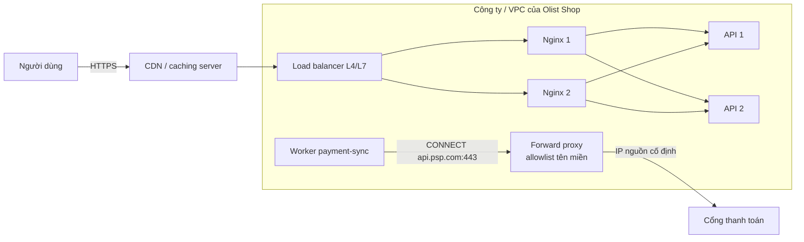
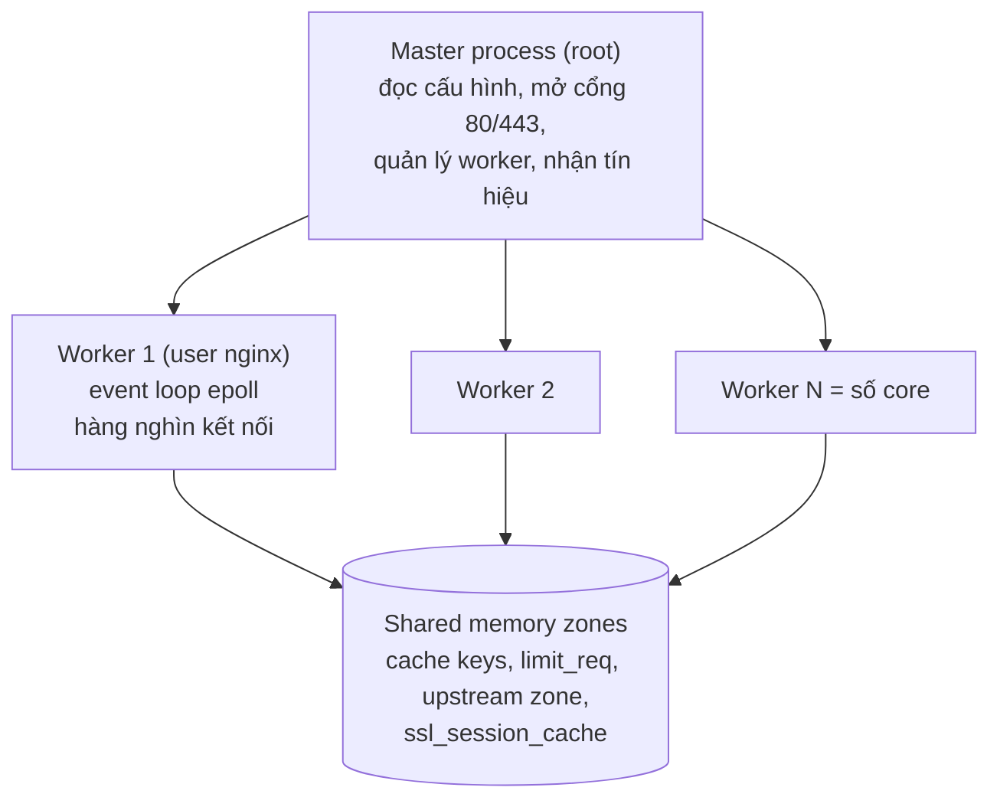
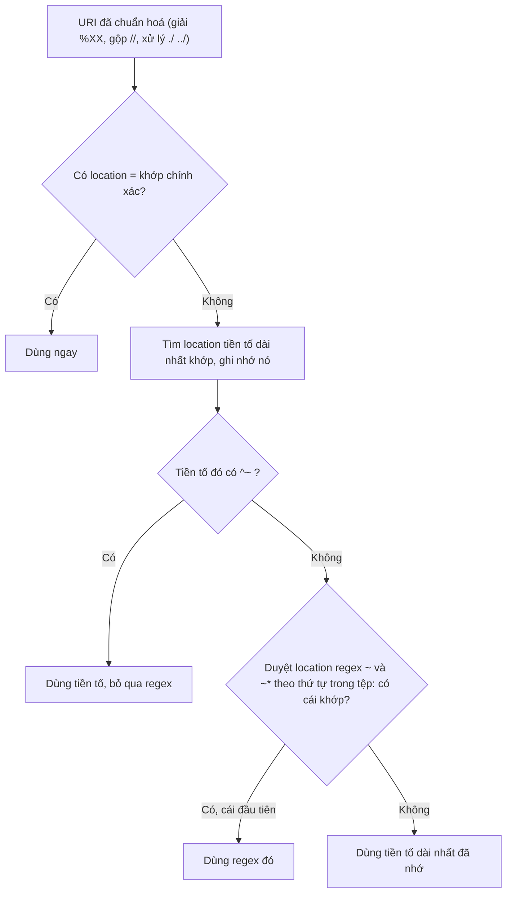
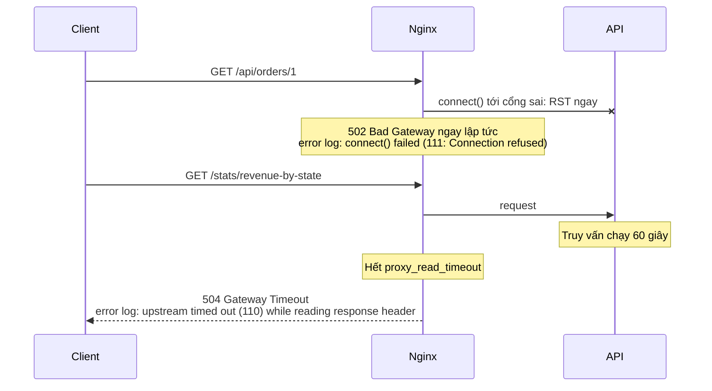

# Web server & proxy

Gần như mọi request tới một hệ thống production đi qua ít nhất một proxy trước khi chạm vào code: load balancer của cloud,
CDN, Nginx, ingress của Kubernetes, sidecar của service mesh. Lớp này quyết định ai được vào, request đi tới đâu, ai thấy
IP thật của client, cái gì được cache, khi backend chậm thì người dùng chờ bao lâu. Nó cũng là nơi sinh ra phần lớn mã 502
và 504 mà on-call nhận lúc nửa đêm, và nơi một dòng cấu hình sai (một dấu `/` thiếu sau `proxy_pass`, một cổng chép từ
staging) làm sập cả site trong khi mọi health check vẫn xanh.

Module này dạy Nginx ở mức người vận hành: cấu hình được, đọc log ra nguyên nhân, và biết khi nào **không** dùng Nginx. Các
công cụ khác (Caddy, Apache, Tomcat, IIS, HAProxy, Envoy) nằm trong bảng so sánh ở mục 1.

Sau module này bạn sẽ:

- Giải thích forward proxy, reverse proxy, caching server, L4 và L7 load balancer, và chọn đúng thứ cho từng tình huống.
- Đọc một cấu hình Nginx và nói chính xác request nào vào `server` nào, `location` nào, và backend nhận path gì.
- Đặt header proxy đúng và biết header nào được tin ở tầng nào (`X-Forwarded-For`, `real_ip`, request id).
- Cấu hình load balancing với passive health check, và biết nó không thay được active health check.
- Kết thúc TLS đúng cách: chuyển hướng, HSTS, HTTP/2, từ chối SNI lạ, gia hạn cert tự động.
- Bảo vệ upstream bằng rate limit, cache và timeout; phân biệt 502 với 504 trong một phút.
- Đặt firewall và security group theo nguyên tắc mặc định từ chối, biết bẫy Docker vượt qua `ufw`.
- Chẩn đoán một sự cố proxy từ log và viết postmortem cho nó.

## 0. Cài đặt

Mọi bài tập chạy Nginx trong container, không cài gì lên máy. Test tự tạo network, container và cổng riêng, rồi tự dọn.

| Công cụ | Phiên bản đã kiểm | Tối thiểu | Dùng ở |
| --- | --- | --- | --- |
| Docker Engine | 29.x | 24.0 (đã cài từ [SETUP.md](../../../../setup/SETUP.md)) | Mọi bài có `tests/` chạy Nginx |
| Image `nginx` | `nginx:1.30.6-alpine` (nhánh stable) | Đúng tag này | Basic 01, 02; Intermediate 01, 02, 03 |
| Image `python` | `python:3.12.16-alpine3.24` | Đúng tag này | Backend giả của Olist Shop trong test |

Image được ghim đúng tag, không dùng `latest`: hành vi Nginx đổi giữa các bản (ví dụ keep-alive tới upstream bật mặc định
từ 1.29.7), ghim tag thì test hôm nay và năm sau cho cùng kết quả.

### Tải và xác minh

```bash
docker pull nginx:1.30.6-alpine && docker pull python:3.12.16-alpine3.24 &&
docker image inspect --format '{{index .RepoDigests 0}}' nginx:1.30.6-alpine python:3.12.16-alpine3.24 &&
docker run --rm --entrypoint nginx nginx:1.30.6-alpine -v
```

Lệnh cuối in `nginx version: nginx/1.30.6`. Với image, **digest** đóng vai trò của checksum: Docker kiểm nội dung từng layer
theo SHA-256 khi tải, và digest của manifest định danh đúng bản bạn có. Digest lúc viết module:

| Image | Digest |
| --- | --- |
| `nginx:1.30.6-alpine` | `sha256:0e52bd054126cdc040b1276c0af347aeb02a41b9cfe305d6094767ac30e97949` |
| `python:3.12.16-alpine3.24` | `sha256:e6dae589c1c05976188fd3bd019afd091445fc533ed2ea29001beddc7368a9c8` |

So với digest trên trang tag của Docker Hub. Tag có thể bị đẩy lại (nhà phát hành build lại để vá lỗ hổng của Alpine), khi
đó digest đổi dù tag giữ nguyên. Trong production, ghim bằng digest (`nginx:1.30.6-alpine@sha256:...`) để chắc chắn mọi máy
chạy cùng một bản, và để công cụ như Renovate đề xuất cập nhật có kiểm soát.

Chưa pull image thì test **skip** kèm lệnh cần chạy, không fail.

### Gỡ

```bash
docker image rm nginx:1.30.6-alpine python:3.12.16-alpine3.24
```

Container và network của test có tên bắt đầu bằng `devops-ex-` và nhãn `devops-ex=1`, luôn được xoá khi test kết thúc. Nếu
bạn ngắt test bằng `kill -9` và còn sót, dọn đúng những thứ có nhãn đó (không đụng container khác của bạn):

```bash
docker ps -aq --filter label=devops-ex=1 | xargs -r docker rm -f &&
docker network ls -q --filter label=devops-ex=1 | xargs -r docker network rm
```

### Nginx cài thẳng lên máy (tuỳ chọn)

Không bài nào cần. Nếu muốn, cài gói của distro: `apt` kiểm chữ ký GPG của kho và checksum của gói trước khi cài.

```bash
sudo apt update && sudo apt install nginx && nginx -v
```

Ubuntu 24.04 cho Nginx 1.24 (cũ hơn bản các bài dùng; cấu hình keep-alive khác, xem mục 3), Debian 13 cho 1.26. Muốn bản
mới trên máy thật thì dùng kho chính thức của nginx.org theo hướng dẫn trên trang đó (có bước kiểm fingerprint của khoá ký).
Gói distro tự bật service nghe cổng 80; tắt bằng `sudo systemctl disable --now nginx`, gỡ bằng `sudo apt remove nginx`.

### Lab thủ công

Test dựng môi trường rồi xoá ngay. Muốn tự gõ `curl`, xem log và reload như khi làm sự cố thật, dựng lab của một bài (ví
dụ Intermediate 01) từ thư mục gốc repo. Container ghim CPU theo `DEVOPS_CPUSET` nếu bạn đã đặt (xem
[setup/DEVOPS-TOOLS.md](../../../../setup/DEVOPS-TOOLS.md)), để trống thì không ghim:

```bash
EX=tracks/devops/modules/05-web-server-proxy/exercises/intermediate/01-incident-api-502 &&
CPU=${DEVOPS_CPUSET:+--cpuset-cpus=$DEVOPS_CPUSET} &&
docker network create --label devops-ex=1 devops-ex-lab &&
docker run -d --rm --label devops-ex=1 --name devops-ex-lab-api-1 --network devops-ex-lab --network-alias olist-api-1 \
  $CPU -e INSTANCE=olist-api-1 -v "$PWD/$EX/tests/fixtures/backend.py:/srv/backend.py:ro" \
  python:3.12.16-alpine3.24 python /srv/backend.py &&
docker run -d --rm --label devops-ex=1 --name devops-ex-lab-api-2 --network devops-ex-lab --network-alias olist-api-2 \
  $CPU -e INSTANCE=olist-api-2 -v "$PWD/$EX/tests/fixtures/backend.py:/srv/backend.py:ro" \
  python:3.12.16-alpine3.24 python /srv/backend.py &&
docker run -d --rm --label devops-ex=1 --name devops-ex-lab-nginx --network devops-ex-lab -p 127.0.0.1:18085:80 \
  $CPU -v "$PWD/$EX/starter:/etc/nginx/lab:ro" \
  nginx:1.30.6-alpine nginx -c /etc/nginx/lab/nginx.conf -g 'daemon off;' &&
sleep 2 && curl -s --retry 5 --retry-delay 1 -H 'Host: shop.olist.test' localhost:18085/api/healthz; echo
```

Sửa `starter/nginx.conf`, rồi kiểm và nạp lại không làm rớt kết nối:

```bash
docker exec devops-ex-lab-nginx nginx -t && docker exec devops-ex-lab-nginx nginx -s reload &&
docker logs --tail 20 devops-ex-lab-nginx
```

Lab mount **cả thư mục** `starter/` chứ không mount riêng tệp: editor thường lưu bằng cách ghi tệp mới rồi đổi tên, bind
mount một tệp vẫn trỏ vào inode cũ và Nginx không bao giờ thấy bản bạn sửa. Cổng chỉ mở trên `127.0.0.1`. Dọn khi xong:

```bash
docker rm -f devops-ex-lab-nginx devops-ex-lab-api-1 devops-ex-lab-api-2 && docker network rm devops-ex-lab
```

## 1. Web server, proxy và load balancer: ai làm gì

### Bốn vai trò hay bị gọi lẫn

| Vai trò | Đứng ở đâu | Ai cấu hình nó | Việc chính | Ví dụ |
| --- | --- | --- | --- | --- |
| Web server | Phía server | Bạn | Trả tệp tĩnh, chạy hoặc chuyển request tới app | Nginx, Apache, Caddy, IIS |
| Reverse proxy | Phía server, trước app | Bạn; client không biết nó tồn tại | Kết thúc TLS, định tuyến, cache, giới hạn, ẩn topology | Nginx, HAProxy, Envoy, Traefik |
| Forward proxy | Phía client, trước Internet | Client (`HTTPS_PROXY`) hoặc mạng công ty | Kiểm soát và ghi log kết nối **đi ra**, IP nguồn cố định, cache | Squid, Envoy egress, proxy công ty |
| Load balancer | Trước một nhóm server giống nhau | Bạn | Chia kết nối/request, rút server hỏng | AWS ALB/NLB, HAProxy, Nginx, IPVS |

Một sản phẩm thường đóng nhiều vai: Nginx vừa là web server, reverse proxy, load balancer L7 và L4 (khối `stream`), và cache.
**Caching server** là reverse proxy chuyên cache (Varnish, Nginx với `proxy_cache`, CDN như Cloudflare, CloudFront):
nó trả response đã lưu mà không hỏi backend. Forward proxy cũng cache được (Squid trong mạng công ty từng làm vậy), nhưng
ngày nay phần lớn lưu lượng là HTTPS nên forward proxy chỉ thấy tên miền qua `CONNECT`, không thấy nội dung, trừ khi nó
chặn TLS bằng CA riêng (proxy kiểm duyệt của công ty).



### L4 và L7

- **L4** (TCP/UDP) chỉ thấy IP và cổng: chia **kết nối**, không đọc được request. Nhanh, rẻ, giữ nguyên TLS end-to-end nếu
  cần, chạy được mọi giao thức (Postgres, Redis, MQTT, gRPC không cần định tuyến theo method). Không định tuyến theo path,
  không thêm header, không cache. IP client tới backend nhờ giữ nguyên IP nguồn (NLB, IPVS) hoặc PROXY protocol. Ví dụ: AWS
  NLB, HAProxy `mode tcp`, Nginx `stream`, IPVS/kube-proxy.
- **L7** (HTTP) đọc request: định tuyến theo host, path, header; thêm header; retry từng request; cache; rate limit; kết thúc
  TLS (bắt buộc, vì phải đọc được HTTP). Với HTTP/2 và gRPC, L7 chia từng **request** trên một kết nối dài, L4 chỉ chia được
  cả kết nối, nên một client gRPC dính chặt một backend. Ví dụ: AWS ALB, Nginx `http`, Envoy, HAProxy `mode http`, Traefik.

### Kiến trúc Nginx



- **Master** đọc cấu hình, bind cổng (cần root cho cổng dưới 1024), sinh worker, không xử lý request.
- **Worker** chạy một event loop không chặn (epoll trên Linux): một worker giữ hàng nghìn kết nối, chỉ làm việc khi có sự
  kiện đọc/ghi. Vì vậy Nginx chịu được nhiều kết nối chậm (client mạng yếu, keep-alive) mà Apache prefork (một tiến trình
  mỗi kết nối) không chịu nổi. `worker_processes auto` (một worker mỗi core), `worker_connections` giới hạn kết nối mỗi
  worker (kể cả kết nối tới upstream: một request proxy tốn hai), `worker_rlimit_nofile` phải đủ cho chừng đó file
  descriptor.
- Thao tác chặn (đọc đĩa chậm, module viết tồi) chặn cả worker và mọi kết nối của nó; `aio threads` đưa đọc đĩa sang thread
  pool.
- **Reload** (`nginx -s reload`, tín hiệu `HUP`): master kiểm cấu hình mới; sai thì giữ nguyên worker cũ và ghi lỗi. Đúng thì
  sinh worker mới, worker cũ ngừng nhận kết nối mới và thoát khi xong việc (`worker_shutdown_timeout` giới hạn thời gian).
  Không rớt request. Nâng cấp binary không downtime dùng tín hiệu `USR2`. Kết nối dài (WebSocket) giữ worker cũ sống tới
  khi đóng, nên reload liên tục có thể làm tồn nhiều worker cũ.
- Trạng thái dùng chung giữa worker nằm trong **shared memory zone**: khoá cache (`keys_zone`), bộ đếm rate limit
  (`limit_req_zone`), trạng thái upstream (`zone`), session TLS. Thứ gì không có zone thì mỗi worker giữ bản riêng.

### So sánh công cụ

| Công cụ | Loại | Mạnh | Yếu | Dùng khi | Hay gặp ở |
| --- | --- | --- | --- | --- | --- |
| **Nginx** | Web server, reverse proxy, LB L4/L7, cache | Nhanh, ít RAM, cấu hình rõ, hệ sinh thái lớn, ingress phổ biến | Đổi upstream cần reload; active health check, API cấu hình động, dashboard chỉ có ở NGINX Plus (trả phí); cấu hình dễ sai ngầm (`proxy_pass`, kế thừa `add_header`) | Mặc định cho reverse proxy, TLS, tệp tĩnh, cache trước app | Mọi cỡ công ty, đặc biệt máy ảo và Docker |
| **Caddy** | Web server, reverse proxy | HTTPS tự động (ACME) mặc định, cấu hình ngắn, HTTP/3 sẵn, API cấu hình JSON | Ít module và tài liệu vận hành ở quy mô lớn hơn Nginx; build thêm plugin phải dùng `xcaddy` | Team nhỏ, nhiều site, muốn bỏ hẳn việc quản lý cert | Startup, homelab, SaaS nhỏ |
| **Apache httpd** | Web server, reverse proxy | `.htaccess` theo thư mục, module phong phú (mod_php, mod_security), MPM `event` đủ tốt | Prefork/mod_php tốn RAM; `.htaccess` chậm; cấu hình dài | Hosting chia sẻ, ứng dụng PHP đời cũ, nơi đã có chuyên môn Apache | Hosting (cPanel), doanh nghiệp, đại học |
| **Tomcat** | Servlet container (Java) | Chạy `.war`, JSP, chuẩn Jakarta EE web profile | Không phải reverse proxy đa năng; TLS và tệp tĩnh kém tiện hơn Nginx | Ứng dụng Java dạng `.war`; Spring Boot nhúng sẵn Tomcat | Ngân hàng, doanh nghiệp Java |
| **IIS** | Web server Windows | Tích hợp Windows auth, .NET Framework, quản trị GUI | Chỉ Windows; tự động hoá bằng PowerShell/DSC, ít công cụ DevOps hơn | Ứng dụng ASP.NET Framework, môi trường Windows Server | Doanh nghiệp Microsoft |
| **HAProxy** | LB L4/L7, reverse proxy | Load balancer chuyên dụng: active health check, thống kê chi tiết, runtime API, hiệu năng cao | Không phục vụ tệp tĩnh, không cache đầy đủ | LB cho TCP (Postgres, Redis), LB HTTP cần health check và quan sát tốt | Mạng lớn, fintech, trước cụm DB |
| **Envoy** | Proxy L4/L7 cho microservice | Cấu hình động qua xDS, retry, circuit breaking, outlier detection, mTLS, observability sâu | Cấu hình YAML dài, gần như cần control plane (Istio, Envoy Gateway) | Service mesh, API gateway, gRPC | Nền tảng microservice, Kubernetes lớn |

Traefik (tự đọc cấu hình từ label Docker và CRD Kubernetes) và các load balancer quản lý (AWS ALB/NLB, GCP LB, Azure
Application Gateway) cũng nằm cùng nhóm; module 10 quay lại với Ingress và Gateway API.

## 2. Cấu hình Nginx: server, location, proxy_pass và header

### Request vào `server` nào

1. Chọn theo **địa chỉ và cổng** của `listen` khớp với kết nối.
2. Trong các khối cùng địa chỉ:cổng, chọn theo `server_name` với header `Host` (với HTTPS: tên trong SNI chọn cert, rồi
   `Host` chọn khối): tên chính xác, rồi wildcard dài nhất bắt đầu bằng `*` (`*.olist.test`), rồi wildcard dài nhất kết thúc
   bằng `*`, rồi regex đầu tiên khớp theo thứ tự trong tệp.
3. Không khối nào khớp: **server mặc định** của địa chỉ:cổng đó, là khối có `default_server`, hoặc khối đầu tiên nếu không
   có. Quên khối mặc định là để mọi `Host` lạ (bot quét IP, tên miền khác trỏ nhầm về bạn) chạy vào app (bài Basic 01).

### Request vào `location` nào



Hệ quả hay gặp: một `location ~ \.php$` viết phía trên vẫn thắng `location /uploads/` (tiền tố không có `^~`), nên tệp
`/uploads/x.php` do người dùng tải lên bị chạy. Thứ tự **trong tệp** chỉ quan trọng với regex. `location = /healthz` rẻ
nhất vì so khớp chính xác dừng tìm ngay.

### `proxy_pass`: có hay không có phần URI

Đây là nguồn sự cố số một khi đổi routing:

| `location` | `proxy_pass` | Client gọi | Backend nhận |
| --- | --- | --- | --- |
| `/api/` | `http://olist_api` | `/api/orders/1` | `/api/orders/1` (không có URI: chuyển nguyên) |
| `/api/` | `http://olist_api/` | `/api/orders/1` | `/orders/1` (có URI `/`: thay phần `/api/`) |
| `/api/` | `http://olist_api/v2/` | `/api/orders/1` | `/v2/orders/1` |
| `/api` | `http://olist_api/` | `/api/orders/1` | `//orders/1` (thiếu `/` ở location) |
| `~ ^/api/(.*)$` | `http://olist_api/$1$is_args$args` | `/api/orders/1?x=1` | `/orders/1?x=1` (regex phải tự dựng URI) |

Có URI thì Nginx thay phần khớp với `location` bằng URI đó, trên URI **đã chuẩn hoá** (đã giải `%2F`); không URI thì gửi
nguyên URI gốc client gửi. Có biến trong `proxy_pass` thì Nginx không thay gì và tên upstream được resolve lúc chạy (cần
`resolver`).

**DNS của upstream**: tên trong `upstream`/`proxy_pass` được resolve **một lần** lúc khởi động và reload. Backend đổi IP
(container tạo lại, IP của ALB xoay vòng) thì Nginx vẫn gọi IP cũ cho tới lần reload sau. Từ 1.27.3, Nginx open source có
`server api.internal:8000 resolve;` trong `upstream` (kèm `zone` và `resolver`) để tự cập nhật theo TTL; bản cũ hơn dùng
biến trong `proxy_pass` với `resolver`.

### Header tới backend và chuyện tin ai

`proxy_pass` mặc định gửi `Host: <tên upstream>` và chuyển nguyên mọi header client gửi. Bộ tối thiểu:

```nginx
proxy_set_header Host $host;
proxy_set_header X-Real-IP $remote_addr;
proxy_set_header X-Forwarded-For $remote_addr;
proxy_set_header X-Forwarded-Proto $scheme;
proxy_set_header X-Request-ID $req_id;
```

`proxy_set_header` ở một mức thay **toàn bộ** danh sách kế thừa từ mức trên: thêm một dòng trong `location` là mất cả bộ ở
`server`. Gom bộ này vào một tệp và `include` ở mọi `location` có `proxy_pass`.

**`X-Forwarded-For` bị giả thế nào.** Client gửi `X-Forwarded-For: 1.2.3.4`. Một proxy dùng `$proxy_add_x_forwarded_for`
nối IP thật vào sau: backend nhận `1.2.3.4, 203.0.113.7`. App lấy phần tử **đầu** làm IP client là đã tin client. Hậu quả:
qua mặt rate limit theo IP, qua allowlist IP của trang admin, ghi sai audit log, gian lận chống bot. Quy tắc:

- Proxy **ngoài cùng** (không có gì đáng tin phía trước): ghi đè, `X-Forwarded-For $remote_addr`.
- Proxy **sau** một proxy tin cậy (LB, CDN): bật `real_ip` để dựng lại IP client từ header, **chỉ** khi request đến từ
  dải tin cậy, rồi mới nối tiếp:

```nginx
set_real_ip_from 10.0.0.0/16;
real_ip_header X-Forwarded-For;
real_ip_recursive on;
proxy_set_header X-Forwarded-For $proxy_add_x_forwarded_for;
```

Với `real_ip_recursive on`, Nginx đi từ **phải sang trái** trong `X-Forwarded-For`, bỏ các IP thuộc dải tin cậy, lấy IP đầu
tiên không tin cậy làm `$remote_addr`. Sau bước này `$remote_addr` là IP client thật cho log, `limit_req`, `allow/deny`.
App phía sau cũng đọc từ phải sang trái, bỏ đúng số proxy tin cậy, không bao giờ lấy phần tử đầu. Và firewall phải chặn
mọi đường gọi thẳng Nginx không qua LB (mục 6), nếu không ai đó tự đặt header như thể là LB.

Chuẩn `Forwarded` (RFC 7239) gom các thông tin trên vào một header, ít được hỗ trợ hơn `X-Forwarded-*` nhưng cùng quy tắc tin
cậy. `X-Forwarded-Proto` cũng phải lấy từ tầng kết thúc TLS: sau LB, `$scheme` của Nginx luôn là `http`.

**Request id**: giữ id hợp lệ của client để lần theo từ đầu tới cuối, sinh mới khi thiếu hoặc sai dạng, ghi vào access log
và chuyển cho app (bài Basic 01). Đây là sợi chỉ nối log Nginx, log API và trace ở module 13.

## 3. Upstream, load balancing và health check

### Thuật toán

| Thuật toán | Nginx | Hợp khi | Bẫy |
| --- | --- | --- | --- |
| Round robin có trọng số | Mặc định, `weight=` | Request đồng đều, backend giống nhau hoặc biết tỉ lệ sức mạnh | Request dài ngắn rất khác nhau làm lệch tải |
| Least connections | `least_conn` | Thời gian xử lý khác nhau nhiều, kết nối dài | Mỗi worker đếm riêng nếu không có `zone` |
| Hash theo IP | `ip_hash` | Cần "dính" client vào một backend (session trong RAM) | Cả công ty sau một NAT dồn vào một backend; thêm bớt backend làm đổi gần hết ánh xạ |
| Hash nhất quán | `hash $key consistent` | Cache phân tán, chia theo user/tenant | Thêm bớt backend chỉ đổi khoảng 1/N ánh xạ, nhưng phân bố phụ thuộc chất lượng khoá |
| Random two choices | `random two least_conn` | Nhiều LB cùng chia một nhóm backend (mỗi LB chỉ thấy tải của chính nó) | Ít người hiểu, khó giải thích khi debug |

Session "dính" (sticky) là nợ kỹ thuật: app lưu session ở Redis hoặc trong token thì mọi backend thay thế được nhau, deploy và
scale không làm người dùng đăng xuất.

### Passive và active health check

```nginx
upstream olist_api {
    zone olist_api 64k;
    server olist-api-1:8000 max_fails=3 fail_timeout=30s;
    server olist-api-2:8000 max_fails=3 fail_timeout=30s;
    server olist-api-maint:8000 backup;
}
```

- **Passive** (Nginx open source): đếm lỗi của **request thật**. `max_fails` lỗi trong `fail_timeout` thì server bị coi là
  hỏng trong `fail_timeout` tiếp theo; hết hạn thì một request thật đi thử. Lỗi là những gì `proxy_next_upstream` liệt kê
  (mặc định `error timeout`). Mặc định `max_fails=1 fail_timeout=10s`: một lỗi lẻ đã rút server ra.
- **Active**: một thành phần gọi định kỳ `/healthz` hoặc `/readyz` của từng backend kể cả khi không có traffic, rút backend
  trước khi người dùng gặp lỗi, phát hiện cả backend treo. Nginx open source **không** có (`health_check` là của NGINX Plus).
  Trong thực tế active check do lớp khác làm: LB cloud, Kubernetes readiness probe, HAProxy, Envoy, Consul.
- `backup` chỉ nhận request khi mọi server chính hỏng: chỗ để một trang bảo trì hoặc một cụm ở vùng khác.
- `zone` đưa trạng thái upstream vào shared memory. Không có nó, với 16 worker, một backend chết bị thử tới `16 x max_fails`
  lần, và weight chỉ đúng trong từng worker.

**Liveness và readiness ở tầng proxy**: health check của LB gọi một route đi **qua** Nginx tới app (bài Intermediate 01 là
ví dụ health check trả thẳng từ Nginx che mất sự cố). Nhưng readiness phụ thuộc DB có cái giá: DB chết thì mọi node cùng
fail, nhiều LB cloud khi đó "fail open" (gửi tới mọi node) hoặc trả 503 cho tất cả. Thiết kế có chủ ý: liveness cho LB chỉ
kiểm app, readiness phụ thuộc DB dùng cho cảnh báo và cho việc rút từng node.

### Retry và idempotency

`proxy_next_upstream error timeout` thử backend kế tiếp khi kết nối lỗi hoặc timeout; thêm `http_502 http_503 http_504` nếu
muốn thử lại cả khi backend trả các mã đó. Từ 1.9.13, request không idempotent (`POST`, `PATCH`, `LOCK`) **không** được thử
lại sau khi đã gửi tới một backend, trừ khi bạn thêm `non_idempotent`: thử lại `POST /jobs/recompute` là chạy job hai lần,
thử lại một lệnh thanh toán là trừ tiền hai lần. Giới hạn bằng `proxy_next_upstream_tries 2` và
`proxy_next_upstream_timeout`, nếu không một sự cố lan rộng biến mỗi request thành N request (retry storm).

### Timeout, 502 và 504



| Mã | Nghĩa ở Nginx | Nguyên nhân hay gặp |
| --- | --- | --- |
| 502 | Không nói chuyện được với upstream | Cổng sai, app chết, app đóng kết nối giữa chừng (crash, OOM kill), header response quá lớn so với `proxy_buffer_size`, keep-alive bị app đóng đúng lúc Nginx dùng lại |
| 503 | Nginx từ chối phục vụ | `no live upstreams` khi mọi server bị `max_fails` rút; `limit_req`/`limit_conn` với mã mặc định |
| 504 | Upstream không trả lời kịp | `proxy_read_timeout` (mặc định 60s), hoặc `proxy_connect_timeout` khi gói tin bị firewall nuốt im lặng |
| 499 | Client đóng kết nối trước khi Nginx trả lời | Client timeout ngắn hơn app; mobile mất mạng; thường là dấu hiệu backend chậm |
| 413 | Body quá lớn | `client_max_body_size` mặc định 1 MB, upload ảnh sản phẩm hay vướng |

`proxy_read_timeout` là khoảng chờ **giữa hai lần đọc**, không phải tổng thời gian. Timeout của các tầng phải lồng nhau:
DB (`statement_timeout`) < app < Nginx < LB < client; tầng trong hết hạn trước thì lỗi có nghĩa và có log ở đúng chỗ.

### Buffering và keep-alive

- `proxy_buffering on` (mặc định): Nginx đọc nhanh response từ app vào buffer rồi tự trả từ từ cho client mạng chậm, giải
  phóng worker của app sớm. Tắt (`proxy_buffering off` hoặc app gửi `X-Accel-Buffering: no`) cho Server-Sent Events và
  streaming, nếu không client nhận dữ liệu thành từng cục.
- `proxy_request_buffering on`: Nginx nhận hết body upload rồi mới gửi cho app; app không bị client upload chậm giữ chân.
- **Keep-alive tới upstream** tiết kiệm bắt tay TCP (và TLS nếu có) cho mỗi request, tránh cạn cổng nguồn ở `TIME_WAIT` khi
  tải cao. Từ Nginx **1.29.7** (có trong nhánh stable 1.30), `keepalive` trong `upstream` bật mặc định,
  `proxy_http_version` mặc định là 1.1 và header `Connection` không còn bị gửi (giới hạn mặc định 32 kết nối nhàn rỗi mỗi
  worker; `keepalive 0;` tắt hẳn: mỗi request một kết nối mới, vẫn HTTP/1.1). Trên các bản cũ (1.24 của Ubuntu 24.04,
  1.26, 1.28) phải tự viết `keepalive 32;` trong `upstream` cùng `proxy_http_version 1.1;` và `proxy_set_header Connection
  "";`. Cấu hình chép từ blog thường nhắm bản cũ; kiểm bản bạn chạy bằng `nginx -v` trước.
- WebSocket cần chuyển tiếp `Upgrade` và `Connection: upgrade` (một `map $http_upgrade $connection_upgrade`) và timeout
  đọc dài hơn.

## 4. TLS termination

### Kết thúc TLS ở đâu

| Mô hình | Ưu | Nhược | Dùng khi |
| --- | --- | --- | --- |
| Tại LB/CDN, HTTP trong mạng riêng | Cert quản lý tập trung (ACM, Cloudflare), WAF đọc được request, ít CPU ở backend | Lưu lượng trong VPC không mã hoá; phải tin `X-Forwarded-*` từ LB | Phổ biến nhất trên cloud |
| Tại LB, mã hoá lại tới Nginx/app | Mã hoá end-to-end, LB vẫn đọc được HTTP | Hai bộ cert, thêm độ trễ và CPU | Tuân thủ (PCI DSS, dữ liệu y tế), zero trust |
| TLS passthrough (LB L4), kết thúc ở Nginx | LB không thấy nội dung; Nginx giữ cert và có mTLS với client | LB không định tuyến theo path, không WAF; IP client cần PROXY protocol | mTLS với đối tác, cert phải nằm trong tay bạn |
| Tại sidecar (service mesh) | mTLS giữa mọi service tự động | Độ phức tạp của mesh | Nền tảng nhiều service (module 15) |

### Những thứ một khối HTTPS production cần

- **Chuyển hướng HTTP sang HTTPS**, trừ đường ACME HTTP-01 (`/.well-known/acme-challenge/`). Dùng `308` cho API để giữ method
  và body; `301` làm client đổi `POST` thành `GET`.
- **Fullchain**: cert lá cộng intermediate (module 04). Khoá riêng quyền `600`; chỉ master đọc khoá.
- **Phiên bản**: chỉ TLS 1.2 và 1.3 (RFC 8996 đã loại 1.0 và 1.1). Cipher mặc định của Nginx với OpenSSL 3 đã ổn.
- **Session**: `ssl_session_cache shared:SSL:10m` để kết nối lại nhanh; `ssl_session_tickets off` trừ khi bạn tự xoay khoá
  ticket.
- **HSTS** với `always`: `Strict-Transport-Security: max-age=31536000`. Bật dần (`max-age` vài phút rồi mới tới một năm),
  cân nhắc kỹ `includeSubDomains` và `preload` vì không rút lại nhanh được.
- **HTTP/2**: `http2 on;` (từ 1.25.1, chỉ thị riêng). HTTP/3 (`listen 443 quic;`) chạy được nhưng cần mở UDP 443 và vẫn
  giữ TCP làm đường dự phòng.
- **Server mặc định từ chối SNI lạ**: `ssl_reject_handshake on;` (từ 1.19.4) trong khối `listen 443 ssl default_server`: không
  lộ cert và danh sách tên miền cho scanner quét IP. Client không gửi SNI cũng bị từ chối; phục vụ chúng bằng IP hoặc cổng
  riêng.
- **OCSP stapling**: nhiều hướng dẫn cũ bật `ssl_stapling on`. Let's Encrypt đã ngừng OCSP năm 2025 (cert mới không còn URL
  OCSP), nên với cert của họ chỉ thị này không làm gì; với CA khác vẫn có ích.

### Vòng đời cert

ACME client (certbot, lego, acme.sh; cert-manager trên Kubernetes) xin và gia hạn tự động, ghi cert ra thư mục, rồi
`nginx -t && nginx -s reload`. CA/Browser Forum đã thông qua lộ trình hạ thời hạn tối đa của cert công khai xuống 200 ngày
(2026), 100 ngày (2027) rồi 47 ngày (2029): gia hạn tay không còn là lựa chọn. Giám sát hai thứ: ngày hết hạn, và việc một
client nghiêm ngặt (curl, Java) tin được cert từ nhiều nơi (bài postmortem của module 04 cho thấy vì sao chỉ đọc ngày hết
hạn là không đủ).

**mTLS**: `ssl_verify_client on` với `ssl_client_certificate` là CA của đối tác khi chính client phải chứng minh danh tính
(đối tác B2B, máy POS). Phía upstream, `proxy_ssl_verify on` và `proxy_ssl_trusted_certificate` khi Nginx gọi backend bằng
HTTPS; mặc định Nginx **không** kiểm cert của upstream.

## 5. Cache và rate limit

### Cache ở reverse proxy

```nginx
proxy_cache_path /var/cache/nginx/olist levels=1:2 keys_zone=olist_cache:10m max_size=1g inactive=10m use_temp_path=off;

location = /stats/revenue-by-state {
    proxy_pass http://olist_api;
    proxy_cache olist_cache;
    proxy_cache_valid 200 30s;
    proxy_cache_lock on;
    proxy_cache_use_stale error timeout updating http_502 http_503 http_504;
    proxy_cache_background_update on;
    add_header X-Cache-Status $upstream_cache_status always;
}
```

- Khoá mặc định `$scheme$proxy_host$request_uri`. Response phụ thuộc header nào (ngôn ngữ, tenant, `Accept-Encoding` khi
  backend tự nén) thì header đó phải vào `proxy_cache_key` hoặc backend phải gửi `Vary` đúng, nếu không bạn trả nội dung của
  người này cho người kia.
- Thời hạn lấy từ `Cache-Control`/`Expires` của backend nếu có, rồi tới `proxy_cache_valid`. Response có `Set-Cookie`
  mặc định không được cache; `Cache-Control: private` hoặc `no-store` cũng vậy. Đừng tắt các bảo vệ đó bằng
  `proxy_ignore_headers` khi chưa hiểu hết.
- **Không bao giờ cache** response phụ thuộc người dùng (đơn hàng, giỏ hàng, mọi thứ có `Authorization`) ở cache chung, trừ
  khi khoá cache có danh tính người dùng; sự cố "người dùng thấy dữ liệu của người khác" từ cache cấu hình sai đã xảy ra ở
  nhiều công ty lớn.
- **Thundering herd**: cache hết hạn trên một endpoint đông người đọc làm hàng trăm request cùng đánh vào backend.
  `proxy_cache_lock` cho một request đi, các request khác chờ; `use_stale updating` và `background_update` trả bản cũ trong
  lúc làm tươi; `use_stale error timeout http_5xx` giữ trang chạy bằng bản cũ khi backend chết.
- Xoá cache: `proxy_cache_purge` chỉ có ở NGINX Plus; với bản open source dùng `proxy_cache_bypass` từ nguồn tin cậy (bài
  Intermediate 03), thời hạn ngắn, hoặc đưa phiên bản vào URL cho tài nguyên tĩnh (`app.3f2a1c.js` với
  `Cache-Control: public, max-age=31536000, immutable`).
- Cache ở Nginx hay ở CDN: CDN gần người dùng hơn và gánh được tải ở biên; Nginx cache bảo vệ backend khỏi chính CDN (nhiều
  điểm biên cùng hỏi) và cho các response mà CDN không thấy (lưu lượng nội bộ). Varnish khi cần logic cache phức tạp (VCL).

### Rate limit: leaky bucket

`limit_req` là **leaky bucket**: request chảy ra với tốc độ `rate`, `burst` là sức chứa hàng chờ. Không `nodelay`: request
trong burst bị giữ lại cho tới lượt (người dùng thấy chậm). Có `nodelay`: được phục vụ ngay nhưng vẫn chiếm chỗ trong bucket,
chỗ trống lại sau mỗi `1/rate` giây. Vượt quá thì bị từ chối với `limit_req_status` (đặt `429`, mặc định là `503`).

```nginx
limit_req_zone $binary_remote_addr zone=per_ip:10m rate=20r/s;
limit_req_zone $http_x_api_key zone=per_key:10m rate=100r/s;

location /api/ {
    limit_req zone=per_ip burst=40 nodelay;
    limit_req zone=per_key burst=200;
    limit_req_status 429;
    proxy_pass http://olist_api/;
}
```

- **Khoá** quyết định công bằng: theo IP thì cả công ty sau một NAT chung một bucket, và **sau LB mà chưa có `real_ip` thì
  toàn bộ người dùng chung một bucket** (IP của LB). Theo API key hoặc user id công bằng hơn cho API có đăng nhập. Khoá rỗng
  thì request không bị tính (dùng để miễn trừ: `map` IP nội bộ ra chuỗi rỗng).
- Nhiều `limit_req` trong một location áp đồng thời. `limit_conn` giới hạn số kết nối đồng thời (chống client giữ nhiều kết
  nối tải lớn).
- `limit_req_dry_run on` để đo trước khi chặn thật. Mỗi worker dùng chung zone qua shared memory, nhưng mỗi máy Nginx có bộ
  đếm riêng: hai máy sau LB thì giới hạn thực tế gấp đôi. Giới hạn toàn cục cần Redis, gateway chuyên dụng hoặc WAF.
- Rate limit ở Nginx bảo vệ tài nguyên; không thay WAF và chống DDoS ở biên (CDN, AWS Shield): một cuộc tấn công đủ lớn làm
  nghẽn đường mạng trước khi Nginx kịp trả 429.

## 6. Firewall và vận hành lớp edge

### Firewall trên máy: nftables, iptables, ufw

- **nftables** là framework lọc gói của kernel Linux hiện nay, thay iptables (lệnh `iptables` trên distro mới thường là lớp
  tương thích `iptables-nft`). **ufw** (Ubuntu) và **firewalld** (RHEL, Fedora) là lớp quản lý dễ dùng phía trên.
- Firewall có trạng thái (conntrack): cho phép kết nối mới vào cổng được mở, gói của kết nối đã thiết lập tự đi qua cả hai
  chiều.
- Nguyên tắc: **mặc định từ chối** chiều vào, mở đúng cổng cần, giới hạn nguồn cho cổng quản trị. Đừng chặn hết ICMP: ICMP
  "fragmentation needed" và ICMPv6 cần cho Path MTU Discovery (module 04).

Một ruleset nftables cho máy Nginx (đọc để hiểu; áp lên máy dùng chung có thể khoá chính bạn ra ngoài):

```text
table inet filter {
  chain input {
    type filter hook input priority filter; policy drop;
    ct state established,related accept
    ct state invalid drop
    iif "lo" accept
    meta l4proto { icmp, ipv6-icmp } accept
    tcp dport { 80, 443 } accept
    ip saddr 10.0.0.0/16 tcp dport 22 accept
  }
}
```

Tương đương với ufw: `ufw default deny incoming`, `ufw allow 80,443/tcp`, `ufw allow from 10.0.0.0/16 to any port 22 proto
tcp`, rồi `ufw enable`. Bật firewall qua SSH mà chưa mở cổng 22 cho chính mình là tự khoá cửa.

**Bẫy Docker**: `docker run -p 8080:80` thêm rule NAT và FORWARD của riêng Docker, xử lý **trước** rule `INPUT` mà ufw quản lý.
Cổng được publish trên `0.0.0.0` vì vậy mở ra Internet dù `ufw status` nói đã chặn. Cách đúng: publish trên `127.0.0.1` khi
chỉ dùng nội bộ (mọi test và lab của module làm vậy), đặt rule trong chain `DOCKER-USER`, hoặc để firewall của cloud chặn ở
ngoài máy.

### Firewall trên cloud: security group, NACL, WAF

| Lớp | Phạm vi | Trạng thái | Rule | Dùng cho |
| --- | --- | --- | --- | --- |
| Security group (AWS), firewall rule (GCP), NSG (Azure) | Từng network interface | Có | Chỉ allow; nguồn có thể là security group khác | Lớp chính: "chỉ ALB gọi được Nginx", "chỉ app gọi được DB" |
| Network ACL | Subnet | Không (phải mở cả chiều về, dải cổng tạm 1024–65535) | Allow và deny, theo thứ tự | Chặn thô cả subnet, chặn dải IP xấu |
| WAF | L7, trước LB/CDN | Có | Theo request: path, header, chữ ký tấn công, rate | SQL injection, bot, rate limit toàn cục |

Phòng thủ nhiều lớp: WAF và CDN ở biên, security group giữa các tầng tham chiếu nhau (không dùng `0.0.0.0/0` cho tầng trong),
firewall trên máy cho những gì cloud không thấy, và cuối cùng là chính Nginx (`allow`/`deny` cho location quản trị). DB và
Redis không bao giờ có rule từ Internet; quản trị đi qua SSM, bastion hoặc VPN chứ không mở 22 ra ngoài.

### Vận hành hằng ngày

**Log có cấu trúc** để công cụ ở module 13 đọc được và để tách thời gian của Nginx với thời gian của app:

```nginx
log_format json escape=json '{"ts":"$time_iso8601","rid":"$req_id","ip":"$remote_addr","host":"$host",'
    '"req":"$request","status":$status,"bytes":$body_bytes_sent,"rt":$request_time,'
    '"uct":"$upstream_connect_time","urt":"$upstream_response_time","up":"$upstream_addr","ust":"$upstream_status",'
    '"cache":"$upstream_cache_status","ua":"$http_user_agent"}';
```

`$request_time` lớn mà `$upstream_response_time` nhỏ: client chậm hoặc mạng chậm. Cả hai cùng lớn: backend chậm.
`$upstream_addr` có nhiều giá trị: Nginx đã thử lại trên backend khác.

**Runbook 5xx ở proxy**:

1. Mã nào, từ ai? Response có header của app (`X-Request-ID` do app trả, body JSON của app) là app sinh; trang lỗi HTML
   của Nginx là Nginx sinh.
2. Đọc **error log của Nginx** trước khi đoán: `connect() failed (111)` là cổng/tiến trình, `upstream timed out (110)` là
   chậm, `no live upstreams` là mọi backend đã bị rút, `upstream prematurely closed connection` là app chết giữa chừng,
   `upstream sent too big header` là buffer. Trường `upstream:` cho biết chính xác URL Nginx đã gọi.
3. Cấu hình Nginx thực sự đang chạy là gì: `nginx -T` (in mọi tệp đã `include`), so với bản trong git.
4. Gọi thẳng backend từ máy Nginx (`curl -v http://api-1:8000/healthz`) để tách lỗi của mạng/app với lỗi của cấu hình proxy.
5. Có change nào trong 30 phút gần nhất không: phần lớn sự cố proxy do thay đổi cấu hình.

**Cấu hình như code**: cấu hình Nginx nằm trong git, có reviewer từ team vận hành, sinh từ template cho từng môi trường
(không chép tay giữa staging và production), và pipeline chạy hai lớp kiểm: `nginx -t` (cú pháp) và một **smoke test** dựng
Nginx với cấu hình mới trước upstream thật hoặc giả, gọi các route chính, kiểm mã và path backend nhận. Đó đúng là cách các
test của module này chấm bài, và là thứ đã thiếu trong sự cố ở bài Intermediate 01 và Advanced 01. Triển khai từng máy một,
kiểm sau mỗi máy, giữ lệnh rollback sẵn.

**Giám sát tối thiểu**: tỉ lệ 5xx theo upstream (không chỉ của LB), p95/p99 `$upstream_response_time`, số kết nối
(`stub_status`), số 429 (rate limit chặn oan người thật?), tỉ lệ cache HIT, ngày hết hạn cert. Module 13 dựng phần này.

## 7. Tài liệu tham khảo

- [Nginx documentation](https://nginx.org/en/docs/): đặc biệt [How nginx processes a request](https://nginx.org/en/docs/http/request_processing.html),
  [ngx_http_core_module `location`](https://nginx.org/en/docs/http/ngx_http_core_module.html#location),
  [ngx_http_proxy_module](https://nginx.org/en/docs/http/ngx_http_proxy_module.html),
  [ngx_http_upstream_module](https://nginx.org/en/docs/http/ngx_http_upstream_module.html),
  [ngx_http_realip_module](https://nginx.org/en/docs/http/ngx_http_realip_module.html),
  [ngx_http_limit_req_module](https://nginx.org/en/docs/http/ngx_http_limit_req_module.html),
  [ngx_http_ssl_module](https://nginx.org/en/docs/http/ngx_http_ssl_module.html)
- [Nginx CHANGES](https://nginx.org/en/CHANGES): thay đổi mặc định của keep-alive tới upstream ở 1.29.7, `resolve` cho
  upstream ở 1.27.3, `add_header_inherit` ở 1.29.3
- [Nginx: Inside NGINX - How We Designed for Performance & Scale](https://blog.nginx.org/blog/inside-nginx-how-we-designed-for-performance-scale)
- [Nginx: Rate Limiting with NGINX](https://blog.nginx.org/blog/rate-limiting-nginx) và
  [A Guide to Caching with NGINX](https://blog.nginx.org/blog/nginx-caching-guide)
- [Mozilla SSL Configuration Generator](https://ssl-config.mozilla.org/) và
  [Mozilla Server Side TLS](https://wiki.mozilla.org/Security/Server_Side_TLS)
- [RFC 9110 HTTP Semantics](https://www.rfc-editor.org/rfc/rfc9110) (mã 502, 504, 308), [RFC 6797 HSTS](https://www.rfc-editor.org/rfc/rfc6797),
  [RFC 7239 Forwarded](https://www.rfc-editor.org/rfc/rfc7239), [RFC 8996 deprecating TLS 1.0 and 1.1](https://www.rfc-editor.org/rfc/rfc8996)
- [Let's Encrypt: Challenge Types](https://letsencrypt.org/docs/challenge-types/) và
  [Ending OCSP Support in 2025](https://letsencrypt.org/2024/12/05/ending-ocsp/)
- [CA/Browser Forum Ballot SC-081](https://cabforum.org/2025/04/11/ballot-sc081v3-introduce-schedule-of-reducing-validity-and-data-reuse-periods/):
  lộ trình hạ thời hạn cert
- [Caddy documentation](https://caddyserver.com/docs/), [Apache HTTP Server documentation](https://httpd.apache.org/docs/2.4/),
  [Apache Tomcat documentation](https://tomcat.apache.org/), [HAProxy documentation](https://docs.haproxy.org/),
  [Envoy documentation](https://www.envoyproxy.io/docs), [IIS documentation](https://learn.microsoft.com/en-us/iis/)
- [nftables wiki](https://wiki.nftables.org/), [Ubuntu: Firewall (ufw)](https://documentation.ubuntu.com/server/how-to/security/firewalls/),
  [Docker: Packet filtering and firewalls](https://docs.docker.com/engine/network/packet-filtering-firewalls/)
- [AWS: Security groups](https://docs.aws.amazon.com/vpc/latest/userguide/vpc-security-groups.html) và
  [Network ACLs](https://docs.aws.amazon.com/vpc/latest/userguide/vpc-network-acls.html)
- Google SRE Book, chương [Load Balancing in the Datacenter](https://sre.google/sre-book/load-balancing-datacenter/) và
  [Handling Overload](https://sre.google/sre-book/handling-overload/)
