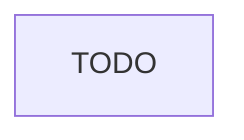

# Thiết kế lớp edge cho Olist Shop production

## 1. Bối cảnh và giả định

TODO: tóm tắt yêu cầu (lưu lượng thường và lúc cao điểm, các luồng vào và ra), và giả định bạn đặt thêm.

## 2. Luồng request

TODO: một sơ đồ mermaid từ client tới API, worker, Postgres, Redis và luồng ra ngoài tới cổng thanh toán.

## 3. Quyết định

| Quyết định | Lựa chọn | Phương án bị loại | Lý do và đánh đổi |
| --- | --- | --- | --- |
| TODO | TODO | TODO | TODO |

## 4. Firewall và security group

| Nguồn | Đích | Cổng | Giao thức | Lý do |
| --- | --- | --- | --- | --- |
| TODO | TODO | TODO | TODO | TODO |

## 5. IP client và header tin cậy

- TODO

## 6. Health check, timeout và giới hạn

- TODO

## 7. Rủi ro và việc còn mở

- TODO
