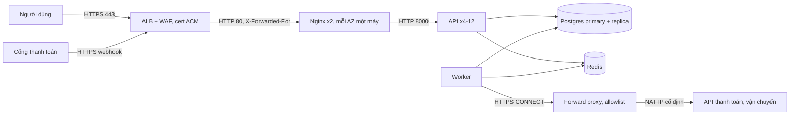

# Lời giải: thiết kế lớp edge cho Olist Shop

Bài Advanced không có một đáp án duy nhất. Một reviewer chấm theo chất lượng lập luận: mỗi lựa chọn có phương án bị loại,
lý do gắn với ràng buộc của đề, và chỗ yếu được nói ra thay vì giấu. Dưới đây là các quyết định cốt lõi, rubric, và một tài
liệu mẫu đã chạy qua test.

## Các quyết định cốt lõi

- **L7 load balancer quản lý (ALB) ở ngoài cùng, Nginx phía sau**, hay **NLB (L4) rồi Nginx kết thúc TLS**? Cả hai đều bảo
  vệ được. ALB giữ cert (ACM tự gia hạn), có WAF, health check active; Nginx làm thứ ALB không làm (cache, rate limit theo
  route, request id, rewrite `/api/`). NLB giữ IP tĩnh và cho Nginx thấy IP client qua proxy protocol, phù hợp khi cần mTLS
  tới tận Nginx hoặc giao thức không phải HTTP. Với team 4 người, ALB + Nginx ít việc hơn. Bỏ hẳn Nginx (chỉ ALB) cũng là
  phương án hợp lệ nếu chuyển cache sang CDN và rate limit sang WAF; khi đó phải nói rõ mất gì.
- **Thiết bị không SNI**: ALB chọn cert theo SNI, client không SNI nhận cert mặc định của listener. Đặt cert mặc định của
  listener là cert có SAN `api.olist-shop.com.br`, hoặc một listener/hostname riêng cho đối tác.
- **Chuỗi tin cậy IP**: ALB nối IP client vào `X-Forwarded-For`; Nginx `set_real_ip_from <CIDR subnet của ALB>`,
  `real_ip_header X-Forwarded-For`, `real_ip_recursive on`, rồi dùng `$remote_addr` (đã là IP client) cho log và rate limit.
  Security group của Nginx chỉ nhận từ security group của ALB, nếu không ai đó gọi thẳng Nginx và tự đặt header.
- **`X-Forwarded-Proto`**: Nginx nhận HTTP từ ALB nên `$scheme` là `http`; chuyển tiếp header của ALB.
- **Egress**: worker đi ra qua NAT gateway có Elastic IP cố định (đối tác allowlist được) **và** forward proxy (Squid hoặc
  Envoy) với allowlist hai tên miền; security group của worker chỉ cho ra tới proxy. Security group chỉ lọc theo IP, không
  theo tên miền; IP của API đối tác đổi được bất cứ lúc nào.
- **Webhook thanh toán**: allowlist dải IP của cổng thanh toán ở WAF hoặc Nginx (`allow`/`deny` trên đúng location), cộng
  kiểm chữ ký HMAC trong app (IP allowlist một mình là không đủ). Không rate limit chung với `/jobs/`.
- **Quản trị**: SSM Session Manager (không mở cổng 22 nào) hoặc bastion chỉ nhận từ IP VPN công ty.
- **Health check**: ALB gọi `/readyz` qua Nginx tới API với `unhealthy_threshold` 2, `interval` 10 giây; hiểu hành vi fail
  open khi mọi target cùng hỏng. Nginx thêm passive check (`max_fails=3 fail_timeout=30s`).
- **Giới hạn và timeout có số**: 300 req/s thường, 3.000 lúc cao điểm. Rate limit `/jobs/` theo IP 1r/s burst 5; API theo IP
  khoảng 20r/s burst 40 (một người dùng thật hiếm khi vượt); cache `/stats/revenue-by-state` 30 giây (70% đọc). Timeout
  Nginx tới API: connect 2s, read 5s (p99 của API khoảng 800 ms), dài hơn `statement_timeout` của DB (4s), ngắn hơn idle
  timeout của ALB (60s).

## Rubric (100 điểm)

| Tiêu chí | Điểm | Đạt đủ điểm khi |
| --- | --- | --- |
| Lựa chọn L4/L7 và vị trí kết thúc TLS có lý do | 15 | So sánh ít nhất hai phương án, gắn với team 4 người, cert Let's Encrypt/ACM, thiết bị không SNI |
| Chuỗi tin cậy IP và header | 15 | `set_real_ip_from` đúng dải LB, `real_ip_recursive`, không tin XFF từ nơi khác, `X-Forwarded-Proto` đúng, request id đặt ở tầng nào |
| Firewall và security group | 15 | Chỉ 80/443 từ Internet; Nginx chỉ nhận từ LB; DB và Redis chỉ nhận từ app/worker; không SSH từ Internet; tham chiếu security group thay vì CIDR khi được |
| Egress và IP cố định | 10 | NAT với IP cố định cho allowlist của đối tác, forward proxy với allowlist tên miền, log kết nối ra |
| Webhook | 10 | IP allowlist đúng chỗ cộng xác thực chữ ký, không bị rate limit chung, idempotent ở app |
| Health check, timeout, rate limit có số và lý do | 15 | Mỗi giá trị suy ra từ số liệu đề (300/3.000 req/s, tỉ lệ đọc), active và passive, quan hệ timeout giữa các tầng |
| Black Friday và năng lực | 10 | Tính được số bản API, `worker_connections`, giới hạn file descriptor, cache giảm tải bao nhiêu, kế hoạch scale trước |
| Rủi ro và việc mở | 10 | Nêu rủi ro thật (fail open, cert mặc định cho thiết bị không SNI, IP đối tác đổi, một region) kèm cách giảm |

Trừ điểm: mở 5432/6379/22 ra Internet (−20, test cũng chặn); tin `X-Forwarded-For` mà không giới hạn nguồn (−10); "dùng
mặc định" cho mọi timeout (−5).

## Tài liệu mẫu

`````markdown
# Thiết kế lớp edge cho Olist Shop production

## 1. Bối cảnh và giả định

Olist Shop chạy trên một region, hai availability zone. Lưu lượng thường 300 request/giây, Black Friday tới 3.000
request/giây trong 6 giờ; 70% là đọc catalog và thống kê, 25% đơn hàng. Luồng vào: người dùng qua HTTPS, cổng thanh toán
gọi webhook từ một dải IP công bố, một đối tác cũ gọi API bằng thiết bị không hỗ trợ SNI. Luồng ra: worker gọi API cổng
thanh toán và API đối tác vận chuyển, cả hai yêu cầu IP nguồn cố định. Giả định thêm: p99 của API là 800 ms ở tải thường,
mỗi bản API chịu khoảng 150 request/giây, Postgres đặt `statement_timeout` 4 giây, team dùng AWS nên có ALB, ACM, WAF và
SSM.

## 2. Luồng request



## 3. Quyết định

| Quyết định | Lựa chọn | Phương án bị loại | Lý do và đánh đổi |
| --- | --- | --- | --- |
| Load balancer ngoài cùng | ALB (L7) với WAF | NLB rồi Nginx kết thúc TLS | Cert ACM tự gia hạn, WAF và health check sẵn, ít việc cho team 4 người; đổi lại Nginx phải dựng lại IP client từ header |
| Còn giữ Nginx không | Giữ, làm cache, rate limit theo route, request id, rewrite `/api/` | Chỉ ALB | ALB không cache và không rate limit theo route; bỏ Nginx thì phải thêm CDN và quy tắc WAF |
| Kết thúc TLS | Tại ALB, ALB tới Nginx bằng HTTP trong VPC | TLS tới tận API | Lưu lượng nội bộ trong VPC riêng; mã hoá lại tốn CPU và thêm việc quản lý cert; xem lại nếu có yêu cầu tuân thủ |
| Thiết bị không SNI | Cert mặc định của listener có SAN `api.olist-shop.com.br` | Listener riêng với IP riêng | Không tốn thêm tài nguyên; chỉ đúng khi mọi tên trên listener nằm chung một cert |
| Egress | Forward proxy Squid với allowlist tên miền, đi ra qua NAT có Elastic IP | Chỉ security group theo IP | Security group không lọc theo tên miền; IP của đối tác đổi được; NAT cho IP nguồn cố định để họ allowlist |
| Quản trị | SSM Session Manager | Bastion với SSH | Không mở cổng 22, có audit log; bastion là thêm một máy phải vá |
| Webhook | Allowlist IP ở WAF cho đúng path, cộng kiểm chữ ký HMAC ở app | Chỉ allowlist IP | Dải IP đổi được và có thể bị giả qua proxy; chữ ký mới chứng minh nguồn gốc |

## 4. Firewall và security group

| Nguồn | Đích | Cổng | Giao thức | Lý do |
| --- | --- | --- | --- | --- |
| 0.0.0.0/0 | sg-alb | 443 | TCP | HTTPS công khai |
| 0.0.0.0/0 | sg-alb | 80 | TCP | Chỉ để chuyển hướng sang HTTPS |
| sg-alb | sg-nginx | 80 | TCP | Chỉ ALB gọi được Nginx, không ai vòng qua ALB để tự đặt header |
| sg-nginx | sg-api | 8000 | TCP | Nginx tới API |
| sg-api, sg-worker | sg-db | 5432 | TCP | Chỉ app và worker tới Postgres |
| sg-api, sg-worker | sg-redis | 6379 | TCP | Chỉ app và worker tới Redis |
| sg-worker | sg-proxy | 3128 | TCP | Worker chỉ đi ra qua forward proxy |
| sg-proxy | 0.0.0.0/0 | 443 | TCP | Proxy ra Internet qua NAT, lọc tên miền ở tầng proxy |

## 5. IP client và header tin cậy

- ALB nối IP client vào `X-Forwarded-For`. Nginx đặt `set_real_ip_from` là CIDR các subnet của ALB, `real_ip_header
  X-Forwarded-For`, `real_ip_recursive on`; sau đó `$remote_addr` là IP client thật, dùng cho log, rate limit và allowlist.
- Nginx chuyển tiếp `X-Forwarded-For` bằng `$proxy_add_x_forwarded_for` (vì đã có proxy tin cậy phía trước) và API chỉ tin
  phần tử do ALB thêm, không tin phần tử đầu.
- `X-Forwarded-Proto`: Nginx chuyển nguyên giá trị ALB đặt, không dùng `$scheme` (luôn là http phía sau ALB).
- `X-Request-ID`: ALB đặt `X-Amzn-Trace-Id`; Nginx giữ `X-Request-ID` hợp lệ của client hoặc sinh mới, ghi cả hai vào log.

## 6. Health check, timeout và giới hạn

- ALB health check gọi `/readyz` qua Nginx tới API, interval 10 giây, unhealthy sau 2 lần, healthy sau 3 lần; Nginx thêm
  passive check `max_fails=3 fail_timeout=30s`.
- Timeout Nginx tới API: connect 2s, read 5s (p99 800 ms, dài hơn `statement_timeout` 4s của DB để app tự trả lỗi có
  nghĩa); idle timeout của ALB 60s.
- Rate limit theo IP: `/jobs/` 1r/s burst 5, `/api/` 20r/s burst 40, trả 429; webhook không nằm trong các zone này.
- Cache `/stats/revenue-by-state` 30 giây với `proxy_cache_lock` và `use_stale updating`: 70% lưu lượng đọc gần như không
  chạm API.
- Black Friday: 3.000 req/s chia 150 req/s mỗi bản là 20 bản API trước cache, khoảng 8 bản sau cache; scale lên 12 bản từ
  hôm trước. Nginx `worker_connections 4096`, `worker_rlimit_nofile 16384`.

## 7. Rủi ro và việc còn mở

- Khi mọi target cùng fail `/readyz` (Postgres chết), ALB fail open và gửi tới mọi target; cần trang lỗi có ý nghĩa thay
  vì 502 trần.
- Một region: sự cố cả region là mất dịch vụ; chấp nhận cho giai đoạn này, ghi RTO và xem lại sau 6 tháng.
- Cert mặc định cho thiết bị không SNI ràng buộc mọi tên miền trên listener vào một cert; khi thêm tên miền mới phải kiểm
  lại.
- Dải IP của cổng thanh toán có thể đổi; cần theo dõi thông báo của họ và tự động cập nhật allowlist.
`````
