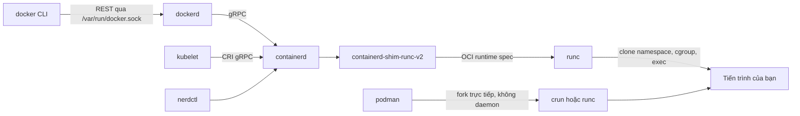
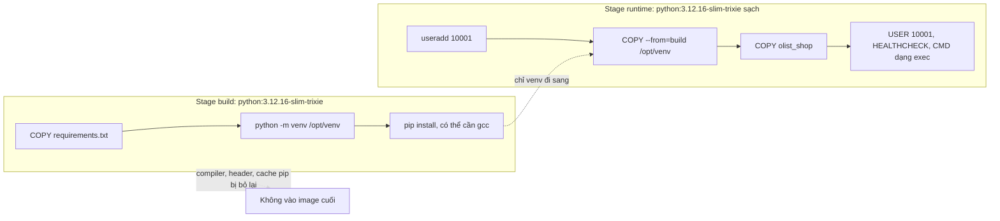
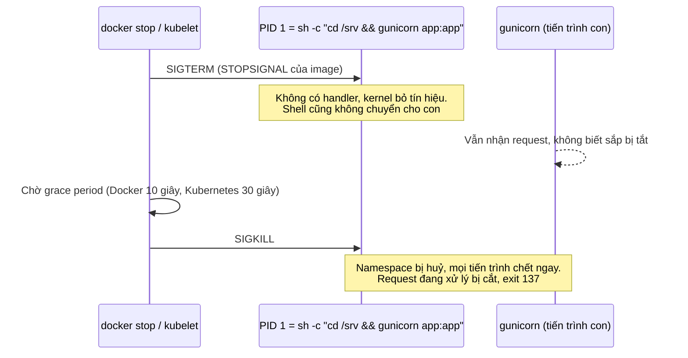

# Containers

[Module DE 08, mục 2 Docker](../../../data-engineer/modules/08-devops-for-data/README.md) dạy bạn viết Dockerfile để đóng gói một job dữ liệu và dựng vài service bằng compose. Module này đi tiếp ở mức
người vận hành nền tảng: hiểu container là gì dưới lớp vỏ (namespace, cgroup, OCI, runtime), build image nhỏ và tái lập được,
chạy chúng với ít quyền nhất có thể, xử lý đúng vòng đời tiến trình, quản lý image qua registry bằng digest, SBOM và chữ ký,
và quét lỗ hổng bằng trivy theo một chính sách thay vì nhìn con số đỏ.

Sau module này bạn sẽ:

- Giải thích một container là tổ hợp namespace, cgroup, capability, seccomp và overlay filesystem; vẽ được chuỗi từ `docker run`
  tới `runc`, và biết kubelet nói chuyện với runtime nào.
- Chọn đúng công cụ: Docker Engine, Podman, containerd, nerdctl, BuildKit, Buildah, Kaniko, LXC/LXD.
- Đọc build cache của BuildKit, sắp layer hợp lý, viết multi-stage, chọn image nền (slim, alpine, distroless, scratch) có lý do.
- Chạy container non-root, `no-new-privileges`, bỏ capability, rootfs chỉ đọc, có giới hạn tài nguyên; hiểu rootless Docker.
- Chẩn đoán sự cố vòng đời: PID 1 nuốt SIGTERM, exit 137, zombie, healthcheck sai.
- Tham chiếu image bằng digest, sinh SBOM, ký và kiểm chữ ký; viết gate trivy ổn định trước biến động của DB lỗ hổng.

## 0. Cài đặt

| Công cụ / image | Phiên bản đã kiểm | Tối thiểu cho bài tập | Dùng ở |
| --- | --- | --- | --- |
| Docker Engine | 29.9.2 | 24.0 (đã cài từ [SETUP.md](../../../../setup/SETUP.md)) | Mọi bài có `tests/` chạy Docker |
| docker buildx (BuildKit) | buildx 0.38.1, BuildKit 0.34.0, builder driver `docker` | builder driver `docker` | Mọi bài build image |
| docker compose | 5.6.1 | 2.24.4 | Ví dụ trong lý thuyết, capstone m03 |
| Image `python` | `python:3.12.16-slim-trixie`, `python:3.12.16-alpine3.24` | Đúng tag này | Basic 01, 02; Intermediate 01, 02 |
| Image distroless | `gcr.io/distroless/python3-debian13:nonroot` (ghim digest bên dưới) | Đúng digest này | Lời giải Intermediate 02 |
| trivy | 0.76.1 | 0.76 | Intermediate 02 |

### Kiểm Docker và BuildKit

```bash
docker version --format 'client {{.Client.Version}} server {{.Server.Version}}' &&
docker buildx version &&
docker buildx inspect | grep -E '^(Driver|BuildKit version):|^ *BuildKit version' &&
docker info --format 'storage={{.Driver}} cgroup=v{{.CgroupVersion}} security={{json .SecurityOptions}}'
```

Kết quả trên máy viết bài:

```text
client 29.9.2 server 29.9.2
github.com/docker/buildx v0.38.1 0dbe87f36ed472fe36b6796c3f70b4210a731fc5
Driver:        docker
BuildKit version: v0.34.0
storage=overlayfs cgroup=v2 security=["name=apparmor,profile=default","name=seccomp,profile=builtin","name=cgroupns"]
```

Test build image bằng builder **driver `docker`** của context hiện tại (BuildKit nằm sẵn trong dockerd), vì driver này áp
`--cpuset-cpus` và `--memory` lên bước `RUN`. Nếu bạn đã `docker buildx use` một builder `docker-container`, test skip và báo;
chuyển lại bằng `docker buildx use default`. `storage=overlayfs` kèm `driver-type: io.containerd.snapshotter.v1` trong
`docker info` nghĩa là Docker dùng image store của containerd (mặc định từ Docker 29); `overlay2` là store cũ, bài tập chạy được
với cả hai. Nếu `security` có `name=rootless`, bạn đang chạy rootless Docker (mục 3): bài tập vẫn chạy, riêng giới hạn CPU và RAM
cần cgroup v2 có delegation.

### Tải image

```bash
docker pull python:3.12.16-slim-trixie && docker pull python:3.12.16-alpine3.24 &&
docker pull gcr.io/distroless/python3-debian13:nonroot@sha256:1c32c3720dc4c7f0c7dbe998737f32c200add6511eca7cec705008be488b87d6 &&
docker tag gcr.io/distroless/python3-debian13:nonroot@sha256:1c32c3720dc4c7f0c7dbe998737f32c200add6511eca7cec705008be488b87d6 \
  gcr.io/distroless/python3-debian13:nonroot &&
docker image inspect --format '{{index .RepoDigests 0}}' python:3.12.16-slim-trixie python:3.12.16-alpine3.24
```

Digest đóng vai checksum của image: Docker kiểm SHA-256 của từng layer khi tải, và digest của manifest định danh đúng bản bạn
có. Digest lúc viết module:

| Image | Digest |
| --- | --- |
| `python:3.12.16-slim-trixie` | `sha256:8523d6abeb48ceae0b7240d30c5808fc26cb79c1a635bacdf19cf3baecfbec07` |
| `python:3.12.16-alpine3.24` | `sha256:e6dae589c1c05976188fd3bd019afd091445fc533ed2ea29001beddc7368a9c8` |
| `gcr.io/distroless/python3-debian13:nonroot` | `sha256:1c32c3720dc4c7f0c7dbe998737f32c200add6511eca7cec705008be488b87d6` |

Tag của image `python` có thể được build lại (Debian hay Alpine vá lỗ hổng), khi đó digest bạn thấy khác bảng trên mà bài tập
vẫn chạy. Image distroless chỉ có tag cuộn (`nonroot`, `latest`), nên lệnh trên kéo đúng digest đã kiểm rồi gắn tag cho nó.
Test không bao giờ tự kéo image: thiếu image nào thì test skip kèm lệnh `docker pull` cần chạy.

### trivy

trivy là binary Go tĩnh, cài không cần `sudo`. Mỗi release có tệp `trivy_<phiên bản>_checksums.txt` (SHA-256 của mọi tệp, kèm
chữ ký Sigstore `.sigstore.json`). Hướng dẫn ghim hash của tarball Linux x86_64 và đối chiếu với cả tệp checksums: hash đã ghim
là giá trị đã được review, không phải thứ vừa tải cùng lúc với tarball.

| Tệp | SHA-256 |
| --- | --- |
| `trivy_0.76.1_Linux-64bit.tar.gz` | `c7cbe3137fb8a48a17574bede3dd6beb16742d1e9772929940fc90082c39d9c0` |

Máy khác (`Linux-ARM64`, `macOS-ARM64`...) lấy hash của đúng tệp trong `trivy_0.76.1_checksums.txt` của release, rồi tự đối
chiếu với trường `digest` trên trang release GitHub. Chạy từ một thư mục tạm mới:

```bash
TRIVY_VERSION=0.76.1 &&
TRIVY_FILE="trivy_${TRIVY_VERSION}_Linux-64bit.tar.gz" &&
TRIVY_SHA256=c7cbe3137fb8a48a17574bede3dd6beb16742d1e9772929940fc90082c39d9c0 &&
TRIVY_BASE="https://github.com/aquasecurity/trivy/releases/download/v${TRIVY_VERSION}" &&
cd "$(mktemp -d)" &&
curl -fsSLO --proto '=https' "${TRIVY_BASE}/${TRIVY_FILE}" &&
curl -fsSLO --proto '=https' "${TRIVY_BASE}/trivy_${TRIVY_VERSION}_checksums.txt" &&
grep -qx "${TRIVY_SHA256}  ${TRIVY_FILE}" "trivy_${TRIVY_VERSION}_checksums.txt" &&
echo "${TRIVY_SHA256}  ${TRIVY_FILE}" | sha256sum -c - &&
tar -xzf "${TRIVY_FILE}" trivy &&
mkdir -p ~/.local/bin &&
install -m 0755 trivy ~/.local/bin/trivy &&
which trivy && trivy --version
```

Khối nối mọi bước bằng `&&`: hash ghim không khớp tệp checksums của release (`grep -qx` thất bại), hoặc tarball không khớp hash
(`sha256sum -c` báo `FAILED`), thì dừng trước khi giải nén. macOS không có `sha256sum`: thay bằng `shasum -a 256 -c -`. Kết quả
trên máy viết bài (Pop!_OS 24.04, x86_64):

```text
trivy_0.76.1_Linux-64bit.tar.gz: OK
/home/<user>/.local/bin/trivy
Version: 0.76.1
```

Muốn kiểm cả chữ ký Sigstore (cần `cosign`, module 07): `cosign verify-blob --bundle trivy_0.76.1_checksums.txt.sigstore.json
--certificate-identity-regexp 'https://github.com/aquasecurity/trivy/' --certificate-oidc-issuer
https://token.actions.githubusercontent.com trivy_0.76.1_checksums.txt`. Kiểm chữ ký của tệp checksums rồi kiểm hash của
tarball theo tệp đó là chuỗi tin cậy đầy đủ.

**DB lỗ hổng.** trivy không chứa dữ liệu CVE trong binary; nó tải một DB (khoảng 1,6 GB giải nén) từ `mirror.gcr.io` (dự phòng
`ghcr.io`). Track dùng chung một thư mục cache cho mọi lệnh và mọi test:

```bash
mkdir -p ~/.cache/devops-track/trivy &&
trivy image --download-db-only --cache-dir ~/.cache/devops-track/trivy &&
trivy --version --cache-dir ~/.cache/devops-track/trivy
```

```text
Version: 0.76.1
Vulnerability DB:
  Version: 2
  UpdatedAt: 2026-11-01 01:13:06.496727497 +0000 UTC
  NextUpdate: 2026-11-02 01:13:06.496727277 +0000 UTC
  DownloadedAt: 2026-11-01 04:22:09.97138411 +0000 UTC
```

DB được build lại nhiều lần mỗi ngày từ NVD, advisory của các distro và GitHub Advisory Database. Hệ quả: **quét cùng một image
hôm nay và tuần sau cho kết quả khác** (CVE mới được công bố, mức độ được chấm lại, distro ra bản vá). Mặc định trivy tự tải DB
mới khi đã qua `NextUpdate`. Test của module chạy với `--skip-db-update --offline-scan` trên DB đang có, để một lần chạy không
phụ thuộc mạng; cập nhật DB bằng lệnh `--download-db-only` ở trên khi bạn muốn. Chưa có DB thì test thử tải về đúng thư mục
này, không tải được (không có mạng) thì skip. Vì vậy test **không bao giờ** đếm số CVE: xem mục 6 và Intermediate 02.

Thêm `--skip-version-check --disable-telemetry` khi chạy trong CI hay máy cần im lặng: trivy mặc định hỏi máy chủ của Aqua về bản
mới và gửi thống kê ẩn danh.

Gỡ:

```bash
rm -f ~/.local/bin/trivy && rm -rf ~/.cache/devops-track/trivy
```

### Dọn sau khi làm bài

Container, network và image do test tạo có nhãn `devops-ex=1`, tên bắt đầu bằng `devops-ex-`, và luôn bị xoá khi test kết thúc.
Ngắt test bằng `kill -9` mà còn sót thì dọn đúng những thứ có nhãn đó, không đụng tài nguyên khác của bạn:

```bash
docker ps -aq --filter label=devops-ex=1 | xargs -r docker rm -f &&
docker image ls -q --filter label=devops-ex=1 | xargs -r docker image rm -f &&
docker network ls -q --filter label=devops-ex=1 | xargs -r docker network rm
```

Build cache của BuildKit dùng chung cho mọi build trên máy và **không** tự dọn (test cố ý giữ để lần sau build nhanh và chạy
được khi không có mạng). Xem dung lượng bằng `docker buildx du`, dọn bằng `docker builder prune` (hỏi xác nhận; thêm
`--filter until=168h` để chỉ xoá cache cũ hơn một tuần).

### LXD (tuỳ chọn, không bài nào cần)

LXD cài bằng snap và cần quyền root để khởi tạo (`sudo snap install lxd && sudo lxd init --minimal`, rồi thêm user vào nhóm
`lxd`); Incus là fork cộng đồng, có gói trong Debian 13 và Ubuntu 24.04. Module chỉ dạy khái niệm và so sánh ở mục 1; module 09
(Ansible) và lab kubeadm tuỳ chọn ở module 10 mới dùng system container hay VM nhẹ.

## 1. Container dưới lớp vỏ: namespace, cgroup, OCI và runtime

DE 08 coi container là "một tiến trình đóng gói kèm dependency". Đúng, và chính xác hơn: container là **một tiến trình Linux
bình thường** mà kernel cho nhìn thấy một phần thế giới (namespace), cho dùng một phần tài nguyên (cgroup), và cho làm một phần
việc của root (capability, seccomp, LSM). Không có "container" nào trong kernel; chỉ có các cơ chế này, và runtime ghép chúng lại.

### Các mảnh ghép trong kernel

| Cơ chế | Cô lập hay giới hạn gì | Ví dụ thấy được |
| --- | --- | --- |
| PID namespace | Cây tiến trình riêng; tiến trình đầu tiên là PID 1 | `ps` trong container chỉ thấy vài tiến trình |
| Mount namespace | Bảng mount riêng; rootfs là layer của image | `/` trong container khác `/` của host |
| Network namespace | Interface, routing, iptables, cổng riêng | Container nào cũng có `eth0` và cổng 8000 riêng |
| UTS, IPC | Hostname; shared memory, semaphore | `hostname` ra ID container |
| User namespace | Ánh xạ UID: root trong container là UID thường ngoài host | Nền của rootless Docker, Podman (mục 3) |
| cgroup v2 | Giới hạn và đo CPU, RAM, PID, I/O | `--memory 256m` vượt thì bị OOM kill, exit 137 |
| Capability | Chia quyền root thành khoảng 40 quyền nhỏ | Docker mặc định giữ 14, bỏ `SYS_ADMIN`, `NET_ADMIN`... |
| seccomp | Lọc system call | Profile mặc định chặn khoảng 44 syscall như `mount`, `reboot`, `kexec_load` |
| AppArmor / SELinux | Chính sách truy cập bắt buộc | `docker-default` của AppArmor; nhãn `container_t` trên RHEL |
| overlayfs | Ghép các layer chỉ đọc với một layer ghi được | Sửa tệp trong container không đổi image |

Vì container dùng chung kernel với host, một lỗ hổng kernel hay một cấu hình nới lỏng (`--privileged`, mount `docker.sock`,
`--pid=host`) là đường thoát ra host. VM có kernel riêng nên ranh giới chắc hơn, đổi lại nặng hơn. Đó là lý do các nền tảng chạy
code không tin cậy dùng sandbox như gVisor (kernel giả lập ở user space) hay Kata Containers và Firecracker (micro VM cho từng
container).

### OCI và chuỗi runtime

Open Container Initiative chuẩn hoá ba thứ: **image spec** (manifest, config, layer dạng tar), **runtime spec** (`config.json`
mô tả namespace, mount, cgroup cho một container) và **distribution spec** (API của registry). Nhờ đó image build bằng Docker chạy
được trên Podman, containerd, CRI-O; registry nào cũng nhận.



- **runc** (hoặc **crun**, viết bằng C, nhanh hơn, mặc định của Podman trên Fedora/RHEL) là low-level runtime: đọc `config.json`,
  tạo namespace và cgroup, `exec` tiến trình rồi thoát.
- **containerd** là high-level runtime: kéo và lưu image, quản lý snapshot, vòng đời container, nói CRI với kubelet. Shim giữ
  container sống khi containerd khởi động lại.
- **dockerd** thêm API của Docker, network, volume, build (BuildKit) phía trên containerd. Kubernetes từ 1.24 không còn nói chuyện
  với dockerd (bỏ dockershim); kind, EKS, GKE, AKS dùng containerd, OpenShift dùng CRI-O.

### So sánh công cụ

| Công cụ | Vai trò | Daemon | Rootless | Dùng khi |
| --- | --- | --- | --- | --- |
| Docker Engine | CLI, API, build, network, volume trên containerd | `dockerd` chạy root (hoặc rootless mode) | Có (rootless mode) | Máy dev, CI đơn giản, server đơn lẻ; hệ sinh thái lớn nhất (compose, Desktop) |
| Podman | Engine không daemon, CLI tương thích docker, có pod | Không (mỗi lệnh là tiến trình của user; có API socket tuỳ chọn) | Có, là mặc định tự nhiên | RHEL/Fedora, máy cấm daemon root, chạy container bằng systemd (Quadlet), sinh YAML Kubernetes |
| containerd | Runtime cấp cao, CRI cho kubelet | `containerd` | Có (rootless containerd) | Node Kubernetes; nền của Docker; ít khi dùng trực tiếp |
| nerdctl | CLI giống docker cho containerd, có compose | Dùng daemon containerd | Có | Debug trên node Kubernetes, dùng containerd không cần Docker, thử tính năng mới (lazy pull, IPFS) |
| BuildKit | Engine build: DAG, cache, secret, multi-platform, SBOM | `buildkitd` (nằm sẵn trong dockerd) | Có (rootless buildkitd) | Mọi `docker build` hiện đại; CI cần cache ra registry, attestation |
| Buildah | Build image OCI không daemon, cả từ Dockerfile lẫn từng lệnh shell | Không | Có | CI không privileged, script build tuỳ biến, hệ sinh thái Red Hat |
| Kaniko | Build Dockerfile trong container không daemon, không privileged | Không | Chạy như root trong container, không cần privileged | Từng phổ biến trên Kubernetes/GitLab; repo gốc của Google đã lưu trữ (archived) năm 2025, chỉ còn fork bảo trì |

Quy tắc chọn: build trên máy có Docker thì dùng `docker build` (là BuildKit); CI trên Kubernetes không privileged thì BuildKit
rootless hoặc Buildah (Advanced 02); chạy container ở máy cấm daemon root thì Podman; debug node Kubernetes thì nerdctl hoặc
`crictl`.

### LXC/LXD, application container và VM

LXC dùng đúng các cơ chế kernel trên (namespace, cgroup) nhưng nhắm tới **system container**: một hệ điều hành đầy đủ với
`systemd` làm init, nhiều service, đăng nhập SSH như một máy. Docker nhắm tới **application container**: một tiến trình (hoặc một
nhóm nhỏ), image bất biến, thay container thay vì vá nó. LXD (Canonical) là trình quản lý phía trên LXC, có API, cluster, image
server, và quản lý được cả VM (QEMU) bằng cùng lệnh; Incus là fork cộng đồng của LXD từ 2023.

| | VM (KVM, VMware) | System container (LXC/LXD, Incus) | Application container (Docker, Podman) |
| --- | --- | --- | --- |
| Kernel | Riêng | Dùng chung host | Dùng chung host |
| Init | Có, đầy đủ | `systemd` thật | Thường không; tiến trình app là PID 1 |
| Khởi động | Hàng chục giây | Vài giây | Dưới một giây |
| Vòng đời | Lâu dài, vá tại chỗ | Lâu dài, vá tại chỗ | Ngắn, bất biến, thay mới khi đổi |
| Đóng gói | Ảnh đĩa | Ảnh rootfs của distro | Image OCI nhiều layer |
| Hợp với | Kernel khác, OS khác, cô lập mạnh, đa thuê bao | Thay VM nhẹ, lab nhiều máy, thử Ansible, chạy app cũ cần systemd | Microservice, CI, Kubernetes |

## 2. Image, layer và build cache

### Image gồm những gì

Một image OCI là: **manifest** (danh sách layer và config, mỗi thứ định danh bằng digest SHA-256), **config** (`User`, `Cmd`,
`Entrypoint`, `Env`, `Healthcheck`, lịch sử build) và các **layer** (tar của thay đổi filesystem). Image đa kiến trúc có thêm
**index** trỏ tới manifest của từng platform (`linux/amd64`, `linux/arm64`). Mọi thứ được định danh theo nội dung, nên hai image
dùng chung image nền chỉ lưu và tải layer nền một lần.

Layer chỉ cộng dồn. `RUN rm -rf /var/lib/apt/lists/*` ở bước sau không làm nhỏ layer `apt-get install` trước đó: nó thêm một
"whiteout" che tệp đi, còn dữ liệu vẫn nằm trong layer cũ và ai pull image cũng đọc được. Vì vậy tạo và dọn phải ở cùng một
`RUN`, và bí mật đã vào một layer là đã lộ (Basic 02).

### BuildKit và cache

BuildKit dịch Dockerfile thành một đồ thị phụ thuộc, chạy song song các nhánh độc lập (các stage không phụ thuộc nhau), và tính
cache key cho mỗi bước:

- `FROM`: digest của image nền.
- `COPY`/`ADD`: checksum nội dung (và metadata) các tệp được chép, không phải thời gian sửa.
- `RUN`: chuỗi lệnh cộng key của bước trước. BuildKit **không** biết lệnh có tải gì từ mạng: `RUN apt-get update` được cache vĩnh
  viễn cho tới khi một bước trước nó đổi.

Một bước đổi thì mọi bước sau trong cùng stage build lại. Nguyên tắc: thứ ít đổi đặt trước (image nền, gói hệ thống, manifest
dependency, cài dependency), thứ hay đổi đặt sau (mã nguồn). Đo được bằng `docker history`: layer lấy từ cache giữ nguyên thời
điểm tạo.

Các tính năng BuildKit đáng dùng:

| Cú pháp | Làm gì | Vì sao |
| --- | --- | --- |
| `RUN --mount=type=cache,target=/root/.cache/pip` | Thư mục cache bền giữa các build, không vào image | `requirements.txt` đổi một dòng thì pip không tải lại mọi thứ |
| `RUN --mount=type=secret,id=npmrc` | Bí mật chỉ có mặt trong bước đó | Không lộ trong layer hay `docker history` như `ARG`/`ENV` |
| `RUN --mount=type=bind,source=...` | Đọc tệp từ context mà không tạo layer | Cài từ lock file mà không chép nó vào image |
| `COPY --link` | Layer độc lập với layer bên dưới | Đổi image nền không phải chép lại layer |
| `--cache-to/--cache-from type=registry` | Cache ra registry | Runner CI mới tinh vẫn có cache (module 07) |
| `--sbom=true --provenance=mode=max` | Đính kèm SBOM và provenance SLSA vào image | Chuỗi cung ứng (mục 5) |

`.dockerignore` loại tệp khỏi build context trước khi gửi cho builder: nhanh hơn, cache ổn định hơn, và `.env`, `.git`, dump DB
không bao giờ tới builder. Viết dạng allowlist (`*` rồi `!...`) an toàn hơn liệt kê thứ cần loại.

### Multi-stage



Image cuối chỉ chứa stage cuối cùng (hoặc stage chọn bằng `--target`). Compiler, header, cache của trình quản lý gói ở lại stage
build. Với Go hay Rust, stage runtime có thể là `scratch` hoặc `distroless/static`: chỉ một binary. Với Python và Node.js, stage
runtime cần interpreter, nên venv hoặc `node_modules` được chép sang image cùng distro và cùng phiên bản interpreter với stage
build. Basic 01 đo: image API Olist Shop từ 869 MB xuống 293 MB, phần lớn nhờ bỏ `build-essential` mà app không cần.

### Chọn image nền

| Image nền | Kích thước (Python) | Shell, trình quản lý gói | libc | Ưu | Nhược |
| --- | --- | --- | --- | --- | --- |
| `python:3.12` (Debian đầy đủ) | khoảng 1 GB | Có | glibc | Có sẵn compiler và thư viện dev | Rất nhiều gói, nhiều CVE, chỉ hợp làm stage build |
| `python:3.12-slim` | khoảng 125-180 MB | Có (`apt`) | glibc | Tương thích wheel manylinux, dễ debug | Vẫn khoảng 90 gói Debian |
| `python:3.12-alpine` | khoảng 50-75 MB | Có (`apk`) | musl | Nhỏ, ít gói, ít CVE báo cáo | Wheel manylinux không chạy, phải có wheel musllinux hoặc build từ nguồn; khác biệt DNS, cấp phát bộ nhớ |
| `gcr.io/distroless/python3-debian13` | khoảng 90 MB | Không | glibc | Không shell, không trình quản lý gói, `nonroot` sẵn | Python theo bản của Debian (3.13); khó debug; vẫn mang CVE của gói Debian |
| `scratch` / `distroless/static` | vài MB cộng binary | Không | Không có | Bề mặt tấn công nhỏ nhất | Chỉ cho binary tĩnh (Go, Rust); thiếu CA cert, tzdata nếu quên chép |
| Chainguard, Wolfi, UBI micro | thay đổi | Tuỳ biến thể | glibc | Build lại hằng ngày, ít CVE, SBOM sẵn | Bản miễn phí chỉ có tag `latest`; cần đánh giá nhà cung cấp |

Không có lựa chọn đúng cho mọi trường hợp. Số liệu đo ngày 2026-11-01 ở mục 6: lúc đó image distroless ít gói như
alpine nhưng tổng CVE cao hơn cả slim, vì cách Debian và Alpine ghi nhận lỗ hổng khác nhau (con số sẽ đổi khi bạn đo lại). Hỏi thứ cần hỏi: image có thứ gì không dùng lúc chạy, và các
lỗ hổng **có bản vá** ở đâu.

## 3. Chạy container an toàn

Docker mặc định đã cô lập khá tốt (namespace, seccomp, AppArmor, bỏ một nửa capability), nhưng tiến trình trong container vẫn
là **root** và có thể leo quyền. Mỗi lớp dưới đây giảm thiệt hại khi app bị chiếm.

### Non-root và quyền tệp

`USER 10001:10001` trong Dockerfile (UID số, để Kubernetes kiểm được `runAsNonRoot`). Mã nguồn thuộc root và chỉ đọc với user
của app: kẻ tấn công chiếm được tiến trình không sửa được code. Cổng dưới 1024 cần `NET_BIND_SERVICE`; đơn giản hơn là app nghe
8000 và để proxy hay Service ánh xạ cổng 80.

### Capability, no-new-privileges, seccomp

```bash
docker run --rm --cap-drop ALL --security-opt no-new-privileges --read-only --tmpfs /tmp \
  --user 10001:10001 --memory 256m --pids-limit 128 python:3.12.16-alpine3.24 \
  python3 -c "print(open('/proc/self/status').read().split('CapEff:')[1].split()[0])"
```

In `0000000000000000`: không còn capability nào. `--cap-drop ALL` rồi chỉ thêm đúng thứ cần (`--cap-add NET_BIND_SERVICE`).
`no-new-privileges` đặt cờ kernel `PR_SET_NO_NEW_PRIVS`: binary setuid (`su`, `sudo`, `ping` cũ) không còn tăng quyền được. Mọi
container do test của track dựng đều có cờ này. Profile seccomp mặc định đủ cho hầu hết app; đừng tắt (`seccomp=unconfined`) chỉ
vì một lỗi khó hiểu, hãy tìm syscall bị chặn.

### Rootfs chỉ đọc

`--read-only` (compose `read_only: true`, Kubernetes `readOnlyRootFilesystem: true`) chặn kẻ tấn công ghi binary, sửa cấu hình
hay chép công cụ vào container. App cần chỗ ghi thì gắn tmpfs (`--tmpfs /tmp`) hoặc volume đúng thư mục đó. Triệu chứng khi quên:
`OSError: [Errno 30] Read-only file system` lúc khởi động, hoặc tệp PID, socket, cache không tạo được. Image API ở Basic 01 chạy
được với `--read-only --tmpfs /tmp` vì app chỉ ghi SQLite vào `/tmp`.

### Giới hạn tài nguyên

| Cờ | Không đặt thì | Vượt thì |
| --- | --- | --- |
| `--memory 256m` | Một container rò bộ nhớ làm host swap hay OOM kill tiến trình khác | Kernel OOM kill trong cgroup: exit 137, `State.OOMKilled: true` |
| `--pids-limit 256` | Fork bomb chiếm hết PID của host | `fork: Resource temporarily unavailable` |
| `--cpus 1.5` | Một container chiếm hết CPU | Bị throttle (chậm), không bị kill |
| `--cpuset-cpus "$DEVOPS_CPUSET"` | Chạy trên mọi core | Chỉ chạy trên các core trong dải đó (cách track ghim CPU) |

Python không biết giới hạn cgroup: `os.cpu_count()` trả số core của host, nên pool worker mặc định có thể quá lớn so với
`--cpus`. Đặt số worker rõ ràng.

### docker.sock bằng root

Ai gọi được API Docker thì chạy được `docker run --privileged -v /:/host ... chroot /host`: shell root trên host. Mount
`/var/run/docker.sock` vào container (Portainer, Traefik cũ, runner CI) là trao quyền đó cho mọi thứ trong container. Thêm user
vào nhóm `docker` cũng vậy. Testkit của track từ chối mọi compose mount socket này. CI cần build image thì dùng builder không cần
socket (Advanced 02).

### Rootless Docker và user namespace

| Cách | Daemon chạy bằng | Root trong container là | Đánh đổi |
| --- | --- | --- | --- |
| Docker mặc định | root | root thật của host (bị giới hạn bởi capability, seccomp) | Đơn giản nhất; thoát container là root |
| `userns-remap` | root | UID thường của host (dải `/etc/subuid`) | Volume khó chia sẻ quyền; tắt cho cả daemon, không theo container |
| Rootless Docker (`dockerd-rootless-setuptool.sh install`) | User thường | UID thường của host | Cổng < 1024 cần cấu hình; mạng qua slirp4netns/pasta chậm hơn; giới hạn cgroup cần systemd delegation |
| Podman rootless | Không daemon, tiến trình của user | UID thường của host | Như rootless Docker; tích hợp systemd tốt |

Rootless dựa trên user namespace: dải UID trong `/etc/subuid` (ví dụ `bangbc:100000:65536`) được ánh xạ thành UID 0-65535 trong
container. Thoát được container thì kẻ tấn công chỉ là UID 100000 vô danh trên host. Kubernetes có user namespace cho pod
(`hostUsers: false`): có từ v1.28, stable (GA) từ v1.36 theo tài liệu kubernetes.io; cần kernel 6.3 trở lên, containerd 2.0 hoặc
CRI-O 1.25, runc 1.2 hoặc crun 1.9. Module 11 dùng lại.

## 4. Vòng đời tiến trình: PID 1, tín hiệu và healthcheck

### Dạng exec và dạng shell

| Viết trong Dockerfile | Docker ghi thành | PID 1 là |
| --- | --- | --- |
| `CMD ["uvicorn", "app:app"]` | `["uvicorn", "app:app"]` | uvicorn |
| `CMD uvicorn app:app` | `["/bin/sh", "-c", "uvicorn app:app"]` | `sh` (trên Debian trixie, `dash` không `exec` lệnh trong `-c`) |
| `CMD cd /srv && gunicorn app:app` | `["/bin/sh", "-c", "cd /srv && gunicorn app:app"]` | `sh`; gunicorn là con |
| `ENTRYPOINT ["tini", "--"]` cộng `CMD ["gunicorn", "app:app"]` | Như viết | `tini`, chuyển tín hiệu cho gunicorn |

### PID 1 khác mọi tiến trình khác

Kernel đối xử đặc biệt với tiến trình init của một PID namespace: tín hiệu gửi tới nó chỉ được giao nếu nó **đã cài handler** cho
tín hiệu đó (SIGKILL và SIGSTOP từ namespace cha là ngoại lệ). Hành vi mặc định "SIGTERM thì thoát" không áp dụng cho PID 1. Thêm
nữa, PID 1 phải `wait()` các tiến trình mồ côi, nếu không chúng thành zombie và chiếm PID tới khi đụng `--pids-limit`.



Với ví dụ trên: viết CMD dạng exec với `WORKDIR /srv` thay cho `cd` để gunicorn là PID 1 (app phải tự xử lý SIGTERM, gunicorn
có sẵn); dùng init nhỏ `tini` làm PID 1 để chuyển tín hiệu và dọn zombie khi app sinh tiến trình con; hoặc `docker run --init` /
compose `init: true` khi không sửa được image. `STOPSIGNAL SIGQUIT` cho Nginx dừng êm, `SIGINT` cho vài app chỉ bắt Ctrl-C.
Triệu chứng chung để nhận ra: mọi lần dừng mất đúng bằng grace period và kết thúc bằng 137.

### Mã thoát

| Mã | Nghĩa | Hay gặp vì |
| --- | --- | --- |
| 0 | Thoát bình thường | Dừng sạch |
| 1, 2 | Lỗi của app | Exception, cấu hình thiếu |
| 126 | Lệnh không chạy được | Thiếu quyền thực thi (`chmod +x`), sai kiến trúc |
| 127 | Không tìm thấy lệnh | Sai `PATH`, thiếu binary trong image distroless/alpine |
| 137 | 128 + 9: SIGKILL | OOM kill (`OOMKilled: true`) hoặc hết grace period sau `docker stop` |
| 139 | 128 + 11: SIGSEGV | Thư viện C hỏng, wheel glibc chạy trên musl |
| 143 | 128 + 15: SIGTERM | App thoát theo mặc định khi nhận SIGTERM mà không có handler (không phải PID 1) |

### HEALTHCHECK

```dockerfile
HEALTHCHECK --interval=15s --timeout=3s --start-period=10s --retries=3 \
  CMD ["python", "-c", "import urllib.request; urllib.request.urlopen('http://127.0.0.1:8000/healthz', timeout=2)"]
```

Docker chạy lệnh trong container theo chu kỳ; `retries` lần fail liên tiếp thì trạng thái thành `unhealthy`. Docker Engine **không**
tự khởi động lại container unhealthy (Swarm thì có); compose dùng nó cho `depends_on: condition: service_healthy`, `docker compose
up --wait` chờ nó. Kubernetes **bỏ qua** HEALTHCHECK của image và dùng liveness, readiness, startup probe (module 10). Các bẫy:

- Healthcheck gọi `curl` trong image không có `curl`: luôn unhealthy. Dùng chính runtime của app (Python, Node) hoặc một binary
  healthcheck nhỏ.
- Healthcheck gọi endpoint chạm DB: DB chậm làm mọi API "unhealthy" cùng lúc. Liveness chỉ hỏi "tiến trình còn phục vụ được
  không"; sự sẵn sàng của dependency là readiness.
- `start-period` quá ngắn với app khởi động chậm (JVM, nạp model) làm container bị coi là hỏng trước khi kịp lên.

## 5. Registry, tag, digest và chuỗi cung ứng

### Tên image

`ghcr.io/olist/olist-api:1.8.2@sha256:9f2c...` gồm registry (`ghcr.io`, bỏ trống là `docker.io`), namespace và repository
(`olist/olist-api`), tag (`1.8.2`, bỏ trống là `latest`) và digest. Khi có cả tag và digest, runtime kéo theo digest, tag chỉ để
người đọc.

### Tag và digest

| | Tag | Digest |
| --- | --- | --- |
| Là gì | Con trỏ do người đẩy đặt | SHA-256 của manifest |
| Đổi được không | Được: đẩy bản mới cùng tag là tag trỏ chỗ khác | Không: nội dung khác thì digest khác |
| Dùng cho | Người đọc, chọn dòng phiên bản | Deploy, tái lập build, kiểm chữ ký |
| Rủi ro | Hai node kéo cùng tag ở hai thời điểm chạy hai bản khác nhau; tag bị xoá | Không tự nhận bản vá: phải có quy trình cập nhật |

Image chính thức được build lại dưới cùng tag khi distro vá lỗ hổng, nên ghim digest nghĩa là phải chủ động cập nhật: Renovate
hay Dependabot mở PR đổi digest, CI build và quét, merge. Registry nên bật tag immutability cho tag phát hành (ECR, Harbor, Google
Artifact Registry có tuỳ chọn này) để `1.8.2` không bao giờ bị đẩy đè.

### Registry

| Registry | Ghi chú |
| --- | --- |
| Docker Hub | Mặc định; giới hạn số lần pull cho người dùng ẩn danh và tài khoản miễn phí, nên production đi qua pull-through cache |
| GitHub Container Registry (`ghcr.io`) | Gắn với repo và quyền GitHub, token OIDC của Actions đẩy được không cần secret |
| Amazon ECR, Google Artifact Registry, Azure Container Registry | Gắn IAM của cloud, quét lỗ hổng sẵn, replication giữa region |
| Harbor, Quay | Tự host: RBAC, quét, ký, replication, proxy cache; Harbor là dự án CNCF graduated |
| `registry:2` (distribution) | Registry tối giản tự chạy; module 07 dựng một cái local cho CI |

### SBOM, provenance và chữ ký

- **SBOM** (Software Bill of Materials) liệt kê mọi gói trong image kèm phiên bản và purl, theo chuẩn SPDX hoặc CycloneDX. Có SBOM
  thì khi một CVE mới được công bố (như Log4Shell), bạn trả lời "image nào bị ảnh hưởng" bằng một truy vấn thay vì quét lại mọi
  thứ. Sinh bằng `trivy image --format cyclonedx`, `syft`, hoặc BuildKit `--sbom=true` (đính kèm image dưới dạng attestation).
- **Provenance** (SLSA) ghi image được build từ commit nào, bằng workflow nào, với tham số gì: `--provenance=mode=max`.
- **Chữ ký**: cosign (Sigstore) ký digest của image; chế độ keyless dùng token OIDC của CI làm danh tính, chữ ký ghi vào log minh
  bạch Rekor. Notation (Notary v2) là phương án khác. Ký mà không kiểm thì vô ích: admission controller (Kyverno `verifyImages`,
  Sigstore policy-controller) từ chối image không có chữ ký hợp lệ từ đúng workflow.

## 6. Quét lỗ hổng với trivy

### trivy làm gì

1. **Liệt kê gói**: đọc database gói của OS (`/var/lib/dpkg/status`, `/lib/apk/db/installed`, `rpm`) và metadata của gói ngôn ngữ
   (`site-packages/*.dist-info`, `package-lock.json`, `go.sum`, `pom.xml`, binary Go). Không cần DB lỗ hổng cho bước này: đó là
   cách sinh SBOM.
2. **Đối chiếu DB**: so phiên bản từng gói với advisory của chính distro (Debian Security Tracker, Alpine secdb, Red Hat OVAL), GitHub
   Advisory Database, NVD.
3. **Báo cáo** theo mức độ (`CRITICAL`, `HIGH`, `MEDIUM`, `LOW`, `UNKNOWN`) và trạng thái (`fixed` có bản vá, `affected` chưa vá,
   `will_not_fix`, `fix_deferred`, `end_of_life`).

Ngoài image, trivy quét `fs` (thư mục mã nguồn và lock file), `repo`, `sbom` (SBOM có sẵn, kể cả của vendor), `config` (cấu hình
sai trong Dockerfile, Kubernetes YAML, Terraform), `k8s` (cluster đang chạy), và bí mật lọt trong tệp (`--scanners secret`).

### Gate ổn định trước biến động của DB

Vì DB đổi hằng ngày, một gate "fail nếu có CVE" hôm nay xanh mai đỏ dù không ai đổi gì. Gate tốt mã hoá **chính sách**, không
phải con số:

```yaml
severity: [HIGH, CRITICAL]
exit-code: 1
ignorefile: .trivyignore.yaml
vulnerability:
  ignore-unfixed: true
```

- Chỉ chặn thứ hành động được ngay: HIGH/CRITICAL **có bản vá**. Lỗ hổng chưa có bản vá theo dõi riêng (dashboard, rà soát định
  kỳ), không chặn release.
- Ngoại lệ là dữ liệu trong repo: `.trivyignore.yaml` khoanh theo purl, có `statement` và `expired_at`. Hết hạn thì trivy báo lại,
  buộc xem lại. Tuyên bố "không bị ảnh hưởng" của vendor đi theo chuẩn VEX (`--vex`).
- Tách gate lúc build (chặn image mới) với quét định kỳ image đang chạy (mở ticket theo thời hạn vá, không chặn hotfix).
- Cache DB trong CI và ghi phiên bản DB (`trivy --version`) vào log để giải thích được vì sao hai lần chạy khác nhau.

### Đọc con số cho đúng

Số liệu đo ngày 2026-11-01 (DB cùng ngày):

| Image | Gói | CVE mọi mức | Có bản vá |
| --- | --- | --- | --- |
| `python:3.12.16-slim-trixie` | 88 | 172 | 6, đều ở `pip` |
| `python:3.12.16-alpine3.24` | 39 | 6 | 6, đều ở `pip` |
| `gcr.io/distroless/python3-debian13:nonroot` | 38 | 176 | 0 |

Lúc đo ngày 2026-11-01, distroless ít gói như alpine mà tổng CVE còn cao hơn slim: các gói Debian còn lại mang mọi CVE Debian
đánh dấu "affected" (phần lớn LOW/MEDIUM, nhiều cái không áp dụng trong container). Alpine báo ít một phần vì secdb của Alpine chỉ
ghi lỗ hổng đã vá. Khi bạn đo lại, con số sẽ khác: image được build lại, DB được cập nhật, thứ hạng có thể đảo. Bài học thì giữ
nguyên: ít gói không có nghĩa là không có CVE; độ mới của image nền (build lại gần đây chưa, có digest mới chưa) quan trọng ngang
việc chọn loại image; và lỗ hổng có bản vá hôm đó đều nằm ở `pip`, thứ một job không cần lúc chạy. Kết luận cho chính sách: đo số
gói và lỗ hổng có bản vá, gỡ thứ không dùng, rebuild khi image nền có bản mới, và đừng chọn image chỉ vì tổng CVE nhỏ.

### Các scanner khác

| Công cụ | Điểm mạnh | Lưu ý |
| --- | --- | --- |
| Trivy | Một binary, quét image, fs, SBOM, IaC, Kubernetes, bí mật; offline được | DB lớn; cấu hình nhiều tầng |
| Grype (Anchore) | Đi cặp với syft (SBOM), nhanh, xuất nhiều định dạng | Chỉ lỗ hổng, không IaC |
| Docker Scout | Tích hợp Docker Desktop và Hub, gợi ý image nền | Cần tài khoản Docker, tính năng theo gói |
| Snyk Container | Gợi ý nâng cấp, tích hợp IDE và PR | Thương mại, giới hạn ở bản miễn phí |
| Clair (Quay) | Chạy như service cho registry | Vận hành phức tạp hơn một CLI |

## 7. Tài liệu tham khảo

- Docker Docs, "Building best practices" và "Multi-stage builds": https://docs.docker.com/build/building/best-practices/,
  https://docs.docker.com/build/building/multi-stage/
- Docker Docs, "Optimize cache usage in builds" và "Build secrets": https://docs.docker.com/build/cache/optimize/,
  https://docs.docker.com/build/building/secrets/
- Docker Docs, Dockerfile reference (`HEALTHCHECK`, `STOPSIGNAL`, dạng exec và shell): https://docs.docker.com/reference/dockerfile/
- Docker Docs, "Rootless mode" và "Isolate containers with a user namespace": https://docs.docker.com/engine/security/rootless/,
  https://docs.docker.com/engine/security/userns-remap/
- Docker Docs, "Docker Engine security" và "Seccomp security profiles": https://docs.docker.com/engine/security/,
  https://docs.docker.com/engine/security/seccomp/
- Open Container Initiative, image, runtime và distribution spec: https://github.com/opencontainers
- Kernel man pages: `namespaces(7)`, `pid_namespaces(7)` (mục về tín hiệu tới init), `cgroups(7)`, `capabilities(7)`:
  https://man7.org/linux/man-pages/man7/pid_namespaces.7.html
- tini, "What is advantage of Tini?": https://github.com/krallin/tini
- Kubernetes Docs, "Container Runtimes" và "Dockershim removal FAQ": https://kubernetes.io/docs/setup/production-environment/container-runtimes/
- Podman Docs và "Rootless containers": https://docs.podman.io/
- BuildKit, rootless mode: https://github.com/moby/buildkit/blob/master/docs/rootless.md
- Buildah: https://buildah.io/
- Kaniko (repo đã lưu trữ): https://github.com/GoogleContainerTools/kaniko
- nerdctl: https://github.com/containerd/nerdctl
- Canonical LXD Docs: https://documentation.ubuntu.com/lxd/ ; Incus: https://linuxcontainers.org/incus/
- Google, distroless: https://github.com/GoogleContainerTools/distroless
- Trivy Docs: cài đặt, cấu hình, filtering (`.trivyignore.yaml`), VEX, cache DB: https://trivy.dev/latest/docs/
- Sigstore cosign: https://docs.sigstore.dev/ ; SLSA: https://slsa.dev/ ; CycloneDX: https://cyclonedx.org/ ; SPDX: https://spdx.dev/
- OpenVEX: https://github.com/openvex/spec
- NIST SP 800-190, "Application Container Security Guide": https://csrc.nist.gov/pubs/sp/800/190/final
- CIS Docker Benchmark: https://www.cisecurity.org/benchmark/docker
