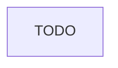

# Build image không cần socket Docker cho CI của Olist

## 1. Bối cảnh

TODO: hiện trạng runner CI, số build mỗi ngày, yêu cầu của bảo mật và của team, ràng buộc của đề.

## 2. Hiện trạng và rủi ro

- TODO

## 3. So sánh phương án

| Phương án | Cần daemon | Cần privileged | Cache | Đánh đổi |
| --- | --- | --- | --- | --- |
| TODO | TODO | TODO | TODO | TODO |

## 4. Quyết định

Lựa chọn: TODO

TODO: vì sao chọn, chấp nhận đánh đổi gì, khi nào xem lại.

## 5. Kiến trúc

## 6. Kế hoạch chuyển đổi

1. TODO

## 7. Kiểm chứng và rủi ro còn lại

- TODO
