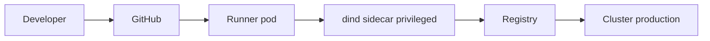

# Build image không cần socket Docker cho CI của Olist

## 1. Bối cảnh

Runner CI của Olist chạy trên một cluster Kubernetes dùng chung với các service nội bộ. Mỗi ngày có khoảng 300 build image
cho 25 repository. Hiện mỗi job build mount /var/run/docker.sock của node vào pod để gọi docker build. Bảo mật yêu cầu bỏ
mount socket. Team muốn giữ Dockerfile như cũ, giữ tốc độ build nhờ cache, và không phải học công cụ mới quá nhiều.

## 2. Hiện trạng và rủi ro

- Job nào cũng điều khiển được Docker daemon của node qua docker.sock, tức là có quyền root trên node.
- Một job có thể xem và xoá container của job khác trên cùng node.
- Cache build nằm trên node, job chạy ở node khác thì build lại từ đầu.

## 3. So sánh phương án

| Phương án | Cần daemon | Cần privileged | Cache | Đánh đổi |
| --- | --- | --- | --- | --- |
| Docker-in-Docker | Có, daemon riêng trong pod | Có | Mất khi pod chết | Quen thuộc, nhưng privileged |
| BuildKit rootless | Có, buildkitd không root | Không | Registry cache | Cần cấu hình user namespace |
| Buildah rootless | Không | Không | Layer cache cục bộ | Cú pháp khác docker build |
| Kaniko | Không | Không | Registry cache | Bản gốc đã ngừng bảo trì |

## 4. Quyết định

Lựa chọn: Docker-in-Docker

Chọn Docker-in-Docker vì team đã quen lệnh docker, không phải sửa script build nào, và daemon riêng trong mỗi pod nghĩa là
job không còn chạm vào daemon của node. Chấp nhận pod chạy privileged trong namespace ci-build riêng, có NetworkPolicy chặn
truy cập ra ngoài trừ registry. Xem lại sau sáu tháng.

## 5. Kiến trúc

## 6. Kế hoạch chuyển đổi

1. Tạo namespace ci-build.
2. Thêm sidecar dind vào template runner.
3. Đổi DOCKER_HOST của job sang sidecar.
4. Bỏ mount docker.sock.
5. Theo dõi thời gian build hai tuần.

## 7. Kiểm chứng và rủi ro còn lại

- Kiểm không pod nào mount docker.sock.
- Thời gian build tăng do mất cache.
- Pod privileged vẫn thoát ra node được nếu có lỗ hổng kernel.
- Cần giới hạn tài nguyên cho sidecar.
