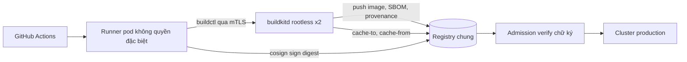

# Lời giải: build image rootless cho CI

Bài Advanced không có một đáp án duy nhất. Reviewer chấm việc bạn hiểu đúng mô hình đe doạ, so sánh bằng tiêu chí có thật
(daemon, quyền, cache, bảo trì), và kế hoạch có số đo. Dưới đây là các quyết định cốt lõi, rubric, và một tài liệu mẫu đã chạy
qua test.

## Các quyết định cốt lõi

- **Vì sao docker.sock là root.** Ai gọi được API của Docker daemon thì chạy được
  `docker run --privileged --pid=host -v /:/host alpine chroot /host`: một shell root trên node. Mọi job CI có socket là mọi
  người có quyền sửa workflow (kể cả PR từ fork nếu cấu hình sai) có root trên node đang chạy service khác. Job còn đọc được log,
  biến môi trường, image của job khác qua cùng daemon.
- **DinD không giải quyết được.** Docker-in-Docker cho mỗi job một daemon riêng (cô lập giữa các job tốt hơn) nhưng cần
  `privileged`, mà container privileged thoát ra node dễ dàng. Rootless DinD (`docker:dind-rootless`) vẫn cần tắt seccomp và
  AppArmor, và cache vẫn mất theo pod.
- **Kaniko không còn là lựa chọn mặc định.** Repo gốc `GoogleContainerTools/kaniko` đã lưu trữ năm 2025; fork của Chainguard có
  bảo trì nhưng team 3 người không muốn phụ thuộc một fork mà không có hợp đồng. Kaniko cũng chậm với Dockerfile multi-stage lớn
  (snapshot cả filesystem sau mỗi bước).
- **BuildKit rootless hay Buildah.** Cả hai không cần privileged. BuildKit là engine đứng sau `docker build`, hiểu Dockerfile y hệt
  (mount cache, secret, heredoc, multi-platform), xuất SBOM và provenance bằng cờ có sẵn, cache ra registry. Buildah (Red Hat)
  không daemon, rootless tốt, nhưng cache ra registry hạn chế hơn và một số cú pháp BuildKit (`RUN --mount=type=cache` có khác
  biệt) cần kiểm. Với yêu cầu giữ nguyên Dockerfile và giữ tốc độ: **BuildKit rootless**.
- **buildkitd dùng chung hay theo job.** buildkitd rootless chạy thành Deployment riêng trong namespace `ci-build` (2 bản, gọi
  qua mTLS) giữ cache cục bộ nóng; job chỉ có `buildctl` và chứng chỉ client, không có quyền gì trên node. Đổi lại daemon dùng
  chung là điểm tập trung: tách theo mức tin cậy (một buildkitd cho repo nội bộ, một cho PR từ fork, hoặc tắt build cho fork).
  Theo job (`buildctl-daemonless.sh` trong pod của job) cô lập hơn nhưng cache chỉ còn ở registry.
- **SBOM và chữ ký đi cùng build.** `buildctl build ... --opt attest:sbom= --opt attest:provenance=mode=max`, cosign ký digest
  sau khi push.

## Rubric (100 điểm)

| Tiêu chí | Điểm | Đạt đủ điểm khi |
| --- | --- | --- |
| Mô hình đe doạ | 15 | Giải thích cụ thể vì sao socket là root (lệnh ví dụ), rủi ro giữa các job, PR từ fork, node dùng chung với service khác |
| So sánh phương án | 20 | Ít nhất 4 phương án với tiêu chí daemon, root, privileged, cache, tương thích Dockerfile, trạng thái bảo trì (Kaniko archived), hiệu năng |
| Quyết định và đánh đổi | 15 | Chọn có lý do gắn với ràng buộc (giữ Dockerfile, ≤ 30% chậm hơn, 3 người, không fork); nói rõ chấp nhận mất gì, khi nào xem lại |
| Kiến trúc | 15 | Sơ đồ đúng: runner, builder, registry, cache, ký; ai có chứng chỉ gì; tách theo mức tin cậy |
| Cache và hiệu năng | 10 | Cache ra registry hoặc buildkitd dùng chung; đo trước/sau (p50, p95 thời gian build) |
| Kế hoạch chuyển đổi | 15 | Pilot, song song, cắt dần theo repo, cách rollback, mốc tắt socket hẳn, thông báo team |
| Kiểm chứng | 10 | Admission policy chặn pod mount docker.sock hay privileged trong namespace CI; kiểm định kỳ; SBOM có trên registry |

Trừ điểm: chọn phương án vẫn cần privileged (−20, test chặn); không nhắc cache (−10); chọn Kaniko bản gốc mà không nói trạng
thái bảo trì (−5).

## Tài liệu mẫu

`````markdown
# Build image không cần socket Docker cho CI của Olist

## 1. Bối cảnh

Runner CI tự host chạy dạng pod trên cluster Kubernetes dùng chung với vài service nội bộ. Mỗi ngày khoảng 300 lần build image
cho 25 repository, trung bình 4 phút nhờ cache layer trên node, p95 khoảng 9 phút. Mỗi job mount /var/run/docker.sock của node.
Bảo mật yêu cầu trong một quý: không mount socket, không pod CI privileged, job không đọc được tài nguyên của job khác, image có
SBOM. Ràng buộc của team platform 3 người: giữ nguyên Dockerfile của các team, thời gian build không tăng quá 30%, không tự bảo
trì fork của công cụ nào. Giả định: registry chung hỗ trợ OCI artifact (để chứa cache và SBOM), cluster cho phép user namespace.

## 2. Hiện trạng và rủi ro

- Job có docker.sock gọi được `docker run --privileged -v /:/host` và có shell root trên node, nơi cũng chạy service nội bộ.
- Mọi job trên cùng node dùng chung một daemon: đọc được `docker inspect` (biến môi trường, bí mật) và log của job khác.
- Ai sửa được workflow (kể cả PR từ fork nếu cấu hình sai) là có quyền trên.
- Cache nằm trên từng node, job sang node khác thì build nguội; không có SBOM.

## 3. So sánh phương án

| Phương án | Cần daemon | Cần privileged | Cache | Đánh đổi |
| --- | --- | --- | --- | --- |
| DinD | Có, daemon riêng mỗi pod | Có | Mất theo pod | Quen thuộc nhưng privileged thoát ra node dễ |
| BuildKit rootless | Có, buildkitd không root | Không, cần bỏ seccomp/AppArmor của pod | Cục bộ của buildkitd và registry | Chính là engine của docker build, hiểu Dockerfile y hệt, có SBOM và provenance |
| Buildah rootless | Không | Không | Cục bộ, registry hạn chế | Không daemon, nhưng một số cú pháp BuildKit cần kiểm lại |
| Kaniko | Không | Không | Registry | Repo gốc đã archived năm 2025, chậm với multi-stage lớn |
| Podman build | Không | Không | Cục bộ | Dùng Buildah bên dưới, hợp cho máy dev hơn CI |

## 4. Quyết định

Lựa chọn: BuildKit rootless

BuildKit là engine mà `docker build` đang dùng, nên Dockerfile của 25 repo chạy y nguyên, kể cả `RUN --mount=type=cache` và
`--mount=type=secret`. buildkitd chạy rootless thành Deployment hai bản trong namespace ci-build, job gọi bằng buildctl qua mTLS
và không có quyền gì trên node. Cache cục bộ của buildkitd giữ build nóng, cộng `--cache-to type=registry,mode=max` để không mất
khi buildkitd khởi động lại. SBOM và provenance xuất bằng cờ có sẵn. Chấp nhận: buildkitd dùng chung là điểm tập trung, nên PR từ
fork không được build trên buildkitd này; pod buildkitd cần `seccompProfile: Unconfined` và AppArmor unconfined. Xem lại sau 6
tháng hoặc khi cluster hỗ trợ user namespace cho pod ổn định.

## 5. Kiến trúc



## 6. Kế hoạch chuyển đổi

1. Tuần 1: dựng buildkitd rootless trong ci-build, đo p50 và p95 thời gian build của 5 repo đại diện với cả hai đường.
2. Tuần 2-3: thêm action dùng chung `olist/build-image` (buildctl, cache registry, SBOM, cosign), pilot với 5 repo.
3. Tuần 4-6: chuyển 20 repo còn lại theo đợt, mỗi đợt giữ đường cũ để rollback trong một tuần.
4. Tuần 7: bật Kyverno policy chặn pod mount docker.sock hoặc privileged trong namespace CI ở chế độ audit, rồi enforce.
5. Tuần 8: gỡ mount socket khỏi template runner, tổng kết số đo so với mốc tuần 1.
6. Sau đó: tách buildkitd riêng cho build không tin cậy, hoặc tắt build image cho PR từ fork.

## 7. Kiểm chứng và rủi ro còn lại

- Kyverno policy enforce trong namespace CI; job kiểm hằng ngày `kubectl get pods -A` không pod nào mount docker.sock.
- Thời gian build p95 so với mốc tuần 1, ngưỡng chấp nhận +30%; vượt thì tăng bản buildkitd hoặc tách cache theo repo.
- Pod buildkitd chạy không seccomp: giới hạn bằng NetworkPolicy, chỉ nhận kết nối từ runner, chỉ ra registry.
- buildkitd dùng chung có thể bị một build độc chiếm: đặt giới hạn tài nguyên và `max-parallelism`.
`````
