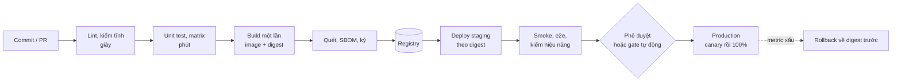
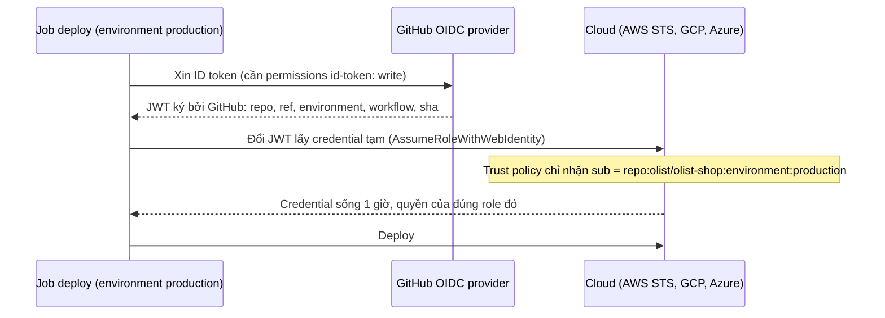
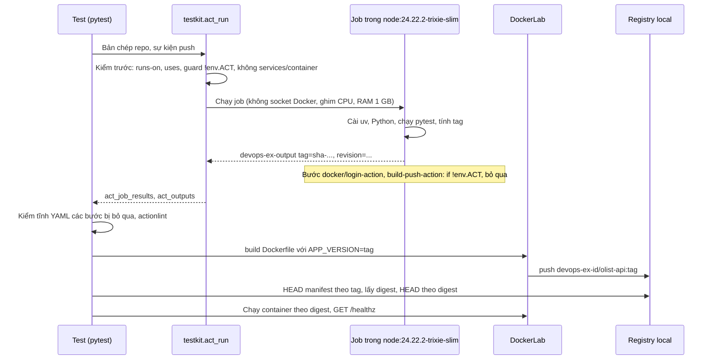
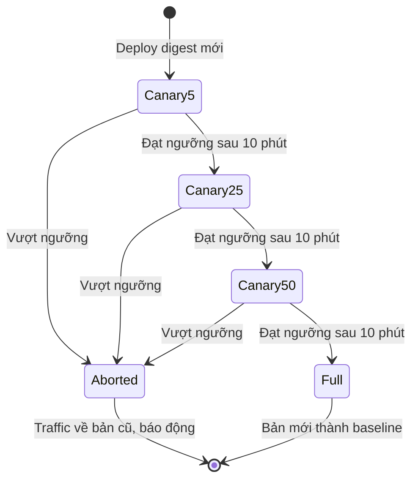

# CI/CD và artifact

Module DE 08 dạy bạn viết một workflow GitHub Actions chạy lint và test cho job dữ liệu. Module này đi tiếp ở mức người thiết kế
và vận hành pipeline cho cả tổ chức: pipeline là một hệ thống production có quyền ghi vào registry và môi trường thật, nên phải
được thiết kế (stage, cache, artifact, môi trường, phê duyệt), bảo mật (quyền tối thiểu, OIDC, ghim action, dữ liệu không tin cậy),
thử được trên máy (act), và nối với hai việc ở hai đầu: quản lý artifact (tag bất biến, digest, promotion, SBOM, chữ ký) và chiến
lược deploy có rollback.

Sau module này bạn sẽ:

- Thiết kế pipeline theo nguyên tắc "build một lần, promote nhiều lần", chọn được chỗ cho cache, matrix, artifact, môi trường và
  phê duyệt, `concurrency`.
- Đọc một workflow như kẻ tấn công: `permissions`, `pull_request_target`, script injection, action không ghim, token dài hạn so
  với OIDC.
- Chạy workflow trên máy bằng `act`, biết rõ act làm được gì và không làm được gì, và tách logic khỏi phần gắn với nền tảng.
- Quản lý artifact: tag bất biến, digest, retag để promote, SBOM, ký và kiểm chữ ký, chính sách giữ lại.
- Chọn chiến lược deploy (rolling, blue/green, canary, shadow, recreate, feature flag) và thiết kế rollback, kể cả migration cơ sở
  dữ liệu.
- So sánh GitHub Actions, GitLab CI, Jenkins, CircleCI, TeamCity, Octopus Deploy và Artifactory, Nexus, Cloudsmith, GHCR, Harbor.

## 0. Cài đặt

| Công cụ / image | Phiên bản đã kiểm | Tối thiểu cho bài tập | Dùng ở |
| --- | --- | --- | --- |
| act | 0.2.94 | 0.2.94 | Basic 01, 02; Intermediate 01 |
| Image runner `node` | `node:24.22.2-trixie-slim` (digest bên dưới) | Đúng tag này | Mọi bài chạy act |
| actionlint | 1.7.12 | 1.7 (thiếu thì riêng test actionlint skip) | Basic 01, 02; Intermediate 01 |
| Registry local | `registry:2.8.3` (service `registry`, profile `devops`) | Đúng tag này | Basic 01, Intermediate 02 |
| Image `python` | `python:3.12.16-slim-trixie`, `python:3.12.16-alpine3.24` (từ module 06) | Đúng tag này | Basic 01, Intermediate 02 |
| Docker, buildx, git, bwrap, shellcheck | Như module 06 và 02 | Như module 06 và 02 | Build image, repo git tạm, sandbox |
| uv, Python trong job | uv 0.10.8, CPython 3.12.13, tải **trong** job | Đúng phiên bản này | Basic 01, 02; Intermediate 01 |

### act

act đọc `.github/workflows/`, dựng đồ thị job theo `needs:`, và chạy mỗi job trong một container Docker thay cho máy ảo runner
của GitHub. Bản phát hành là binary Go tĩnh; release có tệp `checksums.txt`. Hash dưới đây là của tarball Linux x86_64; máy khác
(`Linux_arm64`, `Darwin_arm64`...) lấy dòng tương ứng trong `checksums.txt` rồi đối chiếu với trường `digest` trên trang release.

| Tệp | SHA-256 |
| --- | --- |
| `act_Linux_x86_64.tar.gz` | `33e6748e3c07affb6855f19fb7a28bc6c344c1d0888fae0564e6d34d4a71915a` |

Chạy từ một thư mục tạm mới:

```bash
ACT_VERSION=0.2.94 &&
ACT_FILE=act_Linux_x86_64.tar.gz &&
ACT_SHA256=33e6748e3c07affb6855f19fb7a28bc6c344c1d0888fae0564e6d34d4a71915a &&
ACT_BASE="https://github.com/nektos/act/releases/download/v${ACT_VERSION}" &&
cd "$(mktemp -d)" &&
curl -fsSLO --proto '=https' "${ACT_BASE}/${ACT_FILE}" &&
curl -fsSLO --proto '=https' "${ACT_BASE}/checksums.txt" &&
grep -qx "${ACT_SHA256}  ${ACT_FILE}" checksums.txt &&
echo "${ACT_SHA256}  ${ACT_FILE}" | sha256sum -c - &&
tar -xzf "${ACT_FILE}" act &&
mkdir -p ~/.local/bin &&
install -m 0755 act ~/.local/bin/act &&
which act && act --version
```

Hash ghim không khớp `checksums.txt` của release, hoặc tarball không khớp hash, thì chuỗi `&&` dừng trước khi giải nén. Kết quả
trên máy viết bài (Pop!_OS 24.04, x86_64):

```text
act_Linux_x86_64.tar.gz: OK
/home/<user>/.local/bin/act
act version 0.2.94
```

Đừng dùng script `install.sh` của repo act kiểu `curl ... | bash`: nó tải bản mới nhất, không ghim phiên bản.

**Image runner.** Lần đầu chạy, act hỏi chọn image cho nhãn `ubuntu-latest` (Large khoảng 18 GB, Medium `catthehacker/ubuntu:act-*`
khoảng 1,5 GB, Micro `node:*-slim`). Track dùng một image Micro ghim tag và kiểm digest:

```bash
docker pull node:24.22.2-trixie-slim &&
docker image inspect --format '{{index .RepoDigests 0}}' node:24.22.2-trixie-slim
```

```text
node@sha256:54f84b4cf8432b21aaffd5d3ce8d41e12cea0d10d33c09d2f3c9879d49d6b446
```

| | Runner `ubuntu-latest` của GitHub | `node:24.22.2-trixie-slim` dưới act |
| --- | --- | --- |
| Kích thước | Máy ảo đầy đủ | 337 MB |
| Có sẵn | Python, Docker, git, curl, jq, hàng trăm công cụ | Node.js 24, bash, tar, gzip, `sha256sum`, apt; **không** Python, git, curl, chứng chỉ CA hệ thống |
| Docker | Có daemon riêng của máy ảo | Không có socket (testkit tắt), không Docker-in-Docker |
| User | `runner` có sudo | `root` trong container, bị giới hạn bởi cgroup và `no-new-privileges` |

Image nhỏ, ghim được, đủ chạy action JavaScript (cần Node) và bước `run:` bằng bash. Thứ gì job cần mà image không có thì job phải
tự cài, y như trên một runner trống: các bài tập tải uv bằng `fetch` của Node (Node mang sẵn kho chứng chỉ CA của nó), kiểm SHA-256,
rồi dùng uv cài Python và dependency. Cách cài này chạy y hệt trên runner của GitHub, nên workflow không cần nhánh riêng cho act.

Test của module không gọi `act` trực tiếp mà qua `testkit.act_run`: env dựng từ đầu (không đọc `~/.actrc`, `GITHUB_TOKEN` của
bạn), `--pull=false`, job bị ghim CPU theo `DEVOPS_CPUSET`, RAM 1 GB, 512 tiến trình, không socket Docker, network riêng, dọn mọi
container, volume, network của lần chạy khi xong. Muốn tự chạy act bằng tay với cùng mặc định, tạo `~/.actrc`:

```text
-P ubuntu-latest=node:24.22.2-trixie-slim
--pull=false
--container-daemon-socket -
```

`--container-daemon-socket -` quan trọng: mặc định act mount `/var/run/docker.sock` vào mọi job, tức là trao quyền root trên máy
bạn cho mọi bước của workflow (module 06, mục 3).

Gỡ: `rm -f ~/.local/bin/act && rm -rf ~/.cache/act ~/.cache/devops-track/act`, cộng `~/.actrc` nếu bạn đã tạo theo hướng dẫn
trên. Volume `act-toolcache` do act tạo dùng
chung giữa mọi lần chạy; xoá bằng `docker volume rm act-toolcache` khi không còn dùng act.

### actionlint

actionlint kiểm tĩnh workflow: cú pháp, kiểu của biểu thức `${{ }}`, `needs:` trỏ job không tồn tại, input sai của action phổ
biến, biểu thức không tin cậy chèn vào script, và chạy shellcheck trên từng bước `run:` nếu máy có shellcheck (module 01). Release
có `actionlint_<phiên bản>_checksums.txt`.

| Tệp | SHA-256 |
| --- | --- |
| `actionlint_1.7.12_linux_amd64.tar.gz` | `8aca8db96f1b94770f1b0d72b6dddcb1ebb8123cb3712530b08cc387b349a3d8` |

```bash
ACTIONLINT_VERSION=1.7.12 &&
ACTIONLINT_FILE="actionlint_${ACTIONLINT_VERSION}_linux_amd64.tar.gz" &&
ACTIONLINT_SHA256=8aca8db96f1b94770f1b0d72b6dddcb1ebb8123cb3712530b08cc387b349a3d8 &&
ACTIONLINT_BASE="https://github.com/rhysd/actionlint/releases/download/v${ACTIONLINT_VERSION}" &&
cd "$(mktemp -d)" &&
curl -fsSLO --proto '=https' "${ACTIONLINT_BASE}/${ACTIONLINT_FILE}" &&
curl -fsSLO --proto '=https' "${ACTIONLINT_BASE}/actionlint_${ACTIONLINT_VERSION}_checksums.txt" &&
grep -qx "${ACTIONLINT_SHA256}  ${ACTIONLINT_FILE}" "actionlint_${ACTIONLINT_VERSION}_checksums.txt" &&
echo "${ACTIONLINT_SHA256}  ${ACTIONLINT_FILE}" | sha256sum -c - &&
tar -xzf "${ACTIONLINT_FILE}" actionlint &&
mkdir -p ~/.local/bin &&
install -m 0755 actionlint ~/.local/bin/actionlint &&
which actionlint && actionlint -version
```

```text
actionlint_1.7.12_linux_amd64.tar.gz: OK
/home/<user>/.local/bin/actionlint
1.7.12
installed by downloading from release page
built with go1.26.1 compiler for linux/amd64
```

Máy khác lấy hash của `linux_arm64`, `darwin_arm64`... trong tệp checksums. Test của module chạy actionlint trong sandbox bwrap với
`-shellcheck= -pyflakes=` (tắt hai công cụ ngoài) để kết quả không phụ thuộc phiên bản shellcheck trên máy bạn; tự chạy
`actionlint` không cờ để có cả gợi ý của shellcheck. Thiếu actionlint thì chỉ test actionlint skip; các test cấu trúc YAML không
phụ thuộc nó. Gỡ: `rm -f ~/.local/bin/actionlint`.

### Registry local

Basic 01 và Intermediate 02 đẩy image lên một registry Docker chạy trên máy (`registry:2.8.3`, chỉ mở trên `127.0.0.1`):

```bash
docker pull registry:2.8.3 &&
docker compose -f setup/docker-compose.yml --profile devops up -d registry &&
curl -fsS http://127.0.0.1:15000/v2/ && echo " registry sẵn sàng"
```

Đổi cổng bằng `DEVOPS_REGISTRY_PORT` trong `setup/.env`. Test đặt image dưới tên `devops-ex-<id>/...` và xoá manifest khi xong.
Tắt và xoá cả volume: `docker compose -f setup/docker-compose.yml --profile devops rm -fsv registry`.

### Dọn sau khi làm bài

Container, network, volume và image do test tạo mang nhãn `devops-ex=1` hoặc tên bắt đầu bằng `devops-ex-` (của `DockerLab`)
hay `act-devops-ex-` (của act), và luôn bị xoá khi test kết thúc. Ngắt test bằng `kill -9` mà còn sót thì dọn đúng những thứ đó:

```bash
docker ps -aq --filter label=devops-ex=1 | xargs -r docker rm -f &&
docker volume ls -q --filter name=act-devops-ex- | xargs -r docker volume rm &&
docker network ls -q --filter label=devops-ex=1 | xargs -r docker network rm &&
docker image ls -q --filter label=devops-ex=1 | xargs -r docker image rm -f
```

## 1. Thiết kế pipeline: từ commit tới production

### Stage và nguyên tắc

Một pipeline tốt trả lời nhanh câu "commit này có an toàn để lên production không", và khi trả lời "có" thì đưa **đúng thứ đã được
kiểm** lên production. Các stage điển hình:



- **Fail fast**: bước rẻ và hay lỗi chạy trước (lint vài giây trước test vài phút trước e2e vài chục phút). Job độc lập chạy song
  song; `needs:` chỉ đặt ở nơi có phụ thuộc thật.
- **Build một lần, promote nhiều lần**: image được build đúng một lần, định danh bằng digest; staging và production nhận cùng
  digest, chỉ khác cấu hình. Build lại ở mỗi môi trường tạo ra thứ chưa ai kiểm.
- **Pipeline là code**: nằm trong repo, review qua PR, có CODEOWNERS, và được test như code (một PR cố ý làm hỏng phải làm pipeline
  đỏ).
- **Nhanh là tính năng**: pipeline 40 phút làm người ta gộp thay đổi lớn và bỏ qua CI. Mục tiêu thường gặp: PR dưới 10 phút.

### Cache, artifact và matrix

| Khái niệm | Là gì | Dùng cho | Bẫy |
| --- | --- | --- | --- |
| Cache (`actions/cache`, `cache:` của GitLab) | Thư mục được khôi phục theo **key** giữa các lần chạy, có thể mất bất cứ lúc nào | Thư mục tải về của trình quản lý gói (`~/.cache/uv`, `~/.npm`), cache của BuildKit | Key phải đổi khi đầu vào đổi (`hashFiles('uv.lock')`); `restore-keys` khôi phục cache gần đúng; không bao giờ cache thứ chứa bí mật; cache của nhánh PR không được ghi đè nhánh chính |
| Artifact (`actions/upload-artifact`) | Tệp do một job tạo ra, gắn với **một lần chạy**, có hạn giữ | Báo cáo test, coverage, binary chuyển từ job build sang job deploy | Không phải chỗ lưu image phát hành (dùng registry); đặt `retention-days` |
| Matrix (`strategy.matrix`) | Nhân một job theo tổ hợp tham số | Nhiều phiên bản Python, nhiều OS, nhiều service trong monorepo | `fail-fast: true` (mặc định) huỷ các tổ hợp còn lại khi một cái lỗi; `max-parallel` tránh ăn hết runner; `include`/`exclude` để bỏ tổ hợp vô nghĩa |

Cache của BuildKit ra registry (`--cache-to type=registry` hay `type=gha`) giúp runner mới tinh vẫn build nhanh (module 06, mục 2).
Monorepo thêm một tầng: chỉ chạy job của phần bị đổi (`on.push.paths`, `dorny/paths-filter`, hay công cụ build biết đồ thị phụ
thuộc như Bazel, Nx, Turborepo).

### Môi trường, phê duyệt và concurrency

- **Environment** (GitHub `environment:`, GitLab `environment:`): một đích deploy có tên, có secret và biến riêng, có quy tắc bảo
  vệ: required reviewers, wait timer, chỉ nhánh hay tag nhất định được deploy. Job deploy production gắn `environment: production`
  thì chỉ chạy sau khi người được phép duyệt, và chỉ job đó đọc được secret của production.
- **Phê duyệt bằng người** hợp với thay đổi hiếm, rủi ro cao; với deploy nhiều lần mỗi ngày, thay dần bằng gate tự động có số
  (canary analysis, mục 5) và chỉ giữ người duyệt cho ngoại lệ.
- **`concurrency`**: `group` theo nhánh, `cancel-in-progress: true` cho CI của PR (bản cũ vô nghĩa khi có commit mới), nhưng
  `false` cho deploy (huỷ giữa chừng một lần deploy có thể để môi trường nửa vời; xếp hàng thay vì huỷ).
- **`timeout-minutes`**: mặc định là 360 phút. Đặt theo thời gian chạy thật cộng biên.

## 2. GitHub Actions dưới góc nhìn người vận hành

### Mô hình chạy

Một **event** (`push`, `pull_request`, `schedule`, `workflow_dispatch`, `release`...) kích hoạt các **workflow** khớp trigger. Mỗi
workflow là đồ thị **job** theo `needs:`; mỗi job chạy trên một **runner** mới (máy ảo của GitHub, hay runner tự host), gồm các
**step** là lệnh `run:` hoặc **action** (`uses:`: JavaScript, composite, hay container). Job chia sẻ dữ liệu qua `outputs` (chuỗi
nhỏ, qua `$GITHUB_OUTPUT`), artifact hay registry; workspace không đi theo sang job khác.

Biểu thức `${{ }}` được runner tính **trước** khi bước chạy. Trong `if:` nó quyết định có chạy bước; trong `run:` nó được thay vào
**văn bản** của script. Phân biệt `${{ env.X }}` (runner thay) với `$X` (shell đọc biến môi trường lúc chạy) là nền của mục bảo
mật bên dưới.

Tái sử dụng: **reusable workflow** (`on: workflow_call`, gọi bằng `jobs.<id>.uses:`) cho cả một chuỗi job chuẩn của tổ chức;
**composite action** cho một nhóm bước. Platform team thường giữ một repo `.github` với template và reusable workflow để mọi repo
dùng chung cách build, quét, ký.

### Quyền của GITHUB_TOKEN

Mỗi job nhận `GITHUB_TOKEN` ngắn hạn, hết hạn khi job xong. Quyền của nó là `permissions:` của workflow hoặc job; không khai báo
thì theo mặc định của repo (repo cũ thường là ghi gần như mọi thứ). Quy tắc: `permissions: contents: read` (hoặc `{}`) ở cấp
workflow, nâng đúng quyền cho đúng job: `packages: write` để đẩy GHCR, `id-token: write` để xin token OIDC, `pull-requests: write`
để bình luận. Job chạy code của PR không bao giờ cần quyền ghi.

### Secret và OIDC

Secret của repo, environment hay tổ chức được runner che (`***`) trong log khi xuất hiện đúng nguyên văn. Che log là lưới cuối
cùng, không phải biện pháp chính: biện pháp chính là để job không cần secret dài hạn.



OIDC thay khoá cloud dài hạn trong secret: không có gì để lộ hay xoay vòng, quyền gắn với đúng repo, nhánh, environment. Module 14
dùng lại với cloud; cosign keyless (mục 4) cũng dựa vào token này. Secret vẫn cần cho dịch vụ không hỗ trợ OIDC: đặt ở
environment (chỉ job gắn environment đọc được), không ở repo.

### Chuỗi cung ứng của chính workflow

- **Ghim action theo commit SHA** đủ 40 ký tự. Tag `@v4` là con trỏ dời được; tháng 3 năm 2025, tag của `tj-actions/changed-files`
  bị dời sang commit độc in secret ra log, ảnh hưởng hàng chục nghìn repo dùng `@v<số>`. Dependabot cập nhật SHA ghim.
- **`pull_request` so với `pull_request_target`**: `pull_request` từ fork chạy code của PR với token chỉ đọc và không secret.
  `pull_request_target` chạy workflow của nhánh đích **với** quyền và secret của repo; checkout code của PR trong đó là trao quyền
  cho người lạ ("pwn request"). Chỉ dùng nó cho việc không đụng code của PR (gắn nhãn, bình luận).
- **Dữ liệu không tin cậy**: tiêu đề PR, nội dung issue, tên nhánh, commit message do người ngoài đặt. Đưa chúng vào `run:` qua
  `env:` để shell coi là dữ liệu, không bao giờ `${{ github.event.pull_request.title }}` trong script.
- **`actions/checkout` với `persist-credentials: false`** khi job không cần push, để token không nằm lại trong `.git/config`.
- **Runner tự host** giữ trạng thái giữa các job: không bao giờ dùng cho repo public, và dùng runner sống một job (Actions Runner
  Controller trên Kubernetes) thay vì máy chạy mãi.

Basic 02 sửa một workflow mắc gần như mọi lỗi trên.

## 3. Chạy workflow trên máy bằng act

### act làm được gì

| Việc | Dưới act | Ghi chú |
| --- | --- | --- |
| Bước `run:`, `needs:`, `outputs`, `if:`, `env`, `strategy.matrix` | Chạy thật | Đúng thứ cần thử nhất: logic của pipeline |
| Action JavaScript, composite | Chạy, sau khi clone repo action (cần mạng lần đầu) | Testkit chỉ cho `actions/checkout` (act chép thẳng repo vào job, không tải) |
| `actions/checkout` | Chép thư mục hiện tại vào job | Không clone từ remote |
| `GITHUB_TOKEN`, secret | Chỉ khi bạn truyền vào (`-s`) | Testkit không truyền token của bạn |
| `services:`, `container:` | act hỗ trợ | Testkit từ chối: container phụ không bị giới hạn CPU, RAM như job |
| Docker trong job (build, push) | Chỉ khi mount socket Docker | Testkit tắt socket: socket là root trên máy bạn |
| Cache (`actions/cache`), artifact | Cần server giả lập của act | Testkit tắt; không bài nào cần |
| Environment, phê duyệt, OIDC, `concurrency` | Không có | Chỉ GitHub có |
| `runs-on` khác `ubuntu-latest` | Theo image bạn ánh xạ | Testkit chỉ nhận `ubuntu-latest` |

act đặt biến môi trường `ACT=true` trong mọi job. Bước gắn `if: ${{ !env.ACT }}` vì vậy bị bỏ qua dưới act và chạy bình thường
trên GitHub; đó là cách viết **một** workflow cho cả hai nơi.

### Mẫu chấm của module



Ba phần, ba cách kiểm:

1. **Logic** (test, tính tag, thứ tự job, điều kiện) chạy thật dưới act. Job gửi giá trị cho test bằng dòng
   `devops-ex-output <key>=<value>` trên stdout (`testkit.act_outputs`), vì workspace của job là bản chép và tệp job ghi ra không
   về tới test.
2. **Bước gắn với nền tảng** (login registry, build và push bằng action của Docker, upload artifact) gắn `if: ${{ !env.ACT }}` và
   chỉ được kiểm tĩnh: cấu trúc YAML (bài nêu rõ kiểm khoá nào), cộng `actionlint` nếu đã cài.
3. **Build, push, deploy thật** do harness làm thay workflow bằng `DockerLab.build`, `DockerLab.push`, `DockerLab.compose`, với
   đúng tham số workflow khai báo và output workflow in ra.

Vì sao không cho job build image thật: cần socket Docker (root trên máy bạn) hoặc Docker-in-Docker (`--privileged`, cũng là root),
và một workflow viết sai có thể xoá container của bạn. Bài học rộng hơn: giữ logic trong bước `run:` hay script chạy được ở mọi
nơi, giữ phần gắn với vendor mỏng. Pipeline như vậy thử được trên máy, chuyển được sang CI khác, và debug được.

### Chạy pipeline thật trên GitHub (tuỳ chọn)

Bài tập không đòi tài khoản GitHub. Muốn thấy phần bị bỏ qua chạy thật: tạo repo riêng, chép bộ tệp mà harness dựng (Basic 01 có
lệnh sẵn), push lên `main`. Trên GitHub, `env.ACT` rỗng nên `docker/login-action` dùng `GITHUB_TOKEN` (quyền `packages: write` của
job) để đẩy `ghcr.io/<owner>/olist-api:sha-...`; tab Actions hiện job summary, tab Packages hiện image và digest. Xoá repo và
package khi xong.

## 4. Quản lý artifact

### Tag bất biến, digest và promotion

| Loại tag | Ví dụ | Dời không | Dùng cho |
| --- | --- | --- | --- |
| Theo commit | `sha-3f9c2a1b7d10` | Không | Định danh chuẩn của mọi build |
| Theo commit, sắp xếp được | `main-20261028101500-3f9c2a1b7d10` | Không | Công cụ tự cập nhật (Flux image automation) chọn "mới nhất" theo thứ tự chữ |
| Phiên bản phát hành | `1.4.2` | Không (bật tag immutability) | Người đọc, changelog, khách hàng |
| Kênh | `latest`, `main`, `stable`, `1.4` | Có | Chỉ cho người thử tay; không bao giờ trong manifest deploy |

Manifest deploy tham chiếu `olist-api:sha-3f9c2a1b7d10@sha256:...` (module 06, mục 5): tag cho người đọc, digest cho runtime.
**Promotion** là gắn thêm tag (hay ghi digest vào cấu hình của môi trường tiếp theo) cho cùng một manifest, không build lại:
`docker buildx imagetools create --tag reg/olist-api:1.4.2 reg/olist-api@sha256:...`, `crane tag`, `skopeo copy`. Một số tổ chức
tách registry theo mức tin cậy (`dev`, `prod`) và promote bằng cách chép manifest sang registry production, nơi chỉ pipeline
promote có quyền ghi. Intermediate 02 mã hoá một chính sách tag thành script và chứng minh promotion giữ nguyên digest.

### SBOM, provenance, chữ ký

- **SBOM** (SPDX, CycloneDX) liệt kê thành phần của artifact; sinh lúc build (`docker buildx build --sbom=true`, syft, trivy) và
  đính kèm image dưới dạng attestation OCI.
- **Provenance** (SLSA) ghi artifact được build từ commit nào bằng workflow nào. GitHub có `actions/attest-build-provenance`;
  BuildKit có `--provenance=mode=max`. SLSA Build Level 3 đòi provenance do nền tảng build ký, không phải do bước người dùng viết.
- **Chữ ký**: cosign keyless dùng token OIDC của job làm danh tính (Fulcio cấp chứng chỉ ngắn hạn, Rekor ghi log minh bạch), ký
  **digest**. Kiểm ở nơi tiêu thụ: `cosign verify --certificate-identity-regexp ... --certificate-oidc-issuer
  https://token.actions.githubusercontent.com`, hay admission controller (Kyverno `verifyImages`, Sigstore policy-controller) từ chối
  image không do đúng workflow ký.

### Giữ lại và dọn

Registry không dọn sẽ phình mãi. Chính sách thường gặp: giữ mọi tag phát hành; giữ N bản `sha-*` gần nhất của `main` và mọi digest
đang chạy ở bất kỳ môi trường nào (lấy từ cluster hay repo GitOps); xoá image của PR sau 14 ngày; chạy garbage collection của
registry sau khi xoá manifest. Artifact của CI (báo cáo test) đặt `retention-days`. Đừng xoá thứ có thể cần để rollback.

### Artifact repository

| Sản phẩm | Mô hình | Định dạng | Điểm mạnh | Lưu ý |
| --- | --- | --- | --- | --- |
| JFrog Artifactory | SaaS hoặc tự host | Gần như mọi định dạng (Maven, npm, PyPI, Docker, Helm, Go, NuGet, Conan...) | Repository ảo gộp local và remote, replication đa vùng, Xray quét, quản lý vòng đời | Đắt; tự host vận hành nặng |
| Sonatype Nexus Repository | Tự host (bản Community miễn phí) hoặc Pro | Maven, npm, PyPI, Docker, NuGet, Helm, raw... | Proxy cache phổ biến nhất cho Maven; bản miễn phí đủ cho nhiều team | Bản Community có giới hạn; HA và một số tính năng chỉ ở bản trả phí |
| Cloudsmith | SaaS | Đa định dạng | Không phải vận hành, phân phối toàn cầu, chính sách và SBOM | Chỉ SaaS; vị trí lưu trữ tuỳ gói |
| GHCR / GitHub Packages | SaaS gắn GitHub | OCI, npm, Maven, NuGet, RubyGems | Quyền theo repo, token của Actions, không cần secret | Không có proxy cache cho PyPI; không chọn vùng |
| Harbor | Tự host, CNCF graduated | OCI (image, Helm chart, artifact OCI) | RBAC, quét, ký, replication, proxy cache, tag immutability | Chỉ OCI, không phải kho gói ngôn ngữ |
| ECR, Google Artifact Registry, Azure Container Registry | SaaS của cloud | OCI (GAR thêm Maven, npm, Python) | IAM của cloud, quét, replication theo region | Gắn với một cloud |

Quy tắc chọn: chỉ có image và đã ở GitHub thì GHCR; tự host chỉ cho image thì Harbor; cần proxy và kho cho nhiều ngôn ngữ thì Nexus
(rẻ) hoặc Artifactory (đầy đủ); không muốn vận hành thì Cloudsmith hay registry của cloud. Advanced 02 bắt bạn chọn có lý do.

## 5. Chiến lược deploy và rollback

### Các chiến lược

| Chiến lược | Cách làm | Hai phiên bản cùng chạy | Tài nguyên thêm | Rollback | Hợp khi |
| --- | --- | --- | --- | --- | --- |
| Recreate | Dừng hết bản cũ, rồi chạy bản mới | Không | Không | Deploy lại bản cũ (có downtime) | Hai bản không được chạy song song; chấp nhận vài phút gián đoạn |
| Rolling | Thay dần từng nhóm pod (`maxSurge`, `maxUnavailable`) | Có, theo số pod | Ít (`maxSurge`) | Rolling ngược, vài phút | Mặc định cho service stateless tương thích ngược |
| Blue/green | Dựng đầy đủ bản mới bên cạnh, đổi router một lần | Không (với traffic) | Gấp đôi trong lúc chuyển | Đổi router lại, vài giây | Thay đổi phải đổi một lần cho tất cả; cần rollback tức thì |
| Canary | Đưa một phần traffic (1%, 5%, 25%) vào bản mới, phân tích metric, tăng dần | Có, theo tỉ lệ traffic | Ít | Dồn traffic về bản cũ, vài giây | Thay đổi rủi ro trên service nhiều traffic; có metric tốt |
| Shadow (mirror) | Sao chép traffic thật sang bản mới, bỏ response | Có, bản mới không trả lời khách | Gấp đôi phần được mirror | Không cần | Viết lại service, đo hiệu năng trên traffic thật; request không có tác dụng phụ |
| Feature flag | Code mới đi cùng deploy nhưng tắt; bật theo người dùng, vùng, tỉ lệ | Cùng một bản | Không | Tắt flag, vài giây | Tách ngày deploy khỏi ngày ra mắt; tính năng rủi ro |

Kubernetes có sẵn Recreate và Rolling. Blue/green và canary cần thêm công cụ điều khiển traffic: Argo Rollouts, Flagger (với
service mesh hoặc ingress hỗ trợ trọng số), hay load balancer của cloud. Feature flag dùng LaunchDarkly, Unleash, Flagsmith, chuẩn
OpenFeature. Các chiến lược kết hợp được: canary cho phần hạ tầng, flag cho phần sản phẩm.

### Canary có phân tích



Ngưỡng viết **trước** khi chạy, so với baseline (bản cũ chạy cùng lúc, cùng loại traffic), không so với con số tuyệt đối: tỉ lệ
5xx không vượt baseline quá 0,5 điểm phần trăm, p95 không tăng quá 20%, đủ số request tối thiểu để phép so có nghĩa. Metric nghiệp
vụ (tỉ lệ thanh toán thành công) thường bắt được lỗi mà metric kỹ thuật bỏ qua.

### Rollback và cơ sở dữ liệu

- Rollback nhanh nhất là deploy lại **digest** của bản trước đã chạy tốt: không build lại, không chờ CI. Lịch sử deploy phải ghi
  digest (Kubernetes giữ `revisionHistoryLimit` ReplicaSet; GitOps giữ lịch sử commit của repo cấu hình).
- Rollback chỉ an toàn khi bản cũ chạy được với **trạng thái hiện tại**: schema DB, định dạng message trong hàng đợi, cache.
  Migration viết theo **expand/contract**: release N thêm (cột, bảng) và ghi cả hai, release N+1 chuyển chỗ đọc, release N+2 mới
  xoá cái cũ. Migration tách khỏi deploy code và tương thích ngược với bản đang chạy.
- Thứ không đảo được (xoá cột, gửi email, gọi API thanh toán) cần **roll forward**: sửa nhanh và deploy tiếp, có sẵn kế hoạch.
- Đo thời gian rollback thật trong game day; con số trên giấy không có ý nghĩa.

## 6. So sánh nền tảng CI/CD

| Nền tảng | Mô hình | Cấu hình | Điểm mạnh | Lưu ý | Hợp với |
| --- | --- | --- | --- | --- | --- |
| GitHub Actions | SaaS, runner của GitHub hoặc tự host | YAML trong repo | Gắn chặt với PR, hệ sinh thái action lớn, OIDC, environment, reusable workflow | Action bên thứ ba là rủi ro chuỗi cung ứng; phút runner tính tiền cho repo private; không có pipeline nhiều repo tự nhiên | Code đã ở GitHub, team muốn ít vận hành |
| GitLab CI/CD | SaaS hoặc tự host, cùng nền tảng với Git, registry, issue | `.gitlab-ci.yml` | Một sản phẩm cho cả vòng đời: DAG, parent-child pipeline, merge train, environment, registry, quét bảo mật | Tính năng mạnh ở gói Premium/Ultimate; tự host cần vận hành cả GitLab | Tổ chức muốn một nền tảng, hay phải tự host vì pháp lý |
| Jenkins | Tự host, mã nguồn mở | Jenkinsfile (Groovy), UI | Linh hoạt vô hạn, 1800+ plugin, chạy mọi nơi | Controller là điểm chết và trạng thái; plugin là bề mặt tấn công và nợ nâng cấp; tốn người vận hành | Hệ thống cũ, môi trường đóng, nhu cầu rất đặc thù |
| CircleCI | SaaS, runner tự host được | YAML, orb | Nhanh, cache và song song hoá tốt, SSH vào job để debug | Thêm một nhà cung cấp ngoài Git; sự cố lộ secret năm 2023 | Team cần tốc độ build, không ràng buộc nền tảng Git |
| TeamCity (JetBrains) | Tự host hoặc Cloud | Kotlin DSL, UI | Mạnh với Java, .NET; build chain, phân tích test lịch sử | Ít phổ biến ngoài thế giới JetBrains; giấy phép theo agent | Team Java/.NET, monorepo lớn cần build chain |
| Octopus Deploy | Tự host hoặc Cloud, chỉ phần CD | UI, Config as Code | Release, môi trường, tenant, runbook, phê duyệt; deploy tới VM, Windows, Kubernetes | Không làm CI, đi cặp với CI khác | Nhiều môi trường và khách hàng (multi-tenant), hạ tầng hỗn hợp Windows |

Hai trục chọn nền tảng: **vận hành** (SaaS hay tự host, ai trực khi nó hỏng) và **ràng buộc** (code đang ở đâu, dữ liệu phải ở
đâu, ngôn ngữ nào). Trên Kubernetes, phần CD thường tách khỏi CI: CI build và đẩy artifact, một công cụ GitOps (Argo CD, Flux,
module 12) kéo cấu hình từ repo và áp vào cluster, nên CI không cần credential của cluster. Buildkite (điều phối SaaS, agent tự
host) và Tekton (pipeline thành tài nguyên Kubernetes) là hai lựa chọn khác đáng biết. Chọn nền tảng rồi viết ADR (Advanced 02):
quyết định công cụ sống lâu hơn người ra quyết định.

## 7. Tài liệu tham khảo

- GitHub Docs, workflow syntax, contexts, expressions: https://docs.github.com/en/actions/reference/workflows-and-actions/workflow-syntax
- GitHub Docs, "Security hardening for GitHub Actions" và "Secure use reference" (script injection, ghim action, `pull_request_target`):
  https://docs.github.com/en/actions/reference/security/secure-use
- GitHub Docs, "About security hardening with OpenID Connect": https://docs.github.com/en/actions/concepts/security/openid-connect
- GitHub Docs, environments và deployment protection rules: https://docs.github.com/en/actions/how-tos/deploy/configure-and-manage-deployments/manage-environments
- GitHub Security Lab, "Keeping your GitHub Actions and workflows secure: Preventing pwn requests":
  https://securitylab.github.com/resources/github-actions-preventing-pwn-requests/
- CISA, cảnh báo về `tj-actions/changed-files` (CVE-2025-30066): https://www.cisa.gov/news-events/alerts/2025/03/18/supply-chain-compromise-third-party-tj-actionschanged-files-cve-2025-30066-and-reviewdogaction
- nektos/act, tài liệu người dùng: https://nektosact.com/ ; mã nguồn: https://github.com/nektos/act
- actionlint: https://github.com/rhysd/actionlint ; zizmor (kiểm bảo mật workflow): https://docs.zizmor.sh/
- Jez Humble, David Farley, "Continuous Delivery" (Addison-Wesley, 2010): deployment pipeline, build một lần
- Nicole Forsgren, Jez Humble, Gene Kim, "Accelerate" (2018) và DORA: https://dora.dev/
- Martin Fowler, "BlueGreenDeployment", "CanaryRelease", "FeatureToggle" (Pete Hodgson), "ParallelChange" (expand/contract):
  https://martinfowler.com/bliki/
- Argo Rollouts: https://argo-rollouts.readthedocs.io/ ; Flagger: https://flagger.app/ ; OpenFeature: https://openfeature.dev/
- Kubernetes Docs, Deployment strategy: https://kubernetes.io/docs/concepts/workloads/controllers/deployment/
- Sigstore cosign: https://docs.sigstore.dev/ ; SLSA: https://slsa.dev/ ; GitHub artifact attestations:
  https://docs.github.com/en/actions/concepts/security/artifact-attestations
- OCI distribution spec (API registry, digest): https://github.com/opencontainers/distribution-spec
- GitLab CI/CD: https://docs.gitlab.com/ci/ ; Jenkins Pipeline: https://www.jenkins.io/doc/book/pipeline/ ; CircleCI:
  https://circleci.com/docs/ ; TeamCity: https://www.jetbrains.com/help/teamcity/ ; Octopus Deploy: https://octopus.com/docs
- JFrog Artifactory: https://jfrog.com/help/ ; Sonatype Nexus Repository: https://help.sonatype.com/ ; Cloudsmith:
  https://docs.cloudsmith.com/ ; Harbor: https://goharbor.io/docs/
- Google SRE Workbook, "Canarying Releases": https://sre.google/workbook/canarying-releases/
