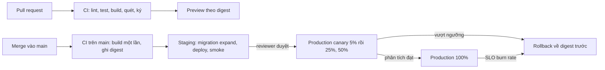

# Lời giải: pipeline nhiều môi trường có rollback cho Olist Shop

Bài Advanced không có một đáp án duy nhất. Reviewer chấm theo việc thiết kế có **vận hành được lúc có sự cố** không: thứ lên
production có đúng là thứ đã kiểm, rollback có phải thao tác sẵn có với thời hạn đo được, gate có ngưỡng và chỗ thực thi. Dưới đây
là các quyết định cốt lõi, rubric, và một thiết kế mẫu đã chạy qua test.

## Các quyết định cốt lõi

- **Build một lần, promote theo digest.** CI build image một lần ở commit trên `main`, đẩy `sha-<12>`, ghi digest. Staging và
  production nhận đúng digest đó; khác nhau chỉ ở cấu hình (ConfigMap, Secret, số replica). Không môi trường nào build lại.
- **Môi trường là ranh giới quyền, không chỉ là namespace.** Mỗi môi trường là một GitHub `environment` riêng: secret riêng, quy
  tắc bảo vệ riêng (required reviewers cho production, giới hạn chỉ `main` được deploy), token OIDC riêng mà cloud tin theo
  `environment:production` trong claim `sub`.
- **Chiến lược theo đặc tính service, không theo thói quen.** `api` stateless, phục vụ thanh toán: canary có phân tích tự động.
  `worker` giữ khoá độc quyền trên bảng kết quả: recreate. Migration: job riêng chạy trước, theo expand/contract. Tính năng rủi ro
  (luồng checkout mới): feature flag.
- **Rollback là thao tác có sẵn, không phải dự án.** Deploy lại digest trước (Argo Rollouts `abort`/`undo`, hay đổi digest trong
  repo GitOps), mục tiêu dưới 5 phút cho `api`, vì bản trước luôn chạy được trên schema hiện tại nhờ expand/contract. Flag tắt
  trong vài giây.
- **Gate có số và có chủ.** Gate trước deploy (test, quét lỗ hổng có bản vá, chữ ký) do CI thực thi; gate trong rollout (tỉ lệ lỗi,
  p95, bão hoà) do công cụ rollout thực thi; gate sau deploy (smoke test, SLO burn rate) do giám sát thực thi và tự quay lại.
- **Đo DORA từ đầu.** Lead time, tần suất deploy, change failure rate, thời gian khôi phục lấy tự động từ lịch sử deploy; mục tiêu
  có số để biết pipeline mới có tốt hơn hiện trạng không.

## Rubric (100 điểm)

| Tiêu chí | Điểm | Đạt đủ điểm khi |
| --- | --- | --- |
| Mục tiêu đo được | 10 | Hiện trạng có số, mục tiêu DORA có số và hạn, nêu ràng buộc (5 phút lỗi thanh toán, mùa cao điểm) |
| Promotion và bất biến | 15 | Build một lần, mọi môi trường sau nhận digest; cấu hình tách khỏi image; lịch sử deploy ghi digest; dữ liệu staging gần production nhưng đã ẩn danh |
| Phê duyệt và quyền | 15 | Environment có required reviewers, giới hạn nhánh, secret theo môi trường, OIDC thay khoá dài hạn, `permissions` tối thiểu theo job, break-glass có log |
| Chiến lược deploy theo service | 15 | Mỗi service có chiến lược kèm lý do từ đặc tính của nó (stateless, khoá, schema), tín hiệu rollback đo được |
| Rollback và migration | 20 | Mục tiêu thời gian có số; thao tác cụ thể (lệnh, nút); expand/contract tách khỏi deploy; feature flag cho tính năng rủi ro; trường hợp không rollback được (migration phá huỷ) có kế hoạch roll-forward |
| Gate và quan sát | 15 | Ngưỡng có số, so với baseline, đủ mẫu, có hành động tự động; gate trước, trong và sau deploy; ai sở hữu |
| Lộ trình và rủi ro | 10 | Các pha có mốc, đo được tiến độ; rủi ro thật (đội quen deploy tay, cấu hình drift, flag thành nợ, chi phí môi trường) và cách giảm |

Trừ điểm: production nhận tag dời được hay build lại (−15); rollback bằng build lại commit cũ (−10); migration đổi tên hay xoá
cột trong cùng release với code (−10); secret dài hạn của cloud trong secret của repo (−5).

## Thiết kế mẫu

`````markdown
# Thiết kế pipeline nhiều môi trường cho Olist Shop

## 1. Bối cảnh và mục tiêu

Hiện trạng: một lần deploy mỗi tuần, làm tay từ laptop, tag `latest`, không có lịch sử image. Sáu tháng qua có 26 lần deploy và 5
lần sửa gấp, tức change failure rate khoảng 19%; lần lâu nhất mất 3 giờ để khôi phục vì không ai biết bản trước là image nào. Lead
time từ commit tới production trung bình 4 ngày (chờ tới thứ Năm). Mục tiêu sau 2 quý, đo tự động từ lịch sử deploy: lead time dưới
1 ngày, deploy nhiều lần mỗi ngày khi cần, change failure rate dưới 10%, MTTR dưới 15 phút, và lỗi thanh toán không quá 5 phút cho
mỗi sự cố do deploy. Ràng buộc: một người vận hành, bốn kỹ sư backend, mùa Black Friday không được đóng băng deploy hoàn toàn.

## 2. Môi trường và promotion

| Môi trường | Trigger | Phê duyệt | Artifact | Dữ liệu |
| --- | --- | --- | --- | --- |
| preview | Mỗi pull request, tự xoá khi đóng PR | Không cần, chỉ code đã qua CI | Image `pr-<số>-<sha>` theo digest của lần build PR | Dữ liệu giả sinh lại mỗi lần |
| staging | Tự động sau mỗi merge vào `main` | Gate tự động (test, quét, smoke) | `sha-<12>` theo digest, đúng digest sẽ lên production | Bản sao production đã ẩn danh, làm mới hằng tuần |
| production | Promote digest đã xanh ở staging | Required reviewer (1 người ngoài tác giả) cộng gate canary | Cùng digest đã chạy ở staging, ghi vào lịch sử deploy | Dữ liệu thật |

## 3. Sơ đồ pipeline



## 4. Chiến lược deploy theo service

| Service | Chiến lược | Lý do | Tín hiệu rollback |
| --- | --- | --- | --- |
| api | Canary 5%, 25%, 50% rồi 100%, phân tích tự động mỗi bước 10 phút | Stateless, phục vụ thanh toán: đo trên traffic thật nhỏ trước | 5xx vượt baseline 0,5 điểm %, p95 tăng 20% |
| worker | Recreate | Giữ khoá độc quyền trên `revenue_by_state`; hai bản song song ghi đè nhau; trễ vài phút chấp nhận được | Job thất bại liên tiếp, hàng đợi quá 1000 |
| migration (job trước deploy) | Recreate theo expand/contract | Mỗi migration chạy một lần, tương thích ngược với bản đang chạy | Migration lỗi thì dừng pipeline, không deploy code |
| Luồng checkout mới | Feature flag theo vùng | Ngày ra mắt do kinh doanh chọn, tách khỏi deploy | Tỉ lệ thanh toán thành công giảm 2 điểm % |

## 5. Rollback và migration cơ sở dữ liệu

- Mục tiêu: rollback `api` xong trong 5 phút kể từ khi cảnh báo, rollback flag trong 1 phút.
- Rollback là deploy lại digest trước, lấy từ lịch sử deploy (Argo Rollouts `abort` khi đang canary, `undo` sau khi xong); không
  build lại, không `git revert` rồi chờ CI.
- Migration theo expand/contract: release N thêm cột hoặc bảng (expand) và code ghi cả hai, release N+1 đọc chỗ mới, release N+2
  mới xoá chỗ cũ (contract). Nhờ đó bản trước luôn chạy được trên schema hiện tại.
- Migration là job riêng chạy trước deploy code, có kiểm tra "tương thích ngược" trong CI (chạy test của bản đang ở production
  trên schema mới).
- Migration phá huỷ (xoá cột, đổi kiểu) chỉ ở bước contract, sau ít nhất một release ổn định, có backup và kế hoạch roll-forward
  vì không rollback được.
- Tính năng rủi ro đi sau feature flag; tắt flag là cách rollback đầu tiên khi lỗi nằm trong tính năng đó.
- Game day mỗi quý: cố ý deploy bản lỗi lên staging, đo thời gian rollback thật, cập nhật runbook.

## 6. Bí mật và quyền

- Mỗi môi trường là một GitHub `environment`; secret của production chỉ job gắn `environment: production` đọc được.
- Không khoá cloud dài hạn: job deploy lấy token OIDC, cloud chỉ tin claim `repo:olist/olist-shop:environment:production`.
- `permissions` tối thiểu theo job: test chỉ `contents: read`; job build thêm `packages: write` và `id-token: write` để ký.
- Production chỉ deploy từ `main` (deployment branch policy), reviewer không được là tác giả commit.
- Break-glass: một quy trình deploy khẩn có ghi log và tự mở ticket postmortem, không phải tắt bảo vệ.

## 7. Gate tự động và quan sát

| Gate | Ngưỡng | Hành động |
| --- | --- | --- |
| Test và lint trong CI | 100% test xanh, độ phủ không giảm quá 2 điểm % | Chặn merge |
| Quét lỗ hổng image | 0 lỗ hổng CRITICAL hoặc HIGH có bản vá chưa có ngoại lệ | Chặn promote |
| Tỉ lệ lỗi 5xx của canary | Không vượt baseline quá 0,5 điểm %, tối thiểu 500 request | Tự rollback |
| Độ trễ p95 của canary | Không tăng quá 20% so với baseline | Tự rollback |
| Smoke test sau deploy | 5 luồng chính trả đúng trong 2 phút | Tự rollback |
| SLO burn rate sau 100% | Burn rate 1 giờ trên 14 | Báo động người trực, rollback thủ công |

## 8. Rủi ro và lộ trình triển khai

- Tháng 1: CI trên GitHub Actions, image `sha-<12>` theo digest, staging tự động; production vẫn deploy tay nhưng bằng digest.
- Tháng 2: environment production có reviewer, OIDC, rollback một lệnh, game day đầu tiên.
- Tháng 3: canary có phân tích tự động cho `api`, feature flag cho luồng checkout, đo DORA trên dashboard.
- Rủi ro: team quen deploy tay và tìm cách lách; giảm bằng cách làm đường chuẩn nhanh hơn đường tay và tắt quyền SSH deploy.
- Rủi ro: flag thành nợ; mỗi flag có chủ và hạn xoá.
- Rủi ro: staging lệch production (cấu hình drift); quản lý cấu hình hai môi trường bằng cùng một nguồn (GitOps, module 12).
`````
