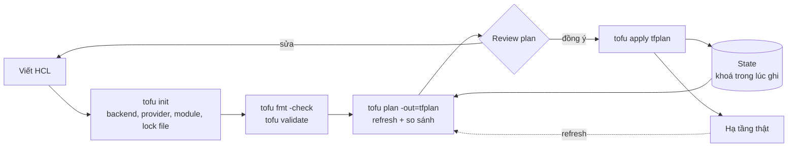
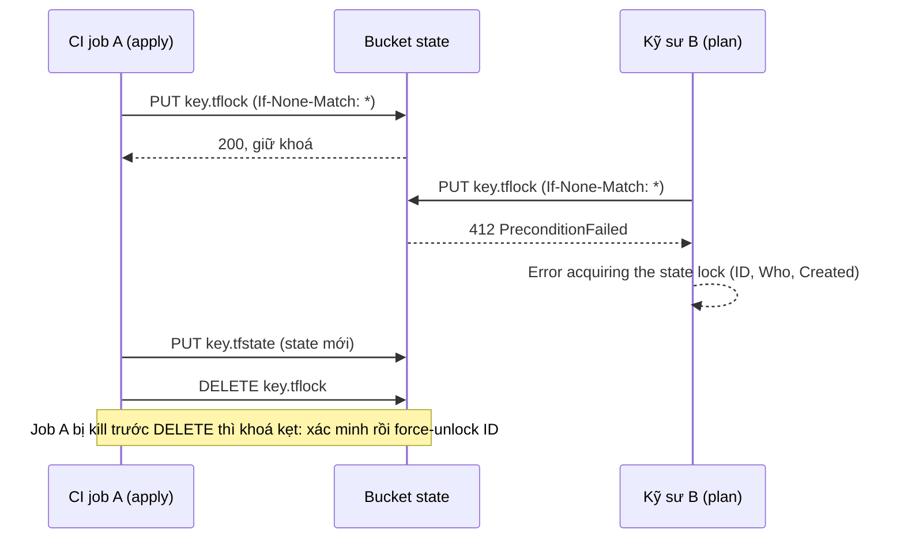
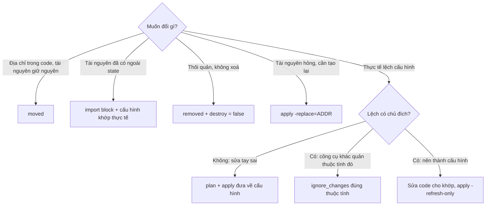
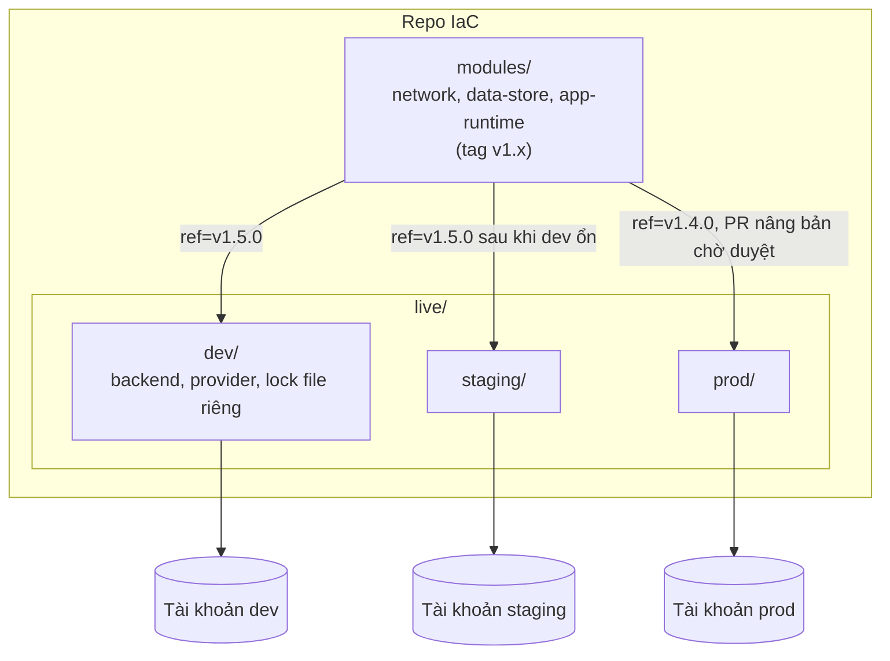

# Provisioning bằng IaC: OpenTofu tới mức Terraform Associate

Module DE 08 (mục 5) đã cho bạn viết một cấu hình Terraform tạo bucket cho data lake, chạy `validate`, và so sánh vài công cụ IaC.
Module này đi tiếp tới mức người **vận hành** IaC cho cả tổ chức: state là cơ sở dữ liệu quan trọng nhất của hạ tầng, nên phải
được khoá, mã hoá, chia nhỏ, refactor không làm mất tài nguyên; module phải có giao diện, version và test; mọi thay đổi đi qua plan
được review và chính sách tự động. Bài tập chạy thật trên một LocalStack riêng, không cần tài khoản AWS.

Công cụ chính là OpenTofu 1.13, fork mã nguồn mở của Terraform. Nội dung bám checklist của kỳ thi **HashiCorp Terraform Associate
(004)** (thi trên Terraform 1.12) cộng roadmap.sh/terraform; mọi chỗ OpenTofu khác Terraform được ghi rõ, và mục 6 gom lại thành
một bảng để bạn vừa làm việc với `tofu` vừa thi được chứng chỉ.

Sau module này bạn sẽ:

- Viết cấu hình HCL đúng thành ngữ: provider và lock file, `resource` và `data`, meta-argument (`count`, `for_each`, `depends_on`,
  `provider`, `lifecycle`), biến có kiểu và validation, locals, output, biểu thức, hàm, `dynamic`, `templatefile`.
- Dùng đúng loại điều kiện: validation, precondition, postcondition, `check`.
- Quản state: backend `s3` có khoá (`use_lockfile`), mã hoá state và plan, import, `moved`, `removed`, lệnh `state`, drift,
  `-refresh-only`, `force-unlock`, chia state theo blast radius.
- Viết module có version, chọn giữa workspace và thư mục theo môi trường, test bằng `tofu test` với mock provider, quét chính sách
  bằng trivy.
- Giữ secret khỏi state (biến `ephemeral`, thuộc tính write-only) và biết khi nào `sensitive` không đủ.
- So sánh OpenTofu, Terraform, HCP Terraform, CloudFormation, CDK, Pulumi, Crossplane và chọn theo ràng buộc.

## 0. Cài đặt

| Công cụ / dịch vụ | Phiên bản đã kiểm | Tối thiểu cho bài tập | Dùng ở |
| --- | --- | --- | --- |
| OpenTofu (`tofu`) | 1.13.2 | 1.11 (biến `ephemeral` ở Basic 02); 1.10 cho các bài còn lại (khoá S3 native) | Mọi bài trừ Basic 03, Advanced 01 |
| Provider `hashicorp/aws` | 6.12.0 (ghim cứng, xem dưới) | Đúng bản này | Mọi bài có `tofu` |
| LocalStack riêng `localstack-devops` | `localstack/localstack:4.4.0` (profile `devops`) | Đúng tag này | Mọi bài có `tofu` |
| trivy | 0.76.1 (cài ở module 06) | 0.76 | Intermediate 04 |
| jq | Như module 01 | 1.6 | Intermediate 03 |
| bwrap, uv | Như module 02 | Như module 02 | Sandbox của test, chạy pytest |

### OpenTofu

Bản phát hành là binary Go tĩnh. Release có tệp `tofu_<phiên bản>_SHA256SUMS` và chữ ký GPG `..._SHA256SUMS.gpgsig` của khoá
OpenTofu (fingerprint `E3E6 E43D 84CB 852E ADB0 051D 0C0A F313 E5FD 9F80`, đăng ở `https://get.opentofu.org/opentofu.asc`). Kiểm cả
hai: chữ ký chứng minh tệp checksum do OpenTofu phát hành, checksum chứng minh tarball không bị sửa.

| Tệp | SHA-256 |
| --- | --- |
| `tofu_1.13.2_linux_amd64.tar.gz` | `ac05d9952662c7db28dd57e93f0a68018837bfdf9342384ec0987977c16a9645` |

Chạy từ một thư mục tạm mới:

```bash
TOFU_VERSION=1.13.2 &&
TOFU_FILE="tofu_${TOFU_VERSION}_linux_amd64.tar.gz" &&
TOFU_SHA256=ac05d9952662c7db28dd57e93f0a68018837bfdf9342384ec0987977c16a9645 &&
TOFU_FPR=E3E6E43D84CB852EADB0051D0C0AF313E5FD9F80 &&
TOFU_BASE="https://github.com/opentofu/opentofu/releases/download/v${TOFU_VERSION}" &&
cd "$(mktemp -d)" &&
curl -fsSLO --proto '=https' "${TOFU_BASE}/${TOFU_FILE}" &&
curl -fsSLO --proto '=https' "${TOFU_BASE}/tofu_${TOFU_VERSION}_SHA256SUMS" &&
curl -fsSLO --proto '=https' "${TOFU_BASE}/tofu_${TOFU_VERSION}_SHA256SUMS.gpgsig" &&
curl -fsSL --proto '=https' -o opentofu.asc https://get.opentofu.org/opentofu.asc &&
export GNUPGHOME="$(mktemp -d)" &&
gpg --quiet --import opentofu.asc &&
gpg --with-colons --fingerprint | grep -qx "fpr:::::::::${TOFU_FPR}:" &&
gpg --verify "tofu_${TOFU_VERSION}_SHA256SUMS.gpgsig" "tofu_${TOFU_VERSION}_SHA256SUMS" &&
grep -qx "${TOFU_SHA256}  ${TOFU_FILE}" "tofu_${TOFU_VERSION}_SHA256SUMS" &&
echo "${TOFU_SHA256}  ${TOFU_FILE}" | sha256sum -c - &&
tar -xzf "${TOFU_FILE}" tofu &&
mkdir -p ~/.local/bin &&
install -m 0755 tofu ~/.local/bin/tofu &&
which tofu && tofu version
```

`GNUPGHOME` tạm giữ khoá OpenTofu ngoài keyring của bạn. Khoá tải về có fingerprint khác, chữ ký sai, hash ghim không có trong tệp
checksum, hay tarball không khớp hash thì chuỗi `&&` dừng trước khi giải nén. Kết quả trên máy viết bài (Pop!_OS 24.04, x86_64):

```text
gpg: Good signature from "OpenTofu (This key is used to sign opentofu providers) <core@opentofu.org>" [unknown]
gpg: WARNING: This key is not certified with a trusted signature!
Primary key fingerprint: E3E6 E43D 84CB 852E ADB0  051D 0C0A F313 E5FD 9F80
tofu_1.13.2_linux_amd64.tar.gz: OK
/home/<user>/.local/bin/tofu
OpenTofu v1.13.2
on linux_amd64
```

Dòng `WARNING: This key is not certified` là bình thường: bạn chưa ký tin khoá đó trong web of trust; thứ bảo đảm ở đây là
fingerprint đã đối chiếu ở bước `grep -qx`. Máy khác (`linux_arm64`, `darwin_arm64`) lấy dòng tương ứng trong tệp SHA256SUMS sau
khi chữ ký đã đúng. Đừng dùng `curl ... | sh` của script cài đặt: nó tải bản mới nhất, không ghim. Gỡ: `rm -f ~/.local/bin/tofu &&
rm -rf ~/.cache/devops-track/tofu-plugins`. Quản nhiều phiên bản CLI trên một máy: `tenv` (cài và chuyển bản tofu, terraform,
terragrunt theo tệp `.opentofu-version`) hay đơn giản là nhiều binary có hậu tố phiên bản.

### Provider ghim 6.12.0 và mirror offline

Test không bao giờ dùng HCL của bạn để tải provider. Lần đầu, testkit tải đúng `hashicorp/aws` 6.12.0 bằng cấu hình của chính nó
vào `~/.cache/devops-track/tofu-plugins` (cần mạng một lần); mọi lần sau `tofu init` trong test cài từ mirror đó bằng symlink,
không cần mạng. Vì sao đúng 6.12.0: LocalStack 4.4.0 của track chạy đúng tới bản này; từ 6.13 bảng DynamoDB kẹt lúc tạo, bản mới
hơn nữa gọi S3 Control mà LocalStack không có. Vì vậy mọi starter và lời giải ghi `version = "6.12.0"`, và test fail kèm lý do
nếu lock file khoá bản khác. Ở dự án thật bạn sẽ viết `~> 6.12` và để lock file giữ bản đã chọn (mục 2).

### LocalStack riêng của track DevOps

```bash
docker compose -f setup/docker-compose.yml --profile devops up -d --wait localstack-devops &&
curl -fsS http://127.0.0.1:14566/_localstack/health | jq -c '.services | {s3, iam, sts, dynamodb, kms, ssm, secretsmanager}'
```

```text
{"s3":"available","iam":"available","sts":"available","dynamodb":"available","kms":"available","ssm":"available","secretsmanager":"available"}
```

Service `localstack-devops` tách hẳn `localstack` của track DE (cổng 14566, volume `devops-track-localstack-data`). Đặt
`DEVOPS_CPUSET` (ví dụ `12-35`) trong shell hay `setup/.env` để ghim CPU cho container. Bản community không có EC2/VPC, Route 53,
S3 Control, Organizations, Budgets: bài cần các service đó chỉ chạy `tofu plan` (Advanced 02) hay `tofu test` với mock provider
(Intermediate 04).

### Test chạy `tofu` thế nào

Test không gọi `tofu` trực tiếp mà qua `testkit.TofuLab`: cấu hình của bạn được chép vào thư mục tạm, `tofu` chạy trong sandbox
bwrap với env dựng từ đầu (`HOME` tạm, `AWS_ACCESS_KEY_ID=test`, `AWS_ENDPOINT_URL` trỏ LocalStack, proxy chết chặn mọi request
không tới LocalStack nên dù cấu hình ghi endpoint AWS thật cũng không ra ngoài được), `~/.aws`, `~/.terraformrc` và biến `AWS_*`
của bạn không được đọc. Biến `prefix` là `devops-ex-<8 hex>` riêng cho mỗi lần chạy; mọi tên tài nguyên phải bắt đầu bằng nó. Khi
xong (kể cả lỗi hay Ctrl-C), test chạy `tofu destroy` rồi xoá mọi bucket, bảng, role, tham số, alias KMS còn sót mang tiền tố đó.
Cấu hình có đối số `http_proxy`, `https_proxy`, `no_proxy`, `custom_ca_bundle` bị từ chối trước khi chạy.

### Chạy tay một bài

Mở một shell riêng (các biến dưới làm mọi lệnh AWS trong shell đó đi tới LocalStack):

```bash
export AWS_ENDPOINT_URL=http://127.0.0.1:14566 AWS_ACCESS_KEY_ID=test AWS_SECRET_ACCESS_KEY=test \
  AWS_REGION=us-east-1 AWS_EC2_METADATA_DISABLED=true &&
unset AWS_PROFILE AWS_SESSION_TOKEN &&
export TF_VAR_prefix="devops-ex-$(openssl rand -hex 4)" &&
cd tracks/devops/modules/08-iac-provisioning/exercises/basic/01-olist-storage-module/starter/infra &&
tofu init && tofu plan
```

`tofu init` chạy tay tải provider từ `registry.opentofu.org` như bình thường. Xong thì `tofu destroy` và xoá `.terraform`,
`.terraform.lock.hcl`, `terraform.tfstate*` khỏi thư mục starter (test bỏ qua chúng khi chép, nhưng đừng commit).

### Lint và chính sách: chạy được gì offline

| Công cụ | Dùng trong bài? | Offline? |
| --- | --- | --- |
| `tofu fmt -check`, `tofu validate` | Có, mọi bài | Có |
| trivy `config` | Có (Intermediate 04), bản cài ở module 06 | Có: bộ kiểm IaC nhúng trong binary, test chạy `--skip-check-update` |
| tflint | Không, dạy khái niệm ở mục 5 | Lõi và ruleset `terraform` có sẵn trong binary chạy offline; ruleset `aws` là plugin phải tải bằng `tflint --init` (cần mạng, cần GitHub API) |
| checkov | Không, dạy khái niệm | Có sau khi cài, nhưng là gói Python lớn kéo nhiều dependency; trùng phần lớn với trivy |

Track không cài thêm tflint hay checkov: trivy đã có từ module 06, chạy offline đầy đủ và đủ cho chính sách; tflint mà thiếu ruleset
AWS thì chỉ còn kiểm quy ước, phần `tofu fmt`/`validate` và phép kiểm cấu trúc trong test đã làm.

### Dọn sau khi làm bài

```bash
docker compose -f setup/docker-compose.yml --profile devops rm -fsv localstack-devops &&
docker volume rm devops-track-localstack-data
```

Lệnh này chỉ xoá LocalStack của DevOps; `localstack` và dữ liệu của track DE không bị đụng.

## 1. IaC, quy trình và hai công cụ (ôn nhanh từ DE 08)

### IaC là gì và đáng giá ở đâu

**Infrastructure as Code** mô tả hạ tầng (mạng, máy, bucket, quyền, DNS) bằng tệp văn bản trong git, và một công cụ đưa thực tế về
đúng mô tả đó. Giá trị không nằm ở "tự động hoá" (script cũng tự động) mà ở bốn tính chất:

- **Xem trước:** `plan` cho thấy chính xác cái gì sẽ tạo, sửa, xoá trước khi xảy ra; review hạ tầng như review code.
- **Lặp lại được:** cùng code dựng dev, staging, prod giống nhau; dựng lại sau thảm hoạ.
- **Truy vết:** ai đổi gì, khi nào, vì sao nằm trong lịch sử git và PR.
- **Phát hiện lệch (drift):** thực tế khác mô tả thì công cụ thấy được.

DE 08 đã so declarative với imperative. Thêm một phân biệt hay gặp trong roadmap: **IaC và CaC (configuration as code)**. IaC tạo
và xoá tài nguyên (OpenTofu, CloudFormation): "có một máy ảo, một bucket". CaC cấu hình bên trong tài nguyên đã có (Ansible,
Chef, Puppet ở module 09): "máy đó có Nginx bản này, tệp cấu hình này". Ranh giới mờ (OpenTofu tạo được bản ghi DNS, Ansible gọi
được API cloud), nhưng thiết kế tốt giao mỗi việc cho công cụ hợp nhất: OpenTofu dựng, image bất biến hay Ansible cấu hình.

OpenTofu và Terraform là **đa nền tảng** theo nghĩa cùng một ngôn ngữ và quy trình cho mọi thứ có provider: AWS, GCP, Azure,
Kubernetes, GitHub, Cloudflare, Datadog, PostgreSQL. Không có nghĩa một cấu hình chạy trên mọi cloud: `aws_s3_bucket` chỉ là AWS.
Đa cloud và hybrid đạt được bằng nhiều provider trong cùng một quy trình và cùng cách review, không phải bằng trừu tượng hoá
"bucket chung".

### Quy trình cốt lõi



| Lệnh | Làm gì | Ghi chú cho người vận hành |
| --- | --- | --- |
| `tofu init` | Cấu hình backend, cài provider (ghi `.terraform.lock.hcl`), tải module | `-upgrade` chọn lại bản provider/module mới nhất trong ràng buộc; `-backend-config=...` cho backend partial; `-migrate-state` khi đổi backend |
| `tofu fmt` | Định dạng chuẩn | `-check -recursive` trong CI |
| `tofu validate` | Kiểm cú pháp, kiểu, tham chiếu; không gọi API, không đọc state | Cần `init` trước (schema của provider) |
| `tofu plan` | Refresh state, so cấu hình với state, in kế hoạch | `-out=tfplan` để apply đúng thứ đã duyệt; `-detailed-exitcode` trả 2 khi có thay đổi; `-refresh-only` chỉ xem drift |
| `tofu apply` | Thực thi plan, ghi state | Không đối số thì plan lại và hỏi `yes`; `apply tfplan` không hỏi lại; `-replace=ADDR` buộc tạo lại một tài nguyên (thay cho `taint` cũ) |
| `tofu destroy` | Xoá mọi tài nguyên trong state | Bằng `apply -destroy`; `-target`/`-exclude` để giới hạn |
| `tofu show`, `output`, `graph` | Đọc state hay plan (`show -json tfplan`), đọc output, vẽ đồ thị phụ thuộc dạng DOT | `show -json` là đầu vào cho guard, OPA, Infracost |
| `tofu console` | REPL thử biểu thức với state hiện tại | Học hàm nhanh nhất |

Mấy điểm nữa thuộc đề thi:

- **`-auto-approve`.** `tofu apply` (và `destroy`) không đối số sẽ tính plan mới, in ra và chờ gõ `yes`; `-auto-approve` bỏ bước
  hỏi đó. Hợp lý trong CI **khi apply một tệp plan đã được duyệt** (`tofu apply tfplan` vốn không hỏi) hay cho môi trường tạm
  dùng một lần. Nguy hiểm khi dùng kèm plan mới tính lúc apply: thứ được thực thi có thể khác thứ ai đó đã xem (state hay hạ tầng
  đổi giữa hai lần), và một lỗi gõ biến hay chọn nhầm workspace đi thẳng vào production không có cơ hội dừng. Test của module dùng
  `-auto-approve` vì chạy trên LocalStack với tiền tố riêng.
- **`refresh` đã deprecated.** `tofu refresh` (`terraform refresh`) ghi thẳng thực tế vào state mà không cho xem trước; dùng
  `plan -refresh-only` để xem rồi `apply -refresh-only` để chấp nhận.
- **Output máy đọc.** `-json` in sự kiện dạng JSON từng dòng; OpenTofu 1.12 thêm `-json-into=tệp` để vừa có output cho người ở
  terminal vừa ghi bản JSON ra tệp cho automation (đã kiểm có trong `tofu plan -help` của 1.13.2).

- **`-target` và `-exclude`.** `-target=ADDR` chỉ plan tài nguyên đó cộng những gì nó phụ thuộc; OpenTofu 1.9 thêm `-exclude=ADDR`
  (ngược lại) và 1.10 cho đọc danh sách từ tệp (`-target-file`, `-exclude-file`). Cả hai là công cụ cứu hoả, in cảnh báo "Resource
  targeting is in effect", không phải quy trình thường: state sau đó lệch với cấu hình tới khi plan đầy đủ.
- **Log chi tiết.** `TF_LOG=TRACE|DEBUG|INFO|WARN|ERROR` (OpenTofu đọc cùng biến), `TF_LOG_CORE` và `TF_LOG_PROVIDER` để tách log
  của lõi và của provider, `TF_LOG_PATH=tofu.log` ghi ra tệp. Log TRACE có cả request HTTP tới API, kể cả header: đừng dán lên issue
  công khai. OpenTofu 1.10 thêm tracing OpenTelemetry (đặt `OTEL_TRACES_EXPORTER=otlp` và endpoint) để xem từng bước init, plan mất
  bao lâu. `-parallelism=N` (mặc định 10) giới hạn số thao tác song song khi API bị rate limit.

### OpenTofu và Terraform: chuyện gì đã xảy ra

Tháng 8/2023 HashiCorp đổi giấy phép Terraform (từ 1.6) từ MPL 2.0 sang Business Source License 1.1: dùng nội bộ vẫn được, nhưng
sản phẩm cạnh tranh với HashiCorp thì không. Cộng đồng fork bản MPL cuối cùng thành **OpenTofu**, đặt dưới Linux Foundation, phát
hành 1.6.0 tháng 1/2024, rồi đi tiếp với các tính năng riêng (mã hoá state, early evaluation, provider `for_each`...). IBM mua
HashiCorp (hoàn tất 2/2025). Hệ quả thực tế:

- Ngôn ngữ, cấu trúc thư mục, state (định dạng v4), provider dùng chung. `tofu` đọc được state của Terraform 1.5.x và tương thích
  phần lớn tới các bản sau; mục 6 có lưu ý migrate.
- Registry riêng: `registry.opentofu.org` (mirror provider và module công khai từ GitHub) và `registry.terraform.io`.
- Tính năng mới của mỗi bên không còn tự động có ở bên kia. Khi đọc tài liệu, kiểm nó thuộc công cụ nào và từ bản nào.

## 2. HCL, provider, resource, data và meta-argument

### Cú pháp HCL

HCL gồm **block** (`kiểu "nhãn" "nhãn" { ... }`), **đối số** (`tên = biểu thức`) và **biểu thức**. Mọi tệp `.tf` (và `.tofu`,
mục 6) trong một thư mục là **một module**; thứ tự tệp và thứ tự block không quan trọng, OpenTofu dựng đồ thị phụ thuộc từ tham chiếu.

```hcl
terraform {
  required_version = ">= 1.10"
  required_providers {
    aws = {
      source  = "hashicorp/aws"
      version = "~> 6.12"
    }
  }
}

provider "aws" {
  region = "us-east-1"
  default_tags {
    tags = { Project = "olist-shop", ManagedBy = "opentofu" }
  }
}

resource "aws_s3_bucket" "media" {
  bucket = "${var.prefix}-media"
}

output "media_arn" {
  value = aws_s3_bucket.media.arn
}
```

Kiểu dữ liệu: nguyên thuỷ `string`, `number`, `bool`; tập hợp `list(T)`, `set(T)`, `map(T)`; cấu trúc `object({...})`,
`tuple([...])`; `any`; `null` nghĩa là "không đặt, dùng mặc định của provider". Chú thích `#`, `//`, `/* */`. Quy ước tệp phổ biến:
`versions.tf` (khối `terraform`, provider), `variables.tf`, `main.tf`, `outputs.tf`, `locals.tf`; `tofu fmt` lo thụt lề và căn `=`.

### Provider và lock file

Provider là plugin (binary riêng) nói chuyện với một API; lõi OpenTofu không biết gì về AWS. `source = "hashicorp/aws"` là viết tắt
của `registry.opentofu.org/hashicorp/aws` (với Terraform: `registry.terraform.io/hashicorp/aws`).

- **Ràng buộc version** (`= 6.12.0`, `~> 6.12` nghĩa là `>= 6.12, < 7.0`, `>= 6.0, < 6.20`) nói bản nào **được phép**. Module dùng
  chung nên đặt ràng buộc rộng (`>= 6.0`); root module quyết định bản thật.
- **`.terraform.lock.hcl`** ghi bản **đã chọn** của từng provider kèm checksum (`h1:` của gói đã giải nén, `zh:` của tệp zip từng
  nền tảng). Commit tệp này. `init` lần sau cài đúng bản đó và từ chối gói có checksum khác (chống tráo binary). Lên bản mới:
  `tofu init -upgrade`, xem diff của lock file trong PR. Nhóm có Mac ARM và CI Linux: `tofu providers lock -platform=linux_amd64
  -platform=darwin_arm64` để lock file có checksum của cả hai.
- **Mirror và cache.** `tofu providers mirror <thư mục>` tải provider về một thư mục; khối `provider_installation { filesystem_mirror
  {...} }` trong CLI config cài từ đó, dùng cho môi trường không có Internet (đúng cách testkit làm). `plugin_cache_dir` chia sẻ
  provider giữa các thư mục làm việc; OpenTofu 1.10 thêm khoá toàn cục cho cache nên nhiều `init` song song không làm hỏng nó, và
  1.12 tải và cài nhiều provider song song trong một lần `init` (nhanh hơn với root có nhiều provider), đồng thời ghi đủ checksum
  `zh:`/`h1:` cho mọi nền tảng vào lock file.
- **Nhiều provider, alias.** Hai cấu hình của cùng provider (hai region, hai tài khoản) phân biệt bằng `alias`; tài nguyên chọn bằng
  meta-argument `provider = aws.eu`. **Module con kế thừa ngầm** cấu hình provider mặc định (không alias) của module cha, nên phần
  lớn lời gọi module không cần gì thêm; chỉ khi muốn module dùng một cấu hình có alias mới truyền tường minh
  `providers = { aws = aws.eu }` (module khai báo `configuration_aliases` nếu chính nó cần nhiều cấu hình).

```hcl
provider "aws" {
  alias  = "eu"
  region = "eu-west-1"
}

resource "aws_s3_bucket" "replica" {
  provider = aws.eu
  bucket   = "${var.prefix}-media-replica"
}
```

OpenTofu 1.9 cho **`for_each` trên provider**: `provider "aws" { alias = "by_region"; for_each = toset(var.regions); region =
each.key }` rồi `provider = aws.by_region[each.key]` trong tài nguyên cũng có `for_each`. Terraform không có tính năng này (phải
viết một khối provider cho mỗi region).

### Resource và data source

- **`resource`**: OpenTofu **quản vòng đời** (tạo, cập nhật, xoá) và ghi vào state. Thuộc tính đọc bằng `TYPE.NAME.ATTR`
  (`aws_s3_bucket.media.arn`); tham chiếu đó cũng tạo cạnh phụ thuộc (bucket trước, thứ dùng ARN sau).
- **`data`**: chỉ **đọc** thứ đã có (AMI mới nhất, VPC do team khác quản, tài khoản hiện tại, policy document sinh tại chỗ). Đọc
  lúc plan nếu đối số đã biết; nếu phụ thuộc giá trị chưa biết (một tài nguyên đang có thay đổi) thì hoãn tới apply và mọi thứ dùng
  nó thành "known after apply". Đây là lý do Basic 01 dựng ARN từ tên thay vì từ tài nguyên.
- **Hành vi cập nhật**: đổi thuộc tính cập nhật tại chỗ được thì `~ update in-place`; đổi thuộc tính "ForceNew" (tên bucket, AMI của
  instance) thì `-/+ destroy and then create replacement`. Đọc plan để biết thuộc tính nào gây thay thế.
- **Ephemeral resource** (OpenTofu 1.11, Terraform 1.10): khối `ephemeral "TYPE" "NAME"` đọc một giá trị nhạy cảm lúc chạy (secret
  từ Secrets Manager, token tạm) mà không bao giờ ghi vào state hay plan; dùng được trong provider và thuộc tính write-only.

### Meta-argument

| Meta-argument | Dùng khi | Bẫy |
| --- | --- | --- |
| `count = N` | Bật/tắt một tài nguyên (`var.enabled ? 1 : 0`), hay N bản giống hệt | Địa chỉ theo vị trí `[0]`, `[1]`: bỏ phần tử giữa làm các phần tử sau bị thay thế |
| `for_each = map/set` | Nhiều bản khác nhau theo khoá | Khoá phải biết lúc plan (không dùng ID do apply sinh ra làm khoá) |
| `depends_on = [...]` | Phụ thuộc ẩn mà tham chiếu không thể hiện (policy IAM phải có trước khi Lambda chạy) | Dùng tham chiếu khi có thể; `depends_on` trên data source làm nó hoãn tới apply mỗi khi một thứ nó phụ thuộc có thay đổi đang chờ (plan đầy "known after apply") |
| `provider = aws.alias` | Chọn cấu hình provider khác mặc định | Module con tự **kế thừa** provider mặc định (không alias) của module cha; chỉ provider có alias mới phải truyền bằng `providers = {...}` |
| `lifecycle { ... }` | Đổi hành vi vòng đời | Xem bảng dưới |
| `lifecycle { enabled = bool }` (OpenTofu 1.11) | Bật/tắt tài nguyên hay module mà không đổi địa chỉ thành `[0]` | Chỉ OpenTofu; Terraform vẫn dùng `count` |

| `lifecycle` | Tác dụng |
| --- | --- |
| `create_before_destroy = true` | Khi phải thay thế: tạo bản mới trước rồi mới xoá bản cũ (giảm downtime; tên phải khác nhau hoặc dùng `name_prefix`) |
| `prevent_destroy = true` | Plan nào đòi xoá tài nguyên này thì lỗi. OpenTofu 1.12 cho tham chiếu biến (`prevent_destroy = var.protect`), Terraform đòi hằng số. Không chặn được việc xoá khối khỏi code (dùng thêm guard trong CI) |
| `ignore_changes = [attr]` | Bỏ qua thay đổi bên ngoài của thuộc tính đó (tag do FinOps gắn, `desired_count` do autoscaler chỉnh). Giữ hẹp nhất có thể; `all` gần như luôn sai |
| `replace_triggered_by = [ref]` | Thay thế tài nguyên này khi tài nguyên/thuộc tính kia thay đổi (instance tạo lại khi launch template đổi) |
| `precondition`, `postcondition` | Custom condition (mục 3) |

Bên trong khối có `count`, `count.index` là chỉ số (0, 1, ...) của bản đang tính; bên trong khối có `for_each`, `each.key` là
khoá (với set thì khoá cũng là giá trị) và `each.value` là giá trị của khoá đó trong map. Tham chiếu từ ngoài:
`aws_s3_bucket.exports[0]` với `count`, `aws_s3_bucket.exports["orders"]` với `for_each`, và `aws_s3_bucket.exports` cả khối là
list (count) hay map (for_each).

**`terraform_data`** là tài nguyên có sẵn trong lõi (không cần provider): giữ một giá trị trong state và đổi khi `triggers_replace`
đổi; dùng làm mốc cho `replace_triggered_by` hay chạy provisioner. Nó thay `null_resource` của provider `null`.

### Provisioner: phương án cuối

`provisioner "local-exec"` chạy lệnh trên máy chạy `tofu`; `remote-exec` chạy qua SSH/WinRM trên máy vừa tạo; `file` chép tệp
lên máy đó. Mặc định chạy lúc tạo (creation-time); `when = destroy` chạy trước khi xoá; `on_failure = continue|fail`. Provisioner
không có trong plan, không idempotent, cần mạng tới máy, và lỗi giữa chừng làm tài nguyên bị đánh dấu "tainted". Thứ tự ưu tiên:
dữ liệu khởi động có sẵn của nền tảng (`user_data`, cloud-init), image dựng sẵn (Packer), công cụ cấu hình (Ansible, module 09),
rồi mới tới provisioner. "Custom provisioner" là plugin; ít ai viết nữa.

## 3. Biến, output, biểu thức và custom condition

### Biến, locals, output

```hcl
variable "services" {
  type = map(object({
    port     = number
    replicas = number
    public   = optional(bool, false)
  }))
  description = "Service của Olist Shop"

  validation {
    condition     = alltrue([for s in values(var.services) : s.port >= 1024 && s.port <= 65535])
    error_message = "Cổng phải trong khoảng 1024-65535."
  }
}

locals {
  public_services = { for name, s in var.services : name => s if s.public }
}

output "public_services" {
  value       = sort(keys(local.public_services))
  description = "Service mở ra Nginx"
}
```

- **Gán giá trị cho biến**, từ thấp tới cao: `default`; `terraform.tfvars`, `terraform.tfvars.json`; `*.auto.tfvars` theo thứ tự
  tên; `-var-file`; `-var` (hai cờ cuối theo thứ tự trên dòng lệnh). Biến môi trường `TF_VAR_tên` đứng sau `default` và trước các
  tệp. Biến root không có giá trị mà `TF_INPUT=0` thì lỗi; có terminal thì hỏi.
- **`optional(T, mặc định)`** trong object để người gọi chỉ truyền thứ khác mặc định. `nullable = false` để `null` không đè mặc định.
- **`sensitive = true`** trên biến hay output: CLI in `(sensitive value)` và tính chất này lan sang mọi biểu thức dùng nó. **Không**
  mã hoá, **không** giữ giá trị khỏi state (mục 4). `tofu output -json` vẫn in giá trị thật.
- **`sensitive()` và `nonsensitive()`**: hàm đánh dấu một giá trị là nhạy cảm (ví dụ chuỗi kết nối ghép từ mật khẩu) hay bỏ
  đánh dấu khi bạn chắc phần dẫn xuất không lộ gì (`nonsensitive(length(var.db_password))`). Output dùng giá trị nhạy cảm mà không
  ghi `sensitive = true` thì OpenTofu báo lỗi, buộc bạn quyết định tường minh; dùng `nonsensitive` bừa là tự tắt lớp che đó.
- **`ephemeral = true`** trên biến (OpenTofu 1.11, Terraform 1.10): giá trị không bao giờ được ghi vào state hay plan, và chỉ được
  dùng ở chỗ cũng không lưu: thuộc tính write-only (`value_wo`, `password_wo`), provider, ephemeral resource, output ephemeral.
- **`deprecated = "thông báo"`** trên biến và output (OpenTofu 1.10): người gọi module còn dùng thì nhận cảnh báo, để đổi giao diện
  module dần dần.
- **Locals** đặt tên cho biểu thức dùng lại; không nhận giá trị từ ngoài. **Output** của root in sau apply và đọc được bằng `tofu
  output`; output của module con là cách duy nhất để module cha lấy giá trị bên trong. Scope: module con không thấy biến của module
  cha; mọi thứ đi qua biến và output.

### Biểu thức và hàm

| Cấu trúc | Ví dụ | Ghi chú |
| --- | --- | --- |
| Nội suy, điều kiện | `"${var.prefix}-${var.environment}"`, `var.env == "prod" ? 3 : 1` | Hai nhánh của `? :` phải cùng kiểu |
| `for` tạo list/map | `[for s in var.names : upper(s)]`, `{ for k, v in var.buckets : k => v if v.versioning }` | Map dùng `=>`; `...` gom giá trị trùng khoá thành list |
| Splat | `aws_instance.web[*].id`, `values(aws_ssm_parameter.setting)[*].name` | Splat chạy trên list; tài nguyên `for_each` là map nên cần `values()` |
| `dynamic` block | `dynamic "rule" { for_each = var.retention; content { ... rule.value.days ... } }` | Sinh khối lồng lặp; đừng lạm dụng làm cấu hình khó đọc |
| Template | `templatefile("${path.module}/t.tftpl", { services = ... })`, `%{ for ... ~}` | `path.module` để module dùng được ở mọi chỗ |
| Kiểm lỗi | `try(var.x.y, "mặc định")`, `can(regex("^ami-", var.ami))` | `can` hợp với validation |
| Mã hoá | `jsonencode`, `yamlencode`, `base64encode` | Viết policy bằng `jsonencode` hay `data "aws_iam_policy_document"`, không viết JSON trong heredoc |
| Tập hợp | `merge`, `flatten`, `setproduct`, `lookup`, `zipmap`, `keys`, `values`, `contains`, `alltrue`, `anytrue` | `merge([...]...)` gộp list map |
| Mạng | `cidrsubnet("10.0.0.0/16", 8, 1)` | Chia subnet có quy luật |

Thử hàm trong `tofu console`. OpenTofu thêm hai nhóm hàm riêng: **hàm do provider định nghĩa** (`provider::<tên>::<hàm>(...)`,
OpenTofu 1.7 cho cả provider sinh hàm động; Terraform 1.8 có hàm provider tĩnh), và từ 1.13 hàm `convert(giá_trị, kiểu)` cùng họ
`assume...` để gợi ý kiểu hay giá trị cho plan khi giá trị chưa biết.

### Custom condition: bốn loại, bốn mục đích

| Loại | Đặt ở | Thấy gì | Khi lỗi | Dùng cho |
| --- | --- | --- | --- | --- |
| `validation` | Trong `variable` | Biến đó (và biến khác của cùng module: Terraform 1.9; OpenTofu 1.13 đã kiểm) | Lỗi `Invalid value for variable`, dừng sớm | Hợp đồng đầu vào của module |
| `precondition` | `lifecycle` của resource, data, output | Mọi giá trị trong module | `Resource precondition failed`, trước khi tạo/đọc | Giả định trước khi làm ("có ít nhất một service public") |
| `postcondition` | `lifecycle` của resource, data | Thêm `self` | `Resource postcondition failed`, chặn thứ phụ thuộc | Kiểm kết quả ("AMI là arm64", "đúng tài khoản") |
| `check` | Khối riêng cấp module | Mọi giá trị, data source lồng | Chỉ **cảnh báo** `Check block assertion failed` | Chính sách mềm, kiểm sức khoẻ sau deploy |

Ba loại đầu là **contract test** chạy ở mọi plan: người gọi module truyền sai thì thấy lỗi có nghĩa thay vì lỗi API khó hiểu sau 3
phút apply. Basic 02 dùng cả bốn.

## 4. State: cơ sở dữ liệu của hạ tầng

### State dùng để làm gì

State (`terraform.tfstate`, JSON) ánh xạ **địa chỉ trong cấu hình** (`module.storage.aws_s3_bucket.this["media"]`) sang **đối
tượng thật** (bucket `olist-prod-media`), lưu thuộc tính đã biết, phụ thuộc, và `lineage`/`serial` để phát hiện ghi đè. Không có
state, OpenTofu không biết bucket nào là "của mình", không tính được diff, không biết thứ tự xoá. Ba hệ quả:

1. State phải **dùng chung** khi nhiều người hay CI cùng làm: backend remote.
2. Chỉ **một người ghi** tại một thời điểm: khoá.
3. State chứa **mọi thuộc tính**, kể cả mật khẩu, khoá riêng, chuỗi kết nối: phải bảo vệ như secret.

### Backend: local và remote

Mặc định là backend `local` (tệp trong thư mục). Backend remote khai báo trong khối `terraform { backend "<loại>" { ... } }`: `s3`,
`gcs`, `azurerm`, `pg`, `http`, `kubernetes`... (với Terraform còn có khối `cloud` cho HCP Terraform). Mỗi thư mục chỉ một backend;
đổi backend thì `init -migrate-state`.

```hcl
terraform {
  backend "s3" {
    bucket       = "${var.prefix}-tfstate"
    key          = "olist/${var.environment}/platform.tfstate"
    region       = "us-east-1"
    encrypt      = true
    use_lockfile = true
  }
}
```

Dùng biến trong khối `backend` là **early evaluation** của OpenTofu (1.8): chỉ biến và local tính được trước khi có state. Với
Terraform, khối `backend` chỉ nhận hằng số; phần thay đổi truyền bằng `terraform init -backend-config=prod.s3.tfbackend` (partial
configuration). `terraform_remote_state` đọc output của một state khác (cần quyền đọc **cả** state đó, nên nhiều tổ chức publish giá
trị qua SSM Parameter Store thay vì vậy).

### Khoá state



- **S3 native lock** (`use_lockfile = true`, OpenTofu 1.10, Terraform 1.11): object `<key>.tflock` ghi bằng PUT có điều kiện. Không
  cần thêm dịch vụ.
- **DynamoDB** (`dynamodb_table = "..."`): cách cũ, bảng có khoá chính `LockID`; đã deprecated ở cả hai công cụ, vẫn chạy. Có thể bật
  cả hai trong lúc chuyển.
- Lệnh ghi state (`plan` cũng lấy khoá để refresh nhất quán) chờ theo `-lock-timeout=5m`; mặc định không chờ.
- **Khoá kẹt** khi tiến trình chết giữa chừng: thông báo in `ID`, `Who`, `Operation`, `Created`. Xác minh người giữ đã dừng hẳn,
  rồi `tofu force-unlock <ID>`, rồi `plan` ngay để xem apply dở để lại gì. **Không** dùng `-lock=false` để đi vòng. Runbook đầy đủ
  ở lời giải Intermediate 02.

### Mã hoá state và plan (chỉ OpenTofu)

OpenTofu 1.7 mã hoá state và plan **phía client** trước khi ghi ra bất kỳ backend nào (kể cả local), và cả state đọc qua
`terraform_remote_state`:

```hcl
terraform {
  encryption {
    key_provider "aws_kms" "state" {
      kms_key_id = "alias/olist-prod-state"
      region     = "us-east-1"
      key_spec   = "AES_256"
    }
    method "aes_gcm" "state" {
      keys = key_provider.aws_kms.state
    }
    state {
      method   = method.aes_gcm.state
      enforced = true
    }
    plan {
      method   = method.aes_gcm.state
      enforced = true
    }
  }
}
```

- **Key provider:** `pbkdf2` (passphrase ≥ 16 ký tự), `aws_kms`, `gcp_kms`, `azure_vault`, `openbao`, `external` (chương trình ngoài,
  1.10). **Method:** `aes_gcm`, `external`, `unencrypted` (chỉ để migrate).
- **`fallback`** trong `state`/`plan`: method cũ để đọc khi chuyển đổi (từ không mã hoá sang mã hoá, xoay khoá). `enforced = true`
  cấm ghi không mã hoá, và không đi cùng `unencrypted`: thêm mã hoá cho state cũ là hai bước (fallback trước, enforced sau).
- `remote_state_data_sources { default { method = ... } }` cấu hình riêng cho state đọc bằng `terraform_remote_state`.
- Mỗi key provider ghi metadata (salt, số vòng lặp...) vào state dưới tên `key_provider.<loại>.<tên>`; đổi tên khối thì OpenTofu
  không tìm thấy metadata cũ. `encrypted_metadata_alias = "..."` đặt một tên ổn định cho metadata đó để đổi tên hay chuyển khối mà
  vẫn giải mã được state cũ.
- Cấu hình có thể đặt ngoài code bằng biến môi trường `TF_ENCRYPTION` (HCL hay JSON), hợp khi CI cấp khoá.
- Mất khoá là mất state. Với `pbkdf2`, passphrase là secret sống còn; với KMS, khoá KMS phải có chính sách chống xoá.

Terraform không có tính năng này; bảo vệ state ở Terraform dựa vào mã hoá phía server của backend (SSE-KMS trên S3) cộng quyền đọc.

### Dữ liệu nhạy cảm trong state

| Cách | Giá trị trong state? | Ghi chú |
| --- | --- | --- |
| Biến/output `sensitive` | **Có**, dạng rõ | Chỉ che output của CLI |
| Mã hoá state (OpenTofu), SSE-KMS của backend | Có, nhưng mã hoá | Ai có khoá vẫn đọc được |
| Biến `ephemeral` + thuộc tính write-only (`value_wo`) | **Không** | Provider không đọc lại được giá trị, nên không phát hiện drift của nó; đổi bằng `*_wo_version` |
| Ephemeral resource đọc secret lúc chạy | **Không** | Ví dụ đọc mật khẩu từ Secrets Manager để cấu hình provider PostgreSQL |
| Không đưa secret qua IaC | **Không** | IaC tạo secret rỗng và quyền; ứng dụng hay Vault/Secrets Manager sinh và xoay giá trị |

Đề Associate 004 (mục 4h) hỏi thêm về **Vault**: provider `vault` đọc secret động (credential AWS sống 15 phút do Vault sinh) để
cấu hình provider khác, thay cho credential dài hạn trong biến. Secret đọc bằng data source vẫn vào state; bản ephemeral thì không.
OpenBao là fork mã nguồn mở của Vault, OpenTofu có key provider `openbao`.

### Lệnh state và refactor

| Việc | Cách có review (khối trong code) | Cách bằng tay (CLI) |
| --- | --- | --- |
| Đổi địa chỉ (đổi tên, đưa vào module, `count` sang `for_each`) | `moved { from = ...; to = ... }` | `tofu state mv OLD NEW` |
| Nhận tài nguyên có sẵn | `import { to = ...; id = ... }` (cả `for_each`, OpenTofu 1.7 / Terraform 1.7) | `tofu import ADDR ID` |
| Bỏ quản lý, giữ tài nguyên | `removed { from = ...; lifecycle { destroy = false } }` (khối `removed`: OpenTofu 1.7, Terraform 1.7; `lifecycle` trong `removed`: OpenTofu 1.10) | `tofu state rm ADDR` |
| Xem | | `tofu state list`, `tofu state show ADDR`, `tofu show` |
| Sao lưu, khôi phục | | `tofu state pull > backup.tfstate`, `tofu state push backup.tfstate` (kiểm lineage, serial) |
| Đổi nguồn provider | | `tofu state replace-provider registry.terraform.io/hashicorp/aws registry.opentofu.org/hashicorp/aws` |

Khối `import` đi qua plan nên thấy trước kết quả; `tofu plan -generate-config-out=generated.tf` viết nháp cấu hình cho tài nguyên
import. Khối `moved`, `import`, `removed` giữ trong repo tới khi mọi state đã áp dụng. Trước mọi thao tác tay, `state pull` ra một
bản sao; backend có versioning là lưới an toàn thứ hai. Bài Intermediate 01 và 03 làm đủ các thao tác này.



### Drift

Drift là thực tế khác state hay cấu hình vì ai đó sửa ngoài OpenTofu. `tofu plan` luôn refresh trước và đề xuất **đưa về cấu hình**;
`tofu plan -refresh-only` chỉ cho thấy khác biệt giữa thực tế và state (mục "Objects have changed outside of OpenTofu"), còn `apply
-refresh-only` chấp nhận thực tế vào state mà không đụng hạ tầng. Phát hiện drift liên tục bằng job theo lịch chạy
`plan -detailed-exitcode` (mã 2 là có khác) cho từng stack. Phân loại và xử lý theo sơ đồ trên; phòng ngừa bằng quyền console chỉ
đọc ở production.

### Chia state và best practice

- **Một state, một ranh giới:** theo môi trường (tài khoản, quyền) rồi theo stack (network, data, app) và tần suất thay đổi. State
  nhỏ: plan nhanh, khoá ít tranh chấp, lỗi phá ít. Stack đọc nhau qua output đã publish.
- Bucket state: versioning, chặn public, quyền theo prefix key, mã hoá, không do chính stack đó quản (bootstrap riêng).
- Không bao giờ sửa tay tệp state; không commit state vào git (`.gitignore` có `*.tfstate*`, `.terraform/`).
- **Workspace CLI** (`tofu workspace new|select|list|show|delete`): nhiều state cho cùng một cấu hình, cùng backend (với S3: key thành
  `env:/<workspace>/<key>`), `terraform.workspace` dùng được trong biểu thức. Hợp cho bản sao tạm giống hệt nhau; không hợp cho môi
  trường lâu dài khác quyền (mục 5).

## 5. Module, môi trường, kiểm thử và vận hành ở quy mô

### Module

Mọi thư mục là một module; thư mục chạy lệnh là **root module**, module được gọi là **child module**. Một child module tốt có giao
diện nhỏ (biến có kiểu, mô tả, validation; output đủ cho người gọi), không khai báo provider (nhận từ root), không hard-code tên
tài khoản hay region, và làm một việc.

```hcl
module "storage" {
  source  = "git::https://github.com/olist-shop/infra-modules.git//olist-storage?ref=v1.4.0"
  prefix  = var.prefix
  buckets = var.buckets
}
```

| Nguồn | Ví dụ | Version |
| --- | --- | --- |
| Đường dẫn local | `./modules/olist-storage` | Theo commit của repo |
| Registry | `terraform-aws-modules/vpc/aws` (registry.opentofu.org / registry.terraform.io) | `version = "~> 5.0"` |
| Git | `git::https://...//thư_mục?ref=v1.4.0` | `ref=` là tag hay commit; không trỏ nhánh |
| HTTP, S3, GCS | `s3::https://.../modules/vpc.zip` | Theo tên tệp |
| OCI registry (OpenTofu 1.10) | `oci://ghcr.io/olist-shop/modules/storage?tag=1.4.0` | Tag hay digest; hợp với môi trường air-gapped đã có registry container |

`version` chỉ dùng được với registry; nguồn git dùng `ref`. `tofu init -upgrade` lấy lại module theo ràng buộc mới. OpenTofu 1.8 cho
**biến trong `source` và `version`** (early evaluation); Terraform đòi hằng số. Module công khai (terraform-aws-modules) tiết kiệm
thời gian nhưng là phụ thuộc bên ngoài: ghim version, đọc code, và cân nhắc fork vào tổ chức. **Composition**: module lớn ghép từ
module nhỏ (như `upload-bucket` gọi `artifact-bucket` ở Intermediate 04) thay vì một module 80 biến.

### Nhiều môi trường: workspace hay thư mục



| | CLI workspace | Thư mục theo môi trường | Terragrunt |
| --- | --- | --- | --- |
| Cấu trúc | Một thư mục, nhiều state | Mỗi môi trường (và stack) một root module | `terragrunt.hcl` mỗi thư mục, kế thừa cấu hình chung |
| Ranh giới quyền | Cùng backend, cùng credential | Backend, role, người duyệt riêng | Như thư mục |
| Khác version provider/module | Không | Có | Có |
| Rủi ro | Chọn nhầm workspace là apply nhầm | Lặp vài dòng backend và gọi module | Thêm một công cụ, một lớp trừu tượng |
| Hợp với | Bản sao tạm giống hệt (môi trường theo PR) | Môi trường lâu dài, nhiều tài khoản | Hàng chục stack × môi trường × region |

Mặc định cho production: thư mục theo môi trường và stack, mỗi môi trường một tài khoản, module có version, promote bằng PR đổi
`ref=`. Advanced 01 thiết kế đầy đủ.

### Kiểm thử

| Tầng | Công cụ | Ở đâu trong module |
| --- | --- | --- |
| Tĩnh | `fmt -check`, `validate`, tflint, trivy/checkov/KICS | Mọi bài, Intermediate 04 |
| Contract | `validation`, `precondition`, `postcondition`, `check` | Basic 01, 02 |
| Đơn vị | `tofu test` + `mock_provider`, `override_resource`, `override_data` | Intermediate 04 |
| Tích hợp | `tofu test` với provider thật, hay apply trên LocalStack rồi kiểm bằng API | Mọi bài có LocalStack |
| End-to-end | Dựng môi trường tạm, chạy smoke test ứng dụng, destroy (Terratest bằng Go là lựa chọn phổ biến) | Advanced 02 (tuỳ chọn, AWS thật) |

`tofu test` đọc `*.tftest.hcl` (và `*.tofutest.hcl` chỉ cho OpenTofu) trong thư mục `tests/`. Mỗi `run` là một `plan` hay `apply`
với `assert { condition; error_message }` và `expect_failures` cho lỗi mong đợi; `run` sau thấy state của `run` trước; cuối cùng
OpenTofu tự destroy những gì đã tạo. **Mock provider** (OpenTofu 1.8, Terraform 1.7) thay provider thật bằng bản trả giá trị giả cho
thuộc tính computed: test chạy trong vài giây, không cần credential. Đo chất lượng test bằng **đột biến**: làm hỏng module có chủ
đích, test phải đỏ.

### Lint và chính sách

- **tflint**: lint theo provider (instance type không tồn tại, cú pháp deprecated, quy ước đặt tên, biến không dùng). Lõi và ruleset
  `terraform` chạy offline; ruleset `aws`, `google`, `azurerm` là plugin tải bằng `tflint --init` theo `.tflint.hcl` (cần mạng và
  GitHub API; CI nên cache thư mục plugin). Không dùng trong bài vì lý do ở mục 0.
- **trivy `config`** (kế thừa tfsec), **checkov**, **KICS**, **Terrascan**: quét cấu hình tìm cấu hình sai về bảo mật (bucket public,
  không mã hoá, security group mở 0.0.0.0/0). Chạy trên mã nguồn, hay trên plan JSON để thấy giá trị sau khi tính. Ngoại lệ ghi bằng
  tệp ignore hay chú thích kèm lý do và hạn, được review như code.
- **Policy as code trên plan**: OPA/Conftest (Rego) đọc `tofu show -json tfplan`; Sentinel (HashiCorp, chỉ HCP Terraform/Enterprise).
  Hợp cho quy tắc tổ chức ("không xoá bucket dữ liệu", "chỉ region được duyệt", "mọi tài nguyên có tag Owner"). Guard của Intermediate 03
  là phiên bản bash + jq của ý tưởng này.

### CI/CD và vận hành ở quy mô

- **Pipeline:** PR chạy fmt, validate, lint, test, `plan -out` cho mọi stack bị đổi, đăng tóm tắt plan lên PR, guard; merge thì apply
  đúng tệp plan đã duyệt (mã hoá, hạn giữ ngắn). Credential qua OIDC (module 07). `concurrency` để hai apply cùng stack không chạy
  song song. GitHub Actions dùng `opentofu/setup-opentofu`; GitLab CI có component OpenTofu; Jenkins, CircleCI chạy cùng các lệnh.
- **Chi phí:** Infracost đọc plan JSON, in chênh lệch chi phí tháng ngay trong PR.
- **Quy mô:** chia state; `-parallelism` khi API bị rate limit; Terragrunt sinh backend và gọi module cho hàng trăm thư mục; quản
  bản CLI bằng `.opentofu-version` với tenv.
- **TACOS** (Terraform/OpenTofu Automation and Collaboration Software): Spacelift, env0, Scalr, Harness IaCM, Atlantis (mã nguồn mở,
  plan/apply qua comment PR). Chúng cung cấp đúng thứ HCP Terraform cung cấp cho Terraform, cho cả OpenTofu.

### HCP Terraform (khái niệm cho đề thi; OpenTofu không có)

HCP Terraform (trước là Terraform Cloud; bản tự host là Terraform Enterprise) chạy Terraform trên hạ tầng của HashiCorp và giữ state.

- **Tạo hạ tầng (8a):** khối `cloud { organization = "olist"; workspaces { name = "olist-prod-network" } }` thay cho `backend`;
  `terraform login` lấy API token (lưu ở `~/.terraform.d/credentials.tfrc.json`); `terraform plan` chạy **từ xa** và stream log về.
- **Workspace và project (8c):** workspace của HCP là một đơn vị gồm state, biến (kể cả biến môi trường và biến nhạy cảm chỉ ghi),
  quyền, lịch sử run; tương đương một thư mục root ở mục trên, **khác** CLI workspace. Project gom workspace và gán quyền theo team.
  Variable set chia sẻ biến cho nhiều workspace.
- **Luồng chạy (8d):** VCS-driven (nối repo, PR tự chạy speculative plan, merge thì apply), CLI-driven, API-driven. Run task gọi
  dịch vụ ngoài (quét bảo mật, chi phí) giữa các pha. Agent chạy trong mạng riêng.
- **Cộng tác và quản trị (8b):** team và quyền theo workspace/project, policy set (Sentinel, OPA) với mức advisory, soft-mandatory,
  hard-mandatory, private registry cho module và provider của tổ chức, audit log, SSO, drift detection và health assessment, ước tính
  chi phí. Khi nào dùng: tổ chức dùng Terraform, muốn dịch vụ có sẵn thay vì tự dựng pipeline, khoá state, policy và registry.

## 6. OpenTofu khác Terraform: bảng đối chiếu để đi thi

Đề Associate 004 thi trên **Terraform 1.12**. Mọi thứ trong bảng dưới mà cột Terraform ghi "không" thì **không** được chọn làm đáp án
khi thi, dù bạn dùng hằng ngày.

| Tính năng | OpenTofu | Terraform (tới 1.12, bản thi) | Ghi chú |
| --- | --- | --- | --- |
| Giấy phép, quản trị | MPL 2.0, Linux Foundation | BSL 1.1 từ 1.6, IBM/HashiCorp | Dùng nội bộ Terraform vẫn miễn phí |
| Lệnh, registry | `tofu`, `registry.opentofu.org` | `terraform`, `registry.terraform.io` | `hashicorp/aws` có ở cả hai |
| Mã hoá state và plan phía client | Có (1.7): `encryption`, key provider, `fallback`, `enforced`, `TF_ENCRYPTION` | Không | Điểm khác lớn nhất |
| Early evaluation: biến trong `backend`, `source`/`version` của module, `encryption` | Có (1.8) | Không (dùng `-backend-config`) | |
| Đuôi `.tofu`, `.tofutest.hcl` | Có (1.8): `x.tofu` được ưu tiên hơn `x.tf` cùng tên | Không (bỏ qua) | Viết tệp riêng cho OpenTofu trong module dùng chung cho cả hai |
| `-exclude`, `-target-file`, `-exclude-file` | Có (1.9, 1.10) | Chỉ `-target` | |
| `for_each` trên khối `provider` | Có (1.9) | Không | |
| Meta-argument `enabled` (trong `lifecycle`) | Có (1.11) | Không (dùng `count`) | |
| `prevent_destroy` tham chiếu biến | Có (1.12) | Không | |
| `lifecycle { destroy = false }` | Trong `removed` từ 1.10; trên resource từ 1.12 | Trong `removed` (1.7) | |
| `removed` không có `lifecycle` | Mặc định **forget** (bỏ khỏi state, không xoá) kèm cảnh báo | Mặc định **destroy** | Luôn ghi `destroy` tường minh; đề thi theo hành vi Terraform |
| Hàm do provider định nghĩa | Có, kể cả hàm động (1.7) | Có (1.8) | Cú pháp `provider::aws::arn_parse(...)` giống nhau |
| `convert`, `assume...` | Có (1.13) | Không | |
| `deprecated` cho biến, output | Có (1.10) | Không | |
| Module và provider từ OCI registry | Có (1.10) | Không | |
| Khoá S3 native (`use_lockfile`) | 1.10 | 1.11 | `dynamodb_table` deprecated ở cả hai |
| `removed`, import `for_each`, `moved` | Có | Có | Có thể ra trong đề |
| Ephemeral resource, write-only attribute, biến `ephemeral` | 1.11 | 1.10–1.11 | |
| Mock provider trong test | 1.8 (`mock_provider`, `override_*`) | 1.7 | |
| Tracing OpenTelemetry | Có (1.10) | Không | |
| Thử nghiệm lint, symbol libraries | Thử nghiệm (1.13) | Không | |
| Khối `cloud`, HCP Terraform, Sentinel, `terraform login` vào HCP | Không (dùng TACOS) | Có | Mục 8 của đề |
| Stacks, `terraform query`, actions | Không | Không ở 1.12; có ở bản sau hay chỉ trên HCP | Ngoài phạm vi đề 004 |

**Migrate từ Terraform sang OpenTofu:** kiểm phiên bản Terraform đang dùng (từ 1.5.x là đường thẳng nhất; bản mới hơn thì đọc
hướng dẫn theo từng bản trên opentofu.org vì có tính năng Terraform-only), sao lưu state (`terraform state pull`), bỏ hay thay khối
`cloud` nếu đang dùng HCP, chạy `tofu init` (tải provider từ registry của OpenTofu; lock file được cập nhật checksum), `tofu plan`
phải ra **không đổi gì**, rồi mới apply bằng `tofu`. Quay lại Terraform được khi chưa dùng tính năng riêng của OpenTofu (đặc biệt
là mã hoá state: phải giải mã trước).

**Mẹo đọc đề:** câu hỏi nhắc `terraform`, HCP, Sentinel, `cloud` block là đang hỏi về Terraform. Câu về state nhạy cảm: đáp án của
Terraform là "bảo vệ backend (mã hoá phía server, quyền), dùng Vault, tránh output secret", không phải khối `encryption`.

## 7. So sánh công cụ IaC

| Công cụ | Ngôn ngữ | State | Phạm vi | Xem trước | Mạnh | Yếu |
| --- | --- | --- | --- | --- | --- | --- |
| OpenTofu | HCL (và JSON) | Tự quản (backend) | Mọi thứ có provider | `plan` | Mã nguồn mở thật, đa nền tảng, mã hoá state, hệ sinh thái Terraform | Tự lo state, pipeline, policy (hay dùng TACOS) |
| Terraform | HCL | Tự quản hay HCP | Như trên | `plan` | Phổ biến nhất, HCP Terraform, Sentinel, chứng chỉ | BSL, tính năng doanh nghiệp trả phí |
| AWS CloudFormation | YAML/JSON | AWS giữ (stack) | Chỉ AWS | Change set | Không phải quản state, rollback tự động khi stack lỗi, StackSets nhiều tài khoản, drift detection có sẵn | Chỉ AWS, YAML dài, hỗ trợ tài nguyên mới đôi khi chậm |
| AWS CDK | TypeScript, Python, Java, C#, Go | CloudFormation | Chỉ AWS | `cdk diff` | Construct cấp cao (L2/L3) đóng gói best practice, vòng lặp và class của ngôn ngữ thật, test bằng unit test | Thêm lớp sinh template khó debug; giới hạn của CloudFormation (500 tài nguyên mỗi stack) |
| Pulumi | TypeScript, Python, Go, C#, Java, YAML | Pulumi Cloud hay tự host (S3...) | Đa nền tảng (dùng lại provider Terraform qua bridge) | `pulumi preview` | Ngôn ngữ thật, test, secret mã hoá trong state | Code tự do dễ thành phức tạp; cần kỷ luật như phần mềm |
| Crossplane | YAML (Kubernetes CRD) | etcd của cluster | Đa nền tảng | Không có plan thật | Reconcile liên tục kiểu Kubernetes, tự sửa drift, API nội bộ cho platform team | Cần cluster vận hành tốt; không có bước xem trước như plan |
| Ansible | YAML | Không | Cấu hình máy, gọi API | `--check` | Cấu hình bên trong máy (module 09) | Không theo dõi tài nguyên đã tạo, xoá phải viết tay |

**Chọn thế nào:**

- Đa cloud hay quản cả dịch vụ ngoài cloud (GitHub, Cloudflare, Datadog, Kafka), muốn mã nguồn mở và không khoá nhà cung cấp:
  **OpenTofu**. Đã có Terraform và cần HCP, Sentinel hay hỗ trợ thương mại: **Terraform**.
- Chỉ AWS, team viết TypeScript/Python, muốn construct cấp cao và để AWS giữ state: **CDK**. Chỉ AWS, muốn khai báo thuần và
  rollback do AWS lo, hay cần StackSets cho hàng trăm tài khoản: **CloudFormation**.
- Đội phần mềm mạnh, muốn logic phức tạp và test bằng ngôn ngữ quen: **Pulumi**.
- Platform team muốn cho developer tự tạo hạ tầng qua API Kubernetes và cần tự sửa drift: **Crossplane**.
- Đã có Terraform mà muốn viết bằng ngôn ngữ lập trình: CDK for Terraform (CDKTF) từng là lựa chọn nhưng HashiCorp đã thông báo
  ngừng phát triển nó (kiểm trạng thái hiện tại trước khi chọn); Pulumi hay OpenTofu thuần là đường an toàn hơn.

Lý do Olist Shop (và capstone m05) dùng OpenTofu: chạy được hoàn toàn local trên LocalStack, mã nguồn mở, cùng ngôn ngữ với
Terraform nên kỹ năng dùng được ở mọi công ty, và tính năng state (mã hoá, early evaluation) giải quyết đúng những vấn đề ở mục 4.

## 8. Tài liệu tham khảo

- OpenTofu Documentation (1.13): https://opentofu.org/docs/
- OpenTofu, State and Plan Encryption: https://opentofu.org/docs/language/state/encryption/
- OpenTofu, Backend `s3` (use_lockfile): https://opentofu.org/docs/language/settings/backends/s3/
- OpenTofu, Command `test` và mock provider: https://opentofu.org/docs/cli/commands/test/
- OpenTofu, Migrating to OpenTofu: https://opentofu.org/docs/intro/migration/
- OpenTofu, What are TACOS: https://opentofu.org/docs/intro/tacos/
- Blog phát hành OpenTofu 1.7 tới 1.13 (tính năng riêng): https://opentofu.org/blog/
- OpenTofu releases (checksum, chữ ký): https://github.com/opentofu/opentofu/releases
- HashiCorp, Terraform Associate (004) review: https://developer.hashicorp.com/terraform/tutorials/certification-004/associate-review-004
- HashiCorp, Terraform language documentation: https://developer.hashicorp.com/terraform/language
- HashiCorp, HCP Terraform documentation: https://developer.hashicorp.com/terraform/cloud-docs
- roadmap.sh, Terraform roadmap: https://roadmap.sh/terraform
- Terraform AWS provider 6.x documentation: https://registry.terraform.io/providers/hashicorp/aws/6.12.0/docs
- LocalStack, Terraform integration: https://docs.localstack.cloud/user-guide/integrations/terraform/
- Trivy, Misconfiguration scanning (Terraform): https://trivy.dev/latest/docs/scanner/misconfiguration/
- TFLint: https://github.com/terraform-linters/tflint
- Yevgeniy Brikman, "Terraform: Up & Running", 3rd edition, O'Reilly, 2022 (state, module, test, workflow nhóm)
- AWS CDK Developer Guide: https://docs.aws.amazon.com/cdk/v2/guide/home.html
- AWS CloudFormation User Guide: https://docs.aws.amazon.com/AWSCloudFormation/latest/UserGuide/
- Pulumi, Comparing Pulumi to other tools: https://www.pulumi.com/docs/iac/concepts/vs/
- Crossplane documentation: https://docs.crossplane.io/
- Infracost: https://www.infracost.io/docs/
