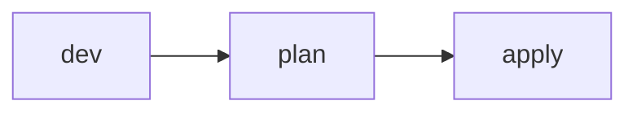

# Thiết kế repo IaC nhiều môi trường cho Olist Shop

## 1. Bối cảnh và ràng buộc

Olist Shop có một tài khoản AWS duy nhất cho mọi môi trường. Team muốn nhanh nên mọi người đều có quyền admin và apply từ laptop.
Hiện có dev, staging và prod nằm chung một state; mỗi lần sửa dev thì plan in ra cả tài nguyên prod. Chúng tôi chỉ cần một cấu
trúc gọn để ai cũng chạy được, chưa quan tâm tới tuân thủ.

## 2. Cấu trúc repo

```text
infra/
  main.tf
  dev.tfvars
  staging.tfvars
  prod.tfvars
```

## 3. State và ranh giới

| Stack | Backend key | Khoá | Ai được apply | Blast radius |
| --- | --- | --- | --- | --- |
| dev | `olist/terraform.tfstate` | không | mọi người | toàn bộ |
| staging | `olist/terraform.tfstate` | không | mọi người | toàn bộ |
| data | `olist/terraform.tfstate` | không | mọi người | toàn bộ |
| network | `olist/terraform.tfstate` | không | mọi người | toàn bộ |

## 4. Workspaces hay thư mục

Dùng một thư mục và chọn workspace bằng tay trước khi apply. Đơn giản, ít tệp, không cần nghĩ nhiều về cấu trúc thư mục hay
quyền theo môi trường; ai quên chọn workspace thì sẽ thấy trong plan.

## 5. Module, version và promotion

- Module lấy từ nhánh main.
- Không ghim version.
- Sửa thẳng trên prod khi gấp.
- Promote bằng cách chép tệp.

## 6. Luồng CI/CD



## 7. Bảo mật state và secret

- Mật khẩu DB để trong prod.tfvars cho tiện.
- State encryption để sau.
- Dùng access key dài hạn trong CI.
- Không dùng KMS.

## 8. Rủi ro và lộ trình

- Chưa có.
- Chưa có.
- Chưa có.
- Chưa có.
