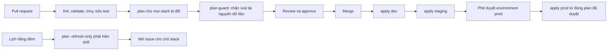

# Lời giải: thiết kế repo IaC nhiều môi trường

Bài Advanced không có một đáp án duy nhất. Reviewer chấm theo việc thiết kế có **giới hạn được thiệt hại** khi có người sai (apply
nhầm, lộ token, sửa tay) và có **đường đi rõ** cho mọi thay đổi không.

## Các quyết định cốt lõi

- **Tài khoản là ranh giới, thư mục phản ánh tài khoản.** Mỗi môi trường một tài khoản AWS; mỗi thư mục lá dưới `live/<env>/<stack>`
  là một root module có backend, provider, role và lock file riêng. Không dùng CLI workspace cho môi trường lâu dài.
- **Chia state theo blast radius.** network, data, app tách nhau: state nhỏ, plan nhanh, khoá ít tranh chấp; stack app đổi hằng ngày
  không thể vô tình đụng bảng dữ liệu. Giá trị dùng chung đi qua output đã publish (SSM Parameter) hay `terraform_remote_state`.
- **Module có version, promote bằng PR.** Module phát hành bằng tag; mỗi môi trường ghim `ref=`; nâng bản lần lượt dev → staging →
  prod, mỗi bước một plan được duyệt. Lock file commit theo từng thư mục.
- **CI là người duy nhất apply prod.** OIDC, role theo môi trường, environment protection với người duyệt; apply đúng tệp plan đã
  duyệt (mã hoá); guard chặn xoá tài nguyên dữ liệu.
- **Secret không vào state, state không đọc được.** Write-only/ephemeral cho secret; mã hoá state và plan bằng `aws_kms`; bucket
  state ở tài khoản shared, versioning, quyền theo prefix key.
- **Drift là tín hiệu vận hành.** Job hằng đêm `plan -refresh-only -detailed-exitcode` cho mỗi stack, mở issue cho chủ stack.

## Rubric (100 điểm)

| Tiêu chí | Điểm | Đạt đủ điểm khi |
| --- | --- | --- |
| Bối cảnh và ràng buộc | 10 | Nêu sự cố thật, số tài khoản, team, tần suất; ràng buộc tuân thủ đo được |
| Cấu trúc repo | 15 | Tách `modules/` và `live/`; thư mục lá là root module; giải thích chỗ đặt policy và workflow |
| State và blast radius | 20 | Key riêng mỗi stack và môi trường; khoá; bucket state riêng, versioning, quyền theo prefix; giải thích chia theo tần suất đổi và mức nguy hiểm |
| Workspace hay thư mục | 10 | Lập luận từ ranh giới quyền, tài khoản, version; nói rõ khi nào workspace vẫn hợp |
| Module và promotion | 15 | Version module, lock file, thứ tự promote, test của module, xử lý thay đổi phá giao diện |
| CI/CD | 15 | Plan ở PR, guard, duyệt, apply đúng plan, OIDC, `concurrency`, drift theo lịch |
| Bảo mật state và secret | 10 | Mã hoá state và plan (KMS), write-only/ephemeral, không secret trong tfvars, quyền đọc state hẹp |
| Lộ trình và rủi ro | 5 | Các bước tách state có kiểm plan không đổi (moved, state mv), bật mã hoá hai bước, thu hồi key cũ |

Trừ điểm: một state cho nhiều môi trường (−15); kỹ sư apply prod từ laptop là đường chính (−10); secret trong tfvars hay biến CI
dạng rõ không xoay (−10); module trỏ nhánh `main` không ghim (−5).

## Câu hỏi kiểm tra

- **Kỹ sư mới sửa module `data-store`:** PR vào `modules/` chạy fmt, validate, trivy, `tofu test` của module; merge rồi tag
  `modules/data-store/v1.5.0`. Prod chỉ nhận khi có PR đổi `ref=` trong `live/prod/data`, plan đính kèm, hai người duyệt, apply qua
  environment `prod`. Trước đó dev và staging đã chạy bản đó.
- **CI của dev lộ token:** token OIDC của dev chỉ assume được role dev; role đó không có quyền trên tài khoản prod, không đọc được
  key `olist/prod/*` trong bucket state, không giải mã được khoá KMS của prod. Thiệt hại giới hạn trong dev.

## Thiết kế mẫu (đã qua test, cũng ở `DESIGN.md` cạnh tệp này)

`````markdown
# Thiết kế repo IaC nhiều môi trường cho Olist Shop

## 1. Bối cảnh và ràng buộc

Olist Shop chạy trên ba tài khoản AWS trong một Organization: `olist-dev`, `olist-staging`, `olist-prod`, cộng tài khoản
`olist-shared` giữ bucket state, khoá KMS và registry. Ba môi trường cùng kiến trúc (network, data, app) nhưng khác kích thước.
Team có 4 kỹ sư backend và 1 người vận hành; trung bình 15 PR hạ tầng mỗi tuần. Sự cố quý trước: một lần apply nhầm workspace
làm mất bảng DynamoDB của staging, một lần state bị ghi đè vì hai người apply cùng lúc. Ràng buộc: prod chỉ apply qua CI, có
người duyệt; mọi thay đổi truy vết được tới PR; không ai giữ access key dài hạn.

## 2. Cấu trúc repo

```text
infra/
  modules/
    network/         VPC, subnet, endpoint
    data-store/      S3, DynamoDB, KMS cho dữ liệu
    app-runtime/     IAM role, SSM parameter cho service
  live/
    dev/
      network/       backend.tf, main.tf gọi module, dev.tfvars (không secret)
      data/
      app/
    staging/
      network/
      data/
      app/
    prod/
      network/
      data/
      app/
  policies/          rule trivy/OPA bổ sung
  .github/workflows/ plan.yml, apply.yml, drift.yml
```

Mỗi thư mục lá dưới `live/` là một root module có backend, provider và `.terraform.lock.hcl` riêng; nó chỉ gọi module có version.

## 3. State và ranh giới

| Stack | Backend key | Khoá | Ai được apply | Blast radius |
| --- | --- | --- | --- | --- |
| dev/network | `olist/dev/network.tfstate` | `use_lockfile = true` | CI sau merge, kỹ sư trong giờ làm | VPC dev |
| dev/app | `olist/dev/app.tfstate` | `use_lockfile = true` | CI sau merge | Role, tham số của dev |
| staging/data | `olist/staging/data.tfstate` | `use_lockfile = true` | CI sau merge | Bucket, bảng của staging |
| prod/network | `olist/prod/network.tfstate` | `use_lockfile = true` | CI với environment `prod`, 1 người duyệt | VPC prod |
| prod/data | `olist/prod/data.tfstate` | `use_lockfile = true` | CI với environment `prod`, 2 người duyệt | Dữ liệu khách hàng |
| prod/app | `olist/prod/app.tfstate` | `use_lockfile = true` | CI với environment `prod`, 1 người duyệt | Role, tham số của prod |

Bucket state của prod nằm ở tài khoản `olist-shared`, bật versioning, chặn public, chỉ role apply của prod được ghi key `olist/prod/*`.

## 4. Workspaces hay thư mục

Chọn thư mục theo môi trường và theo stack. CLI workspace dùng chung một backend, một provider và một bộ quyền; chọn nhầm
workspace là apply nhầm môi trường, và không phân quyền được theo môi trường vì mọi workspace cùng bucket, cùng role. Thư mục
riêng cho mỗi tài khoản role riêng, người duyệt riêng, lock file riêng (nâng provider ở dev trước rồi mới tới prod). Workspace chỉ
dùng cho môi trường tạm theo PR ở dev, tự xoá khi đóng PR.

## 5. Module, version và promotion

- Module nằm cùng repo trong `modules/`, phát hành bằng tag `modules/data-store/v1.4.0`; thư mục live gọi `source = "git::...//modules/data-store?ref=modules/data-store/v1.4.0"`.
- Nâng bản module là một PR đổi `ref=` lần lượt ở dev, staging, prod; promotion là thay đổi có review chứ không chép tệp.
- `.terraform.lock.hcl` của từng thư mục lá được commit; nâng provider bằng `tofu init -upgrade` ở dev trước, chạy test, rồi mới tới prod.
- Module có `tofu test` với mock provider trong CI của chính module; thay đổi phá giao diện thì tăng version chính.

## 6. Luồng CI/CD



## 7. Bảo mật state và secret

- State và plan được mã hoá phía client bằng khối `encryption` của OpenTofu, key provider `aws_kms` dùng khoá KMS riêng mỗi môi trường.
- Secret của ứng dụng tạo bằng thuộc tính write-only (`value_wo`) với biến `ephemeral`, nên không nằm trong state; không bao giờ để password trong .tfvars.
- CI nhận quyền qua OIDC, mỗi môi trường một role, role prod chỉ dùng được từ environment `prod` của GitHub.
- Bucket state chặn public, bật versioning, chỉ role apply đọc ghi; người đọc state thấy mọi output nên output nhạy cảm được đánh dấu `sensitive`.

## 8. Rủi ro và lộ trình

- Tuần 1–2: tách state hiện tại thành các stack bằng `moved` và `tofu state mv` trên bản sao, kiểm plan không đổi.
- Tuần 3: bật mã hoá state với `fallback` từ unencrypted, rồi bỏ fallback và đặt `enforced`.
- Tuần 4: chuyển CI sang OIDC, thu hồi access key cũ.
- Rủi ro: nhiều thư mục làm lặp cấu hình backend; chấp nhận vì mỗi tệp chỉ vài dòng và có thể sinh bằng script hay Terragrunt sau.
- Rủi ro: drift do sửa tay khi sự cố; quy định ghi lại trong 24 giờ và hợp nhất bằng PR.
`````
