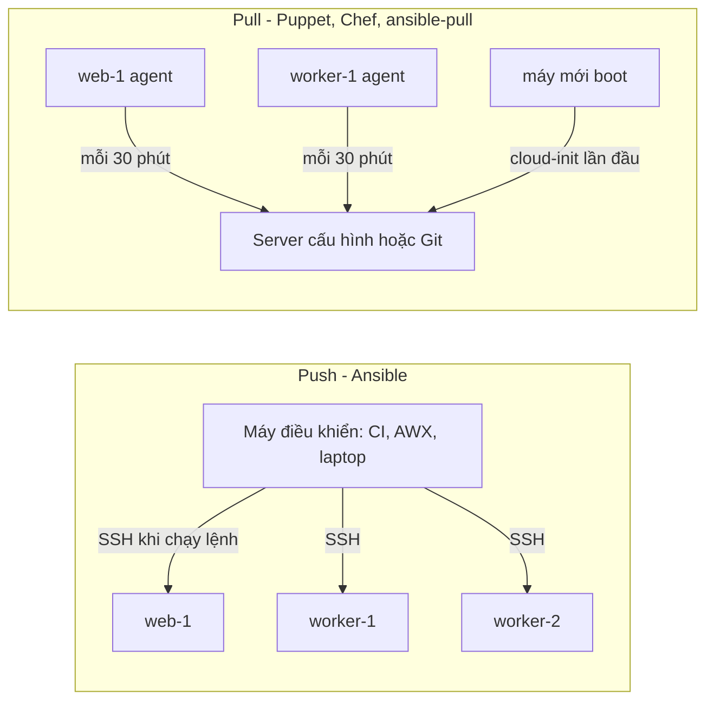
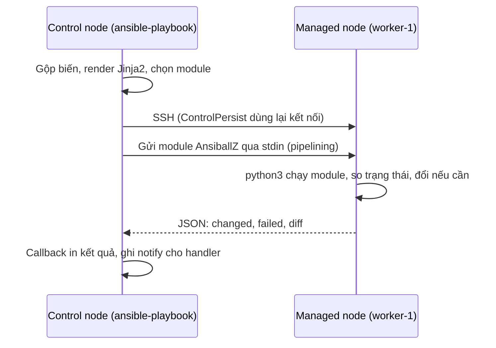
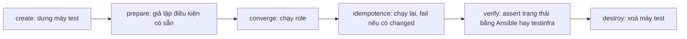

# Configuration management: Ansible từ inventory tới role production

Module 08 dựng hạ tầng: VPC, máy, bucket, quyền. Module này lo phần tiếp theo: trên mỗi máy đã có, cài gì, cấu hình ra sao, và giữ
cho 40 máy giống hệt nhau qua hàng trăm lần thay đổi. Công cụ chính là Ansible, vì nó không cần agent, đọc được như tài liệu, và là
thứ bạn gặp nhiều nhất ở các team vận hành VM. Nhưng câu hỏi senior không phải "viết playbook thế nào" mà là: khi nào cấu hình máy
đang chạy, khi nào thay máy bằng image dựng sẵn, và làm sao biết một lần deploy "xanh" thật sự đã làm đúng việc.

Bài tập chạy Ansible thật tới các container có SSH do test dựng; phần chạy trên máy bạn nằm trong sandbox (mục 0).

Sau module này bạn sẽ:

- Viết inventory tĩnh (YAML, nhóm lồng nhau, `group_vars`, `host_vars`) và inventory động (script, plugin `constructed`), chọn máy
  bằng host pattern; dùng ad-hoc command để điều tra.
- Viết playbook chỉ dùng module có trạng thái, biết khi nào `command` là đúng và viết `changed_when`, `failed_when` cho nó.
- Dùng handler đúng thời điểm (`notify`, `listen`, `flush_handlers`, `force_handlers`), đọc `--check --diff` và biết nó nói dối ở đâu.
- Thuộc thứ tự variable precedence và nhận ra ba cái bẫy hay gây sự cố nhất.
- Đóng gói thành role có giao diện ở `defaults`, template Jinja2, tag; test bằng kịch bản converge, idempotence, verify của molecule.
- Giữ bí mật bằng Ansible Vault (vault id, `encrypt_string`, `no_log`) và xoay vòng chúng.
- Rollout an toàn bằng `serial`, `max_fail_percentage`, `block`/`rescue`; tự rollback.
- So sánh push và pull, mutable và immutable, Ansible với Chef, Puppet, Salt, cloud-init và Packer, rồi chọn theo ràng buộc.

## 0. Cài đặt

| Công cụ | Phiên bản đã kiểm | Tối thiểu cho bài tập | Dùng ở |
| --- | --- | --- | --- |
| `ansible-core` (`ansible`, `ansible-playbook`, `ansible-inventory`, `ansible-vault`...) | 2.21.5 trên CPython 3.12.13 | 2.21 | Mọi bài trừ Basic 03, Advanced 02 |
| Image target của lab | `python:3.12.16-slim-trixie` cộng `setup/ansible-target/` (test tự build) | Đúng tag base này | Mọi bài có máy target |
| Docker, buildx | Như module 06 | Như module 06 | Dựng target |
| OpenSSH client (`ssh`, `ssh-keygen`) | 9.6 | 8.0 | Kết nối tới target |
| bwrap, uv | Như module 02 | Như module 02 | Sandbox của test, chạy pytest |

### Ansible

Ansible là gói Python. Track không thêm nó vào `pyproject.toml` gốc (để lock của các track khác không đổi), mà cài vào một venv
riêng rồi đưa lệnh vào `~/.local/bin`. `setup/ansible/requirements.txt` ghim `ansible-core==2.21.5` cùng mọi dependency và hash
SHA-256 của từng wheel (sinh bằng `uv pip compile --generate-hashes`); `--require-hashes` làm uv kiểm hash **trước** khi cài và từ
chối gói nào không khớp hay không có trong danh sách. `uv tool install ansible-core` ngắn hơn nhưng không kiểm hash theo tệp ghim
của repo, nên track không dùng.

Chạy từ thư mục gốc của repo:

```bash
ANSIBLE_VENV="${XDG_CACHE_HOME:-$HOME/.cache}/devops-track/ansible" &&
uv venv --python 3.12 "$ANSIBLE_VENV" &&
uv pip install --python "$ANSIBLE_VENV/bin/python" --require-hashes --only-binary :all: -r setup/ansible/requirements.txt &&
mkdir -p ~/.local/bin &&
ln -sf "$ANSIBLE_VENV"/bin/ansible{,-playbook,-inventory,-vault,-config,-doc,-galaxy} ~/.local/bin/ &&
which ansible-playbook && ansible-playbook --version
```

Một hash sai hay một gói lạ thì `uv pip install` dừng và chuỗi `&&` không tạo symlink nào. Brace expansion `ansible{,-playbook,...}`
cần bash hay zsh. `uv venv` từ chối ghi đè venv đã có: cài lại hay nâng bản thì chạy khối gỡ ở dưới trước. Kết quả trên máy viết bài (Pop!_OS 24.04,
x86_64):

```text
Installed 9 packages in 32ms
 + ansible-core==2.21.5
 + cffi==2.1.1
 + cryptography==50.0.2
 + jinja2==3.1.6
 + markupsafe==3.0.4
 + packaging==26.3
 + pycparser==3.12
 + pyyaml==6.0.3
 + resolvelib==1.2.1
/home/<user>/.local/bin/ansible-playbook
ansible-playbook [core 2.21.5]
  config file = None
  python version = 3.12.13 (main, Mar  3 2026, 14:59:34) [Clang 21.1.4 ]
  jinja version = 3.1.6
```

`ansible-core` 2.20 trở lên cần Python 3.12 trên máy điều khiển; máy đích chỉ cần Python 3.9 trở lên. Bài tập chỉ dùng module
`ansible.builtin.*` có sẵn trong `ansible-core`, không cần tải collection từ Galaxy. Gói `ansible` (không có `-core`) là bản gom thêm
khoảng 90 collection cộng đồng, nặng hơn nhiều; ở công ty bạn thường cài `ansible-core` cộng đúng các collection cần qua
`requirements.yml`, hoặc dùng Execution Environment (mục 6).

Ansible tạo `~/.ansible/` (tmp, collection, role) ở lần chạy đầu trên máy bạn. Test không bao giờ dùng thư mục đó. Gỡ:

```bash
rm -f ~/.local/bin/ansible{,-playbook,-inventory,-vault,-config,-doc,-galaxy} &&
rm -rf "${XDG_CACHE_HOME:-$HOME/.cache}/devops-track/ansible"
```

### Máy target của lab

Ansible cần một máy để cấu hình. Test dựng mỗi máy là một container (`DockerLab` của module 06) từ `setup/ansible-target/`:
`python:3.12.16-slim-trixie` cộng `openssh-server`, `sudo`, gói `systemd` (chỉ để có `systemd-analyze`), `packaging` (module `pip`
cần) và một kho wheel nội bộ ở `/srv/wheels` cho worker Olist Shop. Lần đầu build cần mạng cho `apt` và `pip download`; các lần sau
dùng cache của BuildKit, không cần mạng. Không tải được thì test skip kèm lời nhắc.

Mỗi container chạy `sshd` bằng root làm PID 1, với `--security-opt no-new-privileges`, RAM 512 MB, cổng 22 chỉ mở trên `127.0.0.1`
ở một cổng trống. sshd chạy được với capability mặc định của Docker (`SYS_CHROOT`, `SETUID`, `SETGID` cho privilege separation) nên
lab không phải cấp thêm quyền nào. Ansible kết nối bằng `root`; `become: true` vẫn chạy (sudo của root dưới `no-new-privileges` không
cần đổi UID), còn user thường gọi `sudo` sẽ bị chặn, nên lab không có kiểu đăng nhập user thường rồi `become` như ở production.

**Container không chạy systemd.** systemd làm PID 1 trong container cần cgroup ghi được, `/run` và `/sys/fs/cgroup` riêng, thường
cả `--privileged`: đúng loại quyền mà lab cấm. Vì vậy trong bài, unit systemd là một **tệp được deploy** và được kiểm bằng
`systemd-analyze verify` ngay trên target; task quản service (`ansible.builtin.systemd_service`) có `when: ansible_facts.service_mgr
== "systemd"`, trên lab fact này là `sshd` nên task bị bỏ qua, còn trên VM thật nó chạy. Handler vẫn được notify và test thấy nó
(trạng thái `skipped`). Bạn học đủ cách role quản service, chỉ không thấy tiến trình worker chạy thật.

### Test chạy Ansible thế nào

Helper `AnsibleLab` của testkit:

1. Build image target, chạy N container, sinh cặp khoá ed25519 trong thư mục tạm, đọc khoá host của từng container rồi **ghim** vào
   một `known_hosts` riêng.
2. Sinh tệp điều khiển trong một thư mục tạm riêng: `ssh_config` (`StrictHostKeyChecking yes`, `IdentityAgent none`,
   `GlobalKnownHostsFile /dev/null`, một `ProxyCommand` chỉ mở kết nối tới `127.0.0.1:<cổng của lab>`), `ansible.cfg`, inventory
   `lab.ini` chỉ liệt kê tên máy (truyền **sau** inventory của bài), và tệp extra vars `lab-conn.yml` luôn truyền cuối cùng bằng
   `-e @lab-conn.yml`. Sandbox chỉ thấy thư mục này ở chế độ chỉ đọc, và lab ghi lại nó trước mỗi lệnh.
3. Chép thư mục bài vào thư mục làm việc tạm, chạy `ansible-playbook` trong sandbox bwrap: `HOME` tạm, `ANSIBLE_CONFIG` trỏ tệp của
   lab (nên `ansible.cfg` trong thư mục bài, `~/.ansible.cfg`, `/etc/ansible` không được đọc), `~/.ssh` bị che, env dựng từ đầu.
4. Đọc kết quả từng task qua một callback của lab (máy nào, task nào, module gì, `changed`, handler hay không, kết nối qua đâu),
   không parse output.

Cách lab giữ bài Ansible khỏi máy bạn, chia theo vai trò:

- **Ranh giới cho code chạy trên máy điều khiển: sandbox.** `ansible-playbook` và mọi thứ nó chạy trên máy bạn (script inventory
  động, lookup, một task lỡ chạy local) nằm trong bwrap: `/` chỉ đọc, `~/.ssh` và thông tin đăng nhập khác bị che, không SSH agent,
  chỉ thư mục làm việc tạm của lab ghi được.
- **Thứ giữ kết nối trong lab: biến ghim, tệp điều khiển chỉ đọc, khoá host ghim, ProxyCommand.**
  - Extra vars đứng cao nhất trong precedence (mục 4), thắng `set_fact`, inventory (kể cả inventory động), `vars:` và cả từ khoá
    `connection:`. `lab-conn.yml` đặt `ansible_connection: ansible.builtin.ssh` (tên đầy đủ, không đi qua plugin cùng tên của
    người dùng); `ansible_host`, `ansible_port` và cả tên cũ `ansible_ssh_host`,
    `ansible_ssh_port` (plugin ssh lấy tên khai báo sau cùng) theo bảng cổng của lab, máy không thuộc lab (kể cả `localhost` ngầm
    định) nhận `0.0.0.0:1`; `ansible_user`/`ansible_ssh_user: root`; đối số, chương trình, khoá, control path và pipelining của ssh.
    Đặt các biến này ở chỗ khác không có tác dụng; `become` và `become_user` vẫn dùng bình thường.
  - Các tệp đó (cùng `ssh_config`, `known_hosts`, callback, script proxy, `ANSIBLE_HOME` và thư mục rỗng cho mọi đường dẫn plugin,
    `library`, `module_utils`) nằm trong thư mục mà sandbox chỉ thấy ở chế độ chỉ đọc: script inventory của bài thử ghi đè chúng nhận
    lỗi `EROFS`, và lab còn ghi lại chúng trước mỗi lệnh. Bài đã chép cũng chỉ đọc trong sandbox (chỉ `HOME`, control path và tệp
    sự kiện ghi được), nên không ai thêm được plugin cạnh playbook lúc chạy; thư mục `*_plugins/`, `library/`, `module_utils/` có sẵn
    trong bài thì bị phép quét từ chối, vì Ansible luôn nạp chúng và chúng thay được plugin builtin cùng tên.
  - ssh chỉ mở được kết nối tới `127.0.0.1:<cổng của từng container>` (ProxyCommand) và chỉ tin khoá host của các container đó.
- **Phát hiện: callback của lab.** Lần chạy bị đánh dấu lỗi khi có task trên host ngoài lab, task không đi bằng ssh tới đúng cổng của
  máy đó, kết nối bị ProxyCommand chặn, hay khi bài cố đặt một biến kết nối bị ghim (qua `set_fact`, biến inventory, `vars:`,
  `connection:`). Đây là phát hiện, không phải ranh giới: tệp sự kiện phải ghi được để callback ghi vào.
- **Tín hiệu dạy học: phép quét tĩnh trước khi chạy.** Test từ chối tệp nào trong thư mục bài có `connection:`, `ansible_connection`,
  `ansible_host`, `ansible_port`, `ansible_ssh_*`, `host_key_checking`, `delegate_to`, `local_action`, `add_host`, lookup
  `pipe`/`lines`, escape `\xNN`/`\uNNNN`, `localhost`, địa chỉ 127.0.0.0/8 (kể cả `127.1`), `0.0.0.0`, `::1` (ngoài `templates/` và
  `files/`), hay thư mục `*_plugins`, `collections`. Quét văn bản thô, kể cả chú thích. Nó giúp bạn bỏ thói quen sớm; tên khoá dựng
  bằng Jinja2 hay script inventory lách được nó, nên nó không phải chỗ chặn. Bài inventory động (Intermediate 03) không kết nối máy
  nào nên không qua phép quét và được dùng `ansible_host`.

Test chạy `uv run pytest <thư mục bài> -q -rs`. Bài có target mất 15 giây tới 1,5 phút. Máy nhiều core thì ghim như module 06:

```bash
export DEVOPS_CPUSET=12-35 &&
nice -n 15 taskset -c "$DEVOPS_CPUSET" uv run pytest tracks/devops/modules/09-config-management/exercises/intermediate/01-olist-worker-role -q -rs
```

### Lab tay để thử ad-hoc và playbook

Test tự dựng và dọn mọi thứ. Muốn tự gõ lệnh, dựng một target tay (cổng 2222; đổi nếu đã có dịch vụ khác dùng):

```bash
cd "$(git rev-parse --show-toplevel)" &&
nice -n 15 docker build --pull=false ${DEVOPS_CPUSET:+--cpuset-cpus "$DEVOPS_CPUSET"} -t devops-track/ansible-target:manual setup/ansible-target &&
LAB="$(mktemp -d)" &&
ssh-keygen -q -t ed25519 -N '' -f "$LAB/id_ed25519" &&
docker run -d --name devops-ex-manual-target --label devops-ex=1 --security-opt no-new-privileges \
  --memory 512m --pids-limit 256 ${DEVOPS_CPUSET:+--cpuset-cpus "$DEVOPS_CPUSET"} -p 127.0.0.1:2222:22 \
  -e DEVOPS_EX_AUTHORIZED_KEY="$(cat "$LAB/id_ed25519.pub")" devops-track/ansible-target:manual &&
timeout 30 sh -c 'until docker exec devops-ex-manual-target test -s /etc/ssh/ssh_host_ed25519_key.pub; do sleep 0.5; done' &&
printf '[127.0.0.1]:2222 %s\n' "$(docker exec devops-ex-manual-target cut -d' ' -f1,2 /etc/ssh/ssh_host_ed25519_key.pub)" > "$LAB/known_hosts" &&
printf 'worker-1 ansible_host=127.0.0.1 ansible_port=2222 ansible_user=root\n' > "$LAB/hosts.ini" &&
printf '[defaults]\ninterpreter_python = /usr/local/bin/python3\nhost_key_checking = True\n[ssh_connection]\nssh_args = -o IdentitiesOnly=yes -o IdentityAgent=none -o UserKnownHostsFile=%s/known_hosts -o StrictHostKeyChecking=yes -i %s/id_ed25519\n' "$LAB" "$LAB" > "$LAB/ansible.cfg" &&
export LAB ANSIBLE_CONFIG="$LAB/ansible.cfg" &&
ansible -i "$LAB/hosts.ini" all -m ansible.builtin.ping
```

```text
worker-1 | SUCCESS => {
    "changed": false,
    "ping": "pong"
}
```

Chạy playbook của một bài lên máy này: trong thư mục `starter/`,
`ansible-playbook -i inventory -i "$LAB/hosts.ini" site.yml --limit worker-1`. Lab tay chạy ngoài sandbox với `HOME` thật nên Ansible
tạo `~/.ansible/` trên máy bạn như mọi lần dùng Ansible bình thường (gỡ ở mục Ansible phía trên). Dọn:

```bash
docker rm -f devops-ex-manual-target &&
docker rmi devops-track/ansible-target:manual &&
rm -rf "$LAB" && unset LAB ANSIBLE_CONFIG
```

### Dọn sau khi làm bài

Mọi container, network, image của test mang tiền tố `devops-ex-` và nhãn `devops-ex=1`, bị xoá khi test xong (kể cả lỗi hay Ctrl-C).
Kiểm không còn gì sót:

```bash
docker ps -a --filter label=devops-ex=1 --format '{{.Names}}' &&
docker network ls --filter name=devops-ex- --format '{{.Name}}' &&
docker images --filter label=devops-ex=1 --format '{{.Repository}}:{{.Tag}}'
```

Ba lệnh in rỗng là sạch. Cache build của BuildKit (layer `apt`, wheel) được giữ để lần sau chạy offline; dọn tay bằng
`docker builder prune` khi cần chỗ.

## 1. Configuration management: bài toán, push và pull, mutable và immutable

### Bài toán

Một máy chủ mới từ module 08 là một hệ điều hành trống. Để chạy worker Olist Shop cần user dịch vụ, thư mục với đúng quyền, code,
virtualenv, tệp cấu hình, unit systemd, log rotation, hardening theo CIS. Làm tay một lần thì được; làm cho 40 máy, mỗi tuần đổi
vài thứ, và chứng minh được với audit rằng máy nào cũng đúng, thì cần **configuration management**: mô tả trạng thái mong muốn
bằng code, một công cụ đưa máy về trạng thái đó và báo cái gì đã đổi.

Ba ý niệm chạy suốt module:

- **Trạng thái mong muốn (desired state).** Bạn viết "tệp này có nội dung này, quyền này", không viết "chạy lệnh echo". Công cụ so
  trạng thái hiện tại với mong muốn và chỉ đổi phần lệch.
- **Idempotency.** Áp cùng cấu hình lần thứ hai không đổi gì và báo không đổi gì. Đây là thứ cho phép chạy lại an toàn sau sự cố,
  chạy định kỳ để sửa drift, và tin vào chữ `changed` trong báo cáo.
- **Drift.** Khoảng lệch giữa máy thật và cấu hình trong Git: ai đó sửa tay lúc trực đêm, gói tự cập nhật, script chạy một lần rồi
  quên. Máy lệch lâu ngày thành "snowflake server": không ai dám động vào vì không ai biết nó khác gì.

### Phân lớp: provisioning, configuration, deployment

| Lớp | Câu hỏi | Công cụ điển hình | Module |
| --- | --- | --- | --- |
| Image | Máy boot lên đã có gì sẵn | Packer, Dockerfile, EC2 Image Builder | 06, mục 7 ở đây |
| Provisioning | Có những tài nguyên nào (máy, mạng, bucket, quyền) | OpenTofu, Terraform, CloudFormation | 08 |
| Configuration | Trên mỗi máy cài và cấu hình gì | Ansible, Puppet, Chef, Salt | 09 |
| Deployment | Bản ứng dụng nào chạy ở đâu, đổi bản thế nào | Ansible, CI/CD, Kubernetes, ArgoCD | 07, 10–12 |

Ranh giới không cứng: Ansible tạo được máy EC2, OpenTofu chạy được script khởi tạo. Quy ước tốt là mỗi lớp một công cụ chính và một
nguồn sự thật. Dùng OpenTofu `remote-exec` để cấu hình máy là con đường dẫn tới cấu hình không idempotent và state không biết gì về
nó (provisioner là "phương án cuối" ở module 08).

### Push và pull

- **Push**: một máy điều khiển (laptop, CI, AWX) kết nối vào máy đích và áp cấu hình khi **bạn** chạy lệnh. Ansible là push, qua
  SSH (WinRM cho Windows), không có agent thường trực. Ưu: không cài gì thêm trên máy, thứ tự và thời điểm rõ ràng, hợp với deploy
  theo lệnh. Nhược: máy điều khiển phải tới được mọi máy; máy mới hay máy tắt lúc chạy bị lỡ; drift tồn tại giữa hai lần chạy.
- **Pull**: agent trên mỗi máy định kỳ kéo cấu hình từ server (Puppet agent mỗi 30 phút, Chef client, Salt minion) hoặc từ Git
  (`ansible-pull`). Ưu: tự sửa drift định kỳ, máy mới tự cấu hình khi boot, scale tới hàng chục nghìn máy vì server không phải mở
  kết nối tới từng máy. Nhược: agent phải chạy, được vá, có chứng chỉ; thứ tự thay đổi giữa các máy khó điều phối.



Thực tế hay trộn: Ansible push cho deploy có thứ tự, cộng job định kỳ chạy `--check --diff` để phát hiện drift; máy autoscaling dùng
`ansible-pull` lúc boot qua cloud-init, hoặc tốt hơn, boot từ image đã cấu hình sẵn.

### Mutable và immutable infrastructure

- **Mutable**: máy sống lâu, thay đổi được áp **lên** máy đang chạy (Ansible, Puppet). Hợp với máy có trạng thái khó thay
  (database, máy vật lý, thiết bị mạng), và khi thay đổi nhỏ, thường xuyên.
- **Immutable**: máy không bao giờ được sửa sau khi chạy. Đổi bất kỳ thứ gì nghĩa là build image mới (Packer, Dockerfile) và thay máy
  cũ bằng máy mới. Drift không tích tụ vì không ai sửa tại chỗ; rollback là quay về image cũ; mọi máy chạy cùng image giống hệt.
  Container và Kubernetes là immutable ở mức ứng dụng.

Immutable không loại Ansible: Packer chạy chính role Ansible làm provisioner lúc build image. Cái đổi là **khi nào** cấu hình được áp
(lúc build thay vì lúc chạy) và **cái gì** được phép áp lúc chạy (chỉ cấu hình theo môi trường và secret, qua cloud-init hay đọc từ
secret manager). Advanced 02 bắt bạn chọn cho từng workload của Olist Shop.

| Câu hỏi | Mutable (Ansible trên máy) | Immutable (image) |
| --- | --- | --- |
| Đổi một dòng cấu hình | Vài giây, tại chỗ | Build, quét, rollout image: hàng chục phút |
| Máy mới sẵn sàng | Boot rồi chạy cấu hình: phút | Boot là xong: giây |
| Drift | Tích tụ giữa hai lần chạy | Không có nếu cấm sửa tại chỗ và máy được thay định kỳ |
| Rollback | Chạy lại bản cũ, không phải thay đổi nào cũng đảo được | Quay về image cũ |
| Máy có dữ liệu | Tự nhiên | Dữ liệu phải ở ngoài máy |

## 2. Kiến trúc Ansible, inventory và ad-hoc command

### Ansible chạy một task thế nào

**Control node** là máy chạy `ansible-playbook` (cần Python, Linux hay macOS; Windows qua WSL). **Managed node** là máy đích, chỉ cần
SSH và Python. Với mỗi task trên mỗi máy, Ansible:

1. Dựng biến cho máy đó (inventory, facts, play, role...), render các tham số Jinja2 **trên control node**.
2. Đóng gói module (code Python của `ansible.builtin.copy`, `user`...) cùng tham số thành một tệp tự chạy (AnsiballZ).
3. Gửi qua kết nối (connection plugin `ssh` mặc định; `local`, `docker`, `winrm`, `community.aws.aws_ssm`...) và chạy bằng Python của
   máy đích. Với `pipelining = True` module đi qua stdin, không ghi tệp tạm, nhanh gấp vài lần.
4. Module so trạng thái hiện tại với tham số, đổi nếu cần, trả JSON `{"changed": ..., ...}`. Action plugin (`template`, `copy`,
   `debug`) chạy một phần trên control node trước, ví dụ render template rồi mới gửi kết quả xuống.



`forks` (mặc định 5) là số máy chạy song song. `strategy: linear` (mặc định) chờ mọi máy xong task này mới sang task sau;
`strategy: free` để mỗi máy chạy hết tốc độ. `become` đổi user trên máy đích (mặc định qua `sudo`) sau khi đã đăng nhập bằng
`remote_user`. Ở production bạn đăng nhập bằng user deploy có khoá SSH riêng rồi `become: true`; trong lab, như mục 0, đăng nhập thẳng
bằng root.

### Inventory tĩnh

Inventory là danh sách máy, nhóm và biến. Hai nhóm luôn có sẵn: `all` (mọi máy) và `ungrouped`. Nhóm lồng nhau qua `children`:

```yaml
olist:
  children:
    web:
      hosts:
        web-1:
    workers:
      hosts:
        worker-1:
        worker-2:
          olist_worker_concurrency: 4
```

Biến nên đặt trong `group_vars/<nhóm>.yml` (hay thư mục `group_vars/<nhóm>/` chứa nhiều tệp) và `host_vars/<máy>.yml` cạnh tệp
inventory, không viết lẫn vào tệp hosts. Mỗi môi trường một thư mục inventory (`inventories/staging/`, `inventories/prod/`) là cách
phổ biến nhất để tách môi trường: chọn môi trường bằng `-i`, không bằng biến.

Ansible không có khái niệm "máy thuộc một nhóm duy nhất": `worker-1` có thể thuộc `workers`, `prod`, `az_hcm_1a`. Khi hai nhóm cùng
cấp đặt cùng một biến, nhóm nào thắng phụ thuộc thứ tự tên (hay `ansible_group_priority`): một nguồn sự cố khó thấy, nên tránh hai
nhóm ngang hàng cùng đặt một biến.

### Inventory động

Danh sách máy thật nằm ở nơi khác: API cloud, CMDB, Consul. Inventory động đọc từ đó mỗi lần chạy:

- **Script**: chương trình thực thi được, `--list` in JSON `{nhóm: {hosts: [...]}, "_meta": {"hostvars": {...}}}`, `--host <máy>`
  in biến của một máy (trả `{}` khi đã có `_meta`). Viết bằng ngôn ngữ nào cũng được.
- **Inventory plugin**: tệp YAML có `plugin: amazon.aws.aws_ec2` (hay `google.cloud.gcp_compute`, `community.general.proxmox`...),
  hỗ trợ `keyed_groups` (nhóm theo tag), `filters`, `compose`, và cache. Ưu tiên plugin khi có; script cho nguồn nội bộ.
- **`ansible.builtin.constructed`**: plugin không đọc nguồn ngoài, chỉ tạo nhóm và biến mới từ biến đã có (`groups: {canary:
  olist_canary}`). Đặt sau các nguồn khác trong cùng thư mục inventory.

Một nguyên tắc: inventory rỗng nguy hiểm hơn inventory lỗi. Script không đọc được nguồn mà vẫn in `{}` làm playbook "thành công" trên
0 máy và pipeline xanh. Fail to.

### Host pattern

`hosts:` của play và `--limit` nhận pattern: `workers` (một nhóm), `web:workers` (hợp), `workers:&prod` (giao), `workers:!canary`
(loại), `worker-*` (wildcard), `~worker-\d+` (regex), `workers[0]` (phần tử đầu). Ghép được: `role_worker:&env_prod:!canary`.
`ansible-playbook site.yml --list-hosts` in danh sách máy của từng play mà không kết nối máy nào: luôn chạy nó trước khi nhắm prod.

### Ad-hoc command

Một module, một lần, không cần playbook:

```bash
ansible -i inventory workers -m ansible.builtin.ping
ansible -i inventory workers -m ansible.builtin.setup -a 'filter=ansible_distribution*'
ansible -i inventory workers -m ansible.builtin.command -a 'systemctl is-active olist-worker'
ansible -i inventory 'workers:&az_hcm_1a' -m ansible.builtin.service -a 'name=olist-worker state=restarted' --become -f 2
```

Ad-hoc hợp để điều tra (fact, trạng thái service, dung lượng đĩa trên 40 máy một lúc) và việc khẩn có kiểm soát (restart theo nhóm
nhỏ với `-f 2`). Mọi thay đổi muốn giữ phải về playbook trong Git, nếu không ad-hoc là một cách tạo drift có tổ chức.

## 3. Playbook, module, idempotency và handler

### Cấu trúc

Playbook là danh sách **play**; mỗi play gắn một tập máy (`hosts`) với danh sách **task**; mỗi task gọi một **module**. Play còn có
`vars`, `pre_tasks`, `roles`, `tasks`, `post_tasks`, `handlers`, và các khoá điều khiển (`become`, `gather_facts`, `serial`,
`strategy`). Viết module bằng FQCN (`ansible.builtin.copy`, không `copy`) để không nhầm với module cùng tên của collection khác.

```yaml
- name: Cấu hình worker
  hosts: workers
  become: true
  tasks:
    - name: Ghi env file
      ansible.builtin.template:
        src: worker.env.j2
        dest: /etc/olist-shop/worker.env
        owner: root
        group: olist
        mode: "0640"
      notify: Restart olist-worker
  handlers:
    - name: Restart olist-worker
      ansible.builtin.systemd_service:
        name: olist-worker
        state: restarted
```

`mode` luôn viết dạng chuỗi có số 0 đầu (`"0640"`): YAML đọc `0640` không nháy là số bát phân 416 và `640` là thập phân 640, cho ra
quyền sai mà không báo lỗi.

### Module hay shell

Module **khai báo trạng thái**: `ansible.builtin.file: path=/x state=directory mode=0750` nghĩa là "thư mục này phải tồn tại với quyền
này". Module đọc trạng thái hiện tại, chỉ đổi khi lệch, trả `changed` đúng, hỗ trợ `--check` và `--diff`. `shell`/`command` chỉ là
"chạy lệnh này": Ansible không biết lệnh đổi gì, nên mặc định coi là luôn `changed`, mã thoát khác 0 luôn là lỗi, và `--check` bỏ qua.

| Việc | Đừng | Dùng |
| --- | --- | --- |
| Thêm, sửa một dòng | `echo ... >>`, `sed -i` | `lineinfile` (một dòng), `blockinfile` (một khối), `template` (cả tệp) |
| Thư mục, symlink, quyền | `mkdir -p`, `ln -sfn`, `chown -R` | `file` |
| User, group | `useradd` | `user`, `group` |
| Gói | `apt-get install -y` | `apt`, `dnf`, `package` |
| Service | `systemctl restart` | `systemd_service` (hay `service`) trong handler |
| Tải tệp | `curl -o` | `get_url` có `checksum:` |
| Giải nén | `tar xzf` | `unarchive` có `creates:` hay so checksum |

Khi buộc phải chạy lệnh (công cụ không có module, kiểm tra trạng thái), cho Ansible biết ngữ nghĩa của nó:

- `changed_when: false` cho lệnh chỉ đọc; `changed_when: "'created' in result.stdout"` cho lệnh tự báo có đổi hay không.
- `failed_when: result.rc > 1` khi mã thoát khác 0 không phải lỗi (`grep` trả 1 khi không khớp; `diff` trả 1 khi khác).
- `creates: /path` hay `removes: /path`: bỏ qua lệnh khi tệp đã có hay đã không còn. Đây là cách duy nhất để `command` được đánh giá
  đúng trong check mode.
- `command` thay `shell` khi không cần pipe, chuyển hướng, biến shell: không có shell nghĩa là không có shell injection.

`ignore_errors: true` không phải cách "sửa" lệnh trả mã khác 0: nó nuốt cả lỗi thật. Basic 02 đặt bạn vào đúng tình huống này.

### Idempotency, check mode và diff

Play idempotent: chạy lần hai trên máy đã đúng thì recap `changed=0`. Đây là phép thử rẻ nhất và mạnh nhất cho chất lượng role, và là
kịch bản `idempotence` của molecule (mục 5). Các lỗi phá idempotency hay gặp: `shell`/`command` không có `changed_when`; template chứa
giá trị đổi mỗi lần (`{{ ansible_date_time.iso8601 }}`, thứ tự dict không ổn định); `copy` với `content` sinh ra khác nhau; module
`pip`/`apt` với `state: latest`.

`ansible-playbook site.yml --check --diff` chạy mọi task ở chế độ "chỉ nói sẽ làm gì" và in khác biệt nội dung tệp. Hữu ích để review
trước khi áp prod và để phát hiện drift định kỳ. Giới hạn cần biết:

- `command`/`shell` bị bỏ qua (trừ khi có `creates`/`removes`), nên task sau dùng `register` của chúng nhận kết quả rỗng và có thể
  báo sai hay lỗi. Đánh dấu task chỉ đọc bằng `check_mode: false` để nó vẫn chạy thật trong check mode.
- Một số module không hỗ trợ check mode hay báo `changed` bảo thủ. Ví dụ đã kiểm: `ansible.builtin.pip` với `extra_args` hay
  `requirements:` luôn báo `changed` trong check mode (Intermediate 01).
- Task phụ thuộc thứ mà task trước sẽ tạo (cài gói rồi cấu hình nó) fail trong check mode vì thứ đó chưa có.
- `--diff` in **nội dung** tệp: tệp chứa bí mật phải có `diff: false` (mục 5).

### Handler

Handler là task chỉ chạy khi được `notify` bởi một task **báo changed**, và chạy **một lần** ở điểm flush kế tiếp dù được notify
nhiều lần.
Dùng cho restart, reload: đổi env file và unit trong cùng một lần chạy vẫn chỉ restart một lần.

- Tên trong `notify:` phải trùng `name:` của handler, hoặc dùng `listen: "restart worker stack"` để nhiều handler cùng nghe một chủ
  đề. Notify một tên không tồn tại là lỗi.
- Điểm flush: sau `pre_tasks`, sau phần `roles` cộng `tasks`, sau `post_tasks`, và ở mỗi `- ansible.builtin.meta: flush_handlers`.
  Handler chạy theo **thứ tự khai báo trong `handlers`**, không theo thứ tự notify. Task sau cần service đã restart (ví dụ health check
  trong cùng phần `tasks`) thì đặt `flush_handlers` trước nó.
- Máy fail giữa play bị loại khỏi play và **handler đang chờ của nó không chạy**. Lần chạy sau tệp đã đúng nên không task nào notify
  nữa: service chạy cấu hình cũ vô thời hạn. `force_handlers: true` (play) hay `--force-handlers` buộc handler chạy dù máy fail.
- Task có `changed_when: false` không bao giờ notify được, kể cả khi thật sự ghi tệp. Đây là nguyên nhân của một trong ba triệu chứng
  ở Intermediate 04.

### Fact, điều kiện, vòng lặp, block

`gather_facts: true` (mặc định) chạy module `setup` đầu play, cho `ansible_facts` (distro, IP, RAM, `service_mgr`...). Tắt khi không
dùng để nhanh hơn, hay bật fact cache (`fact_caching = jsonfile`, Redis) cho inventory lớn. `when:` nhận biểu thức Jinja2 (không cần
`{{ }}`); từ `ansible-core` 2.19, điều kiện phải cho kết quả bool: `when: some_string` với chuỗi không rỗng không còn được ép thành
đúng mà là **lỗi** ("Conditionals must have a boolean result"), trừ khi bật tạm `ALLOW_BROKEN_CONDITIONALS`; viết `when: some_string |
length > 0` hay `when: flag | bool`. `loop:` lặp qua danh sách;
`register` lưu kết quả; `block`/`rescue`/`always` gom task, bắt lỗi và dọn dẹp (Advanced 01 dùng để rollback).

## 4. Biến, template Jinja2 và variable precedence

### Biến đến từ đâu

Inventory (`group_vars`, `host_vars`), play (`vars`, `vars_files`, `vars_prompt`), role (`defaults`, `vars`), fact của máy, kết quả
`register` và `set_fact`, tham số khi gọi role hay include, và dòng lệnh (`-e`). Biến "ma thuật" do Ansible cung cấp: `inventory_hostname`
(tên trong inventory), `groups` (map nhóm sang danh sách máy), `hostvars` (biến của máy khác: `hostvars['db-1'].ansible_host`),
`group_names`, `play_hosts`, `ansible_check_mode`.

### Thứ tự ưu tiên đầy đủ

Cùng một tên biến được đặt nhiều nơi thì nơi đứng **sau** trong danh sách thắng (theo tài liệu "Understanding variable precedence"):

| Tầng | Nguồn | Ghi chú |
| --- | --- | --- |
| 1 | Giá trị dòng lệnh không phải biến (`-u`, `-b`) | Thấp nhất |
| 2 | **Role `defaults/main.yml`** | Giao diện của role: nơi đặt mọi thứ người dùng role có thể đổi |
| 3 | Biến nhóm viết trong tệp hay script inventory | |
| 4 | `group_vars/all` cạnh inventory | |
| 5 | `group_vars/all` cạnh playbook | |
| 6 | `group_vars/<nhóm>` cạnh inventory | Nơi ops đặt giá trị theo môi trường |
| 7 | `group_vars/<nhóm>` cạnh playbook | **Bẫy**: thắng `group_vars` của inventory cùng loại |
| 8 | Biến máy viết trong tệp hay script inventory | |
| 9 | `host_vars/<máy>` cạnh inventory | |
| 10 | `host_vars/<máy>` cạnh playbook | |
| 11 | Fact của máy, fact đã cache | |
| 12 | `vars:` của play | |
| 13 | `vars_prompt` của play | |
| 14 | `vars_files` của play | |
| 15 | **Role `vars/main.yml`** | **Bẫy**: thắng mọi thứ của inventory và play |
| 16 | `vars:` của block | |
| 17 | `vars:` của task | |
| 18 | `include_vars` | |
| 19 | `set_fact`, `register` | |
| 20 | Tham số của role (`roles: - role: x, vars...`), `include_role` | |
| 21 | Tham số của include | |
| 22 | **Extra vars (`-e`)** | Luôn thắng, kể cả `set_fact` |

Ba cái bẫy gây sự cố nhiều nhất:

1. **Giá trị người dùng đặt trong role `vars/`.** Ops đặt `DEBUG` trong `group_vars` (tầng 6), role đặt `INFO` trong `vars/` (tầng 15):
   `INFO` thắng, không cảnh báo, và `ansible-inventory --host` vẫn in `DEBUG` vì nó chỉ đọc inventory. Quy ước: role chỉ để hằng số
   nội bộ (đường dẫn theo distro, tên gói) trong `vars/`, mọi thứ khác trong `defaults/`.
2. **`group_vars` ở hai chỗ.** Thư mục cạnh playbook thắng thư mục cạnh inventory cùng loại. Repo có cả `playbooks/group_vars/` và
   `inventories/prod/group_vars/` là hai nguồn sự thật cho một biến. Chọn một chỗ (thường là cạnh inventory).
3. **`-e` để "sửa nhanh".** Extra vars thắng mọi thứ, nên `-e olist_worker_log_level=DEBUG` trong job CI "chữa" được bẫy 1 mà cấu hình thật
   của môi trường không còn nằm trong Git. Dùng `-e` cho tham số của một lần chạy (bản cần deploy), không cho cấu hình.

Thêm: biến từ hai nhóm ngang hàng (cùng độ sâu) cùng đặt một tên thì nhóm xếp sau theo tên thắng, trừ khi đặt `ansible_group_priority`.
Dict mặc định bị **thay** chứ không trộn (`hash_behaviour = replace`); cần trộn thì `combine` tường minh.

### Template Jinja2

`ansible.builtin.template` render tệp `.j2` trên control node rồi ghi xuống máy đích (so checksum, chỉ ghi khi khác). Jinja2 cho biểu
thức `{{ }}`, lệnh ``/``, chú thích `{# #}`, filter và test:

```jinja
# {{ ansible_managed }}
[host]
name = {{ inventory_hostname }}
role = {{ olist_role }}

concurrency = {{ olist_worker_concurrency | default(2) | int }}

upstreams = {{ groups['workers'] | map('extract', hostvars, 'ansible_host') | join(',') }}
```

- Filter hay dùng: `default`, `mandatory`, `int`, `bool`, `to_nice_yaml`, `to_json`, `regex_replace`, `combine`, `dict2items`,
  `selectattr`, `map('extract', ...)`, `password_hash`, `b64encode`.
- Test: `is defined`, `is match(...)`, `is version("3.12", ">=")`, `is changed`, `is failed`.
- `template` mặc định bật `trim_blocks` (dòng chỉ có `` không để lại dòng trống); `lstrip_blocks` tắt.
- `ansible_managed` ở đầu tệp nhắc người sửa tay rằng tệp sẽ bị ghi đè.
- Từ `ansible-core` 2.19, chuỗi đến từ nguồn không tin cậy (kết quả module, fact) không còn được render như template nữa; template lồng
  trong dữ liệu phải đến từ chính playbook. Cùng đợt, điều kiện trả giá trị không phải bool thành lỗi.

## 5. Role, collection, vault, tag và kiểm thử

### Role

Role đóng gói một mối quan tâm (cài worker, hardening SSH, cấu hình Nginx) thành thư mục có bố cục cố định, dùng lại được ở nhiều
playbook và nhiều môi trường:

```text
roles/olist_worker/
├── defaults/main.yml      biến người dùng đổi được (ưu tiên thấp nhất)
├── vars/main.yml          hằng số nội bộ (ưu tiên cao)
├── tasks/main.yml         điểm vào; có thể import_tasks tệp khác
├── handlers/main.yml      restart, reload
├── templates/             tệp .j2 cho module template
├── files/                 tệp chép nguyên cho copy, script
├── meta/main.yml          galaxy_info, dependencies, platforms
└── molecule/default/      kịch bản test (mục dưới)
```

- **Giao diện là `defaults`.** Đặt tiền tố tên role cho mọi biến (`olist_worker_*`) để không va biến của role khác. `meta/argument_specs.yml`
  khai báo kiểu và giá trị bắt buộc; Ansible kiểm trước khi chạy role.
- **`import_role` hay `include_role`.** `import_*` là tĩnh: xử lý lúc parse, tag và `when` áp cho mọi task bên trong, `--list-tasks`
  thấy được. `include_*` là động: xử lý lúc chạy, dùng được trong `loop` hay với tên role từ biến, nhưng tag và `when` chỉ áp cho chính
  lệnh include. Chọn `import` trừ khi cần tính động.
- **Phụ thuộc** trong `meta/main.yml` (`dependencies:`) chạy trước role, một lần mỗi play. Dùng tiết chế: phụ thuộc ẩn khó đọc hơn liệt
  kê role trong playbook.

**Collection** là đơn vị phân phối từ Ansible 2.10: gói gồm module, plugin, role (`amazon.aws`, `community.general`,
`ansible.posix`). Cài bằng `ansible-galaxy collection install -r requirements.yml` với phiên bản ghim; gọi module bằng FQCN. Ở công ty
dùng mirror nội bộ (Automation Hub, Galaxy NG, hay thư mục `collections/` được vendor vào repo kèm checksum) để build không phụ thuộc
Internet. Bài tập chỉ dùng `ansible.builtin`.

### Ansible Vault

Vault mã hoá AES-256 (khoá dẫn xuất từ mật khẩu bằng PBKDF2) dữ liệu nằm trong repo; Ansible giải mã trong bộ nhớ lúc chạy.

```bash
ansible-vault create --vault-id prod@prompt group_vars/prod/vault.yml
ansible-vault edit --vault-id prod@prompt group_vars/prod/vault.yml
ansible-vault encrypt_string --vault-id prod@prompt --name vault_db_password
ansible-vault rekey --vault-id prod@old.txt --new-vault-id prod@new.txt group_vars/prod/vault.yml
ansible-playbook site.yml --vault-id prod@~/.secrets/prod-vault-pass
```

- **Vault id** (`prod@...`) ghi nhãn vào đầu tệp (`$ANSIBLE_VAULT;1.2;AES256;prod`), cho phép mỗi môi trường một mật khẩu và truyền
  nhiều id trong một lần chạy. Nguồn mật khẩu: `prompt`, một tệp `0600`, hay một script in mật khẩu ra stdout (lấy từ secret manager).
- **Tách tên và giá trị**: `vars.yml` có `db_password: "{{ vault_db_password }}"`, `vault.yml` mã hoá có `vault_db_password`. Grep
  thấy biến dùng ở đâu, reviewer biết biến nào là bí mật.
- **`no_log: true`** che kết quả task (kể cả với `-v`); **`diff: false`** chặn in nội dung tệp khi `--diff`. Thiếu một trong hai là bí
  mật vào log CI, như starter của Intermediate 02 cho thấy.
- Vault chỉ bảo vệ dữ liệu **trong Git**. Trên máy đích tệp cấu hình là bản rõ; ai chạy được playbook prod là đọc được bí mật. Lộ mật
  khẩu vault thì phải `rekey` **và** xoay mọi bí mật bên trong, vì lịch sử Git vẫn giải mã được bằng mật khẩu cũ.
- Bí mật động (HashiCorp Vault, AWS Secrets Manager) đọc bằng lookup lúc chạy hay để ứng dụng tự đọc là bước tiếp theo (module 12).

### Tag

`tags: [config]` trên task, block, role hay import cho phép chạy một phần: `--tags config` chỉ chạy task mang tag đó, `--skip-tags
packages` bỏ qua. Tag đặc biệt: `always` (luôn chạy trừ khi skip tường minh; fact gathering mang tag này), `never` (chỉ chạy khi gọi
tên). Tag trên `import_*` lan xuống mọi task con; trên `include_*` chỉ áp cho lệnh include. Handler được notify vẫn chạy khi lọc tag.
`--list-tags` và `--list-tasks --tags x` cho biết chính xác cái gì sẽ chạy. Tag hợp cho thay đổi nhỏ, thường xuyên (đổi cấu hình
không cần cài lại gói); đừng dựa vào nó cho tính đúng: máy mới phải chạy đủ.

### Kiểm thử: lint, check, molecule

| Mức | Công cụ | Bắt được |
| --- | --- | --- |
| Cú pháp | `ansible-playbook --syntax-check` | YAML hỏng, khoá sai chỗ |
| Tĩnh | `ansible-lint` (profile `production`) | `shell` thay module, thiếu `changed_when`, `mode` không nháy, FQCN, tên task |
| Hành vi | molecule: converge, idempotence, verify | Role không chạy được trên distro đích, không idempotent, trạng thái cuối sai |
| Sau deploy | `--check --diff` định kỳ, kiểm cấu hình trên máy | Drift, thay đổi tay |

Molecule tạo máy test (driver `docker`, `podman`, Vagrant, EC2), chạy role, rồi kiểm:



Track không chạy molecule thật: driver docker cần socket Docker, mà sandbox của test che socket đó để playbook không điều khiển được
Docker của bạn. Test của các bài làm đúng các bước trên bằng `AnsibleLab`: dựng và dọn container (`create`, `destroy`), chạy playbook hai
lần và đòi lần hai `changed=0` (`converge`, `idempotence`), đọc tệp, quyền, `systemd-analyze verify` trên target (`verify`). Ở repo
thật, đặt `molecule/default/` trong role và chạy `molecule test` trong CI có Docker (bản trên PyPI lúc viết là molecule 26.10;
track không cài và không kiểm nó).

## 6. Vận hành ở quy mô: rollout, hiệu năng, nền tảng, bảo mật

### Rollout giới hạn blast radius

| Khoá | Tác dụng |
| --- | --- |
| `serial: 1`, `serial: "25%"`, `serial: [1, 5, "100%"]` | Chia máy thành đợt; chạy hết play trên đợt này rồi mới sang đợt sau. Đợt đầu một máy là canary |
| `max_fail_percentage: 0` | Trong một đợt, lỗi vượt tỉ lệ thì dừng cả play; `0` là dừng ở máy lỗi đầu tiên |
| `any_errors_fatal: true` | Một máy lỗi là dừng mọi máy, kể cả các máy cùng đợt đang chạy |
| `order: inventory` / `sorted` / `shuffle` | Thứ tự máy trong đợt |
| `run_once: true` | Chạy task một lần cho cả play (migration database); kết hợp `delegate_to` |
| `delegate_to: lb-1` | Chạy task trên máy khác thay cho máy đang xét: rút máy khỏi load balancer, gọi API cloud từ control node |
| `throttle: 2` | Giới hạn số máy chạy đồng thời một task nặng |
| `async`/`poll` | Task dài (backup, migration) chạy nền, không giữ kết nối SSH |

Mẫu rolling deploy (Advanced 01): đợt một máy; `pre_tasks` kiểm tham số, rút máy khỏi load balancer (`delegate_to` máy LB); deploy;
health check với `until`/`retries`; `rescue` rollback và `fail` để `max_fail_percentage` dừng rollout; `post_tasks` đưa máy về LB.
Máy được rescue thành công **không** bị tính là lỗi, nên quên `fail` trong `rescue` nghĩa là rollout đi tiếp sang máy sau với cùng bản lỗi.

### Hiệu năng

- `pipelining = True` (cần `requiretty` tắt trong sudoers, mặc định trên distro hiện đại) và SSH `ControlPersist` giảm số lần mở kết nối.
- `forks` 20–50 cho fleet lớn, giới hạn bởi CPU và RAM của control node.
- `gather_facts: false` khi không dùng fact, `gather_subset` khi chỉ cần một phần, fact cache khi chạy nhiều play.
- `strategy: free` khi các máy độc lập và không cần đồng bộ từng task.
- Profile bằng callback `ansible.posix.profile_tasks` để biết task nào chậm.

### Nền tảng chạy Ansible

Laptop của người trực không phải là nơi chạy playbook prod. Các lựa chọn: **CI** (GitHub Actions, GitLab CI chạy `ansible-playbook`
với mật khẩu vault từ secret của CI); **AWX / Ansible Automation Platform** (UI, RBAC, lịch chạy, lưu log mọi lần chạy, credential
được quản tập trung, inventory động đồng bộ); **Semaphore UI** (nhẹ hơn AWX). **Execution Environment** là image container chứa đúng
bản `ansible-core`, collection và thư viện Python (build bằng `ansible-builder`, chạy bằng `ansible-navigator`): mọi người và mọi
pipeline chạy cùng một môi trường, hết cảnh "chạy được trên máy tôi". `ansible-pull` đảo chiều: máy tự clone repo và chạy playbook cho
chính nó (cron hay cloud-init), không cần control node tới được máy.

### Bảo mật

- SSH: khoá riêng cho user deploy, không mật khẩu; `known_hosts` được quản (lab ghim khoá host; ở cloud dùng SSH certificate hay
  `ssh-keyscan` lúc tạo máy rồi lưu lại), không tắt `host_key_checking` ở prod.
- `become` với sudoers giới hạn; tách user chạy Ansible khỏi user của ứng dụng.
- Mật khẩu vault và khoá SSH chỉ có ở hệ thống chạy playbook (CI, AWX), không ở laptop.
- Không chạy playbook của người khác mà không đọc: lookup `pipe`, action plugin, `delegate_to: localhost` chạy code trên control node.
  Đó là lý do lab chạy Ansible trong sandbox và chặn các mẫu này.
- Ghi lại mọi lần chạy (AWX, log CI có `no_log` đúng chỗ) để trả lời "ai đổi gì trên máy nào, khi nào".

## 7. So sánh công cụ configuration management

| | Ansible | Puppet | Chef (Progress Chef Infra) | Salt | cloud-init | Image bất biến (Packer) |
| --- | --- | --- | --- | --- | --- | --- |
| Mô hình | Push qua SSH; pull bằng `ansible-pull` | Pull, agent mỗi 30 phút | Pull, chef-client | Push và pull qua ZeroMQ (minion) hay SSH (salt-ssh) | Chạy một lần khi boot đầu | Cấu hình lúc build image |
| Agent | Không | Có (cần CA, chứng chỉ) | Có | Có (minion), tuỳ chọn không | Có sẵn trong image cloud | Không |
| Ngôn ngữ | YAML + Jinja2 | Puppet DSL khai báo | Ruby DSL | YAML + Jinja2 | YAML (`#cloud-config`), script | HCL + provisioner (thường là Ansible) |
| Thứ tự thực thi | Tuần tự theo tệp | Đồ thị phụ thuộc, khai báo | Tuần tự theo recipe | Tuần tự, có `require` | Theo module cố định | Theo provisioner |
| Sửa drift tự động | Không (chạy lại hay job định kỳ) | Có, mỗi chu kỳ agent | Có | Có | Không | Thay máy |
| Báo cáo tập trung | AWX/AAP | PuppetDB, Puppet Enterprise | Chef Automate | Salt master, event bus | Không | Theo pipeline build |
| Đường học | Thấp | Cao (DSL, catalog, Hiera) | Cao (Ruby) | Trung bình | Thấp | Trung bình |
| Hợp với | Đội nhỏ tới vừa, deploy theo lệnh, thiết bị mạng, điều phối nhiều bước | Fleet lớn cần tuân thủ liên tục | Đội mạnh Ruby, hạ tầng phức tạp | Fleet lớn cần phản ứng theo sự kiện, thực thi nhanh | Khởi tạo máy cloud | Fleet stateless, autoscaling |

Ghi chú: Puppet bản mã nguồn mở chuyển sang **OpenVox** (fork cộng đồng) sau khi Perforce ngừng phát hành bản build mã nguồn mở công
khai; Chef thuộc Progress. Ở Kubernetes, configuration management cho node phần lớn nhường cho image node bất biến và cho controller
(mục 10–12); Ansible vẫn phổ biến cho VM, máy vật lý, thiết bị mạng và cho chính bước build image.

Chọn thế nào:

- **Ít máy, đội nhỏ, cần điều phối thứ tự** (rút LB, migration, rolling deploy): Ansible.
- **Hàng nghìn máy sống lâu, tuân thủ liên tục, phải tự sửa drift mỗi giờ**: Puppet hay Chef (hay Salt), chấp nhận agent và DSL.
- **Fleet stateless autoscaling**: image bất biến (Packer chạy role Ansible) cộng cloud-init chỉ để truyền tên môi trường, không cấu
  hình nặng lúc boot.
- **Máy có dữ liệu không thay được**: mutable, Ansible hay Puppet, cộng phát hiện drift định kỳ.
- **Container, Kubernetes**: Dockerfile và manifest là cấu hình; đừng chạy Ansible vào trong container đang chạy.

## 8. Tài liệu tham khảo

- Ansible, [Ansible Core documentation](https://docs.ansible.com/ansible-core/2.21/index.html) và
  [ansible-core 2.21 porting guide](https://docs.ansible.com/ansible/latest/porting_guides/porting_guide_core_2.21.html).
- Ansible, [Understanding variable precedence](https://docs.ansible.com/ansible/latest/playbook_guide/playbooks_variables.html#understanding-variable-precedence).
- Ansible, [Handlers: running operations on change](https://docs.ansible.com/ansible/latest/playbook_guide/playbooks_handlers.html).
- Ansible, [Validating tasks: check mode and diff mode](https://docs.ansible.com/ansible/latest/playbook_guide/playbooks_checkmode.html).
- Ansible, [Controlling playbook execution: strategies and more](https://docs.ansible.com/ansible/latest/playbook_guide/playbooks_strategies.html)
  và [Error handling in playbooks](https://docs.ansible.com/ansible/latest/playbook_guide/playbooks_error_handling.html).
- Ansible, [Roles](https://docs.ansible.com/ansible/latest/playbook_guide/playbooks_reuse_roles.html) và
  [Tips and tricks](https://docs.ansible.com/ansible/latest/tips_tricks/ansible_tips_tricks.html).
- Ansible, [Protecting sensitive data with Ansible vault](https://docs.ansible.com/ansible/latest/vault_guide/index.html).
- Ansible, [Working with dynamic inventory](https://docs.ansible.com/ansible/latest/inventory_guide/intro_dynamic_inventory.html),
  [Developing dynamic inventory](https://docs.ansible.com/ansible/latest/dev_guide/developing_inventory.html) và
  [constructed inventory plugin](https://docs.ansible.com/ansible/latest/collections/ansible/builtin/constructed_inventory.html).
- Ansible, [Data tagging and templating changes in 2.19](https://docs.ansible.com/ansible/latest/porting_guides/porting_guide_core_2.19.html).
- [Molecule documentation](https://ansible.readthedocs.io/projects/molecule/) và [ansible-lint](https://ansible.readthedocs.io/projects/lint/).
- [Ansible Builder và Execution Environments](https://ansible.readthedocs.io/projects/builder/).
- Puppet, [Puppet documentation](https://www.puppet.com/docs/puppet/latest/puppet_index.html); [OpenVox](https://voxpupuli.org/openvox/).
- Progress, [Chef Infra documentation](https://docs.chef.io/chef_overview/).
- Salt Project, [Salt documentation](https://docs.saltproject.io/en/latest/contents.html).
- [cloud-init documentation](https://cloudinit.readthedocs.io/) và HashiCorp, [Packer Ansible provisioner](https://developer.hashicorp.com/packer/integrations/hashicorp/ansible).
- Kief Morris, *Infrastructure as Code*, 2nd edition, O'Reilly, 2020: chương về server configuration, immutable server, drift.
- Martin Fowler, [ImmutableServer](https://martinfowler.com/bliki/ImmutableServer.html) và [SnowflakeServer](https://martinfowler.com/bliki/SnowflakeServer.html).
- roadmap.sh, [DevOps roadmap: Configuration Management](https://roadmap.sh/devops).
