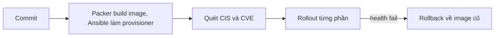

# Quyết định: Ansible hay image bất biến cho cụm xử lý ảnh sản phẩm

## 1. Bối cảnh và ràng buộc

Cụm xử lý ảnh có 8 máy lúc bình thường và 30 máy khi chạy chiến dịch, scale theo hàng đợi. Code đổi mỗi ngày, OS vá mỗi tháng.
Tháng trước một máy được sửa tay để thử thư viện ảnh mới và cho kết quả khác các máy còn lại suốt hai tuần mà không ai biết.
Máy mới mất 7 phút mới nhận việc vì phải chạy playbook lúc boot. Ngoài cụm này còn một Postgres lưu metadata, một Nginx edge
cho CDN gốc và một bastion. Audit bảo mật yêu cầu chứng minh mọi máy cùng cấu hình theo CIS level 1.

## 2. Tiêu chí so sánh

| Tiêu chí | Ansible trên máy đang chạy | Image bất biến |
| --- | --- | --- |
| Thời gian boot tới khi nhận việc | Phút, phụ thuộc mạng và repo gói | Giây tới một phút, mọi thứ có sẵn |
| Drift | Tích tụ giữa hai lần chạy, phát hiện bằng --check | Không sửa tại chỗ, thay máy là hết drift |
| Rollback | Chạy lại bản playbook cũ, có thể không đảo được mọi thay đổi | Đổi về image cũ |
| Vá lỗi bảo mật | Vá tại chỗ nhanh, không cần build | Build image mới rồi thay dần máy |
| Dữ liệu cục bộ | Giữ nguyên trên máy | Phải nằm ngoài máy (volume, dịch vụ) |
| Kiểm chứng | Báo cáo theo lần chạy | Quét một lần trên image, mọi máy giống hệt |

## 3. Quyết định theo workload

| Workload | Chọn | Lý do | Rủi ro còn lại |
| --- | --- | --- | --- |
| Worker xử lý ảnh | Image | Stateless, scale nhanh, cần giống hệt | Build mỗi lần đổi code |
| Postgres metadata | Ansible | Có dữ liệu, không thay máy được | Drift giữa hai lần chạy |
| Nginx edge | Kết hợp | Image nền, cấu hình đẩy bằng Ansible | Hai nguồn sự thật |
| Bastion | Ansible | Một máy, ít đổi | Quên chạy định kỳ |

## 4. Luồng build và deploy

## 5. Drift, tuân thủ và vá lỗi

- Postgres và bastion: job hằng đêm chạy playbook với --check --diff, có thay đổi thì mở ticket.
- Image được quét theo CIS level 1 ngay sau build; máy chạy từ image đó không cần quét lại từng máy.
- Patch OS cho cụm worker bằng build image mới mỗi tháng; Postgres vá tại chỗ theo cửa sổ bảo trì.
- Khoá SSH vào worker, mọi thay đổi phải qua image.

## 6. Secret và cấu hình lúc chạy

- Không đưa secret vào image; máy đọc từ Secrets Manager lúc boot bằng role IAM của instance.
- cloud-init chỉ truyền tên môi trường và tên cụm qua user-data.
- Postgres lấy mật khẩu từ Ansible Vault khi chạy playbook.

## 7. Rủi ro và lộ trình chuyển đổi

- Team chưa quen Packer: pair hai tuần đầu.
- Build image mất 12 phút: cache layer gói.
- Image cũ tích tụ: giữ 5 bản gần nhất.
- Chuyển worker trước, Nginx sau, Postgres giữ Ansible.
