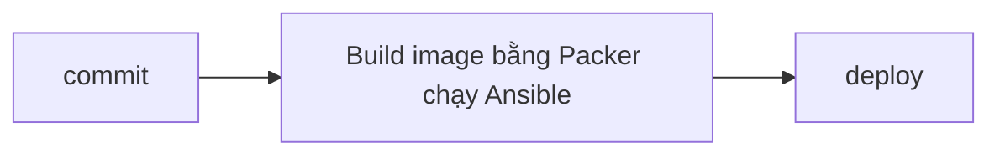

# Quyết định: Ansible hay image

## 1. Bối cảnh và ràng buộc

Olist Shop có nhiều máy và deploy thường xuyên. Ansible chạy chậm và đôi khi các máy không giống nhau. Team muốn chuyển sang
image cho nhanh nhưng chưa rõ làm thế nào với database. Đây là bản nháp viết vội trước buổi họp kiến trúc, chưa có số liệu cụ
thể về số máy hay thời gian deploy, nhưng đủ để thấy hướng đi chung của team trong quý tới.

## 2. Tiêu chí so sánh

| Tiêu chí | Ansible trên máy đang chạy | Image bất biến |
| --- | --- | --- |
| Tốc độ | Chậm | Nhanh |
| Drift | Có | Không |
| Rollback | Khó | Dễ |

## 3. Quyết định theo workload

| Workload | Chọn | Lý do | Rủi ro còn lại |
| --- | --- | --- | --- |
| Worker | Image | Stateless | Build lâu |
| Postgres | Ansible | Có dữ liệu | Drift |
| Nginx edge | Cả hai | Tuỳ | Không rõ |

## 4. Luồng build và deploy

## 5. Drift, tuân thủ và vá lỗi

- Chạy Ansible định kỳ.
- Audit CIS mỗi quý.
- Vá OS hằng tháng.
- Thay máy thay vì sửa.

## 6. Secret và cấu hình lúc chạy

- Mật khẩu database nằm sẵn trong image để máy boot nhanh.
- Cấu hình chung để trong image.
- Lấy secret từ Vault cho Postgres.

## 7. Rủi ro và lộ trình chuyển đổi

- Team chưa quen Packer.
- Build image chậm.
- Chi phí lưu image.
- Chuyển dần từng workload.
