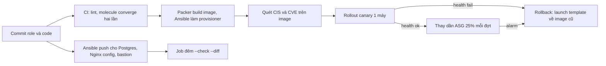

# Quyết định: Ansible trên máy đang chạy hay image bất biến cho Olist Shop

## 1. Bối cảnh và ràng buộc

Olist Shop chạy trên VM: 12 worker lúc bình thường, tới 60 máy trong đợt 11.11 nhờ autoscaling group; Postgres một primary và
hai replica (2 TB, không dựng lại nhanh được); 4 máy Nginx edge giữ TLS và rule rate limit đổi gần như mỗi ngày; một bastion.
Worker deploy khoảng 10 lần mỗi tuần. Hiện Jenkins chạy playbook đẩy (push) tới 40 worker mất 25 phút; máy mới do autoscaling
tạo chạy `ansible-pull` qua cloud-init và mất 9 phút mới nhận job, nên đợt 11.11 năm ngoái hàng đợi dồn 40 phút trước khi đủ
máy. Tháng trước ba worker được `pip install` bản vá tay lúc trực đêm và lệch khỏi phần còn lại tới khi có người thấy log
khác. Audit quý yêu cầu chứng minh mọi máy theo CIS level 1 và biết chính xác gói nào đang chạy ở đâu. Team platform có 4
người, đã quen Ansible, chưa dùng Packer.

## 2. Tiêu chí so sánh

| Tiêu chí | Ansible trên máy đang chạy | Image bất biến |
| --- | --- | --- |
| Thời gian từ boot tới nhận việc | 9 phút (`ansible-pull`, tải gói, cài venv) và hỏng khi repo gói chậm | Dưới 1 phút: code, venv, cấu hình nền có sẵn trong image |
| Drift | Tích tụ giữa hai lần chạy (bản vá tay, gói tự cập nhật); phát hiện bằng `--check --diff` định kỳ | Không sửa tại chỗ; muốn đổi thì build image mới và thay máy |
| Rollback | Chạy lại playbook bản cũ; tệp đã xoá, gói đã nâng không phải lúc nào cũng đảo được | Trỏ launch template về image cũ rồi thay máy, kết quả biết trước |
| Vá lỗi bảo mật khẩn | Vá tại chỗ trong vài phút | Build, quét, rollout image mới: khoảng 40 phút |
| Dữ liệu và trạng thái cục bộ | Giữ nguyên trên máy | Phải nằm ngoài máy (EBS tách rời, dịch vụ quản lý) |
| Kiểm chứng cho audit | Báo cáo từng lần chạy, mỗi máy một lịch sử | Quét một lần trên image; mọi máy cùng image giống hệt |
| Chi phí vận hành | Không thêm hạ tầng | Pipeline build image, lưu và dọn image cũ |

## 3. Quyết định theo workload

| Workload | Chọn | Lý do | Rủi ro còn lại |
| --- | --- | --- | --- |
| Worker (autoscaling) | Image | Stateless, scale nhanh trong đợt sale, cần giống hệt nhau; role Ansible hiện có dùng lại làm provisioner trong Packer | Mỗi lần đổi code phải build image; vá khẩn chậm hơn |
| Postgres primary và replica | Ansible | Có 2 TB dữ liệu, không thay máy được mỗi lần đổi cấu hình; thay đổi cần cửa sổ bảo trì và thứ tự (replica trước) | Drift giữa hai lần chạy; cần job `--check` hằng đêm |
| Nginx edge | Kết hợp | Image nền (OS, Nginx, hardening) đổi theo tháng; rule rate limit và chứng chỉ đổi theo ngày nên đẩy bằng Ansible với `serial: 1` và `nginx -t` | Hai nguồn sự thật cho một máy, phải ghi rõ cái gì thuộc image |
| Bastion | Ansible | Một máy, ít đổi, không scale; build image cho một máy không đáng | Quên chạy định kỳ, nên đưa vào cùng job đêm |

## 4. Luồng build và deploy

## 5. Drift, tuân thủ và vá lỗi

- Worker: tắt SSH trực tiếp, mọi thay đổi đi qua image; máy chạy quá 14 ngày bị thay để không có máy "sống lâu" lệch bản.
- Postgres, Nginx, bastion: job đêm chạy `ansible-playbook --check --diff`; có thay đổi thì mở ticket thay vì tự sửa.
- CIS level 1 quét trên image ngay sau build (một báo cáo cho mọi worker) và trên máy Ansible bằng cùng role hardening.
- Patch OS: worker theo image hằng tháng hoặc khi có CVE nghiêm trọng; Postgres vá tại chỗ trong cửa sổ bảo trì, replica trước.
- Mỗi image ghi nhãn commit, phiên bản role và danh sách gói (SBOM) để trả lời audit "máy này chạy gì".

## 6. Secret và cấu hình lúc chạy

- Không bao giờ đưa secret vào image: image có thể bị chia sẻ, lưu lâu, và ai đọc được image là đọc được secret.
- Worker lấy mật khẩu database và Redis từ Secrets Manager lúc boot bằng role IAM của instance, không có tệp secret trên đĩa image.
- cloud-init chỉ truyền tên môi trường và tên cụm qua user-data; user-data không chứa secret vì đọc được từ metadata.
- Postgres, Nginx, bastion: secret nằm trong Ansible Vault (vault id theo môi trường), task dùng `no_log`.

## 7. Rủi ro và lộ trình chuyển đổi

- Team chưa quen Packer: tuần 1–2 dựng pipeline image cho worker, giữ song song đường Ansible cũ để quay lại được.
- Build image chậm làm chậm deploy: cache bước cài gói hệ thống vào image nền, image ứng dụng chỉ thêm code và venv.
- Vá khẩn chậm hơn: giữ playbook vá khẩn cho worker dùng trong 24 giờ, sau đó bắt buộc build image mới thay máy.
- Image cũ tích tụ tốn tiền và gây nhầm: giữ 5 bản gần nhất, xoá bản cũ hơn sau 30 ngày.
- Đo lại sau đợt sale: thời gian boot tới nhận job, số lần rollback, số drift phát hiện mỗi tuần.
