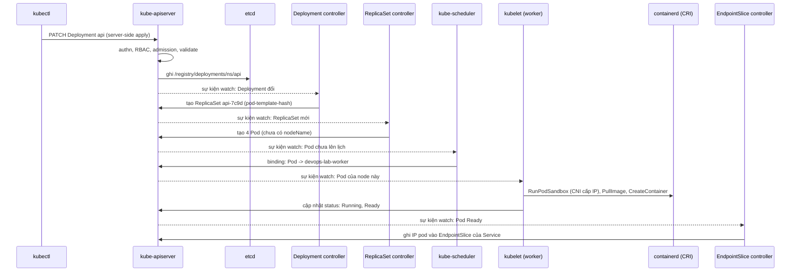
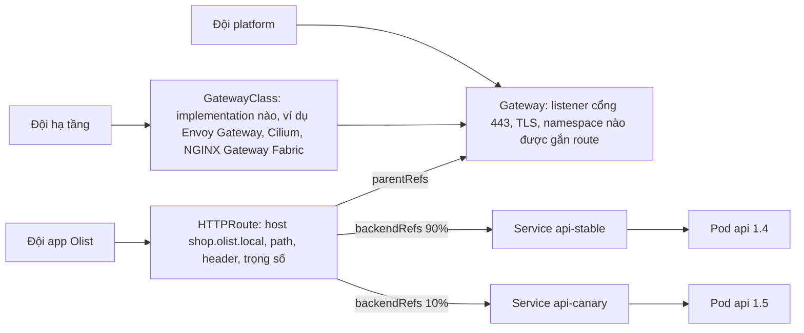

# Kubernetes core: kiến trúc, workload, mạng, storage và vận hành cluster

Module 06 đóng gói Olist Shop thành image, module 07 build và đẩy image đó, module 09 cấu hình máy. Từ đây máy không còn là đơn vị
bạn quản: bạn khai báo "4 pod API, mỗi pod 256 MiB, chỉ nhận traffic khi `/readyz` trả 200" và Kubernetes tự chọn node, tự thay pod
chết, tự rollout. Module này đi từ bên trong ra: control plane quyết định thế nào, mỗi loại workload sinh ra để giải bài toán gì, gói
tin đi từ client tới container qua những lớp nào, dữ liệu sống ở đâu, và người vận hành cluster làm gì với etcd và kubeadm. Mức mục
tiêu là phần core của CKA v1.37 cộng các mục CKAD hay gặp; module 11 lo phần production (RBAC, NetworkPolicy, scheduling, autoscaling,
Helm, Kustomize, troubleshooting sâu, nâng cấp).

Bài tập chạy trên cluster kind `devops-lab` dùng chung của track (1 control plane, 2 worker), mỗi test trong một namespace riêng
với quyền bị giới hạn (mục 0).

Sau module này bạn sẽ:

- Vẽ lại được đường đi của `kubectl apply` qua API server, etcd, controller, scheduler, kubelet, CRI, CNI, CSI, và nói được thành
  phần nào chết thì mất gì.
- Chọn đúng workload (Deployment, StatefulSet, DaemonSet, Job, CronJob, static pod) và mẫu nhiều container (init, native sidecar,
  ephemeral) cho từng bài toán; rollout và rollback không mất capacity.
- Viết probe đúng ngữ nghĩa, tách ConfigMap và Secret, đặt requests, limits và đọc ra QoS.
- Giải thích Service từng loại, EndpointSlice, kube-proxy, CoreDNS, Ingress và Gateway API; gỡ lỗi Service không có endpoint.
- Dùng PV, PVC, StorageClass, access mode, reclaim policy, provisioning động; biết vì sao hostPath là chuyện an toàn của máy chủ.
- Backup và restore etcd, nắm vòng đời cluster kubeadm (init, join, nâng cấp, chứng chỉ, HA control plane) và chọn bản Kubernetes
  theo ràng buộc.

## 0. Cài đặt

| Công cụ | Phiên bản đã kiểm | Tối thiểu cho bài tập | Dùng ở |
| --- | --- | --- | --- |
| `kind` | 0.30.0 (node image `kindest/node:v1.34.0` ghim digest) | 0.30.0 | Cluster `devops-lab` |
| `kubectl` | 1.34.13 | 1.33 (lệch tối đa một minor với API server 1.34) | Mọi bài trừ Basic 03, Advanced 01 |
| Docker | 29.x, như module 06 | 24.0 | Node của kind là container |
| Image bài tập | `devops-track/olist-shop:1.0` (build từ `setup/kind/olist-shop.Dockerfile`), `postgres:16.15-alpine`, `redis:7.4.12-alpine`, `nginx:1.30.6-alpine` | Đúng tag này | Nạp sẵn vào hai worker |
| bwrap, uv | Như module 02 | Như module 02 | Sandbox của test, chạy pytest |
| Gateway dùng chung | CRD Gateway API standard v1.6.3, Traefik v3.7.17 (`setup/kind/gateway/`) | Đúng bản này | Intermediate 04 |
| `etcdutl` (tuỳ chọn) | 3.6.4 | 3.6 | Lab restore etcd ở mục 6 |

Helm cũng đã có trong `setup/DEVOPS-TOOLS.md`, nhưng module 11 mới dùng.

### kind và kubectl

Chạy từ bất kỳ đâu; tệp tải về nằm trong `~/.cache/devops-track/dl`. Mỗi tệp được kiểm SHA-256 với tệp checksum chính thức **trước**
khi cài; sai thì chuỗi `&&` dừng và không cài gì:

```bash
mkdir -p ~/.cache/devops-track/dl ~/.local/bin && cd ~/.cache/devops-track/dl &&
curl -fsSLO https://kind.sigs.k8s.io/dl/v0.30.0/kind-linux-amd64 &&
curl -fsSLO https://kind.sigs.k8s.io/dl/v0.30.0/kind-linux-amd64.sha256sum &&
sha256sum --check kind-linux-amd64.sha256sum &&
install -m 0755 kind-linux-amd64 ~/.local/bin/kind &&
curl -fsSLO https://dl.k8s.io/release/v1.34.13/bin/linux/amd64/kubectl &&
curl -fsSLO https://dl.k8s.io/release/v1.34.13/bin/linux/amd64/kubectl.sha256 &&
echo "$(cat kubectl.sha256)  kubectl" | sha256sum --check &&
install -m 0755 kubectl ~/.local/bin/kubectl &&
kind version && kubectl version --client
```

Kết quả trên máy viết bài (Pop!_OS 24.04, x86_64):

```text
kind-linux-amd64: OK
kubectl: OK
kind v0.30.0 go1.24.6 linux/amd64
Client Version: v1.34.13
Kustomize Version: v5.7.1
```

SHA-256 đã kiểm: kind `517ab7fc89ddeed5fa65abf71530d90648d9638ef0c4cde22c2c11f8097b8889`, kubectl
`b4bb494e9466a7a94bb851414548bc0d3e2f8da90757e6eccc3371e648648591`. Máy ARM đổi `amd64` thành `arm64` ở cả tệp và checksum. kubectl
chỉ được lệch một minor với API server; node image 1.34 nên kubectl 1.33 tới 1.35 đều dùng được, bản 1.34.13 khớp nhất. Gỡ:

```bash
rm -f ~/.local/bin/kind ~/.local/bin/kubectl ~/.cache/devops-track/dl/kind-linux-amd64* ~/.cache/devops-track/dl/kubectl*
```

### Cluster devops-lab

Cấu hình ở `setup/kind/devops-lab.yaml`: một control plane và hai worker, node image ghim digest, API server và cổng ingress
`18180`/`18543` chỉ mở trên `127.0.0.1`. Tạo cluster từ thư mục gốc của repo, **luôn** kèm `--kubeconfig ~/.kube/devops-lab.yaml`
để kind không ghi vào `~/.kube/config` và không đổi current-context của bạn (nếu `~/.kube/config` đang trỏ cluster công ty, nó vẫn
nguyên). Mỗi node là một container Docker; `nice` và `taskset` chỉ áp cho lệnh `kind`, còn container node phải ghim bằng `docker
update` ngay sau khi tạo (xem mục Ghim CPU trong `setup/DEVOPS-TOOLS.md`; không ghim thì bỏ `taskset -c "$DEVOPS_CPUSET"`):

```bash
mkdir -p ~/.kube &&
nice -n 15 taskset -c "$DEVOPS_CPUSET" kind create cluster --config setup/kind/devops-lab.yaml --kubeconfig ~/.kube/devops-lab.yaml &&
if [ -n "$DEVOPS_CPUSET" ]; then for node in $(kind get nodes --name devops-lab); do docker update --cpuset-cpus "$DEVOPS_CPUSET" "$node"; done; fi &&
docker inspect --format '{{.Name}} {{.HostConfig.CpusetCpus}}' $(kind get nodes --name devops-lab) &&
KUBECONFIG=~/.kube/devops-lab.yaml kubectl get nodes -o wide
```

```text
/devops-lab-worker 12-35
/devops-lab-control-plane 12-35
/devops-lab-worker2 12-35
NAME                       STATUS   ROLES           AGE   VERSION   INTERNAL-IP   EXTERNAL-IP   OS-IMAGE                         KERNEL-VERSION           CONTAINER-RUNTIME
devops-lab-control-plane   Ready    control-plane   61m   v1.34.0   172.21.0.2    <none>        Debian GNU/Linux 12 (bookworm)   7.2.6-76070206-generic   containerd://2.1.3
devops-lab-worker          Ready    <none>          61m   v1.34.0   172.21.0.4    <none>        Debian GNU/Linux 12 (bookworm)   7.2.6-76070206-generic   containerd://2.1.3
devops-lab-worker2         Ready    <none>          61m   v1.34.0   172.21.0.3    <none>        Debian GNU/Linux 12 (bookworm)   7.2.6-76070206-generic   containerd://2.1.3
```

Node mới tạo cần khoảng 30 giây để `Ready` (chờ CNI kindnet). Tắt khi không dùng (giữ nguyên trạng thái, giải phóng RAM), bật lại
(sau khi khởi động lại máy, node cũng ở trạng thái dừng), xoá hẳn:

```bash
docker stop $(kind get nodes --name devops-lab)
docker start $(kind get nodes --name devops-lab)
kind delete cluster --name devops-lab --kubeconfig ~/.kube/devops-lab.yaml
```

`~/.kube/devops-lab.yaml` là kubeconfig **admin** của cluster. Để nó trong `~/.kube` (sandbox của test luôn che thư mục này, nên
script của bài không đọc được); đừng chép vào thư mục bài. Khi tự gõ lệnh, dùng `export KUBECONFIG=~/.kube/devops-lab.yaml` trong
một terminal riêng, hay `kubectl --kubeconfig ~/.kube/devops-lab.yaml ...`, để không bao giờ gõ nhầm vào cluster khác.

### Image cho bài tập

Pod của bài không bao giờ kéo image từ Internet lúc chấm: image phải nằm sẵn trong containerd của hai worker. Test gọi
`ex.require_kind_images(...)`, thiếu thì skip kèm đúng lệnh nạp. Build image Olist Shop (lần đầu cần mạng cho `pip install`), kéo ba
image còn lại, rồi nạp:

```bash
nice -n 15 docker build --pull=false -f setup/kind/olist-shop.Dockerfile -t devops-track/olist-shop:1.0 tracks/devops/sample-app ${DEVOPS_CPUSET:+--cpuset-cpus "$DEVOPS_CPUSET"} &&
docker pull postgres:16.15-alpine && docker pull redis:7.4.12-alpine && docker pull nginx:1.30.6-alpine &&
nice -n 15 kind load docker-image devops-track/olist-shop:1.0 postgres:16.15-alpine redis:7.4.12-alpine nginx:1.30.6-alpine --name devops-lab --nodes devops-lab-worker,devops-lab-worker2
```

`setup/kind/olist-shop.Dockerfile` là bản multi-stage chạy user `10001` như lời giải Basic 01 của module 06, build trên
`python:3.12.16-slim-trixie` (cần có sẵn: `docker pull python:3.12.16-slim-trixie`). Docker bật containerd image store (Docker Engine 29
cài mới, Docker Desktop mới; `docker info` có `driver-type: io.containerd.snapshotter.v1`) thì `kind load docker-image` lỗi `ctr:
content digest sha256:...: not found`. Đó là lỗi đã gặp trên máy viết bài; nạp qua tarball một nền tảng theo vòng lặp trong mục
"Image cho bài tập trên cluster" của `setup/DEVOPS-TOOLS.md`. Kiểm:

```bash
docker exec devops-lab-worker crictl images | grep -E 'olist-shop|postgres|redis|nginx'
```

```text
docker.io/devops-track/olist-shop               1.0                  a56752b53dc81       68.6MB
docker.io/library/nginx                         1.30.6-alpine        88f52f3d58a50       26.1MB
docker.io/library/postgres                      16.15-alpine         6a2e324ebe59a       116MB
docker.io/library/redis                         7.4.12-alpine        98c6ca8f397f8       16.3MB
```

Manifest trong bài dùng đúng các tag này và không có `imagePullPolicy: Always`, nên kubelet dùng bản trong node. Xoá cluster là
xoá luôn image đã nạp.

### Gateway dùng chung (Ingress và Gateway API)

Intermediate 04 cần một controller Ingress và Gateway API chạy sẵn trong cluster. Admin (bạn, bằng kubeconfig admin) cài **một lần**
sau khi tạo cluster: CRD Gateway API kênh standard v1.6.3 và Traefik v3.7.17 cùng IngressClass, GatewayClass `devops-traefik` và Gateway
dùng chung `devops-gateway/public`, từ các tệp ghim checksum trong `setup/kind/gateway/`. Lệnh đầy đủ (kéo image theo digest, kiểm
`SHA256SUMS`, nạp image, `kubectl apply --server-side` cho CRD, chờ rollout) nằm ở mục "Gateway dùng chung" của
`setup/DEVOPS-TOOLS.md`. Kết thúc đúng khi:

```bash
kubectl --kubeconfig ~/.kube/devops-lab.yaml -n devops-gateway get gateway public
```

```text
NAME     CLASS            ADDRESS   PROGRAMMED   AGE
public   devops-traefik             True         6s
```

Test không bao giờ cài nó; thiếu thì `ex.require_gateway()` skip kèm lệnh cài. Traefik chỉ có Service ClusterIP, không mở cổng nào trên
máy bạn; test gọi nó từ một pod trong cluster.

### Test chạy trên cluster thế nào

Helper `KubeLab` của testkit, mỗi test một lab:

1. Kiểm cluster (`require_cluster`: Docker chạy, có cluster, node không dừng, `/readyz` trả `ok` trong 5 giây; mỗi trường hợp một
   thông báo skip riêng), lấy kubeconfig admin bằng `kind get kubeconfig` vào thư mục tạm. Test **không bao giờ** đọc `KUBECONFIG`
   hay `~/.kube` của bạn.
2. Bằng quyền admin, tạo namespace `devops-ex-<id>` có Pod Security `enforce=baseline`, một ServiceAccount với **Role riêng** trong
   namespace đó (workload, Service, ConfigMap, Secret, PVC, Job...; không impersonate, không xin token cho ServiceAccount khác,
   không escalate/bind), quyền đọc cả cluster, và ba ValidatingAdmissionPolicy của lab. Kubeconfig của lab chỉ có token của
   ServiceAccount đó.
3. Manifest của bạn đi qua `lab.apply_learner`: kiểm tĩnh trước (namespace khác, privileged, hostPath, hostNetwork, hostPort,
   PersistentVolume, StorageClass... bị từ chối kèm lý do), rồi apply đúng các object đã kiểm bằng token của lab. Script của bạn
   (`release.sh`, `rollback.sh`) chạy qua `lab.run` trong sandbox bwrap: `HOME` tạm, `~/.kube` thật bị che, chỉ có kubeconfig của lab.
4. `close()` xoá namespace và mọi thứ có nhãn của lab, kể cả khi test lỗi hay bạn nhấn Ctrl-C.

Ranh giới thật là quyền RBAC, policy và Pod Security **trong cluster**; kiểm tĩnh chỉ là tín hiệu sớm. Lý do phải chặt: node kind là
container Docker privileged, nên pod privileged hay pod mount hostPath vào node chạm được ổ đĩa và containerd của máy bạn. Bài nào
cũng không cần những thứ đó.

Việc của admin trong CKA mà bài cần thì testkit làm từ một spec đã kiểm từng trường, không bao giờ từ YAML của bạn:
`lab.admin_local_pv(...)` cấp PV `local` trong thư mục riêng của worker (Advanced 02), `lab.node_action(...)` cordon, drain, taint
worker (module 11). etcd snapshot ở Intermediate 02 là một lệnh cố định viết sẵn trong test chạy trong node control plane; script
backup của bạn chạy trong sandbox với `etcdctl` giả.

Chạy một bài (ghim như module 06 khi máy nhiều core):

```bash
export DEVOPS_CPUSET=12-35 &&
nice -n 15 taskset -c "$DEVOPS_CPUSET" uv run pytest tracks/devops/modules/10-kubernetes-core/exercises/basic/01-olist-stack-on-kind -q -rs
```

### Thực hành tay an toàn

Ví dụ trong các mục sau chạy trong một namespace riêng có Pod Security `baseline`, đúng như namespace của test:

```bash
export KUBECONFIG=~/.kube/devops-lab.yaml &&
kubectl create namespace lab10 &&
kubectl label namespace lab10 pod-security.kubernetes.io/enforce=baseline pod-security.kubernetes.io/warn=restricted &&
kubectl config set-context --current --namespace=lab10
```

`set-context` ghi vào `~/.kube/devops-lab.yaml`, không đụng `~/.kube/config`. Đừng thử pod privileged hay hostPath trên cluster này,
kể cả trong namespace không nhãn: chúng chạm máy host qua node privileged.

### Dọn sau khi làm bài

Test bị ngắt giữa chừng có thể để lại namespace. Xem và xoá (chỉ khi không có test nào đang chạy):

```bash
KUBECONFIG=~/.kube/devops-lab.yaml kubectl get namespaces,clusterroles,clusterrolebindings,validatingadmissionpolicies,validatingadmissionpolicybindings -l devops-ex
KUBECONFIG=~/.kube/devops-lab.yaml kubectl delete namespaces,clusterroles,clusterrolebindings,validatingadmissionpolicies,validatingadmissionpolicybindings -l devops-ex
KUBECONFIG=~/.kube/devops-lab.yaml kubectl delete namespace lab10 --ignore-not-found
```

Rồi tắt cluster (`docker stop ...` ở trên) khi không dùng nữa.

## 1. Kiến trúc: control plane, node và vòng lặp reconcile

### Các thành phần

Kubernetes là một cơ sở dữ liệu trạng thái mong muốn (etcd) có một API (kube-apiserver) đứng trước, cộng nhiều vòng lặp điều khiển
chạy độc lập, mỗi vòng so trạng thái thật với trạng thái mong muốn rồi sửa phần lệch. Không có thành phần nào "ra lệnh" cho thành
phần khác; tất cả chỉ đọc và ghi object qua API server.

| Thành phần | Chạy ở | Việc | Nó chết thì |
| --- | --- | --- | --- |
| kube-apiserver | Control plane | Cửa duy nhất vào etcd: xác thực (authn), phân quyền (authz, RBAC), admission (mutating, validating, Pod Security, ValidatingAdmissionPolicy), validate schema, ghi etcd, phát sự kiện cho các watch | Không ai thay đổi được gì; pod đang chạy vẫn chạy |
| etcd | Control plane (stacked) hay cụm riêng | Kho key-value nhất quán (Raft), lưu mọi object dưới `/registry/...` | Như API server chết; mất dữ liệu etcd là mất cả cluster |
| kube-scheduler | Control plane | Watch pod chưa có node, lọc node không đủ điều kiện (tài nguyên, taint, affinity, volume), chấm điểm, ghi binding | Pod mới nằm `Pending` |
| kube-controller-manager | Control plane | Hàng chục controller: Deployment, ReplicaSet, StatefulSet, DaemonSet, Job, CronJob, EndpointSlice, Node lifecycle, PV binder, ServiceAccount... | Không ai sửa lệch: pod chết không được thay, node chết không được đánh dấu |
| cloud-controller-manager | Control plane (cloud) | Load balancer, route, thông tin node của cloud | Service `LoadBalancer` không có IP |
| kubelet | Mọi node | Watch pod được gán cho node mình, gọi runtime qua CRI, chạy probe, mount volume (qua CSI), báo trạng thái node và pod; chạy static pod từ `/etc/kubernetes/manifests` | Node `NotReady` sau vài chục giây (`node-monitor-grace-period`), pod trên node bị evict sau 5 phút (toleration mặc định của taint `not-ready`/`unreachable`) |
| container runtime | Mọi node | containerd hay CRI-O: kéo image, tạo container qua runc (OCI) | Không tạo được container mới |
| kube-proxy | Mọi node (DaemonSet) | Biến Service và EndpointSlice thành rule iptables, IPVS hay nftables | Rule cũ vẫn chạy, thay đổi mới không áp |
| CNI plugin | Mọi node | Cấp IP cho pod, nối mạng pod-to-pod (kindnet ở kind; Calico, Cilium, Flannel...) | Pod mới không có mạng, node `NotReady` |
| CoreDNS | Deployment trong `kube-system` | DNS cho Service và pod | Lỗi phân giải tên trong cluster |

Trên kind, bốn thành phần đầu của control plane là **static pod**: kubelet đọc YAML trong `/etc/kubernetes/manifests` của node và tự
chạy, không cần API server (vì chính API server là một trong số đó). Đây là cách kubeadm dựng control plane:

```bash
docker exec devops-lab-control-plane ls /etc/kubernetes/manifests
KUBECONFIG=~/.kube/devops-lab.yaml kubectl -n kube-system get pods -o wide
```

```text
etcd.yaml
kube-apiserver.yaml
kube-controller-manager.yaml
kube-scheduler.yaml
```

### Đường đi của `kubectl apply` một Deployment



Ba điều rút ra:

- **Level-triggered, không phải edge-triggered.** Controller không xử lý "sự kiện X xảy ra" mà xử lý "trạng thái hiện tại khác
  mong muốn". Mất một sự kiện không sao: lần resync sau vẫn thấy lệch. Đó là lý do xoá tay một pod của Deployment thì pod mới mọc
  lại, và sửa tay một ReplicaSet do Deployment quản thì bị Deployment sửa ngược.
- **Mọi thứ đi qua API server.** Scheduler không gọi kubelet; nó ghi một trường. Vì vậy admission (Pod Security, policy) chặn được
  mọi đường tạo pod, kể cả pod do controller tạo hộ.
- **Owner reference và garbage collection.** Pod có `ownerReferences` trỏ ReplicaSet, ReplicaSet trỏ Deployment. Xoá Deployment thì
  garbage collector xoá dây chuyền; `kubectl delete --cascade=orphan` giữ lại con.

### Giao diện mở rộng: CRI, CNI, CSI

Kubernetes không tự chạy container, tự nối mạng hay tự gắn ổ đĩa; nó định nghĩa giao diện và để plugin làm:

- **CRI** (Container Runtime Interface, gRPC): kubelet gọi `RunPodSandbox`, `CreateContainer`, `PullImage`... trên containerd hay
  CRI-O. Docker Engine không nói CRI; từ 1.24 kubelet bỏ dockershim. Image build bằng Docker vẫn chạy bình thường vì đều là image OCI.
  Công cụ gỡ lỗi ở node là `crictl` (`crictl ps`, `crictl logs`, `crictl images`), không phải `docker`.
- **CNI** (Container Network Interface): khi tạo sandbox, runtime gọi binary CNI trong `/opt/cni/bin` theo cấu hình
  `/etc/cni/net.d`. Mô hình mạng của Kubernetes đòi: mọi pod có IP riêng, pod nói chuyện trực tiếp với pod khác không qua NAT, kể cả
  khác node. Plugin hiện thực bằng overlay (VXLAN, Geneve), route trực tiếp (BGP) hay eBPF. NetworkPolicy chỉ có tác dụng khi plugin
  hỗ trợ (kindnet của kind 0.30 có).
- **CSI** (Container Storage Interface): driver (EBS, Ceph, NFS, local-path...) chạy dưới dạng pod: controller plugin tạo, xoá,
  attach volume; node plugin (DaemonSet) mount vào pod. Kubernetes chỉ gọi gRPC; volume in-tree cũ (`awsElasticBlockStore`...) đã được
  chuyển sang CSI.

### Control plane sẵn sàng cao

Cluster production chạy ba (hay năm) control plane sau một load balancer cho API server. etcd cần **đa số** member còn sống để ghi
(3 member chịu được 1 hỏng, 5 chịu được 2); số chẵn không thêm khả năng chịu lỗi. Hai kiểu của kubeadm: **stacked** (etcd chạy cùng
node control plane, ít máy, hỏng một node mất cả hai) và **external etcd** (cụm etcd riêng, nhiều máy hơn, cô lập lỗi). API server
không trạng thái nên chạy song song; scheduler và controller-manager chạy nhiều bản nhưng chỉ một bản làm việc nhờ **leader election**
(Lease trong `kube-system`). Managed Kubernetes (EKS, GKE, AKS) lo phần này cho bạn; mục 6 có lab kubeadm.

## 2. Workload: từ Pod tới CronJob

### Nhắc lại từ track Data Engineer

Module 08 của track Data Engineer đã dùng Pod, Deployment, Job, CronJob, ConfigMap, Secret, PVC cho job dữ liệu, cộng
`requests`/`limits` và `kubectl get/logs/describe`. Phần dưới không nhắc lại định nghĩa; nó đi vào những gì người vận hành cần:
vòng đời, chiến lược cập nhật, và lý do chọn loại này thay loại kia.

### Pod và các kiểu container trong pod

Pod là đơn vị lên lịch: một hay nhiều container chung network namespace (cùng IP, gọi nhau qua `localhost`), chung volume, cùng nằm
trên một node. Vòng đời: `Pending` (chưa lên lịch, đang kéo image, init container đang chạy) → `Running` → `Succeeded`/`Failed`
(container kết thúc, với `restartPolicy` `Never`/`OnFailure`). `CrashLoopBackOff` không phải phase mà là lý do chờ: container chết
liên tục, kubelet restart với backoff 10, 20, 40 giây... tối đa 5 phút.

| Kiểu | Khai báo | Chạy khi | Dùng cho |
| --- | --- | --- | --- |
| Container chính | `containers` | Sau mọi init container | Ứng dụng |
| Init container | `initContainers` | Tuần tự, cái trước xong mã 0 mới tới cái sau, trước container chính | Chờ dependency, migration, tải cấu hình, sửa quyền volume |
| Native sidecar | `initContainers` kèm `restartPolicy: Always` (GA từ 1.33) | Khởi động theo thứ tự trong `initContainers`, sống suốt đời pod, dừng sau container chính | Proxy, log shipper, mesh, Cloud SQL proxy |
| Ephemeral container | Thêm vào pod đang chạy bằng `kubectl debug` | Theo yêu cầu, không restart | Gỡ lỗi image distroless (không có shell) |

Trước native sidecar, sidecar là một container thường; nó không biết khi nào container chính xong, nên Job có sidecar chạy mãi, và
lúc pod dừng sidecar có thể chết trước container chính. Native sidecar sửa cả hai: kubelet dừng nó sau khi container chính xong, và
khởi động nó trước (chờ startupProbe của nó). Intermediate 01 cho bạn thấy cả hai cách.

```yaml
spec:
  initContainers:
    - name: wait-db
      image: devops-track/olist-shop:1.0
      command: ["python", "-c", "import socket; socket.create_connection(('postgres', 5432), timeout=2)"]
    - name: proxy
      image: nginx:1.30.6-alpine
      restartPolicy: Always
      startupProbe:
        tcpSocket: {port: 8080}
  containers:
    - name: api
      image: devops-track/olist-shop:1.0
```

Gỡ lỗi container không có shell: `kubectl debug -it <pod> --image=nginx:1.30.6-alpine --target=api -- sh` thêm một ephemeral
container chung PID namespace với `api`. `kubectl debug <pod> --copy-to=<pod>-debug --container=api -- sh` thì tạo bản sao của pod
với lệnh khác, không đụng pod gốc. Gỡ lỗi node bằng `kubectl debug node/<tên>` tạo pod dùng hostPID, hostNetwork và mount `/` của node qua
hostPath, nên Pod Security `baseline` chặn trong namespace của bài; trên kind thì `docker exec` vào node thay thế.

### ReplicaSet và Deployment

ReplicaSet giữ đúng N pod khớp selector. Bạn gần như không tạo ReplicaSet trực tiếp; Deployment tạo một ReplicaSet cho mỗi phiên bản
của pod template (tên có hậu tố `pod-template-hash`) và chuyển dần replica từ cái cũ sang cái mới.

- `strategy.type: RollingUpdate` với `maxSurge` (thêm tối đa bao nhiêu pod trên mức replicas, làm tròn lên) và `maxUnavailable`
  (thiếu tối đa bao nhiêu pod ready, làm tròn xuống). `maxUnavailable: 0, maxSurge: 1` là kiểu "không bao giờ mất capacity".
  `Recreate` xoá hết rồi mới tạo: chỉ dùng khi hai phiên bản không được chạy cùng lúc (migration không tương thích, ổ RWO).
- `minReadySeconds`: pod phải Ready liên tục ngần ấy giây mới tính là available, chặn bản "lên rồi chết sau 5 giây".
- `progressDeadlineSeconds`: quá hạn không tiến triển thì condition `Progressing=False, ProgressDeadlineExceeded`; `kubectl rollout
  status` thoát lỗi. Không tự rollback.
- `revisionHistoryLimit`: số ReplicaSet cũ giữ lại để `kubectl rollout undo`.
- Change-cause: annotation `kubernetes.io/change-cause` hiện trong `kubectl rollout history`.

```bash
kubectl set image deployment/api api=devops-track/olist-shop:1.1
kubectl rollout status deployment/api --timeout=120s
kubectl rollout history deployment/api
kubectl rollout undo deployment/api --to-revision=2
kubectl rollout pause deployment/api && kubectl set env deployment/api LOG_LEVEL=DEBUG && kubectl rollout resume deployment/api
kubectl rollout restart deployment/api
```

`rollout undo` chép template của revision đích vào Deployment; ReplicaSet cũ có cùng hash được scale lên lại. `rollout restart` thêm
annotation thời gian vào template để tạo ReplicaSet mới với cùng image (dùng khi Secret đổi mà app chỉ đọc lúc khởi động).

**Blue/green và canary bằng primitive có sẵn.** Blue/green: hai Deployment `api-blue`, `api-green` khác nhãn `track`, Service chọn
một trong hai; đổi selector của Service là chuyển toàn bộ traffic tức thì, đổi lại là chuyển ngược. Canary thô: hai Deployment cùng nhãn
`app.kubernetes.io/name: api` (Service chọn cả hai), tỉ lệ traffic xấp xỉ tỉ lệ replica (9 stable, 1 canary). Canary theo phần trăm
request chính xác cần trọng số của Gateway API `HTTPRoute`, service mesh (module 15) hay Argo Rollouts (module 12).

### StatefulSet

Cho workload mà mỗi replica có **danh tính**: tên cố định (`postgres-0`, `postgres-1`), DNS cố định qua Service headless
(`postgres-0.postgres.<ns>.svc.cluster.local`), volume riêng sinh từ `volumeClaimTemplates` (`data-postgres-0`) đi theo tên đó qua mọi
lần pod bị tạo lại hay dời node.

- `podManagementPolicy: OrderedReady` (mặc định): tạo 0, 1, 2 lần lượt, chờ cái trước Ready; xoá ngược lại. `Parallel` bỏ thứ tự
  (cho hệ thống tự bầu leader như Kafka KRaft, Cassandra).
- `updateStrategy.rollingUpdate.partition: N`: chỉ cập nhật pod có số thứ tự ≥ N, để canary trên replica cuối. `OnDelete`: chỉ cập
  nhật khi bạn tự xoá pod.
- `persistentVolumeClaimRetentionPolicy`: mặc định giữ PVC khi xoá hay scale xuống; dữ liệu không mất vì lỡ tay.
- StatefulSet **không** làm replication cho bạn: ba pod Postgres là ba Postgres độc lập. Replication, failover là việc của ứng
  dụng hay operator (CloudNativePG, Zalando, Strimzi cho Kafka).

### DaemonSet

Một pod trên mỗi node khớp (nodeSelector, affinity, toleration), tự thêm khi có node mới: agent log (Fluent Bit), metrics (node
exporter), CNI, kube-proxy, CSI node plugin. Cập nhật bằng RollingUpdate `maxUnavailable` (hay `maxSurge` để không có lúc node thiếu
agent) hoặc `OnDelete`. DaemonSet thường cần toleration để chạy cả trên node có taint, kể cả control plane.

### Job và CronJob

Job chạy pod tới khi đủ `completions` lần thành công. Các trường người vận hành phải đặt:

- `backoffLimit` (retry, mặc định 6), `activeDeadlineSeconds` (trần thời gian cả Job), `ttlSecondsAfterFinished` (dọn Job xong).
- `parallelism` và `completions`; `completionMode: Indexed` cho mỗi pod một `JOB_COMPLETION_INDEX` (chia lô dữ liệu không cần hàng
  đợi); `backoffLimitPerIndex` để một phần lỗi không làm hỏng cả lô; `successPolicy` (GA 1.33) để Job Indexed coi là xong khi đủ một
tập index chỉ định thành công (ví dụ chỉ cần pod leader index 0), không chờ mọi pod; `podFailurePolicy` để không retry lỗi chắc chắn không qua được
  (mã thoát 42 là "dữ liệu hỏng") và không tính lần bị evict là lỗi.
- `restartPolicy` của pod: `Never` (mỗi lần thử là pod mới, giữ log) hay `OnFailure` (restart container trong cùng pod).

CronJob tạo Job theo lịch: `timeZone` (mặc định múi giờ của controller-manager), `concurrencyPolicy` (`Allow`, `Forbid`, `Replace`),
`startingDeadlineSeconds` (lỡ lịch thì chạy bù trong bao lâu; không đặt mà lỡ hơn 100 lần thì CronJob ngừng lên lịch),
`successfulJobsHistoryLimit`/`failedJobsHistoryLimit`. `kubectl create job <tên> --from=cronjob/<cronjob>` chạy ngay một lần.
CronJob không đảm bảo chạy đúng một lần: job phải idempotent.

### Chọn workload

| Câu hỏi | Trả lời | Workload |
| --- | --- | --- |
| Chạy mãi, replica giống hệt nhau, không giữ dữ liệu cục bộ? | Có | Deployment |
| Chạy mãi, mỗi replica cần tên và volume riêng? | Có | StatefulSet (cộng operator nếu là database phân tán) |
| Chạy trên **mọi** node (hay mọi node có nhãn)? | Có | DaemonSet |
| Chạy tới khi xong? | Một lần, theo yêu cầu | Job |
| Chạy tới khi xong, theo lịch? | Có | CronJob |
| Phải chạy kể cả khi API server chưa có? | Có (control plane) | Static pod |
| Database quan trọng, đội nhỏ, có cloud? | Thường | Không chạy trong cluster: dịch vụ managed, nối bằng Service `ExternalName` |

## 3. Cấu hình, sức khoẻ và tài nguyên

### ConfigMap và Secret

Hai cách đưa vào pod, khác nhau ở lúc giá trị mới có hiệu lực:

| Cách | Khai báo | Đổi giá trị thì |
| --- | --- | --- |
| Biến môi trường | `env[].valueFrom.configMapKeyRef`/`secretKeyRef`, hay cả object bằng `envFrom` | **Không** đổi tới khi pod được tạo lại (`kubectl rollout restart`) |
| Tệp | `volumes[].configMap`/`secret`, mount vào thư mục | kubelet cập nhật tệp sau tối đa khoảng một phút (symlink nguyên tử); app phải tự đọc lại. Mount bằng `subPath` thì **không bao giờ** cập nhật |

Mẫu hay dùng để rollout khi cấu hình đổi: đặt tên ConfigMap có hậu tố hash nội dung (Kustomize `configMapGenerator`, Helm checksum
annotation, module 11), đổi cấu hình là đổi tên, template đổi, Deployment rollout và rollback được. `immutable: true` chặn sửa nhầm
và bớt tải watch cho API server.

Secret chỉ là base64, không phải mã hoá. Lớp bảo vệ thật: RBAC (role `view` có sẵn không đọc được Secret), **encryption at rest**
(`EncryptionConfiguration` của API server, tốt nhất với KMS v2), không mount Secret vào pod không cần, và đưa bí mật từ nơi khác vào
(External Secrets Operator, Vault, SOPS, module 12). Mục 6 cho thấy snapshot etcd chứa Secret ở dạng đọc được. Ba loại Secret hay
gặp: `Opaque`, `kubernetes.io/tls` (`tls.crt`, `tls.key`), `kubernetes.io/dockerconfigjson` (cho `imagePullSecrets`).

### Probe

| Probe | Câu hỏi | Fail thì | Endpoint nên |
| --- | --- | --- | --- |
| startupProbe | Đã khởi động xong chưa? | Restart (sau `failureThreshold × periodSeconds`); hoãn hai probe kia tới khi đạt | Rẻ, như `/healthz` |
| readinessProbe | Có nên nhận traffic ngay bây giờ không? | Bỏ pod khỏi EndpointSlice (ready=false), **không** restart | Kiểm dependency cần để phục vụ: `/readyz` |
| livenessProbe | Tiến trình có treo không thể tự hồi phục không? | **Restart** container | Chỉ kiểm chính tiến trình: `/healthz`; không bao giờ kiểm database |

Bốn kiểu: `httpGet` (2xx, 3xx là đạt), `tcpSocket`, `exec` (mã 0), `grpc` (Health Checking Protocol). Tham số: `initialDelaySeconds`,
`periodSeconds`, `timeoutSeconds` (mặc định 1 giây, hay gây fail giả khi node bận), `failureThreshold`, `successThreshold`.

Ba lỗi kinh điển: liveness gọi endpoint kiểm database (DB chậm thì restart cả đội API, sự cố dây chuyền); liveness chặt mà không có
startupProbe (app khởi động chậm bị giết mãi, Intermediate 03); không có readiness (pod nhận traffic khi chưa sẵn sàng, rollout không
biết bản mới lỗi, Basic 02). Readiness quá nhạy cũng nguy hiểm: mọi pod cùng fail vì một dependency chung thì Service không còn
endpoint nào.

### Requests, limits và QoS

- `requests`: scheduler dùng để xếp pod (tổng requests trên node không vượt allocatable); CPU request còn là trọng số chia CPU khi
  tranh chấp.
- `limits.cpu`: trần CPU (CFS quota); vượt thì bị **throttle**, không bị giết. Nhiều team bỏ CPU limit để tránh throttle khi node
  rảnh, chỉ giữ request.
- `limits.memory`: vượt thì kernel **OOMKill** container (`Last State: OOMKilled`, exit 137).

QoS class tính từ requests và limits, quyết định thứ tự bị evict khi node thiếu tài nguyên:

| QoS | Điều kiện | Bị evict |
| --- | --- | --- |
| Guaranteed | Mọi container có requests bằng limits cho cả CPU và memory | Sau cùng |
| Burstable | Có ít nhất một request hay limit, không đủ điều kiện Guaranteed | Giữa, ưu tiên pod dùng vượt request |
| BestEffort | Không đặt gì | Trước tiên |

LimitRange (mặc định cho namespace) và ResourceQuota (tổng của namespace) ở module 11. Xem dùng thật bằng `kubectl top` (cần
metrics-server, module 11) hay `kubectl describe node` (phần Allocated resources).

### API phiên bản và deprecation

Mỗi kind có `apiVersion` (`apps/v1`, `batch/v1`, `networking.k8s.io/v1`). Bản beta bị gỡ sau vài release: manifest cũ dùng
`extensions/v1beta1` cho Ingress hay `policy/v1beta1` cho PodDisruptionBudget không apply được trên cluster mới. Trước mỗi lần nâng
cấp: `kubectl api-resources`, `kubectl explain <kind> --api-version=...`, công cụ như `pluto` hay `kubent` quét manifest và Helm
release tìm API sắp gỡ. Ví dụ đang diễn ra: API `Endpoints` (v1) bị deprecated từ 1.33 để nhường chỗ cho EndpointSlice.

## 4. Mạng: Service, EndpointSlice, DNS, Ingress và Gateway API

### Service và EndpointSlice

Pod đến rồi đi, IP đổi theo. Service cho một tên và một IP ảo ổn định trước một nhóm pod chọn bằng `selector`. EndpointSlice
controller theo dõi pod khớp selector và ghi IP cùng trạng thái (`ready`, `serving`, `terminating`) vào EndpointSlice (mỗi slice tối
đa 100 endpoint, thay cho object `Endpoints` cũ không chia nhỏ được). kube-proxy trên mỗi node đọc Service và EndpointSlice rồi lập
rule (iptables mặc định, nftables GA từ 1.33 nhanh hơn với nhiều Service, IPVS đang dần bị thay); gói tin tới ClusterIP bị DNAT sang
IP của một pod ready.

| Loại | Truy cập từ | Cơ chế | Khi nào |
| --- | --- | --- | --- |
| ClusterIP (mặc định) | Trong cluster | IP ảo, kube-proxy DNAT | Gần như mọi giao tiếp nội bộ |
| Headless (`clusterIP: None`) | Trong cluster | Không IP ảo; DNS trả thẳng IP của từng pod, kèm bản ghi `<pod>.<svc>` cho StatefulSet | StatefulSet, client tự cân bằng tải (gRPC, Cassandra) |
| NodePort | Ngoài cluster qua `<IP node>:30000-32767` | ClusterIP cộng một cổng trên **mọi** node | Lab, hay đứng sau load balancer ngoài |
| LoadBalancer | Internet hay mạng nội bộ | NodePort cộng load balancer do cloud-controller-manager (hay MetalLB, cloud-provider-kind) tạo | Lộ một service ra ngoài trên cloud |
| ExternalName | Trong cluster | Bản ghi DNS CNAME, không proxy | Đặt tên nội bộ cho dịch vụ ngoài cluster |

Các trường hay dùng: `targetPort` theo **tên** cổng của container; `externalTrafficPolicy: Local` (giữ IP client, chỉ gửi tới node có
pod, đổi lại cân bằng tải kém hơn); `internalTrafficPolicy: Local` (traffic từ trong cluster chỉ tới endpoint trên **cùng node** với
pod gọi, không có thì gói tin bị bỏ chứ không chuyển node khác: hợp với agent DaemonSet như log collector, nguy hiểm với service thường); `sessionAffinity: ClientIP`; `trafficDistribution: PreferClose`
(ưu tiên endpoint cùng zone, đỡ phí truyền giữa zone). Service không selector cộng EndpointSlice tay trỏ được tới IP ngoài cluster.

Gỡ lỗi Service theo thứ tự:

```bash
kubectl get endpointslices -l kubernetes.io/service-name=api -o wide
kubectl get pods -l app.kubernetes.io/name=api --show-labels -o wide
kubectl get svc api -o jsonpath='{.spec.selector}{"\n"}{.spec.ports}{"\n"}'
kubectl run curl-debug --rm -it --restart=Never --image=devops-track/olist-shop:1.0 -- python -c "import urllib.request; print(urllib.request.urlopen('http://api:8000/healthz').read())"
```

EndpointSlice rỗng hoàn toàn: selector không khớp. Có endpoint mà `ready: false`: readiness đang fail. Có endpoint ready mà gọi không
được: `targetPort` sai, app nghe `127.0.0.1` thay vì `0.0.0.0`, hay NetworkPolicy chặn (module 11).

### DNS và CoreDNS

CoreDNS (Deployment trong `kube-system`, Service `kube-dns` ở `10.96.0.10` trên kind) trả lời theo plugin `kubernetes` trong Corefile:

| Tên | Trả về |
| --- | --- |
| `api.lab10.svc.cluster.local` | ClusterIP của Service `api` |
| `api` (từ pod cùng namespace), `api.lab10` (khác namespace) | Như trên, nhờ danh sách `search` trong `/etc/resolv.conf` của pod |
| `postgres-0.postgres.lab10.svc.cluster.local` | IP của pod `postgres-0` (Service headless) |
| `_http._tcp.api.lab10.svc.cluster.local` (SRV) | Cổng có tên `http` |
| Tên ngoài (`pypi.org`) | `forward . /etc/resolv.conf` tới DNS của node |

`/etc/resolv.conf` của pod có `options ndots:5`: tên có ít hơn 5 dấu chấm được thử ghép với từng search domain trước, nên mỗi lần gọi
`api.stripe.com` sinh vài truy vấn NXDOMAIN thừa. Gọi tên ngoài bằng FQDN có dấu chấm cuối (`api.stripe.com.`), hay giảm `ndots` qua
`dnsConfig` của pod khi DNS thành nút cổ chai. `dnsPolicy`: `ClusterFirst` (mặc định), `Default` (dùng DNS của node), `None` (tự khai
báo). Sửa Corefile: `kubectl -n kube-system edit configmap coredns`, plugin `reload` tự nạp lại.

### Ingress

Ingress là object HTTP(S) L7: rule theo host và path, TLS từ Secret `kubernetes.io/tls`, trỏ tới Service. Object này không làm gì nếu
không có **Ingress controller** (ingress-nginx, Traefik, HAProxy, AWS Load Balancer Controller...) đọc nó; `ingressClassName` chọn
controller. Điểm yếu đã lộ: mọi thứ ngoài host, path, TLS (rewrite, timeout, rate limit, canary) nằm trong annotation riêng của từng
controller, không mang sang controller khác được; một object vừa chứa việc của đội hạ tầng (TLS, cổng) vừa của đội app (route). Dự án
ingress-nginx của cộng đồng Kubernetes ngừng bảo trì ngày 24/3/2026 (SIG Network thông báo ngày 11/11/2025); cluster mới nên đi
thẳng Gateway API.

```yaml
apiVersion: networking.k8s.io/v1
kind: Ingress
metadata:
  name: olist
spec:
  ingressClassName: nginx
  tls:
    - hosts: [shop.olist.local]
      secretName: olist-tls
  rules:
    - host: shop.olist.local
      http:
        paths:
          - path: /
            pathType: Prefix
            backend:
              service: {name: api, port: {name: http}}
```

### Gateway API

Gateway API (`gateway.networking.k8s.io/v1`, GA từ 2023, cài bằng CRD; `devops-lab` dùng bản v1.6.3) tách vai trò thành ba lớp object:



```yaml
apiVersion: gateway.networking.k8s.io/v1
kind: HTTPRoute
metadata:
  name: olist-api
spec:
  parentRefs:
    - name: public
      namespace: gateway-infra
  hostnames: [shop.olist.local]
  rules:
    - matches:
        - path: {type: PathPrefix, value: /}
      backendRefs:
        - {name: api-stable, port: 8000, weight: 90}
        - {name: api-canary, port: 8000, weight: 10}
```

Những gì Ingress phải dùng annotation thì Gateway API có trường chuẩn: trọng số (canary), match theo header, rewrite, redirect, timeout,
mirror; route TCP, UDP, TLS, gRPC (`GRPCRoute`). `ReferenceGrant` cho phép route tham chiếu Service ở namespace khác một cách tường
minh. `ingress2gateway` chuyển Ingress cũ sang.

Trên `devops-lab`, Traefik dùng chung (mục 0) phục vụ cả hai API: IngressClass `devops-traefik` cho Ingress và GatewayClass
`devops-traefik` với Gateway `devops-gateway/public` cho HTTPRoute. Đây đúng là cách chia vai ở công ty: Gateway do platform giữ (bạn
không tạo được Gateway, GatewayClass hay ReferenceGrant bằng quyền của lab), team app chỉ gắn route vào. Policy của lab buộc mọi host là
`<namespace của lab>.olist.test` hay tên con, để route của lab này không chiếm host của lab khác. Intermediate 04 cho bạn viết một
Ingress cho host cũ và một HTTPRoute chia 90/10 cộng match header, rồi gọi qua Service của Traefik từ trong cluster với header `Host`:

```bash
kubectl exec deploy/api-stable -- python -c "import urllib.request as u; r = u.Request('http://traefik.devops-gateway.svc.cluster.local/healthz', headers={'Host': 'lab10.olist.test'}); print(u.urlopen(r).read())"
```

## 5. Storage: volume, PV, PVC, StorageClass và CSI

### Volume gắn với vòng đời pod

| Volume | Sống tới | Dùng cho |
| --- | --- | --- |
| `emptyDir` (`medium: Memory` thì là tmpfs) | Khi pod bị xoá (sống qua restart container) | Cache, tệp tạm chia giữa container trong pod |
| `configMap`, `secret`, `downwardAPI`, `projected` | Theo object nguồn | Cấu hình, token ServiceAccount có hạn |
| Generic ephemeral volume (`ephemeral.volumeClaimTemplate`) | Khi pod bị xoá | Ổ tạm lớn do CSI cấp, có dung lượng và StorageClass |
| `hostPath` | Theo node | Agent hệ thống (CNI, log). Bài tập và namespace thường **không** dùng: pod đọc ghi được hệ thống tệp của node; trên kind node là container privileged nên chạm tới máy bạn |

### PersistentVolume và PersistentVolumeClaim

PV là một ổ cụ thể (object cluster-scoped, admin hay provisioner tạo). PVC là yêu cầu của app (namespace): "tôi cần 1Gi, ReadWriteOnce,
class `standard`". Controller **bind** một PVC với một PV khớp class, access mode, dung lượng (và `claimRef` nếu PV giữ sẵn cho một
PVC); bind là một đối một và độc quyền.

| Access mode | Nghĩa | Ví dụ |
| --- | --- | --- |
| ReadWriteOnce (RWO) | Mount đọc ghi trên **một node** (nhiều pod cùng node vẫn được) | EBS, Persistent Disk, local |
| ReadWriteOncePod (RWOP) | Đúng một pod trong cả cluster | Database cần chắc chắn chỉ một writer |
| ReadOnlyMany (ROX) | Nhiều node, chỉ đọc | Dữ liệu tham chiếu |
| ReadWriteMany (RWX) | Nhiều node đọc ghi | NFS, EFS, CephFS |

Reclaim policy quyết định số phận dữ liệu khi PVC bị xoá: `Delete` (provisioner xoá ổ, mặc định của class động), `Retain` (PV thành
`Released`, dữ liệu còn, admin tự xử: xoá `claimRef` để bind lại hay chép dữ liệu ra). `Recycle` đã bị bỏ.

### StorageClass và provisioning động

StorageClass mô tả "loại ổ": `provisioner` (CSI driver), `parameters` (loại đĩa, IOPS), `reclaimPolicy`, `allowVolumeExpansion`,
`volumeBindingMode`. PVC xin class có provisioner thì PV được tạo tự động. `WaitForFirstConsumer` hoãn tạo ổ tới khi pod dùng PVC được
lên lịch, để ổ nằm đúng zone hay node của pod; `Immediate` tạo ngay và có thể tạo ổ ở zone mà pod không tới được.

```bash
KUBECONFIG=~/.kube/devops-lab.yaml kubectl get storageclass
```

```text
NAME                 PROVISIONER             RECLAIMPOLICY   VOLUMEBINDINGMODE      ALLOWVOLUMEEXPANSION   AGE
standard (default)   rancher.io/local-path   Delete          WaitForFirstConsumer   false                  61m
```

`standard` của kind là local-path provisioner: tạo thư mục trong node được chọn và một PV `hostPath` trỏ vào đó, nên PVC của nó gắn
với một node (giống ổ local thật). Đó là lý do PVC của Basic 01 `Pending` cho tới khi pod `postgres-0` được lên lịch. Trong bài, bạn
không tạo PV hay StorageClass (quyền của lab không có, như ở công ty): PV tĩnh do `lab.admin_local_pv` cấp (Advanced 02), PV động
xin qua `standard`. Lý do an toàn: tham số `pathPattern` của local-path hay PV hostPath tự viết trỏ được tới `/run/containerd` của
node.

Mở rộng ổ: class có `allowVolumeExpansion: true` thì sửa `spec.resources.requests.storage` của PVC lên (không bao giờ xuống), CSI
driver mở rộng ổ và hệ thống tệp. Snapshot: CRD `VolumeSnapshot` cộng `VolumeSnapshotClass` của CSI driver hỗ trợ; khác backup ứng
dụng (`pg_dump`) ở chỗ nó chụp khối đĩa, nhanh nhưng chỉ nhất quán ở mức crash.

## 6. Vận hành cluster: etcd, kubeadm và chọn bản Kubernetes

### Backup etcd

Mọi object của cluster nằm trong etcd. Backup etcd khôi phục **object** (Deployment, Secret, cả object PV và PVC), không khôi phục
**dữ liệu trong volume**: Postgres trong cluster vẫn cần backup riêng (Advanced 02). Trên control plane kubeadm:

```bash
etcdctl --endpoints=https://127.0.0.1:2379 \
  --cacert=/etc/kubernetes/pki/etcd/ca.crt \
  --cert=/etc/kubernetes/pki/etcd/server.crt \
  --key=/etc/kubernetes/pki/etcd/server.key \
  snapshot save /var/backups/etcd/etcd-snapshot-$(date -u +%Y%m%dT%H%M%SZ).db
etcdutl snapshot status /var/backups/etcd/etcd-snapshot-*.db -w table
```

Bốn giá trị đọc ra từ `/etc/kubernetes/manifests/etcd.yaml` (`--listen-client-urls`, `--trusted-ca-file`, `--cert-file`,
`--key-file`); etcd có CA riêng trong `pki/etcd`, không phải CA của cluster. etcd 3.6 bỏ `etcdctl snapshot status` và `etcdctl
snapshot restore`; dùng `etcdutl`. Production chạy định kỳ (systemd timer), mã hoá tệp, đẩy ra khỏi cluster, giữ nhiều bản và
**diễn tập restore**. Intermediate 02 là script đó.

### Lab: backup rồi restore etcd của devops-lab

Lab tay, chấm bằng rubric trong lời giải của Intermediate 02. Đã kiểm trên máy viết bài (etcd 3.6.4, kind 0.30.0): ConfigMap bị xoá
trở lại sau khi etcd và API server khởi động lại. Node
kind chỉ có `etcdctl` bên trong container etcd (image không có `etcdutl` hay shell), nên snapshot ghi vào `/var/lib/etcd` (mount chung
giữa container etcd và node) rồi chép ra máy; restore dùng `etcdutl` trên máy bạn.

**Cảnh báo.** Restore đưa **cả cluster dùng chung** về thời điểm snapshot, không chỉ namespace `etcd-lab`: mọi namespace, RBAC,
policy, object của lab test, HTTPRoute... tạo sau snapshot biến mất, và thứ đã xoá sau snapshot hiện lại; pod đang chạy mà etcd không còn
biết thành mồ côi cho tới khi controller dọn. **Không chạy pytest nào trong lúc làm lab**, kể cả ở terminal khác. Làm xong mà còn thấy lạ
(namespace `devops-ex-*` sót, Gateway không Programmed) thì dùng phương án cuối ở cuối mục.

Bước 1: cài `etcdutl` 3.6.4 vào thư mục lab (kiểm SHA-256 trước khi giải nén):

```bash
LAB=~/.cache/devops-track/etcd-lab && mkdir -p "$LAB" && cd "$LAB" &&
curl -fsSLO https://github.com/etcd-io/etcd/releases/download/v3.6.4/etcd-v3.6.4-linux-amd64.tar.gz &&
curl -fsSLO https://github.com/etcd-io/etcd/releases/download/v3.6.4/SHA256SUMS &&
grep ' etcd-v3.6.4-linux-amd64.tar.gz$' SHA256SUMS | sha256sum --check &&
tar -xzf etcd-v3.6.4-linux-amd64.tar.gz etcd-v3.6.4-linux-amd64/etcdutl &&
./etcd-v3.6.4-linux-amd64/etcdutl version
```

```text
etcd-v3.6.4-linux-amd64.tar.gz: OK
etcdutl version: 3.6.4
API version: 3.6
```

Bước 2: tạo dữ liệu, snapshot, chép ra máy, kiểm:

```bash
export KUBECONFIG=~/.kube/devops-lab.yaml LAB=~/.cache/devops-track/etcd-lab &&
kubectl create namespace etcd-lab &&
kubectl label namespace etcd-lab pod-security.kubernetes.io/enforce=baseline &&
kubectl -n etcd-lab create configmap quan-trong --from-literal=gia-tri=truoc-su-co &&
kubectl -n etcd-lab create secret generic bi-mat --from-literal=mat-khau=khong-nen-lo-ra &&
docker exec devops-lab-control-plane crictl exec -q --name '^etcd$' --state running etcdctl \
  --endpoints=https://127.0.0.1:2379 --cacert=/etc/kubernetes/pki/etcd/ca.crt \
  --cert=/etc/kubernetes/pki/etcd/server.crt --key=/etc/kubernetes/pki/etcd/server.key \
  snapshot save /var/lib/etcd/lab-snapshot.db &&
docker cp devops-lab-control-plane:/var/lib/etcd/lab-snapshot.db "$LAB/lab-snapshot.db" &&
docker exec devops-lab-control-plane rm -f /var/lib/etcd/lab-snapshot.db &&
chmod 600 "$LAB/lab-snapshot.db" &&
"$LAB/etcd-v3.6.4-linux-amd64/etcdutl" snapshot status "$LAB/lab-snapshot.db" -w table &&
grep -a -c khong-nen-lo-ra "$LAB/lab-snapshot.db"
```

```text
+----------+----------+------------+------------+---------+
|   HASH   | REVISION | TOTAL KEYS | TOTAL SIZE | VERSION |
+----------+----------+------------+------------+---------+
| c964f201 |    11134 |        429 |     6.6 MB |   3.6.0 |
+----------+----------+------------+------------+---------+
1
```

Dòng `1` cuối: giá trị của Secret nằm nguyên văn trong snapshot. Ai có tệp backup là có mọi Secret của cluster.

Bước 3: "sự cố", rồi restore. `etcdutl snapshot restore` dựng một data dir **mới** với tên member và cấu hình cluster lấy đúng từ cờ
của etcd trong manifest (`--name`, `--initial-cluster`, `--initial-advertise-peer-urls`; với một member thì etcd vẫn chạy được nếu bỏ
qua, nhưng cluster nhiều member bắt buộc, nên tập làm đúng). Rồi dừng etcd và API server bằng cách chuyển manifest của chúng ra khỏi
`/etc/kubernetes/manifests` (kubelet dừng static pod khi manifest biến mất), giữ data dir cũ ở `/var/lib/etcd-truoc-restore`, đặt data dir
mới vào đúng `/var/lib/etcd`, trả manifest về:

```bash
export KUBECONFIG=~/.kube/devops-lab.yaml LAB=~/.cache/devops-track/etcd-lab N=devops-lab-control-plane &&
docker exec "$N" test ! -e /var/lib/etcd-truoc-restore &&
test ! -e "$LAB/restored" &&
kubectl -n etcd-lab delete configmap quan-trong &&
ETCD_NAME="$(docker exec $N sed -n 's/^ *- --name=//p' /etc/kubernetes/manifests/etcd.yaml)" &&
ETCD_PEER="$(docker exec $N sed -n 's/^ *- --initial-advertise-peer-urls=//p' /etc/kubernetes/manifests/etcd.yaml)" &&
ETCD_CLUSTER="$(docker exec $N sed -n 's/^ *- --initial-cluster=//p' /etc/kubernetes/manifests/etcd.yaml)" &&
echo "$ETCD_NAME | $ETCD_PEER | $ETCD_CLUSTER" &&
"$LAB/etcd-v3.6.4-linux-amd64/etcdutl" snapshot restore "$LAB/lab-snapshot.db" --name "$ETCD_NAME" \
  --initial-cluster "$ETCD_CLUSTER" --initial-advertise-peer-urls "$ETCD_PEER" --data-dir "$LAB/restored" &&
docker exec $N mkdir -p /etc/kubernetes/manifests-stopped &&
docker exec $N mv /etc/kubernetes/manifests/kube-apiserver.yaml /etc/kubernetes/manifests/etcd.yaml /etc/kubernetes/manifests-stopped/ &&
timeout 120 sh -c "until [ -z \"\$(docker exec $N crictl ps -q --name '^(etcd|kube-apiserver)\$')\" ]; do sleep 2; done" &&
docker exec $N mv /var/lib/etcd /var/lib/etcd-truoc-restore &&
docker cp "$LAB/restored" $N:/var/lib/etcd &&
docker exec $N chown -R root:root /var/lib/etcd &&
docker exec $N chmod 700 /var/lib/etcd &&
docker exec $N mv /etc/kubernetes/manifests-stopped/etcd.yaml /etc/kubernetes/manifests-stopped/kube-apiserver.yaml /etc/kubernetes/manifests/ &&
timeout 180 sh -c "until kubectl get --raw /readyz >/dev/null 2>&1; do sleep 3; done" &&
kubectl -n etcd-lab get configmap quan-trong -o jsonpath='{.data.gia-tri}{"\n"}'
```

```text
devops-lab-control-plane | https://172.21.0.3:2380 | devops-lab-control-plane=https://172.21.0.3:2380
truoc-su-co
```

Lệnh `timeout ... until` đầu chờ kubelet dừng hẳn hai container (không chờ là đổi thư mục khi etcd còn ghi); lệnh sau chờ API server trả
`ok`. Cả khối mất khoảng 40 giây trên máy viết bài. `test ! -e /var/lib/etcd-truoc-restore` và `test ! -e "$LAB/restored"` dừng chuỗi
ngay từ đầu, trước khi xoá ConfigMap hay đụng manifest, nếu thứ của lần chạy trước còn đó (nếu không, `mv` sẽ lồng thư mục và khối
quay lui sẽ trả về dữ liệu của lần trước). Muốn làm lại lab thì chạy xong khối dọn ở cuối mục trước.

**Nếu chuỗi lệnh dừng giữa chừng** sau khi manifest đã bị chuyển đi, etcd và API server vẫn tắt: `kubectl` báo `connection refused`. Quay
về data dir trước restore (khối này đã kiểm: chạy ngay sau một lần restore thành công, cluster về đúng trạng thái trước restore):

```bash
export KUBECONFIG=~/.kube/devops-lab.yaml N=devops-lab-control-plane &&
docker exec $N mkdir -p /etc/kubernetes/manifests-stopped &&
docker exec $N sh -c 'for f in etcd kube-apiserver; do if [ -f /etc/kubernetes/manifests/$f.yaml ]; then mv /etc/kubernetes/manifests/$f.yaml /etc/kubernetes/manifests-stopped/; fi; done' &&
timeout 120 sh -c "until [ -z \"\$(docker exec $N crictl ps -q --name '^(etcd|kube-apiserver)\$')\" ]; do sleep 2; done" &&
docker exec $N test -d /var/lib/etcd-truoc-restore &&
docker exec $N sh -c 'if [ -d /var/lib/etcd ]; then mv /var/lib/etcd "/var/lib/etcd-restore-loi-$(date +%s)"; fi' &&
docker exec $N mv /var/lib/etcd-truoc-restore /var/lib/etcd &&
docker exec $N sh -c 'mv /etc/kubernetes/manifests-stopped/*.yaml /etc/kubernetes/manifests/' &&
timeout 180 sh -c "until kubectl get --raw /readyz >/dev/null 2>&1; do sleep 3; done" &&
kubectl get nodes
```

Khối này chuyển data dir hỏng sang `/var/lib/etcd-restore-loi-<thời điểm>` thay vì xoá, để còn xem lại. `test -d` dừng chuỗi nếu chưa có
bản trước restore (lỗi xảy ra trước bước đổi thư mục): khi đó chỉ cần trả manifest về
(`docker exec $N sh -c 'mv /etc/kubernetes/manifests-stopped/*.yaml /etc/kubernetes/manifests/'`).

**Phương án cuối**, khi cả hai cách trên không đưa API server về: xoá cluster rồi làm lại mục 0 từ đầu (tạo cluster, ghim CPU, nạp image,
cài Gateway dùng chung theo `setup/DEVOPS-TOOLS.md`):

```bash
kind delete cluster --name devops-lab --kubeconfig ~/.kube/devops-lab.yaml
```

Dọn sau lab (glob `etcd-restore-loi-*` phải mở rộng **trong** node nên đi qua `sh -c`):

```bash
export KUBECONFIG=~/.kube/devops-lab.yaml N=devops-lab-control-plane &&
kubectl delete namespace etcd-lab --ignore-not-found &&
docker exec "$N" rm -rf /var/lib/etcd-truoc-restore /var/lib/etcd/lab-snapshot.db &&
docker exec "$N" sh -c 'rm -rf /var/lib/etcd-restore-loi-*' &&
rm -rf ~/.cache/devops-track/etcd-lab/restored ~/.cache/devops-track/etcd-lab/lab-snapshot.db
```

Thư mục `~/.cache/devops-track/etcd-lab` còn `etcdutl` để dùng lại; xoá hẳn bằng `rm -rf ~/.cache/devops-track/etcd-lab`. Data dir vẫn ở `/var/lib/etcd` như kubeadm đặt, nên Intermediate 02 vẫn chạy được sau lab. Tài liệu
kubeadm còn cách khác là restore ra thư mục mới rồi sửa `hostPath` của volume `etcd-data` trong manifest; đừng dùng cách đó trên
`devops-lab`: test snapshot của Intermediate 02 đọc tệp ở `/var/lib/etcd` của node và sẽ fail kèm lời nhắc làm lại bước này.

Trên kubeadm thật có thêm: dừng kube-apiserver trước (chuyển `kube-apiserver.yaml` ra khỏi `/etc/kubernetes/manifests`) để không ai
ghi vào etcd cũ trong lúc restore; cluster nhiều member thì restore **cùng một** snapshot trên mọi member với `--name`,
`--initial-cluster`, `--initial-advertise-peer-urls` của từng member, tạo một cluster etcd mới; rồi bật lại API server, restart
kubelet. Mọi thay đổi sau thời điểm snapshot mất, kể cả pod mà controller sẽ tạo lại khác đi.

### Vòng đời cluster kubeadm

kubeadm dựng cluster "theo chuẩn" trên máy bạn tự lo (VM, bare metal), là cách CKA dùng:

1. **Chuẩn bị node**: tắt swap (hay cấu hình kubelet cho swap), module kernel `overlay`, `br_netfilter`, sysctl
   `net.ipv4.ip_forward=1`; cài containerd với `SystemdCgroup = true`; cài `kubeadm`, `kubelet`, `kubectl` cùng minor từ
   `pkgs.k8s.io`, giữ bản (`apt-mark hold`).
2. **`kubeadm init`** trên control plane đầu: preflight, sinh CA và chứng chỉ trong `/etc/kubernetes/pki` (hạn 1 năm, CA 10 năm), viết
   kubeconfig cho admin, controller-manager, scheduler, kubelet, viết manifest static pod, chờ control plane, tạo token bootstrap.
   Cần `--control-plane-endpoint` (tên hay IP của load balancer) ngay từ đầu nếu sau này muốn HA.
3. **CNI**: cluster chưa có mạng pod tới khi cài plugin (Calico, Cilium, Flannel), node `NotReady` cho tới lúc đó.
4. **`kubeadm join`** từ worker (token, hash CA); control plane khác join kèm `--control-plane --certificate-key`.
5. **Nâng cấp** từng minor một (1.33 lên 1.34, không nhảy): nâng `kubeadm` trên control plane đầu, `kubeadm upgrade plan`, `kubeadm
   upgrade apply v1.34.x`; control plane khác `kubeadm upgrade node`; rồi từng node: `kubectl drain`, nâng `kubelet` và `kubectl`,
   restart kubelet, `kubectl uncordon`. kubelet được cũ hơn API server tối đa ba minor, không bao giờ mới hơn. Backup etcd trước mỗi
   lần nâng cấp.
6. **Chứng chỉ**: `kubeadm certs check-expiration`; `kubeadm upgrade` tự gia hạn; cluster không nâng cấp trong một năm thì chứng chỉ
   hết hạn và API server từ chối mọi kết nối: `kubeadm certs renew all` rồi restart static pod.

Lab tuỳ chọn (1 control plane, 2 worker trên VM Multipass), **chưa kiểm chứng trên máy builder**: Multipass và LXD đều cài qua snap,
cần `sudo`, mà máy viết bài không dùng sudo cho track này. Các bước theo tài liệu chính thức của kubeadm, cần khoảng 12 GB RAM trống:

```bash
sudo snap install multipass &&
for vm in cp1 w1 w2; do multipass launch 24.04 --name "$vm" --cpus 2 --memory 4G --disk 20G; done &&
multipass list
```

Trong từng VM (`multipass shell cp1`), làm bước 1 theo trang "Installing kubeadm" của bản 1.34 (kho `pkgs.k8s.io/core:/stable:/v1.34/deb/`,
khoá ký thêm bằng `gpg --dearmor`, không chạy script tải về bằng `sudo bash`). Rồi trên `cp1`:
`sudo kubeadm init --pod-network-cidr=192.168.0.0/16 --control-plane-endpoint=cp1`, cài CNI theo hướng dẫn của Calico, chạy lệnh
`kubeadm join ...` in ra trên `w1`, `w2`. Thử nâng cấp bằng cách cài bản 1.33 trước rồi làm bước 5. Multipass chạy VM bằng QEMU dưới
daemon root, nên `taskset` từ user không ghim được; giới hạn CPU bằng `--cpus`, hay ghim tiến trình QEMU bằng `sudo taskset -apc
12-35 <pid>`. Xoá: `multipass delete --purge cp1 w1 w2`.

### Chọn bản Kubernetes

| Bản | Kiểu | Hợp với | Không hợp với |
| --- | --- | --- | --- |
| kind | Node là container Docker | CI, test manifest và operator, lab nhiều node trên laptop (track này) | Chạy app thật; node privileged, không có LoadBalancer thật |
| minikube | VM hay container một node, nhiều addon | Học, dev một người, thử addon (ingress, metrics) | Mô phỏng nhiều node, CI nhẹ |
| k3s (k3d chạy trong Docker) | Một binary, SQLite hay etcd nhúng, bỏ bớt thành phần | Edge, IoT, VM nhỏ, homelab, cluster nhiều nơi | Ai cần đúng bản upstream, tuỳ biến control plane sâu |
| MicroK8s, k0s | Snap hay binary đơn, addon bật tắt | Máy đơn, edge, dev trên Ubuntu | Đội cần hệ sinh thái lớn nhất |
| kubeadm | Công cụ chuẩn dựng cluster upstream | Bare metal, on-prem, học CKA, tự chủ toàn bộ | Đội nhỏ không muốn trực control plane, etcd, chứng chỉ, nâng cấp |
| Talos Linux | OS bất biến chỉ chạy Kubernetes, quản qua API | On-prem nghiêm túc, bảo mật | Đội cần SSH vào node |
| EKS, GKE, AKS | Managed control plane, tích hợp IAM, LB, storage của cloud | Production trên cloud, đội nhỏ tới lớn | Chi phí control plane (EKS), khoá vào cloud, nâng cấp theo lịch nhà cung cấp |
| OpenShift, Rancher (RKE2) | Bản phân phối doanh nghiệp, kèm registry, CI, policy, hỗ trợ trả phí | Doanh nghiệp cần hỗ trợ và chuẩn hoá nhiều cluster | Đội nhỏ, ngân sách thấp |

Câu hỏi để chọn: ai trực control plane và etcd lúc 3 giờ sáng; cluster chạy ở đâu (cloud, datacenter, cửa hàng); cần bao nhiêu cluster;
có yêu cầu tuân thủ nào. Kinh nghiệm chung: có cloud thì managed; nhiều điểm edge nhỏ thì k3s; on-prem thì kubeadm, Talos hay bản
doanh nghiệp tuỳ năng lực đội; kind và minikube chỉ cho dev và CI.

## 7. Tài liệu tham khảo

- CNCF, *CKA Curriculum v1.37* và *CKAD Curriculum v1.37*: https://github.com/cncf/curriculum
- Kubernetes Documentation, *Cluster Architecture* và *Components*: https://kubernetes.io/docs/concepts/architecture/
- Kubernetes Documentation, *Sidecar Containers*: https://kubernetes.io/docs/concepts/workloads/pods/sidecar-containers/
- Kubernetes Documentation, *Init Containers* và *Ephemeral Containers*: https://kubernetes.io/docs/concepts/workloads/pods/
- Kubernetes Documentation, *Deployments*, *StatefulSets*, *DaemonSet*, *Jobs*, *CronJob*: https://kubernetes.io/docs/concepts/workloads/controllers/
- Kubernetes Documentation, *Configure Liveness, Readiness and Startup Probes*: https://kubernetes.io/docs/tasks/configure-pod-container/configure-liveness-readiness-startup-probes/
- Kubernetes Documentation, *Pod Quality of Service Classes*: https://kubernetes.io/docs/concepts/workloads/pods/pod-qos/
- Kubernetes Documentation, *Service*, *EndpointSlices*, *DNS for Services and Pods*: https://kubernetes.io/docs/concepts/services-networking/
- Kubernetes Gateway API: https://gateway-api.sigs.k8s.io/
- Kubernetes Blog, *Ingress NGINX Retirement: What You Need to Know* (11/11/2025): https://kubernetes.io/blog/2025/11/11/ingress-nginx-retirement/
- Traefik Documentation v3.7, *Kubernetes Gateway API provider* (hỗ trợ Gateway API standard v1.6.3): https://doc.traefik.io/traefik/v3.7/reference/install-configuration/providers/kubernetes/kubernetes-gateway/
- Kubernetes Documentation, *Persistent Volumes*, *Storage Classes*, *Dynamic Volume Provisioning*: https://kubernetes.io/docs/concepts/storage/
- Kubernetes Documentation, *Operating etcd clusters for Kubernetes* (backup, restore): https://kubernetes.io/docs/tasks/administer-cluster/configure-upgrade-etcd/
- etcd Documentation v3.6, *Disaster recovery* và `etcdutl`: https://etcd.io/docs/v3.6/op-guide/recovery/
- Kubernetes Documentation, *Bootstrapping clusters with kubeadm*, *Upgrading kubeadm clusters*, *Certificate Management with kubeadm*: https://kubernetes.io/docs/setup/production-environment/tools/kubeadm/
- Kubernetes Documentation, *Version Skew Policy*: https://kubernetes.io/releases/version-skew-policy/
- kind Documentation, *Quick Start* và *Loading an Image Into Your Cluster*: https://kind.sigs.k8s.io/docs/user/quick-start/
- roadmap.sh, *Kubernetes Roadmap*: https://roadmap.sh/kubernetes
- Brendan Burns, Joe Beda, Kelsey Hightower, Lachlan Evenson, *Kubernetes: Up and Running*, 3rd ed., O'Reilly, 2022.
- Marko Lukša, *Kubernetes in Action*, 2nd ed., Manning.
