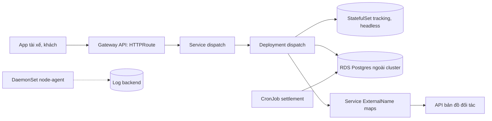

# Thiết kế workload cho dịch vụ gọi xe GoNow trên Kubernetes

## 1. Bối cảnh và ràng buộc

GoNow phục vụ 40.000 cuốc xe mỗi ngày ở hai thành phố, đỉnh 900 request mỗi giây lúc 17 giờ. Cluster EKS ba AZ, node group
m6i.xlarge từ 6 tới 30 node. Đội platform năm người, on-call luân phiên. Dữ liệu vị trí tài xế ghi liên tục và chỉ cần giữ 24 giờ,
dữ liệu chuyến đi và đối soát cần giữ bảy năm theo luật, nằm ở RDS Postgres Multi-AZ do AWS quản. Mục tiêu: API điều phối 99,95%,
mất tối đa 5 phút dữ liệu vị trí khi một node chết, không mất dữ liệu đối soát. Bản đồ dùng API của bên thứ ba qua HTTPS.

## 2. Bảng quyết định

| Thành phần | Workload | Service | Storage | Probe | Lý do |
| --- | --- | --- | --- | --- | --- |
| dispatch API | Deployment | ClusterIP | Không | startup, readiness /readyz, liveness /healthz | Stateless, scale theo HPA từ 6 tới 40 pod, rollout không mất capacity |
| tracking store | StatefulSet | Headless | PVC gp3 ReadWriteOnce mỗi replica | readiness kiểm quorum | Ba replica cần tên ổn định để bầu leader, mỗi replica giữ volume của mình qua lần reschedule |
| node-agent | DaemonSet | Không | Không | liveness | Thu log và metric của từng node, phải có đúng một bản mỗi node kể cả node mới autoscale |
| settlement | CronJob | Không | Không | Không | Đối soát với ngân hàng lúc 01:00, concurrencyPolicy Forbid để không ghi trùng sổ |
| reindex | Job | Không | Không | Không | Chạy theo yêu cầu khi đổi schema tìm kiếm, completionMode Indexed chia 16 phần, chạy xong là hết |
| maps gateway | Không chạy trong cluster | ExternalName | Không | Không | API bản đồ của đối tác ở ngoài; ExternalName cho code gọi tên nội bộ, đổi nhà cung cấp chỉ đổi Service |

## 3. Sơ đồ

## 4. Rollout và cập nhật

- dispatch: RollingUpdate maxUnavailable 0, maxSurge 25%, progressDeadlineSeconds 120; canary 5% qua trọng số của HTTPRoute trước.
- tracking store: updateStrategy RollingUpdate với partition, hạ partition từng replica và chờ quorum khỏe rồi mới đi tiếp.
- PodDisruptionBudget maxUnavailable 1 cho tracking store và minAvailable 80% cho dispatch, để drain node khi nâng cấp không phá quorum.
- node-agent: DaemonSet maxUnavailable 10% để không mất log của cả cluster cùng lúc.
- reindex và settlement chạy image ghim digest, đổi bản bằng cách đổi template, không sửa Job đang chạy.

## 5. Dữ liệu và storage

- tracking store dùng StorageClass gp3 (CSI EBS), volumeBindingMode WaitForFirstConsumer để volume nằm cùng AZ với pod.
- Volume ReadWriteOnce: EBS chỉ gắn một node; một node chết thì pod chờ volume detach, nên quorum ba replica mới đảm bảo sẵn sàng.
- reclaimPolicy Retain cho volume tracking để lỡ xoá StatefulSet vẫn còn dữ liệu; xoá PV tay sau khi kiểm.
- Backup: VolumeSnapshot mỗi giờ cho tracking, RDS snapshot tự động cộng PITR cho dữ liệu đối soát.

## 6. Rủi ro và đánh đổi

- Tracking store tự vận hành trong cluster tốn công hơn dịch vụ managed; chấp nhận vì cần độ trễ dưới 5 ms trong cùng AZ.
- ExternalName không có health check: API bản đồ chết thì lỗi lộ ra ở dispatch, cần circuit breaker trong code.
- CronJob lỡ lịch khi controller-manager gián đoạn: đặt startingDeadlineSeconds 3600 và alert khi job thành công cuối quá 26 giờ.
- DaemonSet chiếm tài nguyên trên mọi node: đặt requests nhỏ, PriorityClass cao để không bị evict trước app.
