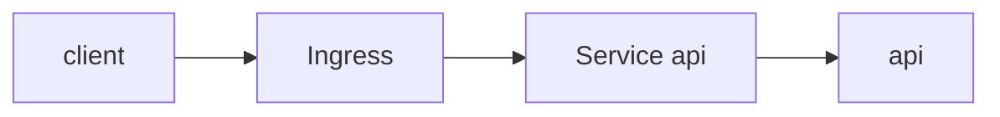

# Thiết kế workload cho Olist Shop

## 1. Bối cảnh và ràng buộc

Olist Shop chạy trên Kubernetes, có API, worker, Postgres, Redis và vài job phụ. Team muốn mọi thứ chạy trong cluster cho đơn
giản. Bản này viết nhanh trước buổi review, chưa có số liệu cụ thể về tải hay yêu cầu dữ liệu, nhưng đủ để thấy hướng đi: dùng
Deployment cho gần như mọi thứ vì nó quen thuộc nhất với team, và thêm Service cho từng thành phần cần gọi tới.

## 2. Bảng quyết định

| Thành phần | Workload | Service | Storage | Probe | Lý do |
| --- | --- | --- | --- | --- | --- |
| api | Deployment | ClusterIP | Không | readiness /readyz | Stateless, scale ngang theo tải |
| worker | Deployment | Không | Không | liveness metrics | Đọc hàng đợi, stateless |
| postgres | StatefulSet | Headless | PVC standard | pg_isready | Cần tên ổn định và volume riêng cho mỗi replica |
| redis | Deployment | ClusterIP | hostPath /data | ping | Nhanh |
| fluent-bit | Deployment | Không | Không | Không | Thu log của cả cluster |
| report | Deployment | Không | Không | Không | Chạy vòng lặp sleep tới 2 giờ sáng rồi tính báo cáo |
| migration | Job | Không | Không | Không | Chạy một lần mỗi release, retry có giới hạn |
| payment | Không chạy trong cluster | ClusterIP | Không | Không | Cổng thanh toán của đối tác ở ngoài cluster |

## 3. Sơ đồ

## 4. Rollout và cập nhật

- API dùng RollingUpdate với maxUnavailable 0.
- Worker rollout mặc định.
- Có PodDisruptionBudget cho API.
- Migration chạy trước khi rollout API.

## 5. Dữ liệu và storage

- Postgres dùng StorageClass standard, ReadWriteOnce.
- Redis không cần giữ dữ liệu.
- Backup Postgres hằng đêm.

## 6. Rủi ro và đánh đổi

- Một node chết thì Postgres chờ volume.
- Redis mất dữ liệu khi restart.
- Fluent-bit có thể thiếu log.
- Report có thể chạy trùng.
