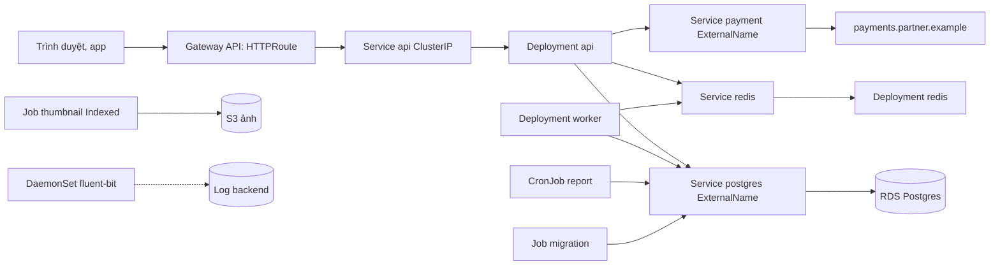

# Thiết kế workload cho Olist Shop trên Kubernetes

## 1. Bối cảnh và ràng buộc

Olist Shop lúc thường 150 request mỗi giây, đỉnh 1.200 trong đợt 11.11; 8.000 đơn mỗi ngày. Cluster managed (EKS) ba AZ, node group
từ 4 tới 20 node, đội platform bốn người. Dữ liệu đơn hàng là tài sản quan trọng nhất: RPO 5 phút, RTO 30 phút. Redis chỉ là hàng
đợi job và cache, mất thì job được enqueue lại từ API. Ảnh sản phẩm 10.000 tấm mỗi đợt nhập hàng cần tạo thumbnail trong một giờ.
Báo cáo doanh thu chạy 02:00 giờ Việt Nam. Cổng thanh toán là dịch vụ HTTPS của đối tác ở `payments.partner.example`. Migration
schema đi kèm mỗi release, khoảng 10 lần mỗi tuần.

## 2. Bảng quyết định

| Thành phần | Workload | Service | Storage | Probe | Lý do |
| --- | --- | --- | --- | --- | --- |
| api | Deployment | ClusterIP | Không | startup /healthz, readiness /readyz, liveness /healthz | Stateless, scale ngang bằng HPA 4 tới 30 pod; Gateway API đưa traffic vào Service |
| worker | Deployment | Không | Không | startup và liveness trên cổng metrics | Consumer hàng đợi stateless, scale theo độ dài hàng đợi; không ai gọi vào nên không cần Service |
| postgres | Không chạy trong cluster | ExternalName | RDS Multi-AZ, PITR | Không | RPO 5 phút, RTO 30 phút với đội bốn người: RDS cho PITR, failover, vá tự động; bản StatefulSet chỉ dùng cho môi trường dev |
| redis | Deployment | ClusterIP | Không | readiness redis-cli ping | Dữ liệu tạm, mất được; một replica đủ, cần bền hơn thì chuyển ElastiCache chứ không tự dựng cluster Redis |
| fluent-bit | DaemonSet | Không | Không | liveness HTTP | Phải có đúng một agent trên mỗi node, kể cả node autoscale mới thêm, để đọc log của mọi container trên node đó |
| report | CronJob | Không | Không | Không | Lịch 02:00 Asia/Ho_Chi_Minh, concurrencyPolicy Forbid, startingDeadlineSeconds để không chạy bù vô hạn |
| migration | Job | Không | Không | Không | Chạy một lần mỗi release trước khi rollout API, backoffLimit 1, activeDeadlineSeconds; schema phải tương thích hai chiều |
| thumbnail | Job | Không | Không | Không | Lô 10.000 ảnh chia 20 phần bằng completionMode Indexed, parallelism 10; xong là hết, không giữ pod chạy |
| payment | Không chạy trong cluster | ExternalName | Không | Không | Dịch vụ của đối tác; ExternalName cho code gọi tên nội bộ `payment`, đổi nhà cung cấp chỉ đổi Service |

## 3. Sơ đồ

## 4. Rollout và cập nhật

- api: RollingUpdate maxUnavailable 0, maxSurge 25%, progressDeadlineSeconds 120, revisionHistoryLimit 5; rollback bằng `rollout undo`.
- Migration Job chạy trước rollout và chỉ thêm cột, bảng (expand); bản sau mới xoá (contract), nên rollback API không vỡ schema.
- PodDisruptionBudget minAvailable 75% cho api, maxUnavailable 1 cho worker, để drain node khi nâng cấp không cắt capacity.
- fluent-bit: DaemonSet RollingUpdate maxUnavailable 10%. Bản StatefulSet Postgres ở dev dùng partition để thử bản mới trên một replica trước, hoặc OnDelete khi cần kiểm soát từng pod.
- Image ghim tag theo commit, không `latest`; đổi env hay image đều qua Git rồi CI apply.

## 5. Dữ liệu và storage

- Production không có PV nào cho dữ liệu: Postgres ở RDS (Multi-AZ, PITR 7 ngày), ảnh ở S3.
- Dev chạy Postgres bằng StatefulSet với volumeClaimTemplates StorageClass gp3, ReadWriteOnce, WaitForFirstConsumer để volume cùng AZ với pod.
- StorageClass của dev đặt reclaimPolicy Retain để lỡ xoá PVC không mất dữ liệu ngay; dọn PV tay.
- Backup: RDS snapshot tự động cộng pg_dump hằng đêm sang tài khoản AWS khác; diễn tập restore mỗi quý, đo RTO thật.

## 6. Rủi ro và đánh đổi

- RDS khoá chặt hơn vào AWS và tốn tiền hơn StatefulSet; đổi lại đội bốn người không phải trực failover Postgres.
- ExternalName không có health check hay TLS riêng: lỗi đối tác lộ ở api, cần timeout, retry có giới hạn, circuit breaker.
- Redis một replica: restart làm mất job chưa xử lý; API ghi đơn vào Postgres trước, job recompute có thể enqueue lại.
- CronJob lỡ lịch khi controller-manager gián đoạn: alert khi lần thành công cuối quá 26 giờ.
