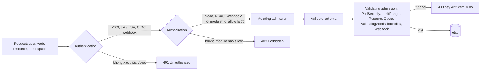
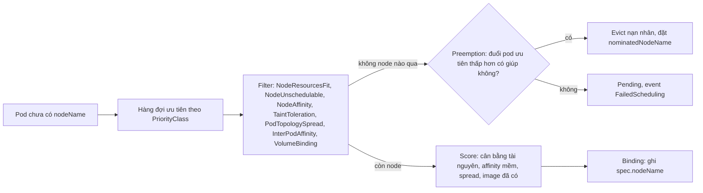
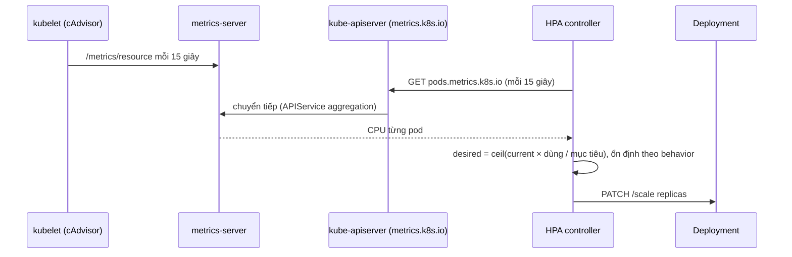
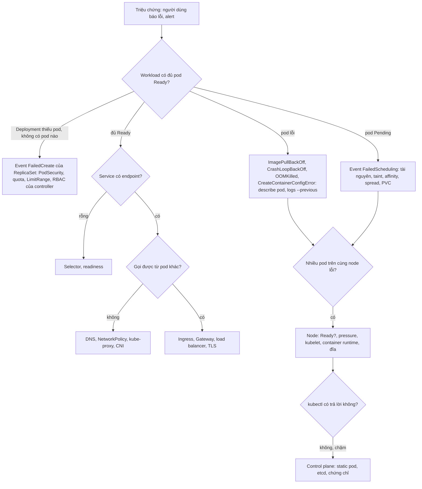

# Kubernetes production: bảo mật, scheduling, autoscaling, đóng gói, troubleshooting và nâng cấp

Module 10 đưa Olist Shop lên cluster và giải thích từng viên gạch: control plane, workload, Service, storage, etcd. Một cluster
"chạy được" như thế vẫn còn xa production: ai cũng `kubectl` được mọi thứ, pod nào cũng gọi được Postgres, pod chạy root, một Deployment
lỡ tay chiếm hết node, drain một worker là mất capacity, lúc 11.11 phải tự `kubectl scale` tay, manifest chép dán giữa ba môi trường, và
mỗi lần nâng bản Kubernetes là một đêm mất ngủ. Module này đi qua đúng những lớp đó: danh tính và phân quyền, bảo mật workload và mạng,
xếp lịch và chia tài nguyên, tự co giãn, đóng gói bằng Helm và Kustomize, mở rộng API bằng CRD và operator, gỡ lỗi có hệ thống (30%
của đề CKA), rồi nâng cấp cluster và chọn nền tảng. Mức mục tiêu là phần còn lại của CKA v1.37 cộng các mục CKAD về bảo mật ứng dụng,
quota, API deprecation.

Bài tập chạy trên cluster kind `devops-lab` dùng chung của track như module 10, mỗi test trong một namespace riêng có quyền bị giới hạn;
module này thêm metrics-server dùng chung, Helm, và các thao tác node (cordon, drain, taint) do testkit làm hộ từ một spec đã kiểm.

Sau module này bạn sẽ:

- Thiết kế RBAC least privilege cho người, pipeline CI và controller; kiểm bằng `kubectl auth can-i`; giải thích đường đi authn, authz,
  admission của một request.
- Viết `securityContext` đạt Pod Security `restricted`, NetworkPolicy default-deny có DNS, và biết những gì NetworkPolicy không làm.
- Điều khiển nơi pod chạy bằng nodeSelector, affinity, taint/toleration, topology spread, priority; chia tài nguyên bằng
  ResourceQuota và LimitRange; giữ capacity khi drain bằng PodDisruptionBudget.
- Cấu hình HPA theo CPU với behavior hợp lý, giải thích VPA và Cluster Autoscaler, và khi nào chúng đánh nhau.
- Tự viết Helm chart có helper, checksum, test hook; tổ chức Kustomize base/overlay; định nghĩa CRD có schema và CEL; viết một
  controller nhỏ theo vòng lặp reconcile.
- Gỡ lỗi theo lớp từ ứng dụng xuống node và control plane; lập kế hoạch nâng cấp không downtime; quét API sắp bị gỡ; chọn giữa
  EKS, GKE, AKS, ECS/Fargate, Swarm theo ràng buộc thật.

## 0. Cài đặt

| Công cụ | Phiên bản đã kiểm | Tối thiểu cho bài tập | Dùng ở |
| --- | --- | --- | --- |
| kind, kubectl, Docker, bwrap, uv | Như module 10 (kind 0.30.0, kubectl 1.34.13) | Như module 10 | Mọi bài trừ Basic 03 |
| Kustomize | v5.7.1, có sẵn trong kubectl 1.34 (`kubectl kustomize`, `kubectl apply -k`) | Bản đi kèm kubectl | Intermediate 04, Advanced 02, cài metrics-server |
| `helm` | 3.22.1 | 3.18 | Basic 01 |
| Cluster `devops-lab` cộng image bài tập | Như mục 0 của module 10 | Như module 10 | Mọi bài trừ Basic 03 |
| Gateway dùng chung (Traefik) | Như module 10 | Như module 10 | Không bài nào bắt buộc; drain ở Intermediate 03 dời nó sang worker khác |
| metrics-server | 0.9.1 (`setup/kind/metrics-server/`) | Đúng bản này | Intermediate 02, `kubectl top` |

Chưa có cluster thì làm mục 0 của module 10 trước (tạo cluster, ghim CPU, nạp image, cài Gateway).

### Helm

Tải bản phát hành chính thức, kiểm SHA-256 **trước** khi giải nén; sai thì chuỗi `&&` dừng, không cài gì:

```bash
mkdir -p ~/.cache/devops-track/dl ~/.local/bin && cd ~/.cache/devops-track/dl &&
curl -fsSLO https://get.helm.sh/helm-v3.22.1-linux-amd64.tar.gz &&
curl -fsSLO https://get.helm.sh/helm-v3.22.1-linux-amd64.tar.gz.sha256sum &&
sha256sum --check helm-v3.22.1-linux-amd64.tar.gz.sha256sum &&
tar -xzf helm-v3.22.1-linux-amd64.tar.gz linux-amd64/helm &&
install -m 0755 linux-amd64/helm ~/.local/bin/helm &&
helm version --short
```

Kết quả trên máy viết bài (Pop!_OS 24.04, x86_64):

```text
helm-v3.22.1-linux-amd64.tar.gz: OK
v3.22.1+gd6c1a0e
```

SHA-256 đã kiểm: `896cf63684a42a723d61c980369d6e588330927deb13676ca0d85006dd6da0ea`. Máy ARM đổi `amd64` thành `arm64`. Helm không có
thành phần nào chạy trong cluster (Tiller của Helm 2 đã bỏ từ lâu); nó dùng kubeconfig như kubectl, nên luôn chỉ định
`--kubeconfig ~/.kube/devops-lab.yaml` hay `KUBECONFIG` khi tự gõ. Helm lưu cache, repo, plugin trong `~/.cache/helm`,
`~/.config/helm`, `~/.local/share/helm`; test đặt ba thư mục này trong thư mục tạm của lab. Gỡ:

```bash
rm -rf ~/.local/bin/helm ~/.cache/devops-track/dl/helm-v3.22.1-linux-amd64.tar.gz* ~/.cache/devops-track/dl/linux-amd64
```

Helm 4 đã phát hành (server-side apply làm mặc định, plugin dạng WebAssembly); track giữ Helm 3.22 vì chart `apiVersion: v2` của bài
chạy giống nhau trên hai dòng và phần lớn pipeline, tài liệu hiện có vẫn ở Helm 3. Khi chuyển, đọc ghi chú phát hành về khác biệt cờ
dòng lệnh trước.

### metrics-server dùng chung

HPA và `kubectl top` đọc số liệu qua API `metrics.k8s.io`, do metrics-server phục vụ. Admin (bạn, bằng kubeconfig admin) cài **một
lần** sau khi tạo cluster, từ `setup/kind/metrics-server/`: `components.yaml` của release v0.9.1 chép nguyên cộng một
`kustomization.yaml` thêm cờ `--kubelet-insecure-tls` và `imagePullPolicy: Never`, cả hai ghim trong `SHA256SUMS`. Lệnh đầy đủ (kéo
image theo digest, kiểm checksum, nạp image bằng `kind load image-archive`, `kubectl apply -k`) và lý do của từng cờ nằm ở mục
"metrics-server dùng chung" của `setup/DEVOPS-TOOLS.md`. Bỏ `--kubelet-insecure-tls` thì metrics-server không bao giờ Ready, log báo:

```text
E1101 20:52:19.922042  1 scraper.go:149] "Failed to scrape node" err="Get \"https://172.21.0.3:10250/metrics/resource\": tls: failed to verify certificate: x509: cannot validate certificate for 172.21.0.3 because it doesn't contain any IP SANs" node="devops-lab-worker2"
```

Kubelet của kind tự ký chứng chỉ serving, không có IP của node trong SAN. Cluster production thì ngược lại: bật `serverTLSBootstrap`
cho kubelet, duyệt CSR của kubelet (thủ công hay bằng một approver), để metrics-server kiểm được chứng chỉ. Cài xong, khoảng 30 giây
sau có số:

```bash
kubectl --kubeconfig ~/.kube/devops-lab.yaml top nodes
```

```text
NAME                       CPU(cores)   CPU(%)   MEMORY(bytes)   MEMORY(%)
devops-lab-control-plane   237m         0%       855Mi           0%
devops-lab-worker          137m         0%       243Mi           0%
devops-lab-worker2         53m          0%       253Mi           0%
```

Test không bao giờ cài metrics-server; thiếu thì `ex.require_metrics()` skip kèm lệnh cài.

### Test chạy trên cluster thế nào

Như module 10 (`KubeLab`: namespace riêng `devops-ex-<id>`, Pod Security `baseline` hay `restricted`, token của một ServiceAccount
có Role riêng, bốn ValidatingAdmissionPolicy của lab, mọi thứ bị xoá khi xong). Module này thêm:

- **`lab.can_i(...)`**: token của lab không có quyền `impersonate`, nên `kubectl auth can-i --as=system:serviceaccount:...` bị từ chối
  với bạn. Test hỏi hộ bằng kubeconfig admin, chỉ đọc (một SubjectAccessReview, không đổi gì trên cluster). Basic 02 chấm RBAC bằng cách
  này.
- **`lab.node_action(...)`**: cordon, drain, taint worker bằng quyền admin từ một spec đã kiểm (chỉ worker, không bao giờ control
  plane); `close()` gỡ taint, uncordon rồi chờ CoreDNS, Gateway, metrics-server available lại. Trạng thái node là của cả cluster, nên
  testkit giữ khoá `~/.cache/devops-track/kube-nodes.lock` trong suốt bài: hai bài thao tác node không chạy chồng nhau. Tệp test của
  chúng mang marker `kube_nodes`. Đừng tự `kubectl drain` tay trong lúc test đang chạy; khoá không biết lệnh tay của bạn.
- **Nhóm API riêng cho CRD**: bài tạo CRD (Advanced 02) chỉ được dùng nhóm `<namespace của lab>.olist.test`; test thay chuỗi
  `lab.olist.test` trong tệp của bạn bằng nhóm đó, vì tên CRD là duy nhất trên cả cluster.
- **ResourceQuota, LimitRange** ghi được trong namespace của lab (Intermediate 04 dùng chúng làm "rào của platform team").

Chạy một bài (ghim CPU như module 10 khi máy nhiều core):

```bash
export DEVOPS_CPUSET=12-35 &&
nice -n 15 taskset -c "$DEVOPS_CPUSET" uv run pytest tracks/devops/modules/11-kubernetes-production/exercises/basic/01-helm-chart-olist-api -q -rs
```

### Thực hành tay an toàn

Ví dụ trong các mục sau chạy trong một namespace riêng có Pod Security, giống namespace của test:

```bash
export KUBECONFIG=~/.kube/devops-lab.yaml &&
kubectl create namespace lab11 &&
kubectl label namespace lab11 pod-security.kubernetes.io/enforce=baseline pod-security.kubernetes.io/warn=restricted &&
kubectl config set-context --current --namespace=lab11
```

Lệnh thao tác node (cordon, drain, taint) trong các mục dưới là việc của admin; chỉ chạy khi không có test nào đang chạy, và luôn hoàn
tác (`kubectl uncordon`, `kubectl taint ... -`) ngay sau khi thử. Xong module: `kubectl delete namespace lab11`.

## 1. Danh tính và phân quyền: authentication, RBAC, ServiceAccount

### Ba cửa của API server

Mọi request (kubectl, controller, kubelet, pod) đi qua đúng một đường: xác thực (ai), phân quyền (được làm gì), admission (có hợp lệ và
hợp chính sách không), rồi mới tới etcd.



- **Authentication.** Kubernetes không có object User. Người được nhận diện bằng chứng chỉ client x509 (CN là username, O là group;
  kubeconfig admin của kubeadm và kind là loại này), token OIDC (Okta, Entra ID, Google, Keycloak; cách nên dùng cho người ở
  production), hay webhook (`aws-iam-authenticator` của EKS). Workload được nhận diện bằng token của **ServiceAccount**. Mọi request
  đã xác thực có thêm nhóm `system:authenticated`.
- **Authorization.** Thường bật `Node,RBAC`: Node authorizer cho kubelet chỉ đọc đúng Secret, ConfigMap của pod trên node mình; RBAC lo
  phần còn lại. RBAC chỉ có quy tắc **cho phép**, không có deny; muốn chặn thì không cấp.
- **Admission.** Mutating chạy trước (điền mặc định, gắn sidecar), validating sau. LimitRanger, ResourceQuota, PodSecurity là plugin
  dựng sẵn; ValidatingAdmissionPolicy (GA 1.30) cho bạn viết luật bằng CEL ngay trong API server, không cần webhook. Kyverno, OPA
  Gatekeeper là webhook ngoài cho chính sách phức tạp hơn. Bốn policy mà KubeLab gắn cho mỗi lab là ValidatingAdmissionPolicy.

Request bị từ chối ở cửa nào thì thông báo nói rõ cửa đó: `Unauthorized` (token sai, hết hạn), `forbidden: User "..." cannot list
resource "pods" in API group "" in the namespace "shop"` (RBAC), `is forbidden: violates PodSecurity "restricted:latest"`, `exceeded
quota`, `maximum memory usage per Container is 512Mi` (admission). Đọc kỹ dòng lỗi là nửa việc gỡ lỗi quyền.

### RBAC: bốn object, hai phạm vi

| Object | Phạm vi | Chứa |
| --- | --- | --- |
| Role | Một namespace | Danh sách rule: `apiGroups`, `resources` (kể cả subresource như `pods/log`, `pods/exec`, `deployments/scale`), `verbs`, tuỳ chọn `resourceNames` |
| ClusterRole | Cả cluster | Rule như Role, cộng resource cluster-scoped (`nodes`, `persistentvolumes`), `nonResourceURLs` (`/healthz`, `/metrics`), `aggregationRule` |
| RoleBinding | Một namespace | `roleRef` (một Role cùng namespace hay một ClusterRole) cộng `subjects` (User, Group, ServiceAccount) |
| ClusterRoleBinding | Cả cluster | `roleRef` tới ClusterRole, quyền có hiệu lực ở mọi namespace |

Mẫu hay dùng nhất là **ClusterRole dùng lại cộng RoleBinding**: một ClusterRole `deployer` định nghĩa một lần, mỗi namespace một
RoleBinding; quyền chỉ có hiệu lực trong namespace của binding. ClusterRoleBinding vào `edit` hay `admin` là cấp quyền đó cho **mọi**
namespace, gần như không bao giờ đúng cho người hay pipeline.

- **Role dựng sẵn**: `cluster-admin` (mọi thứ), `admin` (gần như mọi thứ trong namespace, kể cả Role/RoleBinding), `edit` (ghi workload,
  Secret, không đụng RBAC), `view` (đọc, **không** đọc Secret). Bốn role này là ClusterRole **aggregated**: ClusterRole nào mang nhãn
  `rbac.authorization.k8s.io/aggregate-to-view: "true"` thì quy tắc của nó tự gộp vào `view` của mọi namespace. Đó là lý do lab chặn
  nhãn này: một ClusterRole của bài mang nhãn đó là mở quyền cho mọi người dùng `view` trên cluster.
- **Không tự nâng quyền**: API server chỉ cho bạn tạo hay sửa Role chứa quyền mà chính bạn đang có, và chỉ cho bind tới role có quyền
  bạn đang có, trừ khi bạn có verb `escalate` hay `bind`. Basic 02 và Advanced 02 đụng đúng luật này: Role trỏ `pods` trong nhóm
  `apps` (không tồn tại) vẫn bị từ chối vì bạn không có quyền đó.
- **Subresource là quyền riêng**: `get pods` không cho đọc log (`pods/log`), không cho exec (`pods/exec` với verb `create`), không cho
  evict (`pods/eviction`). `patch deployments` cho phép đổi replica và image; ai patch được Deployment thì gần như chạy được mọi image
  trong namespace, nên quyền deploy luôn là quyền mạnh.
- **Verb**: `get`, `list`, `watch` (đọc), `create`, `update`, `patch`, `delete`, `deletecollection` (ghi), cộng verb đặc biệt
  `impersonate`, `escalate`, `bind`, `approve`. `list` một loại Secret là đọc được **nội dung** mọi Secret loại đó.

Lệnh nhanh kiểu CKA và cách kiểm:

```bash
kubectl create role pod-reader --verb=get,list,watch --resource=pods,pods/log
kubectl create rolebinding oncall-pods --role=pod-reader --group=olist-oncall
kubectl create rolebinding ci-edit --clusterrole=edit --serviceaccount=lab11:ci-deployer
kubectl auth can-i list pods --as=jane@olist.example --as-group=olist-oncall
kubectl auth can-i --list --as=system:serviceaccount:lab11:ci-deployer
kubectl auth whoami
```

`--as` cần quyền `impersonate`; admin có, token của lab thì không (test hỏi hộ bằng `lab.can_i`). `kubectl auth whoami` cho biết
API server thấy bạn là ai và thuộc nhóm nào, hữu ích khi gỡ lỗi OIDC.

### ServiceAccount và token

Mỗi pod chạy bằng một ServiceAccount (mặc định `default` của namespace). kubelet mount một **token có hạn** vào
`/var/run/secrets/kubernetes.io/serviceaccount/token` qua projected volume: token ràng buộc với pod (pod bị xoá thì token vô hiệu),
mặc định hết hạn sau khoảng một giờ và được kubelet tự xoay. Từ 1.24 Kubernetes không còn tự tạo Secret chứa token vĩnh viễn cho
ServiceAccount; Secret loại `kubernetes.io/service-account-token` cũ không dùng tới sẽ bị dọn dần. Cần token cho hệ thống ngoài cluster
thì `kubectl create token <sa> --duration=...` (TokenRequest API), hay tốt hơn là federation: workload identity của GKE, EKS Pod
Identity hay IRSA, AKS Workload Identity đổi token của ServiceAccount lấy credential cloud ngắn hạn, không có khoá nào nằm trong Secret.

Thực hành tốt:

- Mỗi ứng dụng một ServiceAccount, kể cả khi nó không gọi API; ServiceAccount `default` không bao giờ được gắn quyền.
- `automountServiceAccountToken: false` trên ServiceAccount hay pod spec khi ứng dụng không gọi API server; token không mount thì không
  bị đánh cắp từ một lỗ hổng RCE.
- Pipeline CI ngoài cluster dùng OIDC của nền tảng CI (GitHub Actions có OIDC provider) đổi lấy token ngắn hạn, không lưu kubeconfig
  admin làm secret của CI.
- Quyền của ServiceAccount chỉ trong namespace của nó; controller cần xem nhiều namespace thì ClusterRole cộng RoleBinding ở đúng các
  namespace đó, không ClusterRoleBinding toàn cụm khi không cần.

## 2. Bảo mật workload: SecurityContext, Pod Security, NetworkPolicy

### SecurityContext

`securityContext` ở mức pod (áp cho mọi container) và mức container (ghi đè):

| Trường | Mức | Ý nghĩa | Giá trị nên dùng |
| --- | --- | --- | --- |
| `runAsNonRoot` | Pod, container | kubelet từ chối chạy nếu tiến trình sẽ là UID 0 | `true` |
| `runAsUser`, `runAsGroup` | Pod, container | UID, GID của tiến trình (ghi đè `USER` của image) | UID của image, như `10001` của Olist Shop |
| `fsGroup` | Pod | GID sở hữu volume được mount, để user non-root ghi được | GID của ứng dụng khi có volume ghi |
| `allowPrivilegeEscalation` | Container | Đặt cờ `no_new_privs`: setuid binary không nâng được quyền | `false` |
| `capabilities.drop`, `add` | Container | Capability Linux; container mặc định có khoảng 14 capability | `drop: ["ALL"]`, chỉ `add: ["NET_BIND_SERVICE"]` khi cần cổng dưới 1024 |
| `readOnlyRootFilesystem` | Container | Hệ thống tệp gốc chỉ đọc; ghi tạm qua `emptyDir` | `true`, mount `emptyDir` vào `/tmp` |
| `seccompProfile.type` | Pod, container | Lọc syscall | `RuntimeDefault` |
| `privileged` | Container | Gần như mọi quyền của host | Không bao giờ cho ứng dụng |

Module 06 đã làm phần image (user non-root, multi-stage). `securityContext` là lớp chặn khi image không đáng tin như ta nghĩ.

### Pod Security Admission

PodSecurityPolicy (đã gỡ ở 1.25) được thay bằng **Pod Security Admission**, plugin dựng sẵn, cấu hình bằng nhãn namespace:

| Mức | Chặn | Hợp với |
| --- | --- | --- |
| `privileged` | Không chặn gì | Namespace hệ thống: CNI, CSI, agent node |
| `baseline` | privileged, hostNetwork/PID/IPC, hostPath, hostPort, capability ngoài danh sách mặc định, procMount, seccomp Unconfined | Mặc định tối thiểu cho mọi namespace ứng dụng |
| `restricted` | Thêm: phải `runAsNonRoot`, `allowPrivilegeEscalation: false`, `capabilities.drop: ["ALL"]`, seccomp `RuntimeDefault`, chỉ một số loại volume | Ứng dụng production |

Ba chế độ, đặt độc lập: `enforce` (từ chối pod), `audit` (ghi audit log), `warn` (kubectl in cảnh báo). Cách chuyển một namespace lên
`restricted` không gây sự cố: đặt `warn` và `audit` trước, đọc cảnh báo, sửa workload, rồi mới `enforce`. Thử trước trên server:

```bash
kubectl label --dry-run=server --overwrite namespace lab11 pod-security.kubernetes.io/enforce=restricted
```

Điểm hay bị bỏ qua: PSA chặn **pod**, không chặn Deployment. `kubectl apply` một Deployment vi phạm vẫn thành công (kèm `Warning: would
violate PodSecurity`), còn ReplicaSet thì không tạo được pod, chỉ để lại event `FailedCreate` trên ReplicaSet. Deployment đứng `0/3`
mà không có pod nào để `describe`; Intermediate 04 bắt đầu từ đúng triệu chứng đó.

### NetworkPolicy

Mặc định mọi pod nói chuyện được với mọi pod, kể cả khác namespace. NetworkPolicy là allow-list theo pod, do **CNI** thực thi
(kindnet của kind 0.30, Calico, Cilium có; Flannel thuần thì không, object vẫn tạo được nhưng không chặn gì).

- Một pod chưa bị policy nào chọn theo chiều Ingress (hay Egress) thì chiều đó mở hoàn toàn. Khi đã có ít nhất một policy chọn nó theo
  chiều đó, chỉ traffic khớp **một trong các** policy mới qua: các policy cộng dồn (hợp), không bao giờ triệt tiêu nhau, không có luật
  deny.
- Policy chỉ cần cho phép chiều khởi tạo: gói trả lời của kết nối đã được cho phép tự qua (stateful). Pod A gọi pod B cần egress của A
  **và** ingress của B cùng cho phép, khi cả hai bên đều có policy.
- Trong một phần tử `from`/`to`, `namespaceSelector` và `podSelector` cùng gạch đầu dòng là **và**; hai gạch đầu dòng riêng là **hoặc**.
  Lệch một dấu `-` là mở cho mọi pod của namespace kia.
- `namespaceSelector` dùng nhãn `kubernetes.io/metadata.name` có sẵn trên mọi namespace để chọn theo tên.
- NetworkPolicy là L3/L4 (IP, cổng, giao thức). Lọc theo HTTP path, method, hay theo tên miền bên ngoài cần CNI có policy riêng (Cilium
  `CiliumNetworkPolicy`) hay service mesh (module 15).

Mẫu nền cho một namespace production: chặn hết hai chiều, mở DNS, rồi mở từng luồng.

```yaml
apiVersion: networking.k8s.io/v1
kind: NetworkPolicy
metadata:
  name: default-deny-all
spec:
  podSelector: {}
  policyTypes: [Ingress, Egress]
---
apiVersion: networking.k8s.io/v1
kind: NetworkPolicy
metadata:
  name: allow-dns
spec:
  podSelector: {}
  policyTypes: [Egress]
  egress:
    - to:
        - namespaceSelector:
            matchLabels:
              kubernetes.io/metadata.name: kube-system
          podSelector:
            matchLabels:
              k8s-app: kube-dns
      ports:
        - {protocol: UDP, port: 53}
        - {protocol: TCP, port: 53}
```

**Bẫy DNS kinh điển**: deny egress mà quên `allow-dns`, mọi lời gọi theo tên (`postgres`, `redis`) chết với `Temporary failure in name
resolution` sau khoảng 20 giây (resolver thử lại qua các search domain), trong khi gọi theo IP vẫn được. Trên `devops-lab`, khi thử
tay, `socket.gethostbyname("postgres")` mất 20,1 giây rồi mới lỗi, còn kết nối thẳng tới ClusterIP của Postgres thì thành công ngay.
**Bẫy thứ hai**: kết nối đã mở trước khi áp policy (connection pool của SQLAlchemy, kết nối Redis) có thể vẫn sống; ứng dụng chỉ chết
ở lần restart sau, có khi là nửa đêm. Luôn restart thử một pod sau khi đổi policy. Intermediate 01 chấm cả hai chiều: luồng được
phép phải thông, luồng bị cấm phải bị chặn, kể cả lời gọi tới API server của cluster.

## 3. Scheduling, chia tài nguyên và giữ capacity

### Scheduler quyết định thế nào



Event `FailedScheduling` liệt kê lý do loại của **từng** node: `0/3 nodes are available: 1 node(s) didn't match pod topology spread
constraints, 1 node(s) had untolerated taint {node-role.kubernetes.io/control-plane: }, 1 node(s) had untolerated taint
{olist.io/pool: frontend}`. Đọc theo node, không đọc như một lỗi duy nhất.

### Đặt pod lên đúng node

| Cơ chế | Khai báo ở | Dùng khi |
| --- | --- | --- |
| `nodeSelector` | Pod | Ràng buộc cứng đơn giản: `disktype: ssd`, `kubernetes.io/arch: arm64` |
| `nodeAffinity` | Pod | Cứng (`requiredDuringScheduling...`) hay mềm (`preferred...`, có trọng số), toán tử `In`, `NotIn`, `Exists`, `DoesNotExist`, `Gt`, `Lt` |
| `podAffinity`, `podAntiAffinity` | Pod | Đặt gần (cache cạnh API) hay xa (hai replica không chung node, chung zone) pod khác theo `topologyKey` |
| Taint (node) cộng toleration (pod) | Node, pod | Node **đuổi khéo** mọi pod trừ pod được phép: pool GPU, pool frontend, node đang bảo trì |
| `topologySpreadConstraints` | Pod | Trải đều replica qua zone, node với độ lệch tối đa `maxSkew` |
| `nodeName` | Pod | Bỏ qua scheduler; chỉ dùng khi gỡ lỗi |

Khi mọi cơ chế trên chưa đủ: scheduler có **profile** (bật, tắt, đổi trọng số plugin trong `KubeSchedulerConfiguration`), **extender**
(gọi HTTP ra ngoài để lọc, chấm điểm) và scheduler thứ hai chạy song song, pod chọn bằng `spec.schedulerName` (Volcano, Kueue cho job
batch, AI xếp theo nhóm). Hiếm khi cần; thử affinity, spread, priority trước.

Taint có ba effect: `NoSchedule` (pod mới không tolerate thì không vào), `PreferNoSchedule` (tránh nếu được), `NoExecute` (đuổi luôn
pod đang chạy không tolerate, sau `tolerationSeconds` nếu có). Kubernetes tự taint node theo tình trạng: `node.kubernetes.io/not-ready`,
`unreachable` (pod được tolerate mặc định 300 giây, nên pod trên node chết bị dời sau khoảng 5 phút), `memory-pressure`,
`disk-pressure`, `unschedulable` (khi cordon). Toleration không key với `operator: Exists` tolerate **mọi** taint, kể cả `unschedulable`:
pod như vậy vẫn được xếp lên node đang cordon. Chỉ DaemonSet hệ thống mới nên có nó.

Taint là "node từ chối", affinity là "pod muốn". Pool dành riêng cần cả hai: taint để pod lạ không vào, nhãn cộng nodeAffinity để pod
của pool không chạy ra ngoài.

```bash
kubectl taint nodes devops-lab-worker2 olist.io/pool=frontend:NoSchedule
kubectl taint nodes devops-lab-worker2 olist.io/pool=frontend:NoSchedule-
```

Topology spread có hai trường hay bị bỏ qua: `nodeAffinityPolicy` (mặc định `Honor`: node không khớp affinity của pod không tính vào
độ lệch) và `nodeTaintsPolicy` (mặc định `Ignore`: node có taint mà pod không tolerate **vẫn tính** vào độ lệch). Với `DoNotSchedule`
và mặc định `Ignore`, cordon một trong hai worker làm node đó thành một miền có 0 pod mãi mãi; mọi pod thay thế bị `Pending` vì đặt
thêm ở node còn lại sẽ vượt `maxSkew`. Đã thử trên `devops-lab`: drain treo tới hết timeout, pod mới `Pending` với `didn't match pod
topology spread constraints`. `nodeTaintsPolicy: Honor` sửa đúng chỗ đó mà vẫn giữ ràng buộc. Intermediate 03 là sự cố này.

### Priority và preemption

PriorityClass cho pod một số `value`; scheduler xếp pod ưu tiên cao trước, và khi không còn chỗ, có thể **đuổi** pod ưu tiên thấp hơn
(preemption). PDB của nạn nhân chỉ được tôn trọng theo kiểu cố gắng. `preemptionPolicy: Never` cho pod ưu tiên cao mà không đuổi ai
(job batch quan trọng nhưng chờ được). Hai lớp dựng sẵn `system-cluster-critical`, `system-node-critical` dành cho thành phần hệ thống;
`globalDefault: true` đổi mặc định của **mọi** pod mới, nên lab chặn. Thiết kế điển hình: API thanh toán 100000, web 10000, batch 100,
và batch dùng tài nguyên còn thừa, bị đuổi khi cần.

### ResourceQuota và LimitRange

- **ResourceQuota** giới hạn tổng của namespace: `requests.cpu`, `requests.memory`, `limits.memory`, số `pods`, `services`,
  `persistentvolumeclaims`, `requests.storage`, cả `count/deployments.apps`. Khi quota có một tài nguyên tính toán, **mọi** pod mới phải
  khai báo tài nguyên đó, nếu không bị từ chối. Pod vượt quota cũng bị từ chối lúc tạo, nên triệu chứng lại là `FailedCreate` trên
  ReplicaSet và Deployment thiếu replica. Rolling update cần chỗ cho pod surge: quota sát nút làm rollout treo.
- **LimitRange** áp cho từng container (hay pod, PVC) trong namespace: `defaultRequest`, `default` (limit mặc định) điền vào container
  không khai báo, `min`, `max`, `maxLimitRequestRatio` chặn giá trị lạ. LimitRange chạy ở admission nên đặt sau không sửa pod đang
  chạy.

```bash
kubectl create quota team-shop --hard=requests.cpu=2,requests.memory=4Gi,limits.memory=8Gi,pods=30
kubectl describe quota team-shop
kubectl describe limitrange
```

Platform team đặt quota và LimitRange cho mỗi namespace của team; team ứng dụng không được sửa chúng (trong Intermediate 04, testkit đặt
hai object này, overlay của bạn không được đè).

### PodDisruptionBudget, cordon, drain, eviction

Hai loại gián đoạn: **không tự nguyện** (node chết, kernel OOM, kubelet đuổi pod khi node thiếu bộ nhớ hay đĩa) và **tự nguyện** (drain
để bảo trì, nâng cấp, cluster autoscaler bớt node). PDB chỉ bảo vệ loại thứ hai, và chỉ khi gián đoạn đi qua **Eviction API**:

- `kubectl cordon` chỉ đánh dấu node không nhận pod mới; pod đang chạy giữ nguyên.
- `kubectl drain` cordon rồi gọi Eviction API cho từng pod; eviction vi phạm PDB bị từ chối (`Cannot evict pod as it would violate the
  pod's disruption budget`) và drain thử lại cho tới `--timeout`. DaemonSet bị bỏ qua với `--ignore-daemonsets`; pod dùng emptyDir cần
  `--delete-emptydir-data`.
- Taint `NoExecute`, `kubectl delete pod`, `--disable-eviction` không đi qua Eviction API: PDB không được kiểm.

PDB đặt `minAvailable` hay `maxUnavailable` (số hay phần trăm) trên một selector. `minAvailable` bằng đúng số replica (hay
`maxUnavailable: 0`) nghĩa là **không bao giờ** drain được node có pod đó: bảo trì treo, cluster autoscaler không bớt được node.
`maxUnavailable: 1` là lựa chọn an toàn cho Deployment nhiều replica. `unhealthyPodEvictionPolicy: AlwaysAllow` cho phép đuổi pod đang
không Ready, tránh việc một pod hỏng giữ cả node.

```bash
kubectl cordon devops-lab-worker
kubectl drain devops-lab-worker --ignore-daemonsets --delete-emptydir-data --timeout=120s
kubectl uncordon devops-lab-worker
```

Ngoài ra kubelet tự đuổi pod khi node thiếu tài nguyên (**node-pressure eviction**, ngưỡng mặc định `memory.available<100Mi`), theo thứ
tự QoS và mức dùng vượt request ở module 10; loại này bỏ qua PDB.

## 4. Autoscaling: HPA, VPA và Cluster Autoscaler

### Ba trục co giãn

| Thành phần | Đổi gì | Dựa trên | Đi kèm |
| --- | --- | --- | --- |
| HorizontalPodAutoscaler | Số replica của Deployment, StatefulSet | CPU, bộ nhớ qua `metrics.k8s.io`; custom/external metrics qua adapter | Có sẵn trong controller-manager |
| VerticalPodAutoscaler | `requests` (và `limits` theo tỉ lệ) của container | Lịch sử dùng tài nguyên | Cài riêng (recommender, updater, admission controller) |
| Cluster Autoscaler, Karpenter | Số node | Pod `Pending` vì thiếu chỗ; node dư | Cài riêng, gắn với cloud provider |

### HPA



- Công thức: `desiredReplicas = ceil(currentReplicas × currentMetric / targetMetric)`, bỏ qua lệch nhỏ hơn 10% (tolerance). CPU
  `Utilization` là phần trăm của **request**: container không có `requests.cpu` thì HPA báo `FailedGetResourceMetric: missing request
  for cpu` và không làm gì.
- `behavior` điều khiển tốc độ: `scaleUp` mặc định không chờ, tăng tối đa gấp đôi hay 4 pod mỗi 15 giây; `scaleDown` mặc định chờ cửa sổ
  ổn định 300 giây (lấy mức cao nhất trong 5 phút) để không dao động. Bài tập hạ xuống 30 giây cho nhanh; production nên giữ vài phút.
- Khi HPA quản số replica, **bỏ `spec.replicas` khỏi manifest**: mỗi lần `kubectl apply` hay Helm upgrade đặt lại con số trong tệp, kéo
  replica về rồi HPA lại kéo lên.
- Đo trên `devops-lab` (Intermediate 02, metrics-server 0.9.1, request 100m, mục tiêu 60%): HPA đọc được CPU khoảng 26 giây sau khi pod
  chạy; có tải thì lên 2 replica sau khoảng 30 giây và chạm max 4; hết tải về 1 replica sau khoảng 70 giây (cửa sổ 30 giây). Cluster
  thật với cửa sổ 300 giây cần hơn 5 phút để thu nhỏ.
- CPU là tín hiệu muộn cho ứng dụng I/O: hàng đợi job dài ra trước khi CPU tăng. KEDA scale theo độ dài hàng đợi Redis, Kafka lag, cả
  về 0 replica; Prometheus Adapter đưa metric tuỳ ý vào `custom.metrics.k8s.io`.

```bash
kubectl autoscale deployment api --cpu=60% --min=1 --max=4
kubectl get hpa api --watch
kubectl describe hpa api
```

### VPA và Cluster Autoscaler (khái niệm)

**VPA** đo dùng thật và đề xuất `requests`. Chế độ `Off` chỉ đề xuất (đọc trong `status.recommendation`, rất tốt để chọn request ban
đầu), `Initial` đặt lúc tạo pod, `Recreate` đuổi pod để áp request mới, và các bản VPA mới có chế độ cập nhật tại chỗ dựa trên in-place
pod resize (beta, bật mặc định từ Kubernetes 1.33). VPA và HPA cùng điều khiển một Deployment **theo CPU** sẽ đánh nhau: VPA tăng request
làm phần trăm sử dụng giảm, HPA thu nhỏ, tải dồn lên ít pod hơn, VPA lại tăng. Kết hợp an toàn: HPA theo CPU, VPA ở `Off` hay chỉ quản
bộ nhớ; hoặc HPA theo metric tuỳ chỉnh.

**Cluster Autoscaler** không nhìn CPU của node. Nó thêm node khi có pod `Pending` mà mô phỏng thấy sẽ vừa một node mới của node group,
và bớt node khi tổng **requests** trên node thấp (mặc định dưới 50% trong 10 phút) và mọi pod trên đó dời được (PDB, pod không có
controller, volume local giữ chân node). Vì vậy requests sai làm autoscaler sai theo: request quá cao tốn node, quá thấp làm node quá tải.
**Karpenter** (AWS, Azure) không dùng node group cố định: nó chọn loại máy vừa với nhóm pod Pending, gom và thay node rẻ hơn
(consolidation). Trên kind không có cloud provider nên hai thứ này chỉ học khái niệm.

## 5. Đóng gói và mở rộng: Helm, Kustomize, CRD và Operator

### Helm chart tự viết

Chart là thư mục:

```text
olist-api/
├── Chart.yaml            apiVersion v2, name, version (của chart), appVersion (của ứng dụng), dependencies
├── values.yaml           giá trị mặc định, là "API" của chart cho người cài
├── values.schema.json    (tuỳ chọn) JSON Schema kiểm values lúc install
├── templates/
│   ├── _helpers.tpl      template dùng lại: name, fullname, labels, selectorLabels
│   ├── deployment.yaml
│   ├── service.yaml
│   ├── configmap.yaml
│   ├── NOTES.txt         in ra sau khi cài
│   └── tests/test-readyz.yaml   pod có annotation helm.sh/hook: test
└── .helmignore
```

- Template là Go template cộng thư viện Sprig: `{{ .Values.replicaCount }}`, `{{ include "olist-api.labels" . | nindent 4 }}`,
  `{{ toYaml .Values.resources | nindent 12 }}`, `{{ .Values.image.tag | default .Chart.AppVersion }}`, `required`, `tpl`, `lookup`.
  `include` (không phải `template`) để kết quả đi qua pipe được.
- **Selector bất biến**: `spec.selector` của Deployment không sửa được sau khi tạo. Helper `selectorLabels` chỉ gồm
  `app.kubernetes.io/name` và `app.kubernetes.io/instance`; nhãn đổi theo bản (`app.kubernetes.io/version`, `helm.sh/chart`) chỉ nằm
  trong `labels`. Gắn version vào selector là `helm upgrade` lần sau lỗi `field is immutable`.
- **Checksum annotation**: `checksum/config: {{ include (print $.Template.BasePath "/configmap.yaml") . | sha256sum }}` trong pod
  template, để đổi cấu hình là đổi template, Deployment rollout và `helm rollback` đưa pod về đúng bản cũ.
- **Hook**: `helm.sh/hook: pre-install, pre-upgrade` cho Job migration chạy trước khi Deployment đổi; `helm.sh/hook: test` cho pod chạy
  bởi `helm test`; `helm.sh/hook-delete-policy` dọn pod hook.
- Release được lưu thành Secret `sh.helm.release.v1.<release>.v<revision>` trong namespace của release; `helm history`,
  `helm rollback <release> <revision>` đọc từ đó. Ai đọc được Secret của namespace thì đọc được values đã cài, kể cả mật khẩu nếu bạn
  truyền mật khẩu qua values; chart tốt nhận tên Secret có sẵn (`existingSecret`) thay vì nhận mật khẩu.

Vòng làm việc:

```bash
helm create /tmp/demo
helm lint --strict olist-api
helm template shop olist-api --set replicaCount=3 | less
helm upgrade --install shop olist-api -n lab11 --wait --timeout 3m
helm test shop -n lab11
helm history shop -n lab11 && helm rollback shop 1 -n lab11 --wait
helm package olist-api && helm push olist-api-0.1.0.tgz oci://registry.example/charts
```

`--wait` chờ mọi Deployment Ready; Helm 3 có `--atomic` để tự rollback khi `--wait` hết giờ (CI hay dùng). Chart phân phối qua
registry OCI (cùng registry chứa image, module 07) hay repo HTTP.

### Kustomize

Kustomize không có ngôn ngữ template: YAML thuần cộng các "phép biến đổi" khai báo trong `kustomization.yaml`.

```text
k8s/
├── base/                    manifest chung, chạy được một mình
│   ├── kustomization.yaml   resources, labels, secretGenerator
│   └── api.yaml
└── overlays/
    ├── staging/kustomization.yaml     resources: [../../base], patches, images
    └── production/
        ├── kustomization.yaml
        └── api-production.yaml        strategic merge patch: replicas, resources
```

- `patches` nhận strategic merge patch (một mẩu YAML có `kind` và `name`) hay JSON 6902 (`op: add/replace/remove`, như `setup/kind/
  metrics-server/kustomization.yaml` thêm cờ cho metrics-server mà không sửa tệp gốc của release).
- `configMapGenerator`, `secretGenerator` sinh object có hậu tố hash nội dung (`olist-db-fgf27g9htd`) và tự sửa mọi tham chiếu: đổi nội
  dung là đổi tên, Deployment rollout, bản cũ vẫn còn cho rollback. Đây là cách Kustomize giải bài "ConfigMap đổi mà pod không biết".
- `images` đổi tag mà không sửa manifest (`kustomize edit set image` trong CI), `labels`, `namePrefix`, `namespace`, `components` cho
  phần dùng chung tuỳ chọn.

```bash
kubectl kustomize overlays/production | less
kubectl apply -k overlays/production --dry-run=server
kubectl diff -k overlays/production
```

| Câu hỏi | Helm | Kustomize |
| --- | --- | --- |
| Phân phối cho người ngoài team cài với tham số của họ | Hợp: values là giao diện, có version, registry, dependency | Không có khái niệm gói |
| Vài môi trường của chính mình, khác nhau ít trường | Được, nhưng template làm YAML khó đọc | Hợp: YAML thuần, diff overlay rõ |
| Logic (vòng lặp, điều kiện, giá trị tính toán) | Có | Gần như không, cố ý |
| Vòng đời release, rollback, hook trước và sau | Có | Không; dựa vào `kubectl` và GitOps |
| Sửa chart bên thứ ba mà không fork | Post-renderer chạy Kustomize trên kết quả của Helm | Helm chart inflation hay patch trên kết quả render |

Hai công cụ không loại trừ nhau: ArgoCD và Flux (module 12) chạy được cả hai, và mẫu phổ biến là Helm cho phần mềm bên thứ ba,
Kustomize cho ứng dụng của mình.

### CustomResourceDefinition và Operator

CRD thêm một loại object mới vào API server: sau khi `Established`, `kubectl get storefronts` dùng được như `kubectl get pods`, có
RBAC, watch, `kubectl explain`. API server lưu và kiểm object; **không** ai làm gì với nó cho tới khi có controller.

- **Schema** (`openAPIV3Schema`, bắt buộc dạng "structural") kiểm kiểu, `minimum`, `maximum`, `enum`, `pattern`, `default`.
  `x-kubernetes-validations` (CEL, GA 1.29) kiểm quan hệ giữa các trường (`!self.maintenance || self.replicas == 1`) và cả chuyển đổi
  trạng thái (`self == oldSelf` cho trường bất biến). Từ chối sai ngay ở API server tốt hơn để controller phát hiện sau.
- **Subresource** `status` tách quyền ghi spec (người dùng) và status (controller); `scale` cho HPA, `kubectl scale` dùng được với CR.
- **`additionalPrinterColumns`** quyết định `kubectl get` hiện gì; **versions** nhiều bản cùng lúc, một bản `storage`, conversion webhook
  khi schema đổi khác.

**Operator** là CRD cộng một controller chứa kiến thức vận hành: vòng lặp **reconcile** đọc trạng thái mong muốn (spec của CR), đọc
trạng thái thật (Deployment, ConfigMap con), sửa phần lệch, ghi `status`. Ba nguyên tắc giống controller dựng sẵn ở module 10:
level-triggered (xoá tay object con thì lần reconcile sau tạo lại), idempotent (chạy lại nhiều lần không đổi kết quả, server-side
apply giúp việc này), và `ownerReferences` để garbage collector xoá con khi xoá cha. Controller thật dùng informer (watch có cache) thay
vì poll, work queue, leader election khi chạy nhiều bản; viết bằng controller-runtime và Kubebuilder hay Operator SDK (Go), kopf (Python),
hay Java Operator SDK. Operator Lifecycle Manager và OperatorHub phân phối operator; mô hình năng lực của Operator Framework đi từ cài
đặt cơ bản tới tự nâng cấp, backup, tự điều chỉnh.

Trước khi tự viết: CloudNativePG, Strimzi, cert-manager, Prometheus Operator đã làm phần khó cho Postgres, Kafka, chứng chỉ, giám sát.
Operator tự viết đáng khi quy trình vận hành của **chính bạn** lặp lại đủ nhiều; Advanced 02 viết một controller nhỏ để hiểu cơ chế,
quyền chỉ trong namespace của nó.

## 6. Troubleshooting có hệ thống

### Phương pháp

Một nửa thời gian gỡ lỗi mất vào việc đoán ở sai lớp. Quy trình đi từ triệu chứng xuống từng lớp, mỗi lớp một câu hỏi có lệnh trả lời:



Ba thói quen: đọc **event** trước log (`kubectl events --for deployment/api`, `kubectl get events --sort-by=.lastTimestamp`), so với
**lần cuối chạy tốt** (đã đổi gì: deploy, policy, quota, node, chứng chỉ), và sửa nguyên nhân chứ không restart cho qua (restart
xoá bằng chứng: log của container cũ chỉ còn với `--previous`).

### Ứng dụng

| Trạng thái | Thường do | Lệnh |
| --- | --- | --- |
| Deployment `0/N`, không có pod | Admission từ chối pod: PodSecurity, ResourceQuota, LimitRange, ServiceAccount không tồn tại | `kubectl describe rs -l app.kubernetes.io/name=api`, `kubectl events` |
| `Pending` | Thiếu CPU, bộ nhớ theo request; taint; affinity; spread; PVC chưa bind | `kubectl describe pod`, phần Events |
| `ImagePullBackOff`, `ErrImageNeverPull` | Sai tag, registry riêng thiếu `imagePullSecrets`, mất mạng, image chưa nạp vào node kind | `kubectl describe pod`, `crictl images` trong node |
| `CreateContainerConfigError` | ConfigMap, Secret hay key được tham chiếu không tồn tại | `kubectl describe pod` |
| `CrashLoopBackOff` | Tiến trình thoát; liveness sai; thiếu cấu hình | `kubectl logs --previous`, `Last State`, `kubectl debug` |
| `OOMKilled`, exit 137 | Vượt `limits.memory` | `kubectl describe pod`, `kubectl top pod --containers` |
| `Running` nhưng `0/1` Ready | Readiness fail: dependency, sai cổng | `kubectl describe pod`, gọi endpoint từ pod debug |
| `Forbidden` trong log ứng dụng | ServiceAccount thiếu quyền (sai verb, sai nhóm API, binding sai tên) | Đọc nguyên câu lỗi; `kubectl auth can-i --as=system:serviceaccount:<ns>:<sa>` |
| Kết nối chết sau khi đổi NetworkPolicy, theo tên còn theo IP được | Thiếu egress DNS | Probe theo tên và theo IP từ chính pod đó |

`kubectl debug -it <pod> --image=nginx:1.30.6-alpine --target=api -- sh` thêm ephemeral container để soi pod không có shell (module 10).

### Node

```bash
kubectl get nodes -o wide
kubectl describe node devops-lab-worker
docker exec devops-lab-worker systemctl status kubelet --no-pager
docker exec devops-lab-worker journalctl -u kubelet --since "10 min ago" --no-pager | tail -50
docker exec devops-lab-worker crictl ps -a
docker exec devops-lab-worker df -h /var
```

- `NotReady`: kubelet chết hay không nói được với API server (chứng chỉ client của kubelet hết hạn, sai địa chỉ), container runtime chết,
  CNI chưa cài (node mới). Đọc `Conditions` và `journalctl -u kubelet` trước tiên.
- `MemoryPressure`, `DiskPressure`, `PIDPressure`: kubelet đang đuổi pod; xem image và log chiếm đĩa (`crictl rmi --prune`), giới hạn log
  của container runtime.
- Trên máy thật thay `docker exec <node>` bằng `ssh` vào node. Cấu hình kubelet ở `/var/lib/kubelet/config.yaml`, kubeconfig của kubelet
  ở `/etc/kubernetes/kubelet.conf`.
- Tài nguyên: `kubectl top nodes`, `kubectl top pods -A --sort-by=memory`, phần Allocated resources của `kubectl describe node` (tổng
  requests so với allocatable; node "đầy" theo requests trong khi CPU thật rảnh là dấu hiệu request quá cao).

### Control plane và thành phần cụm

Thành phần control plane của kubeadm là static pod; khi API server chết, `kubectl` không dùng được, phải xuống node:

```bash
docker exec devops-lab-control-plane crictl ps -a --name 'kube-apiserver|etcd|kube-scheduler|kube-controller-manager'
docker exec devops-lab-control-plane sh -c 'crictl logs --tail 30 $(crictl ps -a -q --name kube-apiserver | head -1)'
docker exec devops-lab-control-plane kubeadm certs check-expiration
kubectl get --raw '/readyz?verbose'
```

- Sửa một tệp trong `/etc/kubernetes/manifests` là kubelet tạo lại static pod đó; YAML lỗi thì pod biến mất mà không có event nào trong
  API (vì chính API server có thể là pod đó). Log ở `crictl` và `journalctl -u kubelet`.
- Chứng chỉ của kubeadm hết hạn sau một năm; `kubeadm upgrade` tự gia hạn, cluster không nâng cấp cả năm thì một sáng API server từ chối
  mọi client (`x509: certificate has expired`). `kubeadm certs renew all` rồi restart static pod.
- Scheduler chết: pod mới `Pending` mà không có event `FailedScheduling` nào. Controller-manager chết: Deployment không tạo ReplicaSet,
  node chết không bị đánh dấu. etcd mất đa số: API server trả lỗi cho mọi thay đổi.
- `kube-proxy`, CoreDNS là DaemonSet và Deployment trong `kube-system`: `kubectl -n kube-system logs ds/kube-proxy`, `deploy/coredns`.

Intermediate 03 (drain treo, pod `Pending`) và Intermediate 04 (namespace production không lên pod nào) là hai sự cố có thật theo khuôn
này; chỉ có triệu chứng, nguyên nhân nằm trong `solutions/`.

## 7. Vận hành dài hạn: nâng cấp, API deprecation, managed Kubernetes và lựa chọn khác

### Nhịp phát hành và version skew

Kubernetes ra ba bản minor mỗi năm; mỗi minor được vá khoảng 14 tháng. Cluster không nâng thì sau hơn một năm là chạy bản không còn vá
bảo mật, và nâng lúc đó là nâng nhiều bước. Chính sách version skew:

| Thành phần | Được lệch so với kube-apiserver mới nhất |
| --- | --- |
| kube-apiserver các node control plane khác | Cũ hơn tối đa 1 minor (trong lúc đang nâng) |
| kube-controller-manager, kube-scheduler, cloud-controller-manager | Không mới hơn API server, cũ hơn tối đa 1 minor |
| kubelet, kube-proxy | Không mới hơn API server, cũ hơn tối đa 3 minor |
| kubectl | Lệch ±1 minor |

Hệ quả: luôn nâng control plane trước, worker sau; và worker được giữ bản cũ trong lúc control plane đi qua nhiều minor.

### Nâng cấp bằng kubeadm

Module 10 đã liệt kê vòng đời kubeadm; trình tự cho mỗi minor:

1. Snapshot etcd (module 10), đọc release notes, quét API sắp bị gỡ.
2. Node control plane đầu tiên: đổi repo gói `pkgs.k8s.io` sang minor mới, cài kubeadm mới, `kubeadm upgrade plan`, `kubeadm upgrade
   apply v1.35.x`. kubeadm nâng static pod, CoreDNS, kube-proxy và gia hạn chứng chỉ.
3. Từng node control plane còn lại: `kubeadm upgrade node`.
4. Mỗi node control plane: drain (nếu có workload), nâng kubelet và kubectl, `systemctl restart kubelet`, uncordon.
5. Từng worker: `kubectl drain`, `kubeadm upgrade node`, nâng kubelet, restart, `kubectl uncordon`. Cách khác thường gọn hơn ở cloud:
   thêm node mới bản mới (surge), drain rồi xoá node cũ.

kubeadm không cho nhảy minor (1.34 lên thẳng 1.36), và Kubernetes không hỗ trợ **hạ** minor: lùi lại nghĩa là restore etcd từ snapshot
cộng binary cũ, hay dựng cluster mới. Vì vậy kế hoạch không downtime dựa vào: ứng dụng nhiều replica có PDB và readiness đúng, drain
từng node, capacity dư (surge), diễn tập trên staging, tiêu chí dừng rõ ràng. Advanced 01 là bài viết kế hoạch đó; nâng cấp kubeadm thật
trên VM là lab tay (module 10 mục 6 hướng dẫn dựng), chấm bằng rubric. Cluster kind thì không nâng tại chỗ: tạo cluster mới với node image
mới.

### API deprecation

- Chính sách: API GA không bị gỡ trong một major; API beta bị gỡ sau khi deprecated ít nhất 9 tháng hay 3 bản (lấy cái dài hơn). Gỡ là
  gỡ hẳn: manifest cũ apply lên cluster mới báo `no matches for kind "Ingress" in version "extensions/v1beta1"`.
- Object đã lưu trong etcd **không** hỏng khi nâng: API server chuyển đổi giữa các version. Thứ hỏng là manifest, chart, pipeline còn gửi
  version cũ, và Helm release có manifest cũ trong lịch sử (`helm-mapkubeapis` sửa).
- Tìm trước khi nâng: `pluto detect-files -d manifests/`, `pluto detect-helm`, `kubent` quét cluster; API server đếm request tới API
  deprecated trong metric `apiserver_requested_deprecated_apis` và gắn annotation `k8s.io/deprecated` vào audit log; kubectl in
  `Warning: ... is deprecated` khi bạn dùng. `kubectl convert` (plugin `kubectl-convert`, cài riêng) chuyển manifest sang version mới cho
  các kind nó biết; không có plugin thì sửa tay theo Deprecated API Migration Guide.

Những lần gỡ lớn mà manifest cũ hay vấp:

| Bản gỡ | API | Thay bằng | Thay đổi cần sửa tay |
| --- | --- | --- | --- |
| 1.16 | `extensions/v1beta1`, `apps/v1beta1`, `apps/v1beta2` cho Deployment, DaemonSet, ReplicaSet | `apps/v1` | `spec.selector` bắt buộc |
| 1.22 | `extensions/v1beta1`, `networking.k8s.io/v1beta1` Ingress; `apiextensions.k8s.io/v1beta1` CRD; `rbac.authorization.k8s.io/v1beta1` | `networking.k8s.io/v1`, `apiextensions.k8s.io/v1`, `rbac.authorization.k8s.io/v1` | Ingress: `pathType` bắt buộc, `backend.service.name`/`port.number`, `ingressClassName` thay annotation; CRD: schema structural bắt buộc |
| 1.25 | `batch/v1beta1` CronJob, `policy/v1beta1` PodDisruptionBudget, `discovery.k8s.io/v1beta1`, `autoscaling/v2beta1`; **PodSecurityPolicy bị gỡ hẳn** | `batch/v1`, `policy/v1`, `discovery.k8s.io/v1`, `autoscaling/v2` | PDB `policy/v1`: selector rỗng chọn mọi pod của namespace; PSP: chuyển sang Pod Security Admission |
| 1.26 | `autoscaling/v2beta2` HPA, `flowcontrol.apiserver.k8s.io/v1beta1` | `autoscaling/v2`, bản flowcontrol mới hơn | Trường `metrics` giữ dạng `target.type` |
| 1.27 | `storage.k8s.io/v1beta1` CSIStorageCapacity | `storage.k8s.io/v1` | |
| 1.29, 1.32 | `flowcontrol.apiserver.k8s.io/v1beta2`, `v1beta3` | `flowcontrol.apiserver.k8s.io/v1` | |

Từ 1.33 API `Endpoints` (v1) bị đánh dấu deprecated để nhường cho EndpointSlice nhưng chưa gỡ. Với các bản 1.35 tới 1.37, đọc mục
Deprecation trong release notes của từng bản trước khi nâng; bảng trên chỉ là các lần gỡ đã biết tới 1.32.

### Managed Kubernetes và các lựa chọn khác

| Nền tảng | Bạn không phải lo | Bạn vẫn lo | Hợp khi |
| --- | --- | --- | --- |
| Tự quản bằng kubeadm, RKE2, Talos | Không có gì | Mọi thứ: control plane, etcd, chứng chỉ, nâng cấp, HA | On-prem, yêu cầu dữ liệu tại chỗ, đội platform đủ người |
| EKS (AWS) | Control plane, etcd, HA nhiều AZ | Node (managed node group, Karpenter, hay Fargate cho pod), addon (VPC CNI, CoreDNS, kube-proxy), nâng cấp có lịch, IAM với EKS Pod Identity hay IRSA | Đã ở AWS; cần hệ sinh thái AWS |
| GKE (Google) | Control plane; ở Autopilot cả node (tính tiền theo requests của pod, không cho pod privileged) | Workload, NetworkPolicy, nâng cấp theo release channel | Muốn Kubernetes "đúng chuẩn" ít vận hành nhất |
| AKS (Azure) | Control plane (tầng Free không có SLA, tầng Standard có) | Node pool, nâng cấp, Entra ID tích hợp RBAC | Tổ chức dùng Microsoft, Entra ID |
| ECS trên Fargate | Không có node, không có Kubernetes để nâng | Task definition, IAM, mạng VPC | Ít service, không cần hệ sinh thái Kubernetes (Helm, operator, CRD) |
| Docker Swarm | Gần như không cần học thêm sau Docker Compose | Ít tính năng: không NetworkPolicy, CRD, HPA dựng sẵn; hệ sinh thái nhỏ | Vài host, đội nhỏ, ứng dụng đơn giản |

Nhiều cluster (theo vùng, theo môi trường, theo tenant) là chuyện thường ở quy mô lớn: Cluster API quản vòng đời cluster như object
Kubernetes, ArgoCD ApplicationSet hay Flux đưa cùng cấu hình tới nhiều cluster (module 12), Karmada hay các fleet của cloud (GKE Fleet,
Azure Fleet Manager) phân phối workload. Mỗi cluster thêm là thêm một lần nâng cấp, một bộ RBAC, một bộ addon cần giữ đồng bộ.

Managed không xoá việc của module này: RBAC, NetworkPolicy, PDB, requests, HPA, nâng cấp node và addon vẫn là của bạn, và mỗi nhà cung cấp
có lịch buộc nâng (bản hết hỗ trợ chuẩn bị tính phí hỗ trợ mở rộng hay bị nâng tự động). Giá control plane và tầng hỗ trợ thay đổi theo
thời gian, luôn xem trang giá hiện hành khi so. Nomad (HashiCorp) là lựa chọn khác cho workload không chỉ container; Cloud Run, App
Runner, Azure Container Apps cho service HTTP không muốn thấy cluster (module 14).

## 8. Tài liệu tham khảo

- CNCF, CKA Curriculum v1.37 và CKAD Curriculum v1.37: https://github.com/cncf/curriculum
- Kubernetes, Controlling Access to the Kubernetes API: https://kubernetes.io/docs/concepts/security/controlling-access/
- Kubernetes, Using RBAC Authorization: https://kubernetes.io/docs/reference/access-authn-authz/rbac/
- Kubernetes, Service Accounts và Managing Service Accounts: https://kubernetes.io/docs/concepts/security/service-accounts/
- Kubernetes, Validating Admission Policy: https://kubernetes.io/docs/reference/access-authn-authz/validating-admission-policy/
- Kubernetes, Configure a Security Context for a Pod or Container: https://kubernetes.io/docs/tasks/configure-pod-container/security-context/
- Kubernetes, Pod Security Standards và Pod Security Admission: https://kubernetes.io/docs/concepts/security/pod-security-standards/
- Kubernetes, Network Policies: https://kubernetes.io/docs/concepts/services-networking/network-policies/
- Kubernetes, Assigning Pods to Nodes; Taints and Tolerations; Pod Topology Spread Constraints: https://kubernetes.io/docs/concepts/scheduling-eviction/
- Kubernetes, Pod Priority and Preemption: https://kubernetes.io/docs/concepts/scheduling-eviction/pod-priority-preemption/
- Kubernetes, Resource Quotas và Limit Ranges: https://kubernetes.io/docs/concepts/policy/resource-quotas/
- Kubernetes, Disruptions và Safely Drain a Node: https://kubernetes.io/docs/concepts/workloads/pods/disruptions/
- Kubernetes, Horizontal Pod Autoscaling: https://kubernetes.io/docs/tasks/run-application/horizontal-pod-autoscale/
- metrics-server v0.9.1: https://github.com/kubernetes-sigs/metrics-server
- Vertical Pod Autoscaler: https://github.com/kubernetes/autoscaler/tree/master/vertical-pod-autoscaler
- Cluster Autoscaler FAQ: https://github.com/kubernetes/autoscaler/blob/master/cluster-autoscaler/FAQ.md
- Karpenter: https://karpenter.sh/docs/
- Helm, Chart Template Guide và Chart Best Practices: https://helm.sh/docs/chart_template_guide/
- Kustomize trong tài liệu Kubernetes: https://kubernetes.io/docs/tasks/manage-kubernetes-objects/kustomization/
- Kubernetes, Extend the Kubernetes API with CustomResourceDefinitions: https://kubernetes.io/docs/tasks/extend-kubernetes/custom-resources/custom-resource-definitions/
- Kubernetes, Operator pattern: https://kubernetes.io/docs/concepts/extend-kubernetes/operator/
- Operator Framework, Operator Capability Levels: https://sdk.operatorframework.io/docs/overview/operator-capabilities/
- Kubernetes, Troubleshooting Clusters và Debug Running Pods: https://kubernetes.io/docs/tasks/debug/
- Kubernetes, Upgrading kubeadm clusters: https://kubernetes.io/docs/tasks/administer-cluster/kubeadm/kubeadm-upgrade/
- Kubernetes, Version Skew Policy: https://kubernetes.io/releases/version-skew-policy/
- Kubernetes, Deprecated API Migration Guide: https://kubernetes.io/docs/reference/using-api/deprecation-guide/
- Kubernetes, Deprecation Policy: https://kubernetes.io/docs/reference/using-api/deprecation-policy/
- Pluto (Fairwinds): https://github.com/FairwindsOps/pluto
- Amazon EKS, Google Kubernetes Engine (Autopilot), Azure Kubernetes Service: https://docs.aws.amazon.com/eks/ , https://cloud.google.com/kubernetes-engine/docs , https://learn.microsoft.com/azure/aks/
- Amazon ECS on AWS Fargate: https://docs.aws.amazon.com/AmazonECS/latest/developerguide/AWS_Fargate.html
- Docker Swarm mode: https://docs.docker.com/engine/swarm/
