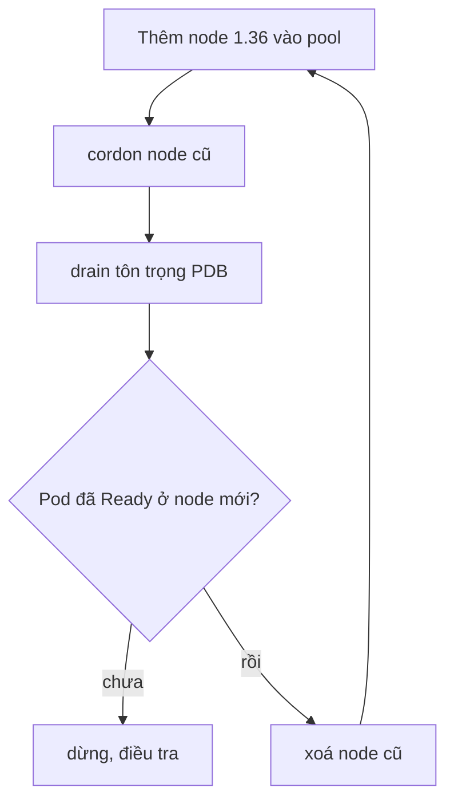

# Kế hoạch nâng cấp cluster production của ví PayLite

## 1. Bối cảnh và mục tiêu

PayLite chạy cluster kubeadm 1.33 tự quản trên ba VM control plane (etcd stacked) và tám worker chia hai node pool: `payments`
(cổng thanh toán, SLO 99,95% tháng, error budget còn 14 phút) và `batch` (đối soát đêm). 1.33 hết hỗ trợ bản vá từ tháng 6; đích là
1.36, bản mới nhất mà mọi addon (Cilium, cert-manager, CSI Ceph) đã công bố hỗ trợ. Cửa sổ: 01:00 tới 05:00 hai đêm thứ ba liên tiếp,
lưu lượng thấp nhất tuần. Ngoài phạm vi: nâng hệ điều hành node, đổi CNI. Thành công nghĩa là không request thanh toán nào lỗi do
nâng cấp và error budget không giảm quá 3 phút.

## 2. Trình tự phiên bản

| Bước | Control plane | kubelet worker | kubectl CI |
| --- | --- | --- | --- |
| 0 | 1.33 | 1.33 | 1.33 |
| 1 | 1.34 | 1.33 | 1.34 |
| 2 | 1.35 | 1.33 | 1.35 |
| 3 | 1.36 | 1.36 (thay node) | 1.36 |

kubeadm chỉ nâng control plane từng minor một. Version skew cho phép kubelet cũ hơn API server tới ba minor, nên worker giữ 1.33
trong lúc control plane đi 1.34, 1.35, 1.36, rồi thay node một lần lên 1.36: tám worker chỉ drain một lần thay vì ba.

## 3. Chuẩn bị trước cửa sổ bảo trì

- Quét manifest trong Git và mọi Helm release bằng pluto và kubent tìm deprecated và removed API tới 1.36; sửa trước, không sửa
  trong đêm.
- Đọc release notes, mục Urgent Upgrade Notes của 1.34, 1.35, 1.36; đối chiếu ma trận hỗ trợ của Cilium, cert-manager, CSI.
- Diễn tập toàn bộ trên staging dựng từ cùng Terraform, đo thời gian từng bước.
- etcd snapshot trước mỗi bước control plane, chép ra ngoài cluster, kiểm restore được trên staging.
- Mọi Deployment của pool payments có ít nhất 3 replica, PDB maxUnavailable 1, readiness đúng, topology spread theo zone.
- Đóng băng deploy ứng dụng trong hai đêm; tăng tạm quota cloud để có node surge.

## 4. Nâng control plane

- Lần lượt từng node control plane, bắt đầu từ node không giữ leader của etcd.
- Node đầu: đổi repo gói sang minor mới, cài kubeadm, `kubeadm upgrade plan`, rồi `kubeadm upgrade apply v1.34.x`.
- Hai node còn lại: `kubeadm upgrade node`, rồi kubelet và kubectl của chính node đó, restart kubelet.
- Sau mỗi node: `/readyz` của API server, etcd member list đủ ba, các thành phần control plane Running mới sang node kế.
- Lặp lại cho 1.35 và 1.36, mỗi minor một snapshot etcd.

## 5. Nâng worker không downtime

- Mỗi pool thêm một node mới 1.36 trước (surge), rồi mới drain một node cũ: capacity không bao giờ thấp hơn trước khi bắt đầu.
- `kubectl drain` có eviction để PDB chặn khi đã có pod chưa Ready; không dùng `--disable-eviction`.
- Node cũ không quay lại: không cần uncordon, xoá hẳn; node lỡ drain nhầm thì uncordon ngay.
- Pool batch làm sau 03:00 khi job đối soát xong.

## 6. Khi hỏng: dừng, lùi, khôi phục

- Mỗi bước có tiêu chí dừng: error rate thanh toán vượt 0,1% trong 5 phút, hay node mới không Ready sau 10 phút.
- Worker: dừng thay node, uncordon node cũ còn lại; node mới lỗi thì xoá.
- Control plane: Kubernetes không hỗ trợ downgrade minor; lùi nghĩa là restore etcd từ snapshot của bước đó cùng binary cũ, chỉ
  khi API server không lên được.
- Phương án cuối: dựng cluster 1.33 mới từ Terraform, restore etcd, chuyển DNS.

## 7. Kiểm chứng và truyền thông

- Smoke test tự động sau mỗi bước: tạo giao dịch thử, đọc số dư, kiểm webhook.
- Dashboard SLO: tỉ lệ lỗi và p99 của cổng thanh toán, error budget còn lại, so với cùng giờ tuần trước.
- Thông báo trước 48 giờ trên status page và kênh #payments-oncall; cập nhật mỗi bước.
- Sau cửa sổ: ghi lại thời gian thực tế, việc lệch kế hoạch, cập nhật runbook.
