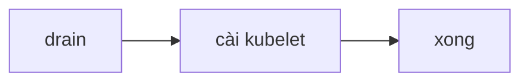

# Kế hoạch nâng cấp cluster

## 1. Bối cảnh và mục tiêu

Cluster đang chạy 1.34 đã hết hỗ trợ nên cần lên 1.37 cho kịp. Team platform sẽ làm vào tối thứ bảy khi ít khách. Cluster có ba
control plane và sáu worker, chạy API, worker, Redis của Olist Shop. Database đã chạy ở dịch vụ managed nên không nằm trong phạm vi.
Mục tiêu là lên bản mới mà không ai phải trực quá nửa đêm và khách không thấy lỗi gì đáng kể trong lúc làm.

## 2. Trình tự phiên bản

Nâng thẳng 1.34 lên 1.37 bằng kubeadm cho nhanh, một lần là xong.

## 3. Chuẩn bị trước cửa sổ bảo trì

- Đọc release notes của 1.37.
- Thử trên staging.
- Quét deprecated API bằng pluto.
- Kiểm PDB của các app quan trọng.
- Báo cho team ứng dụng.

## 4. Nâng control plane

- Cài kubeadm bản mới.
- Chạy kubeadm upgrade plan.
- Chạy kubeadm upgrade apply v1.37.0 trên cả ba node cùng lúc.
- Cài kubelet mới.

## 5. Nâng worker không downtime

- Drain tất cả worker.
- Cài kubelet mới cho cả sáu node.
- Restart kubelet.
- Chờ node Ready, có thể dùng surge thêm node mới nếu thiếu.

## 6. Khi hỏng: dừng, lùi, khôi phục

- Cài lại bản cũ của kubeadm và kubelet.
- Restore từ backup.
- Báo cáo sự cố.

## 7. Kiểm chứng và truyền thông

- Chạy smoke test.
- Thông báo trên kênh #ops.
