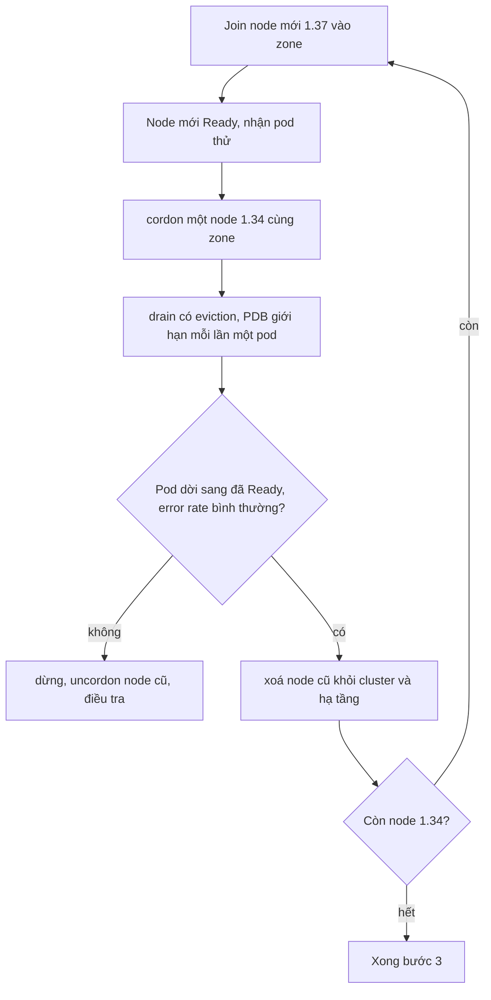

# Kế hoạch nâng cấp cluster production của Olist Shop

## 1. Bối cảnh và mục tiêu

Olist Shop chạy cluster kubeadm 1.34 tự quản: ba control plane (etcd stacked) sau một load balancer, sáu worker trong hai zone. 1.34
hết hỗ trợ bản vá từ 27/10/2026; đích là 1.37, bản mà CNI, Traefik (Gateway API), metrics-server và CSI đang dùng đều công bố hỗ
trợ. Trên cluster có API (6 tới 20 pod theo HPA), worker hàng đợi, Redis, CronJob báo cáo; Postgres là dịch vụ managed nên ngoài phạm
vi. Cửa sổ: 00:30 tới 04:30 đêm thứ ba và thứ tư, lưu lượng bằng 8% giờ cao điểm. Mục tiêu: không request nào của khách lỗi vì nâng
cấp (SLO 99,9% tháng của API không tốn quá 5 phút error budget), không mất job nào trong hàng đợi. Không nâng hệ điều hành node hay
đổi CNI trong đợt này.

## 2. Trình tự phiên bản

| Bước | Control plane | kubelet worker | kubectl của CI |
| --- | --- | --- | --- |
| 0 | 1.34 | 1.34 | 1.34 |
| 1 | 1.35 | 1.34 | 1.35 |
| 2 | 1.36 | 1.34 | 1.36 |
| 3 | 1.37 | 1.37 (thay node) | 1.37 |

- kubeadm chỉ nâng control plane một minor mỗi lần, nên phải qua 1.35 rồi 1.36 mới tới 1.37.
- Version skew: các API server trong cluster HA lệch nhau tối đa một minor (trong lúc nâng từng node); controller-manager và
  scheduler không mới hơn API server; kubelet được cũ hơn API server tới ba minor, không bao giờ mới hơn; kubectl lệch ±1.
- Nhờ skew của kubelet, worker giữ 1.34 suốt bước 1 và 2, rồi thay hẳn bằng node 1.37 ở bước 3: mỗi worker chỉ drain một lần.

## 3. Chuẩn bị trước cửa sổ bảo trì

- Quét toàn bộ manifest trong Git và Helm release đang chạy bằng pluto và kubent tìm deprecated và removed API tới 1.37; chuyển
  `manifests/` sang API hiện hành (Ingress `networking.k8s.io/v1`, CronJob `batch/v1`, PDB `policy/v1`, HPA `autoscaling/v2`), bỏ
  PodSecurityPolicy, thay bằng nhãn Pod Security Admission trên namespace; `kubectl apply --dry-run=server` trên staging.
- Đọc release notes (Urgent Upgrade Notes, mục Deprecation) của 1.35, 1.36, 1.37; đối chiếu ma trận hỗ trợ của CNI, Traefik,
  metrics-server, CSI và cert-manager; nâng addon nào cần trước.
- Diễn tập đủ ba bước trên staging dựng từ cùng mã IaC, đo thời gian từng bước để biết cửa sổ có đủ không.
- etcd snapshot trước mỗi bước control plane (`etcdctl snapshot save`), chép ra object storage ngoài cluster, thử restore trên
  staging; backup cả `/etc/kubernetes/pki`.
- Mọi Deployment phục vụ khách có ít nhất 3 replica, PDB `maxUnavailable: 1`, readiness đúng nghĩa, topology spread theo zone;
  worker hàng đợi xử lý SIGTERM sạch (job dở được trả lại hàng đợi).
- Đóng băng deploy ứng dụng trong hai đêm; xin thêm quota cho hai node surge.

## 4. Nâng control plane

- Làm lần lượt từng node control plane, không bao giờ hai node cùng lúc, để etcd luôn giữ đa số.
- Node đầu tiên: đổi repo gói `pkgs.k8s.io` sang minor mới, cài kubeadm, chạy `kubeadm upgrade plan` (xem bản đích, chứng chỉ, addon
  CoreDNS, kube-proxy), rồi `kubeadm upgrade apply v1.35.x`.
- Hai node còn lại: cài kubeadm mới rồi `kubeadm upgrade node`; sau đó drain node control plane đó (nếu có pod ứng dụng), nâng
  kubelet và kubectl, restart kubelet, uncordon.
- Sau mỗi node: `kubectl get --raw /readyz?verbose`, `etcdctl member list` đủ ba member healthy, static pod mới Running, rồi mới sang
  node kế tiếp.
- Lặp lại cho 1.36 và 1.37, mỗi minor một snapshot etcd mới; giữa hai minor chờ 15 phút theo dõi lỗi API.

## 5. Nâng worker không downtime

- Surge trước, drain sau: thêm một node 1.37 rồi mới cordon và drain một node 1.34, nên capacity không bao giờ thấp hơn lúc bắt đầu.
- `kubectl drain --ignore-daemonsets --delete-emptydir-data` đi qua Eviction API nên PDB chặn khi ứng dụng đã thiếu pod Ready; không
  dùng `--disable-eviction` hay `--force` trên pod có controller.
- Drain từng node một, xen kẽ hai zone; theo dõi drain không treo quá 10 phút (PDB quá chặt, pod kẹt Terminating).
- Node cũ không quay lại: xoá node; nếu phải dừng giữa chừng thì uncordon node cũ đang drain dở.
- Worker hàng đợi được `terminationGracePeriodSeconds` đủ dài để xong job đang chạy.

## 6. Khi hỏng: dừng, lùi, khôi phục

- Tiêu chí dừng ở mọi bước: tỉ lệ lỗi 5xx của API vượt 0,5% trong 5 phút, `/readyz` của API server lỗi quá 2 phút, hay node mới
  không Ready sau 10 phút.
- Worker: dừng thay node, uncordon node 1.34 còn lại, xoá node 1.37 lỗi; ứng dụng không bị ảnh hưởng vì capacity vẫn đủ.
- Control plane: Kubernetes không hỗ trợ downgrade minor; nếu node control plane hỏng sau `kubeadm upgrade apply`, sửa tiến (kubeadm
  tự backup manifest trong `/etc/kubernetes/tmp`), không hạ bản.
- Chỉ khi API server không lên được: restore etcd từ snapshot của bước đó cùng binary và manifest của bản cũ trên cả ba node.
- Phương án cuối: dựng cluster 1.34 mới từ IaC, restore etcd, chuyển DNS của Gateway sang cluster mới.

## 7. Kiểm chứng và truyền thông

- Smoke test tự động sau mỗi bước: `/readyz` qua Gateway, đặt đơn thử, `POST /jobs/recompute` và chờ worker xử lý, CronJob chạy tay
  một lần.
- Dashboard SLO: tỉ lệ lỗi và p99 latency của API, độ dài hàng đợi, error budget còn lại, so với cùng giờ tuần trước.
- Thông báo trước 48 giờ trên status page và kênh #olist-ops; cập nhật sau mỗi bước, có người trực ứng dụng cùng ca.
- Sau cửa sổ: so thời gian thật với diễn tập, ghi mọi chỗ lệch kế hoạch, cập nhật runbook và lịch nâng cấp lần sau (mỗi 4 tháng).
