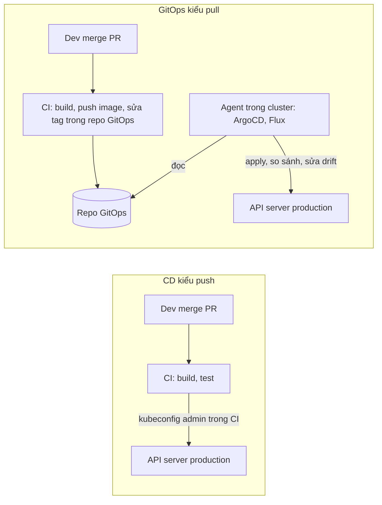
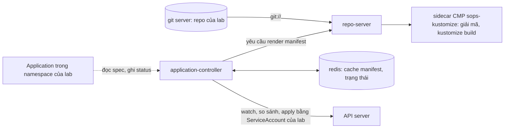
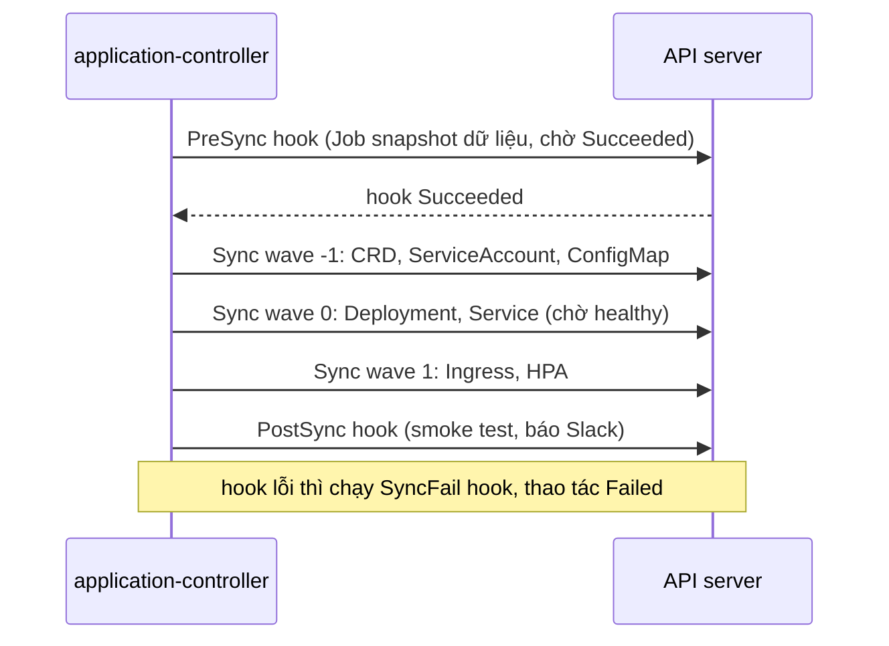
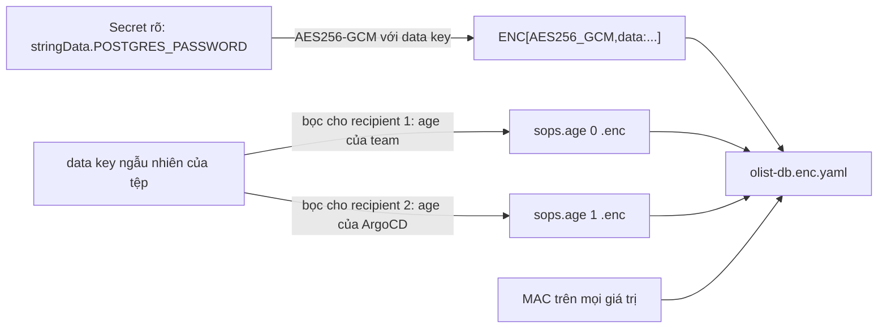

# GitOps & secrets: ArgoCD, SOPS, Vault và cách chọn công cụ quản lý bí mật

Module 11 đóng gói Olist Shop thành Kustomize và Helm chart, module 07 có pipeline build và push image. Còn thiếu một câu trả lời: **ai**
đưa manifest lên cluster, bằng credential nào, và làm sao biết cluster đang chạy đúng thứ trong Git. Pipeline `kubectl apply` thẳng vào
production chạy được, nhưng kubeconfig admin nằm trong CI, ai đó `kubectl edit` lúc 2 giờ sáng thì không ai biết, và "production đang
chạy commit nào" phải đi hỏi. GitOps đảo chiều: Git là nguồn sự thật, một agent trong cluster liên tục kéo cluster về đúng Git. Đi kèm là
câu hỏi khó hơn: nếu mọi thứ nằm trong Git thì mật khẩu Postgres nằm đâu?

Module này đi qua: nguyên tắc GitOps; ArgoCD từ Application, AppProject, sync policy tới sync wave, hook, health, app-of-apps và
ApplicationSet, so với FluxCD; mã hoá secret trong Git bằng SOPS + age; Vault cho secret động, policy và token ngắn hạn; Sealed Secrets,
External Secrets Operator và secret manager của cloud để chọn đúng công cụ; cuối cùng là vận hành GitOps nhiều môi trường, promote,
rollback, drift và gỡ lỗi sync.

Bài tập chạy trên cluster `devops-lab` dùng chung như module 10, 11, cộng một ArgoCD bản core và một git server chỉ đọc do admin cài một
lần, và một Vault dev chạy bằng compose.

Sau module này bạn sẽ:

- Giải thích bốn nguyên tắc GitOps và khác biệt bảo mật giữa CD kiểu push và kiểu pull; biết khi nào GitOps không đáng.
- Viết Application, đọc AppProject, chọn sync policy (auto, prune, self-heal) và sync option; sắp thứ tự bằng phase, wave, hook; dựng
  app-of-apps và hiểu ApplicationSet; chọn giữa ArgoCD và FluxCD.
- Mã hoá Secret theo trường bằng SOPS + age, viết `.sops.yaml` nhiều recipient, xoay khoá và xoay giá trị đúng thứ tự.
- Viết policy Vault least privilege cho KV v2, cấp token TTL ngắn, giải thích dynamic secret, lease và các cách đưa secret từ Vault vào pod.
- Chọn giữa SOPS, Sealed Secrets, External Secrets, Vault, AWS Secrets Manager/SSM, GCP Secret Manager, Azure Key Vault theo ràng buộc thật.
- Thiết kế repo GitOps nhiều môi trường, đường promote bất biến, rollback bằng `git revert`; gỡ sync kẹt, OutOfSync mãi, ComparisonError;
  phản ứng đúng khi một secret bị lộ.

## 0. Cài đặt

| Công cụ | Phiên bản đã kiểm | Tối thiểu cho bài tập | Dùng ở |
| --- | --- | --- | --- |
| kind, kubectl, Docker, bwrap, uv | Như module 10 (kind 0.30.0, kubectl 1.34.13) | Như module 10 | Basic 01, Intermediate 01, 02, Advanced 01 (chỉ `kubectl kustomize`) |
| Cluster `devops-lab` cộng image bài tập | Như mục 0 của module 10 (`olist-shop:1.0`, `postgres:16.15-alpine`, `redis:7.4.12-alpine`) | Như module 10 | Basic 01, Intermediate 01, 02 |
| ArgoCD và git server (trong cluster) | ArgoCD v3.5.6 bản core, `setup/kind/argocd/` | Đúng bản đã ghim | Basic 01, Intermediate 01, 02 |
| `sops` | 3.13.3 | 3.9 | Intermediate 01 |
| `age`, `age-keygen` | 1.3.2 | 1.2 | Intermediate 01, tạo khoá của ArgoCD |
| `vault` (CLI) | 2.2.1 | 1.15 | Basic 02 |
| Vault dev (`vault-devops` trong compose) | `hashicorp/vault:2.2.1` ghim digest | Đúng bản đã ghim | Basic 02 |
| `argocd` (CLI) | 3.5.6 | Không bài nào cần | Tuỳ chọn, xem bên dưới |

Chưa có cluster thì làm mục 0 của module 10 trước (tạo cluster, ghim CPU, nạp image). Mọi binary tải bản phát hành chính thức, kiểm
SHA-256 **trước** khi giải nén hay cài; sai thì chuỗi `&&` dừng, không cài gì. Máy ARM đổi `amd64` thành `arm64` (và lấy hash tương ứng).

### sops và age

```bash
mkdir -p ~/.cache/devops-track/dl ~/.local/bin && cd ~/.cache/devops-track/dl &&
curl -fsSLO https://github.com/getsops/sops/releases/download/v3.13.3/sops-v3.13.3.linux.amd64 &&
curl -fsSLO https://github.com/getsops/sops/releases/download/v3.13.3/sops-v3.13.3.checksums.txt &&
grep ' sops-v3.13.3.linux.amd64$' sops-v3.13.3.checksums.txt | sha256sum --check &&
install -m 0755 sops-v3.13.3.linux.amd64 ~/.local/bin/sops &&
curl -fsSLO https://github.com/FiloSottile/age/releases/download/v1.3.2/age-v1.3.2-linux-amd64.tar.gz &&
echo "cbe24006683f8eb669266162894b9a522a1af52f2665fbc63a4bb032ed26ac10  age-v1.3.2-linux-amd64.tar.gz" | sha256sum --check &&
tar -xzf age-v1.3.2-linux-amd64.tar.gz age/age age/age-keygen &&
install -m 0755 age/age age/age-keygen ~/.local/bin/ &&
sops --version --disable-version-check && age --version && age-keygen --version
```

Kết quả trên máy viết bài (Pop!_OS 24.04, x86_64):

```text
sops-v3.13.3.linux.amd64: OK
age-v1.3.2-linux-amd64.tar.gz: OK
sops 3.13.3
v1.3.2
v1.3.2
```

- sops: tệp checksum của release (SHA-256 của chính nó `91710ede6a3218e5b62286412543768a92d0c3449434951bd148d21043aad538`) đi kèm chữ
  ký Sigstore (`sops-v3.13.3.checksums.sigstore.json`); muốn chắc tệp checksum không bị thay thì kiểm thêm bằng `cosign verify-blob`.
  SHA-256 của binary: `e5bec3346a873ae91d871550f3e698c1aad962aff462a080e40f25fde17fef6b`.
- age: release **không có** tệp checksum. Hash ghim ở trên lấy từ trường `digest` của asset trong GitHub API (`gh api
  repos/FiloSottile/age/releases/tags/v1.3.2`) và khớp tệp đã tải. Chọn ghim hash vì một dòng `sha256sum --check` dễ đọc và không cần
  công cụ thêm; đổi lại, bạn tin GitHub và người viết bài. Release còn có tệp `.proof` (bằng chứng sigsum, nhật ký minh bạch kiểu
  Certificate Transparency); ai cần chuỗi tin cậy tới tác giả thì kiểm bằng `sigsum-verify` theo README của age. Tarball còn
  `age-inspect` và vài `age-plugin-*`, bài không cần nên không cài.
- `--disable-version-check`: `sops --version` mặc định gọi mạng để so bản mới nhất; test cũng tắt việc này.

Gỡ: `rm -f ~/.local/bin/sops ~/.local/bin/age ~/.local/bin/age-keygen`, xoá các tệp đã tải trong `~/.cache/devops-track/dl`.

### Vault CLI và Vault dev

```bash
cd ~/.cache/devops-track/dl &&
curl -fsSLO https://releases.hashicorp.com/vault/2.2.1/vault_2.2.1_linux_amd64.zip &&
curl -fsSLO https://releases.hashicorp.com/vault/2.2.1/vault_2.2.1_SHA256SUMS &&
grep ' vault_2.2.1_linux_amd64.zip$' vault_2.2.1_SHA256SUMS | sha256sum --check &&
unzip -o -q vault_2.2.1_linux_amd64.zip vault -d vault-2.2.1 &&
install -m 0755 vault-2.2.1/vault ~/.local/bin/vault &&
vault version
```

```text
vault_2.2.1_linux_amd64.zip: OK
Vault v2.2.1 (0e7c41b936218bd2401ab0f891c93bec10e2e8e4), built 2026-10-22T16:27:49Z
```

SHA-256 của zip: `079435de8ff146bdec4cdbe3be71d672ef4e59e4df6af0f2dba672e71be21a68`. `vault_2.2.1_SHA256SUMS.sig` là chữ ký GPG của
HashiCorp cho tệp checksum (khoá công khai trên trang Security của HashiCorp), kiểm bằng `gpg --verify` nếu muốn. Gỡ: `rm -f
~/.local/bin/vault`.

Server là Vault **dev mode** trong compose (profile `devops`): dữ liệu chỉ trong RAM, đã unseal sẵn, token root là chuỗi cố định
`devops-lab-root` (không phải bí mật, đổi bằng `DEVOPS_VAULT_TOKEN`), chỉ mở trên `127.0.0.1:18200`. Không bao giờ dùng cấu hình này
ngoài máy học.

```bash
docker compose -f setup/docker-compose.yml --profile devops up -d --wait vault-devops
export VAULT_ADDR=http://127.0.0.1:18200 VAULT_TOKEN=devops-lab-root && vault status
docker compose -f setup/docker-compose.yml --profile devops rm -s -f -v vault-devops
```

Lệnh cuối tắt và xoá luôn hai volume ẩn danh của image. Test không đọc `VAULT_ADDR`, `VAULT_TOKEN` hay `~/.vault-token` của bạn: env
của lệnh `vault` trong test dựng từ đầu với `HOME` tạm.

### ArgoCD và git server trong `devops-lab` (việc của admin)

Bài GitOps cần một ArgoCD và một git server trong cluster. **Admin (bạn, bằng kubeconfig admin) cài một lần** sau khi tạo cluster;
test không bao giờ cài, thiếu thì `ex.require_argocd()` skip kèm đúng lệnh. Lệnh đầy đủ nằm ở mục "ArgoCD và git server dùng chung"
của `setup/DEVOPS-TOOLS.md`, gồm ba bước:

1. Kéo ba image theo digest (ArgoCD v3.5.6, redis, sops), nạp vào hai worker bằng `kind load image-archive`, kiểm `SHA256SUMS` của
   `setup/kind/argocd/`, rồi `kubectl apply --server-side -k setup/kind/argocd` và khoá AppProject `default`.
2. Tạo khoá age dùng chung cho mọi lab: khoá riêng vào Secret `argocd/devops-sops-age` rồi xoá khỏi máy, public key vào ConfigMap
   `argocd/devops-sops-age-public` (bài mã hoá cho recipient này).
3. Chờ repo-server, application-controller, git server sẵn sàng.

Trên máy viết bài (CPU ghim `12-35`, image đã có trong Docker): bước 1 tới 3 khoảng 2 phút, phần lớn là nạp image; RAM của ArgoCD lúc nghỉ
khoảng 145 MiB. Thứ được cài, và vì sao:

- **Bản core** (`core-install.yaml`): application-controller, repo-server, redis. Không có API server, UI, Dex, notifications: nhẹ, không
  có mật khẩu admin hay cổng nào để lộ. Bạn và test đọc trạng thái bằng `kubectl`.
- **Application trong namespace của lab**: người học tạo `Application` ngay trong namespace `devops-ex-<id>`; mỗi lab có AppProject riêng
  chỉ cho repo của lab và namespace của lab, không object cluster-scoped nào.
- **Sync bằng impersonation**: controller có quyền admin cả cluster, nhưng object trong repo được apply bằng chính ServiceAccount của lab,
  nên RBAC, admission policy và Pod Security của lab vẫn áp dụng.
- **Plugin `sops-kustomize`** (Config Management Plugin trong một sidecar của repo-server): giải mã mọi `*.enc.yaml` rồi `kustomize build`.
  Khoá riêng chỉ mount vào sidecar đó. Chọn thay ksops vì ksops cần bật exec plugin của kustomize, tức repo nào cũng chạy được chương
  trình ngay cạnh khoá.
- **Git server `git daemon` chỉ đọc** trong namespace `devops-git`: không ai push qua mạng; testkit đẩy repo của lab bằng quyền admin.
  NetworkPolicy chỉ cho repo-server đọc. Repo-server không ra được Internet (NetworkPolicy egress cộng proxy chết).

### `argocd` CLI (tuỳ chọn)

Không bài nào cần CLI. Ở công ty bạn sẽ gặp nó trên bản cài đầy đủ (có API server): `argocd login`, `argocd app diff`, `argocd app sync`,
`argocd app rollback`, `argocd app terminate-op`. Cài để thử:

```bash
cd ~/.cache/devops-track/dl &&
curl -fsSLO https://github.com/argoproj/argo-cd/releases/download/v3.5.6/argocd-linux-amd64 &&
curl -fsSLo argocd-v3.5.6-cli_checksums.txt https://github.com/argoproj/argo-cd/releases/download/v3.5.6/cli_checksums.txt &&
grep ' argocd-linux-amd64$' argocd-v3.5.6-cli_checksums.txt | sha256sum --check &&
install -m 0755 argocd-linux-amd64 ~/.local/bin/argocd &&
argocd version --client --short
```

```text
argocd-linux-amd64: OK
argocd: v3.5.6+c2b1e30
```

SHA-256: `db9d17b70593d3f86a4dcf08d9ebbb85a42e995426ac5f928b737260656102d3` (binary khoảng 240 MB). Gỡ: `rm -f ~/.local/bin/argocd`.

Với bản core không có API server, CLI chạy ở **core mode** (`--core`): nó dựng một API server tạm trong chính tiến trình CLI, đọc thẳng
cấu hình trong namespace `argocd` bằng kubeconfig của bạn. Vì vậy:

- Cần kubeconfig admin có namespace mặc định là `argocd` (token của lab không đọc được cấu hình trong `argocd`). Đừng đổi namespace của
  `~/.kube/devops-lab.yaml` dùng chung; chép ra tệp riêng (quyền 0600) rồi `kubectl config set-context --current --namespace=argocd` trên
  tệp đó.
- **Đã kiểm 2026-11-11** với v3.5.6: `argocd version --core`, `argocd proj list --core` chạy được; `argocd app list --core -N devops-ex-...`
  trả bảng rỗng và `argocd app get --core <namespace>/<tên>` báo `namespace '...' is not permitted`, kể cả khi đặt
  `ARGOCD_APPLICATION_NAMESPACES`. API server tạm của core mode không nhận cấu hình "Application ngoài namespace `argocd`" mà controller
  dùng. Với cluster của track, đọc trạng thái Application bằng `kubectl` là đường chính.

### Test chạy thế nào

Như module 10, 11 (`KubeLab`: namespace riêng, token có Role riêng, năm ValidatingAdmissionPolicy, mọi thứ bị xoá khi xong). Module này
thêm:

- **`lab.argocd_project()`** tạo AppProject `devops-ex-<id>` cho lab; **`lab.gitops_repo(thư mục)`** chép thư mục bài vào một repo git
  mới, đẩy lên git server và trả `lab.repo_url`; gọi lại là thêm một commit. Nó từ chối symlink, tệp có `AGE-SECRET-KEY-`, quá 2000 tệp
  hay 20 MiB.
- **Placeholder trong Application**: `LAB_PROJECT`, `LAB_REPO_URL`, `LAB_NAMESPACE` trong tệp của bạn được test thay bằng giá trị của lần
  chạy, vì mỗi lab có project, repo, namespace riêng. Policy của lab từ chối Application trỏ project, repo hay namespace khác.
- **`lab.argocd_wait(app)`** đọc Application bằng token của lab, chờ `Healthy`, `Synced`, không còn thao tác sync đang chạy **và** đúng
  SHA của commit cuối; quá hạn thì in health, sync, revision, thông điệp, không bao giờ in object hay giá trị Secret.
- **`lab.sops_age_recipient`**: public key của khoá age của ArgoCD (Intermediate 01 mã hoá cho nó).
- Token của lab dùng được `kubectl apply`, `patch`, `annotate` trên Application; `kubectl replace` và `apply --force` bị policy từ chối, vì
  token của lab không được sửa `status` (status do controller ghi). Huỷ một thao tác sync đang kẹt là việc của admin.
- Lab đóng khi hook còn chạy (sync kẹt): testkit gỡ finalizer `argocd.argoproj.io/hook-finalizer` mà ArgoCD gắn cho hook để namespace
  xoá được.

Chạy một bài (ghim CPU như module 10 khi máy nhiều core):

```bash
export DEVOPS_CPUSET=12-35 &&
nice -n 15 taskset -c "$DEVOPS_CPUSET" uv run pytest tracks/devops/modules/12-gitops-secrets/exercises/basic/01-first-application -q -rs
```

### Thực hành tay an toàn

- **SOPS, age, Vault**: thử thoải mái trên máy, trong thư mục tạm ngoài repo (`mktemp -d`) và với Vault dev. Khoá age thử nghiệm để ngoài
  mọi repo; xoá khi xong.
- **ArgoCD của track**: git server chỉ nhận repo do testkit đẩy, repo-server không ra được Internet, nên Application tự viết tay không có
  repo nào để đọc. Cách xem tận mắt là quan sát trong lúc test chạy, ở một terminal khác:

  ```bash
  kubectl --kubeconfig ~/.kube/devops-lab.yaml get applications.argoproj.io -A -w
  kubectl --kubeconfig ~/.kube/devops-lab.yaml get pods -A -l app.kubernetes.io/name=api -w
  ```

- **Tự tay toàn bộ** (repo trên GitHub của bạn, UI, CLI): dựng một cluster kind riêng dùng một lần (`kind create cluster --name gitops-play
  --kubeconfig ~/.kube/gitops-play.yaml`) và cài ArgoCD bản đầy đủ theo trang Getting Started của ArgoCD. Không cài lên `devops-lab`:
  bản đầy đủ đè cấu hình core của track. Xong thì `kind delete cluster --name gitops-play --kubeconfig ~/.kube/gitops-play.yaml`.

## 1. GitOps: nguyên tắc, push và pull

Nhắc lại từ track Data Engineer: [module DE 08, mục 4 CI/CD cho pipeline dữ liệu](../../../data-engineer/modules/08-devops-for-data/README.md)
đã giới thiệu ArgoCD như "CD kiểu GitOps: cluster tự đồng bộ theo Git, rollback là revert commit", và
[module DE 10, mục 8](../../../data-engineer/modules/10-security-governance/README.md) nói secret phải nằm trong secret manager chứ không
trong code. Mục này đi sâu phần còn lại: vì sao, và cái gì thật sự thay đổi.

### Bốn nguyên tắc (OpenGitOps 1.0)

| Nguyên tắc | Nghĩa | Hệ quả |
| --- | --- | --- |
| Declarative | Hệ thống được mô tả bằng trạng thái mong muốn (manifest), không bằng chuỗi lệnh | Đọc repo là biết hệ thống trông thế nào |
| Versioned and immutable | Trạng thái mong muốn nằm trong một kho có phiên bản, không sửa ngược lịch sử | Mọi thay đổi có tác giả, thời điểm, review; rollback là quay về một phiên bản |
| Pulled automatically | Agent của hệ thống tự kéo trạng thái mong muốn | Không ai bên ngoài cần credential để ghi vào cluster |
| Continuously reconciled | Agent liên tục so trạng thái thật với mong muốn và sửa chênh lệch | Drift bị phát hiện, và (nếu bật) bị sửa |

Ba nguyên tắc đầu, pipeline `kubectl apply -k` từ CI cũng gần đạt. Khác biệt nằm ở hai nguyên tắc cuối.



### Cái gì thật sự thay đổi

- **Credential**: CI chỉ cần quyền ghi repo GitOps. Credential của cluster không rời cluster; API server không phải mở cho runner của CI.
  Lộ token CI là lộ quyền mở pull request, không phải quyền `delete namespace`.
- **Nguồn sự thật**: câu hỏi "production đang chạy gì" có một câu trả lời: commit mà Application báo `Synced`. Rollback là `git revert`,
  audit là `git log`, review là pull request.
- **Drift**: `kubectl edit` lúc nửa đêm hiện ngay thành `OutOfSync`, và với self-heal thì bị kéo về Git sau vài giây. Hệ quả ngược: sửa
  nóng bằng tay không còn "dính"; quy trình sự cố phải có đường tắt auto-sync hay sửa qua Git.
- **Tách CI và CD**: CI xong ở chỗ "sửa một dòng tag trong repo GitOps"; CD là việc của agent. Hai repo (code và GitOps) có quyền và nhịp
  khác nhau.

### Khi nào GitOps không đáng

- Không có Kubernetes (hay hệ thống có API khai báo và agent reconcile): một VM chạy systemd thì Ansible (module 09) hay pipeline thường
  đơn giản hơn.
- Một cluster, một team nhỏ, deploy vài lần mỗi tháng: lợi ích audit và drift có thật nhưng nhỏ so với chi phí vận hành thêm ArgoCD.
- Thứ cần thứ tự mệnh lệnh phức tạp (migration dữ liệu nhiều bước có điểm dừng cho người) không hợp với "khai báo trạng thái"; hook làm
  được một phần (mục 3), phần còn lại vẫn là runbook.
- Secret: GitOps không giải quyết, chỉ làm vấn đề lộ rõ hơn. Mục 4 tới 6.

## 2. ArgoCD: Application, AppProject, sync policy và health

### Kiến trúc



- **repo-server** clone repo, render manifest (Kustomize, Helm, YAML thuần, hay plugin) cho một commit, cache kết quả.
- **application-controller** là vòng reconcile: với mỗi Application, lấy manifest đã render, so với object thật (diff có hiểu default của
  API server), ghi `status.sync` và `status.health`, và khi được phép thì sync.
- **API server và UI** (bản đầy đủ) chỉ là giao diện cho người và CLI; tắt chúng (bản core) thì vòng reconcile vẫn chạy.
- **applicationset-controller** sinh Application từ template (mục 3).

### Application

```yaml
apiVersion: argoproj.io/v1alpha1
kind: Application
metadata:
  name: olist-shop
  namespace: devops-ex-1a2b3c4d
spec:
  project: devops-ex-1a2b3c4d
  source:
    repoURL: git://git.devops-git.svc.cluster.local/devops-ex-1a2b3c4d.git
    targetRevision: main
    path: shop
  destination:
    server: https://kubernetes.default.svc
    namespace: devops-ex-1a2b3c4d
  syncPolicy:
    automated:
      prune: true
      selfHeal: true
    syncOptions:
      - ApplyOutOfSyncOnly=true
    retry:
      limit: 3
      backoff: { duration: 10s, factor: 2, maxDuration: 2m }
```

- `source`: repo, nhánh hay tag hay SHA (`targetRevision`), thư mục; ArgoCD tự nhận Kustomize, Helm (có `Chart.yaml`) hay YAML thuần,
  hoặc dùng `plugin`. `sources` (số nhiều) cho phép một chart từ repo Helm cộng values từ repo GitOps.
- `destination`: cluster (đã đăng ký với ArgoCD) và namespace mặc định cho object không ghi namespace.
- Application thường nằm trong namespace `argocd`; ArgoCD 2.5+ cho Application ở namespace khác khi admin bật (track dùng cách này).

### Trạng thái: sync và health là hai trục

| Trục | Giá trị | Nghĩa |
| --- | --- | --- |
| Sync | `Synced` | Object thật khớp manifest của commit đang so |
| | `OutOfSync` | Có object thiếu, thừa (chờ prune) hay khác |
| | `Unknown` | Không render được (repo không đọc được, plugin lỗi: xem `status.conditions`) |
| Health | `Healthy` | Mọi object healthy theo kiểu của nó (Deployment đủ replica available, Job xong, PVC Bound...) |
| | `Progressing` | Đang tiến tới healthy (rollout, pod chưa Ready) |
| | `Degraded` | Hỏng (rollout quá `progressDeadlineSeconds`, Job failed) |
| | `Missing` | Object chưa tồn tại |
| | `Suspended` | Bị tạm dừng (CronJob suspend, Rollout pause) |

`Synced` + `Degraded` là chuyện bình thường: Git đã được áp đúng, chỉ là thứ trong Git hỏng. Health của CRD lạ mặc định không biết; viết
health check bằng Lua trong `argocd-cm` cho CRD của bạn. Thao tác đang chạy nằm ở `status.operationState` (phase `Running`, `Succeeded`,
`Failed`, `Error`, `Terminating`, cộng `message` và `syncResult` từng object).

### Sync policy

| Cấu hình | Hành vi |
| --- | --- |
| Không `automated` | Chỉ báo OutOfSync; người hay CI bấm sync (`argocd app sync`, hay `kubectl patch` trường `operation`) |
| `automated` | Commit mới làm OutOfSync thì tự sync. Không tự thử lại một lần sync đã lỗi trên cùng commit, trừ khi có `retry` |
| `automated.prune` | Xoá object có trong lần sync trước mà không còn trong Git. Tắt thì object thừa nằm đó, Application OutOfSync |
| `automated.selfHeal` | Drift do sửa tay (không do Git đổi) cũng làm sync, sau một khoảng chờ ngắn. Tắt thì drift nằm tới commit sau |
| `retry` | Sync lỗi được thử lại theo backoff tới `limit` lần |

Sync option hay dùng: `CreateNamespace=true`, `PruneLast=true` (xoá sau cùng, sau khi mọi thứ mới healthy), `ServerSideApply=true` (object
lớn như CRD vượt giới hạn annotation của client-side apply), `ApplyOutOfSyncOnly=true`, `Replace=true` (cho trường immutable, cẩn thận),
`RespectIgnoreDifferences=true`. Annotation trên từng object: `argocd.argoproj.io/sync-options: Prune=false` để không bao giờ prune một PVC
quan trọng, `argocd.argoproj.io/compare-options: IgnoreExtraneous`.

ArgoCD làm mới (refresh) mỗi Application mặc định khoảng 3 phút một lần (`timeout.reconciliation`) cộng khi có webhook từ Git server;
`argocd.argoproj.io/refresh=hard` bỏ qua cache của repo-server. Test của track yêu cầu hard refresh ngay sau mỗi commit nên không phải chờ.

### AppProject: ranh giới giữa các team

```yaml
apiVersion: argoproj.io/v1alpha1
kind: AppProject
metadata:
  name: olist-production
  namespace: argocd
spec:
  sourceRepos: ["https://git.example.com/olist/gitops.git"]
  destinations:
    - server: https://prod-cluster.olist.internal:6443
      namespace: olist-production
  clusterResourceWhitelist: []
  namespaceResourceBlacklist:
    - group: ""
      kind: ResourceQuota
  syncWindows:
    - kind: deny
      schedule: "0 0 10 11 *"
      duration: 72h
      applications: ["*"]
```

- `sourceRepos`, `destinations`: Application của project chỉ được lấy từ các repo này, chỉ được đổ vào các namespace và cluster này.
- `clusterResourceWhitelist` rỗng: không tạo được ClusterRole, Namespace, CRD. Team ứng dụng hiếm khi cần.
- `syncWindows`: đóng băng deploy (ở đây từ 10/11 trong 72 giờ cho đợt 11.11); `manualSync: true` để vẫn cho sync tay khi khẩn cấp.
- `roles`: quyền trong ArgoCD (ai sync, ai xem) cho từng project, gắn với nhóm SSO.
- `destinationServiceAccounts` (sync bằng impersonation, ArgoCD 2.13+): object được apply bằng một ServiceAccount của đích thay vì quyền
  admin của controller. Track bật cái này để RBAC của lab là ranh giới thật.

Project `default` cho phép mọi thứ; cài xong ArgoCD nên khoá nó lại (track làm sẵn). Bài học từ lỗ hổng thật: ArgoCD 3.5.6 không đối chiếu
`operation.sync.source` của một Application với `sourceRepos`, nên ai ghi được Application là render được repo khác; track chặn bằng
admission policy. Ranh giới của ArgoCD là ai ghi được Application và AppProject, không chỉ nội dung của chúng.

## 3. Thứ tự sync, hook, app-of-apps, ApplicationSet và so sánh FluxCD

### Phase, wave và hook

Một lần sync chạy theo **phase**, trong mỗi phase theo **wave** (số nguyên, mặc định 0, âm được), trong mỗi wave theo kind (Namespace,
CRD, ServiceAccount... trước Deployment) rồi theo tên. ArgoCD chờ mọi object của một wave **healthy** rồi mới sang wave kế.



| Annotation | Giá trị |
| --- | --- |
| `argocd.argoproj.io/hook` | `PreSync`, `Sync`, `PostSync`, `SyncFail`, `PostDelete`, `Skip` |
| `argocd.argoproj.io/sync-wave` | Số nguyên dạng chuỗi, `"-1"`, `"5"` |
| `argocd.argoproj.io/hook-delete-policy` | `BeforeHookCreation` (mặc định khi không ghi), `HookSucceeded`, `HookFailed`; ghi nhiều giá trị cách bằng dấu phẩy |

Ba điều hay làm hỏng:

- **Hook giả định thứ tự không có thật**: hook chỉ chắc chắn thấy những gì đã được tạo ở các phase và wave **trước** nó. Một hook chạy được
  trên môi trường cũ có thể chỉ vì thứ nó cần đã tồn tại từ các lần sync trước; luôn thử sync repo trên một namespace trống.
- **Hook không có hạn**: Job pod kẹt `CreateContainerConfigError` hay `ImagePullBackOff` không bao giờ failed; không có
  `activeDeadlineSeconds` thì thao tác sync `Running` mãi, và auto-sync không bắt đầu thao tác mới cho commit mới khi thao tác cũ chưa xong.
- **Ghi `hook-delete-policy: HookSucceeded` một mình**: mất mặc định `BeforeHookCreation`, lần sync sau tạo Job cùng tên thì lỗi nếu Job cũ
  (failed) còn đó.

Hook là Job hay Pod chạy một lần mỗi lần sync, nên phải **idempotent**: migration chạy lại trên schema đã có không được hỏng. Đừng dùng hook
cho thứ cần chạy đúng một lần trong đời hệ thống.

### App-of-apps và ApplicationSet

**App-of-apps**: một Application gốc trỏ thư mục chứa các manifest Application khác. Thêm một app là thêm một tệp; xoá tệp (với prune) là
xoá app. Dùng để bootstrap cả cluster (ingress, cert-manager, monitoring, rồi app) từ một lệnh, và kết hợp sync wave để thứ tự giữa các app
đúng.

**ApplicationSet** sinh nhiều Application từ một template và một **generator**:

| Generator | Sinh Application cho |
| --- | --- |
| List | Danh sách giá trị viết sẵn (môi trường, region) |
| Cluster | Mỗi cluster đã đăng ký (lọc theo nhãn), hợp cho add-on chạy trên mọi cluster |
| Git (directory, files) | Mỗi thư mục `envs/*` hay mỗi tệp cấu hình trong repo |
| Matrix, Merge | Tích hay hợp của hai generator (mọi app × mọi cluster) |
| Pull Request, SCM Provider | Mỗi PR đang mở (môi trường preview), mỗi repo của một tổ chức |

ApplicationSet bớt YAML lặp, nhưng là điểm hỏng chung: template sai là hỏng mọi Application cùng lúc, và người tạo ApplicationSet có quyền
tạo Application ở mọi nơi template cho phép. Track chỉ dạy ở mức khái niệm (controller để 0 replica, testkit từ chối ApplicationSet của
bài); Advanced 01 so sánh nó với app-of-apps.

### ArgoCD hay FluxCD

| | ArgoCD | FluxCD (v2) |
| --- | --- | --- |
| Mô hình | Application, AppProject; một controller trung tâm cho nhiều cluster (hub) hay mỗi cluster một bản | Bộ controller nhỏ: source, kustomize, helm, notification, image automation; thường mỗi cluster một bản |
| Giao diện | UI web, CLI, SSO (Dex, OIDC), RBAC theo project | Không có UI chính thức (có UI bên thứ ba); CLI `flux` và CRD |
| Helm | Render bằng `helm template` rồi apply như manifest (không có release Helm trên cluster) | `HelmRelease`: dùng Helm SDK thật, có release, hook và rollback của Helm |
| Thứ tự | Phase, wave, hook | `dependsOn` giữa các `Kustomization`, health check |
| Secret | Plugin (CMP) hay External Secrets; không giải mã sẵn | Giải mã SOPS có sẵn trong kustomize-controller (`spec.decryption`) |
| Cập nhật image | Argo CD Image Updater (dự án riêng) | Image reflector và automation có sẵn, tự commit tag mới vào Git |
| Đa tenant | AppProject, sync bằng impersonation | ServiceAccount impersonation cho từng `Kustomization` |
| Hợp khi | Nhiều team cần tự xem và bấm, cần UI và SSO, quản nhiều cluster từ một chỗ | Team platform thích mọi thứ là CRD, cluster tự quản mình, cần Helm release thật |

Cả hai là dự án CNCF đã tốt nghiệp (graduated) và đều đạt bốn nguyên tắc GitOps. Chọn theo người dùng (ai cần UI) và theo cách quản cluster,
không theo tính năng lẻ. Kargo (promote nhiều giai đoạn) và Argo Rollouts (canary, blue/green) là các mảnh bổ sung, không thay ArgoCD.

## 4. Secret trong GitOps và SOPS + age

### Vấn đề

Kubernetes Secret là base64, không phải mã hoá: `echo b2xpc3Q= | base64 -d`. Đẩy Secret thuần vào Git là đẩy mật khẩu vào mọi bản clone,
mọi fork, mọi CI log, mãi mãi (xoá commit không thu hồi được bản đã bị chép). Có ba hướng:

1. **Mã hoá trong Git**: Git chứa bản mã hoá; một thứ trong cluster giải mã khi apply (SOPS, Sealed Secrets).
2. **Tham chiếu trong Git**: Git chỉ chứa "lấy secret tên X từ kho Y"; một operator đồng bộ giá trị vào cluster (External Secrets, Secrets
   Store CSI Driver).
3. **App tự lấy**: app (hay sidecar của nó) đăng nhập secret manager lúc chạy (Vault Agent, SDK của cloud); Kubernetes không giữ giá trị.

### SOPS: mã hoá theo trường, khoá kiểu phong bì

SOPS (Secrets OPerationS, dự án CNCF) mã hoá **giá trị** trong YAML, JSON, ENV, INI, giữ nguyên cấu trúc và tên khoá.



- Mỗi tệp có một **data key** ngẫu nhiên; mọi giá trị mã hoá bằng data key đó (AES256-GCM).
- Data key được bọc riêng cho từng **recipient**: khoá age, PGP, AWS KMS, GCP KMS, Azure Key Vault, Vault transit. Ai mở được một bọc là
  giải mã được cả tệp.
- **MAC** trên toàn bộ giá trị: sửa một giá trị trong bản mã hoá mà không qua SOPS thì giải mã báo lỗi.
- Thêm hay gỡ recipient chỉ bọc lại data key (`sops updatekeys`), không đụng giá trị; đổi giá trị thì `sops edit` hay `sops set`.

**age** là công cụ mã hoá tệp đơn giản (khoá X25519, không có web of trust, không cấu hình): `age-keygen -o keys.txt` sinh một khoá riêng
(`AGE-SECRET-KEY-1...`) và in public key (`age1...`). Public key là recipient, chép vào repo được; khoá riêng không bao giờ vào repo.

### `.sops.yaml`

```yaml
creation_rules:
  - path_regex: envs/production/.*\.enc\.yaml$
    encrypted_regex: ^(data|stringData)$
    age: >-
      age1prodcluster...,
      age1oncall1...,
      age1oncall2...
  - path_regex: .*\.enc\.yaml$
    encrypted_regex: ^(data|stringData)$
    age: age1teamstaging...,age1argocdnonprod...
```

- Rule đầu tiên khớp đường dẫn được dùng, nên đặt rule hẹp (production) trước rule rộng.
- `encrypted_regex` so với tên khoá ở mọi cấp; `^(data|stringData)$` mã hoá cây con dưới hai khoá đó, giữ `kind`, `metadata` đọc được để
  review và để kustomize, ArgoCD biết đây là Secret nào. Ngược lại có `unencrypted_regex`, `encrypted_suffix` (`_enc`).
- `sops encrypt --filename-override shop/olist-db.enc.yaml --output shop/olist-db.enc.yaml /ngoài/repo/olist-db.yaml`: chọn rule theo
  đích, bản rõ không bao giờ vào thư mục repo. Sửa sau đó: `sops edit shop/olist-db.enc.yaml` (giải mã vào tệp tạm, mở editor, mã hoá lại).

Một tệp sau khi mã hoá:

```yaml
apiVersion: v1
kind: Secret
metadata:
    name: olist-db
stringData:
    POSTGRES_PASSWORD: ENC[AES256_GCM,data:y/Yb...,iv:b7tC...,tag:NVYu...,type:str]
sops:
    age:
        - recipient: age1nllane...
          enc: |
            -----BEGIN AGE ENCRYPTED FILE-----
            ...
    encrypted_regex: ^(data|stringData)$
    mac: ENC[AES256_GCM,data:iub/...,type:str]
```

### Ai giải mã, ở đâu

- **Người**: khoá riêng ở `~/.config/sops/age/keys.txt` (mặc định của SOPS) hay biến `SOPS_AGE_KEY_FILE` trỏ **ra ngoài** repo. Đặt khoá
  trong thư mục dự án là một `git add -A` từ một sự cố (Advanced 02).
- **ArgoCD**: không giải mã SOPS sẵn; cần plugin. Track dùng sidecar CMP `sops-kustomize` (Intermediate 01); nơi khác dùng ksops, helm-secrets,
  hay chuyển sang External Secrets.
- **Flux**: kustomize-controller giải mã sẵn với khoá trong một Secret mà `Kustomization` trỏ tới.
- Sau khi giải mã, giá trị là Secret bình thường: nằm trong etcd, trong cache của ArgoCD, trong pod. SOPS bảo vệ Git, không bảo vệ cluster;
  RBAC trên `secrets` và encryption at rest của etcd vẫn là việc phải làm.

### Xoay khoá và xoay giá trị

| Tình huống | Làm |
| --- | --- |
| Thêm người hay cluster | Thêm recipient vào `.sops.yaml`, `sops updatekeys <tệp>` cho mọi tệp khớp rule, commit |
| Người rời team (khoá không lộ) | Gỡ recipient, `updatekeys`. Khoá cũ vẫn mở được mọi bản trong lịch sử Git: nếu người đó còn giữ khoá và còn bản clone, coi như họ biết giá trị cũ |
| Khoá có thể đã lộ | Gỡ recipient **và** xoay mọi giá trị khoá đó từng mở được |
| Đổi khoá của ArgoCD | Thêm recipient mới, `updatekeys` mọi tệp, deploy; rồi mới thay Secret khoá trong cluster và gỡ recipient cũ. Đảo thứ tự là sync lỗi |

KMS của cloud làm recipient thì "khoá riêng" không bao giờ rời KMS; quyền giải mã là quyền IAM `kms:Decrypt`, thu hồi bằng IAM và có audit
log của cloud. Đổi lại là phụ thuộc cloud và tốn tiền mỗi lần gọi.

## 5. Vault: KV v2, policy, token, dynamic secret

### Vai trò

HashiCorp Vault là secret manager tự vận hành: lưu secret (KV), **sinh** secret theo yêu cầu (database, cloud credential, PKI), mã hoá
như một dịch vụ (transit), kèm xác thực, phân quyền, audit log. Vault chạy dạng cluster (Raft storage), khởi động ở trạng thái **sealed**:
khoá gốc bị chia (Shamir) hay giao cho KMS (auto-unseal). Dev mode bỏ hết phần đó, chỉ để học. Từ 2023 Vault đổi sang giấy phép BSL;
OpenBao là bản fork mã nguồn mở (MPL) dưới Linux Foundation, tương thích API phần lớn.

### KV v2

```bash
export VAULT_ADDR=http://127.0.0.1:18200 VAULT_TOKEN=devops-lab-root
vault secrets enable -path=lab12 kv-v2
vault kv put -mount=lab12 olist/api/db username=olist password=lab-chi-de-hoc
vault kv get -mount=lab12 -field=password olist/api/db
vault kv put -mount=lab12 olist/api/db username=olist password=da-xoay
vault kv get -mount=lab12 -version=1 olist/api/db
vault kv metadata get -mount=lab12 olist/api/db
vault secrets disable lab12
```

KV v2 giữ nhiều phiên bản (`max_versions`), xoá mềm (`kv delete`, khôi phục được bằng `kv undelete`) và xoá vĩnh viễn (`kv destroy`, `kv
metadata delete`). Quan trọng cho policy: API thật nằm dưới hai cây khác nhau:

| Lệnh CLI | Path API |
| --- | --- |
| `kv get`, `kv put`, `kv patch`, `kv delete` | `<mount>/data/<path>` |
| `kv list`, `kv metadata get`, `kv metadata delete` | `<mount>/metadata/<path>` |
| `kv undelete`, `kv destroy` | `<mount>/undelete/<path>`, `<mount>/destroy/<path>` |

### Policy

```hcl
path "secret/data/olist/api/*" {
  capabilities = ["read"]
}

path "secret/metadata/olist/api/*" {
  capabilities = ["list"]
}
```

Mặc định là **từ chối**; policy chỉ thêm quyền. Capability: `create`, `read`, `update`, `patch`, `delete`, `list`, `sudo`, `deny` (thắng mọi
thứ). Glob `*` ở cuối, `+` cho một đoạn path. Policy viết theo path CLI (`secret/olist/api/*`) là lỗi phổ biến nhất với KV v2: không khớp
gì. `vault kv get -output-policy -mount=secret olist/api/db` in policy tối thiểu cho đúng lệnh đó. Basic 02.

### Token, TTL và lease

| Thuộc tính | Nghĩa |
| --- | --- |
| `ttl` | Sống bao lâu nếu không gia hạn |
| `explicit_max_ttl` | Trần cứng tính từ lúc tạo; gia hạn không vượt được |
| `period` | Token gia hạn được mãi, mỗi lần tối đa một period (cho daemon chạy lâu) |
| `policies` | Quyền của token; token con không kế thừa policy của cha khi ghi `-policy` |
| `num_uses` | Dùng được bao nhiêu lần |
| Cha con | Thu hồi token cha là thu hồi mọi token con; `-orphan` để tách |

Mọi secret động và mọi token có **lease**: Vault biết nó hết hạn khi nào và thu hồi được nó (`vault lease revoke -prefix`). Token root chỉ
dùng lúc dựng hệ thống rồi thu hồi; vận hành hằng ngày đi qua **auth method**: Kubernetes (pod đăng nhập bằng token ServiceAccount của
nó), AppRole (máy, CI), OIDC (người, qua SSO), AWS/GCP/Azure (danh tính của cloud). Mỗi role của auth method gắn policy và TTL.

### Dynamic secret (khái niệm)

Database secrets engine: Vault giữ một user quản trị của Postgres; mỗi lần app hỏi `database/creds/olist-api`, Vault tạo một user Postgres
mới với quyền theo role, trả kèm lease 1 giờ, hết lease thì `DROP ROLE`. Hệ quả: mỗi pod một user (audit biết pod nào truy vấn gì), lộ một
credential chỉ lộ 1 giờ, không còn "mật khẩu Postgres dùng chung từ 2019". Đổi lại: Postgres phụ thuộc Vault lúc app khởi động; app phải chịu
được credential đổi (pool kết nối làm mới khi lease gần hết). Tương tự cho AWS (IAM user, STS), PKI (chứng chỉ ngắn hạn), SSH.

### Đưa secret từ Vault vào pod

| Cách | Hoạt động | Đánh đổi |
| --- | --- | --- |
| Vault Agent Injector | Webhook thêm sidecar Vault Agent vào pod; agent đăng nhập bằng Kubernetes auth, ghi secret ra tệp trong pod, tự gia hạn | Không có Kubernetes Secret nào; mỗi pod thêm một sidecar |
| Vault Secrets Operator | CRD của HashiCorp đồng bộ secret Vault (cả dynamic) vào Kubernetes Secret, rollout lại Deployment khi đổi | Giá trị vào etcd; một controller cho cả cluster |
| External Secrets Operator | Như trên nhưng đa nhà cung cấp (Vault, AWS, GCP, Azure...) | Như trên; dự án cộng đồng |
| Secrets Store CSI Driver | Mount secret như volume tệp lúc pod khởi động, tuỳ chọn đồng bộ thành Secret | Không mặc định vào etcd; xoay cần pod đọc lại tệp |
| SDK trong app | App tự gọi API của Vault | Kiểm soát tốt nhất; code app phụ thuộc Vault |

## 6. Chọn công cụ quản lý secret

### Bảng so sánh

| Công cụ | Git chứa gì | Ai giải mã hay giữ giá trị | Xoay giá trị | Hợp khi | Không hợp khi |
| --- | --- | --- | --- | --- | --- |
| SOPS + age | Bản mã hoá theo trường | Ai có khoá age (người, ArgoCD qua plugin, Flux sẵn) | Sửa và commit | Ít secret, đổi ít, muốn mọi thứ trong Git, không có cloud | Secret đổi thường xuyên, cần audit ai đọc, nhiều team chung khoá |
| SOPS + KMS của cloud | Bản mã hoá | Ai có quyền IAM `kms:Decrypt` | Sửa và commit | Đã ở một cloud, muốn thu hồi quyền bằng IAM và có audit | Đa cloud hay on-prem không KMS |
| Sealed Secrets | `SealedSecret` mã hoá bằng public key của controller | Chỉ controller của cluster đó | Seal lại và commit | Một cluster, team chỉ cần "đưa được secret vào Git" | Nhiều cluster (seal mỗi cluster), người cần đọc lại giá trị, mất khoá controller là mất hết |
| External Secrets Operator | `ExternalSecret`: tham chiếu tên secret | Secret manager bên ngoài; operator đọc rồi ghi Secret | Ở secret manager, tự đồng bộ theo `refreshInterval` | Đã có AWS SM, GCP SM, Azure KV hay Vault; xoay tự động | Không có secret manager nào; cần chạy offline hoàn toàn |
| Vault (tự vận hành) | Tham chiếu, hay không gì cả | Vault; app qua Agent, operator, CSI, SDK | Dynamic secret, lease | Nhiều hệ thống, cần secret động, PKI, đa cloud, on-prem | Team nhỏ không có người vận hành Vault (HA, unseal, backup, nâng cấp) |
| AWS Secrets Manager | Tham chiếu (qua ESO hay CSI) | AWS, quyền IAM | Xoay tự động bằng Lambda, tích hợp RDS | Hệ thống chạy trên AWS, cần xoay mật khẩu RDS | Đa cloud; nhiều secret rẻ tiền (tính tiền mỗi secret) |
| AWS SSM Parameter Store | Tham chiếu | AWS, quyền IAM, `SecureString` mã hoá bằng KMS | Tự làm | Cấu hình và secret đơn giản trên AWS, tier standard miễn phí | Cần xoay tự động, quota API thấp |
| GCP Secret Manager | Tham chiếu | GCP, IAM | Thông báo xoay qua Pub/Sub, tự viết phần xoay | Hệ thống trên GCP, Workload Identity | Ngoài GCP |
| Azure Key Vault | Tham chiếu | Azure, RBAC của Azure | Xoay tự động cho một số loại | Hệ thống trên Azure, cần cả key, certificate, secret | Ngoài Azure |

Quy tắc chọn nhanh:

1. Đã có secret manager của cloud hay Vault và người vận hành nó: External Secrets (hay CSI), Git chỉ chứa tham chiếu.
2. Không có, ít secret, cần offline hay đơn giản: SOPS + age (hay KMS nếu ở cloud), recipient theo môi trường.
3. Cần credential ngắn hạn, mỗi pod một user, PKI nội bộ: Vault (hay OpenBao) với dynamic secret.
4. Sealed Secrets khi chỉ có một cluster và không ai cần đọc lại giá trị; đọc kỹ cách backup khoá controller.

### Chi phí cloud (tuỳ chọn, không bài nào cần)

Thử secret manager thật là tuỳ chọn. Giá tham khảo (kiểm lại trang giá trước khi làm, giá đổi theo vùng và thời điểm):

| Dịch vụ | Giá tham khảo | Một lab vài giờ |
| --- | --- | --- |
| AWS Secrets Manager | Khoảng 0,40 USD mỗi secret mỗi tháng (tính theo giờ), 0,05 USD mỗi 10.000 lần gọi API; secret mới có 30 ngày dùng thử | Dưới 0,01 USD |
| AWS SSM Parameter Store | Tier standard miễn phí, advanced khoảng 0,05 USD mỗi tham số mỗi tháng | 0 USD |
| GCP Secret Manager | Khoảng 0,06 USD mỗi phiên bản secret mỗi tháng, 0,03 USD mỗi 10.000 lần truy cập | Dưới 0,01 USD |
| Azure Key Vault (standard) | Khoảng 0,03 USD mỗi 10.000 thao tác | Dưới 0,01 USD |

Trước khi tạo gì trên AWS, đặt budget alarm 1 USD (thay số tài khoản và email):

```bash
aws budgets create-budget --account-id 123456789012 \
  --budget '{"BudgetName":"devops-lab12","BudgetLimit":{"Amount":"1","Unit":"USD"},"TimeUnit":"MONTHLY","BudgetType":"COST"}' \
  --notifications-with-subscribers '[{"Notification":{"NotificationType":"ACTUAL","ComparisonOperator":"GREATER_THAN","Threshold":80},"Subscribers":[{"SubscriptionType":"EMAIL","Address":"ban@example.com"}]}]'
```

Dọn ngay sau khi thử (mặc định Secrets Manager giữ secret đã xoá 7 tới 30 ngày trước khi xoá hẳn; cờ dưới xoá ngay):

```bash
aws secretsmanager delete-secret --secret-id devops-lab12/olist-db --force-delete-without-recovery
aws ssm delete-parameter --name /devops-lab12/olist-db-password
aws budgets delete-budget --account-id 123456789012 --budget-name devops-lab12
```

Bản local tương đương không tốn gì: LocalStack riêng của track (`localstack-devops`, module 08) có Secrets Manager và SSM. Ví dụ bằng
Python (credential giả, endpoint ép về LocalStack):

```python
import boto3

client = boto3.client("secretsmanager", endpoint_url="http://127.0.0.1:14566", region_name="us-east-1",
                      aws_access_key_id="test", aws_secret_access_key="test")
client.create_secret(Name="devops-lab12/olist-db", SecretString='{"password": "chi-de-hoc"}')
print(client.get_secret_value(SecretId="devops-lab12/olist-db")["SecretString"])
client.delete_secret(SecretId="devops-lab12/olist-db", ForceDeleteWithoutRecovery=True)
```

### Khi secret bị lộ

Thứ tự quyết định thiệt hại:

1. **Coi như đã lộ** từ lúc nó rời chỗ an toàn (push lên repo công khai, dán vào chat, in ra log CI). Bot quét GitHub công khai trong vài
   phút.
2. **Xoay hay thu hồi** trước mọi thứ khác: đổi mật khẩu, thu hồi token, gỡ recipient và xoay mọi giá trị khoá đó mở được.
3. **Kiểm** log truy cập của hệ thống dùng secret đó từ thời điểm lộ.
4. **Dọn dấu vết** sau cùng: xoá commit (`git filter-repo`, BFG), xoá fork, nhờ nhà cung cấp xoá cache. Đây là dọn dẹp, không phải biện
   pháp bảo mật.
5. **Postmortem blameless** và action item: pre-commit hook (module 03), push protection, secret scanning tới kênh trực, secret ngắn hạn.
   Advanced 02.

## 7. Vận hành GitOps: nhiều môi trường, promote, rollback, drift và gỡ lỗi

### Cấu trúc repo

```text
olist-gitops/
├── base/                  manifest chung
├── envs/
│   ├── staging/           overlay: namespace, image, replica, cấu hình riêng
│   └── production/
├── apps/                  Application cho từng môi trường, cộng Application gốc
└── .sops.yaml             creation_rules theo đường dẫn môi trường
```

- **Repo GitOps tách repo code**: lịch sử deploy đọc riêng, quyền duyệt production không gắn với quyền vào code, CI của code không kích
  hoạt vòng lặp vô hạn khi bot sửa tag.
- **Môi trường là thư mục, không là nhánh**: mọi Application theo `main`. Nhánh cho môi trường làm merge kéo theo thay đổi chưa muốn
  promote, và không ai trả lời nhanh được "staging khác production chỗ nào".
- **Overlay chỉ chứa khác biệt**: nếu overlay dài hơn base, base đang sai chỗ.

### Promote

Build một lần, promote cùng một artifact: CI build image, ghi **digest**; promote là một PR chép digest từ overlay trước sang overlay sau.
Không build lại cho production, không dùng tag trôi (`latest`, `stable`). Bot sửa staging (Argo CD Image Updater, Flux image automation hay
một bước CI); production qua PR có người duyệt (CODEOWNERS, branch protection), trong khung giờ cho phép (sync window). Kargo tự động hoá
chuỗi promote nhiều giai đoạn khi có nhiều môi trường. Advanced 01.

### Rollback

- **Đường chuẩn**: `git revert` commit promote. ArgoCD sync về bản trước; lịch sử giữ vết cả lần hỏng lẫn lần lùi. Mất vài phút (PR, CI,
  sync).
- **Đường khẩn cấp**: tắt `automated` của đúng Application (bằng commit, hay bằng admin khi Git cũng hỏng), `argocd app rollback` về một
  bản sync trước trong `status.history`, rồi mở PR revert để Git khớp lại trước khi bật lại auto-sync. `kubectl rollout undo` một mình vô
  ích: self-heal kéo về Git sau vài giây.
- Rollback không lùi được dữ liệu: migration đã chạy thì phải có migration lùi hay thiết kế expand-contract (module 16).

### Gỡ lỗi

| Triệu chứng | Nhìn vào | Nguyên nhân hay gặp |
| --- | --- | --- |
| `Unknown`, condition `ComparisonError` | `status.conditions` | Repo không đọc được, Kustomize hay Helm lỗi, plugin lỗi (SOPS thiếu recipient của ArgoCD) |
| `OutOfSync` mãi dù vừa sync xong | `kubectl get application -o yaml` phần `status.resources`, diff của từng object | Trường do controller hay webhook khác ghi (replicas do HPA, `caBundle` do cert-manager, default của API server): `ignoreDifferences`, `RespectIgnoreDifferences`, hay server-side diff |
| Thao tác `Running` mãi | `status.operationState.message` | Hook chờ (hook cần thứ chưa có, Job không có hạn), wave chờ object không bao giờ healthy (Deployment thiếu readiness, PVC Pending) |
| Commit mới không được sync | `operationState.operation.sync.revision`, `status.sync.revision` | Thao tác cũ chưa kết thúc; sync lỗi trên commit cũ không có `retry`; sync window đang chặn; `targetRevision` trỏ tag cố định |
| `Synced` nhưng `Degraded` | Health từng object, event | Ứng dụng hỏng thật: ArgoCD áp đúng Git, Git sai |
| `is forbidden` khi sync | `operationState.syncResult` | Sync bằng impersonation: ServiceAccount đích không có quyền; hay AppProject không cho kind, namespace đó |
| Object bị xoá bất ngờ | Lịch sử Git, `status.history` | Prune sau khi ai đó đổi `path` hay xoá tệp; hai Application cùng quản một object (tracking annotation đè nhau) |

Huỷ thao tác đang kẹt: `argocd app terminate-op` (bản đầy đủ) hay patch `status.operationState.phase` thành `Terminating` bằng quyền admin.
Theo dõi: metric `argocd_app_info` (sync và health theo nhãn), `argocd_app_sync_total`; alert khi Application OutOfSync hay `Running` quá
10 phút; notifications của ArgoCD báo sync lỗi vào kênh của team.

## 8. Tài liệu tham khảo

- OpenGitOps, GitOps Principles v1.0.0: https://opengitops.dev/
- Argo CD documentation, Core Concepts, Declarative Setup, Sync Options, Sync Phases and Waves, Resource Hooks, Projects, Applications in
  any namespace, Sync with impersonation: https://argo-cd.readthedocs.io/en/stable/
- Argo CD, ApplicationSet Controller và các generator: https://argo-cd.readthedocs.io/en/stable/operator-manual/applicationset/
- Argo CD, Config Management Plugins: https://argo-cd.readthedocs.io/en/stable/operator-manual/config-management-plugins/
- Argo CD, Argo CD Core: https://argo-cd.readthedocs.io/en/stable/operator-manual/core/
- Flux documentation, Core Concepts, Kustomization (decryption với SOPS), HelmRelease, Image automation: https://fluxcd.io/flux/
- SOPS documentation: https://getsops.io/docs/
- age, đặc tả và README: https://github.com/FiloSottile/age và https://age-encryption.org/v1
- HashiCorp Vault documentation: KV v2, Policies, Tokens, Lease, Database secrets engine, Kubernetes auth, Vault Agent Injector:
  https://developer.hashicorp.com/vault/docs
- OpenBao: https://openbao.org/
- Bitnami Sealed Secrets: https://github.com/bitnami-labs/sealed-secrets
- External Secrets Operator: https://external-secrets.io/
- Kubernetes Secrets Store CSI Driver: https://secrets-store-csi-driver.sigs.k8s.io/
- Kubernetes documentation, Good practices for Kubernetes Secrets và Encrypting Confidential Data at Rest:
  https://kubernetes.io/docs/concepts/security/secrets-good-practices/
- AWS Secrets Manager pricing và rotation; AWS Systems Manager Parameter Store; GCP Secret Manager; Azure Key Vault (tài liệu và trang giá
  chính thức của từng cloud).
- GitHub Docs, Removing sensitive data from a repository và Secret scanning, Push protection: https://docs.github.com/
- Codefresh, "Stop Using Branches for Deploying to Different GitOps Environments" (Kostis Kapelonis, 2021).
- Google SRE Book, chương 15 "Postmortem Culture: Learning from Failure": https://sre.google/sre-book/postmortem-culture/
- Kargo: https://kargo.io/ và Argo Rollouts: https://argoproj.github.io/rollouts/
