# Thiết kế repo GitOps cho payments-api (ví dụ đạt, hệ thống khác)

## 1. Bối cảnh và ràng buộc

payments-api là dịch vụ thanh toán của một ví điện tử, chạy ba môi trường: dev (cluster `nonprod`, namespace `payments-dev`), staging
(cluster `nonprod`, namespace `payments-staging`) và production (cluster `prod-hcm` và `prod-hn`, active/active). Team 6 người, release
trung bình 8 lần mỗi tuần; quy định nội bộ yêu cầu mọi thay đổi trên production có người duyệt thứ hai và để lại vết audit ít nhất 12
tháng. Ngoài phạm vi: hạ tầng cluster (team platform quản bằng Terraform), cơ sở dữ liệu managed và quy trình build image (CI đã có).

## 2. Cấu trúc repo

Một repo `payments-gitops` riêng, tách khỏi repo code để quyền và lịch sử deploy độc lập với lịch sử code:

```text
payments-gitops/
├── base/                     manifest chung: Deployment, Service, HPA, NetworkPolicy
├── components/               tính năng bật theo môi trường (tracing, debug endpoint)
├── envs/
│   ├── dev/                  overlay: 1 replica, image theo tag
│   ├── staging/              overlay: 2 replica, image theo digest
│   └── production/
│       ├── hcm/              overlay theo cluster: replica, PDB, topology spread
│       └── hn/
├── projects/                 AppProject cho từng môi trường
└── appsets/payments.yaml     ApplicationSet sinh Application cho mọi thư mục envs/*
```

Môi trường là thư mục, không là nhánh: mọi Application theo `main`, khác biệt giữa môi trường nằm hết trong overlay nên `git diff
envs/staging envs/production` cho thấy đúng thứ sẽ khác. Một ApplicationSet (git directory generator) thay cho app-of-apps viết tay,
vì có bốn đích giống nhau về cấu trúc.

## 3. Quy trình promote

```mermaid
flowchart LR
  CI[CI build, push image] -->|digest| Bot[Bot mở PR sửa envs/dev]
  Bot --> Dev[dev tự sync]
  Dev -->|smoke xanh| PR1[PR promote sang staging]
  PR1 --> Staging[staging tự sync, chạy e2e]
  Staging -->|e2e xanh và 2 người duyệt| PR2[PR promote sang production/hcm]
  PR2 --> HCM[prod-hcm]
  HCM -->|30 phút không vượt error budget| PR3[PR production/hn]
```



- CI build image một lần, push, rồi bot tự động mở pull request chỉ sửa `images:` của `envs/dev` sang digest mới; không build lại cho
  môi trường sau.
- Promote là pull request chép đúng digest đó từ overlay trước sang overlay sau; không bao giờ sửa tay tag trên cluster.
- Staging phải xanh e2e và soak 1 giờ; PR vào production cần hai người duyệt theo CODEOWNERS.
- Production đi từng cluster: hcm trước, hn sau 30 phút nếu tỉ lệ lỗi không vượt error budget.

## 4. Ai được làm gì

- AppProject `payments-dev`, `payments-staging`, `payments-production`: mỗi project chỉ cho đúng namespace và cluster của nó, không cho
  object cluster-scoped; dev và staging không bao giờ deploy được vào production.
- CODEOWNERS: `envs/production/**` cần duyệt của tech lead và một SRE; `base/**` cần một người của team; branch protection trên `main`
  chặn push thẳng và force push.
- Người trên cluster production chỉ có quyền đọc; mọi thay đổi đi qua Git, quyền ghi khẩn cấp (break-glass) có ghi log và hết hạn
  sau 1 giờ.

## 5. Secret theo môi trường

Secret mã hoá bằng SOPS với age, mỗi môi trường một khoá và một creation_rule theo đường dẫn: tệp trong `envs/production/` mã hoá cho
recipient của cluster production và khoá offline của SRE; dev không giải mã được secret production. Khoá riêng của cluster nằm trong
Secret do platform cài, không bao giờ nằm trong repo. Mật khẩu DB của production sẽ chuyển sang External Secrets đọc từ Vault ở quý
sau để xoay tự động.

## 6. Rollback và drift

- Rollback là `git revert` commit promote rồi để ArgoCD sync; lịch sử Git giữ lại vết của cả lần hỏng lẫn lần lùi.
- Khi cần nhanh hơn PR (sự cố lúc 2 giờ sáng): người trực tắt auto sync của đúng Application, `argocd app rollback` về bản trước, rồi
  mở PR revert để Git khớp lại trước khi bật lại sync.
- Self-heal bật ở mọi môi trường: drift do sửa tay bị đưa về Git trong vài giây, và alert khi một Application OutOfSync quá 10 phút.
- Prune bật ở dev và staging; production dùng `PruneLast` và review kỹ PR xoá object.

## 7. Đánh đổi đã cân nhắc

- Branch cho từng môi trường: quen với người làm git-flow, nhưng merge giữa nhánh kéo theo cả thay đổi chưa muốn promote và khó
  thấy môi trường khác nhau chỗ nào. Chọn thư mục.
- Helm chart thay cho Kustomize: hợp khi phân phối cho team khác; ở đây chỉ một team dùng, overlay đọc dễ hơn values lồng nhau.
- ApplicationSet thay app-of-apps: ít YAML lặp hơn, nhưng template sai là hỏng mọi môi trường cùng lúc; bù lại bằng test render
  trong CI.
- Kargo hay Argo Rollouts để tự động hoá promote và canary: để giai đoạn sau, khi đã đo được tần suất release.
- Một repo GitOps chung cho cả công ty: thấy toàn cảnh nhưng quyền phức tạp; chọn repo riêng cho payments.
