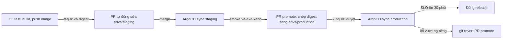

# Thiết kế repo GitOps nhiều môi trường cho Olist Shop

## 1. Bối cảnh và ràng buộc

Olist Shop có hai môi trường: staging (namespace `olist-staging` trên cluster `nonprod`, dùng chung với các team khác) và production
(namespace `olist-production` trên cluster `prod` riêng). Team 4 người release vài lần mỗi tuần, cao điểm là các đợt sale 11.11 và
12.12, lúc đó đóng băng mọi thay đổi không khẩn cấp. ArgoCD chạy trên cluster `nonprod` và quản cả cluster `prod` (đăng ký cluster
bằng ServiceAccount có quyền giới hạn). Mọi thay đổi trên production phải có người duyệt thứ hai và truy được tới commit. Ngoài phạm
vi: build image (CI ở module 07), hạ tầng cluster (module 08), dữ liệu Postgres managed.

## 2. Cấu trúc repo

Repo `olist-gitops` tách khỏi repo code: lịch sử deploy đọc được riêng, quyền duyệt production không phụ thuộc quyền vào code.

```text
olist-gitops/
├── base/                     api, redis, config chung (configMapGenerator)
├── envs/
│   ├── staging/              overlay: namespace, image theo tag rc, 1 replica, LOG_LEVEL=DEBUG
│   └── production/           overlay: namespace, image theo digest, 3 replica, PDB, LOG_LEVEL=WARNING
└── apps/
    ├── root.yaml             app-of-apps: Application gốc trỏ chính thư mục apps
    ├── olist-staging.yaml    Application của staging
    └── olist-production.yaml Application của production
```

Môi trường là thư mục trên cùng nhánh `main`. Base chứa thứ giống nhau, overlay chỉ chứa khác biệt, nên `kubectl kustomize envs/staging`
và `envs/production` cho thấy đúng thứ sẽ khác. App-of-apps (một Application gốc quản các Application con) đủ cho hai môi trường;
khi có thêm môi trường hay region thì đổi sang ApplicationSet.

## 3. Quy trình promote



- CI build image một lần, push lên registry, rồi bot tự động mở pull request sửa `images:` của `envs/staging` sang tag rc mới; merge là
  ArgoCD tự sync staging.
- Staging chạy smoke test và e2e; xanh thì CI mở PR promote chép đúng digest của image đã chạy trên staging vào `envs/production`.
  Không build lại cho production, không dùng tag trôi.
- PR vào production cần hai người duyệt (CODEOWNERS), không merge trong thời gian đóng băng.
- Sau khi sync production, theo dõi tỉ lệ lỗi và độ trễ 30 phút; vượt ngưỡng thì revert.

## 4. Ai được làm gì

- AppProject `olist-staging` chỉ cho namespace `olist-staging` trên cluster `nonprod`; `olist-production` chỉ cho `olist-production`
  trên cluster `prod`; `olist-platform` chỉ quản Application trong namespace `argocd` (cho app-of-apps). Không project nào cho object
  cluster-scoped.
- CODEOWNERS: `envs/production/**` và `apps/olist-production.yaml` cần tech lead duyệt; branch protection trên `main` chặn push thẳng,
  force push và merge khi CI đỏ.
- Dev chỉ có quyền đọc trên cluster production; quyền ghi khẩn cấp đi qua quy trình break-glass có ghi log.

## 5. Secret theo môi trường

Secret mã hoá bằng SOPS với age. `.sops.yaml` có hai creation_rules theo đường dẫn: tệp trong `envs/staging/` mã hoá cho recipient của
ArgoCD trên `nonprod` và khoá của cả team; tệp trong `envs/production/` mã hoá cho recipient của cluster `prod` và khoá offline của hai
người trực, nên dev không giải mã được secret production. Xoay khoá: thêm recipient mới, `sops updatekeys`, rồi gỡ recipient cũ và xoay
luôn giá trị.

## 6. Rollback và drift

- Rollback là `git revert` commit promote; ArgoCD sync về bản trước và lịch sử giữ vết của cả hai lần.
- Self-heal bật ở cả hai môi trường: ai đó `kubectl edit` trên cluster thì ArgoCD đưa về Git sau vài giây; alert khi Application
  OutOfSync quá 10 phút.
- Prune tự động ở staging; production tắt prune tự động và dùng `PruneLast`, để PR lỡ xoá một Service không làm mất traffic ngay.
- Khi cần chặn auto-sync (điều tra sự cố), tắt `automated` bằng một PR, không sửa tay trên cluster.

## 7. Đánh đổi đã cân nhắc

- Branch cho từng môi trường: merge giữa nhánh kéo theo thay đổi chưa muốn promote, và khó thấy hai môi trường khác nhau ở đâu.
  Chọn thư mục trên `main`.
- Helm chart thay Kustomize: hợp khi phân phối cho team khác dùng; ở đây một team, overlay ngắn và đọc dễ hơn values lồng nhau.
- ApplicationSet thay app-of-apps: hợp từ khoảng ba đích trở lên; hai môi trường thì app-of-apps dễ đọc hơn.
- Kargo hay Argo Rollouts để tự động hoá promote và canary: chưa cần với tần suất release hiện tại.
- Repo GitOps chung cho cả công ty: thấy toàn cảnh, nhưng quyền và review phức tạp; chọn repo riêng.
