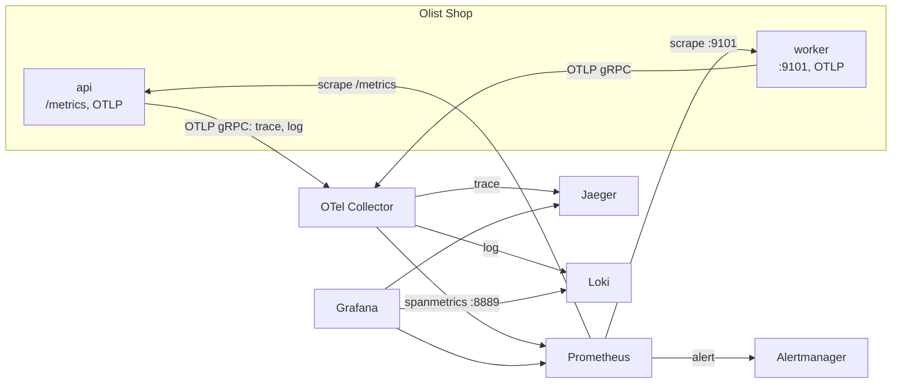
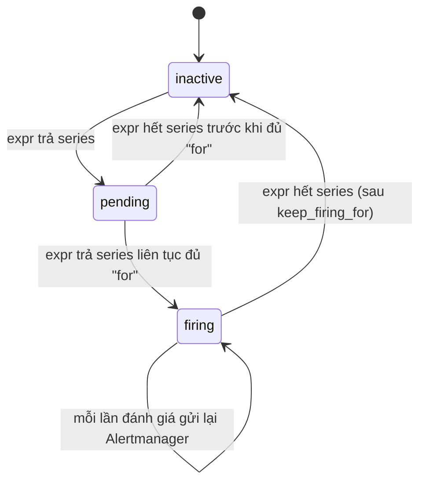
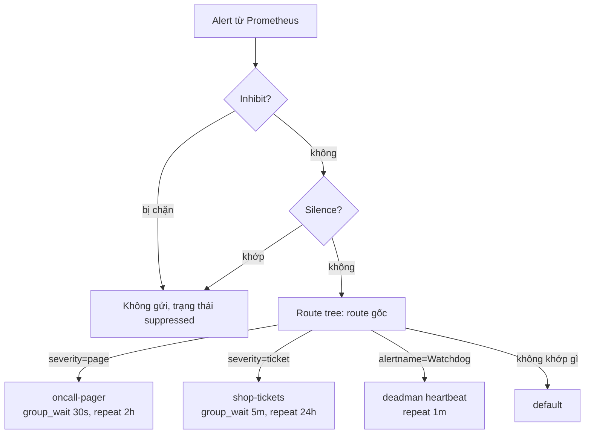
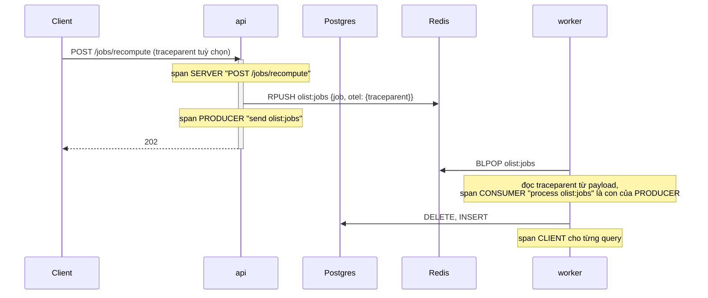

# Observability: metrics, log, trace với Prometheus, Grafana, Loki, OpenTelemetry và Jaeger

Olist Shop đã chạy trên container, Kubernetes, có pipeline và GitOps. Còn một câu hỏi người trực phải trả lời lúc 3 giờ sáng: **hệ thống
đang thế nào, và vì sao**. Monitoring kiểu cũ trả lời câu hỏi đã biết trước ("CPU có cao không"). Observability là khả năng trả lời câu hỏi
**chưa** biết trước ("vì sao đơn của khách ở Bahia chậm từ 21:00") chỉ từ dữ liệu hệ thống đã phát ra, không phải deploy thêm code.

Module này đi qua: ba trụ cột metrics, log, trace (cộng profiles), cách chọn thứ để đo (RED, USE, Four Golden Signals); Prometheus và
PromQL tới recording rule; alerting theo triệu chứng với Alertmanager; dashboard as code trên Grafana; Loki và LogQL, quản lý log (retention,
chi phí, PII); OpenTelemetry (SDK, Collector, sampling) và Jaeger; cuối cùng là chọn công cụ giữa stack mã nguồn mở và ELK/OpenSearch,
Graylog, Splunk, Papertrail, Datadog, New Relic, Zabbix.

Bài tập chạy Olist Shop cùng một stack observability đầy đủ (OTel Collector, Jaeger, Loki, Prometheus, Alertmanager, Grafana) do test dựng
trong Docker và xoá sạch khi xong. SLO, error budget và burn-rate alert để dành cho module 16.

Sau module này bạn sẽ:

- Phân biệt metrics, log, trace, profile; chọn tín hiệu theo RED cho service, USE cho tài nguyên, Four Golden Signals cho người dùng.
- Viết PromQL đúng với counter, gauge, histogram (`rate`, `sum by`, `histogram_quantile`), đặt tên và test recording rule bằng `promtool`.
- Viết alert theo triệu chứng, hiểu `for`, vòng đời pending/firing, route, group, inhibit, silence của Alertmanager, và giám sát chính hệ
  thống alert.
- Đưa dashboard Grafana vào Git bằng provisioning.
- Truy vấn log bằng LogQL, đi từ log sang trace bằng `trace_id`, đặt retention và xử lý PII.
- Cấu hình OpenTelemetry Collector (receiver, processor, exporter, connector), chọn head hay tail sampling, đọc trace trong Jaeger.
- Chẩn đoán sự cố của chính hệ thống observability, và chọn công cụ theo dữ liệu, đội ngũ và ngân sách.

## 0. Cài đặt

| Thành phần | Phiên bản đã kiểm | Tối thiểu cho bài tập | Dùng ở |
| --- | --- | --- | --- |
| Docker, uv | Như module 06 | Như module 06 | Mọi bài có code |
| OTel Collector contrib | `otel/opentelemetry-collector-contrib:0.163.2` ghim digest | Đúng bản đã ghim | Basic 01, 02, Intermediate 01-03 |
| Jaeger | `jaegertracing/jaeger:2.22.0` ghim digest | Đúng bản đã ghim | Như trên |
| Loki | `grafana/loki:3.7.9` ghim digest | Đúng bản đã ghim | Như trên |
| Prometheus (kèm `promtool`) | `prom/prometheus:v3.5.0` ghim digest | Đúng bản đã ghim | Basic 01, 02, Intermediate 01-03 |
| Alertmanager (kèm `amtool`) | `prom/alertmanager:v0.34.1` ghim digest | Đúng bản đã ghim | Advanced 01 |
| Grafana | `grafana/grafana:13.2.5` ghim digest | Đúng bản đã ghim | Basic 02 và mọi bài dựng stack |
| Image Olist Shop | build từ `setup/kind/olist-shop.Dockerfile` (base `python:3.12.16-slim-trixie`), `postgres:16.15-alpine`, `redis:7.4.12-alpine` | Như module 10 | Bài dựng stack |
| `logcli` | 3.7.9 | 3.0 | Tuỳ chọn, không bài nào cần |

Test không tự kéo image: thiếu image thì test skip kèm lệnh `docker pull`. Kéo một lần (khoảng 3,4 GB trên đĩa; Grafana chiếm 1,95 GB;
Prometheus và Alertmanager có sẵn nếu đã học track MLOps):

```bash
nice -n 15 docker pull otel/opentelemetry-collector-contrib:0.163.2@sha256:7f22d2a6748110ffb6a59bc0df448bccbf501cdb667d610ede4c61d3863d5849 &&
nice -n 15 docker pull jaegertracing/jaeger:2.22.0@sha256:836b967b5abcf1f7758066aa6b348619267a2f1459f72d472840570f9bd88a17 &&
nice -n 15 docker pull grafana/loki:3.7.9@sha256:0db216b630ae1f348a1584c67f3cead8b4c1fc839169a39501db664744158e28 &&
nice -n 15 docker pull prom/prometheus:v3.5.0@sha256:63805ebb8d2b3920190daf1cb14a60871b16fd38bed42b857a3182bc621f4996 &&
nice -n 15 docker pull prom/alertmanager:v0.34.1@sha256:e9733bafb1bdef9b00e25a21f8f99dc26a22224bf16641ad754d1649f4c3357a &&
nice -n 15 docker pull grafana/grafana:13.2.5@sha256:9f7aa1e1e3246aade5792d35a738049f7f32f89cd51d1956cf426a4e86268a84 &&
nice -n 15 docker pull postgres:16.15-alpine && nice -n 15 docker pull redis:7.4.12-alpine &&
nice -n 15 docker pull python:3.12.16-slim-trixie
```

Kéo theo `tag@digest` nên Docker kiểm nội dung khớp digest; `docker images` hiện tag là `<none>` nhưng testkit vẫn tìm thấy. Digest là
digest của index đa kiến trúc, dùng được trên cả amd64 lẫn arm64.

### `promtool` và `amtool` qua container

Không cần cài: chúng nằm sẵn trong image Prometheus và Alertmanager. Test gọi `testkit.promtool(...)`, `testkit.amtool(...)` (mount thư
mục chỉ đọc, chạy bằng uid của bạn, không mạng). Gõ tay trong thư mục chứa tệp:

```bash
docker run --rm --network none -u "$(id -u):$(id -g)" -v "$PWD:/work:ro" -w /work --entrypoint /bin/promtool \
  prom/prometheus:v3.5.0@sha256:63805ebb8d2b3920190daf1cb14a60871b16fd38bed42b857a3182bc621f4996 --version
docker run --rm --network none -u "$(id -u):$(id -g)" -v "$PWD:/work:ro" -w /work --entrypoint /bin/amtool \
  prom/alertmanager:v0.34.1@sha256:e9733bafb1bdef9b00e25a21f8f99dc26a22224bf16641ad754d1649f4c3357a --version
```

```text
promtool, version 3.5.0 (branch: HEAD, revision: 8be3a9560fbdd18a94dedec4b747c35178177202)
amtool, version 0.34.1 (branch: HEAD, revision: 73c6bfe7393929211294c1954f30d8ed78e4d0ad)
```

Muốn gõ ngắn, thêm alias vào `~/.bashrc`: `alias promtool='docker run --rm --network none -u "$(id -u):$(id -g)" -v "$PWD:/work:ro" -w /work --entrypoint /bin/promtool prom/prometheus:v3.5.0@sha256:63805ebb8d2b3920190daf1cb14a60871b16fd38bed42b857a3182bc621f4996'`.

### `logcli` (tuỳ chọn)

CLI của Loki, tiện khi muốn chạy LogQL từ terminal thay vì Grafana. Bản phát hành chính thức kèm `SHA256SUMS`; kiểm hash **trước** khi
giải nén:

```bash
mkdir -p ~/.cache/devops-track/dl ~/.local/bin && cd ~/.cache/devops-track/dl &&
curl -fsSLO https://github.com/grafana/loki/releases/download/v3.7.9/logcli-linux-amd64.zip &&
curl -fsSLO https://github.com/grafana/loki/releases/download/v3.7.9/SHA256SUMS &&
grep ' logcli-linux-amd64.zip$' SHA256SUMS | sha256sum --check &&
unzip -o -q logcli-linux-amd64.zip logcli-linux-amd64 &&
install -m 0755 logcli-linux-amd64 ~/.local/bin/logcli && rm logcli-linux-amd64 &&
logcli --version
```

Kết quả trên máy viết bài (Pop!_OS 24.04, x86_64):

```text
logcli-linux-amd64.zip: OK
logcli, version 3.7.9 (branch: release-3.7.x, revision: d3b4a2f7)
```

SHA-256 của zip là `176bc538c72d959daa168bd127dece211ff3e9e435ad13a6946748170cbda5b4` (khớp trường `digest` của asset trong GitHub API).
Dùng với stack chạy tay: `logcli --addr=http://127.0.0.1:13100 query '{service_name="olist-shop-api"} | json | status >= 500'`. Gỡ:
`rm -f ~/.local/bin/logcli`, xoá tệp đã tải trong `~/.cache/devops-track/dl`.

### Chạy stack bằng tay và tài nguyên

Muốn nhìn Grafana, Jaeger khi làm bài: `docker compose -f setup/observability/compose.yaml up -d`, Grafana ở `http://127.0.0.1:13300`
(đọc ẩn danh), Jaeger `16686`, Prometheus `19090`, Alertmanager `19093`, Loki `13100`, OTLP gRPC `14317`; tắt bằng
`docker compose -f setup/observability/compose.yaml down -v` (chi tiết trong `setup/DEVOPS-TOOLS.md`, mục "Stack observability").

Test dựng stack cùng Olist Shop mất khoảng 30 tới 50 giây mỗi lần và khoảng 650 MB RAM; mỗi container giới hạn 512 MB, không tạo volume.
Lần đầu build image Olist Shop cần mạng để `pip install` (khoảng 1 phút), mất mạng thì test skip. Ghim CPU như các module trước:
đặt `DEVOPS_CPUSET` (ví dụ dải core không dùng tới) rồi `nice -n 15 taskset -c "$DEVOPS_CPUSET" uv run pytest ...`.

## 1. Observability: ba trụ cột, RED, USE và Four Golden Signals

Nhắc lại từ track Data Engineer: [module DE 08, mục 6 Monitoring và observability cho pipeline](../../../data-engineer/modules/08-devops-for-data/README.md)
đã giới thiệu ba trụ cột, mô hình pull của Prometheus và bốn loại metric cho job dữ liệu. Track MLOps
([module 09](../../../mlops/modules/09-monitoring-observability/README.md)) áp chúng cho model. Mục này nhắc nhanh rồi đi sâu theo góc của
người vận hành một service web.

### Bốn loại tín hiệu

| Tín hiệu | Là gì | Trả lời câu hỏi | Chi phí tăng theo | Công cụ trong bài |
| --- | --- | --- | --- | --- |
| Metrics | Số đo có nhãn theo thời gian, đã gộp | "Bao nhiêu, nhanh hay chậm, có tệ hơn hôm qua không" | Số **series** (tổ hợp nhãn), không theo traffic | Prometheus |
| Logs | Sự kiện rời rạc, có ngữ cảnh | "Chuyện gì đã xảy ra với request này, lỗi nói gì" | Số **dòng** và độ dài, tỉ lệ với traffic | Loki |
| Traces | Cây span của một request qua nhiều service | "Request này đi đâu, chậm ở bước nào" | Số span được giữ (sampling) | OpenTelemetry, Jaeger |
| Profiles | Mẫu stack của CPU, bộ nhớ theo thời gian | "Dòng code nào ăn CPU, cấp phát bộ nhớ" | Tần suất lấy mẫu | Pyroscope, Parca (khái niệm) |

Ba tín hiệu đầu bổ sung nhau, không thay nhau: metric rẻ và giữ lâu, hợp cho alert và dashboard nhưng mất chi tiết từng request; log giàu
ngữ cảnh nhưng đắt khi giữ lâu; trace cho cấu trúc nhân quả nhưng thường phải lấy mẫu. Sức mạnh nằm ở **nối** chúng: metric cho thấy tỉ lệ
lỗi tăng, exemplar hay nhãn dẫn tới vài trace lỗi, `trace_id` trong trace dẫn tới đúng dòng log.

**Profiles** (continuous profiling) là tín hiệu thứ tư: agent lấy mẫu stack của tiến trình vài chục lần mỗi giây, lưu dưới dạng flame
graph theo thời gian. Khi metric nói "CPU của api tăng 40% từ bản 2.14", profile nói "vì hàm `json.dumps` trong middleware". OpenTelemetry
đang chuẩn hoá profiles thành một signal riêng; công cụ phổ biến là Grafana Pyroscope, Parca, và tính năng profiler của Datadog, New Relic.
Module không có bài về profiles.

### Monitoring và observability

Monitoring là tập câu hỏi đã biết, viết thành dashboard và alert. Observability là thuộc tính của hệ thống: dữ liệu nó phát ra đủ phong phú
(nhãn có ý nghĩa, log có cấu trúc, trace có ngữ cảnh) để hỏi câu hỏi mới mà không deploy lại. Bạn cần cả hai: alert dựa trên monitoring
đánh thức người trực, observability giúp người đó tìm ra nguyên nhân.

### Đo cái gì: RED, USE, Four Golden Signals

| Phương pháp | Áp cho | Tín hiệu | Ví dụ với Olist Shop |
| --- | --- | --- | --- |
| RED (Tom Wilkie) | Service xử lý request | **R**ate, **E**rrors, **D**uration | Request/giây theo route, tỉ lệ 5xx, p95 thời gian xử lý |
| USE (Brendan Gregg) | Tài nguyên | **U**tilization, **S**aturation, **E**rrors | CPU, pool kết nối Postgres (đang dùng, đang chờ), lỗi đĩa |
| Four Golden Signals (Google SRE) | Hệ thống nhìn từ người dùng | Latency, Traffic, Errors, Saturation | Như RED, cộng độ "đầy": hàng đợi job, pool kết nối |

RED cho biết **người dùng có bị ảnh hưởng không**; USE cho biết **tài nguyên nào gây ra**. Alert page dựa trên RED/Golden Signals
(triệu chứng); USE nằm trên dashboard để chẩn đoán. Với worker xử lý hàng đợi, "rate" là job xử lý mỗi giây, "errors" là job lỗi,
"duration" là thời gian xử lý, và saturation là độ dài hàng đợi hay tuổi của job cũ nhất.

### Infra monitoring và app monitoring

| | Infra monitoring | App monitoring (APM) |
| --- | --- | --- |
| Đối tượng | Máy, VM, container, node, mạng, đĩa | Code: request, query, job, hàm |
| Nguồn | node_exporter, cAdvisor, kube-state-metrics, SNMP, agent | Instrumentation trong app (`prometheus_client`, OpenTelemetry SDK), auto-instrumentation |
| Câu hỏi | "Node còn RAM không, pod có restart không" | "Route nào chậm, query nào tốn, lỗi từ đâu" |
| Thường do | Team platform | Team sở hữu service |

Một sự cố thường cần cả hai: p95 của API tăng (app) vì node bị CPU throttling (infra). Nhãn chung như `service`, `namespace`, `pod` cho
phép đi từ tầng này sang tầng kia.

### Kiến trúc stack của bài tập



Metric của app đi bằng **pull** (Prometheus scrape `/metrics`); trace và log đi bằng **push** OTLP tới Collector. Đây là kiểu kết hợp
phổ biến nhất hiện nay. Collector cũng biến trace thành metric (spanmetrics), nên service không tự xuất `/metrics` vẫn có RED.

## 2. Prometheus và PromQL

### Mô hình dữ liệu

Một **series** là tên metric cộng một tổ hợp nhãn: `http_requests_total{job="olist-api", method="GET", path="/orders/{order_id}",
status="404"}`. Mỗi series là một dãy mẫu `(thời điểm, số thực)`. Prometheus giữ series đang hoạt động trong bộ nhớ (head block, khoảng 2
giờ gần nhất) và ghi WAL; RAM tỉ lệ với số series đang hoạt động.

| Loại | Ý nghĩa | Dùng với | Ví dụ |
| --- | --- | --- | --- |
| Counter | Chỉ tăng, về 0 khi tiến trình restart | `rate`, `increase` | `http_requests_total`, `jobs_processed_total` |
| Gauge | Lên xuống tự do | Giá trị trực tiếp, `avg_over_time`, `max_over_time`, `deriv` | Số kết nối đang mở, độ dài hàng đợi |
| Histogram | Đếm quan sát theo bucket `le` cộng `_sum`, `_count` | `histogram_quantile` trên `rate(..._bucket)` | `http_request_duration_seconds` |
| Summary | Quantile tính sẵn ở client | Đọc trực tiếp, **không gộp được** qua instance | Hiếm dùng cho service nhiều replica |

**Cardinality** là số series. Mỗi nhãn nhân số series với số giá trị của nó: 5 route × 4 method × 10 status × 20 pod là 4.000 series cho
một counter, cộng 15 bucket cho một histogram thành 60.000. Nhãn có tập giá trị không chặn được (`user_id`, email, id phiên) làm số series
tăng mãi theo dữ liệu và là nguyên nhân phổ biến nhất làm Prometheus hết RAM. Chi tiết theo từng người dùng hay từng request thuộc về log
và trace.

Quy ước đặt tên: đơn vị cơ bản ở cuối (`_seconds`, `_bytes`), counter kết thúc bằng `_total`, không đặt tên nhãn vào tên metric.

### PromQL cần nhớ

```promql
rate(http_requests_total{job="olist-api"}[5m])

sum by (path) (rate(http_requests_total{job="olist-api"}[5m]))

sum(rate(http_requests_total{job="olist-api", status=~"5.."}[5m]))
  /
sum(rate(http_requests_total{job="olist-api"}[5m]))

histogram_quantile(0.95,
  sum by (le, path) (rate(http_request_duration_seconds_bucket{job="olist-api"}[5m])))

increase(jobs_failed_total[1h])

predict_linear(node_filesystem_avail_bytes{mountpoint="/var/lib/postgresql"}[6h], 3 * 86400) < 0

absent(up{job="olist-worker"})
```

- `rate(counter[5m])`: tốc độ tăng trung bình mỗi giây trong 5 phút, tự xử lý counter reset. Cửa sổ nên ít nhất 4 lần chu kỳ scrape.
  `irate` chỉ dùng hai mẫu cuối, nhạy với nhiễu, hợp cho đồ thị zoom sát, không hợp cho alert.
- **`rate` trước, `sum` sau.** `sum` trước làm một pod restart trông như counter tổng tụt về thấp, và `rate` tính ra đỉnh giả.
- `sum by (path)` giữ nhãn `path`, bỏ mọi nhãn khác; `without (instance)` thì ngược lại.
- Chia hai vector: nhãn hai vế phải khớp; dùng cùng `by (...)` ở cả hai vế. Không có request nào thì `0/0 = NaN`, và mọi phép so với `NaN`
  là false.
- `histogram_quantile` nội suy tuyến tính trong bucket nên độ chính xác phụ thuộc biên bucket: bucket `0.25` và `1` thì p95 nằm đâu đó
  giữa hai số đó. Đặt biên bucket quanh ngưỡng SLO và ngưỡng alert. Prometheus 3 có **native histogram** (bucket tự động theo hàm mũ),
  chính xác hơn và rẻ hơn, cần bật ở cả client lẫn server.
- Bộ chọn trên nhãn không tồn tại **không báo lỗi**, chỉ trả vector rỗng. Đây là lý do một rule đúng cú pháp vẫn có thể không bao giờ ra số.

### Recording rule

Recording rule tính trước một biểu thức theo lịch và lưu thành series mới. Dùng khi: query dashboard đắt và chạy liên tục; nhiều alert
dùng chung một biểu thức; cần biểu thức nhất quán giữa dashboard và alert.

```yaml
groups:
  - name: olist-api-recording
    interval: 15s
    rules:
      - record: job:http_requests:rate5m
        expr: sum by (job) (rate(http_requests_total[5m]))
      - record: job_path:http_request_duration_seconds:p95_5m
        expr: histogram_quantile(0.95, sum by (job, path, le) (rate(http_request_duration_seconds_bucket[5m])))
```

Tên theo quy ước `level:metric:operations`: `level` là các nhãn còn lại (`job`, `job_path`), `metric` là tên gốc bỏ `_total`, `operations`
là phép tính (`rate5m`, `ratio_rate5m`, `p95_5m`).

### Kiểm rule bằng `promtool`

`promtool check rules rules.yml` kiểm cú pháp. `promtool test rules tests.yml` chạy unit test: bạn mô tả chuỗi thời gian đầu vào, thời
điểm đánh giá, và kết quả mong đợi.

```yaml
rule_files: [rules.yml]
evaluation_interval: 1m
tests:
  - interval: 1m
    input_series:
      - series: 'http_requests_total{job="olist-api", path="/orders/{order_id}", status="200"}'
        values: '0+60x20'
    promql_expr_test:
      - expr: job:http_requests:rate5m
        eval_time: 10m
        exp_samples:
          - labels: 'job:http_requests:rate5m{job="olist-api"}'
            value: 1
```

`0+60x20` nghĩa là bắt đầu từ 0, mỗi bước cộng 60, 20 bước. Unit test chỉ chứng minh rule đúng với dữ liệu **bạn tự viết**: tên nhãn đoán
sai thì rule và test sai cùng nhau mà vẫn pass. Bổ sung bằng kiểm trên dữ liệu thật (staging) và bằng ca "phải bắn" cho mỗi alert.

### Prometheus ở quy mô lớn

Một Prometheus giữ được vài triệu series active trên một máy lớn. Vượt mức đó, hay khi cần lưu lâu và HA: **Thanos** hay **Mimir** (lưu
block lên object storage, query toàn cục), **VictoriaMetrics** (tương thích PromQL, nén tốt). Mỗi Prometheus gửi lên bằng
`remote_write` hay sidecar. Federation chỉ hợp cho kéo vài series tổng hợp, không phải để gom toàn bộ.

## 3. Alerting: rule, Alertmanager và alert theo triệu chứng

### Alert rule và vòng đời

```yaml
- alert: OlistApiHighErrorRate
  expr: job:http_requests_errors:ratio_rate5m{job="olist-api"} > 0.05
  for: 5m
  keep_firing_for: 2m
  labels:
    severity: page
  annotations:
    summary: "API Olist trả 5xx cho {{ $value | humanizePercentage }} request"
    runbook_url: https://runbooks.olist-shop.example/api-high-error-rate
```



- Mỗi series mà `expr` trả về là một alert riêng, mang nhãn của series cộng `labels` của rule.
- `for` lọc dao động ngắn: alert ở `pending` cho tới khi điều kiện đúng liên tục đủ lâu. Đổi lại, phát hiện trễ thêm đúng bằng `for`.
  Một lần đánh giá điều kiện sai là `pending` quay về `inactive`, đồng hồ đếm lại từ đầu.
- `keep_firing_for` giữ alert firing thêm một lúc sau khi điều kiện hết, tránh resolve rồi bắn lại liên tục (flapping).
- Annotations dùng template Go: `$value`, `$labels`, các hàm `humanize`, `humanizePercentage`, `humanizeDuration`.
- Alert về **sự vắng mặt**: `absent(up{job="olist-worker"})` hay `absent_over_time(...)` bắt trường hợp target biến mất hẳn khỏi service
  discovery, khi `up == 0` không còn series nào để so.

### Alert theo triệu chứng

Page người trực khi **người dùng** bị ảnh hưởng hoặc sắp bị: lỗi, chậm, không đặt được hàng, job tồn đọng làm số liệu sai. Nguyên nhân
(CPU cao, RAM, một pod restart, đĩa 70%) đưa lên dashboard hay tạo ticket. Lý do:

- Một triệu chứng phủ nhiều nguyên nhân, kể cả nguyên nhân bạn chưa nghĩ tới.
- Nguyên nhân hay báo động giả: CPU 90% lúc batch chạy mà người dùng không bị gì.
- Mỗi page phải **hành động được**: có runbook, có việc làm trong 5 phút đầu. Page không hành động được làm người trực quen bỏ qua.

Ngoại lệ hợp lý: nguyên nhân có thể báo trước đủ lâu (đĩa đầy trong 3 ngày theo `predict_linear`, chứng chỉ TLS hết hạn trong 14 ngày)
thành ticket. SLO và burn rate (module 16) là bước tiếp theo: alert theo tốc độ tiêu error budget thay cho ngưỡng cố định.

### Alertmanager

Prometheus chỉ quyết định **có** alert; Alertmanager quyết định **ai** nhận, **khi nào**, **bao nhiêu lần**.



- **Route**: cây matcher. Alert đi xuống route con đầu tiên khớp (trừ khi `continue: true`), không khớp con nào thì dừng ở route cha.
  Route gốc là nơi rơi về cuối cùng, nên trỏ tới một receiver có người xem, không để mất alert do nhãn gõ sai.
- **Grouping**: `group_by: [alertname, service]` gộp alert cùng nhóm thành một thông báo. `group_wait` chờ gom alert đầu tiên của nhóm,
  `group_interval` khoảng cách giữa các cập nhật của nhóm, `repeat_interval` nhắc lại khi vẫn firing.
- **Inhibition**: khi một alert **nguồn** đang firing, chặn các alert **đích**. `source_matchers` chọn nguồn, `target_matchers` chọn đích,
  `equal` liệt kê các nhãn mà nguồn và đích phải cùng giá trị. Ví dụ: "service down" chặn "error rate cao" của cùng service.
- **Silence**: tắt tạm alert khớp matcher trong một khoảng thời gian, có người tạo và lý do; tạo bằng UI hay `amtool silence add`.
- Receiver: email, Slack, PagerDuty, Opsgenie, webhook; `send_resolved: true` báo khi hết.
- HA: chạy 2-3 Alertmanager cluster (gossip) và cấu hình Prometheus gửi tới tất cả; chúng tự khử trùng thông báo.

`amtool check-config` kiểm cú pháp, `amtool config routes test severity=page service=olist-api` cho biết alert tới receiver nào. `amtool`
không mô phỏng inhibition: muốn chắc, gửi alert giả tới một Alertmanager thật (`amtool alert add` hay `POST /api/v2/alerts`) rồi đọc
`status.inhibitedBy`.

### Giám sát chính hệ thống alert

Một hệ thống alert hỏng trông giống hệt một hệ thống khoẻ: không có tin nhắn nào. Các lớp phòng thủ:

- **Watchdog** (dead man's switch): rule `vector(1)` luôn bắn, route tới một dịch vụ heartbeat bên ngoài (Healthchecks.io, Dead Man's
  Snitch, heartbeat của PagerDuty/Opsgenie). Heartbeat ngừng thì dịch vụ đó page qua kênh khác. Nó chứng minh Prometheus đánh giá rule và
  Alertmanager gửi được; nó không chứng minh từng alert riêng tới được người trực.
- Alert về `up == 0`, `prometheus_rule_evaluation_failures_total`, `prometheus_notifications_dropped_total`, `alertmanager_notifications_failed_total`.
- Test rule trong CI (`promtool test rules`), kiểm rule ra số trên dữ liệu thật, và diễn tập page định kỳ.
- Đo chất lượng alert: số page mỗi tuần, tỉ lệ page actionable, sự cố khách báo trước alert.

### On-call bền vững

Lịch luân phiên có người dự phòng, leo thang khi không ack (ví dụ 10 phút), bàn giao có nội dung (alert trong tuần, silence đang bật,
việc dở), nghỉ bù sau đêm bị page, ngân sách số page (Google SRE gợi ý tối đa khoảng hai sự cố mỗi ca 12 giờ). Chi tiết về incident command
và postmortem ở module 16.

## 4. Grafana và dashboard as code

### Vì sao dashboard nằm trong Git

Dashboard kéo thả trên UI không có review, không có lịch sử, mất khi Grafana mất volume, và lệch giữa staging với production. Đưa vào Git:
review như code, dựng lại Grafana mới là có lại mọi thứ, cùng một dashboard ở mọi môi trường.

### Provisioning

Grafana đọc tệp YAML trong `/etc/grafana/provisioning/` lúc khởi động (và định kỳ với dashboard):

```yaml
apiVersion: 1
datasources:
  - name: Prometheus
    uid: prometheus
    type: prometheus
    url: http://prometheus:9090
    isDefault: true
  - name: Loki
    uid: loki
    type: loki
    url: http://loki:3100
    jsonData:
      derivedFields:
        - name: trace_id
          matcherRegex: '"trace_id":\s*"(\w+)"'
          datasourceUid: jaeger
          url: "$${__value.raw}"
```

```yaml
apiVersion: 1
providers:
  - name: olist
    folder: Olist Shop
    type: file
    disableDeletion: true
    allowUiUpdates: false
    updateIntervalSeconds: 30
    options:
      path: /etc/grafana/dashboards
```

- Datasource có `uid` cố định để dashboard tham chiếu ổn định. Derived field biến chuỗi `trace_id` trong log thành link sang Jaeger.
- Provider `file` quét thư mục; dashboard JSON khớp theo `uid`. `allowUiUpdates: false` bắt mọi thay đổi đi qua Git.
- JSON export "để chia sẻ" chứa placeholder `${DS_PROMETHEUS}` chỉ được thay khi import bằng tay; khi provision thì ghi `uid` thật, hay
  dùng biến kiểu `datasource`.

### Viết dashboard

Một panel tối thiểu:

```json
{
  "id": 1,
  "type": "timeseries",
  "title": "Rate: request mỗi giây theo route",
  "datasource": {"type": "prometheus", "uid": "prometheus"},
  "gridPos": {"h": 8, "w": 12, "x": 0, "y": 0},
  "fieldConfig": {"defaults": {"unit": "reqps"}, "overrides": []},
  "targets": [{"refId": "A", "expr": "sum by (path) (rate(http_requests_total{job=\"olist-api\"}[$__rate_interval]))", "legendFormat": "{{path}}"}]
}
```

- `$__rate_interval` = `max(4 × scrape interval, $__interval + scrape interval)`: cửa sổ đủ mẫu ở mọi mức zoom. Ghi cứng `[5m]` làm đồ
  thị 7 ngày bỏ sót đỉnh.
- Hàng trên là triệu chứng (RED), hàng dưới là nguyên nhân (USE, worker, log). Mỗi panel có đơn vị.
- Biến (`templating`) cho phép chọn `service`, `namespace`; đừng để một dashboard có hai mươi biến.
- Viết JSON tay nhanh chán; dự án lớn sinh JSON bằng code: **Grafonnet** (Jsonnet), **Grafana Foundation SDK** (Go, TypeScript, Python),
  hay Terraform provider `grafana` cho cả dashboard, folder, alert. Grafana 12 trở đi còn có "Git Sync" (đang thử nghiệm) đồng bộ dashboard hai chiều với repo.
- Grafana cũng có alerting riêng (Grafana-managed alerts). Trong module này alert nằm ở Prometheus và Alertmanager để rule đi cùng
  `promtool test`.

## 5. Log: Loki, LogQL và quản lý log

### Log có cấu trúc

Log dạng JSON một dòng mỗi sự kiện, trường cố định: thời điểm, mức, thông điệp, `request_id`, `trace_id`, cộng trường theo ngữ cảnh. Máy
parse được, không cần regex. Olist Shop ghi:

```json
{"ts": "2026-11-11T09:12:03.120+00:00", "level": "INFO", "msg": "request", "request_id": "a1b2", "trace_id": "4bf92f3577b34da6a3ce929d0e0e4736", "logger": "olist_shop.api", "method": "GET", "path": "/orders/{order_id}", "status": 404, "duration_ms": 7.8}
```

`request_id` do client hay gateway đặt (header `X-Request-ID`), dừng ở biên HTTP. `trace_id` do OpenTelemetry tạo và **đi theo** request
qua service khác, kể cả qua hàng đợi nếu code truyền context. Đó là khoá để nối log của nhiều service.

### Loki

Loki chỉ **index nhãn** của stream (`service_name`, `namespace`...), còn nội dung nén thành chunk trên object storage. Kết quả: rẻ hơn
nhiều lần so với index toàn văn, đổi lại tìm chuỗi trên phạm vi rộng chậm hơn. Quy tắc nhãn giống Prometheus: ít nhãn, giá trị chặn được;
`trace_id`, `request_id` **không** làm nhãn stream mà nằm trong nội dung hay **structured metadata** (trường đi kèm dòng log, lọc được,
không tạo stream mới). Loki nhận log qua OTLP (`/otlp`), Promtail đã ngừng phát triển, thay bằng **Grafana Alloy** hay OTel Collector.

### LogQL

```logql
{service_name="olist-shop-api"} |= "QueuePool"

{service_name="olist-shop-api"} | json | status >= 500 and path != "/healthz"

{service_name="olist-shop-api"} | trace_id = "4bf92f3577b34da6a3ce929d0e0e4736"

{service_name="olist-shop-api"} | json | line_format "{{.method}} {{.path}} {{.status}} {{.duration_ms}}ms"

sum by (path) (count_over_time({service_name="olist-shop-api"} | json | status >= 500 [5m]))

quantile_over_time(0.95, {service_name="olist-shop-api"} | json | unwrap duration_ms [5m]) by (path)
```

Thứ tự trong một pipeline: **stream selector** (chọn chunk, rẻ nhất) → **line filter** `|=`, `!=`, `|~` (so chuỗi, rẻ) → **parser** `json`,
`logfmt`, `pattern`, `regexp` (tách trường thành nhãn) → **label filter** (`status >= 500`, so đúng giá trị) → **format** (`line_format`,
`label_format`). Line filter là so **chuỗi con**: `|= "req-1"` khớp cả `req-10`. Lọc chính xác thì parse rồi so nhãn. Metric query
(`count_over_time`, `rate`, `sum by`, `unwrap`) biến log thành chuỗi số, dùng được cho dashboard và cho ruler của Loki.

### Quản lý log: retention, chi phí, PII

- **Retention theo loại dữ liệu**: log debug vài ngày, log request 14-30 ngày, log audit theo luật (thường 1 năm trở lên) ở storage rẻ.
  Loki đặt `retention_period` toàn cục và theo stream (`retention_stream`), compactor xoá chunk hết hạn.
- **Chi phí** đi theo GB ghi vào và GB giữ lại. Giảm từ nguồn: không log mỗi health check, giảm mức log mặc định, gom log lặp, lấy mẫu log
  của request thành công. Với SaaS (Datadog, New Relic, Splunk Cloud) chi phí theo GB ingest và theo thời gian index; đặt hạn mức và cảnh
  báo khi vượt.
- **PII** (email, số điện thoại, địa chỉ, số thẻ): không ghi từ đầu là cách duy nhất chắc chắn. Log id nội bộ thay cho email; che (`***`)
  hay băm có muối nếu cần đối chiếu. Thêm lưới an toàn ở Collector (processor `attributes`/`transform` xoá hay che trường, `redaction`
  processor) và ở Loki (giới hạn ai query được stream nhạy cảm). Nhớ yêu cầu xoá dữ liệu cá nhân (LGPD ở Brazil, GDPR ở EU, Nghị định
  13/2023 ở Việt Nam): log giữ càng lâu, càng khó xoá.
- Log là dữ liệu nhạy cảm: token, header `Authorization`, câu SQL có giá trị (span DB của Olist Shop chỉ ghi SQL có tham số, không ghi giá trị).

## 6. Tracing: OpenTelemetry, Collector, sampling và Jaeger

### Khái niệm

Một **trace** là cây **span**. Mỗi span có tên, thời điểm bắt đầu và kết thúc, `kind` (`SERVER`, `CLIENT`, `PRODUCER`, `CONSUMER`,
`INTERNAL`), status, attribute (theo semantic conventions: `http.route`, `db.system.name`, `messaging.destination.name`), event, và
`parentSpanId`. **Resource** mô tả nguồn phát: `service.name`, `service.version`, `deployment.environment.name`.

**Context propagation**: khi gọi sang service khác, `trace_id` và `span_id` hiện tại được ghi vào header W3C `traceparent`
(`00-<trace_id>-<span_id>-01`); bên nhận đọc ra và tạo span con. Với hàng đợi, context phải được ghi **vào message**; Olist Shop ghi vào
trường `otel` của payload job trong Redis.



### OpenTelemetry

OpenTelemetry (OTel) là chuẩn mở của CNCF cho cả trace, metric, log (và profiles đang được thêm): API, SDK cho từng ngôn ngữ, giao thức
**OTLP**, semantic conventions, và Collector. Instrument một lần, gửi tới backend bất kỳ.

```python
from opentelemetry import trace
from opentelemetry.exporter.otlp.proto.grpc.trace_exporter import OTLPSpanExporter
from opentelemetry.sdk.resources import Resource
from opentelemetry.sdk.trace import TracerProvider
from opentelemetry.sdk.trace.export import BatchSpanProcessor
from opentelemetry.sdk.trace.sampling import ParentBased, TraceIdRatioBased

provider = TracerProvider(
    resource=Resource.create({"service.name": "olist-shop-api", "service.version": "2.14"}),
    sampler=ParentBased(TraceIdRatioBased(0.1)),
)
provider.add_span_processor(BatchSpanProcessor(OTLPSpanExporter(endpoint="http://otel-collector:4317", insecure=True)))
tracer = provider.get_tracer("olist_shop")

with tracer.start_as_current_span("GET /orders/{order_id}", kind=trace.SpanKind.SERVER) as span:
    span.set_attribute("http.route", "/orders/{order_id}")
```

- **Auto-instrumentation** (`opentelemetry-instrument`, gói `opentelemetry-instrumentation-fastapi`, `-sqlalchemy`, `-redis`; Java agent;
  eBPF như Grafana Beyla) cho span HTTP, DB, cache mà không sửa code. Instrumentation tay thêm span nghiệp vụ và attribute có ý nghĩa.
  Olist Shop viết tay một module `tracing.py` nhỏ để không kéo OTel vào khi tắt trace.
- Biến môi trường chuẩn: `OTEL_EXPORTER_OTLP_ENDPOINT`, `OTEL_SERVICE_NAME`, `OTEL_RESOURCE_ATTRIBUTES`, `OTEL_TRACES_SAMPLER`.
- Log: đưa `trace_id` vào mỗi dòng log (Olist Shop làm trong `JsonFormatter`), hay gửi log qua OTLP để backend tự gắn.

### Collector

Collector là tiến trình trung gian nhận, xử lý và gửi tín hiệu. Ba kiểu triển khai: **agent** (sidecar hay DaemonSet cạnh app),
**gateway** (cụm Collector trung tâm), hay cả hai.

```yaml
receivers:
  otlp:
    protocols: {grpc: {endpoint: 0.0.0.0:4317}, http: {endpoint: 0.0.0.0:4318}}
processors:
  memory_limiter: {check_interval: 1s, limit_percentage: 80, spike_limit_percentage: 20}
  resource/env:
    attributes: [{key: deployment.environment.name, value: production, action: upsert}]
  batch: {timeout: 1s}
connectors:
  spanmetrics: {}
exporters:
  otlp/jaeger: {endpoint: jaeger:4317, tls: {insecure: true}}
  prometheus: {endpoint: 0.0.0.0:8889}
service:
  pipelines:
    traces:
      receivers: [otlp]
      processors: [memory_limiter, resource/env, batch]
      exporters: [otlp/jaeger, spanmetrics]
    metrics:
      receivers: [spanmetrics]
      exporters: [prometheus]
```

- **Receiver** nhận (OTLP, Prometheus scrape, filelog, kafka...), **processor** biến đổi theo thứ tự trong pipeline, **exporter** gửi đi,
  **connector** nối pipeline này vào pipeline khác (spanmetrics biến trace thành metric RED; `count`, `routing`...).
- `memory_limiter` đứng đầu để từ chối dữ liệu trước khi Collector bị OOM; `batch` đứng cuối để gom lô trước khi gửi.
- Component chỉ chạy khi được nhắc tên trong `service.pipelines`. Bản **contrib** có nhiều component hơn bản core; production thường build
  bản riêng bằng OpenTelemetry Collector Builder (`ocb`) chỉ với component cần dùng.
- Collector là chỗ đặt chính sách chung: gắn attribute môi trường, xoá trường nhạy cảm, sampling, gửi song song hai backend khi chuyển đổi.

### Sampling

| Kiểu | Quyết định ở | Ưu | Nhược |
| --- | --- | --- | --- |
| Head sampling (`TraceIdRatioBased`, `ParentBased`) | SDK, ở span gốc | Rẻ, đơn giản, cả trace nhất quán theo quyết định của span gốc | Quyết trước khi biết request lỗi hay chậm; giữ 1% là bỏ 99% trace lỗi |
| Tail sampling (`tail_sampling` processor) | Collector, sau khi trace xong | Giữ mọi trace lỗi, chậm, cộng một tỉ lệ trace bình thường | Collector giữ span trong RAM chờ trace xong (`decision_wait`); mọi span của một trace phải tới cùng một Collector (dùng `loadbalancing` exporter theo `traceID`) |

Kết hợp phổ biến: head sampling vừa phải ở SDK (hay 100% khi traffic thấp), tail sampling ở gateway Collector. Metric (kể cả spanmetrics)
nên tính **trước** sampling để số liệu RED không bị lệch.

### Jaeger

Jaeger là backend trace mã nguồn mở của CNCF: nhận OTLP, lưu (bộ nhớ, Badger, Cassandra, Elasticsearch/OpenSearch, ClickHouse qua
plugin), UI tìm trace theo service, operation, tag, thời gian, so sánh hai trace, và đồ thị phụ thuộc giữa service. Jaeger v2 xây trên
chính OTel Collector; API query v3 trả OTLP JSON. Lựa chọn khác: **Grafana Tempo** (chỉ lưu trên object storage, tìm theo `trace_id` và
TraceQL, rẻ ở quy mô lớn), Zipkin (lâu đời, nhẹ), và phần APM của các vendor.

Đọc một trace: tìm span dài nhất trên đường găng (critical path), xem span con nào chiếm thời gian (DB, gọi ngoài, chờ khoá), span nào có
status ERROR và event exception. Khoảng trống giữa các span con là thời gian trong code của chính service đó.

## 7. Chọn công cụ: stack mã nguồn mở hay ELK, Graylog, Splunk, Papertrail, Datadog, New Relic, Zabbix

### Bảng so sánh

| Công cụ | Loại | Mô hình | Mạnh | Yếu | Chi phí | Hợp khi |
| --- | --- | --- | --- | --- | --- | --- |
| Prometheus + Grafana + Loki + Tempo/Jaeger + OTel | Bộ OSS (hoặc Grafana Cloud) | Tự host | Chuẩn của Kubernetes, PromQL/LogQL, không khoá vendor, rẻ ở quy mô lớn | Phải tự vận hành nhiều thành phần, HA và lưu lâu cần Mimir/Thanos | Hạ tầng và người vận hành | Có team platform, dùng Kubernetes, muốn kiểm soát dữ liệu |
| ELK / OpenSearch (+ Kibana / Dashboards) | Log và tìm kiếm | Tự host hoặc managed (Elastic Cloud, Amazon OpenSearch) | Tìm toàn văn mạnh, aggregation, security analytics, APM | Index toàn văn tốn đĩa, RAM; vận hành cluster (shard, heap) khó | Cao khi log nhiều; managed tính theo node và lưu trữ | Cần tìm chuỗi bất kỳ, SIEM, phân tích log phức tạp |
| Graylog | Quản lý log | Tự host (Open, Enterprise) hoặc cloud | UI cho đội vận hành, stream, pipeline xử lý, alert, phân quyền; lưu trên OpenSearch | Thêm một lớp trên OpenSearch và MongoDB; metric và trace yếu | Bản Open miễn phí; Enterprise theo GB/ngày | Muốn quản lý log tự host có UI sẵn mà không tự ráp Kibana |
| Splunk | Log, SIEM, observability | Enterprise tự host hoặc Splunk Cloud | SPL rất mạnh, hệ sinh thái bảo mật, compliance, app có sẵn | Rất đắt, giá theo GB ingest hoặc workload | Cao | Doanh nghiệp lớn, đội bảo mật, yêu cầu audit |
| Papertrail | Log SaaS nhỏ | SaaS | Gửi syslog là xong, tail trực tiếp, tìm kiếm, alert theo chuỗi | Ít tính năng phân tích, retention tìm kiếm ngắn | Thấp ở quy mô nhỏ, theo GB | Team nhỏ, ít log, không có người vận hành |
| Datadog | Observability SaaS đầy đủ | SaaS, agent hoặc OTLP | Infra, APM, log, RUM, synthetic, security trong một UI; nhiều integration | Hoá đơn khó đoán (theo host, theo sản phẩm, custom metric, GB log); khoá vendor nếu dùng agent riêng | Cao, tăng theo số host và sản phẩm | Không có team platform, cần đủ tính năng ngay |
| New Relic | Observability SaaS đầy đủ | SaaS, agent hoặc OTLP | APM mạnh, NRQL, gói miễn phí 100 GB/tháng | Phí theo user đầy đủ cộng GB ingest; khoá vendor tương tự | Theo GB và theo user | Team vừa, ít người cần quyền đầy đủ, nhiều dữ liệu |
| Zabbix | Monitoring hạ tầng | Tự host | Agent, SNMP, IPMI, template thiết bị, auto-discovery, trigger, màn hình NOC | Không hợp service cloud-native động, không trace, query yếu hơn PromQL | Miễn phí (hỗ trợ trả phí) | Thiết bị mạng, máy chủ, VM cũ, đội NOC |

### Cách chọn

1. **Dữ liệu và câu hỏi**: metric của service trên Kubernetes thì Prometheus là mặc định. Log đọc khi có sự cố, lọc theo nhãn thì Loki.
   Tìm chuỗi bất kỳ, SIEM thì index toàn văn (Elastic/OpenSearch, Splunk). Thiết bị SNMP thì Zabbix.
2. **Người vận hành**: không có team platform thì SaaS (Datadog, New Relic, Grafana Cloud) đáng tiền hơn tự dựng HA.
3. **Chi phí**: tự host trả bằng máy và giờ người; SaaS trả theo host, GB, user, custom metric. Ước tính với số liệu thật (GB log/ngày,
   số series, số host) trước khi ký, và đặt hạn mức.
4. **Đường lui**: instrument bằng OpenTelemetry, gửi qua Collector. Đổi backend là đổi exporter, có thể chạy song song hai backend vài
   tuần trong lúc chuyển.
5. **Dữ liệu ở đâu**: luật về dữ liệu cá nhân, khách hàng chính phủ hay ngân hàng có thể buộc tự host hay chọn vùng.

### Chi phí cloud (tuỳ chọn, không bài nào cần)

Nếu muốn thử bản managed: Grafana Cloud có gói miễn phí (giới hạn series, GB log, GB trace, 14 ngày); New Relic miễn phí 100 GB ingest mỗi
tháng cho một user đầy đủ; Datadog có trial 14 ngày. Trước khi gửi dữ liệu thật: đặt hạn mức ingest và cảnh báo hoá đơn ở trang billing,
chỉ gửi từ stack lab, và xoá API key khi xong. Bài local tương đương là toàn bộ module này: stack OSS chạy trong Docker, không tốn gì.

### Vận hành chính stack observability

Hệ thống observability là một hệ thống production: cần giới hạn (series mỗi target qua `sample_limit`, độ dài nhãn, tốc độ ingest log ở
Loki), alert về chính nó (RAM Prometheus, `prometheus_tsdb_head_series`, log bị Loki từ chối, span bị Collector bỏ), và người sở hữu cấu
hình dùng chung. Khi nó hỏng, bạn mất mắt đúng lúc cần nhìn.

## 8. Tài liệu tham khảo

- Prometheus, tài liệu chính thức: https://prometheus.io/docs/ (Querying basics, Recording rules, Alerting rules, Unit testing for rules
  https://prometheus.io/docs/prometheus/latest/configuration/unit_testing_rules/)
- Prometheus, Naming practices: https://prometheus.io/docs/practices/naming/ và Histograms and summaries: https://prometheus.io/docs/practices/histograms/
- Alertmanager: https://prometheus.io/docs/alerting/latest/alertmanager/ và cấu hình https://prometheus.io/docs/alerting/latest/configuration/
- Rob Ewaschuk, "My Philosophy on Alerting": https://docs.google.com/document/d/199PqyG3UsyXlwieHaqbGiWVa8eMWi8zzAn0YfcApr8Q
- Google SRE book, chương 6 "Monitoring Distributed Systems": https://sre.google/sre-book/monitoring-distributed-systems/ và chương 11
  "Being On-Call": https://sre.google/sre-book/being-on-call/
- Tom Wilkie, "The RED Method": https://grafana.com/blog/2018/08/02/the-red-method-how-to-instrument-your-services/
- Brendan Gregg, "The USE Method": https://www.brendangregg.com/usemethod.html
- Grafana provisioning: https://grafana.com/docs/grafana/latest/administration/provisioning/ ; Grafana Foundation SDK:
  https://grafana.github.io/grafana-foundation-sdk/
- Loki và LogQL: https://grafana.com/docs/loki/latest/query/ ; nhãn và cardinality: https://grafana.com/docs/loki/latest/get-started/labels/bp-labels/ ;
  structured metadata: https://grafana.com/docs/loki/latest/get-started/labels/structured-metadata/
- OpenTelemetry: https://opentelemetry.io/docs/ ; Collector: https://opentelemetry.io/docs/collector/ ; sampling:
  https://opentelemetry.io/docs/concepts/sampling/ ; semantic conventions: https://opentelemetry.io/docs/specs/semconv/
- W3C Trace Context: https://www.w3.org/TR/trace-context/
- Jaeger: https://www.jaegertracing.io/docs/
- Charity Majors, Liz Fong-Jones, George Miranda, *Observability Engineering* (O'Reilly, 2022).
- Cindy Sridharan, *Distributed Systems Observability* (O'Reilly, 2018).
- So sánh công cụ: Elastic https://www.elastic.co/docs ; OpenSearch https://opensearch.org/docs/latest/ ; Graylog https://go2docs.graylog.org/ ;
  Splunk https://docs.splunk.com/ ; Papertrail https://www.papertrail.com/help/ ; Datadog https://docs.datadoghq.com/ ;
  New Relic https://docs.newrelic.com/ ; Zabbix https://www.zabbix.com/documentation/current/
