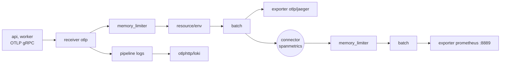

# Lời giải: pipeline OTel Collector

## Các quyết định

- **`memory_limiter` đứng đầu**: nó đo bộ nhớ và từ chối dữ liệu mới (receiver trả lỗi cho client, SDK sẽ retry) trước khi Collector bị
  OOM kill. Đặt sau processor khác thì dữ liệu đã được chép và xử lý rồi mới bị bỏ, mất ý nghĩa.
- **`batch` đứng cuối**: gom span thành lô ngay trước exporter để giảm số request ra ngoài. Đặt trước `resource` thì processor sau phải
  xử lý cả lô vẫn được, nhưng quy ước đặt cuối giúp đọc cấu hình dễ, và mọi processor đã xong việc trên từng span.
- **`resource` chứ không phải `attributes`**: môi trường là thuộc tính của **nguồn** phát (process, pod), không của từng span. Resource
  attribute đi kèm mọi span, log, metric của nguồn đó và backend nào cũng hiểu (Jaeger hiện ở mục Process). `upsert` ghi đè giá trị app tự
  đặt; `insert` chỉ thêm khi chưa có. Chọn `upsert` khi Collector là nơi quyết định môi trường (một Collector cho một môi trường).
- **Connector spanmetrics**: connector vừa là exporter của pipeline này vừa là receiver của pipeline khác, biến trace thành metric ngay
  trong Collector. Nhờ đó có RED theo span (`calls_total`, `duration_milliseconds_bucket`) cho mọi service gửi trace, kể cả service không
  tự xuất `/metrics`. Mặc định có dimension `service.name`, `span.name`, `span.kind`, `status.code`; mỗi dimension thêm vào nhân số series,
  nên chỉ thêm thuộc tính có ít giá trị như mã HTTP.
- **`metrics_flush_interval: 5s`** chỉ để test nhanh. Production thường để 15 tới 60 giây.
- **Exporter `prometheus` (pull) thay vì `prometheusremotewrite` (push)**: Prometheus của stack đã scrape `otel-collector:8889`. Remote
  write hợp khi backend là Mimir, Thanos receive hay vendor SaaS.
- `resource/env` cũng nằm trong pipeline logs để log và trace có cùng attribute; Loki đưa một số resource attribute thành label, số còn
  lại thành structured metadata.

## Đổi backend không sửa app

App chỉ biết OTLP và địa chỉ Collector. Đổi `otlp/jaeger` thành exporter `otlphttp` tới Tempo hay endpoint OTLP của Datadog, New Relic,
Honeycomb là sửa Collector, không build lại app. Gửi song song hai backend trong lúc chuyển: thêm exporter thứ hai vào danh sách.

## Lỗi hay gặp

| Triệu chứng | Nguyên nhân |
| --- | --- |
| Collector không khởi động, log `unknown type` | Tên component sai, hoặc dùng bản core không có component contrib |
| Collector chạy nhưng không gì tới Jaeger | Component khai ở mục trên nhưng không nhắc trong `service.pipelines` |
| Exporter Jaeger báo `connection refused`, `tls: first record does not look like a TLS handshake` | Thiếu `tls.insecure: true` với Jaeger trong mạng nội bộ |
| Prometheus không thấy spanmetrics trong vài phút đầu | `metrics_flush_interval` mặc định 60 giây |
| `histogram_quantile` ra `+Inf` | Bucket explicit không phủ được giá trị thật (span chậm hơn bucket lớn nhất) |
