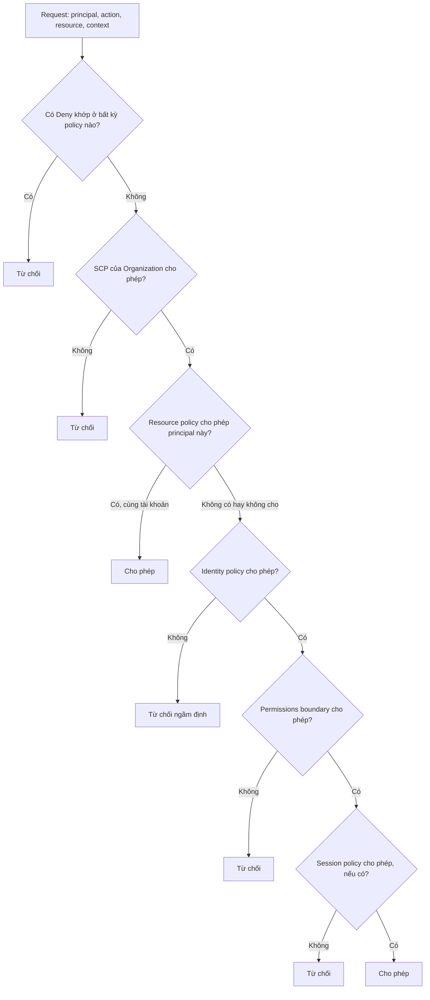
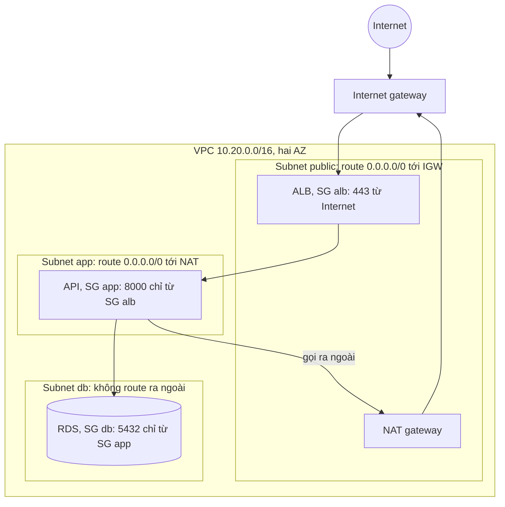
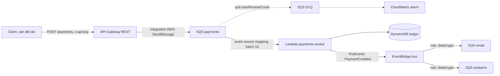

# Cloud và serverless: AWS core, Lambda, event-driven và chọn nhà cung cấp

Tới module này Olist Shop chạy trên container, Kubernetes, có IaC, GitOps và observability, nhưng mọi thứ vẫn nằm trên máy của bạn. Module
này đưa nó lên cloud ở mức người vận hành: viết IAM sao cho một service bị chiếm cũng không lan ra, thiết kế VPC ba tầng mà database không
bao giờ thấy Internet, chạy code dạng Lambda đúng với ngữ nghĩa at-least-once của hàng đợi, nối service bằng event, và biết mỗi quyết định
tốn bao nhiêu tiền.

Mọi bài tập chạy trên máy: LocalStack riêng của track cho IAM, SQS, DynamoDB, S3, Secrets Manager; `tofu plan` cho thứ LocalStack bản miễn phí
không có (VPC, EC2, RDS, Budgets, CloudWatch); code Lambda chạy trong image Lambda chính thức của AWS. Phần AWS thật là tuỳ chọn, luôn kèm
ước tính chi phí, budget alarm, lệnh dọn và bài tương đương trên máy.

Sau module này bạn sẽ:

- Đọc được quyết định của IAM cho một request: identity policy, resource policy, trust policy, permissions boundary, SCP; viết role least
  privilege và chống confused deputy.
- Thiết kế VPC ba tầng (subnet, route table, Internet gateway, NAT, security group, NACL), đặt EC2, S3, RDS vào đúng chỗ, và nói rõ phần
  nào AWS lo, phần nào bạn lo theo shared responsibility model.
- Viết Lambda đúng: cold start, concurrency, timeout, memory, idempotency, partial batch response, DLQ.
- Nối hệ thống bằng SQS, SNS, EventBridge và API Gateway; chọn REST API, HTTP API hay Function URL.
- Ước tính và chặn chi phí: budget, tag, retention, giới hạn đồng thời, quota; biết các khoản hay rò rỉ.
- So sánh Lambda với Cloudflare Workers, Vercel, Netlify, Azure Functions, Cloud Run functions; so sánh AWS, Azure, GCP, DigitalOcean,
  Alibaba Cloud, Hetzner, Contabo, Heroku và chọn theo ràng buộc.

## 0. Cài đặt

| Công cụ / dịch vụ | Phiên bản đã kiểm | Tối thiểu cho bài tập | Dùng ở |
| --- | --- | --- | --- |
| OpenTofu (`tofu`), provider `hashicorp/aws` | 1.13.2, provider 6.12.0 (cài ở module 08) | 1.10 (bài này dùng `-exclude` từ 1.9) | Basic 01, 02; Intermediate 01; Advanced 02 |
| LocalStack riêng `localstack-devops` | `localstack/localstack:4.4.0`, bật thêm `sqs`, `events`, `apigateway` | Đúng tag này | Basic 01, 02; Intermediate 01; Advanced 02 |
| Image Lambda Python | `public.ecr.aws/lambda/python:3.12.2026.10.22.03` ghim digest (Python 3.12.15, boto3 1.42.97) | Đúng digest này | Intermediate 01, 02 |
| AWS CLI v2 (`aws`) | 2.38.6 | 2.x (`aws configure sso`, `aws sso login`) | Chỉ khi chạy tay hay làm lab AWS thật; test không cần |
| bwrap, uv, Docker | Như module 02, 06 | Như module 02, 06 | Sandbox của test, chạy pytest, container |

### Test nói chuyện với "AWS" thế nào

Test không gọi `aws` hay `awslocal`. Tài nguyên được tạo bằng `tofu` qua `TofuLab` (module 08) và kiểm bằng `testkit.localstack_client(...)`:
một client boto3 chỉ trỏ `localstack-devops`, credential giả `test`, không đọc `~/.aws` hay biến `AWS_*` của bạn. Code Lambda chạy trong
`testkit.LambdaLab`: container dựng từ image Lambda của AWS (có Runtime Interface Emulator), code mount chỉ đọc, credential giả, endpoint ép về
LocalStack qua một bộ chuyển tiếp chỉ mở cho network của container, không socket Docker, không thư viện nào ngoài thư viện chuẩn và gói có
sẵn trong image (`boto3`, `botocore`...). Vì vậy mọi bài chạy được mà không có tài khoản AWS và không bao giờ chạm tài khoản thật.

### LocalStack và image Lambda

```bash
docker compose -f setup/docker-compose.yml --profile devops up -d --wait localstack-devops &&
curl -fsS http://127.0.0.1:14566/_localstack/health | jq -c '.services | {iam, sqs, dynamodb, events, apigateway, secretsmanager}' &&
nice -n 15 docker pull public.ecr.aws/lambda/python:3.12.2026.10.22.03@sha256:25aee9bac65f131c5d090d3e3a36ccf232d65cf3e6c1dbd0bffd43ca7ce34406
```

```text
{"iam":"available","sqs":"available","dynamodb":"available","events":"available","apigateway":"available","secretsmanager":"available"}
```

Container `localstack-devops` tạo từ module 08 chưa bật `sqs`, `events`, `apigateway`: test skip kèm lệnh tạo lại. Tạo lại không cần xoá volume
(LocalStack của track không bật persistence):

```bash
docker compose -f setup/docker-compose.yml --profile devops rm -s -f localstack-devops &&
docker compose -f setup/docker-compose.yml --profile devops up -d --wait localstack-devops
```

Image Lambda khoảng 750 MB trên đĩa, mỗi container khoảng 40 MB RAM, khởi động dưới 1 giây. Tag có ngày được ghim thay cho `3.12` vì tag
`3.12` được dựng lại hằng ngày. Chi tiết mạng của `LambdaLab` (network `--internal`, dải cổng chuyển tiếp, tường lửa) ở `setup/DEVOPS-TOOLS.md`.

### AWS CLI v2 (tuỳ chọn)

Chỉ cần khi chạy tay trên LocalStack hay làm lab AWS thật (Advanced 02). AWS CLI v2 không có trên PyPI (gói `awscli` trên PyPI là v1, không
có `aws sso login` kiểu mới), nên cài từ bản phát hành chính thức vào `~/.local`, không sudo. AWS ký tệp zip bằng khoá PGP của "AWS CLI Team"
(fingerprint `FB5D B77F D5C1 18B8 0511 ADA8 A631 0ACC 4672 475C`), khoá đăng trên trang hướng dẫn cài đặt. Bản trên keyserver công cộng đã hết
hạn; bản trên trang docs được gia hạn tới 2027-07-01, nên lấy khoá từ trang docs.

| Tệp | SHA-256 |
| --- | --- |
| `awscli-exe-linux-x86_64-2.38.6.zip` | `66974301c11f8116a6cb96bf72acae57453734b61fa8dd3f56422de9eaab0e42` |

Chạy từ một thư mục tạm mới:

```bash
AWSCLI_VERSION=2.38.6 &&
AWSCLI_FILE="awscli-exe-linux-x86_64-${AWSCLI_VERSION}.zip" &&
AWSCLI_SHA256=66974301c11f8116a6cb96bf72acae57453734b61fa8dd3f56422de9eaab0e42 &&
AWSCLI_FPR=FB5DB77FD5C118B80511ADA8A6310ACC4672475C &&
cd "$(mktemp -d)" &&
curl -fsSLO --proto '=https' "https://awscli.amazonaws.com/${AWSCLI_FILE}" &&
curl -fsSLO --proto '=https' "https://awscli.amazonaws.com/${AWSCLI_FILE}.sig" &&
curl -fsSL --proto '=https' -o install.html https://docs.aws.amazon.com/cli/latest/userguide/getting-started-install.html &&
python3 -I -c 'import html,re,sys; t=html.unescape(re.sub(r"<[^>]+>","",open(sys.argv[1],encoding="utf-8").read())); m=re.search(r"-----BEGIN PGP PUBLIC KEY BLOCK-----.*?-----END PGP PUBLIC KEY BLOCK-----",t,re.S); open(sys.argv[2],"w").write(m.group(0))' install.html awscli.asc &&
export GNUPGHOME="$(mktemp -d)" &&
gpg --quiet --import awscli.asc &&
gpg --with-colons --fingerprint | grep -qx "fpr:::::::::${AWSCLI_FPR}:" &&
gpg --verify "${AWSCLI_FILE}.sig" "${AWSCLI_FILE}" &&
echo "${AWSCLI_SHA256}  ${AWSCLI_FILE}" | sha256sum -c - &&
unzip -q "${AWSCLI_FILE}" &&
./aws/install -i ~/.local/aws-cli -b ~/.local/bin &&
which aws && aws --version
```

Khoá có fingerprint khác, chữ ký sai hay zip không khớp hash ghim thì chuỗi `&&` dừng trước khi giải nén. Kết quả trên máy viết bài
(Pop!_OS 24.04, x86_64):

```text
gpg: Good signature from "AWS CLI Team <aws-cli@amazon.com>" [unknown]
gpg: WARNING: This key is not certified with a trusted signature!
Primary key fingerprint: FB5D B77F D5C1 18B8 0511  ADA8 A631 0ACC 4672 475C
awscli-exe-linux-x86_64-2.38.6.zip: OK
You can now run: /home/<user>/.local/bin/aws --version
/home/<user>/.local/bin/aws
aws-cli/2.38.6 Python/3.14.8 Linux/7.2.6-76070206-generic exe/x86_64.pop.24
```

Nâng cấp: chạy lại với phiên bản mới cộng cờ `--update` cho `./aws/install`. Gỡ: `rm -rf ~/.local/aws-cli ~/.local/bin/aws
~/.local/bin/aws_completer`. Chạy tay với LocalStack trong một shell riêng:

```bash
export AWS_ENDPOINT_URL=http://127.0.0.1:14566 AWS_ACCESS_KEY_ID=test AWS_SECRET_ACCESS_KEY=test \
  AWS_REGION=us-east-1 AWS_EC2_METADATA_DISABLED=true &&
unset AWS_PROFILE AWS_SESSION_TOKEN &&
aws sts get-caller-identity --query Account --output text &&
aws sqs list-queues
```

```text
000000000000
```

`awslocal` (gói `awscli-local`) chỉ là wrapper đặt endpoint LocalStack; với `AWS_ENDPOINT_URL` như trên thì không cần nó.

## 1. Ôn nhanh từ DE 11: mô hình cloud, IAM, VPC, chi phí

[Module DE 11 (Cloud)](../../../data-engineer/modules/11-cloud/README.md) đã đi qua IaaS, PaaS, SaaS, serverless, region và AZ, shared
responsibility, bảng dịch vụ tương đương AWS/Azure/GCP, IAM và least privilege cho data, mạng và mã hoá dữ liệu, FinOps và lock-in. Những gì
module này coi là đã biết:

- **Region** là một vùng địa lý độc lập (`us-east-1`, `sa-east-1`); **AZ** là một hay nhiều trung tâm dữ liệu tách nguồn điện, mạng trong một
  region. Thiết kế chịu lỗi ở mức AZ là mặc định; ở mức region là quyết định đắt.
- **IAM**: principal (user, role, service) làm action trên resource; mặc định là từ chối; policy JSON gồm `Effect`, `Action`, `Resource`,
  `Condition`. Người và máy dùng role với credential tạm (STS), không dùng access key dài hạn.
- **VPC**: mạng riêng có dải CIDR, chia subnet theo AZ; subnet public có route tới Internet gateway; security group là tường lửa gắn vào
  network interface.
- **Chi phí**: trả theo dùng, nhưng nhiều thứ tính theo giờ dù không ai dùng; egress (dữ liệu ra Internet) tính tiền, ingress thường miễn phí.

DE 11 nhìn từ góc data (bucket, warehouse, quyền đọc ghi dữ liệu). Các mục sau đi tiếp ở góc người vận hành hệ thống: request bị IAM quyết
định thế nào, mạng ba tầng cho một app, Lambda và event, và chặn chi phí bằng chính cấu hình.

## 2. IAM cho người vận hành: đánh giá policy, role, trust, boundary

### Một request được quyết định thế nào

Mỗi request tới AWS được đánh giá trên **mọi** policy liên quan cùng lúc, không theo thứ tự viết:



Ba quy tắc cần thuộc:

1. **Explicit deny thắng mọi thứ.** Một `Deny` khớp ở SCP, identity policy, resource policy hay boundary là hết.
2. **Mặc định là từ chối.** Không policy nào cho phép thì bị từ chối ngầm định (`implicitDeny`).
3. **Các lớp chặn là phép giao.** SCP, permissions boundary, session policy không cấp quyền; chúng chỉ đặt trần. Quyền hiệu lực là phần giao của
   identity policy với từng trần. Resource policy là ngoại lệ: trong cùng tài khoản, resource policy cho phép một principal là đủ (với role
   session có vài chi tiết riêng); khác tài khoản thì cả hai phía phải cho phép.

Wildcard là nguồn lỗi phổ biến nhất: `s3:*` cấp cả `s3:PutBucketPolicy` (tự mở bucket ra Internet), `arn:aws:s3:::olist-reports*` khớp cả
bucket `olist-reports-public`. `NotAction` kèm `Allow` cấp mọi thứ còn lại, kể cả action AWS ra mắt năm sau.

### Role, trust policy và confused deputy

Role có hai policy: **permission policy** nói role làm được gì, **trust policy** (`AssumeRolePolicyDocument`) nói ai được trở thành role.
Viết chặt permission policy mà để trust policy tin `"AWS": "*"` hay cả `ec2.amazonaws.com` thì ai đeo được role cũng có đủ quyền đó.

Service principal (`lambda.amazonaws.com`, `ecs-tasks.amazonaws.com`) dùng chung cho mọi khách hàng của AWS. Nếu một dịch vụ AWS có thể được
khách hàng khác bảo "hãy dùng role ARN này", nó trở thành **confused deputy**: làm việc cho người khác bằng quyền của bạn. Điều kiện
`aws:SourceAccount` (và `aws:SourceArn`) trong trust policy hay resource policy giới hạn: chỉ khi dịch vụ đang làm việc cho đúng tài khoản,
đúng tài nguyên. Với role cho bên thứ ba assume chéo tài khoản, thêm `sts:ExternalId`.

```json
{
  "Effect": "Allow",
  "Principal": {"Service": "ecs-tasks.amazonaws.com"},
  "Action": "sts:AssumeRole",
  "Condition": {
    "StringEquals": {"aws:SourceAccount": "111122223333"},
    "ArnLike": {"aws:SourceArn": "arn:aws:ecs:sa-east-1:111122223333:*"}
  }
}
```

### Permissions boundary và SCP

- **Permissions boundary** là managed policy gắn vào một user hay role, làm trần quyền của chính principal đó. Dùng khi giao quyền tạo role cho
  team: admin cho team `iam:CreateRole` kèm điều kiện `iam:PermissionsBoundary` bằng ARN boundary, nên mọi role team tạo đều mang boundary, team
  tự viết policy cho service mà không leo thang được (không tạo được role "admin" cho chính mình).
- **Service Control Policy** (SCP) của AWS Organizations là trần cho cả tài khoản hay OU, kể cả user root của tài khoản thành viên: cấm region
  ngoài danh sách, cấm tắt CloudTrail, cấm xoá budget. SCP không áp dụng cho tài khoản quản lý.
- **Session policy** truyền lúc `AssumeRole` để thu hẹp quyền của một phiên (ví dụ CI chỉ deploy một stack).

### Kiểm IAM

IAM Policy Simulator (`aws iam simulate-principal-policy`) trả lời "role này làm được action X trên resource Y không" mà không gọi thật; IAM
Access Analyzer tìm resource chia sẻ ra ngoài tài khoản, quyền không dùng tới, và sinh policy từ CloudTrail sau một thời gian chạy. LocalStack
bản community có API simulator nhưng kết quả không đáng tin (không hiểu wildcard action) và không thực thi IAM khi gọi API; bài Basic 01 vì vậy
đánh giá policy bằng parser tĩnh trong test, rồi bạn kiểm lại bằng simulator khi lên AWS thật.

## 3. Mạng và tính toán: VPC ba tầng, EC2, S3, RDS, trách nhiệm chung

### VPC ba tầng



- **Subnet** gắn với một AZ. "Public" hay "private" không phải thuộc tính của subnet mà là route table gắn với nó: có route mặc định tới Internet
  gateway thì là public. Mỗi tầng một subnet mỗi AZ, dải CIDR không chồng nhau, chừa chỗ cho AZ thứ ba (`cidrsubnet` với độ lệch theo tầng).
- **NAT gateway** cho máy trong subnet private đi ra (gọi API thanh toán, kéo image, cập nhật gói) mà không ai từ ngoài mở được kết nối vào. Nó
  tính tiền theo giờ (khoảng 0,045 USD ở us-east-1, khoảng 33 USD/tháng) cộng tiền mỗi GB đi qua, và chỉ nằm trong một AZ: production cần một
  NAT mỗi AZ. Gọi S3, DynamoDB thì dùng gateway VPC endpoint (miễn phí) thay vì đi qua NAT.
- **Security group** gắn vào network interface, **stateful** (cho vào thì chiều về tự được phép), chỉ có rule allow; tham chiếu được security
  group khác ("chỉ nhận từ SG của ALB") nên không phụ thuộc IP. Provider AWS của OpenTofu xoá rule egress "mọi thứ" mặc định khi tạo security
  group, nên egress phải khai báo; dùng tài nguyên `aws_vpc_security_group_ingress_rule`/`egress_rule` thay cho khối lồng.
- **NACL** gắn vào subnet, **stateless** (phải mở cả cổng ephemeral 1024-65535 cho chiều về), có rule deny, đánh giá theo số thứ tự. Dùng để
  chặn thô theo dải IP hay làm lớp chắn thứ hai; để mặc định (allow all) thường là đủ khi security group đã đúng.

### EC2, S3, RDS ở mức người vận hành

| Dịch vụ | Điều cần làm đúng | Lỗi hay gặp |
| --- | --- | --- |
| EC2 | IMDSv2 bắt buộc (`http_tokens = "required"`), không IP public cho máy app, ổ EBS mã hoá, instance profile thay cho access key, Auto Scaling Group cho máy thay thế được, Graviton khi app chạy được ARM | SSH mở `0.0.0.0/0`; key dài hạn trong `~/.aws` trên máy; máy "thú cưng" vá tay |
| S3 | Block Public Access ở cả tài khoản, bucket policy theo prefix, versioning cho dữ liệu quan trọng, lifecycle chuyển lớp lưu trữ và xoá bản cũ, mã hoá mặc định (SSE-S3 từ 2023) | Bucket công khai để "chia sẻ nhanh"; versioning bật mà không lifecycle nên bản cũ giữ mãi |
| RDS | Subnet group chỉ gồm subnet db, `publicly_accessible = false`, mã hoá, backup tự động và PITR, `manage_master_user_password` (mật khẩu trong Secrets Manager, xoay được), Multi-AZ khi RTO đòi hỏi | Mật khẩu trong `.tf` nên nằm trong git và state; snapshot cuối bị tắt khi destroy production |

LocalStack bản community không có EC2, VPC, RDS thật: bài Basic 02 kiểm thiết kế bằng `tofu plan` (đọc cả giá trị và quan hệ tham chiếu trong
plan JSON), không apply. Bản local tương đương của RDS là container `postgres:16` như ở module 06: cùng engine và giao thức, khác ở chỗ backup,
failover, vá lỗi, mã hoá là việc của bạn. Đó cũng chính là thứ bạn trả tiền khi dùng RDS.

### Trách nhiệm chung theo dịch vụ

Shared responsibility không phải một đường kẻ cố định: dịch vụ càng được quản lý, AWS càng nhận nhiều tầng.

| Tầng | EC2 | RDS | Lambda | S3 |
| --- | --- | --- | --- | --- |
| Phần cứng, trung tâm dữ liệu, hypervisor | AWS | AWS | AWS | AWS |
| Hệ điều hành, vá kernel | **Bạn** | AWS | AWS | AWS |
| Runtime, engine (Python, Postgres), vá phiên bản phụ | **Bạn** | AWS vá, **bạn** chọn lúc nâng cấp lớn | AWS vá runtime, **bạn** chuyển khi runtime hết hạn | AWS |
| Mạng: security group, ai gọi được | **Bạn** | **Bạn** | **Bạn** (resource policy, VPC nếu gắn) | **Bạn** (bucket policy, Block Public Access) |
| Code, thư viện đóng gói kèm | **Bạn** | Không có | **Bạn** | Không có |
| IAM, dữ liệu, mã hoá, backup có kiểm restore | **Bạn** | **Bạn** | **Bạn** | **Bạn** |

Hàng cuối không bao giờ chuyển sang nhà cung cấp, kể cả với dịch vụ serverless.

## 4. Lambda: mô hình thực thi, cold start, concurrency, timeout, idempotency

### Môi trường thực thi

Lambda chạy hàm của bạn trong một **môi trường thực thi** (microVM Firecracker) gồm runtime và code. Vòng đời:

1. **Init**: tải code, khởi động runtime, chạy code ở cấp module (import, tạo client boto3, đọc cấu hình). Đây là phần **cold start**.
2. **Invoke**: gọi handler với `event` và `context`. Môi trường được dùng lại cho các lần gọi sau (warm), nên biến cấp module, kết nối và
   `/tmp` còn nguyên giữa các lần gọi; đừng dựa vào nó để lưu trạng thái nghiệp vụ.
3. Không có request thì môi trường bị đóng băng giữa các lần gọi và bị huỷ sau một thời gian. Sau khi handler trả lời, mọi thread nền bị đóng
   băng cùng môi trường.

Cold start phụ thuộc runtime (Python, Node vài trăm ms; Java cũ có thể vài giây nếu không có SnapStart), kích thước gói, công việc ở cấp module,
và việc gắn VPC (từ 2019 dùng Hyperplane ENI nên không còn chậm như trước). Giảm bằng: gói nhỏ, import lười cho phần hiếm dùng, khởi tạo client
một lần ở cấp module; khi cần độ trễ ổn định thì **provisioned concurrency** (trả tiền giữ môi trường sẵn) hay SnapStart (Java, Python, .NET).

### Memory, CPU, timeout

- **Memory** 128 MB tới 10 240 MB, CPU tỉ lệ theo memory (khoảng 1 vCPU ở 1 769 MB). Hàm nặng CPU tăng memory có thể vừa nhanh hơn vừa rẻ hơn,
  vì tiền tính theo GB-giây; đo bằng AWS Lambda Power Tuning.
- **Timeout** 1 tới 900 giây (15 phút). Quá timeout thì môi trường bị giết, lần gọi tính là lỗi. Với event source mapping (SQS, Kinesis), lỗi cả
  lần gọi nghĩa là **cả batch** được coi là thất bại. Đặt timeout theo p99 thực đo cộng biên an toàn, và để handler biết thời gian còn lại
  (`context.get_remaining_time_in_millis()`).
- **Gói**: zip tới 50 MB (nén), 250 MB giải nén, cộng layer; hay container image tới 10 GB. `/tmp` từ 512 MB tới 10 GB.

### Concurrency

Concurrency là số môi trường đang xử lý cùng lúc. Ước lượng theo Little's law:

$$\text{concurrency} \approx \text{số request mỗi giây} \times \text{thời gian xử lý trung bình (giây)}$$

Ví dụ 50 request/giây, mỗi lần 200 ms: khoảng 10 môi trường. Hạn mức mặc định của mỗi region là 1 000 cho cả tài khoản (tài khoản mới có thể
thấp hơn nhiều, có khi chỉ 10, cho tới khi xin tăng). Công cụ điều khiển:

| Công cụ | Làm gì | Dùng khi |
| --- | --- | --- |
| Reserved concurrency | Dành riêng và đồng thời là trần cho một function; đặt 0 là tắt function | Bảo vệ downstream, cô lập function quan trọng khỏi function khác |
| Provisioned concurrency | Giữ sẵn N môi trường đã init, trả tiền theo giờ | API cần độ trễ ổn định, không chịu cold start |
| `maximum_concurrency` của event source mapping SQS | Trần số Lambda đồng thời đọc một hàng đợi (2..1000) | Hàng đợi đổ vào DB hay API có hạn mức, mà không đụng reserved concurrency |

Vượt trần thì lời gọi đồng bộ nhận `429 TooManyRequestsException` (throttle), lời gọi bất đồng bộ và event source mapping tự thử lại.

### Lỗi, retry, idempotency

| Kiểu gọi | Ví dụ | Khi handler lỗi |
| --- | --- | --- |
| Đồng bộ | API Gateway, Function URL, `aws lambda invoke` | Người gọi nhận lỗi, tự quyết định thử lại |
| Bất đồng bộ | S3 notification, EventBridge, SNS | Lambda thử lại 2 lần (cấu hình được), rồi gửi tới on-failure destination hay DLQ của function |
| Event source mapping | SQS, Kinesis, DynamoDB Streams | Lambda poll và gọi theo batch; với SQS, lỗi thì message hiện lại sau visibility timeout, quá `maxReceiveCount` thì sang DLQ của hàng đợi |

Mọi đường đều là **at-least-once**: cùng một event có thể tới hai lần (retry, message hiện lại, producer gửi lại). Vì vậy handler phải
**idempotent**: chạy hai lần cho cùng một đầu vào có cùng kết quả như một lần. Cách làm phổ biến:

- Khoá idempotency là **khoá nghiệp vụ** (`payment_id`, `order_id`), không phải `messageId` (message gửi lại có ID mới).
- Ghi nhận khoá và tác dụng phụ **nguyên tử**: DynamoDB `TransactWriteItems` gồm `Put` có điều kiện `attribute_not_exists` và cập nhật dữ liệu;
  hay ràng buộc `UNIQUE` trong Postgres cùng transaction. Bản ghi khoá có TTL dài hơn thời gian một event có thể quay lại.
- Tác dụng phụ ra ngoài (gửi email, gọi API thanh toán) truyền idempotency key cho bên kia nếu bên kia hỗ trợ.
- **Partial batch response** cho SQS: bật `ReportBatchItemFailures` ở event source mapping và trả `{"batchItemFailures": [{"itemIdentifier":
  messageId}]}`; chỉ message lỗi quay lại hàng đợi, message đã xử lý xong được xoá. Không bật thì một record lỗi làm cả batch chạy lại.

Powertools for AWS Lambda (Python, TypeScript, Java, .NET) đóng gói sẵn idempotency, batch processing, log có cấu trúc, metric và trace.

## 5. Event-driven và API Gateway: SQS, SNS, EventBridge



### SQS

- **Standard**: throughput gần như không giới hạn, at-least-once, thứ tự không bảo đảm. **FIFO**: thứ tự theo `MessageGroupId`, chống trùng
  5 phút theo `MessageDeduplicationId`, throughput thấp hơn (có chế độ high throughput). FIFO không thay được idempotency ở consumer.
- **Visibility timeout**: message đã nhận bị ẩn trong khoảng này; consumer xoá trước khi hết giờ là xong, không thì message hiện lại cho lần nhận
  khác. Với Lambda, AWS khuyến nghị visibility timeout ít nhất 6 lần timeout của function.
- **DLQ và redrive**: `redrive_policy` với `maxReceiveCount` chuyển message nhận quá số lần sang DLQ; DLQ giữ lâu hơn hàng đợi nguồn (tuổi message
  tính từ lúc vào hàng đợi nguồn). Sửa xong thì chuyển message về bằng redrive (`StartMessageMoveTask`), đừng xoá DLQ cho alarm im.
- Long polling (`WaitTimeSeconds` tới 20) giảm request rỗng; message tối đa 256 KB (lớn hơn thì để dữ liệu ở S3, gửi con trỏ).

### SNS và EventBridge

- **SNS**: pub/sub đẩy tới nhiều subscriber (SQS, Lambda, HTTP, email, SMS), lọc theo message attribute hay body. Mẫu **fan-out** hay gặp: SNS
  topic đổ vào nhiều hàng đợi SQS, mỗi consumer một hàng đợi có retry và DLQ riêng.
- **EventBridge**: event bus với rule lọc theo nội dung JSON (`source`, `detail-type`, trường trong `detail`), target gồm SQS, Lambda, Step
  Functions, bus ở tài khoản khác. Có schema registry, archive và replay, **Scheduler** (cron và lịch một lần, thay cho cron trên máy), **Pipes**
  (nối nguồn như SQS hay DynamoDB Streams sang target, có lọc và biến đổi). Dùng EventBridge khi nhiều team phát và nhận event theo nội dung;
  SNS khi cần fan-out nhanh, rẻ, đơn giản.
- Event phát ra nên mang đủ ngữ cảnh (ID, phiên bản schema, thời điểm) và được coi như API công khai: đổi schema có phiên bản.

### API Gateway và các cửa vào khác

| Lựa chọn | Có | Không có | Hợp với |
| --- | --- | --- | --- |
| API Gateway REST API (v1) | Usage plan, API key, throttling theo khách, request validation, mapping template, integration thẳng tới dịch vụ AWS (SQS, DynamoDB, Step Functions), WAF, cache, private API | Giá cao nhất (khoảng 3,50 USD/triệu request) | API cho đối tác, cần quota và kiểm schema ở cửa |
| API Gateway HTTP API (v2) | Rẻ hơn khoảng 70%, độ trễ thấp hơn, JWT authorizer, CORS đơn giản | Usage plan, API key, request validation, đa số integration dịch vụ AWS | API nội bộ hay public đơn giản trước Lambda |
| Lambda Function URL | Miễn phí ngoài tiền Lambda, auth IAM hay không auth, streaming response | Mọi tính năng quản lý API | Webhook, công cụ nội bộ, một function một endpoint |
| ALB trước Lambda hay container | Tính theo giờ cộng LCU, hợp lưu lượng đều và lớn | Usage plan, API key | Tải lớn ổn định, đã có ALB cho container |

Integration HTTP của API Gateway (proxy tới một URL bất kỳ) và API destination của EventBridge biến hạ tầng của bạn thành người gửi request ra
ngoài theo cấu hình; trong track, chính `localstack-devops` sẽ gửi request đi, nên bài tập chỉ dùng integration tới dịch vụ AWS (SQS, Lambda) hay
`MOCK`. Ở production, giới hạn chúng bằng review và chính sách.

## 6. Chi phí và so sánh nền tảng, nhà cung cấp

### Chi phí: tính được và chặn được

Lambda tính theo request cộng GB-giây:

$$\text{chi phí Lambda} = \text{số request} \times \text{giá mỗi request} + \text{số request} \times \text{thời gian (giây)} \times \text{memory (GB)} \times \text{giá mỗi GB-giây}$$

Ví dụ 3 triệu request mỗi tháng, 200 ms, 256 MB, arm64 ở us-east-1 (0,20 USD mỗi triệu request, khoảng 0,0000133 USD mỗi GB-giây): 150 000
GB-giây, nằm trong phần miễn phí 400 000 GB-giây và 1 triệu request mỗi tháng; trả khoảng 0,40 USD cho 2 triệu request vượt. Cùng tải đó chạy đều
cả ngày trên một container nhỏ cũng chỉ vài chục USD: serverless rẻ khi tải thấp hoặc theo đợt, đắt lên khi tải cao và đều.

Free Tier: Lambda, SQS, SNS, DynamoDB (25 GB) có phần miễn phí mỗi tháng không hết hạn. Tài khoản tạo từ 15/7/2025 nhận credit (gói Free có
thời hạn) thay cho Free Tier 12 tháng kiểu cũ của EC2, RDS, API Gateway; đọc kỹ trang Free Tier của tài khoản bạn trước khi tin vào chữ
"miễn phí".

Khoản hay rò rỉ, theo thứ tự hay gặp:

| Khoản | Vì sao | Chặn bằng |
| --- | --- | --- |
| NAT gateway | Tính theo giờ cộng mỗi GB đi qua, mỗi AZ một cái | VPC endpoint cho S3/DynamoDB; tắt môi trường không dùng; cân nhắc IPv6 egress-only |
| IPv4 public | Từ 2/2024 mỗi địa chỉ khoảng 0,005 USD/giờ, kể cả đang gắn | Không gán IP public cho máy không cần; ALB dùng chung |
| Egress | Dữ liệu ra Internet, ra region khác, qua AZ khác | CDN (có phần miễn phí), nén, giữ traffic trong một AZ khi được |
| Log và metric | CloudWatch Logs mặc định giữ mãi | Retention theo môi trường, log mức `INFO` ở production, lọc trước khi gửi |
| Thứ quên tắt | Staging chạy cả đêm, snapshot cũ, ổ EBS mồ côi, Elastic IP không gắn | Tag `Owner`, `ExpiresOn`; lịch tắt; quét định kỳ |
| Vòng lặp | Lambda ghi S3 kích hoạt chính nó, retry vô hạn, client gọi lặp | DLQ và `maxReceiveCount`, quota, throttling, `maximum_concurrency`, Lambda recursive loop detection |

Công cụ: **Budgets** (cảnh báo theo chi phí thật và dự báo, chậm vài giờ, chỉ báo chứ không tắt, trừ khi gắn budget action), **Cost Explorer**
lọc theo tag (bật cost allocation tag trước), **Cost Anomaly Detection**, **Compute Optimizer**. Cam kết khi tải đã ổn định: Savings Plans (1 hay
3 năm, áp cho EC2, Fargate, Lambda), Reserved Instances cho RDS; Spot cho việc chịu được bị ngắt. Graviton (arm64) rẻ hơn khoảng 20% cùng hiệu
năng. FinOps ở mức tổ chức (showback, unit cost theo đơn hàng) ở module 16.

### So sánh nền tảng serverless

| Nền tảng | Mô hình chạy | Giới hạn đáng nhớ | Mạnh ở | Yếu ở |
| --- | --- | --- | --- | --- |
| AWS Lambda | MicroVM Firecracker theo region; zip hay image; nhiều runtime | 15 phút, 10 GB RAM, payload đồng bộ 6 MB | Tích hợp sâu với SQS, EventBridge, DynamoDB, S3; IAM chi tiết | Cold start với runtime nặng; một region mỗi function |
| Cloudflare Workers | Isolate V8 ở mọi PoP; JavaScript, TypeScript, WASM, Python (beta) | Giới hạn CPU mỗi request, không phải container, không chạy được binary tuỳ ý | Độ trễ thấp toàn cầu, gần như không cold start, giá theo request rẻ; KV, D1, R2, Queues, Durable Objects | Hệ sinh thái khác Node/Python truyền thống; thư viện phụ thuộc API của Node có thể không chạy |
| Vercel Functions | Function theo framework (Next.js...), chạy trên hạ tầng của Vercel (Node, Python, Edge runtime) | Thời gian chạy theo gói; gắn chặt với luồng deploy của Vercel | Trải nghiệm frontend: git push, preview mỗi PR, API route thành function | Ít điều khiển hạ tầng, chi phí tăng nhanh khi lưu lượng lớn |
| Netlify Functions | Function cạnh site tĩnh (dựng trên Lambda), có Edge Functions (Deno) | Thời gian chạy ngắn; background function riêng | Site tĩnh cộng form, redirect, function nhỏ | Không hợp backend nặng hay chạy lâu |
| Azure Functions | Gói Consumption (Flex), Premium, Dedicated; nhiều ngôn ngữ, .NET mạnh | Consumption có giới hạn thời gian; Durable Functions cho luồng dài | Tích hợp Entra ID, Event Grid, Service Bus, Blob; hợp hệ sinh thái Microsoft | Nhiều gói và mô hình host, dễ chọn nhầm |
| Cloud Run functions (GCP) | Function chạy trên Cloud Run (container), trigger qua Eventarc | Thời gian request dài hơn Lambda; một instance xử lý nhiều request đồng thời | Gần dữ liệu BigQuery, GCS, Pub/Sub; chuyển sang Cloud Run service dễ | Ít trigger dịch vụ trực tiếp như hệ AWS |

### So sánh nhà cung cấp cloud

| Nhà cung cấp | Mạnh ở | Yếu ở | Hợp với |
| --- | --- | --- | --- |
| AWS | Nhiều dịch vụ và region nhất (có São Paulo), hệ sinh thái, tài liệu, người tuyển được | Phức tạp, bảng giá rối, egress đắt | Hầu hết hệ thống cần dịch vụ quản lý đa dạng |
| Azure | Tích hợp Microsoft (Entra ID, M365, .NET, Windows), hợp đồng doanh nghiệp, hybrid | Trải nghiệm portal và API không đồng đều | Doanh nghiệp đã ở hệ Microsoft |
| GCP | Data và AI (BigQuery, Vertex AI), Kubernetes (GKE), mạng toàn cầu, Cloud Run | Ít dịch vụ ngách hơn AWS, từng khai tử sản phẩm | Hệ thống nặng dữ liệu, team thích container |
| DigitalOcean | Đơn giản, giá rõ, droplet, App Platform, Managed DB, Spaces kèm egress | Ít region (không có Nam Mỹ), ít dịch vụ quản lý | Startup, team nhỏ cần PaaS rẻ dễ hiểu |
| Alibaba Cloud | Region và CDN trong Trung Quốc đại lục, hỗ trợ ICP, châu Á | Tài liệu tiếng Anh không đều, ngoài châu Á ít dùng | Kinh doanh ở Trung Quốc và Đông Nam Á |
| Hetzner | VM và máy chủ riêng rất rẻ, mạng tốt ở châu Âu, có cả Mỹ và Singapore | Ít dịch vụ quản lý, không có Nam Mỹ, tự lo HA | Tải đều, team vận hành Linux giỏi, ưu tiên giá |
| Contabo | VPS nhiều RAM và đĩa trên mỗi đồng | Hỗ trợ và độ ổn định thấp hơn, không có dịch vụ quản lý đáng kể | Lab cá nhân, môi trường thử, việc không quan trọng |
| Heroku | PaaS đơn giản nhất: git push, buildpack, add-on | Đắt khi lớn, ít region (Mỹ, châu Âu), ít điều khiển | Prototype, demo, team không có người hạ tầng |

Cách chọn: đi từ ràng buộc loại trừ (region và luật dữ liệu, dịch vụ bắt buộc, kỹ năng của team, hợp đồng sẵn có), rồi mới so giá trên phần
còn lại; ghi đường lui (thứ gì là chuẩn mở, thứ gì khoá chặt) ngay khi chọn. Bài Advanced 01 làm đúng quy trình này cho Olist Shop.

## 7. Lab AWS thật có trách nhiệm và bản local thay thế

### Trước lần apply đầu tiên

- **Tài khoản sandbox riêng** trong AWS Organization, không chung với production; SCP chặn region ngoài danh sách và chặn tắt CloudTrail.
- **Không dùng root**, không access key dài hạn. Đăng nhập bằng IAM Identity Center (`aws configure sso`, `aws sso login`): credential sống vài
  giờ, có MFA. Module 08 Advanced 02 hướng dẫn tạo profile.
- **Budget alarm trước mọi tài nguyên**: ngưỡng thật thấp (5 USD), cảnh báo ACTUAL và FORECASTED, email đã xác minh. Đặt ở stack riêng không bao
  giờ destroy.
- **Tag** `Project`, `Owner`, `ExpiresOn` bằng `default_tags`; bật cost allocation tag để lọc trong Cost Explorer.

### Trong và sau lab

- Mỗi lệnh ghi kiểm lại đúng tài khoản (`aws sts get-caller-identity`); `tofu plan -out` rồi review rồi `tofu apply <tệp plan>`.
- Đặt trần trong chính cấu hình: quota và throttling ở API, `maximum_concurrency`, DLQ, retention log, không NAT hay máy chạy cả ngày.
- Dọn cùng ngày: `tofu destroy`, rồi liệt kê theo tiền tố hay tag để chắc không còn gì (log group do Lambda tự tạo, snapshot, ENI). Hôm sau xem
  Cost Explorer.

### Bản local thay thế

| Trên AWS | Trong track | Khác biệt cần nhớ |
| --- | --- | --- |
| IAM, STS, S3, SQS, DynamoDB, Secrets Manager, EventBridge, API Gateway REST | `localstack-devops` (apply thật) | Không thực thi IAM; policy đúng hay sai phải tự kiểm |
| Lambda | `LambdaLab`: image Lambda của AWS cộng Runtime Interface Emulator | Không có event source mapping thật: test đóng vai poller; không có cold start thật hay concurrency của dịch vụ |
| VPC, EC2, RDS, Budgets, CloudWatch | `tofu plan` (Basic 02, Advanced 02) | Không chạy; plan chỉ chứng minh cấu hình nhất quán |
| RDS Postgres | Container `postgres:16` (module 06) | Backup, failover, vá lỗi là việc của bạn |

Bài Intermediate 01 chạy trọn luồng hàng đợi → Lambda → DynamoDB trên máy; Advanced 02 là runbook đưa đúng luồng đó lên AWS thật.

## 8. Tài liệu tham khảo

- AWS IAM User Guide: [Policy evaluation logic](https://docs.aws.amazon.com/IAM/latest/UserGuide/reference_policies_evaluation-logic.html),
  [Permissions boundaries](https://docs.aws.amazon.com/IAM/latest/UserGuide/access_policies_boundaries.html),
  [The confused deputy problem](https://docs.aws.amazon.com/IAM/latest/UserGuide/confused-deputy.html),
  [IAM Access Analyzer](https://docs.aws.amazon.com/IAM/latest/UserGuide/what-is-access-analyzer.html).
- Amazon VPC User Guide: [Security groups](https://docs.aws.amazon.com/vpc/latest/userguide/vpc-security-groups.html),
  [Network ACLs](https://docs.aws.amazon.com/vpc/latest/userguide/vpc-network-acls.html),
  [NAT gateways](https://docs.aws.amazon.com/vpc/latest/userguide/vpc-nat-gateway.html).
- Amazon RDS: [Password management with Secrets Manager](https://docs.aws.amazon.com/AmazonRDS/latest/UserGuide/rds-secrets-manager.html).
- AWS Lambda Developer Guide: [Execution environment lifecycle](https://docs.aws.amazon.com/lambda/latest/dg/lambda-runtime-environment.html),
  [Concurrency](https://docs.aws.amazon.com/lambda/latest/dg/lambda-concurrency.html),
  [Using Lambda with Amazon SQS](https://docs.aws.amazon.com/lambda/latest/dg/with-sqs.html),
  [Testing container images with the Runtime Interface Emulator](https://docs.aws.amazon.com/lambda/latest/dg/images-test.html).
- [Powertools for AWS Lambda (Python): Idempotency, Batch processing](https://docs.powertools.aws.dev/lambda/python/latest/).
- Amazon SQS Developer Guide: [Dead-letter queues](https://docs.aws.amazon.com/AWSSimpleQueueService/latest/SQSDeveloperGuide/sqs-dead-letter-queues.html),
  [Visibility timeout](https://docs.aws.amazon.com/AWSSimpleQueueService/latest/SQSDeveloperGuide/sqs-visibility-timeout.html).
- [Amazon EventBridge User Guide](https://docs.aws.amazon.com/eventbridge/latest/userguide/eb-what-is.html);
  [Choosing between REST APIs and HTTP APIs](https://docs.aws.amazon.com/apigateway/latest/developerguide/http-api-vs-rest.html).
- [AWS Shared Responsibility Model](https://aws.amazon.com/compliance/shared-responsibility-model/);
  [AWS Well-Architected Framework: Cost Optimization Pillar](https://docs.aws.amazon.com/wellarchitected/latest/cost-optimization-pillar/welcome.html);
  [AWS Free Tier](https://aws.amazon.com/free/).
- [Installing the AWS CLI v2](https://docs.aws.amazon.com/cli/latest/userguide/getting-started-install.html).
- Nền tảng khác: [Cloudflare Workers](https://developers.cloudflare.com/workers/), [Vercel Functions](https://vercel.com/docs/functions),
  [Netlify Functions](https://docs.netlify.com/functions/overview/), [Azure Functions](https://learn.microsoft.com/azure/azure-functions/),
  [Cloud Run functions](https://cloud.google.com/functions/docs).
- [LocalStack docs](https://docs.localstack.cloud/); Yan Cui, *Serverless Architectures on AWS*, 2nd ed., Manning, 2022.
