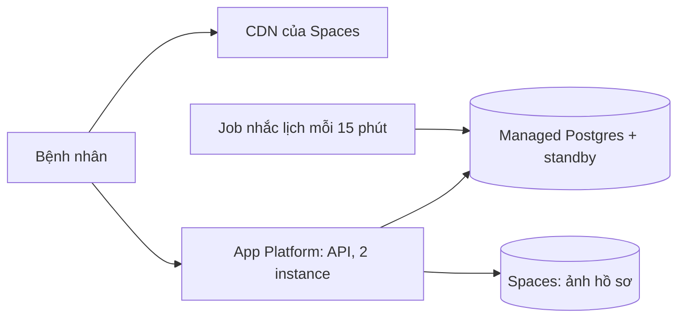

# Kiến trúc cloud cho hệ thống đặt lịch phòng khám Hà Nội

Ví dụ của một hệ thống khác, chỉ để thấy mức chi tiết cần có. Số liệu giá là ước tính tháng 11/2026.

## 1. Bối cảnh và ràng buộc

- Ngân sách 300 USD mỗi tháng cho production và staging, không tính lương.
- 2 dev full-stack, không có người vận hành riêng; không ai trực đêm.
- Khoảng 400 000 request API mỗi tháng, đỉnh 15 request/giây sáng thứ Hai; ảnh hồ sơ 40 GB.
- Bệnh nhân ở Việt Nam: p95 dưới 200 ms từ Hà Nội và TP.HCM.
- Dữ liệu sức khoẻ: mã hoá khi lưu và khi truyền, nhật ký truy cập giữ 1 năm.
- RPO 1 giờ, RTO 8 giờ (đặt lịch qua điện thoại được khi hệ thống chết).

## 2. Phương án

| Phương án | Nhà cung cấp | Chi phí/tháng (USD) | Vận hành | Rủi ro |
| --- | --- | --- | --- | --- |
| App Platform + Managed Postgres ở Singapore | DigitalOcean | 95 | Ít: PaaS, DB có backup và failover | Ít dịch vụ quản lý hơn hãng lớn |
| ECS Fargate + RDS ở ap-southeast-1 | AWS | 210 | Vừa: VPC, ALB, IAM phải tự thiết kế | Dễ vượt ngân sách vì NAT, ALB, log |
| Container Apps + Azure Database for PostgreSQL ở Southeast Asia | Azure | 190 | Vừa | Team chưa quen Azure |
| Hai VPS tự cài Docker và Postgres | Contabo | 30 | Nhiều: tự vá, tự backup, tự HA | Không ai trực đêm để chữa |

## 3. Quyết định

- Chọn DigitalOcean, region SGP1 (Singapore): gần Việt Nam nhất trong các nhà cung cấp so sánh, độ trễ khoảng 40 ms.
- PaaS vì team không có người vận hành; Managed Postgres có standby node đáp ứng RTO và backup point-in-time đáp ứng RPO.
- Chi phí 95 USD còn dư cho staging và tăng trưởng; AWS chỉ đáng khi cần dịch vụ quản lý mà DigitalOcean không có.

## 4. Kiến trúc

Request đi qua load balancer của App Platform tới hai instance API; job nhắc lịch là worker riêng.

## 5. Chi phí ước tính

| Hạng mục | Đơn giá | Lượng | Thành tiền (USD) |
| --- | --- | --- | --- |
| App Platform API | 12 USD/instance | 2 instance | 24 |
| App Platform worker | 5 USD/instance | 1 instance | 5 |
| Managed Postgres + standby | 30 USD | 1 cụm | 30 |
| Spaces | 5 USD (250 GB, 1 TB egress kèm) | 1 | 5 |
| Egress vượt hạn mức | 0,01 USD/GB | 0 GB | 0 |
| Staging (1 instance, DB nhỏ) | 27 USD | 1 | 27 |
| Backup giữ thêm 30 ngày | 4 USD | 1 | 4 |

Tổng: 95 USD mỗi tháng.

## 6. Trách nhiệm chung

- Nhà cung cấp: phần cứng, mạng, vá hệ điều hành của App Platform và Postgres, failover standby.
- Team: code và thư viện, cấu hình quyền truy cập, mã hoá dữ liệu nhạy cảm ở tầng ứng dụng, xoay vòng secret.
- Team: kiểm restore backup mỗi quý, nhật ký truy cập dữ liệu sức khoẻ.

## 7. Rủi ro, lock-in và đường lui

- Lock-in thấp: app là container, DB là Postgres chuẩn, Spaces nói API S3.
- Đường lui: chuyển sang AWS bằng pg_dump hay logical replication, image chạy trên ECS không sửa code.
- DigitalOcean ít dịch vụ bảo mật nâng cao; nếu bị yêu cầu chứng chỉ tuân thủ cao hơn thì phải chuyển.

## 8. Khi nào xem lại

- Lưu lượng vượt 5 lần hiện tại hoặc chi phí vượt 200 USD.
- Có yêu cầu pháp lý bắt dữ liệu nằm tại Việt Nam.
