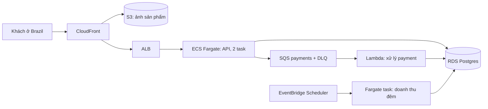

# Kiến trúc cloud cho Olist Shop

Người viết: nhóm platform Olist Shop. Ngày: 2026-11-11. Giá là ước tính theo bảng giá công khai tháng 11/2026, làm tròn; kiểm lại bằng
AWS Pricing Calculator trước khi trình duyệt.

## 1. Bối cảnh và ràng buộc

- Ngân sách 300 USD mỗi tháng cho production và staging, không tính lương; Black Friday được phép vượt 20% trong một tuần.
- 3 dev, 1 DevOps bán thời gian; không có ca trực đêm cố định, nên ưu tiên dịch vụ quản lý tự chữa.
- 3 triệu request API mỗi tháng, trung bình 1 đến 2 request/giây, đỉnh 40 request/giây (Black Friday gấp 10).
- Postgres 30 GB, tăng 2 GB mỗi tháng; job tính doanh thu 40 phút mỗi đêm; ảnh sản phẩm 150 GB, khoảng 1 TB tải ra mỗi tháng qua CDN.
- Khách ở Brazil, chủ yếu São Paulo: p95 dưới 300 ms; LGPD: ưu tiên dữ liệu cá nhân nằm ở Brazil.
- RPO 1 giờ, RTO 4 giờ.

## 2. Phương án

| Phương án | Nhà cung cấp | Chi phí/tháng (USD) | Vận hành | Rủi ro |
| --- | --- | --- | --- | --- |
| ECS Fargate + RDS Postgres + S3/CloudFront ở sa-east-1 | AWS | 235 | Vừa: VPC, IAM, ALB tự thiết kế; DB, container do AWS vận hành | sa-east-1 đắt hơn us-east-1 khoảng 50%; dễ phát sinh NAT, log |
| Cloud Run + Cloud SQL + Cloud Storage ở southamerica-east1 | GCP | 215 | Ít: Cloud Run scale về 0, không có VPC phức tạp | Team chưa quen GCP; Cloud SQL HA gấp đôi giá |
| Hai VM + Postgres tự cài ở Falkenstein | Hetzner | 70 | Nhiều: tự vá, tự backup, tự HA | Không có region ở Brazil: thêm khoảng 200 ms, dữ liệu ra khỏi Brazil |
| Dyno + Heroku Postgres ở region US | Heroku | 290 | Rất ít | Không có region ở Brazil; sát ngân sách, không còn chỗ cho staging |

## 3. Quyết định

- Chọn AWS, region `sa-east-1` (São Paulo): đáp ứng độ trễ và LGPD; team đã dùng OpenTofu với provider AWS ở module 08.
- ECS Fargate thay vì Lambda cho API: tải đều cả ngày, container sẵn có từ module 06; job 40 phút cũng chạy dạng Fargate task (Lambda tối
  đa 15 phút). Lambda chỉ dùng cho xử lý event (payment, gửi email) qua SQS.
- RDS Postgres single-AZ cộng backup tự động và PITR cho RPO 1 giờ; Multi-AZ đắt gấp đôi, để dành khi doanh thu cho phép. RTO 4 giờ đủ để
  restore từ snapshot.
- Không NAT gateway: task Fargate trong subnet public với IP public và security group chỉ mở từ ALB; ở bản sau dùng VPC endpoint.
- GCP là phương án dự phòng gần ngang giá; chọn AWS vì kỹ năng sẵn có, không vì giá.

## 4. Kiến trúc

Request động đi CloudFront → ALB → API; ảnh đi CloudFront → S3. Payment đi qua SQS để API trả lời ngay và Lambda xử lý có retry, DLQ. Job
đêm do EventBridge Scheduler bật một Fargate task rồi tắt.

## 5. Chi phí ước tính

| Hạng mục | Đơn giá | Lượng | Thành tiền (USD) |
| --- | --- | --- | --- |
| Fargate API (vCPU) | 0,0696 USD/vCPU-giờ | 2 task × 0,5 vCPU × 730 giờ | 50,80 |
| Fargate API (RAM) | 0,0076 USD/GB-giờ | 2 task × 1 GB × 730 giờ | 11,10 |
| ALB | 0,034 USD/giờ + LCU | 730 giờ | 30 |
| RDS db.t4g.small single-AZ | 0,065 USD/giờ | 730 giờ | 47,50 |
| RDS lưu trữ gp3 và backup | 0,19 USD/GB-tháng | 50 GB | 12 |
| S3 ảnh sản phẩm | 0,0405 USD/GB-tháng | 150 GB | 6,10 |
| Egress qua CloudFront | 1 TB/tháng miễn phí, sau đó 0,11 USD/GB | 1 TB | 0 |
| IPv4 public cho task | 0,005 USD/giờ | 2 địa chỉ × 730 giờ | 7,30 |
| SQS, Lambda, EventBridge | theo request | dưới mức miễn phí | 1 |
| Job đêm Fargate | 0,0696 USD/vCPU-giờ | 1 vCPU × 20 giờ | 1,60 |
| CloudWatch Logs và alarm | 0,50 USD/GB | 15 GB, 10 alarm | 8 |
| Secrets Manager, Route 53 | 0,40 USD/secret, 0,50 USD/zone | 4 secret, 1 zone | 2,10 |
| Staging (1 task, db.t4g.micro tắt ngoài giờ) | ước tính | 1 môi trường | 45 |

Tổng: 222,50 USD mỗi tháng, còn khoảng 77 USD cho Black Friday (scale API lên 6 task trong một tuần khoảng 25 USD) và sai số.

## 6. Trách nhiệm chung

- Nhà cung cấp (AWS): trung tâm dữ liệu, phần cứng, hypervisor; vá hệ điều hành và engine của RDS trong maintenance window; hạ tầng chạy
  Fargate và Lambda.
- Team Olist: image container và thư viện bên trong, IAM role của từng task và function, security group, mã hoá (bật KMS cho RDS, S3), xoay
  vòng secret, chọn phiên bản engine và thời điểm nâng cấp.
- Team Olist: backup có kiểm restore mỗi quý, phân loại dữ liệu cá nhân theo LGPD, log truy cập, budget và alarm chi phí.

## 7. Rủi ro, lock-in và đường lui

- Lock-in vừa phải: API là container chuẩn, DB là Postgres chuẩn, S3 có API tương thích ở mọi nhà cung cấp; phần khoá chặt là IAM, SQS,
  EventBridge và Lambda.
- Đường lui: chuyển sang GCP southamerica-east1 bằng logical replication Postgres sang Cloud SQL, chạy cùng image trên Cloud Run, thay SQS
  bằng Pub/Sub ở lớp adapter nhỏ trong code.
- Single-AZ RDS: mất AZ thì RTO phụ thuộc restore snapshot (khoảng 1 giờ cho 30 GB); chấp nhận được với RTO 4 giờ.
- Chi phí log và dữ liệu ra là khoản dễ vượt: đặt retention 14 ngày, budget alarm ở 80% và dự báo 100%.

## 8. Khi nào xem lại

- Lưu lượng vượt 5 lần mức hiện tại hay chi phí vượt 270 USD hai tháng liền.
- Doanh thu cho phép Multi-AZ, hoặc yêu cầu RTO dưới 1 giờ.
- AWS mở thêm ưu đãi giá (Savings Plans cho Fargate) khi tải đã ổn định 6 tháng: cam kết 1 năm giảm khoảng 20%.
