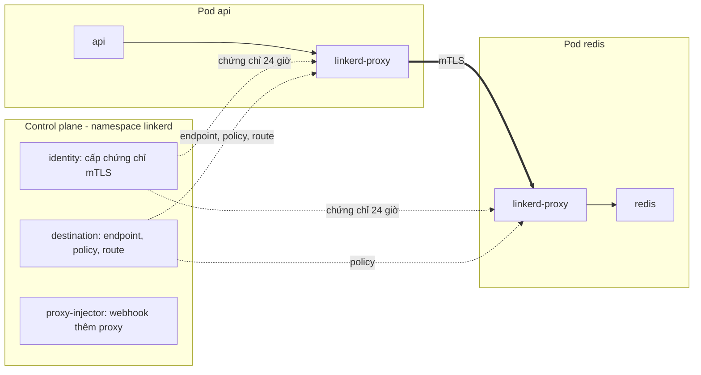
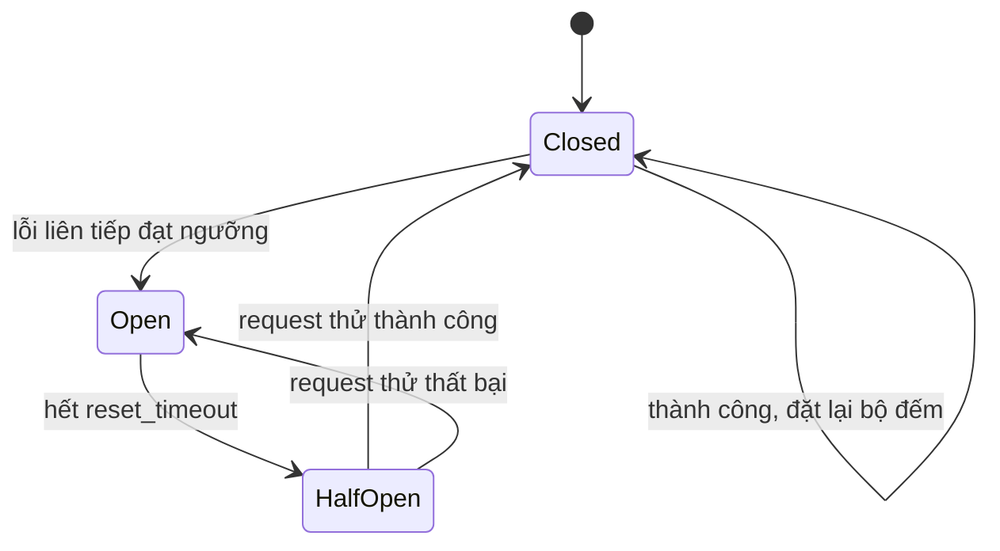

# Service mesh và cloud design patterns

Tới module này Olist Shop đã chạy trên Kubernetes, có GitOps, observability và một chân trên cloud. Câu hỏi tiếp theo không còn là "chạy
được không" mà là "các service nói chuyện với nhau có an toàn và bền không": ai được gọi ai, traffic có mã hoá không, một dependency chậm
có kéo sập cả hệ thống không, và khi có sự cố thì nhìn vào đâu. Service mesh trả lời một phần ở tầng mạng, không phải sửa code. Phần còn
lại là các cloud design pattern: những cách cắt, nối, bảo vệ service đã được gọi tên, mỗi cái có chỗ dùng và cái giá riêng.

Bài thực hành chạy Linkerd thật trong cluster `devops-lab`: mTLS và AuthorizationPolicy cho Olist Shop, retry và timeout bằng HTTPRoute
trước một backend lỗi ngẫu nhiên, một sự cố trong mesh để chẩn đoán. Phần pattern có bài viết code (circuit breaker, retry có jitter)
chạy trong sandbox không cần cluster, và hai bài Advanced: quyết định có dùng mesh không, và một postmortem kèm review kiến trúc.

Sau module này bạn sẽ:

- Giải thích được data plane, control plane, sidecar và ambient; biết proxy nằm ở đâu và traffic đi qua nó thế nào.
- Bật mTLS, đọc danh tính workload, viết `Server`, `MeshTLSAuthentication`, `AuthorizationPolicy` của Linkerd.
- Cấu hình retry, timeout, traffic split; tính được retry làm tải tăng bao nhiêu và vì sao phải có giới hạn.
- Đọc metrics của proxy để trả lời "ai gọi ai, thành công bao nhiêu, có mTLS không".
- Nói được khi nào **không** nên dùng mesh, và chọn giữa Linkerd, Istio, Consul, Envoy, Cilium theo ràng buộc của tổ chức.
- Dùng cloud design pattern theo bốn nhóm Availability, Data Management, Design & Implementation, Management & Monitoring: dùng khi
  nào, đánh đổi gì, lỗi hay gặp, áp vào Olist Shop thế nào.

## 0. Cài đặt

| Thành phần | Phiên bản đã kiểm | Tối thiểu cho bài tập | Dùng ở |
| --- | --- | --- | --- |
| kind, kubectl, Docker | Như module 10 (kind 0.30.0, kubectl 1.34.13) | Như module 10 | Basic 01, Intermediate 01, 02 |
| Cluster `devops-lab` cộng image bài tập | Như mục 0 của module 10 (`olist-shop:1.0`, `postgres:16.15-alpine`, `redis:7.4.12-alpine`) | Như module 10 | Basic 01, Intermediate 01, 02 |
| CRD Gateway API (kênh standard) | v1.6.3, `setup/kind/gateway/` | Đúng bản đã ghim | Phải có trước khi cài Linkerd |
| Linkerd (trong cluster) | edge-26.10.1: control plane cộng linkerd-cni, `setup/kind/linkerd/` | Đúng bản đã ghim | Basic 01, Intermediate 01, 02 |
| `linkerd` (CLI) | edge-26.10.1 | edge-26.10.1, cùng bản control plane; không bài nào cần | Xem tay, tuỳ chọn |
| bwrap, uv | Như module 02 | Như module 02 | Basic 02 (sandbox) |

Chưa có cluster thì làm mục 0 của module 10 trước (tạo cluster, ghim CPU, nạp image). Basic 02 và hai bài Advanced không cần cluster.

### Linkerd trong `devops-lab` (việc của admin)

Linkerd là thành phần cluster-scoped (CRD, webhook, DaemonSet CNI), nên **admin (bạn, bằng kubeconfig admin) cài một lần** sau khi tạo
cluster; test không bao giờ cài, thiếu thì `ex.require_linkerd()` và `KubeLab(mesh=True)` skip kèm đúng lệnh. Lệnh đầy đủ ở mục
"Linkerd dùng chung" của `setup/DEVOPS-TOOLS.md`. Thứ tự:

1. **CRD Gateway API trước.** Policy controller của Linkerd chỉ theo dõi HTTPRoute, GRPCRoute của Gateway API khi CRD đã có lúc nó khởi
   động. Bài không cần Traefik, chỉ cần CRD:

   ```bash
   (cd setup/kind/gateway && sha256sum --check SHA256SUMS) &&
   kubectl --kubeconfig ~/.kube/devops-lab.yaml apply --server-side -f setup/kind/gateway/00-gateway-api-v1.6.3-standard-install.yaml &&
   kubectl --kubeconfig ~/.kube/devops-lab.yaml wait --for condition=Established crd --all --timeout=60s
   ```

   Đã làm phần Gateway của module 10 rồi thì bỏ qua bước này. Cài CRD sau Linkerd thì phải
   `kubectl -n linkerd rollout restart deployment/linkerd-destination`.
2. **Kéo ba image theo digest** (`controller`, `proxy`, `cni-plugin`), nạp vào node bằng `kind load image-archive` (image CNI nạp cả vào
   control plane, vì DaemonSet chạy trên mọi node).
3. **Kiểm `SHA256SUMS` rồi apply** `setup/kind/linkerd` (output của `helm template` cho ba chart 2026.10.1, không có Secret hay khoá
   nào).
4. **Sinh chứng chỉ bằng `bash setup/kind/linkerd/certs.sh`**: trust anchor, issuer, chứng chỉ của ba webhook, bằng openssl trong thư
   mục tạm. Khoá của trust anchor bị xoá ngay sau khi ký issuer, không gì nằm lại trên đĩa hay trong repo.
5. Chờ `linkerd-cni` và ba Deployment sẵn sàng.

Trên máy viết bài (CPU ghim `12-35`, image đã kéo về Docker), bước 2 tới 5 khoảng 30 giây. Kết quả:

```text
$ kubectl --kubeconfig ~/.kube/devops-lab.yaml -n linkerd get deploy
NAME                     READY   UP-TO-DATE   AVAILABLE   AGE
linkerd-destination      1/1     1            1           41m
linkerd-identity         1/1     1            1           41m
linkerd-proxy-injector   1/1     1            1           41m
$ kubectl --kubeconfig ~/.kube/devops-lab.yaml -n linkerd-cni get ds
NAME          DESIRED   CURRENT   READY   UP-TO-DATE   AVAILABLE   NODE SELECTOR            AGE
linkerd-cni   3         3         3       3            3           kubernetes.io/os=linux   41m
```

Vì sao cài như vậy (chi tiết ở DEVOPS-TOOLS):

- **Bản edge**: Linkerd mã nguồn mở chỉ phát hành bản edge đánh số theo tuần; bản "stable" do Buoyant build và cần đăng ký.
  edge-26.10.1 (2026-10-05) là bản edge mới nhất đã ra đủ hai tuần lúc viết bài.
- **linkerd-cni thay init container**: init container `linkerd-init` cần NET_ADMIN, NET_RAW để đặt iptables, bị Pod Security baseline
  của namespace lab từ chối. CNI đặt luật chuyển hướng từ phía node.
- **CA ngoài**: `linkerd install` tự sinh trust anchor và nhét khoá vào manifest; ở đây chứng chỉ do `certs.sh` sinh và chỉ nằm trong
  Secret của namespace `linkerd`.
- **Không cài viz**: testkit (và bạn) đọc thẳng `/metrics` của proxy ở cổng admin 4191, không cần thêm Prometheus và dashboard.

RAM đo bằng `crictl stats` lúc nghỉ: control plane cộng CNI khoảng 85 MiB; mỗi pod trong mesh thêm một proxy khoảng 3-4 MiB.

### `linkerd` CLI (tuỳ chọn)

Không bài nào cần CLI, test không gọi nó (validator cấm). CLI giúp bạn xem tay: `linkerd check`, `linkerd diagnostics proxy-metrics`,
`linkerd authz`. Release của Linkerd **không kèm tệp checksum**; SHA-256 dưới đây là trường `digest` mà GitHub ghi cho asset (`gh api
repos/linkerd/linkerd2/releases/tags/edge-26.10.1`) và khớp tệp đã tải. Bạn tin GitHub và người viết bài; không có chữ ký để kiểm thêm.
Không dùng script `curl ... | sh` trên trang chủ: nó tải bản mới nhất, không ghim, không kiểm hash trước khi chạy.

```bash
mkdir -p ~/.cache/devops-track/dl ~/.local/bin && cd ~/.cache/devops-track/dl &&
curl -fsSLO https://github.com/linkerd/linkerd2/releases/download/edge-26.10.1/linkerd2-cli-edge-26.10.1-linux-amd64 &&
echo "66d634f5318c8016f0b5face246a688964b6e2c86d6c3be34be68ab9fcd2a8cc  linkerd2-cli-edge-26.10.1-linux-amd64" | sha256sum --check &&
install -m 0755 linkerd2-cli-edge-26.10.1-linux-amd64 ~/.local/bin/linkerd &&
linkerd version --client
```

```text
linkerd2-cli-edge-26.10.1-linux-amd64: OK
Client version: edge-26.10.1
```

Luôn truyền `--kubeconfig ~/.kube/devops-lab.yaml`. `linkerd --kubeconfig ~/.kube/devops-lab.yaml check` cho kết quả `Status check
results are √`, kèm cảnh báo `‼ control plane is up-to-date` (đã có edge mới hơn): bình thường, vì track ghim bản. Gỡ CLI: `rm -f
~/.local/bin/linkerd`. Gỡ Linkerd khỏi cluster: mục "Linkerd dùng chung" của DEVOPS-TOOLS.

## 1. Service mesh: data plane, control plane, sidecar và ambient

Khi Olist Shop có ba service, mỗi service tự lo kết nối của mình là đủ. Khi có ba mươi service viết bằng bốn ngôn ngữ, mỗi team tự viết
retry, timeout, TLS, metrics theo cách riêng; một chỗ sai là một sự cố, và không ai nhìn được toàn cảnh "ai gọi ai". Service mesh đưa
những việc đó ra khỏi code, vào một lớp proxy đứng cạnh mọi workload, cấu hình tập trung.



- **Data plane** là các proxy mà mọi request thật đi qua. Linkerd dùng `linkerd2-proxy` viết bằng Rust, nhỏ và chỉ làm việc của mesh;
  Istio, Consul dùng Envoy, đa năng hơn và nặng hơn.
- **Control plane** không nằm trên đường đi của request. Nó phát cấu hình cho proxy: danh sách endpoint của mỗi Service, policy, route,
  và chứng chỉ. Control plane chết thì proxy vẫn chạy với cấu hình cuối cùng nó có; chỉ thay đổi mới (pod mới, chứng chỉ mới) bị kẹt.
- **Traffic tới proxy bằng cách nào?** Luật iptables trong network namespace của pod chuyển mọi kết nối vào, ra sang proxy. Luật do init
  container (cần NET_ADMIN) hay plugin CNI (chạy trên node) đặt. Ứng dụng vẫn gọi `redis:6379` như cũ, không biết có proxy. Proxy tự
  nhận ra HTTP; cổng nói giao thức khác mà server nói trước (MySQL, SMTP) hay cần chuyển nguyên byte thì khai báo bằng annotation
  `config.linkerd.io/opaque-ports`.

**Sidecar và ambient.** Mô hình sidecar đặt một proxy trong mỗi pod: cô lập tốt (proxy chỉ phục vụ một workload, lỗi của nó không lan),
danh tính rõ ràng, nhưng RAM và CPU tỉ lệ với số pod, và nâng cấp proxy là restart mọi pod. Linkerd chạy proxy dạng native sidecar
(init container có `restartPolicy: Always`, Kubernetes 1.29+): proxy khởi động trước và dừng sau ứng dụng, Job chạy xong thì pod kết thúc
được. Istio **ambient** tách hai tầng: `ztunnel` một bản mỗi node lo L4 (mTLS, policy theo danh tính), `waypoint` (Envoy) chỉ dựng cho
namespace hay service cần L7 (retry, route theo header). Đổi lại, một proxy dùng chung cho nhiều pod trên node (ztunnel) là vùng ảnh hưởng
lớn hơn, và đường đi của request phức tạp hơn khi gỡ lỗi. Cilium làm một phần việc của mesh trong eBPF của kernel, cộng Envoy theo node
cho L7.

| | Sidecar | Ambient (Istio) | Theo node (Cilium) |
| --- | --- | --- | --- |
| Proxy nằm ở | Mỗi pod | ztunnel mỗi node, waypoint khi cần L7 | eBPF trong kernel, Envoy mỗi node |
| RAM tăng theo | Số pod | Số node, số waypoint | Số node |
| Nâng cấp proxy | Restart pod | Restart ztunnel (kết nối của mọi pod trên node) | Restart agent |
| Cô lập lỗi | Tốt nhất | ztunnel lỗi ảnh hưởng cả node | Agent lỗi ảnh hưởng cả node |
| Gỡ lỗi | Một proxy cho một pod | Hai tầng proxy | Kernel cộng proxy |

## 2. mTLS, danh tính và policy

TLS thường chỉ chứng minh server là ai. **mTLS** (mutual TLS) bắt cả hai bên trình chứng chỉ, nên server biết chắc ai đang gọi. Trong
mesh, chứng chỉ không gắn với IP hay tên máy (IP của pod đổi liên tục) mà với **danh tính workload**: ở Linkerd là ServiceAccount,
dạng `<sa>.<namespace>.serviceaccount.identity.linkerd.cluster.local`.

```mermaid
sequenceDiagram
    participant P as linkerd-proxy (pod api)
    participant K as Kubernetes API
    participant I as linkerd-identity
    P->>P: sinh khoá riêng, giữ trong bộ nhớ
    P->>I: CSR kèm token của ServiceAccount api (projected, audience riêng)
    I->>K: TokenReview: token này của ai?
    K-->>I: system:serviceaccount:ns:api
    I-->>P: chứng chỉ api.ns.serviceaccount.identity... ký bởi issuer, hạn 24 giờ
    Note over P: xoay trước khi hết hạn; issuer do trust anchor ký
```

- **Chuỗi tin cậy**: trust anchor (CA gốc, giữ ngoài cluster, ở `devops-lab` khoá của nó bị xoá sau khi ký) ký issuer (CA trung gian,
  Secret trong namespace `linkerd`); issuer ký chứng chỉ của từng proxy. Mọi proxy tin trust anchor. Trust anchor hết hạn hay bị thay mà
  không restart các proxy là mTLS hỏng trên toàn mesh: đây là thứ cần lịch, cảnh báo và runbook.
- **Khoá riêng không rời pod**: proxy sinh khoá trong bộ nhớ, chỉ gửi CSR. Token dùng để xin chứng chỉ là volume projected riêng của
  Linkerd, nên `automountServiceAccountToken: false` trên pod vẫn chạy.
- **mTLS mặc định**: giữa hai pod cùng trong mesh, Linkerd tự nâng kết nối lên mTLS, ứng dụng không biết. Pod ngoài mesh vẫn gọi được pod
  trong mesh (plaintext) cho tới khi có policy cấm.

**Policy của Linkerd** (nhóm `policy.linkerd.io`):

| Object | Việc |
| --- | --- |
| `Server` | Gom một cổng của một nhóm pod (theo `podSelector`), nói giao thức (`HTTP/1`, `HTTP/2`, `gRPC`, `opaque`). Đã có Server thì mặc định từ chối |
| `MeshTLSAuthentication` | Danh sách danh tính mTLS được chấp nhận (`identities` hay `identityRefs` tới ServiceAccount, Namespace) |
| `NetworkAuthentication` | Danh sách dải IP (cho client ngoài mesh, như kubelet probe) |
| `AuthorizationPolicy` | Nối một đích (`Server`, `HTTPRoute`, `Namespace`) với các cách xác thực bắt buộc |
| `HTTPRoute` | Route theo path, method, header; gắn vào Service (phía client: retry, timeout, chia traffic) hay Server (phía server: policy theo route) |

Ví dụ: Redis chỉ cho `api` và `worker`:

```yaml
apiVersion: policy.linkerd.io/v1beta3
kind: Server
metadata: {name: redis}
spec:
  podSelector: {matchLabels: {app.kubernetes.io/name: redis}}
  port: redis
  proxyProtocol: opaque
---
apiVersion: policy.linkerd.io/v1alpha1
kind: MeshTLSAuthentication
metadata: {name: redis-clients}
spec:
  identityRefs:
    - {kind: ServiceAccount, name: api}
    - {kind: ServiceAccount, name: worker}
---
apiVersion: policy.linkerd.io/v1alpha1
kind: AuthorizationPolicy
metadata: {name: redis-clients}
spec:
  targetRef: {group: policy.linkerd.io, kind: Server, name: redis}
  requiredAuthenticationRefs:
    - {group: policy.linkerd.io, kind: MeshTLSAuthentication, name: redis-clients}
```

Kết nối bị từ chối: HTTP nhận `403`, TCP bị đóng; proxy đếm vào `inbound_http_authz_deny_total` hay `inbound_tcp_authz_deny_total` kèm
nhãn `client_id` (có mTLS) hay `tls="no_identity"` (không mTLS). Mặc định cluster-wide của Linkerd là `all-unauthenticated` (mọi thứ
được phép), đổi bằng annotation `config.linkerd.io/default-inbound-policy` theo namespace hay pod.

So với NetworkPolicy (module 11): NetworkPolicy lọc theo IP và nhãn pod ở tầng mạng, không mã hoá, ai tạo được pod mang nhãn đúng là
qua. Policy của mesh xác thực danh tính bằng mật mã và hiểu HTTP (cho phép theo path), nhưng chỉ chặn được traffic đi qua proxy. Dùng
cả hai: NetworkPolicy là lớp nền, mesh là lớp danh tính.

## 3. Traffic: retry, timeout, budget, traffic split

Proxy nằm trên đường đi của mọi request nên làm được những việc mà trước đây phải viết trong thư viện client.

**Timeout.** Mỗi lời gọi cần một giới hạn thời gian, nếu không một dependency treo sẽ giữ thread, kết nối, bộ nhớ của bên gọi tới khi
chính bên gọi chết. Ở Linkerd, đặt bằng annotation trên HTTPRoute: `timeout.linkerd.io/request` (cả request, kể cả các lần retry),
`timeout.linkerd.io/response`, `timeout.linkerd.io/idle`, hay `spec.rules[].timeouts` theo Gateway API. Timeout ở tầng ngoài phải lớn hơn
tầng trong cộng thời gian retry, nếu không tầng ngoài bỏ cuộc trong khi tầng trong vẫn đang thử. Tốt hơn nữa là **deadline propagation**:
truyền phần thời gian còn lại xuống tầng dưới (gRPC làm sẵn bằng `grpc-timeout`).

**Retry.** `retry.linkerd.io/http: 5xx` (hay `gateway-error`, hay dải mã), `retry.linkerd.io/limit` (số lần thử lại tối đa, mặc định 1),
`retry.linkerd.io/timeout` (timeout cho từng lần thử: lần thử treo bị cắt và thử lại). Retry chỉ an toàn cho request **idempotent**:
GET, PUT theo khoá, hay POST có idempotency key mà server tôn trọng. Proxy không biết nghiệp vụ, nên route có retry chỉ nên khớp request
idempotent.

**Retry là tải thêm.** Một tầng thử tối đa n lần thì khi backend hỏng hẳn, mỗi request thành n request. Hai tầng nối tiếp mỗi tầng n lần
thì thành n nhân n. Ví dụ `mobile-bff → catalog → search`, mỗi chặng 3 lần thử: search nhận 9 request cho mỗi request của người dùng,
đúng lúc nó yếu nhất. Đó là **retry storm**, và nó hay biến một sự cố nhỏ thành sự cố lớn tự duy trì: backend chậm, client timeout,
client retry, backend càng chậm. Cách giữ:

- Chỉ retry ở **một** tầng (thường là tầng gần dependency nhất), tầng khác trả lỗi nhanh.
- **Giới hạn số lần thử** và **retry budget**: tổng request retry không vượt một tỉ lệ (ví dụ 20%) của request gốc, nên khi backend hỏng
  hẳn thì tải chỉ tăng 20% thay vì gấp n. ServiceProfile cũ của Linkerd có budget theo tỉ lệ; HTTPRoute hiện tại chỉ có `limit`, nên giữ
  `limit` nhỏ.
- **Backoff có jitter** (code client, bài Basic 02): chờ tăng dần và ngẫu nhiên để các client không thử lại cùng lúc.
- **Tôn trọng tín hiệu quá tải**: `429`, `503` kèm `Retry-After`; circuit breaker ngừng gọi khi lỗi liên tục.

Số đo trên `devops-lab` (bài Intermediate 01): backend lỗi 20%, treo 10%. Không có route: 49/60 request thành công, request chậm nhất 2,5
giây. Route GET với `limit: 3`, `retry.linkerd.io/timeout: 300ms`, `timeout.linkerd.io/request: 2s`: 200/200 thành công, chậm nhất 1,2
giây, backend nhận 262 request cho 200 request (1,31 lần).

**Traffic split.** HTTPRoute có nhiều `backendRefs` kèm `weight` chia traffic giữa hai Service (ví dụ `checkout-v1` 95, `checkout-v2` 5):
canary, blue-green, chuyển dần sang service mới. Flagger hay Argo Rollouts đổi trọng số tự động theo tỉ lệ thành công mà mesh đo được.

**Circuit breaking ở mesh.** Linkerd có failure accrual (`balancer.linkerd.io/failure-accrual: consecutive` trên Service): endpoint lỗi
liên tiếp bị loại khỏi cân bằng tải một lúc. Nó bảo vệ khỏi một pod hỏng trong nhiều pod; khi cả service hỏng, ứng dụng vẫn cần circuit
breaker và fallback của riêng mình.

## 4. Observability của mesh và khi nào không cần mesh

Vì mọi request đi qua proxy, mesh cho **golden metrics** theo từng cặp service mà không cần sửa code: số request, tỉ lệ thành công, độ trễ
theo percentile, theo route và theo danh tính bên gọi. Proxy Linkerd phơi chúng ở `/metrics` cổng 4191:

| Metric | Hướng | Đọc ra |
| --- | --- | --- |
| `request_total`, `response_total{classification}` | inbound, outbound | Số request, thành công hay thất bại, nhãn `tls`, `client_id`, `server_id` |
| `response_latency_ms_bucket` | inbound, outbound | Histogram độ trễ |
| `tcp_open_total`, `tcp_read_bytes_total` | inbound, outbound | Kết nối TCP, kể cả giao thức opaque |
| `inbound_http_authz_deny_total`, `inbound_tcp_authz_deny_total` | inbound | Request, kết nối bị policy chặn và vì sao |
| `outbound_http_route_request_statuses_total` | outbound | Kết quả cuối mà ứng dụng nhận, theo route |
| `outbound_http_route_retry_requests_total` | outbound | Số lần retry theo route |

Viz extension (dashboard, `linkerd viz stat`, `tap`) dựng thêm một Prometheus để gom chúng; ở `devops-lab` không cài, bạn đọc thẳng bằng
`linkerd diagnostics proxy-metrics` hay `kubectl get --raw /api/v1/namespaces/<ns>/pods/<pod>:4191/proxy/metrics`. Ở production, cho
Prometheus của module 13 scrape cổng 4191. Mesh không thay trace: nó thấy từng chặng nhưng không nối chúng thành một trace nếu ứng
dụng không truyền header trace (module 13).

**Khi nào không cần mesh.** Mesh không miễn phí: mỗi pod thêm một proxy, mỗi chặng thêm độ trễ, cluster thêm control plane, webhook,
CRD, chứng chỉ phải xoay, và một lớp nữa để gỡ lỗi khi có sự cố. Chưa nên dùng khi:

- Có ít service, một team; NetworkPolicy, TLS ở ingress, retry trong một thư viện client chung là đủ.
- Chưa ai trong team đọc được metrics và log của proxy, và không có thời gian học trước khi có sự cố.
- Cluster đang thiếu tài nguyên; workload nhạy độ trễ tới mức vài trăm micro giây mỗi chặng là đáng kể.
- Vấn đề thật nằm ở chỗ mesh không với tới: idempotency, dữ liệu, nghiệp vụ, hay giao tiếp chủ yếu qua hàng đợi (mesh chỉ thấy kết nối
  tới broker).

Nên cân nhắc khi: có yêu cầu mTLS và danh tính từ kiểm toán (PCI DSS, zero trust), nhiều team và nhiều ngôn ngữ cần cùng chính sách
retry, timeout, cần canary theo tỉ lệ traffic, cần thấy "ai gọi ai" trên hàng chục service. Đưa vào từng bước: một namespace, đo, rồi mới
rộng ra; policy chặn đến sau cùng.

## 5. So sánh Linkerd, Istio, Consul, Envoy, Cilium

| | Linkerd | Istio (sidecar / ambient) | Consul service mesh | Envoy (tự dựng, hay qua Envoy Gateway) | Cilium service mesh |
| --- | --- | --- | --- | --- | --- |
| Data plane | `linkerd2-proxy` (Rust) mỗi pod | Envoy mỗi pod; hay ztunnel (Rust) mỗi node cộng waypoint Envoy | Envoy mỗi workload | Envoy, bạn tự cấu hình qua xDS | eBPF trong kernel, Envoy mỗi node cho L7 |
| Phạm vi | Kubernetes | Kubernetes, VM (hạn chế) | Kubernetes, VM, Nomad | Bất kỳ | Kubernetes (Cilium là CNI) |
| mTLS | Mặc định, tự xoay 24 giờ | `PeerAuthentication` (STRICT, PERMISSIVE) | Có, CA riêng hay Vault | Tự cấu hình | WireGuard/IPsec (mã hoá theo node) hay mutual auth (beta) |
| Traffic L7 | Retry, timeout, split, route theo header cơ bản | Phong phú nhất: mirror, fault injection, rate limit, Wasm | Khá (qua Envoy) | Mọi thứ Envoy làm được | Qua Envoy, ít hơn Istio |
| Vận hành | Ít CRD, ít cấu hình, ít tính năng có chủ đích | Nhiều CRD, cấu hình lớn, cần người chuyên | Thêm cụm Consul server phải vận hành | Bạn là control plane | Gắn với CNI: đổi mesh là đổi mạng |
| RAM | Proxy 3-4 MiB lúc nghỉ, control plane khoảng 85 MiB (đo trên `devops-lab`) | Envoy sidecar hàng chục MiB mỗi pod, tăng theo tải và kích thước cấu hình (trang Performance của Istio); ambient tỉ lệ theo node | Như Envoy | Như Envoy | Theo node |
| Hợp khi | Cần mTLS, metrics, retry với ít người vận hành | Cần L7 phức tạp, có team platform đủ lớn | Hệ thống lai VM và Kubernetes, đã dùng HashiCorp | Gateway, edge proxy, hay xây nền tảng riêng | Đã dùng Cilium làm CNI, muốn ít proxy |

Envoy không phải một mesh mà là proxy mà nhiều mesh dùng; "tự dựng mesh bằng Envoy" nghĩa là bạn viết control plane (xDS), việc mà Istio,
Consul đã làm. Kuma (Kong) và Open Service Mesh (đã ngừng phát triển) là hai cái tên khác bạn sẽ gặp. Gateway API (HTTPRoute, GRPCRoute)
đang thành API chung: dự án GAMMA dùng nó cho traffic giữa service, nên route viết cho Linkerd chuyển sang Istio ít sửa hơn trước.

Track chọn Linkerd cho lab vì nhẹ (cả control plane dưới 100 MiB, quan trọng trên máy học), mTLS mặc định, chạy dưới Pod Security baseline
nhờ CNI, và đủ để học các khái niệm chung. Bản so sánh ở trên dựa trên tài liệu chính thức tháng 11/2026; chỉ Linkerd được cài và đo
trong khoá.

## 6. Cloud design patterns: Availability và Design & Implementation

Cloud design pattern là các giải pháp đã được gọi tên cho vấn đề lặp lại khi xây hệ thống phân tán. Catalog của Microsoft (Azure
Architecture Center, từ cuốn "Cloud Design Patterns" 2014) chia theo nhóm; module này dùng bốn nhóm: **Availability** (giữ hệ thống
phục vụ được khi có lỗi, quá tải; catalog mới tách một phần thành Resiliency), **Data Management**, **Design & Implementation**,
**Management & Monitoring**. Một pattern có thể thuộc hai nhóm. Pattern không phải đích đến: mỗi cái giải một vấn đề và thêm một chi phí.

### Availability

| Pattern | Dùng khi | Đánh đổi | Lỗi hay gặp | Ví dụ Olist Shop |
| --- | --- | --- | --- | --- |
| Retry | Lỗi tạm thời: mất kết nối, 503, 429, timeout ngắn | Tăng tải lên dependency đang yếu; tăng độ trễ | Retry ở nhiều tầng; retry request không idempotent; không backoff, không jitter | api đọc `GET /orders` từ service tồn kho: retry 2 lần có jitter |
| Circuit Breaker | Dependency hỏng kéo dài, gọi tiếp chỉ tốn tài nguyên | Trả lỗi nhanh cho người dùng thay vì chờ; cần chọn ngưỡng | Đếm cả 4xx là lỗi; không có nửa mở nên không tự hồi phục; một breaker chung cho nhiều dependency | api gọi dịch vụ báo giá vận chuyển của đối tác: mở sau 5 lỗi liên tiếp, thử lại sau 30 giây, trả "phí vận chuyển tính sau" |
| Bulkhead | Một dependency chậm có thể chiếm hết thread, kết nối dùng chung | Tài nguyên chia ngăn, mỗi ngăn có thể dư khi ngăn khác thiếu | Ngăn quá to (không cô lập được) hay quá nhỏ (từ chối khi tải bình thường) | Pool kết nối riêng cho dịch vụ đối tác, tách khỏi pool Postgres của đơn hàng |
| Throttling, Rate Limiting | Bảo vệ service khỏi quá tải, chia tài nguyên giữa khách | Từ chối một phần request; cần nói rõ cho client (`429`, `Retry-After`) | Giới hạn theo từng pod thay vì toàn cục; quên giới hạn job nội bộ | Giới hạn API đối tác theo API key; payments trả 503 kèm `Retry-After` khi hàng đợi nội bộ đầy |
| Queue-Based Load Leveling | Việc không cần xong ngay, tải đến theo đợt | Kết quả trễ; thêm broker phải vận hành; cần idempotency khi xử lý lại | Hàng đợi không giới hạn, lỗi chỉ bị dời đi; không theo dõi độ dài hàng đợi | `POST /jobs/recompute` đẩy job vào Redis, worker tính doanh thu theo tốc độ của nó |
| Health Endpoint Monitoring | Cần biết instance có phục vụ được không, để cân bằng tải và cảnh báo | Endpoint kiểm sâu quá thì tự nó gây tải hay lỗi dây chuyền | Liveness kiểm database: database chậm là mọi pod bị restart | `/healthz` (sống), `/readyz` (Postgres, Redis ổn) của api |
| Deployment Stamps | Chia khách thành nhiều bản sao độc lập của cả hệ thống | Nhiều bản phải vận hành, nâng cấp | Dữ liệu dùng chung giữa các stamp phá cô lập | Một stamp cho Brazil, một stamp cho thị trường mới, sự cố của stamp này không chạm stamp kia |



### Design & Implementation

| Pattern | Dùng khi | Đánh đổi | Lỗi hay gặp | Ví dụ Olist Shop |
| --- | --- | --- | --- | --- |
| Sidecar | Thêm năng lực (proxy, log, cấu hình) cho ứng dụng mà không sửa code, cùng vòng đời với nó | Thêm container mỗi pod: RAM, thứ tự khởi động, nâng cấp | Sidecar chưa sẵn sàng khi ứng dụng gọi ra ngoài; Job không kết thúc vì sidecar còn chạy (native sidecar giải quyết) | `linkerd-proxy` cạnh api; nginx sidecar ở module 10 |
| Ambassador | Proxy phía client cho lời gọi ra ngoài: retry, TLS, giám sát thay cho code cũ | Thêm một chặng; dễ thành điểm lỗi chung | Đặt logic nghiệp vụ trong ambassador | Proxy ra API của hãng vận chuyển, lo chứng chỉ client và retry cho ứng dụng PHP cũ |
| Anti-Corruption Layer | Nói chuyện với hệ thống cũ hay bên ngoài có mô hình dữ liệu khác | Thêm lớp dịch phải bảo trì | Để mô hình cũ rò vào domain mới qua "chỉ một trường thôi" | Lớp dịch giữa ERP cũ (mã trạng thái số) và đơn hàng Olist (trạng thái chữ) |
| Strangler Fig | Thay dần một monolith không big-bang | Hai hệ thống chạy song song một thời gian dài | Không bao giờ tắt phần cũ; dữ liệu đồng bộ hai chiều | Gateway chuyển dần `/search`, `/cart` từ monolith PHP sang service mới |
| Backends for Frontends | Mỗi loại client (web, app, đối tác) cần API khác nhau | Thêm service, dễ trùng logic | BFF chứa logic nghiệp vụ thay vì chỉ ghép, định dạng | `mobile-bff` gộp đơn hàng, vận chuyển, đánh giá cho app di động |
| Gateway Routing, Gateway Offloading | Một cửa vào: định tuyến theo path, đưa TLS, xác thực, nén ra khỏi service | Gateway là điểm lỗi và nút cổ chai chung | Nhồi logic nghiệp vụ vào gateway | Traefik/Gateway API ở module 10: `/api` tới api, TLS kết thúc ở gateway |

## 7. Cloud design patterns: Data Management và Management & Monitoring

### Data Management

Phần này giao với track Data Engineer (event, CDC, outbox ở [DE 07: Streaming với Kafka](../../../data-engineer/modules/07-streaming-kafka/README.md));
ở đây nhìn từ phía người vận hành service.

| Pattern | Dùng khi | Đánh đổi | Lỗi hay gặp | Ví dụ Olist Shop |
| --- | --- | --- | --- | --- |
| Cache-Aside | Đọc nhiều, dữ liệu đổi ít, chấp nhận cũ một chút | Dữ liệu cũ; thêm Redis phải vận hành; cache stampede khi key hết hạn | Không có TTL; xoá cache trước khi ghi DB (race); cache cả lỗi | Phí vận chuyển theo bang trong Redis, TTL 10 phút |
| CQRS | Mô hình đọc và ghi khác nhau nhiều, tải đọc lớn | Hai mô hình, đồng bộ trễ (eventual consistency) | Dùng cho CRUD đơn giản; người dùng không thấy thay đổi vừa ghi | Ghi đơn vào Postgres, đọc báo cáo doanh thu từ bảng đã tính sẵn |
| Event Sourcing | Cần lịch sử đầy đủ, audit, dựng lại trạng thái | Truy vấn trạng thái hiện tại khó; đổi schema event khó | Event chứa dữ liệu cá nhân không xoá được; dùng cho mọi thứ | Lịch sử trạng thái thanh toán (authorized, captured, refunded) |
| Materialized View | Truy vấn đắt chạy lặp lại | Dữ liệu trễ; tốn chỗ | Không theo dõi độ trễ làm mới | Bảng `revenue_by_state` do worker tính |
| Sharding | Một database không chứa nổi dữ liệu hay tải ghi | Truy vấn chéo shard, cân bằng lại shard rất khó | Chọn khoá shard lệch (một bang chiếm nửa đơn) | Chia đơn theo `customer_id` băm, không theo bang |
| Saga, Compensating Transaction | Một nghiệp vụ trải qua nhiều service, không có transaction phân tán | Phải viết bước bù cho từng bước; trạng thái trung gian nhìn thấy được | Bước bù không idempotent; quên timeout cho bước đang chờ | Đặt hàng: giữ tồn kho, authorize thẻ, giữ chỗ vận chuyển; hỏng bước sau thì hoàn bước trước |
| Transactional Outbox | Ghi DB và phát event phải cùng thành công | Thêm bảng outbox và tiến trình đọc nó; event có thể trùng | Consumer không idempotent | Ghi đơn và dòng outbox trong một transaction, relay đẩy sang hàng đợi |

### Management & Monitoring

| Pattern | Dùng khi | Đánh đổi | Lỗi hay gặp | Ví dụ Olist Shop |
| --- | --- | --- | --- | --- |
| External Configuration Store | Cấu hình đổi không cần build lại, dùng chung nhiều service | Thêm một dependency lúc khởi động và lúc chạy | Store chết thì service không khởi động được (không có cache cục bộ); bí mật để chung với cấu hình | Timeout, số retry, cờ tính năng trong ConfigMap hay một store chung; bí mật ở Vault (module 12) |
| Health Endpoint Monitoring | Biết từ bên ngoài service có phục vụ được không | Như ở Availability | Chỉ kiểm "process còn sống" | Probe tổng hợp gọi `/orders/<id>` mỗi phút từ ngoài cluster |
| Gateway Offloading, Gateway Routing | Gom TLS, xác thực, log truy cập, định tuyến về một chỗ để quản lý | Như ở Design & Implementation | Gateway không có metric riêng | Log truy cập và metric RED ở gateway cho mọi service |

Mesh là một cách hiện thực nhiều pattern ở tầng hạ tầng: Sidecar (chính nó), Retry, Circuit Breaker (failure accrual), Gateway Routing
(HTTPRoute), Health Endpoint Monitoring (metrics theo cặp service). Pattern nào cần hiểu nghiệp vụ (Saga, Outbox, Idempotency, fallback)
vẫn nằm trong ứng dụng.

```mermaid
flowchart TB
    client[Khách] --> gw[Gateway Routing, Offloading]
    gw --> api[api]
    api -->|Retry, Circuit Breaker, Bulkhead| partner[Báo giá vận chuyển]
    api -->|Cache-Aside| cache[(Redis cache)]
    api -->|Transactional Outbox| db[(Postgres)]
    api -->|Queue-Based Load Leveling| q[[olist:jobs]]
    q --> worker[worker]
    worker -->|Materialized View| db
    cfg[External Configuration Store] -.-> api
    cfg -.-> worker
```



## 8. Tài liệu tham khảo

- Linkerd, [Architecture](https://linkerd.io/2-edge/reference/architecture/), [Automatic mTLS](https://linkerd.io/2-edge/features/automatic-mtls/), [Authorization policy](https://linkerd.io/2-edge/reference/authorization-policy/).
- Linkerd, [Retries](https://linkerd.io/2-edge/reference/retries/), [Timeouts](https://linkerd.io/2-edge/reference/timeouts/), [Circuit breaking](https://linkerd.io/2-edge/reference/circuit-breaking/), [HTTPRoute](https://linkerd.io/2-edge/reference/httproute/).
- Linkerd, [CNI plugin](https://linkerd.io/2-edge/features/cni/), [Generating your own mTLS root certificates](https://linkerd.io/2-edge/tasks/generate-certificates/), [Proxy metrics](https://linkerd.io/2-edge/reference/proxy-metrics/).
- Istio, [Ambient mode overview](https://istio.io/latest/docs/ambient/overview/), [Performance and scalability](https://istio.io/latest/docs/ops/deployment/performance-and-scalability/).
- HashiCorp, [Consul service mesh](https://developer.hashicorp.com/consul/docs/connect).
- Cilium, [Service mesh](https://docs.cilium.io/en/stable/network/servicemesh/).
- Envoy, [What is Envoy](https://www.envoyproxy.io/docs/envoy/latest/intro/what_is_envoy).
- Kubernetes Gateway API, [GAMMA (service mesh)](https://gateway-api.sigs.k8s.io/mesh/).
- Microsoft, [Cloud design patterns](https://learn.microsoft.com/en-us/azure/architecture/patterns/).
- Marc Brooker, [Exponential Backoff and Jitter](https://aws.amazon.com/blogs/architecture/exponential-backoff-and-jitter/) (AWS Architecture Blog); [Timeouts, retries, and backoff with jitter](https://aws.amazon.com/builders-library/timeouts-retries-and-backoff-with-jitter/) (Amazon Builders' Library).
- Google SRE Book, [Handling Overload](https://sre.google/sre-book/handling-overload/) và [Addressing Cascading Failures](https://sre.google/sre-book/addressing-cascading-failures/).
- Bronson và cộng sự, [Metastable Failures in Distributed Systems](https://sigops.org/s/conferences/hotos/2021/papers/hotos21-s11-bronson.pdf), HotOS 2021.
- Michael Nygard, *Release It!*, ấn bản 2 (Pragmatic Bookshelf, 2018): Circuit Breaker, Bulkhead, Timeouts.
