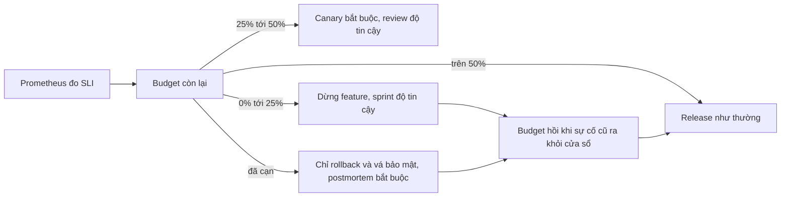
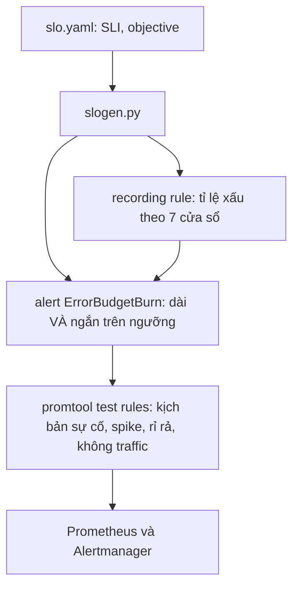
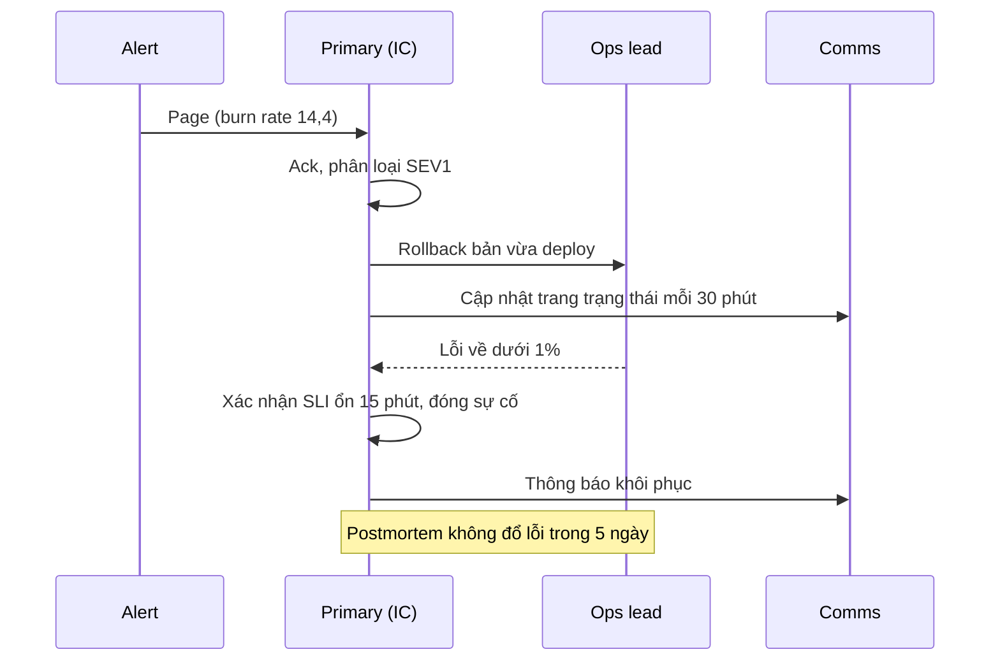
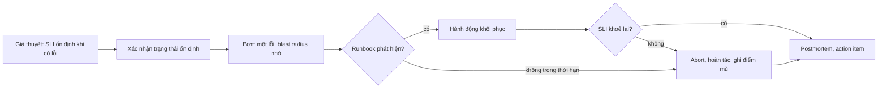
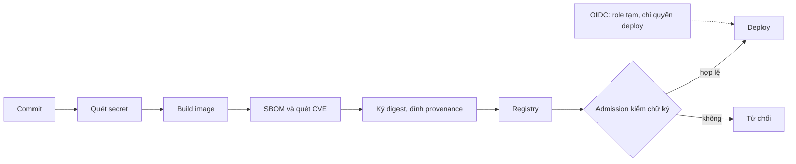

# SRE và vận hành: SLO, error budget, on-call, chaos, capacity, FinOps

Module 13 cho Olist Shop đôi mắt: metric, log, trace, alert. Module này trả lời câu hỏi tiếp theo: **bao nhiêu độ tin cậy là đủ, và
làm gì khi không đủ**. Site Reliability Engineering (SRE) biến độ tin cậy thành con số có thể thương lượng (SLO), thành ngân sách được
phép tiêu (error budget), và thành quy trình con người chạy được lâu dài (on-call, incident, postmortem). Cạnh đó là ba việc vận hành
mà mọi team DevOps gặp: thử hỏng có chủ đích (chaos engineering), tính trước tải (capacity planning) và tính tiền (FinOps), cộng một
lớp bảo mật tối thiểu cho pipeline. Phần cuối giúp bạn chuẩn bị phỏng vấn DevOps/SRE từ những gì đã làm trong cả track.

Sau module này bạn sẽ:

- Chọn SLI theo trải nghiệm của khách, đặt SLO, phân biệt SLO với SLA, tính error budget và viết chính sách error budget.
- Sinh burn-rate alert nhiều cửa sổ từ tệp SLO và kiểm bằng `promtool`.
- Tổ chức on-call bền vững, chạy sự cố với incident commander, viết postmortem không đổ lỗi, nhận diện và giảm toil.
- Thiết kế game day: giả thuyết trạng thái ổn định, blast radius, nút dừng; bơm lỗi bằng `testkit.FaultInjector` và khôi phục bằng
  runbook.
- Đo điểm gãy bằng k6, dùng định luật Little và headroom để đề xuất capacity.
- Tính chi phí theo team, rightsizing, unit economics.
- Áp bốn biện pháp bảo mật pipeline cơ bản: SBOM, quét secret, ký image, least privilege cho CI.

## 0. Cài đặt

| Thành phần | Phiên bản đã kiểm | Tối thiểu cho bài tập | Dùng ở |
| --- | --- | --- | --- |
| Docker, uv | Như module 06 | Như module 06 | Mọi bài có code |
| k6 | image `grafana/k6:1.8.1` ghim digest (cùng tag track MLOps) | Đúng bản đã ghim | Intermediate 01, 02 |
| Image `devops-track/netem:1.0` | `iproute2-tc` 7.0.0-r0 trên `alpine:3.24.3` ghim digest | Đúng bản đã ghim | Advanced 01 (lỗi trễ mạng của `FaultInjector`) |
| Stack observability, `promtool` | Như module 13 | Như module 13 | Basic 02, Advanced 01 |
| Image Olist Shop, `postgres:16.15-alpine`, `redis:7.4.12-alpine` | Như module 13 | Như module 13 | Advanced 01 |

Không cài gì lên máy: k6 và `tc` chạy trong container. Test không tự kéo hay build image; thiếu thì skip kèm đúng lệnh. Kéo và build một
lần (khoảng 130 MB):

```bash
nice -n 15 docker pull grafana/k6:1.8.1@sha256:23f2279054c3e01535455c4d92914a625df12aeb631ea0e3ea7a43f96bcbc843 &&
nice -n 15 docker pull alpine:3.24.3@sha256:be2656061b536c1883c4034790e21d0a09c5aaaf51968b89368a3c0371ea2c9a &&
nice -n 15 docker build --pull=false -t devops-track/netem:1.0 setup/netem
```

Kéo theo `tag@digest` nên Docker kiểm nội dung khớp digest. `setup/netem/Dockerfile` ghim cả base lẫn bản gói `iproute2-tc`, nên build
lại ở máy khác cho cùng phần mềm. Xác nhận:

```bash
docker run --rm grafana/k6:1.8.1@sha256:23f2279054c3e01535455c4d92914a625df12aeb631ea0e3ea7a43f96bcbc843 version
# k6 v1.8.1 (commit/73b044f9f9, go1.26.4, linux/amd64)
docker run --rm devops-track/netem:1.0 tc -V
# tc utility, iproute2-v7.0.0
```

Chạy k6 tay với một service trên máy (Linux): `docker run --rm --network host -v "$PWD:/scripts:ro" grafana/k6:1.8.1@sha256:...
run -e TARGET=http://127.0.0.1:8000 /scripts/load.js`. Lỗi trễ mạng của game day cần module kernel `sch_netem`; kernel tự nạp ở lần đầu
(`lsmod | grep netem`). Quyền `NET_ADMIN` để chạy `tc` chỉ cấp cho một container phụ sống vài giây, dùng chung network namespace với
đúng container bị bơm lỗi; container của bài không bao giờ có thêm capability (chi tiết ở `setup/DEVOPS-TOOLS.md`, mục "k6 và
FaultInjector").

Gỡ: `docker image rm devops-track/netem:1.0 alpine:3.24.3@sha256:be26...`; giữ image k6 nếu còn học track MLOps.

## 1. SLI, SLO, SLA và error budget

### Ba khái niệm

- **SLI** (service level indicator): một con số đo trải nghiệm của khách, thường là tỉ lệ sự kiện tốt trên tổng sự kiện: request không
  lỗi, request nhanh hơn 300 ms, đơn được xử lý trong 5 phút, dữ liệu mới hơn 1 giờ.
- **SLO** (objective): mục tiêu cho SLI trong một cửa sổ, ví dụ 99,5% request tra đơn không lỗi trong 30 ngày trượt.
- **SLA** (agreement): hợp đồng với khách hay đối tác, có điều khoản tiền (credit) khi vi phạm. SLA lỏng hơn SLO để team còn thời gian
  phản ứng trước khi phải trả tiền.

$$
\text{SLI} = \frac{\text{sự kiện tốt}}{\text{tổng sự kiện hợp lệ}}
$$

| | SLO | SLA |
| --- | --- | --- |
| Ai đặt | Team kỹ thuật cùng product | Kinh doanh, pháp chế |
| Đo gì | Thứ khách cảm nhận, cả latency | Thứ dễ chứng minh, thường chỉ "sập hay không" |
| Vi phạm thì | Đổi ưu tiên theo chính sách error budget | Trả credit, mất uy tín |
| Ngoại lệ | Ít (bảo trì vẫn tính) | Nhiều (bảo trì báo trước, lỗi phía khách) |
| Thay đổi | Mỗi quý theo dữ liệu | Theo kỳ hợp đồng |

### Chọn SLI

- Đo **ở chỗ gần khách nhất** mà vẫn đáng tin: load balancer hay gateway thấy cả lỗi khi pod chết; metric trong pod thì không. Probe tổng
  hợp (synthetic) cho route quan trọng nhưng ít traffic.
- **Theo request** (request-based) cho dịch vụ đông khách: giờ cao điểm nặng ký hơn 3 giờ sáng. **Theo thời gian** (time-based: phút tốt
  trên tổng phút) cho dịch vụ ít traffic hay khi hợp đồng đòi.
- Mỗi hành trình quan trọng (tra đơn, đặt hàng, thanh toán) một vài SLI, không phải mỗi endpoint. CPU, RAM, số pod là **nguyên nhân**,
  dùng để chẩn đoán, không làm SLI.
- 100% không phải mục tiêu: mỗi số 9 thêm vào đắt gấp nhiều lần, trong khi khách vẫn bị giới hạn bởi mạng di động và thiết bị của họ.

### Error budget

$$
\text{budget} = (1 - \text{SLO}) \times \text{tổng sự kiện trong cửa sổ}
$$

SLO 99,9% trong 30 ngày cho phép 0,1% request lỗi, quy ra khoảng 43 phút sập hoàn toàn. Budget còn lại là
$$1 - \frac{\text{sự kiện xấu}}{\text{budget}}$$ và có thể âm. Budget là thứ để **tiêu**: deploy, thử nghiệm, bảo trì đều tiêu budget; budget
còn nhiều nghĩa là team được phép chấp nhận rủi ro nhiều hơn.

### Chính sách error budget

Chính sách là thoả thuận ký trước giữa product và kỹ thuật: budget còn bao nhiêu thì làm gì. Không có chính sách, budget chỉ là một biểu
đồ. Một chính sách tốt có ngưỡng, hành động cụ thể, ngoại lệ có người duyệt, và luôn giữ đường cho rollback và vá bảo mật.



Bài Basic 01 tính SLO, SLA, burn rate và credit trên một tháng số liệu; Advanced 02 viết chính sách đầy đủ cho team checkout.

## 2. Alert theo burn rate nhiều cửa sổ

### Burn rate

Burn rate là tốc độ tiêu budget so với tốc độ "vừa đủ hết vào cuối cửa sổ":

$$
\text{burn rate} = \frac{\text{tỉ lệ sự kiện xấu trong cửa sổ đo}}{1 - \text{SLO}}
$$

Burn rate 1 tiêu đúng hết budget sau 30 ngày; burn rate 14,4 tiêu 2% budget mỗi giờ và hết sau khoảng 2 ngày. Phần budget tiêu khi một
alert bắn:

$$
\text{budget tiêu} = \frac{\text{burn rate} \times \text{độ dài cửa sổ dài}}{\text{độ dài cửa sổ SLO}}
$$

### Vì sao nhiều cửa sổ

Alert theo ngưỡng cố định ("lỗi trên 1% trong 5 phút") vừa ồn (một phút lỗi lẻ cũng page) vừa chậm với lỗi rỉ rả (0,5% cả ngày không
bao giờ vượt 1% nhưng đốt hết budget). SRE Workbook đề xuất bốn mức, mỗi mức một cặp cửa sổ:

| Mức | Burn rate | Cửa sổ dài | Cửa sổ ngắn | Budget tiêu khi bắn | Hành động |
| --- | --- | --- | --- | --- | --- |
| Page | 14,4 | 1 giờ | 5 phút | 2% | Đánh thức người trực |
| Page | 6 | 6 giờ | 30 phút | 5% | Đánh thức người trực |
| Ticket | 3 | 1 ngày | 2 giờ | 10% | Xử lý trong giờ làm |
| Ticket | 1 | 3 ngày | 6 giờ | 10% | Xử lý trong giờ làm |

- Cửa sổ **dài** đảm bảo sự cố đủ lớn để đáng quan tâm (một phút lỗi 100% sau một ngày khoẻ chỉ là 1,7% của 1 giờ).
- Cửa sổ **ngắn**, khoảng 1/12 cửa sổ dài, đảm bảo sự cố **vẫn đang** diễn ra: khi lỗi dừng, alert tắt sau vài phút thay vì kêu thêm cả
  giờ vì cửa sổ dài còn nhớ.
- Không cần `for`: cửa sổ ngắn đã là độ trễ.



Biểu thức alert đọc lại recording rule đã tính sẵn:

```promql
slo:sli_error:ratio_rate1h{slo="orders-availability"} > (14.4 * 0.005)
and
slo:sli_error:ratio_rate5m{slo="orders-availability"} > (14.4 * 0.005)
```

Giới hạn: traffic thấp làm tỉ lệ nhảy mạnh (2 lỗi trên 10 request là 20%). Cách xử lý: điều kiện số request tối thiểu, gộp route vào
một SLO, probe tổng hợp, hay SLO theo thời gian.

### SLO as code: so sánh công cụ

| Công cụ | Cách làm | Hợp khi |
| --- | --- | --- |
| Tự viết (Basic 02) | Script sinh rule Prometheus từ YAML | Học, hay cần tuỳ biến hoàn toàn |
| Sloth | CLI hay controller sinh recording rule và alert nhiều cửa sổ từ spec `prometheus/v1` hay OpenSLO | Prometheus thuần, muốn chuẩn SRE Workbook nhanh |
| Pyrra | Controller Kubernetes, CRD `ServiceLevelObjective`, có UI xem budget | Kubernetes, muốn dashboard budget sẵn |
| OpenSLO | Đặc tả YAML trung lập nhà cung cấp, không tự chạy | Muốn đổi backend mà giữ định nghĩa |
| Grafana SLO, Datadog SLO, Nobl9 | SaaS, tính budget và alert trên dữ liệu của họ | Đã dùng nền tảng đó, chấp nhận chi phí |
| Google Cloud, AWS (CloudWatch Application Signals) | SLO gắn với dịch vụ cloud | Hệ thống chủ yếu trên cloud đó |

## 3. On-call, incident, postmortem và toil

### On-call bền vững

- **Hai người mỗi ca**: primary và secondary; người mới làm secondary (shadow) trước. Không ai trực liên tục nhiều tuần.
- **Page budget**: Google SRE khuyên tối đa khoảng 2 sự cố mỗi ca 12 giờ. Vượt nghĩa là alert hay hệ thống có vấn đề: team dừng feature
  để sửa, không bắt người trực chịu đựng.
- **Mọi page phải hành động được**: alert không cần làm gì thì xoá hay chuyển thành ticket. Alert theo burn rate (mục 2) là cách giảm page
  vô ích.
- **Bàn giao ca** có ghi chép; **chế độ bù** (phụ cấp, nghỉ bù sau đêm bị đánh thức); leo thang có thời hạn (không ack sau 10 phút thì
  gọi secondary).
- **Follow-the-sun** khi team trải nhiều múi giờ: không ai phải trực đêm.

### Chạy một sự cố

Mô hình Incident Command System (gốc từ cứu hoả) tách vai trò để không ai vừa sửa vừa điều phối:

| Vai trò | Việc |
| --- | --- |
| Incident commander (IC) | Điều phối, quyết định giảm thiểu, giao việc; không tự gõ lệnh |
| Ops lead | Người duy nhất chạm vào hệ thống, theo quyết định của IC |
| Communications lead | Cập nhật khách, trang trạng thái, nội bộ theo nhịp cố định |
| Scribe | Ghi timeline để viết postmortem |

Mức độ (SEV1 tới SEV3) có tiêu chí khách quan (khách không đặt được hàng là SEV1), để không ai phải tranh luận lúc 3 giờ sáng. Ưu tiên
**giảm thiểu trước, tìm nguyên nhân sau**: rollback, chuyển traffic, tắt feature flag.



### Postmortem không đổ lỗi

- Viết cho mọi sự cố tiêu đáng kể budget hay có bài học mới. Gồm: tóm tắt, tác động có số (khách, đơn hàng, budget), timeline, nguyên
  nhân (thường nhiều yếu tố), phát hiện và khôi phục, điều làm tốt và chưa tốt, action item có người và hạn.
- **Không đổ lỗi** (blameless): hỏi "hệ thống nào cho phép lỗi người thành sự cố" và sửa hệ thống (guardrail, tự động hoá, review), không
  hỏi "ai sai". Người sợ bị phạt sẽ giấu thông tin, và tổ chức mất bài học. Không đổ lỗi không phải là giấu: vẫn ghi đủ lệnh, quyết định,
  diễn biến.
- "Five whys" giúp đào sâu nhưng dễ dừng ở một nguyên nhân đơn lẻ; sự cố thật thường là nhiều điều kiện cùng xảy ra.
- Action item phải đóng được: "cẩn thận hơn" không phải action item; "chặn lệnh xoá bảng production nếu không có người thứ hai duyệt" là.

### Toil

Toil là việc **tay, lặp lại, tự động hoá được, phản ứng, không tạo giá trị lâu dài, tăng theo quy mô** (restart tay worker mỗi tuần, tạo
tài khoản bằng tay). Google SRE đặt trần toil khoảng 50% thời gian; phần còn lại dành cho kỹ thuật làm toil biến mất. Đo toil (ticket gắn
nhãn, khảo sát) rồi tự động hoá việc tốn nhiều giờ nhất trước.

### Công cụ on-call và sự cố

| Công cụ | Điểm mạnh | Lưu ý |
| --- | --- | --- |
| PagerDuty | Lịch trực, leo thang, tích hợp rộng, quy trình sự cố | Đắt theo người dùng |
| Grafana IRM (OnCall và Incident) | Gắn với stack Grafana, Alertmanager | Bản tự host OnCall OSS đã ngừng phát triển, nên dùng bản cloud |
| incident.io, FireHydrant, Rootly | Quy trình sự cố trong Slack, postmortem, trang trạng thái | Thường dùng kèm công cụ page |
| Opsgenie | Lịch trực, leo thang | Atlassian đã ngừng bán, chuyển người dùng sang Jira Service Management |
| Alertmanager thuần | Miễn phí, route và receiver | Không có lịch trực hay leo thang theo người |

### Nhắc lại từ track Data Engineer

Module [DE 08 DevOps cho dữ liệu](../../../data-engineer/modules/08-devops-for-data/README.md) đã có trực vận hành, rollback, khôi phục dữ
liệu cho pipeline và một bài load test API bằng Python. Ở đây mở rộng sang SLO, error budget, vai trò khi sự cố và capacity cho dịch vụ
online.

## 4. Chaos engineering và game day

Chaos engineering là **thí nghiệm** trên hệ thống để tìm điểm yếu trước khi khách tìm thấy. Không phải "phá ngẫu nhiên". Nguyên tắc
(principlesofchaos.org):

1. **Giả thuyết trạng thái ổn định**: viết ra hệ thống "khoẻ" trông như thế nào bằng SLI (mọi request đúng mã, dưới 0,5 giây), và giả
   thuyết rằng nó vẫn đúng khi có lỗi X.
2. **Biến cố của thế giới thật**: container chết, mạng chậm, đĩa đầy, phụ thuộc biến mất, cấu hình sai.
3. **Blast radius nhỏ**: bắt đầu ở lab, một service, một phần traffic; luôn có **nút dừng** (abort khi SLI vượt ngưỡng) và hoàn tác tự
   động.
4. **Tự động hoá và chạy thường xuyên**, rồi dần tiến gần production.

**Game day** là buổi chạy thí nghiệm có người tham gia: một nhóm bơm lỗi, một nhóm trực xử lý như thật, cuối buổi viết postmortem. Mục
tiêu là kiểm tra cả hệ thống lẫn con người: alert có tới không, runbook có đúng không, mọi người có biết vai trò không.



Trong bài Advanced 01, `testkit.FaultInjector(lab, seed=...)` chọn một lỗi theo seed và chỉ bơm vào container của lab: kill, trễ mạng
(`tc qdisc ... netem` chạy trong container phụ có `NET_ADMIN`), đầy tmpfs, dừng Redis; trên Kubernetes thêm sai ConfigMap. Runbook của bạn
(`runbook.yaml`) là cặp "truy vấn phát hiện, hành động", chạy tự động; test kiểm nó không báo động giả khi khoẻ và khôi phục được. Capstone
m09 dùng cùng helper với seed bạn không biết trước.

| Công cụ chaos | Phạm vi | Ghi chú |
| --- | --- | --- |
| `tc netem`, `stress-ng`, `kill` | Một máy, một container | Đơn giản, tự viết kịch bản, cần quyền tương ứng |
| Toxiproxy | Proxy TCP chèn trễ, ngắt, giới hạn băng thông | Hợp test tích hợp, không cần quyền mạng |
| Chaos Mesh | Kubernetes, CRD cho pod, mạng, IO, thời gian | CNCF, có lịch và workflow |
| LitmusChaos | Kubernetes, thư viện thí nghiệm, probe SLI | CNCF, hướng GitOps |
| AWS Fault Injection Service, Azure Chaos Studio | Tài nguyên cloud (EC2, ECS, RDS, AZ) | Có điều kiện dừng theo CloudWatch; tốn tiền thật |
| Gremlin | SaaS, nhiều nền tảng | Có giao diện và quy trình game day |

## 5. Capacity planning và FinOps

### Định luật Little và hàng đợi

Với hệ thống ổn định, số việc đang ở trong hệ thống bằng tốc độ đến nhân thời gian ở lại:

$$
L = \lambda \times W
$$

400 request/giây, mỗi request 50 ms thì trung bình 20 request đang xử lý, tức cần khoảng 20 kết nối database, 20 thread, hay 20 slot của
bất kỳ tài nguyên nào giữ suốt request. Công suất của một service có $$c$$ slot, mỗi việc mất $$s$$ giây là $$c / s$$ việc mỗi giây. Khi
tốc độ đến tiến gần công suất (utilization gần 100%), hàng đợi và latency tăng rất nhanh; vượt công suất thì hàng đợi dài thêm mỗi giây.
Vì vậy không ai chạy production sát 100%.

### Đo điểm gãy và đề xuất capacity

- **Load test** ở tải dự báo, **stress test** tăng tới khi gãy, **soak test** chạy lâu để thấy rò rỉ, **spike test** cho đợt tăng đột
  ngột.
- Tìm **knee** bằng tải bậc thang: mỗi bậc một tốc độ đến cố định (k6 executor `constant-arrival-rate`), đo p95 và tỉ lệ lỗi từng bậc. Knee
  là bậc cao nhất còn đạt SLO. Throughput cao nhất ở bậc đã vỡ SLO không phải công suất dùng được.
- Đề xuất capacity: số replica bằng làm tròn lên của (đỉnh dự báo nhân (1 + headroom) chia knee của một replica), cộng dự phòng N+1 cho
  lúc một replica chết hay đang deploy. Ghi rõ điều kiện đo: máy, dữ liệu, phiên bản.
- Số đo trên laptop là tương đối. Chạy lại nhiều lần, so tương đối giữa các bản, và đo lại trên môi trường giống production trước quyết
  định lớn.

Ví dụ đo được ở bài Intermediate 01 (service 2 slot, mỗi request 40 ms, công suất lý thuyết 50 request/giây):

| Tốc độ đến (request/giây) | 10 | 20 | 30 | 40 | 60 | 80 |
| --- | --- | --- | --- | --- | --- | --- |
| p95 (ms) | 41 | 41 | 41 | 41 | 640 | 1890 |
| Đạt được (request/giây) | 10 | 20 | 30 | 40 | 55 | 63 |

| Công cụ load test | Viết kịch bản bằng | Hợp khi |
| --- | --- | --- |
| k6 | JavaScript, executor theo VU hay theo tốc độ đến, threshold làm cổng CI | Team DevOps, CI, nhẹ |
| Locust | Python, phân tán | Team Python, kịch bản phức tạp |
| JMeter | GUI hay XML, nhiều giao thức | Doanh nghiệp đã có sẵn, giao thức lạ |
| Gatling | Scala, Java, Kotlin | JVM, báo cáo HTML đẹp |
| vegeta, wrk, hey | Dòng lệnh, một endpoint | Đo nhanh một route |

### FinOps

FinOps là cách để kỹ thuật, tài chính và kinh doanh cùng ra quyết định về chi phí cloud: **thấy** (allocation), **tối ưu** (rightsizing,
cam kết), **vận hành** (ngân sách, cảnh báo, review định kỳ).

- **Allocation**: gắn chi phí cho team, sản phẩm, môi trường bằng nhãn (tag, label). Chi phí chung (control plane, observability, NAT)
  chia theo tỉ lệ hay theo driver đã thống nhất. **Showback** (cho xem) trước, **chargeback** (trừ ngân sách) sau. Chi phí không nhãn là
  việc đầu tiên phải giảm.
- **Unit economics**: chi phí trên một đơn vị kinh doanh (mỗi 1000 đơn hàng, mỗi khách hoạt động). Tổng hoá đơn tăng không xấu nếu chi phí
  mỗi đơn giảm.
- **Rightsizing**: Kubernetes tính chỗ theo **request**. Request CPU dựa trên p95 (thiếu CPU thì throttle), request RAM dựa trên mức cao
  nhất (thiếu RAM thì OOMKilled), cộng headroom. Rightsizing chỉ giảm hoá đơn khi autoscaler bớt được node.
- **Cam kết và spot**: Reserved Instances, Savings Plans, committed use discounts cho phần nền ổn định; spot hay preemptible cho việc chịu
  được gián đoạn (batch, CI). Tắt môi trường dev và preview ngoài giờ.
- **Kiến trúc**: phí truyền dữ liệu giữa AZ, qua NAT, ra Internet thường bị bỏ quên; log và metric có cardinality cao cũng tốn (module 13).

| Công cụ | Làm gì |
| --- | --- |
| OpenCost | Chi phí Kubernetes theo namespace, label, workload (CNCF, mã nguồn mở) |
| Kubecost | Dựa trên OpenCost, thêm đề xuất rightsizing, ngân sách (có bản thương mại) |
| Infracost | Ước tính chi phí từ thay đổi Terraform/OpenTofu ngay trong pull request |
| AWS Cost Explorer, GCP Billing, Azure Cost Management | Hoá đơn, ngân sách, cảnh báo của từng cloud |
| Vantage, CloudZero | SaaS gộp nhiều cloud, unit cost |

Cloud thật luôn tuỳ chọn trong track: bài Basic 03 dùng số liệu cho sẵn. Muốn thử trên tài khoản thật, đặt budget alarm (AWS Budgets) trước
khi tạo gì, và xoá tài nguyên ngay sau khi xem.

## 6. Bảo mật pipeline cơ bản

Pipeline CI/CD giữ chìa khoá production nên là mục tiêu tấn công hấp dẫn (vụ SolarWinds, Codecov, action `tj-actions/changed-files` bị
chiếm năm 2025). Bốn lớp cơ bản, rẻ, đáng làm ngay:

1. **Quét secret**: chặn key lọt vào git trước khi push (gitleaks, trufflehog, GitHub push protection) và quét lịch sử. Key đã lọt thì
   **thu hồi**, xoá khỏi lịch sử không đủ.
2. **SBOM** (software bill of materials): danh sách mọi gói trong image, định dạng SPDX hay CycloneDX (`trivy image --format cyclonedx`,
   Syft). Khi có CVE mới, tra SBOM biết ngay image nào bị ảnh hưởng mà không phải quét lại. Module 06 đã dùng trivy.
3. **Ký image và provenance** (mức khái niệm): ký digest của image (Sigstore cosign, ký không cần quản khoá bằng danh tính OIDC của CI),
   đính kèm provenance theo SLSA (image build từ commit nào, workflow nào). Cluster chỉ nhận image có chữ ký hợp lệ (admission policy như
   Kyverno, Sigstore policy-controller).
4. **Least privilege cho CI**: credential ngắn hạn qua OIDC thay cho key dài hạn, role giới hạn theo repo và nhánh; `permissions:` tối thiểu
   cho token của GitHub Actions; ghim action bên thứ ba theo commit SHA; không chạy workflow có secret cho pull request từ fork; runner
   riêng cho job deploy.



| Việc | Công cụ phổ biến |
| --- | --- |
| Quét secret | gitleaks, trufflehog, GitHub secret scanning và push protection, GitLab secret detection |
| SBOM, quét CVE | Syft, Trivy, Grype, Docker Scout |
| Ký, provenance | Sigstore cosign, SLSA GitHub generator, Docker Buildx attestation, Notation |
| Policy khi deploy | Kyverno, Sigstore policy-controller, OPA Gatekeeper |
| Least privilege CI | OIDC của GitHub Actions/GitLab với AWS, GCP, Azure; OpenSSF Scorecard để chấm repo |

## 7. Chuẩn bị phỏng vấn DevOps/SRE

Phỏng vấn DevOps/SRE thường có bốn loại vòng. Các module và capstone của track là kho ví dụ thật để kể.

| Vòng | Hỏi gì | Lấy ví dụ từ |
| --- | --- | --- |
| Kiến thức nền | Linux, mạng, HTTP, DNS, container, Kubernetes, IaC, CI/CD | Module 01 tới 11 |
| Thiết kế hệ thống | Thiết kế cho tải X với SLO Y, chỗ hỏng, capacity, chi phí | Capstone, module 13 tới 16 |
| Sự cố, debug | "Trang chậm, bạn làm gì?", đọc log, đọc metric, chẩn đoán trực tiếp | Bài sự cố của mỗi module, game day |
| Hành vi | Xung đột, sai lầm, ưu tiên, làm việc với product | Postmortem, chính sách error budget bạn đã viết |

### Câu hỏi thiết kế

Một khung trả lời: **yêu cầu** (chức năng, SLO, quy mô: bao nhiêu request/giây đỉnh, dữ liệu bao nhiêu) → **ước lượng** (định luật Little,
dung lượng, băng thông, chi phí) → **kiến trúc** (vẽ, giải thích lựa chọn và đánh đổi) → **chỗ hỏng** (mỗi thành phần chết thì sao,
blast radius, giảm thiểu) → **vận hành** (SLI, alert, deploy an toàn, runbook) → **chi phí**. Nói con số, nói đánh đổi, và hỏi lại khi
yêu cầu mơ hồ.

### Câu hỏi sự cố

Đi theo thứ tự: xác nhận tác động (SLI, bao nhiêu khách) → giảm thiểu nhanh (có vừa deploy không? rollback) → thu hẹp (route nào, region
nào, từ lúc nào, cái gì thay đổi) → đi từ triệu chứng tới nguyên nhân bằng metric, trace, log → khôi phục và xác nhận bằng số → postmortem.
Người phỏng vấn chấm cách nghĩ và cách giao tiếp nhiều hơn đáp án.

### Câu hỏi hành vi

Trả lời theo **STAR**: Situation (bối cảnh ngắn), Task (việc của bạn), Action (bạn làm gì, cụ thể, dùng "tôi"), Result (kết quả có số, và
điều đã thay đổi lâu dài). Chuẩn bị sẵn 5 tới 6 câu chuyện: một sự cố bạn xử lý, một lỗi bạn gây ra, một lần bất đồng với product hay team
khác, một lần tự động hoá xoá toil, một lần học công nghệ mới nhanh, một lần ưu tiên dưới áp lực.

Câu hỏi luyện tập có trong `interview.md` của module này và mọi module trước; bài Advanced 03 là trắc nghiệm phỏng vấn tổng hợp.

## 8. Tài liệu tham khảo

- Google, *Site Reliability Engineering* (2016): https://sre.google/sre-book/table-of-contents/ ; các chương "Embracing Risk",
  "Service Level Objectives", "Eliminating Toil", "Being On-Call", "Managing Incidents", "Postmortem Culture".
- Google, *The Site Reliability Workbook* (2018): "Implementing SLOs" https://sre.google/workbook/implementing-slos/ , "Alerting on SLOs"
  https://sre.google/workbook/alerting-on-slos/ , "Error Budget Policy" https://sre.google/workbook/error-budget-policy/ , "Incident
  Response" https://sre.google/workbook/incident-response/ .
- Alex Hidalgo, *Implementing Service Level Objectives* (O'Reilly, 2020).
- OpenSLO: https://openslo.com/ ; Sloth: https://sloth.dev/ ; Pyrra: https://github.com/pyrra-dev/pyrra
- PagerDuty Incident Response: https://response.pagerduty.com/ ; Atlassian Incident Management Handbook:
  https://www.atlassian.com/incident-management/handbook
- Principles of Chaos Engineering: https://principlesofchaos.org/ ; Casey Rosenthal, Nora Jones, *Chaos Engineering* (O'Reilly, 2020);
  Chaos Mesh https://chaos-mesh.org/docs/ ; LitmusChaos https://docs.litmuschaos.io/ ; `tc-netem(8)`: https://man7.org/linux/man-pages/man8/tc-netem.8.html
- John D. C. Little, "A Proof for the Queuing Formula L = λW" (1961); Neil Gunther, *Guerrilla Capacity Planning* (Springer, 2007).
- k6: https://grafana.com/docs/k6/latest/ ; executor: https://grafana.com/docs/k6/latest/using-k6/scenarios/executors/ ; threshold:
  https://grafana.com/docs/k6/latest/using-k6/thresholds/
- FinOps Foundation, FinOps Framework: https://www.finops.org/framework/ ; J.R. Storment, Mike Fuller, *Cloud FinOps* (O'Reilly, 2nd ed. 2023);
  OpenCost: https://www.opencost.io/docs/ ; Infracost: https://www.infracost.io/docs/
- SLSA: https://slsa.dev/ ; Sigstore: https://docs.sigstore.dev/ ; CycloneDX: https://cyclonedx.org/ ; SPDX: https://spdx.dev/ ; OpenSSF
  Scorecard: https://scorecard.dev/ ; GitHub Actions security hardening:
  https://docs.github.com/en/actions/security-for-github-actions/security-guides/security-hardening-for-github-actions
- Alex Xu, *System Design Interview: An Insider's Guide* (2020); Google SRE book, chương 1 "Introduction" (SRE là gì, tuyển SRE thế nào).
