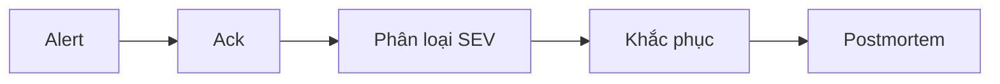

# Chính sách error budget và on-call: team search

## 1. SLO và phạm vi

SLO availability 99,9% cho API tìm kiếm, cửa sổ trượt 28 ngày, đo ở load balancer.

## 2. Error budget

99,9% trong 28 ngày cho 40,32 phút không đạt mỗi cửa sổ.

## 3. Hành động theo mức budget

| Budget còn | State | Hành động |
| --- | --- | --- |
| trên 60% | `normal` | Release như thường |
| 30% tới 60% | `caution` | Review thêm |
| 0% tới 30% | `freeze-features` | Dừng feature |
| cạn | `freeze-all` | Chỉ rollback và vá bảo mật |

## 4. Ngoại lệ và leo thang

CTO duyệt ngoại lệ, tối đa hai lần mỗi cửa sổ.

## 5. On-call

Bàn giao ca thứ Hai 09:30. Tối đa 12 page mỗi tuần, 1 page ban đêm; vượt thì nghỉ bù nửa ngày và review alert.

## 6. Quy trình sự cố

| Mức | Ví dụ |
| --- | --- |
| SEV1 | Sập toàn bộ |
| SEV2 | Một tính năng hỏng |
| SEV3 | Chậm nhẹ |

Người trực đầu tiên là incident commander cho tới khi bàn giao.

## 7. Rà soát và cải tiến

Toil không quá 50% thời gian của người trực; review hằng tuần.
