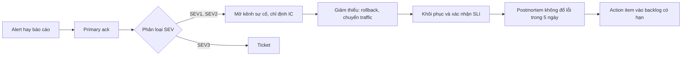

# Chính sách error budget và on-call: team checkout

Tài liệu do team checkout, team platform và product manager của checkout cùng ký, có hiệu lực từ 2026-11-16 và được xem lại mỗi quý.
Mục đích: biến câu hỏi "release hay dừng lại sửa" thành quy tắc đã thống nhất trước, thay vì tranh luận trong lúc có sự cố.

## 1. SLO và phạm vi

- SLI: tỉ lệ request `POST /checkout` và `GET /orders/{order_id}` không trả 5xx, đo ở load balancer (không đo ở pod, vì pod chết thì
  không tự đếm được lỗi của mình).
- SLO: 99,9% trong cửa sổ trượt 28 ngày. 28 ngày chứa đúng bốn tuần nên so sánh được tuần này với tuần trước.
- Không thuộc phạm vi: trang quản trị nội bộ, job tính lại doanh thu (có SLO riêng về độ tươi dữ liệu).

## 2. Error budget

- Budget là 0,1% request của cửa sổ, quy ra thời gian là 40,32 phút sập hoàn toàn mỗi 28 ngày.
- Budget còn lại tính tự động từ Prometheus (`1 - request xấu / request được phép xấu`) và hiện trên dashboard của team.
- Bảo trì có kế hoạch vẫn tiêu budget: khách không phân biệt được bảo trì với sự cố.

## 3. Hành động theo mức budget

| Budget còn lại | State | Bắt buộc | Được phép release |
| --- | --- | --- | --- |
| trên 50% | `normal` | Release như thường | feature, bugfix, security-fix, rollback |
| 25% tới 50% | `caution` | Canary bắt buộc, review độ tin cậy trong họp tuần | feature, bugfix, security-fix, rollback |
| 0% tới 25% | `freeze-features` | Dừng feature, sprint kế tiếp dành cho độ tin cậy | bugfix, security-fix, rollback |
| đã cạn | `freeze-all` | Chỉ vá bảo mật và rollback; postmortem cho mọi sự cố đã tiêu budget; báo cáo lên VP Engineering | security-fix, rollback |

State đổi ngay khi budget qua ngưỡng và chỉ quay lại `normal` khi budget hồi trên 50% (cửa sổ trượt tự hồi khi sự cố cũ ra khỏi 28 ngày).

## 4. Ngoại lệ và leo thang

- VP Engineering duyệt ngoại lệ (ví dụ release tính năng pháp lý bắt buộc trong lúc `freeze-features`), tối đa một lần mỗi cửa sổ,
  ghi lý do vào kênh #checkout-reliability.
- Sự cố do phụ thuộc bên ngoài (cổng thanh toán) vẫn tiêu budget, nhưng action item chuyển sang hợp đồng và kiến trúc (timeout,
  fallback) thay vì đóng băng release.
- Product và kỹ thuật bất đồng về việc dừng release: engineering manager quyết định trong 24 giờ, không chờ họp quý.

## 5. On-call

- Mỗi tuần một primary và một secondary, bàn giao ca (handoff) thứ Hai 10:00 giờ Việt Nam, kèm 15 phút đọc lại sự cố tuần trước.
- Không ai trực hai tuần liền; Hà (mới vào) làm secondary để học, chưa làm primary trong tháng đầu; người nghỉ phép không bị xếp lịch.
- Page budget: tối đa 10 page mỗi tuần và 2 page ban đêm (22:00 tới 07:00). Vượt thì tuần sau team dành thời gian sửa alert thay vì
  làm feature, và người trực được nghỉ bù nửa ngày cho mỗi đêm bị đánh thức.
- Leo thang: primary ack trong 0 phút; không ack sau 10 phút thì gọi secondary; sau 25 phút gọi engineering manager.
- Chế độ bù: phụ cấp trực theo tuần cộng nghỉ bù như trên; không ai trực quá 2 tuần mỗi tháng.

## 6. Quy trình sự cố

| Mức | Tiêu chí | Phản hồi |
| --- | --- | --- |
| SEV1 | Khách không đặt được hàng, hay mất dữ liệu | Page ngay, mở kênh sự cố, cập nhật trang trạng thái 30 phút một lần |
| SEV2 | Một tính năng hỏng hay chậm rõ rệt, có cách vòng | Page giờ làm việc, ticket ưu tiên cao |
| SEV3 | Ảnh hưởng nhỏ, không khẩn | Ticket, xử lý trong sprint |

Vai trò: **incident commander** (điều phối, quyết định, không tự sửa), **ops lead** (người chạm vào hệ thống), **communications lead**
(báo khách và nội bộ). Người trực primary là incident commander cho tới khi bàn giao cho người khác.

## 7. Rà soát và cải tiến

- Họp vận hành hằng tuần 30 phút: budget còn lại, page tuần qua (alert nào không cần hành động thì sửa hay xoá), action item quá hạn.
- Toil (việc tay lặp lại, không tạo giá trị lâu dài) không quá 50% thời gian của người trực; vượt thì việc tự động hoá được ưu tiên trước
  feature.
- Mỗi quý: xem lại SLO (khách có thật sự cần 99,9%?), ngưỡng của chính sách, và chạy một game day.
