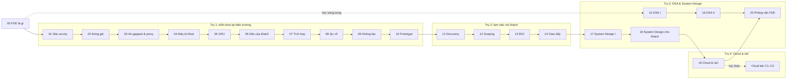
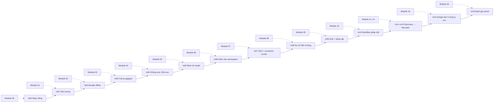

# Lộ trình Forward Deployed Engineer

Lộ trình tự học Forward Deployed Engineer (FDE) bám theo
[roadmap.sh/forward-deployed-engineer](https://roadmap.sh/forward-deployed-engineer). FDE là kỹ sư được "cử ra hiện
trường": ngồi cạnh khách hàng, hiểu bài toán của họ, rồi **tự mang sản phẩm của công ty vào môi trường của khách và
làm cho nó chạy**, kể cả khi môi trường đó không giống máy dev chút nào: không internet, không GPU, OS cũ, proxy công
ty soi cả HTTPS, không có root, dữ liệu không được rời máy. Sau đó FDE còn phải chứng minh hệ thống không hỏng và
không "bịa", bàn giao cho IT khách, đo ROI và mang phản hồi của khách về cho team product.

Bạn đã có phần lớn "đồ nghề" từ các track Data Engineer, Data Scientist, AI Engineer, DevOps, MLOps. Thứ track này
dạy là **mang đồ nghề đó ra môi trường lạ** và làm việc với khách như một FDE senior.

Lộ trình gồm 21 module (00–20) cộng mục **Cloud lab (có phí)** gồm 3 lab tuỳ chọn. Mỗi module có lý thuyết
(`README.md`), câu hỏi phỏng vấn (`interview.md`), khoảng 7 bài tập 3 mức Basic → Intermediate → Advanced chấm bằng
`pytest`, và (với phần lớn module) một milestone của capstone [Trợ lý hợp đồng cho công ty luật](capstone/README.md).

## Bốn trụ, học sâu ngang nhau

| Trụ | Module | Bạn làm được gì sau đó |
| --- | --- | --- |
| **1. Triển khai tại hiện trường** (xương sống) | 01–10 | Khảo sát máy lạ, đóng gói bundle offline, cài lên máy air-gapped, sau proxy TLS inspection, trên máy không root có SELinux, trên GPU và K8s của khách; tích hợp SSO và nguồn dữ liệu; xử lý sự cố khi chỉ đọc được log khách gửi; nâng cấp, rollback, bàn giao |
| **2. Làm việc với khách** | 11–14 | Discovery, scoping và sequencing, nói "không" có lý do, mô hình ROI, báo tin xấu, runbook, exec summary, product feedback. Mỗi module bắt bạn **viết tài liệu thật** và tài liệu đó **được chấm** |
| **3. DSA và System Design** | 15–18, 20 | Qua vòng phỏng vấn FDE: DSA là cửa đầu tiên, System Design có ràng buộc của khách (on-prem, air-gapped, data residency), decomposition interview, nhập vai với khách |
| **4. Cloud và IaC** | 19 + Cloud lab C1–C3 | Triển khai vào tài khoản cloud **của khách** (BYOC) bằng Terraform; phần miễn phí chạy trên LocalStack, phần có phí tách riêng |

Nói thẳng: track phủ **kiến thức và kỹ năng** của một FDE senior, nhưng kiến thức senior **không thay được kinh
nghiệm hiện trường thật**. Track giúp bạn làm việc và phỏng vấn ở mức senior; chức danh senior vẫn cần những lần
thật sự ngồi ở phòng máy của khách, cài hỏng lúc 11 giờ đêm trước buổi demo, và nghe CFO hỏi "vậy tiết kiệm được bao
nhiêu tiền". Đừng bỏ qua trụ 1 để nhảy sang phần phỏng vấn.

## "Sản phẩm công ty" và các "khách hàng"

Track cấp sẵn **quillo** ([`product/`](product/README.md)), một trợ lý hỏi đáp tài liệu (RAG) hư cấu, giấy phép MIT:
FastAPI + htmx, worker nạp tài liệu, Postgres + pgvector, LLM và embedding chạy bằng **llama.cpp server** với model
GGUF nhỏ đóng sẵn trong bundle (Qwen2.5-0.5B, nomic-embed-text). Có hai bản phát hành `1.0.0` và `1.1.0` (có migration
DB) để làm bài nâng cấp và rollback. Bạn **không** xây quillo; bạn đóng gói, cài, chẩn đoán và tuỳ biến nó tại
"máy khách", đúng như việc FDE làm với sản phẩm công ty mình.

"Máy khách" là **VM QEMU/KVM thật** trên laptop, dựng từ cloud image chính thức qua helper `fdekit.py`, mỗi hồ sơ
khách có "tật" riêng ([setup/fde/README.md](../../setup/fde/README.md)):

| Hồ sơ | Máy | Tật chính |
| --- | --- | --- |
| `lab-open` | Ubuntu 22.04, Docker + compose | Không tật: máy tập, có internet |
| `hospital` | Ubuntu 20.04, đĩa 8 GB | Chỉ ra ngoài qua proxy có TLS inspection, CA của proxy chưa được trust, Docker không có plugin compose |
| `bank` | Rocky Linux 8.10 | Air-gapped hoàn toàn, SELinux enforcing, không sudo, Podman rootless |
| `lawfirm-staging` | Ubuntu 22.04 | Air-gapped, chỉ thấy registry nội bộ HTTP, Docker không có plugin compose |

Mỗi bài cài đặt có **ít nhất một chỗ hỏng thật do môi trường của khách gây ra** (proxy, CA, egress bị chặn, đĩa nhỏ,
không sudo, SELinux…), không phải lỗi cố tình cài sẵn trong code. Đề chỉ tả bối cảnh và triệu chứng như khách báo
lại; bạn phải chẩn đoán rồi mới qua được.

## Chuẩn bị lab

| Cần | Kiểm tra | Ghi chú |
| --- | --- | --- |
| CPU có ảo hoá, `/dev/kvm` đọc/ghi được | `ls -l /dev/kvm`, `id` có nhóm `kvm` | Thiếu thì test VM **skip** kèm thông báo, không treo |
| `qemu-system-x86_64`, `qemu-img`, OpenSSH client | `qemu-system-x86_64 --version`, `ssh -V` | Debian/Ubuntu: `sudo apt install qemu-system-x86 qemu-utils` |
| Docker phía host | `docker info` | Cho proxy/registry của "khách" và để dựng bundle quillo |
| Đĩa | `df -h data/raw` | ~25 GB cho cloud image và golden image (`data/raw/fde-images/`), cộng ~1,1 GB mỗi bundle quillo |
| RAM | `free -m` | VM chạy sản phẩm ≤5 GB, tổng RAM VM mỗi bài ≤8 GB; `fdekit` skip khi RAM trống không đủ |

Mỗi hồ sơ khách cần một **golden image** dựng một lần (có mạng, khoảng 1–6 phút mỗi hồ sơ, không tính vào ngân sách 300 s
của bài). Bài nào cần hồ sơ chưa dựng thì test skip kèm đúng lệnh:

```bash
nice -n 15 uv run python -m fdekit prepare lab-open
nice -n 15 uv run python -m fdekit prepare hospital
nice -n 15 uv run python -m fdekit prepare bank
nice -n 15 uv run python -m fdekit prepare lawfirm-staging
uv run python -m fdekit leftovers      # sau khi chạy bài: phải in "Không còn gì sót lại"
```

Capstone làm trong **repo Git riêng của bạn**, ngoài repo học; đặt đường dẫn vào `FDE_CAPSTONE_DIR` trong
`setup/.env` (xem [capstone/README.md](capstone/README.md)).

## Các module

| # | Module | Trọng tâm |
| --- | --- | --- |
| 00 | [`00-introduction`](modules/00-introduction/README.md) FDE là gì | Nguồn gốc (Palantir "Delta/Echo"), FDE vs SE/Consultant/SWE, một tuần tại khách, lab VM, vòng phỏng vấn |
| 01 | [`01-site-survey`](modules/01-site-survey/README.md) Khảo sát môi trường khách | Đọc máy lạ không cần root, script site-survey, preflight theo `REQUIREMENTS.yaml` |
| 02 | [`02-packaging-delivery`](modules/02-packaging-delivery/README.md) Đóng gói cho môi trường lạ | Bundle offline, manifest sha256, ký, installer idempotent |
| 03 | [`03-airgapped-proxy`](modules/03-airgapped-proxy/README.md) Air-gapped, proxy và cert công ty | Registry nội bộ, proxy công ty, TLS inspection, CA nội bộ |
| 04 | [`04-restricted-hosts`](modules/04-restricted-hosts/README.md) Máy bị khoá và máy cũ | Không root, Podman rootless, SELinux, glibc cũ, đĩa đầy |
| 05 | [`05-gpu-field`](modules/05-gpu-field/README.md) GPU ở máy khách | Driver ↔ CUDA, định cỡ LLM theo VRAM, fallback CPU, benchmark |
| 06 | [`06-k8s-at-customer`](modules/06-k8s-at-customer/README.md) Cài lên Kubernetes của khách | Namespace-scoped, Helm values theo khách, NetworkPolicy, k3s air-gapped |
| 07 | [`07-customer-integration`](modules/07-customer-integration/README.md) Tích hợp hệ thống và dữ liệu | SSO, connector dữ liệu, secret, security questionnaire |
| 08 | [`08-field-troubleshooting`](modules/08-field-troubleshooting/README.md) Xử lý sự cố tại hiện trường | Chẩn đoán khi quyền hạn chế, support bundle, escalation |
| 09 | [`09-production-trust`](modules/09-production-trust/README.md) Không hỏng, không "bịa" | Eval trên dữ liệu khách, prompt injection, nâng cấp và rollback |
| 10 | [`10-rapid-prototyping`](modules/10-rapid-prototyping/README.md) Prototype nhanh cho khách | Tuỳ biến theo workflow, throwaway vs productize, fork tối thiểu |
| 11 | [`11-discovery-requirements`](modules/11-discovery-requirements/README.md) Discovery và requirements | Phỏng vấn discovery, workflow mapping, stakeholder simulator |
| 12 | [`12-scoping-sequencing`](modules/12-scoping-sequencing/README.md) Scoping, sequencing, trade-off | Pilot → production, ước lượng có khoảng, SOW kỹ thuật |
| 13 | [`13-business-roi`](modules/13-business-roi/README.md) Business acumen, ROI & AI impact | Baseline, mô hình ROI, TCO on-prem vs cloud |
| 14 | [`14-communication-stakeholders`](modules/14-communication-stakeholders/README.md) Giao tiếp và feedback loop | Báo tin xấu, runbook, exec summary, product feedback |
| 15 | [`15-dsa-core`](modules/15-dsa-core/README.md) DSA I | Hashing, two pointers, sliding window, binary search… (~25 bài) |
| 16 | [`16-dsa-advanced`](modules/16-dsa-advanced/README.md) DSA II | Cây, đồ thị, DP, đề thực tế kiểu FDE (~25 bài) |
| 17 | [`17-system-design-core`](modules/17-system-design-core/README.md) System Design I | Khung trả lời, ước lượng, cache, queue, sharding |
| 18 | [`18-system-design-fde`](modules/18-system-design-fde/README.md) System Design II: thiết kế cho khách | On-prem/BYOC, cập nhật air-gapped, RAG có phân quyền |
| 19 | [`19-cloud-iac`](modules/19-cloud-iac/README.md) Cloud & IaC cho FDE (miễn phí) | BYOC, cross-account IAM, Terraform với LocalStack |
| 20 | [`20-fde-interview`](modules/20-fde-interview/README.md) Vòng phỏng vấn FDE | Decomposition interview, nhập vai khách, take-home, portfolio |

Module được phát hành theo giai đoạn (00–03 trước, rồi 04–10, 11–14, cuối cùng 15–20 và Cloud lab). Link tới module
chưa có sẽ hoạt động khi module đó được thêm.

**DSA học song song từ đầu.** Module 15–16 không phụ thuộc module nào trước nó. Vòng phỏng vấn FDE thường mở bằng DSA,
nên đừng để dành tới cuối: mỗi tuần làm vài bài DSA song song với trụ 1.



## Mục Cloud lab (có phí)

Ba lab tách riêng, trong app nằm ở nhóm **"Cloud lab (có phí)"**, không tính vào tiến độ chính và không bài nào của
track chính phụ thuộc chúng. Mỗi lab viết sẵn đầy đủ (lý thuyết, bài, lời giải), ghi **chi phí ước tính**, dựng
**budget alarm** đầu tiên và có bước `destroy` bắt buộc kèm script kiểm không còn tài nguyên tính phí. Thiếu credential
thì test tự skip và lab chỉ là tài liệu đọc.

| # | Lab | Nội dung |
| --- | --- | --- |
| C1 | [`c1-aws-byoc`](modules/c1-aws-byoc/README.md) Triển khai vào tài khoản AWS "của khách" | Hai account vendor/customer, cross-account role, VPC private + EC2/ECS, truy cập qua SSM |
| C2 | [`c2-gcp-azure`](modules/c2-gcp-azure/README.md) Cùng bài trên GCP hoặc Azure | Khác biệt IAM/networking khi khách dùng cloud khác |
| C3 | [`c3-cloud-gpu-inference`](modules/c3-cloud-gpu-inference/README.md) GPU trên cloud cho khách | GPU spot theo giờ, LLM serving, chi phí/token so với on-prem, tắt tự động |

## Capstone đi cùng module

Capstone là **triển khai trợ lý hợp đồng cho phòng pháp chế của một tập đoàn** (khách hư cấu) trên dữ liệu hợp đồng
thật **CUAD**, với 17 milestone đi theo đúng trình tự một hợp đồng triển khai: tạo repo, khảo sát, đóng gói, cài
air-gapped, … , bàn giao, design doc mở rộng, rồi một bài đánh giá độc lập mức senior. Milestone chỉ gắn với module
của track chính, không gắn với Cloud lab. Chi tiết và cách chấm ở [capstone/README.md](capstone/README.md).



## Đã học ở track khác, dùng ở đâu

Track này không dạy lại phần trùng. Mỗi module chỉ có **tối đa một** phần `## ` ôn nhanh, kèm link về module gốc; bài
tập đều khác bài của các track đó và tập trung vào **môi trường lạ, khách hàng, ràng buộc**.

| Bạn đã học | Ở track | Dùng lại trong module |
| --- | --- | --- |
| Linux, shell, quyền, systemd | [DevOps 01 Linux & terminal](../devops/modules/01-linux-terminal/README.md) | 01, 04, 08 |
| Mạng, DNS, TLS, proxy | [DevOps 04 Networking](../devops/modules/04-networking-protocols/README.md), [05 Web server & proxy](../devops/modules/05-web-server-proxy/README.md) | 03, 08 |
| Docker, image, Compose | Track [DevOps](../devops/README.md) module 06, [MLOps 02 Container cho ML](../mlops/modules/02-containers-for-ml/README.md) | 02, 03, 04 |
| Terraform cơ bản | Track [DevOps](../devops/README.md) module 08, [DE 11 Cloud](../data-engineer/modules/11-cloud/README.md) | 19, Cloud lab |
| Kubernetes (kiến trúc, RBAC, Helm, NetworkPolicy) | Track [DevOps](../devops/README.md) module 10–12, track [MLOps](../mlops/README.md) module 13 | 06 |
| RAG, embedding, vector DB | [AE 12 Embeddings](../ai-engineer/modules/12-embeddings-vector-db/README.md), [AE 13 RAG](../ai-engineer/modules/13-rag/README.md) | 09, 10 |
| Eval, LLM-judge, production LLM | [AE 20 Evaluation & production](../ai-engineer/modules/20-evaluation-production/README.md) | 09, 11–14 (chấm tài liệu) |
| Quantization, chạy LLM local | [AE 10 Quantization](../ai-engineer/modules/10-quantization/README.md) | 05 |
| Prompt injection, AI safety | [AE 19 AI Safety & Security](../ai-engineer/modules/19-ai-safety-security/README.md) | 09 |
| Monitoring, rollback, SLO | [MLOps 09 Monitoring](../mlops/modules/09-monitoring-observability/README.md), [MLOps 07 Serving](../mlops/modules/07-model-serving/README.md) | 09 |
| System design cho ML, làm việc với business | [DS 15 ML System Design](../data-science/modules/15-ml-system-design/README.md), [AE 21 AI System Design](../ai-engineer/modules/21-ai-system-design/README.md) | 13, 17, 18 |

Không học hết các track trên cũng làm được track này: mỗi phần ôn nhanh đủ để làm bài, link về module gốc để đào sâu.
