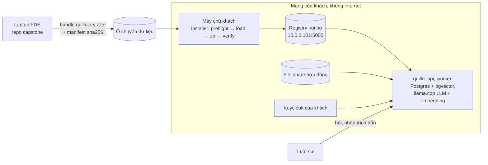

# Trợ lý hợp đồng cho công ty luật

Dự án capstone xuyên suốt lộ trình FDE. Bạn là FDE của công ty bán **quillo** (trợ lý hỏi đáp tài liệu có trích
dẫn) và được cử sang một khách mới. Bạn dẫn trọn một "hợp đồng triển khai": khảo sát máy, đóng gói, cài vào môi
trường air-gapped, chạy dưới ràng buộc bảo mật, tích hợp SSO và nguồn hợp đồng của khách, chứng minh hệ thống không
"bịa", xử lý sự cố, rồi discovery, scoping, ROI, bàn giao, và cuối cùng một bài đánh giá độc lập mức senior.

Trọng tâm **không** phải code của quillo (đã có sẵn) mà là mọi thứ quanh việc đưa nó vào chạy thật ở nhà khách.

## Khách hàng (hư cấu)

Phòng pháp chế của một tập đoàn muốn trợ lý AI tra cứu và rà soát hợp đồng.

| Ràng buộc | Hệ quả cho bạn |
| --- | --- |
| Hợp đồng là dữ liệu mật, **không được rời máy chủ của khách** | LLM và embedding chạy ngay trên máy khách, model đóng trong bundle; không gọi API ngoài |
| IT khách chặn internet | Cài từ bundle offline, image đi qua registry nội bộ, không `apt install` hay `pip install` từ internet |
| IT khách quản máy và cluster | Bạn không có cluster-admin; mọi thay đổi hệ thống phải xin và ghi lại |
| Luật sư hỏi bằng ngôn ngữ tự nhiên, cần dẫn nguồn | Câu trả lời phải trích đúng điều khoản; eval chứng minh điều đó bằng số |

"Máy khách" là VM của hồ sơ `lawfirm-staging` (Ubuntu 22.04, không ra internet, chỉ thấy registry nội bộ HTTP ở
`10.0.2.101:5000`, Docker không có plugin compose) dựng bằng `fdekit.customer_site`. Các milestone sau thêm cluster
k3s của khách (m06), Keycloak và file share (m07), và một khách mới hoàn toàn cho bài đánh giá cuối (m16).

## Dữ liệu thật: CUAD

**CUAD** (Contract Understanding Atticus Dataset v1): 510 hợp đồng thương mại thật lấy từ SEC EDGAR, nhãn chuyên gia
cho 41 loại điều khoản. Nhãn được dùng để dựng eval "có tìm đúng điều khoản không, có bịa không" (m09) và đo số liệu
cho báo cáo ROI (m13).

```bash
uv run python data/download_dataset.py cuad      # tải và giải nén vào data/raw/cuad/
```

**Ghi công (CC BY 4.0, bắt buộc khi dùng hay phân phối lại):** The Atticus Project; Dan Hendrycks, Collin Burns,
Anya Chen, Spencer Ball, "CUAD: An Expert-Annotated NLP Dataset for Legal Contract Review", NeurIPS 2021;
[giấy phép CC BY 4.0](https://creativecommons.org/licenses/by/4.0/); nguồn [Zenodo 4595826](https://zenodo.org/records/4595826).
Nêu rõ nếu bạn chỉnh sửa dữ liệu. **Không commit CUAD vào repo capstone**: repo chỉ chứa script tải và dòng ghi công.

## Capstone là một repo riêng của bạn

Repo học này **chỉ chứa đề, hướng dẫn, bộ chấm và một lời giải tham chiếu**. Bạn làm capstone trong **một repo Git
riêng** do chính bạn tạo (vd. `~/projects/quillo-lawfirm-deployment`), như một dự án setup thật, rồi tự đẩy lên GitHub
public làm portfolio.

- **Tự chứa:** repo riêng mang theo mọi thứ nó cần (script survey, bundle, installer, tài liệu). Khi chạy, nó **không
  import** `testkit`, `fdekit` hay bất kỳ code nào của repo học, và không trỏ đường dẫn tuyệt đối vào repo học. Bản
  phát hành quillo được lấy về theo hướng dẫn ở m02 (bundle `quillo-<version>.tar` dựng từ `tracks/fde/product/`, có
  manifest sha256), không chép mã nguồn sản phẩm.
- **Không lọt secret:** `.gitignore` chặn khoá SSH của lab, `*.pem`, `*.key`, `.env`, dữ liệu CUAD và bundle. Bộ chấm
  m00 kiểm `git ls-files` của repo bạn.
- **License:** quillo phát hành MIT nên bạn được đưa bundle (hoặc script lấy bundle) vào repo public; CUAD thì không.

Milestone **M00** hướng dẫn tạo repo: cấu trúc thư mục, `Makefile`, README dạng case study, license, `.gitignore`.

Bộ chấm ở repo học trỏ vào repo của bạn qua biến môi trường `FDE_CAPSTONE_DIR` (đặt trong `setup/.env`):

```bash
# setup/.env
FDE_CAPSTONE_DIR=/home/<bạn>/projects/quillo-lawfirm-deployment
```

Chưa đặt `FDE_CAPSTONE_DIR` thì mọi test capstone **skip** kèm thông báo.

## Cách chấm

```bash
uv run pytest tracks/fde/capstone -k m01 -q          # chấm một milestone trên repo của bạn
uv run pytest tracks/fde/capstone -q                 # chấm tất cả milestone đã có
SOLUTION=1 uv run pytest tracks/fde/capstone -q      # chấm lời giải tham chiếu (tracks/fde/capstone/solutions/project/)
```

- Test nằm ở `tracks/fde/capstone/tests/`, tên bắt đầu bằng `test_mNN_`; `-k mNN` chọn một milestone.
- Test kiểm **hành vi thật**: dựng VM khách bằng `fdekit`, chạy script/installer của bạn qua SSH, gọi dịch vụ qua cổng
  forward, đọc tài liệu có frontmatter YAML. Không có test nào chỉ grep chuỗi trong code của bạn.
- Mỗi test nhắm ≤300 s kể cả boot VM (golden image chuẩn bị trước bằng `uv run python -m fdekit prepare <hồ sơ>`,
  không tính); capstone dùng tối đa 3 VM cùng lúc. Test nào vượt thì đề milestone ghi rõ chạy bằng terminal.
- Thiếu KVM, golden image, dữ liệu hay `FDE_CAPSTONE_DIR` thì test skip kèm lệnh cần chạy. Skip **không** tính là đạt.
- Lời giải tham chiếu ở `capstone/solutions/` để kiểm bộ chấm và để bạn tham khảo khi bí; đừng chép nó sang repo riêng.

## 17 milestone

Mỗi milestone mở ra sau một module (chỉ module của track chính, không có milestone nào gắn với Cloud lab) và dùng lại
kết quả của milestone trước. Đề chi tiết ở `milestones/`.

| M | Sau module | Nội dung |
| --- | --- | --- |
| M00 | 00 | Tạo repo capstone riêng: cấu trúc, `Makefile`, README case study, license, `.gitignore` chặn secret |
| M01 | 01 | Khảo sát VM của khách bằng script site-survey; báo cáo khoảng cách so với yêu cầu sản phẩm |
| M02 | 02 | Bundle offline cho đúng khách này, installer có preflight dựa trên báo cáo M01 |
| M03 | 03 | Cài qua môi trường air-gapped + registry nội bộ; xác minh toàn vẹn bundle |
| M04 | 04 | Chạy dưới ràng buộc bảo mật của khách (không root, SELinux) |
| M05 | 05 | Định cỡ model theo phần cứng; CPU fallback; (tuỳ chọn) chạy trên PC GPU |
| M06 | 06 | Cài bằng Helm vào namespace k3s của khách, không cluster-admin |
| M07 | 07 | SSO qua Keycloak của khách; nạp CUAD qua connector từ "file share" của khách; phân quyền tài liệu |
| M08 | 08 | Sự cố dựng sẵn ở hiện trường; chẩn đoán chỉ qua support bundle và lệnh "nhờ khách gõ"; báo cáo sự cố |
| M09 | 09 | Eval suite trên nhãn CUAD + red-team prompt injection; nâng cấp v1.0 → v1.1 tại chỗ và rollback; acceptance test |
| M10 | 10 | Tuỳ biến cho workflow pháp chế (vd. bảng rà soát điều khoản rủi ro), giữ fork tối thiểu |
| M11 | 11 | Discovery với stakeholder simulator → tài liệu yêu cầu (chấm theo số yêu cầu ẩn hỏi ra được) |
| M12 | 12 | Scoping doc + kế hoạch pilot → production + tiêu chí nghiệm thu |
| M13 | 13 | Báo cáo ROI dựa trên số đo thật từ M09 (thời gian rà soát, độ chính xác) |
| M14 | 14 | Gói bàn giao: runbook, README vận hành, exec summary, product feedback gửi team product |
| M15 | 18 | Design doc: mở rộng cho 5 công ty con (multi-site, cập nhật air-gapped, GPU dùng chung) |
| M16 | 20 | Đánh giá độc lập mức senior: khách mới với hồ sơ máy lạ, tự đi trọn vòng survey → cài → sự cố → bàn giao; repo hoàn chỉnh làm portfolio |

Về thứ tự: trong hợp đồng thật, discovery (M11) và scoping (M12) thường diễn ra **trước** khi cài. Track đặt chúng sau
trụ hiện trường vì bạn cần biết rõ thứ mình sẽ cài và những gì có thể hỏng ở nhà khách thì mới hỏi đúng câu, ước lượng
có cơ sở và tính ROI bằng số đo thật (M13 dùng số của M09). Đề M11–M12 vẫn đặt tình huống ở đầu hợp đồng.

Các milestone tài liệu (M11–M15) nộp tệp Markdown có **frontmatter YAML bắt buộc**: phần có cấu trúc (danh sách scope,
ước lượng min/max, con số ROI…) được test kiểm một cách xác định, phần lập luận chấm bằng rubric công khai trong đề và
LLM-judge local (tự skip khi không có model).

```mermaid
flowchart LR
    subgraph field[Hiện trường]
        C0[M00 Repo riêng] --> C1[M01 Survey] --> C2[M02 Bundle] --> C3[M03 Air-gapped]
        C3 --> C4[M04 Không root] --> C5[M05 Định cỡ model] --> C6[M06 Helm k3s]
        C6 --> C7[M07 SSO + CUAD] --> C8[M08 Sự cố] --> C9[M09 Eval + nâng cấp] --> C10[M10 Workflow pháp chế]
    end
    subgraph client[Làm việc với khách]
        C11[M11 Discovery] --> C12[M12 Scoping] --> C13[M13 ROI] --> C14[M14 Bàn giao]
    end
    C10 --> C11
    C9 -. số đo .-> C13
    C14 --> C15[M15 Design doc 5 công ty con] --> C16[M16 Đánh giá senior]
```



## Kiến trúc đích ở nhà khách


