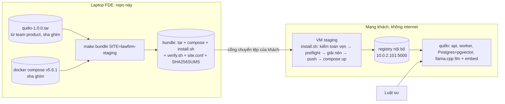

# quillo cho phòng pháp chế: triển khai air-gapped

Case study Forward Deployed Engineer: đưa **quillo** (trợ lý hỏi đáp hợp đồng có trích dẫn, chạy on-prem) vào máy
staging của phòng pháp chế một tập đoàn, nơi hợp đồng không được rời máy chủ và máy không ra internet. Repo này chứa
mọi thứ quanh việc cài: khảo sát máy, đóng gói bundle offline cho đúng khách, installer idempotent, kiểm tra sau cài,
và báo cáo gửi IT khách. Mã nguồn quillo **không** nằm ở đây; repo lấy bản phát hành từ team product và kiểm sha đã ghim.

## Khách hàng và bài toán

Phòng pháp chế (hư cấu) cần luật sư hỏi bằng ngôn ngữ tự nhiên trên kho hợp đồng thương mại và nhận câu trả lời trích
đúng điều khoản. Thử nghiệm đầu tiên chạy trên một VM staging do IT khách quản (Ubuntu 22.04, 2 vCPU, 5 GB RAM). Dữ liệu
thử là CUAD (510 hợp đồng SEC EDGAR, CC BY 4.0, The Atticus Project), không bao giờ commit vào repo này.

## Ràng buộc

| Ràng buộc | Hệ quả kỹ thuật |
| --- | --- |
| Hợp đồng là dữ liệu mật, không rời máy khách | LLM + embedding (llama.cpp, GGUF) chạy ngay trên VM, model nằm trong bundle |
| VM không ra internet, không DNS | Không `apt`/`pip`/`docker pull`; mọi thứ đi trong bundle, image qua registry nội bộ |
| Image chạy trong vùng trong phải từ registry nội bộ HTTP của khách | Installer `docker load` → `tag` → `push`, compose trỏ vào registry đó |
| IT khách quản máy, thay đổi hệ thống phải xin và ghi lại | Installer chỉ đụng `/opt/quillo`, `/etc/quillo`, `daemon.json` (có bản sao lưu), ghi log từng lần chạy |
| Bundle đi qua cổng chuyển tệp của khách | `SHA256SUMS` + `manifest.json` kiểm trước khi đụng vào máy; sha của `SHA256SUMS` gửi qua kênh riêng |

Kết quả khảo sát và các điểm cần IT xử lý: [`reports/site-survey.md`](reports/site-survey.md).

## Kiến trúc



Installer đi chín bước và dừng ở bước đầu tiên lỗi, ghi một dòng vào `/var/log/quillo-install.log`:

1. `sha256sum -c SHA256SUMS` cả bundle (bắt chép hỏng; nêu tên tệp sai).
2. Preflight theo `REQUIREMENTS.yaml` của bản phát hành: CPU, RAM (chừa 10%), đĩa ở `/opt` và `/var/lib/docker`,
   Docker chạy, registry trả lời, cổng còn trống.
3. Đọc luồng tar và kiểm từng tệp theo `manifest.json` bên trong (bắt bundle bị sửa dù `SHA256SUMS` "khớp"), chưa ghi
   gì ra đĩa.
4. Giải nén vào `/opt/quillo/releases/<bản>` qua thư mục tạm, kiểm lại cây trên đĩa rồi mới đổi tên.
5. Đặt binary compose đã ghim ở `/opt/quillo/bin/docker-compose` (máy khách không có plugin compose và không cài được).
6. Thêm registry nội bộ vào `insecure-registries` (ghi nguyên tử, giữ `daemon.json.bak-quillo`, tự trả lại nếu Docker
   không lên); restart Docker chỉ khi có thay đổi, và cảnh báo khi `live-restore` tắt.
7. `docker load` → `tag` → `push` vào registry.
8. `/etc/quillo/quillo.env` (0600, mật khẩu sinh tại chỗ, không bao giờ đi trong bundle) và `compose.site.yaml` ngoài
   cây release (trỏ image sang registry, `inbox` ra `/opt/quillo/data/inbox` thuộc uid 10001).
9. `compose up -d --wait`, `/healthz`.

Chạy lại cùng bản: không tạo lại container, không restart Docker, thoát 0.

## Cách chạy

```bash
make survey SSH="ssh fde@staging" SITE=lawfirm-staging      # reports/survey-*.json + preflight-*.json
make bundle SITE=lawfirm-staging QUILLO_RELEASE_DIR=~/releases   # dist/bundle-lawfirm-staging/
# chép dist/bundle-lawfirm-staging/ sang máy khách (thư mục ~/bundle), đọc sha256(SHA256SUMS) cho IT qua điện thoại
make install SSH="ssh fde@staging"                           # sudo bash ~/bundle/install.sh trên máy khách
make verify SSH="ssh fde@staging"                            # /healthz, đủ 5 dịch vụ, image từ registry nội bộ
make test                                                    # test của repo (preflight)
```

| Biến | Mặc định | Ý nghĩa |
| --- | --- | --- |
| `SITE` | `lawfirm-staging` | Cấu hình site ở `sites/<SITE>.conf` (`lab`: máy lab tập cài, không registry) |
| `BUNDLE_DIR` | `dist/bundle-$(SITE)` | Nơi `make bundle` ghi |
| `QUILLO_RELEASE_DIR` | (bắt buộc cho `bundle`) | Thư mục chứa `quillo-1.0.0.tar` team product giao |
| `QUILLO_RELEASE_SHA256` | sha trong `delivery/release.lock` | sha256 của tar nhận qua kênh riêng (bản dựng lại có sha khác) |
| `COMPOSE_BIN` | tải về `.cache/` | Binary compose v5.6.1 đã có sẵn; luôn kiểm sha ghim |
| `SSH` | rỗng (chạy tại máy này) | Lệnh SSH tới máy khách |
| `REMOTE_BUNDLE` | `bundle` khi có `SSH` | Thư mục bundle trên máy khách |

Cần: GNU make, `sh`, `tar`, `sha256sum`, `curl`; Python 3.10+ với PyYAML cho `survey/preflight.py` và `pytest` cho
`make test`. Máy khách cần Docker, `python3`, `curl`, `openssl`, `ss` (Ubuntu 22.04 có sẵn).

## Cấu trúc repo

```text
survey/      site_survey.sh (POSIX sh, không cần root, che user:pass trong proxy), preflight.py, REQUIREMENTS.yaml
reports/     site-survey.md (báo cáo khoảng cách gửi IT), survey-*.json, preflight-*.json
sites/       cấu hình theo site: registry, địa chỉ bind, cổng
delivery/    release.lock, fetch_release.sh, fetch_compose.sh, build_bundle.sh, install.sh, verify.sh
tests/       test của repo
```

## Quyết định và đánh đổi

- **Binary compose riêng, không cài plugin hệ thống:** máy khách không có `docker compose` và không có mạng để cài gói;
  đặt binary ở `/opt/quillo/bin` thay vì `/usr/local/lib/docker/cli-plugins` để không đổi hành vi `docker` của các
  dịch vụ khác trên máy IT quản. Đổi lại runbook phải gọi `/opt/quillo/bin/docker-compose`.
- **Hai lớp kiểm toàn vẹn:** `SHA256SUMS` bắt chép hỏng (nhanh, nêu tên tệp); `manifest.json` bắt bundle khác bản
  phát hành. Cả hai nằm trong bundle nên không chống được người sửa cả hai; vì vậy sha của `SHA256SUMS` đi qua kênh riêng.
- **Bundle tái lập được:** cùng bản phát hành, cùng compose, cùng site ⇒ `SHA256SUMS` giống hệt từng byte, để IT so
  hai lần giao.
- **Không tự rollback ở m02–m03:** chỉ có một bản; installer dừng và ghi log ở bước lỗi. Nâng cấp/rollback làm ở m09.

## Giấy phép

Script và tài liệu trong repo: MIT (`LICENSE`). Bundle quillo không nằm trong repo (vượt 100 MB và có thành phần bên
thứ ba): mã quillo MIT; image Postgres/pgvector, llama.cpp server và trọng số GGUF (Qwen2.5, nomic-embed) mỗi thứ có
giấy phép riêng, đọc trước khi phân phối lại; binary Docker Compose trong `tools/` của bundle giao khách: Apache-2.0. CUAD: CC BY 4.0, The Atticus Project; Hendrycks, Burns, Chen, Ball,
"CUAD: An Expert-Annotated NLP Dataset for Legal Contract Review", NeurIPS 2021.
