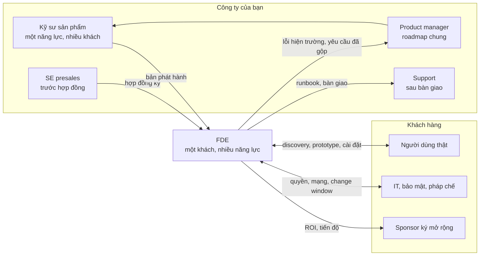
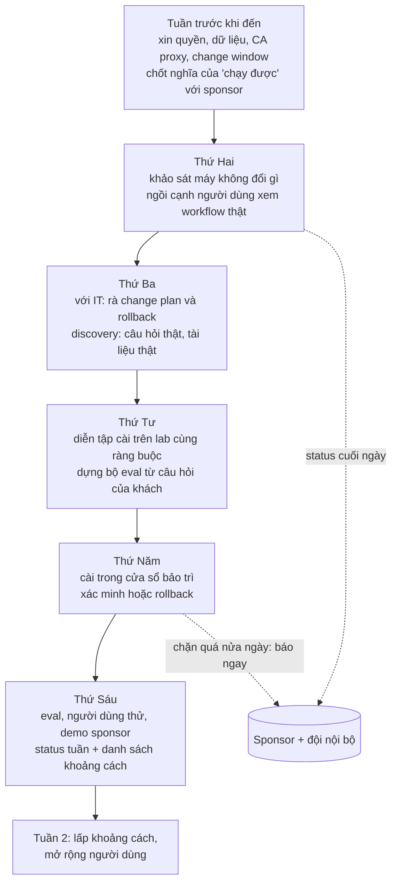
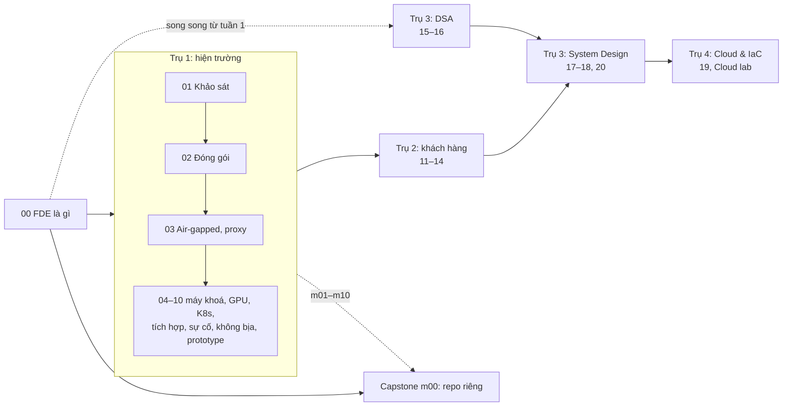
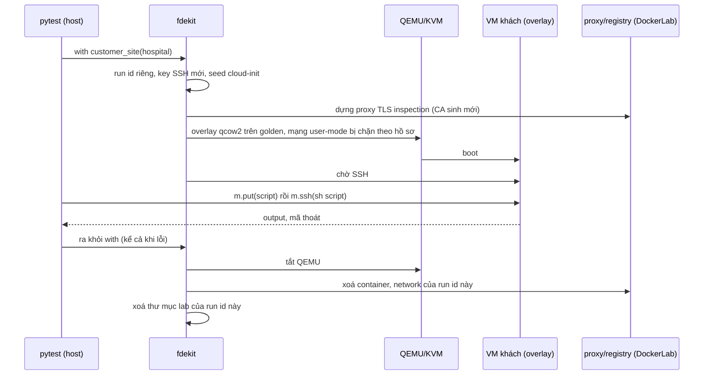
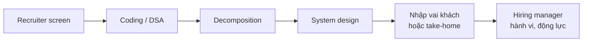

# FDE là gì

Forward Deployed Engineer (FDE) là kỹ sư phần mềm làm việc **ở phía khách hàng**: ngồi cạnh người dùng thật, hiểu bài
toán của họ, rồi mang sản phẩm của công ty vào môi trường của khách và làm cho nó tạo ra kết quả ở đó. Vai này có từ hơn
một thập kỷ trước ở Palantir và mấy năm gần đây nở rộ ở các công ty AI, vì "model tốt" chỉ thành giá trị khi có người
nối nó vào dữ liệu, hệ thống, quy trình và ràng buộc của một khách cụ thể.

Module này đặt nền cho cả track: FDE làm gì và không làm gì, khác các vai gần nó ra sao, một tuần thật trông thế nào,
track chia bốn trụ để học thế nào, bạn đã có gì từ các track trước, lab VM "máy khách" vận hành ra sao, và vòng phỏng
vấn FDE thường có những gì.

Sau module này bạn sẽ:

- Giải thích được nguồn gốc vai FDE (Palantir "Delta" và "Echo") và vì sao các công ty AI tuyển FDE.
- Phân biệt FDE với Solutions/Sales Engineer, consultant, support và kỹ sư sản phẩm qua tình huống cụ thể.
- Lập kế hoạch tuần đầu tại khách có mục tiêu đo được và danh sách thứ phải xin trước.
- Dựng lab VM của track (KVM, QEMU, golden image) và chạy script đầu tiên bên trong "máy khách".
- Biết vòng phỏng vấn FDE gồm những gì để chuẩn bị song song từ đầu.

## 0. Cài đặt

Track chạy "máy khách" bằng **VM QEMU/KVM thật** trên laptop qua helper `fdekit.py` ở gốc repo. Test VM tự skip kèm thông
báo khi thiếu KVM, QEMU, OpenSSH, golden image hoặc RAM trống, không treo.

| Công cụ | Phiên bản đã kiểm | Kiểm bằng |
| --- | --- | --- |
| CPU có ảo hoá (Intel VT-x / AMD-V), bật trong BIOS | — | `grep -cE 'vmx|svm' /proc/cpuinfo` lớn hơn 0 |
| `/dev/kvm` đọc/ghi được bởi user của bạn | — | `test -r /dev/kvm && test -w /dev/kvm && echo ok` |
| QEMU (`qemu-system-x86_64`, `qemu-img`) | 10.0.8 (Debian 13) | `qemu-system-x86_64 --version` |
| OpenSSH client (`ssh`, `scp`, `ssh-keygen`) | 10.0p2 | `ssh -V` |
| Docker phía host (proxy, registry của "khách", dựng bundle) | 29.9.2 | `docker info` |
| uv | 0.11.33 | `uv --version` |

Bản đã kiểm là bản trên máy dựng track (Debian 13), và chỉ bản đó đã được chạy thử. Các tính năng `fdekit` cần (qcow2
backing file, mạng user-mode có `hostfwd`/`guestfwd`, QMP, khoá ed25519) đã có từ lâu trong QEMU và OpenSSH, nên bản
trong kho của các distro còn được hỗ trợ dự kiến dùng được; gặp lỗi thì ghi lại phiên bản và lỗi. Cài từ kho của distro:
`apt` kiểm chữ ký gói, không tải script lạ về chạy bằng quyền root.

```bash
sudo apt install qemu-system-x86 qemu-utils openssh-client
qemu-system-x86_64 --version | head -1 && qemu-img --version | head -1 && ssh -V
```

Output trên máy dựng track:

```text
QEMU emulator version 10.0.8 (Debian 1:10.0.8+ds-0+deb13u1+b2)
qemu-img version 10.0.8 (Debian 1:10.0.8+ds-0+deb13u1+b2)
OpenSSH_10.0p2 Debian-7+deb13u4, OpenSSL 3.5.7 9 Jun 2026
```

### Quyền `/dev/kvm`

```bash
ls -l /dev/kvm
```

Có hai cách user thường được quyền: thuộc nhóm `kvm` (`crw-rw---- root kvm`), hoặc phiên desktop đăng nhập tại chỗ được
`systemd-logind` cấp ACL (dấu `+` cuối cột quyền, `getfacl /dev/kvm` thấy tên bạn). ACL không có trong phiên SSH từ xa
hay cron; muốn chạy test ở đó thì thêm nhóm:

```bash
sudo usermod -aG kvm "$USER"
```

rồi đăng xuất và đăng nhập lại (nhóm mới chỉ có hiệu lực ở phiên mới; `id` phải thấy `kvm`). Không có `/dev/kvm` (máy ảo
lồng không bật nested virtualization, WSL không cấu hình KVM) thì QEMU vẫn chạy được bằng TCG nhưng chậm hàng chục lần,
không vừa ngân sách 300 s mỗi bài; `fdekit` skip thay vì chạy chậm.

### Golden image

Mỗi hồ sơ khách cần một **golden image** dựng một lần: tải cloud image chính thức (kiểm sha256), boot có mạng, cài runtime
và "tật" của khách, rồi ghi một qcow2 độc lập vào `data/raw/fde-images/golden/`. Mỗi bài boot một **overlay** mới trên
golden, nên golden không bao giờ bị ghi và mỗi lần chạy là một máy sạch.

```bash
nice -n 15 uv run python -m fdekit prepare lab-open
```

Mất khoảng 1–6 phút (đo được 64–93 s khi dựng riêng một hồ sơ, tới 323 s khi dựng nhiều hồ sơ cùng lúc; lần đầu cộng
thêm thời gian tải image Ubuntu 22.04 ~730 MB); golden đã có thì lệnh trả ngay, dựng lại bằng `--force`. Module 00 chỉ
cần `lab-open`; module 01–03 cần thêm `hospital`, `bank`, `lawfirm-staging` (cùng lệnh, đổi tên hồ sơ). Đĩa cần khoảng
25 GB cho cả bốn hồ sơ.

Sau mỗi lần chạy test, kiểm không còn VM hay thư mục lab sót lại (lệnh chỉ báo cáo, không xoá gì):

```bash
uv run python -m fdekit leftovers
```

**Gỡ:** xoá `data/raw/fde-images/` (cloud image và golden) và thư mục `.fde-lab/` ở gốc repo nếu còn; gỡ QEMU bằng
`sudo apt remove qemu-system-x86 qemu-utils`. Chi tiết hồ sơ, mạng lab và cách dựng golden ở
[setup/fde/README.md](../../../../setup/fde/README.md).

## 1. FDE là gì và đến từ đâu

### Palantir: Dev, Delta, Echo

Vai FDE được Palantir làm nổi tiếng. Trong blog kỹ thuật của mình, Palantir tách kỹ sư làm hai nhóm: **Dev** (Software
Engineer) phát triển các nền tảng phần mềm như Foundry và Gotham, còn **Delta** (Forward Deployed Software Engineer)
**triển khai** các nền tảng đó cho khách, nhúng trực tiếp vào đội của khách để cấu hình và mở rộng phần mềm có sẵn cho
những bài toán khó nhất của họ. Cách so sánh hay được trích lại: Dev tập trung vào "một năng lực, nhiều khách", Delta vào
"một khách, nhiều năng lực".

Bên cạnh Delta có **Echo** (Deployment Strategist): người hiểu nghiệp vụ, quản lý quan hệ với khách, chọn bài toán quan
trọng nhất và dẫn dự án. Bài blog của Palantir về Echo nói một dự án thường trộn Echo và Delta, và vai Echo trải từ người
viết code cả ngày tới người không chạm code mà điều phối nhiều dự án. Nói gọn: Echo giữ câu hỏi "giải bài nào, cho ai,
vì sao", Delta giữ câu hỏi "làm sao cho nó chạy ở đây, trên dữ liệu này".

Bài học từ mô hình này, quan trọng hơn cái tên:

- **Sản phẩm vẫn là sản phẩm.** Delta cấu hình và mở rộng nền tảng chung, không viết lại một hệ thống riêng cho mỗi
  khách. Khi nhiều khách cần cùng một thứ, phản hồi đi về Dev để thành tính năng chung.
- **Kỹ sư ngồi ở chỗ có vấn đề.** Ở khách, Delta thấy những thứ không ai viết trong tài liệu yêu cầu: dữ liệu bẩn ra sao,
  hệ thống cũ xuất được định dạng gì, ai thật sự quyết định.
- **Cặp kỹ thuật và nghiệp vụ.** Một người hiếm khi giỏi cả hai đầu ngay; mô hình cặp Echo + Delta là cách tổ chức bù chỗ đó.

### FDE ở các công ty AI

Từ 2024–2025, nhiều công ty AI và phần mềm doanh nghiệp lập đội FDE. Lý do lặp lại trong các bài phân tích: model nền
mạnh nhưng giá trị chỉ đến khi có người nối model vào dữ liệu, quy trình, hệ thống phân quyền và yêu cầu tuân thủ của một
khách cụ thể, và cái "nối" đó khó tự phục vụ. Ví dụ đã công bố:

- **OpenAI** tuyển "Forward Deployed Engineer" ở nhiều thành phố; tin tuyển mô tả FDE làm từ discovery, scoping kỹ thuật,
  thiết kế, xây dựng tới đưa vào production cùng khách. Theo bài của The Pragmatic Engineer (8/2025), đội FDE của OpenAI
  lập đầu 2025, viết code trên hạ tầng của khách và mang dữ liệu hiện trường về cải tiến sản phẩm.
- **Anthropic** và nhiều công ty AI khác cũng đăng tin tuyển FDE (link ở phần 8).
- Bài "Trading Margin for Moat" của a16z (6/2025) nhìn từ phía nhà đầu tư: đội forward deployed là đội gần khách nhất, và
  các công ty AI bền vững thường có một dạng hỗ trợ "cầm tay" như FDE hay solutions engineer, đổi một phần biên lợi nhuận
  lấy chỗ đứng chắc ở khách.

Cũng có góc nhìn hoài nghi: một số bài cho rằng nhiều tin "FDE" là vai professional services hay solutions engineer đổi
tên. Khi đọc tin tuyển, nhìn **việc** được mô tả (có viết code production trên hạ tầng khách không, có chịu trách nhiệm
đưa hệ thống vào chạy không) chứ đừng nhìn chức danh.

### Việc của một FDE trong track này

Roadmap [roadmap.sh/forward-deployed-engineer](https://roadmap.sh/forward-deployed-engineer) mà track bám theo coi FDE là
full-stack engineer cộng kỹ năng hiện trường, AI, DevOps, cloud và làm việc với khách, không phải vai cho người mới vào
nghề. Track này đặt trọng tâm vào phần khó dạy nhất: **mang sản phẩm vào môi trường lạ** (không internet, proxy soi
HTTPS, OS cũ, không root, SELinux, GPU lệch driver) và **làm việc với khách** đủ tốt để biết nên xây gì.



## 2. FDE khác SE, consultant, support và SWE thế nào

Ranh giới khác nhau theo công ty (công ty nhỏ có khi một người kiêm hai vai), nhưng câu hỏi tách vai khá ổn định: hợp
đồng đã ký chưa, việc phục vụ một hay nhiều khách, ai sở hữu code, và đo thành công bằng gì.

| Vai | Khi nào | Trọng tâm | Sở hữu code? | Thành công đo bằng |
| --- | --- | --- | --- | --- |
| **Solutions / Sales Engineer (SE)** | Trước hợp đồng (presales) | Demo, POC ngắn, trả lời câu hỏi kỹ thuật và security questionnaire để qua vòng mua hàng | Code demo, ít khi production | Deal ký, chu kỳ bán ngắn |
| **FDE** | Sau ký, trong pilot và mở rộng | Đưa sản phẩm chạy trên hạ tầng và dữ liệu thật của **một** khách: cài đặt, tích hợp, prototype, đo kết quả | Code tích hợp và tuỳ biến ở khách, đôi khi cả tính năng lõi | Khách dùng thật, mở rộng hợp đồng, phản hồi sản phẩm có bằng chứng |
| **Consultant / professional services** | Theo hợp đồng dịch vụ | Làm theo scope khách thuê, thường trên công nghệ của bên khác | Bàn giao cho khách | Giao đúng scope, giờ tính phí |
| **Support / customer success** | Sau bàn giao, vận hành | Xử lý ticket theo quy trình, runbook, bản vá | Không | SLA, thời gian xử lý, tỉ lệ giữ khách |
| **Software Engineer sản phẩm (SWE)** | Liên tục | Năng lực chung cho mọi khách | Code lõi | Chất lượng, tốc độ phát hành, chỉ số sản phẩm |

Ba điểm hay bị hiểu lầm:

- **FDE không phải consultant của công ty mình.** Consultant thắng khi làm đúng scope khách thuê; FDE thắng khi **sản
  phẩm** chạy được ở khách và những gì học được ở đó quay về làm sản phẩm tốt hơn cho khách sau. Một fork riêng khổng lồ
  cho mỗi khách là dấu hiệu FDE đang trôi thành consultant (module 10 nói về fork tối thiểu).
- **FDE không phải support cấp cao.** Support xử lý cái đã biết theo quy trình; FDE làm việc trong vùng chưa có quy
  trình, và một trong các sản phẩm của FDE chính là runbook để support nhận lại.
- **FDE không chỉ "biết giao tiếp".** Phần lớn thời gian FDE vẫn viết code, đọc log và cài đặt; khác SWE ở chỗ code chạy
  trên môi trường không do mình kiểm soát và người dùng ở ngay cạnh.

Bài tập Basic 02 cho bạn luyện phân vai qua 8 tình huống.

## 3. Một tuần của FDE

Không có "tuần điển hình" giống nhau ở mọi công ty, nhưng một pilot tại khách thường có nhịp như dưới đây. Ví dụ: tuần đầu
pilot trợ lý hỏi đáp tài liệu ở một bệnh viện (đúng bối cảnh bài Advanced 01).



Những điều tuần đó dạy:

- **Phần lớn rủi ro biết được trước.** Đĩa 8 GB trong khi bundle cần nhiều hơn, proxy soi HTTPS, thiếu plugin compose:
  đọc được từ thông tin IT gửi. Không xin sửa trước khi đến là tự đẩy chúng vào thứ Hai.
- **Lịch của khách là ràng buộc cứng.** IT chỉ rảnh hai buổi, thay đổi hệ thống chỉ trong cửa sổ bảo trì. Kế hoạch phải
  xếp quanh chúng, không phải ngược lại.
- **"Chạy được" phải định nghĩa bằng con số** và do sponsor xác nhận: "dịch vụ lên" và "điều dưỡng hỏi 30 câu thật, đúng
  20 câu kèm trích dẫn" là hai lời hứa rất khác.
- **Tin xấu báo sớm.** Status ngắn cuối ngày (xong gì, bị chặn bởi gì, cần ai) rẻ hơn nhiều một bất ngờ ngày thứ Sáu.
- **Việc không code chiếm nhiều giờ.** Họp với IT, chờ duyệt dữ liệu, viết status, diễn tập: đây là công việc, không phải
  thời gian chết. FDE giỏi lấp chỗ chờ bằng việc không phụ thuộc (eval, diễn tập trên lab).

Ở các tin tuyển FDE thường có dòng về đi công tác (có tin ghi tới 50% thời gian). Nhiều tuần FDE làm từ xa, qua
screen-share với IT khách hoặc chỉ đọc log khách gửi lại; module 08 dạy chẩn đoán trong điều kiện đó.

## 4. Bốn trụ của track và cách học

Track chia thành bốn trụ học sâu ngang nhau (bảng đầy đủ ở [README của track](../../README.md)):

| Trụ | Module | Câu hỏi trụ trả lời |
| --- | --- | --- |
| 1. Triển khai tại hiện trường (xương sống) | 01–10 | Làm sao cho sản phẩm chạy, đúng và đáng tin trên máy, mạng, dữ liệu của khách? |
| 2. Làm việc với khách | 11–14 | Nên xây gì, theo thứ tự nào, đáng bao nhiêu tiền, nói với ai thế nào? |
| 3. DSA và System Design | 15–18, 20 | Qua được vòng phỏng vấn và thiết kế được hệ thống có ràng buộc của khách |
| 4. Cloud và IaC | 19, Cloud lab C1–C3 | Triển khai vào tài khoản cloud **của khách** mà không giữ quyền thừa |



Cách học khuyến nghị:

- **Đi trụ 1 theo thứ tự.** Module sau dùng kết quả của module trước: khảo sát (01) cho đầu vào của preflight trong bundle
  (02), bundle là thứ mang vào máy air-gapped (03).
- **DSA chạy song song từ tuần đầu**, vài bài mỗi tuần. Nhiều quy trình phỏng vấn FDE mở bằng vòng coding; kỹ năng này cần
  thời gian tích luỹ, không nhồi được trong tuần cuối.
- **Capstone làm trong repo riêng** (milestone m00 ngay sau module này), như một dự án triển khai thật mà bạn khoe được.
- **Bài tập hỏng thật.** Mọi bài cài đặt có ít nhất một chỗ hỏng do môi trường khách gây ra; đề chỉ tả triệu chứng như
  khách báo lại. Đừng đọc lời giải trước khi tự chẩn đoán ít nhất một vòng.

Bài Intermediate 01 cho bạn luyện nghe một câu khách nói và xếp nó vào đúng trụ.

## 5. Bản đồ đồ nghề bạn đã có

Đây là phần **ôn nhanh duy nhất** của module: track không dạy lại những gì các track khác đã dạy, chỉ dùng chúng ở môi
trường lạ. Nếu một dòng dưới đây còn mờ, đọc module gốc trước khi tới module FDE tương ứng.

| Đồ nghề | Học ở | Dùng lại ở module FDE | Khác gì khi ở khách |
| --- | --- | --- | --- |
| Linux, shell, quyền, systemd | [DevOps 01 Linux & terminal](../../../devops/modules/01-linux-terminal/README.md) | 01, 04, 08 | Không root, OS cũ, không cài thêm công cụ được |
| Mạng, DNS, TLS | [DevOps 04 Networking](../../../devops/modules/04-networking-protocols/README.md), [DevOps 05 Web server & proxy](../../../devops/modules/05-web-server-proxy/README.md) | 03, 08 | Proxy công ty soi HTTPS, DNS nội bộ, egress bị chặn |
| Docker, image, Compose | [MLOps 02 Container cho ML](../../../mlops/modules/02-containers-for-ml/README.md) | 02, 03, 04 | Không kéo được image, không có plugin compose, Podman rootless |
| CI/CD, Makefile, packaging | [MLOps 01 Nền tảng kỹ thuật](../../../mlops/modules/01-engineering-foundations/README.md), [DE 08 DevOps cho data](../../../data-engineer/modules/08-devops-for-data/README.md) | 02 | Bundle phải tự chứa, cài offline, idempotent |
| Cloud, Terraform cơ bản | [DE 11 Cloud](../../../data-engineer/modules/11-cloud/README.md) | 19, Cloud lab | Tài khoản là của khách, quyền tối thiểu và thu hồi được |
| RAG, embedding, vector DB | [AE 12 Embeddings](../../../ai-engineer/modules/12-embeddings-vector-db/README.md), [AE 13 RAG](../../../ai-engineer/modules/13-rag/README.md) | 09, 10 | Dữ liệu của khách không rời máy, model nhỏ chạy CPU |
| Quantization, LLM local | [AE 10 Quantization](../../../ai-engineer/modules/10-quantization/README.md) | 05 | GPU của khách lệch driver, VRAM nhỏ |
| Eval, LLM production, an toàn | [AE 20 Evaluation & production](../../../ai-engineer/modules/20-evaluation-production/README.md), [AE 19 AI Safety](../../../ai-engineer/modules/19-ai-safety-security/README.md) | 09 | Eval trên câu hỏi của khách, ngưỡng nghiệm thu do khách duyệt |
| Monitoring, serving, rollback | [MLOps 07 Serving](../../../mlops/modules/07-model-serving/README.md), [MLOps 09 Monitoring](../../../mlops/modules/09-monitoring-observability/README.md) | 09 | Giám sát phải ship cùng sản phẩm, không có SaaS bên ngoài |
| SQL, pipeline, Kafka | Track [Data Engineer](../../../data-engineer/README.md) | 07 | Đọc từ hệ thống cũ của khách, quyền chỉ đọc |

Không học hết các track trên vẫn làm được track này: mỗi module FDE có tối đa một phần ôn nhanh đủ để làm bài. Nhưng người
phỏng vấn FDE sẽ hỏi sâu ở chính những chỗ này, nên chỗ nào mờ thì đó là việc cần làm trong bản đồ khoảng cách (bài
Advanced 02).

## 6. Lab của track: quillo và các "khách hàng"

### Sản phẩm `quillo`

Track cấp sẵn **quillo** ([tracks/fde/product](../../product/README.md)), "sản phẩm của công ty bạn": trợ lý hỏi đáp tài
liệu nội bộ có trích dẫn, giấy phép MIT, hư cấu. Thành phần: API FastAPI + htmx, worker nạp tài liệu, Postgres + pgvector,
LLM và embedding chạy bằng **llama.cpp server** (API kiểu OpenAI) với model GGUF nhỏ đóng trong bundle. Có hai bản phát
hành `1.0.0` và `1.1.0` (có migration DB) cho các bài nâng cấp và rollback. `REQUIREMENTS.yaml` ghi yêu cầu tối thiểu
của một node (2 CPU, 4 GB RAM, 10 GB đĩa trống, Docker ≥ 20.10 hoặc Podman ≥ 4.0, cổng 18080).

Bạn **không** xây quillo. Bạn khảo sát máy cho nó, đóng gói, cài, chẩn đoán, tuỳ biến và chứng minh nó không "bịa", đúng
như FDE làm với sản phẩm công ty mình.

### Các hồ sơ khách

"Máy khách" là VM QEMU/KVM thật dựng từ cloud image chính thức. Mỗi hồ sơ có "tật" riêng, cấu hình trong
`setup/fde/profiles/<hồ sơ>.yaml`:

| Hồ sơ | Máy | sudo | Ra ngoài | Runtime | Tật chính |
| --- | --- | --- | --- | --- | --- |
| `lab-open` | Ubuntu 22.04, đĩa 20 GB | có | mở | Docker + compose | Không tật: máy đối chứng |
| `hospital` | Ubuntu 20.04, đĩa 8 GB | có | chỉ qua proxy soi HTTPS | Docker, không compose | CA của proxy chưa trust, đĩa nhỏ |
| `bank` | Rocky Linux 8.10, đĩa 20 GB | **không** | không | Podman rootless | Air-gapped hoàn toàn, SELinux enforcing |
| `lawfirm-staging` | Ubuntu 22.04, đĩa 30 GB | có | không, chỉ registry nội bộ | Docker, không compose | Registry HTTP chưa khai `insecure-registries` |

Chạy script lab của bài Basic 01 trên ba hồ sơ cho ba bức tranh rất khác nhau (đo 2026-11-04):

```text
lab-open : os=ubuntu-22.04 user=fde docker=29.1.3 compose=yes egress=open
hospital : os=ubuntu-20.04 user=fde docker=26.1.3 compose=no  egress=proxy
bank     : os=rocky-8.10   user=fde docker=missing compose=no egress=none
```

### Một lần chạy test trông thế nào



Vài điều nên biết từ đầu:

- **Golden không bao giờ bị ghi.** Mọi thay đổi nằm trong overlay của lần chạy; hỏng thì chạy lại là có máy sạch.
- **Mỗi lần chạy có run id riêng** (`fde-ex-<uuid8>`) và chỉ dọn đúng run id đó, nên nhiều phiên chạy song song không xoá
  nhầm của nhau. Pytest bị giết giữa chừng thì tiến trình canh giữ vẫn dọn QEMU và container.
- **Mạng của hồ sơ là thật**: VM `bank` không có route ra ngoài, không DNS, không tới được dịch vụ trên host; VM
  `hospital` chỉ thấy proxy. Không có "lối tắt" để làm bài.
- **Ngân sách**: tối đa 2 VM mỗi bài, mỗi bài ≤ 300 s kể cả boot; boot một VM `lab-open` tới khi SSH được mất khoảng 10–15 giây trên máy dựng track.

## 7. Vòng phỏng vấn FDE

Quy trình mỗi công ty khác nhau và thay đổi theo thời gian; phần dưới tổng hợp các dạng vòng hay gặp theo tin tuyển dụng
và chia sẻ của ứng viên, không phải quy trình chính thức của công ty nào.

| Vòng | Kiểm gì | Track luyện ở |
| --- | --- | --- |
| Coding (DSA) | Cấu trúc dữ liệu, giải thuật, code sạch dưới áp lực thời gian | 15, 16 |
| System design | Thiết kế có ràng buộc thật: on-prem, air-gapped, data residency, phân quyền trong RAG | 17, 18 |
| Decomposition | Chia một bài toán mơ hồ của khách thành phần làm được, nêu giả định và đánh đổi, nói to cách nghĩ | 11, 12, 20 |
| Nhập vai với khách | Discovery, nói "không" có lý do, báo tin xấu, giải thích kỹ thuật cho người không kỹ thuật | 11–14, 20 |
| Take-home / dự án thật | Một hệ thống chạy được, có README, có quyết định ghi lại | Capstone, 20 |
| Hành vi | Câu chuyện thật về sở hữu kết quả, xử lý mơ hồ, làm việc với khách | Mọi module, bản đồ khoảng cách |



Ba điều người phỏng vấn FDE thường tìm, ngoài kỹ thuật:

- **Sở hữu kết quả đến cùng**, kể cả phần không phải "việc của kỹ sư" (xin quyền, đuổi theo người duyệt dữ liệu).
- **Thoải mái với mơ hồ**: đặt câu hỏi đúng trước khi giải, nói ra giả định thay vì đoán ngầm.
- **Bằng chứng thay cho tính từ**: một repo cài được trên máy lạ, một bộ eval có số, một tài liệu scope có won't.

Đó là lý do track bắt bạn làm capstone trong repo riêng và làm bản đồ khoảng cách ngay từ module này.

## 8. Tài liệu tham khảo

- roadmap.sh, [Forward Deployed Engineer Roadmap](https://roadmap.sh/forward-deployed-engineer): lộ trình track bám theo.
- Palantir Blog, [Dev versus Delta: Demystifying engineering roles at Palantir](https://blog.palantir.com/dev-versus-delta-demystifying-engineering-roles-at-palantir-ad44c2a6e87): Dev phát triển nền tảng, Delta triển khai cho khách.
- Palantir Blog, [A Day in the Life of a Palantir Forward Deployed Software Engineer](https://blog.palantir.com/a-day-in-the-life-of-a-palantir-forward-deployed-software-engineer-45ef2de257b1) (2020).
- Palantir Blog, [A Day in the Life of a Palantir Deployment Strategist](https://blog.palantir.com/a-day-in-the-life-of-a-palantir-deployment-strategist-951cb59a5a96): vai Echo, cách Echo và Delta làm cùng dự án.
- Palantir Blog, [Who Wants to be a Delta?](https://blog.palantir.com/who-wants-to-be-a-delta-8d2ea948035): một kỹ sư kể chuyện chuyển sang làm Delta.
- Gergely Orosz, The Pragmatic Engineer, [What are Forward Deployed Engineers, and why are they so in demand?](https://newsletter.pragmaticengineer.com/p/forward-deployed-engineers) (8/2025): Palantir, OpenAI và các startup dùng FDE thế nào.
- Joe Schmidt, a16z, [Trading Margin for Moat: Why the Forward Deployed Engineer Is the Hottest Job in Startups](https://a16z.com/services-led-growth/) (6/2025).
- Wikipedia, [Forward Deployed Engineer](https://en.wikipedia.org/wiki/Forward_Deployed_Engineer): tổng hợp nguồn báo chí về vai FDE, kể cả góc nhìn hoài nghi.
- Tin tuyển dụng để đọc mô tả việc: [OpenAI Careers, tìm "Forward Deployed"](https://openai.com/careers/search/?q=forward%20deployed), [Anthropic Careers](https://www.anthropic.com/careers), [Palantir Careers](https://www.palantir.com/careers/).
- QEMU, [tài liệu chính thức](https://www.qemu.org/docs/master/) (system emulation, `qemu-img`, mạng user-mode); Linux kernel, [KVM API](https://docs.kernel.org/virt/kvm/index.html).
- cloud-init, [NoCloud datasource](https://docs.cloud-init.io/en/latest/reference/datasources/nocloud.html): cách `fdekit` cấp user và key SSH cho VM.
- [setup/fde/README.md](../../../../setup/fde/README.md): hồ sơ khách, golden image, mạng lab của track.
