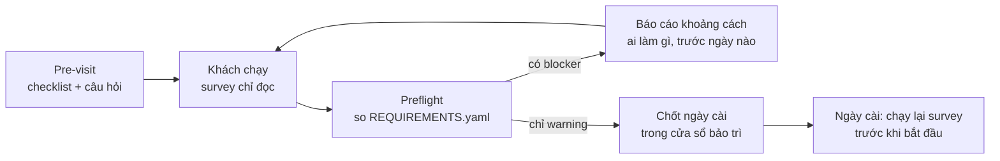
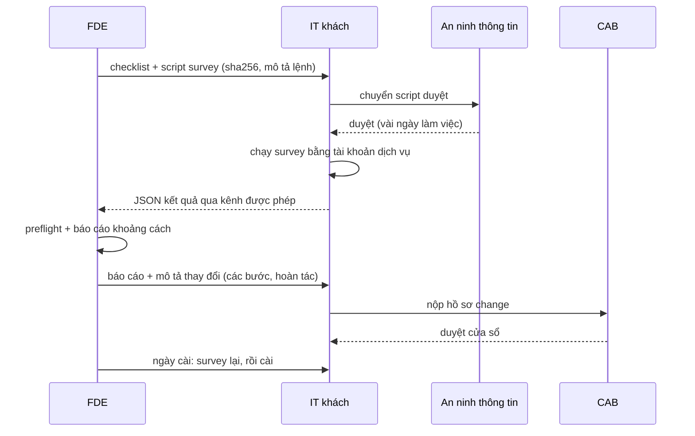
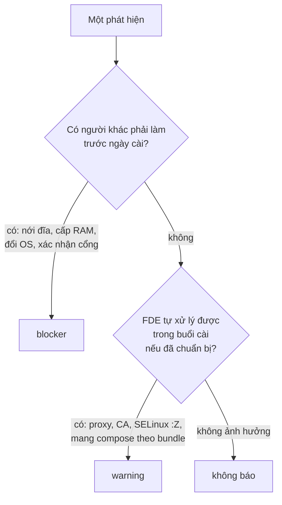

# Khảo sát môi trường khách

Lần cài thất bại phổ biến nhất ở khách không hỏng vì code mà vì một điều **không ai hỏi trước**: đĩa 8 GB, proxy soi
HTTPS, tài khoản không có sudo, máy "tương thích RHEL" không có `python3`, cổng đã có dịch vụ khác chiếm. FDE giỏi biến
những điều đó thành con số trước khi hứa ngày cài: gửi checklist trước khi đến, gửi một script khảo sát chạy được trên
máy lạ mà không cần quyền gì, so kết quả với yêu cầu của sản phẩm, rồi gửi lại khách một trang "khoảng cách" nói rõ ai
làm gì trước ngày nào.

Module này dùng thêm golden `hospital` và `bank` (cùng lệnh như module 00, mỗi hồ sơ dựng một lần):

```bash
nice -n 15 uv run python -m fdekit prepare hospital
nice -n 15 uv run python -m fdekit prepare bank
```

Sau module này bạn sẽ:

- Lập checklist trước khi đến: quyền truy cập, người liên hệ, cửa sổ bảo trì, quy trình change, đường đưa phần mềm vào.
- Đọc một máy Linux lạ bằng user thường: OS, kernel, glibc, CPU/RAM, đĩa và inode, GPU, mạng, DNS, proxy, giờ, SELinux/
  AppArmor, giới hạn tài nguyên, quyền; biết user thường **không** thấy được gì.
- Viết script khảo sát POSIX sh chạy được trên cả Ubuntu và Rocky, xuất JSON theo schema cố định.
- Viết preflight so báo cáo với `REQUIREMENTS.yaml`, phân biệt blocker và warning theo cách người ở hiện trường dùng.
- Viết báo cáo khoảng cách và gói chuẩn bị mà IT khách đọc là làm được.

## 1. Vì sao khảo sát trước khi hứa ngày

Sales nói "máy chủ đã sẵn sàng", IT nói "có Docker rồi". Cả hai thường đúng theo nghĩa của họ và sai theo nghĩa của
bạn: có Docker nhưng bản 19.03, có Docker nhưng user của bạn không thuộc nhóm `docker`, có đĩa 100 GB nhưng `/var` chỉ
8 GB. Khảo sát biến những câu đó thành dữ liệu kiểm được, **trước** khi có ai cam kết ngày.



Ba nguyên tắc chi phối mọi thứ trong module:

- **Đo, không hỏi.** "Máy có bao nhiêu RAM?" nhận câu trả lời theo hợp đồng mua máy; `MemTotal` là thứ sản phẩm thấy.
  Hỏi những gì không đo được (người, quy trình, kế hoạch), đo những gì đo được.
- **Chỉ đọc, không cần quyền.** Script khảo sát được gửi cho người lạ chạy trên máy production của họ. Nó không cài gì,
  không ghi gì ngoài stdout, không cần root, không cần mạng. Script càng ít đòi hỏi, càng nhanh qua bộ phận bảo mật.
- **Vòng lặp tính bằng ngày.** Ở khách khắt khe, mỗi lần gửi script mới là một lần duyệt bảo mật hay một change. Một
  survey hỏng ở dòng 9 tốn cả tuần. Phần lớn kỹ năng của module là làm đúng ngay lần gửi đầu.

Khảo sát cũng chạy lại **vào ngày cài**, ngay trước khi bắt đầu: giữa hai lần, IT có thể đã đổi proxy, ai đó đã chép
2 GB log vào đĩa. Preflight là cổng go/no-go cuối cùng, không chỉ là bước chuẩn bị.

## 2. Checklist trước khi đến

Checklist này là thứ bạn gửi đi trong tuần đầu sau khi ký, thường kèm survey. Mỗi mục gắn với một người phía khách và
một thời hạn xử lý của họ.

| Nhóm | Hỏi gì | Vì sao hay bị lỡ |
| --- | --- | --- |
| Quyền truy cập | Tài khoản trên máy chủ (tên, có sudo không), đường vào (VPN, jump host, VDI), thẻ ra vào, máy tính được mang vào không | Tạo tài khoản và thẻ ra vào có thời gian xử lý; ở ngân hàng thường vài ngày làm việc |
| Người liên hệ | IT hạ tầng, an ninh thông tin, chủ nghiệp vụ/sponsor, người duyệt change, người trực trong cửa sổ | Gặp chặn lúc 21:00 thứ Bảy mà không biết gọi ai |
| Cửa sổ bảo trì | Khi nào được thay đổi hệ thống, dài bao lâu, ai phải có mặt | Bạn lên lịch theo ngày rảnh của mình, khách chỉ cho thay đổi tối thứ Năm |
| Quy trình change | Ai duyệt (CAB), họp khi nào, hồ sơ nộp trước bao lâu, cần những gì (các bước, hoàn tác, ảnh hưởng) | Hồ sơ nộp muộn một ngày là lỡ cả tuần |
| Đưa phần mềm vào | Có internet/proxy không, có registry nội bộ không, cách chuyển tệp (MFT, USB quét virus), giới hạn kích thước | Bundle 3,5 GB, cổng truyền tệp giới hạn 2 GB một tệp |
| Duyệt bảo mật | Script và phần mềm bên ngoài cần ai duyệt, mất bao lâu, cần tài liệu gì | Survey bị giữ một tuần vì gửi lúc đã đến nơi |
| Dữ liệu | Dữ liệu nào được dùng, ai duyệt, được rời khỏi đâu | Pilot "chạy trên dữ liệu thật" nhưng chưa ai cho phép |
| Tài nguyên dự kiến | CPU/RAM/đĩa sẽ cấp, dữ liệu nằm ở volume nào, GPU | Máy được cấp sau khi bạn đã survey một máy khác |



Hai thói quen phân biệt người làm lâu năm:

- **Lịch ngược.** Bắt đầu từ cửa sổ cài, lùi theo từng thời hạn của khách (CAB, duyệt bảo mật, thẻ ra vào). Thường sẽ
  thấy có việc phải gửi ngay ngày mai.
- **Nói trước những gì script sẽ làm**, kể cả phần có thể gây chú ý: một lần thử `sudo -n` có thể ghi log bảo mật trên
  RHEL; một lần thử kết nối ra internet có thể làm firewall cảnh báo. Người duyệt biết trước thì đó là chi tiết; biết sau
  thì đó là sự cố.

## 3. Đọc máy lạ không cần root

Bảng dưới là "đồ nghề" của survey, kiểm trên ba golden của track (Ubuntu 22.04 `lab-open`, Ubuntu 20.04 `hospital`,
Rocky 8.10 `bank`) với user `fde` thường.

| Muốn biết | Lệnh ổn định | Khác biệt Ubuntu / Rocky, bẫy |
| --- | --- | --- |
| OS, phiên bản | `. /etc/os-release` (đọc `ID`, `VERSION_ID`) | `lsb_release` **không có** trên Rocky cloud image; `/etc/issue` là banner, IT hay sửa |
| Kernel | `uname -r` | Rocky: `4.18.0-553.el8_10.x86_64`; số kernel RHEL không nói hết tính năng (backport) |
| glibc | `getconf GNU_LIBC_VERSION` | Dòng đầu `ldd --version` khác định dạng giữa hai họ; glibc quyết định binary/wheel nào chạy được |
| CPU | `nproc` | Tôn trọng cgroup/affinity; `/proc/cpuinfo` đếm CPU của host khi ở trong container |
| RAM | `MemTotal` trong `/proc/meminfo` | Luôn thấp hơn RAM danh nghĩa; Rocky 8 có `crashkernel=auto` giữ thêm: VM 2048 MB chỉ còn ~1778 MB |
| Đĩa | `df -P -k <thư mục>`, `df -P -i <thư mục>` | `-P` giữ một dòng mỗi FS; cột Available đã trừ phần dự trữ cho root; đo ở **thư mục dữ liệu của runtime**, không phải `/` |
| Thiết bị khối | `lsblk` | Có trên cả hai; cho thấy đĩa 8 GB hay volume chưa mount |
| GPU | `nvidia-smi -L`, `ls /dev/nvidia*` | `lspci` **không có** trên Rocky cloud image; có `/dev/nvidia0` mà `nvidia-smi` lỗi là driver/thư viện lệch (module 05) |
| Mạng, route | `ip -br addr`, `ip route` | `ifconfig`, `netstat` không có trên cả hai bản tối thiểu |
| Cổng đang nghe | `ss -H -t -l -n -p` | User thường không thấy tiến trình của user khác (chỉ thấy `uid` với `-e`) |
| DNS | `resolvectl dns`, `/etc/resolv.conf` | Ubuntu: `resolv.conf` chỉ có stub `127.0.0.53`, DNS thật sau `systemd-resolved`. Rocky: `resolvectl` có nhưng resolved **không chạy**, lệnh lỗi |
| Proxy | `env \| grep -i proxy`, `/etc/environment`, `/etc/apt/apt.conf.d/`, `/etc/dnf/dnf.conf`, `systemctl show docker -p Environment` | Mỗi công cụ đọc proxy từ chỗ riêng; có trong shell không có nghĩa Docker daemon có (module 03) |
| Ra internet | `curl --noproxy '*' --max-time 5 ...` rồi thử qua proxy | Route mặc định vẫn có trên máy air-gapped; chỉ kết nối thật mới trả lời được |
| Giờ | `timedatectl` (`System clock synchronized`) | Lệch giờ làm hỏng TLS, token, log; cả ba golden đều báo chưa đồng bộ |
| SELinux / AppArmor | `getenforce`, `aa-enabled`; `aa-status` cần root | Ubuntu không có `getenforce`; Rocky không có AppArmor |
| Giới hạn | `ulimit -n`, `ulimit -u` | `nofile` 1024 mặc định đủ cho survey, có thể thiếu cho Postgres + nhiều worker |
| Quyền | `id`, `sudo -n true` | `sudo -n` không hỏi mật khẩu; sudo qua `/etc/sudoers.d` không hiện trong `id`; trên máy không có quyền, lần thử có thể ghi log |
| Runtime | `docker version --format '{{.Server.Version}}'`, `podman version`, `docker info`/`podman info --format` | `docker --version` chỉ là client; Podman rootless lưu ở `~/.local/share/containers/storage`, không phải `/var/lib/containers` |
| Log kernel | `dmesg` | Ubuntu 22.04 đặt `kernel.dmesg_restrict=1` (user thường bị chặn); Rocky 8 thì không |

Những thứ user thường **không** thấy được, và cách xử lý: tiến trình của user khác giữ cổng (báo `unknown`, đưa IT lệnh
`sudo ss -tlnp 'sport = :18080'`), bên trong thư mục dữ liệu của Docker (dùng `df` trên chính thư mục), profile AppArmor
(`aa-status` cần root), journal hệ thống (cần nhóm `systemd-journal` hoặc `adm`). Ghi rõ "không đo được bằng user thường"
trong báo cáo thay vì đoán.

Thử lệnh trên máy khách của lab trước khi viết script (từ gốc repo, `uv run python thu.py`):

```python
import fdekit

with fdekit.customer_site("bank") as s:
    for cmd in ("command -v lsb_release python3 getenforce", "resolvectl dns", "sudo -n true; echo $?"):
        r = s.vm.ssh(cmd)
        print(f"$ {cmd}\n{r.stdout}{r.stderr}")
```

## 4. Script khảo sát chạy được ở mọi nơi

Script khảo sát có người dùng rất đặc biệt: người lạ, trên máy production, thường không có bạn ngồi cạnh. Các quy tắc
dưới đây đều đến từ lần hỏng thật.

**POSIX `sh`, không phải bash.** Khách sẽ chạy `sh survey.sh`. Trên Ubuntu `sh` là `dash`: `[[ ]]`, mảng, `source`,
`local -n`, `<( )` đều lỗi cú pháp. Trên Rocky `sh` là bash 4.4 ở chế độ POSIX nên bash-ism lại chạy, nghĩa là script
viết trên Rocky có thể hỏng trên Ubuntu và ngược lại. Kiểm bằng `shellcheck -s sh` hoặc `checkbashisms`, và chạy thật
trên cả hai.

**Không phụ thuộc thứ "chắc chắn có".** Rocky/RHEL 8 tối thiểu không có `python3` cho người dùng (chỉ
`/usr/libexec/platform-python` cho công cụ hệ thống), không `jq`, không `lsb_release`, không `lspci`, không `netstat`.
JSON phải tạo bằng `printf` và một hàm escape nhỏ. `awk`, `sed`, `grep`, `df`, `ip`, `ss`, `curl` có trên cả hai bản cài
tối thiểu của lab.

**`set -e` không phải bạn của script dò.** Lệnh dò thất bại là **dữ liệu** ("không có getenforce" nghĩa là không có
SELinux), không phải lỗi. Mỗi lệnh dò nằm trong `if` hoặc có `||`; khi một phần không thu được, ghi lý do vào output thay
vì dừng hay bỏ trống. Cái giá của `set -eu` trong script dò: khách chỉ gửi lại được lỗi đầu tiên, và mỗi vòng sửa rồi gửi
lại tốn một ngày.

**Cố định môi trường của chính script.** `LC_ALL=C` để `awk printf "%.1f"` không in dấu phẩy theo locale; đặt timeout cho
mọi lệnh mạng (`curl --max-time 5`) để máy air-gapped không treo; không dựa vào `$USER`, `$HOME` hay biến proxy của phiên
(cron, `env -i`, công cụ quản trị chạy script với môi trường rỗng).

**stdout cho máy, stderr cho người.** Output máy đọc được (JSON, `khoá=giá_trị`) đi stdout; "Đang kiểm tra..." đi stderr.
Một dòng thông báo lạc vào stdout làm hỏng parser của bạn ở phía bên kia.

**Schema cố định, có kiểu.** Báo cáo có tập khoá và kiểu cố định (`null` thay vì chuỗi rỗng, số là số, boolean là
boolean), kiểm bằng JSON Schema. Preflight và báo cáo khoảng cách dựng trên schema đó; đổi schema là đổi hợp đồng.

**Không mang bí mật về.** Survey và support bundle đi qua email, ticket, ổ chung: coi mọi thứ chúng thu được là sẽ bị
đọc bởi người không nên đọc. Không bao giờ thu: dump biến môi trường (`env`, `/proc/*/environ`), lịch sử shell, tệp
cấu hình có token (`~/.docker/config.json`, `.netrc`, `.env`, `.pgpass`), khoá, dữ liệu nghiệp vụ. Thứ cần thì che trước
khi ghi: bỏ `user:pass@` trong URL (`sed 's#//[^/]*@#//#'`), che giá trị sau `password=`, `token=`, `secret=`. Và nói
cho người duyệt phía khách **đúng** những gì được thu, kể cả thứ trông vô hại nhưng nhạy cảm với họ: IP nội bộ và route
(`ip addr`, `ip route`), cổng đang mở và địa chỉ bind (`ss`), tên máy, DNS server nội bộ.

**Dễ duyệt.** Ngắn, không tải gì, không `eval` dữ liệu đọc được, liệt kê được lệnh và tệp nó đụng tới. Gửi kèm sha256 để
người chạy biết đúng bản đã duyệt.

Hai công cụ khác cùng họ mà FDE hay viết: **support bundle** (gom output thô thành tarball để đội hỗ trợ đọc, Intermediate
01) và **kiểm tra tại chỗ** cho những gì JSON không chứa (cổng, Basic 03; nơi dữ liệu nằm, Intermediate 02). Cùng quy
tắc: chạy được không cần quyền, không dừng giữa chừng, nói rõ cái gì không đo được.

## 5. Preflight: từ số đo đến quyết định

Preflight so báo cáo survey với yêu cầu của sản phẩm (`tracks/fde/product/REQUIREMENTS.yaml`) và trả danh sách phát
hiện. Phần khó không phải code mà là **mức** của mỗi phát hiện.



Blocker nghĩa là "phải có người làm trước ngày cài", không phải "nghiêm trọng". Đĩa thiếu là blocker vì nới đĩa cần
change của IT; SELinux enforcing là warning vì bạn biết cách làm việc với nó (nhãn `:Z` cho volume, thử trước trên lab
enforcing), và **không bao giờ** là lý do xin tắt. Không có sudo khi runtime là Podman rootless không phải phát hiện:
Podman được thiết kế để chạy như vậy. Không có sudo khi runtime là Docker là chuyện khác: user phải vào nhóm `docker`
(tương đương root) hoặc IT chạy hộ.

Những chỗ preflight hay sai:

- **RAM danh nghĩa và `MemTotal`.** Máy "4 GB" báo `MemTotal` khoảng 3,8 GB. So cứng với 4096 là chặn nhầm khách đúng cấu
  hình; đặt biên (vd. dưới 90% mới là blocker, 90–100% là warning cần IT xác nhận) và ghi rõ trong `detail`.
- **So phiên bản bằng chuỗi.** `"8.10" < "8.9"` khi so chuỗi, `float("8.10") == 8.1`. Tách thành tuple số.
- **Đặt cứng ngưỡng.** Yêu cầu thay theo bản phát hành; preflight đọc `REQUIREMENTS.yaml` đi kèm bundle, không chép số
  vào code.
- **Đĩa ở sai chỗ.** `disk_free_gb_max` của survey đo ở `/` để so được với hồ sơ; preflight thật nên dùng chỗ trống ở thư
  mục dữ liệu của runtime (Intermediate 02). Hai số khác nhau thì báo cáo ghi cả hai.
- **Báo thừa.** GPU `optional` mà báo "thiếu GPU"; liệt kê cả các mục đạt vào danh sách phát hiện. Người đọc phải lọc và
  bắt đầu bỏ qua báo cáo.

Preflight từ JSON có giới hạn: không biết phiên bản runtime, không biết cổng có trống không, không biết proxy có cho đi
tới đâu. Những thứ đó vào checklist (hỏi) hoặc kiểm tra tại chỗ (đo vào ngày cài).

## 6. Báo cáo khoảng cách cho khách

Báo cáo khoảng cách là sản phẩm cuối của khảo sát, và là tài liệu đầu tiên IT khách đọc từ bạn. Nó quyết định ngày cài
có giữ được không và khách có tin bạn không. Một khung đã dùng tốt:

1. **Kết luận** tối đa ba câu: cài được chưa, vì sao, cần gì trước ngày nào để giữ lịch, và điểm quyết định nếu không kịp.
2. **Bảng tóm tắt**: hạng mục, hiện trạng (số đo), yêu cầu, mức, ai làm, hạn. Bảng trả lời được "ai làm gì trước ngày
   nào" thì báo cáo đã xong một nửa.
3. **Việc cần khách hỗ trợ**, mỗi việc có bằng chứng, con số cụ thể và **phương án** để IT chọn (nới đĩa ảo hoặc gắn
   volume riêng; giữ dịch vụ trên 18080 và đổi cổng sản phẩm).
4. **Việc phía chúng tôi**: những gì FDE tự lo, để IT không làm thừa (mang plugin compose theo bundle, cấu hình proxy cho
   Docker trong cửa sổ).
5. **Cần xác nhận**: những gì survey không trả lời được.

Viết cho người đọc: IT hạ tầng tìm việc của họ; an ninh thông tin tìm thứ phải giải trình. Không tên script hay hàm nội
bộ, "blocker" nếu dùng thì định nghĩa, không đổ lỗi ("máy của anh chị cấu hình sai"), và không bao giờ đề nghị nới bảo
mật để việc của mình dễ hơn (tắt TLS inspection, `verify=False`, `chmod 777`, tắt SELinux). Đề nghị kiểu đó làm người
duyệt nghi ngờ mọi phần còn lại.

Hai lỗi hay gặp về lịch: hẹn "trước ngày cài" mà không gắn với cửa sổ bảo trì (IT không thể nới đĩa ngoài cửa sổ), và
không có điểm quyết định (đến 21:30 mới phát hiện đĩa chưa nới, cài vội trong 30 phút còn lại).

## 7. Ôn nhanh: Linux và shell cho người khảo sát

Phần này chỉ nhắc những gì module dùng; chi tiết ở [DevOps 01 — Linux và terminal](../../../devops/modules/01-linux-terminal/README.md)
(distro, filesystem và quyền, systemd, công cụ mạng) và [DevOps 02 — Scripting](../../../devops/modules/02-scripting/README.md)
(strict mode, quoting, exit code, trap).

- **Hai họ distro**: Debian/Ubuntu (`apt`, `dpkg`, AppArmor, `sh` = dash) và RHEL/Rocky/Alma (`dnf`, `rpm`, SELinux,
  `sh` = bash). "Tương thích RHEL 8" nghĩa là gói và đường dẫn kiểu Rocky 8, không phải bản cài có sẵn công cụ bạn quen.
- **Quyền**: user thường đọc được hầu hết `/proc`, `/sys`, `/etc`; không đọc được `/proc/<pid>/fd` của user khác, thư mục
  `0700`/`0710` của root, các log như `/var/log/syslog`, `/var/log/secure` (trừ khi thuộc nhóm `adm` trên Ubuntu).
- **Exit code**: `0` là thành công; `127` là không tìm thấy lệnh (dấu hiệu "máy này không có công cụ đó"); `126` là không
  chạy được (quyền, `noexec`).
- **Quoting**: luôn `"$var"`; đường dẫn từ cấu hình của khách có thể có dấu cách.
- **`command -v`** để kiểm có lệnh, không dùng `which` (không có trên một số bản tối thiểu, hành vi khác nhau).

## 8. Tài liệu tham khảo

- [roadmap.sh — Forward Deployed Engineer](https://roadmap.sh/forward-deployed-engineer)
- [os-release(5) — freedesktop.org](https://www.freedesktop.org/software/systemd/man/latest/os-release.html)
- [POSIX Shell Command Language — The Open Group](https://pubs.opengroup.org/onlinepubs/9699919799/utilities/V3_chap02.html)
- [Ubuntu Wiki — Dash as /bin/sh](https://wiki.ubuntu.com/DashAsBinSh)
- [ShellCheck](https://www.shellcheck.net/)
- [proc(5) — Linux manual page](https://man7.org/linux/man-pages/man5/proc.5.html)
- [ss(8) — Linux manual page](https://man7.org/linux/man-pages/man8/ss.8.html)
- [GNU coreutils — df invocation](https://www.gnu.org/software/coreutils/manual/html_node/df-invocation.html)
- [sudo(8) manual](https://www.sudo.ws/docs/man/sudo.man/)
- [systemd-resolved.service(8)](https://www.freedesktop.org/software/systemd/man/latest/systemd-resolved.service.html)
- [Linux kernel — /proc/sys/kernel (dmesg_restrict)](https://docs.kernel.org/admin-guide/sysctl/kernel.html)
- [Red Hat Enterprise Linux 8 — Using SELinux](https://docs.redhat.com/en/documentation/red_hat_enterprise_linux/8/html/using_selinux/index)
- [Podman — Basic setup and use of Podman in a rootless environment](https://github.com/containers/podman/blob/main/docs/tutorials/rootless_tutorial.md)
- [Docker — Daemon data directory](https://docs.docker.com/engine/daemon/#daemon-data-directory)
- [JSON Schema — Getting started](https://json-schema.org/learn/getting-started-step-by-step)
