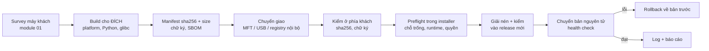
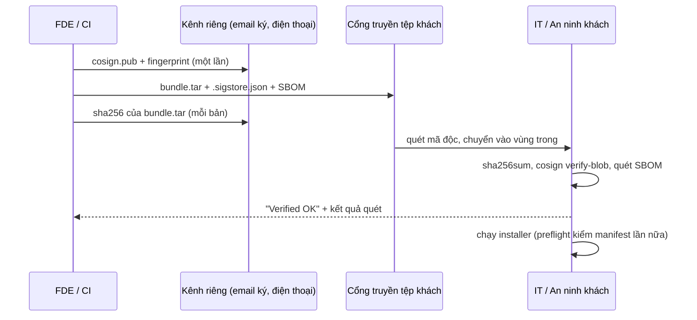
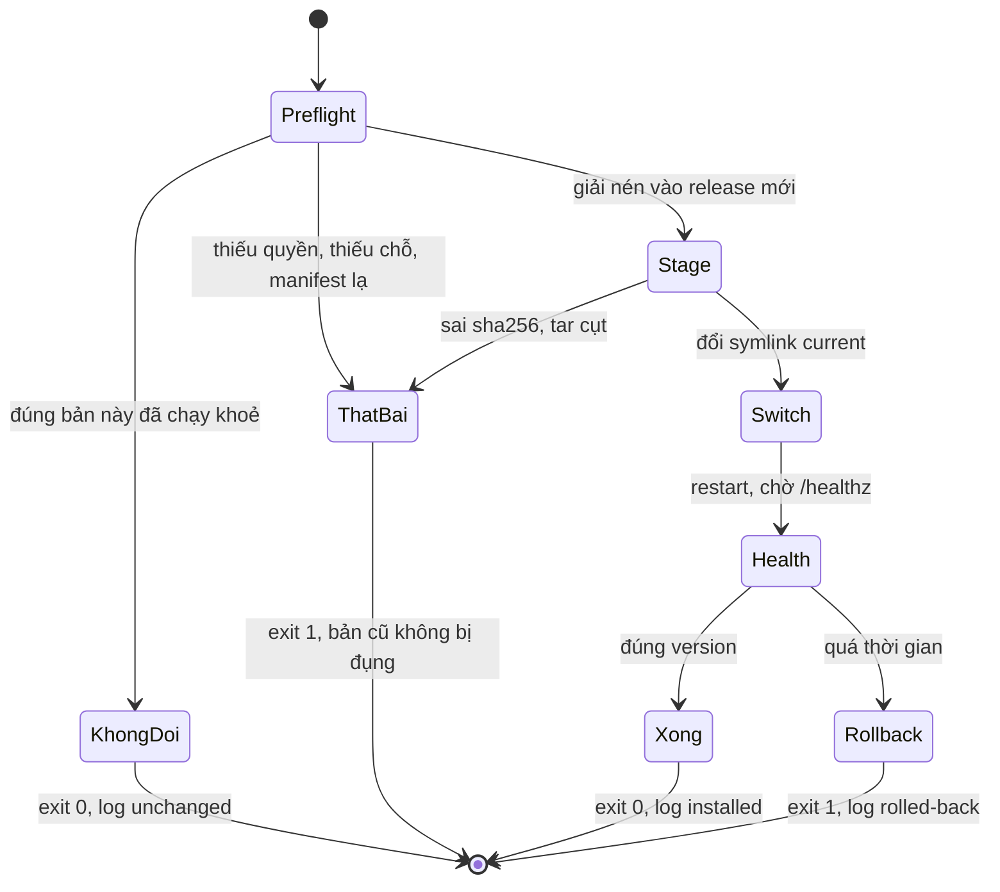
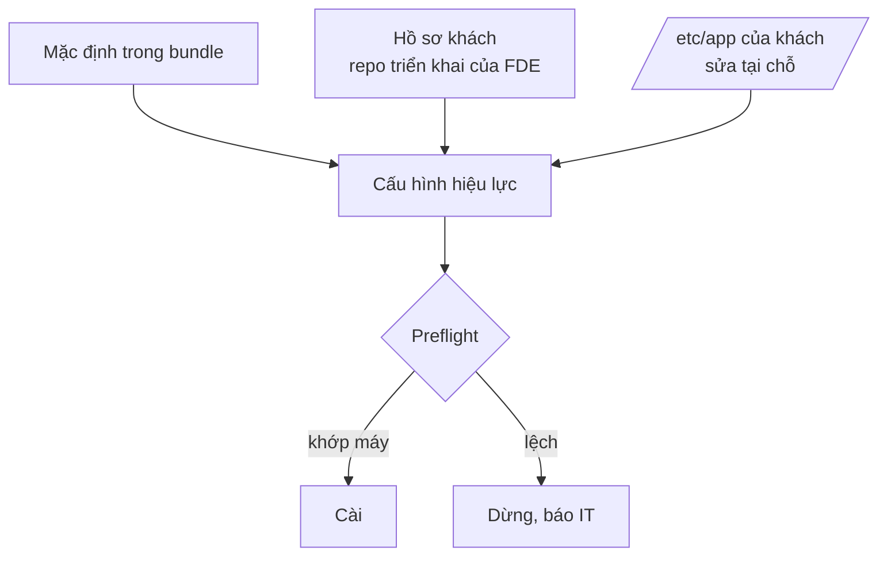

# Đóng gói cho môi trường lạ

Ở công ty, "phát hành" là đẩy image lên registry và để CI làm nốt. Ở khách, phát hành là **một tệp** phải đi qua cổng
truyền tệp có giới hạn dung lượng, máy quét virus, một người duyệt bảo mật chưa từng nghe tên sản phẩm, rồi được cài
lên một máy không ra internet, khác hệ điều hành, khác Python, khác dung lượng đĩa so với mọi máy bạn từng thử. Bundle
tốt là bundle mà **người khác** cài được, kiểm được, và gỡ được, kể cả khi bạn không có mặt.

Module này dùng golden `lab-open`, `hospital` (đã dựng ở module 00–01) và thêm `lawfirm-staging`:

```bash
nice -n 15 uv run python -m fdekit prepare lawfirm-staging
```

Sau module này bạn sẽ:

- Chọn đúng dạng cho từng thành phần: image tarball, wheelhouse, binary tĩnh, model weights; biết mỗi dạng gắn với
  thông số nào của máy **đích**.
- Thiết kế manifest (sha256 + kích thước), kiểm image tarball (kiến trúc, digest, tag) trước khi mang đi.
- Ký bundle bằng cosign với khoá của bạn, kiểm chữ ký offline; tạo SBOM bằng syft hoặc `uv export`.
- Viết installer idempotent: preflight, giải nén và kiểm tra trước khi đụng bản đang chạy, chuyển bản nguyên tử, health
  check, rollback, log máy đọc được.
- Tách cấu hình theo khách khỏi bundle; đặt chính sách version và tương thích ngược mà khách hiểu và ký được.

## 0. Cài đặt

Bài tập của module **không** cần công cụ mới: đọc tar bằng `tarfile`, băm bằng `hashlib`, tải wheel bằng `uv`/`uvx pip`
(đã có). cosign và syft là tuỳ chọn, để chạy các lệnh ở phần 3. Cả hai là một binary Go: tải bản phát hành, **kiểm
sha256 với tệp checksum chính thức** trước khi chạy, đặt vào `~/.local/bin`, không cần root.

| Công cụ | Phiên bản đã kiểm | Phát hành | sha256 của tệp tải (linux/amd64) |
| --- | --- | --- | --- |
| cosign | v3.1.4 | 2026-10-20 | `424e2c97d0b45fd7a6b608a87f090f35633f4c23ece5f092d48bba11aaf4bbfa` (`cosign-linux-amd64`) |
| syft | v1.55.0 | 2026-10-19 | `bb65249542db5fedeeb4d3f9b018b75e7264dbfbbb10486f044581a92f90490d` (`syft_1.55.0_linux_amd64.tar.gz`) |

```bash
mkdir -p ~/.cache/fde-tools && cd ~/.cache/fde-tools
curl -fLO https://github.com/sigstore/cosign/releases/download/v3.1.4/cosign-linux-amd64
curl -fLO https://github.com/sigstore/cosign/releases/download/v3.1.4/cosign_checksums.txt
grep ' cosign-linux-amd64$' cosign_checksums.txt | sha256sum -c -
echo "424e2c97d0b45fd7a6b608a87f090f35633f4c23ece5f092d48bba11aaf4bbfa  cosign-linux-amd64" | sha256sum -c -
install -m 0755 cosign-linux-amd64 ~/.local/bin/cosign

curl -fLO https://github.com/anchore/syft/releases/download/v1.55.0/syft_1.55.0_linux_amd64.tar.gz
curl -fLO https://github.com/anchore/syft/releases/download/v1.55.0/syft_1.55.0_checksums.txt
grep ' syft_1.55.0_linux_amd64.tar.gz$' syft_1.55.0_checksums.txt | sha256sum -c -
echo "bb65249542db5fedeeb4d3f9b018b75e7264dbfbbb10486f044581a92f90490d  syft_1.55.0_linux_amd64.tar.gz" | sha256sum -c -
tar -xzf syft_1.55.0_linux_amd64.tar.gz syft && install -m 0755 syft ~/.local/bin/syft

cosign version | grep GitVersion && syft version | grep '^Version'
```

Mỗi dòng `sha256sum -c` phải in `OK`; sai thì xoá tệp và tải lại, **không** chạy. Dòng thứ hai của mỗi công cụ so với
giá trị ghim trong bảng trên: tệp checksum tải cùng chỗ với binary chỉ chống tải hỏng, không chống kẻ chiếm được trang
phát hành; cosign còn ký chính tệp checksum của nó (`cosign_checksums.txt-keyless.sigstore.json`
cùng trang), xem tài liệu cosign nếu cần mức đó. Gỡ: `rm ~/.local/bin/cosign ~/.local/bin/syft && rm -r ~/.cache/fde-tools`.

## 1. Bundle cài được ở mọi nơi bắt đầu từ máy đích

Câu hỏi đầu tiên khi đóng gói không phải "dùng công cụ gì" mà "máy **đích** là gì": kiến trúc CPU, OS và glibc, Python có
sẵn, runtime container, có mạng/proxy/registry nội bộ không, đĩa còn bao nhiêu và ở đâu, ai được chạy lệnh gì. Survey ở
module 01 trả lời chúng; bundle là câu trả lời ngược lại. Một bundle không ghi nó dành cho đích nào là một lời hứa mơ hồ.



Ba nguyên tắc chi phối phần còn lại:

- **Không gì được tải lúc cài.** Mọi thứ installer cần nằm trong bundle hoặc đã được survey xác nhận có sẵn. "Chỉ một
  `pip install` nhỏ" là thứ làm hỏng ngày cài ở máy không mạng, hoặc qua proxy soi TLS.
- **Kiểm được bởi người không tin bạn.** IT khách phải tự kiểm được bundle là đúng thứ bạn gửi, bằng công cụ của họ
  (`sha256sum`, `cosign`), không cần chạy code của bạn trước.
- **Cài lại được, quay lại được.** Installer sẽ bị chạy lại và sẽ có lúc bản mới không lên. Thiết kế cho hai ca đó ngay
  từ đầu rẻ hơn nhiều so với vá sau sự cố đầu tiên.

## 2. Thành phần của bundle: mỗi thứ một dạng

| Thành phần | Dạng giao | Gắn với thông số đích | Lỗi hay gặp |
| --- | --- | --- | --- |
| Image container | `docker save` / OCI layout (`.tar`), hoặc đẩy vào registry nội bộ | Kiến trúc (`linux/amd64`…), runtime (Docker/Podman/containerd) | Build trên Mac ARM ⇒ `exec format error`; lưu theo ID ⇒ `<none>:<none>`; quên image phụ (Postgres) |
| Thư viện Python | Wheelhouse (`.whl` + `requirements.txt` có hash) | Phiên bản CPython, ABI, glibc (`manylinux_2_xx`), kiến trúc | Wheel `cp312` cho máy 3.10; sdist cần trình biên dịch; venv thấy gói hệ thống |
| Công cụ dòng lệnh | Binary tĩnh (Go, Rust musl) hoặc gói `.deb`/`.rpm` | Kiến trúc; glibc nếu binary động | `docker compose` không có ở máy chỉ có `docker.io`; binary động cần glibc mới hơn máy |
| Model weights | Tệp riêng (GGUF, safetensors) kèm sha256 | Dung lượng đĩa, RAM, định dạng runtime đọc được | Vài GB vượt giới hạn cổng truyền tệp; chép thiếu mà không ai kiểm |
| Cấu hình, migration, tài liệu | Văn bản trong bundle | Phiên bản schema, cấu hình hiện có của khách | Ghi đè cấu hình khách đã sửa |

**Image tarball.** `docker save -o api.tar repo/api:1.1.0` (Docker ≥25) ghi cả `manifest.json` kiểu docker-archive lẫn OCI
layout (`index.json`, `blobs/sha256/…`), nên `docker load`, `podman load` và `skopeo copy docker-archive:api.tar …` đều đọc
được. Luôn `--platform linux/amd64` lúc build **và** lúc save nếu máy bạn không phải amd64; luôn save theo tag. Ở khách
có registry nội bộ (công ty luật) thì `load` một lần ở máy trung gian rồi `push`, các máy chạy chỉ cần `pull` nội bộ. So
với registry, tarball đơn giản hơn nhưng **không dùng chung layer**: hai image cùng base vẫn chép base hai lần. Đó là lý do
`quillo` (`tracks/fde/product/release.py`) tách image ra từng tệp trong `images/` và ghi digest đầy đủ trong manifest.

**Wheelhouse.** `uv export --frozen --no-dev` lấy đúng phụ thuộc đã khoá kèm hash; `uv build --wheel` dựng wheel của app;
`pip download --only-binary=:all: --python-version 3.10 --abi cp310 --platform manylinux_2_17_x86_64 …` tải wheel cho
máy khác (uv chưa có lệnh `download` riêng; chạy pip qua `uvx --from pip==<bản> pip …`). Thông số đích lấy từ survey:
`python3 --version`, `ldd --version` (glibc 2.35 nhận mọi `manylinux_2_xx` với xx ≤ 35). Ở máy đích:
`pip install --no-index --find-links wheels --require-hashes -r requirements.txt`. `--no-index` biến mọi thiếu sót thành
lỗi rõ ngay thay vì treo chờ mạng.

**Binary tĩnh** là cách mang công cụ vào máy không có gói: `docker compose` v2 có bản phát hành là một binary đặt vào
`~/.docker/cli-plugins/`; `uv`, `cosign`, `syft` cũng vậy. Ghim phiên bản + sha256 như phần 0, và ghi trong tài liệu
bundle: mỗi binary là một thứ bộ phận bảo mật phải duyệt.

**Model weights** thường chiếm phần lớn bundle. Tách thành bundle "nền" (image base + model, đổi vài tháng một lần) và
bundle "ứng dụng" (vài chục MB, đổi hằng tuần) giúp lần cập nhật sau đi qua cổng truyền tệp trong vài phút thay vì vài
giờ. Cổng giới hạn 2 GB một tệp ⇒ `split -b 1900M` + manifest ghi sha256 cả từng phần lẫn tệp ghép.

## 3. Manifest, chữ ký và SBOM: chuỗi tin cậy

**Manifest** là danh sách tệp có sha256 và kích thước, nằm **đầu** tar để installer đọc được mà không giải nén cả bundle.
`size` không thừa: nó cho installer tính chỗ trống cần thiết trước khi giải nén, và là cách rẻ nhất phát hiện tệp chép
thiếu. Thêm `version`, `name`, và "đích" (`platform`, OS tối thiểu, runtime) để preflight kiểm được ngay từ manifest.

Manifest không tự chứng minh nó đúng: kẻ sửa được bundle thì sửa được manifest. Có hai cách neo nó:

1. **sha256 của cả bundle gửi qua kênh khác** (email đã ký, đọc qua điện thoại, cổng hỗ trợ). Rẻ, đủ cho phần lớn khách.
2. **Chữ ký số**: bạn ký bằng khoá riêng, khách kiểm bằng khoá công khai nhận qua kênh khác **một lần**. Với cosign, ở
   khách air-gapped dùng khoá (không dùng chế độ keyless vì nó cần OIDC và transparency log trên internet):

```bash
cosign generate-key-pair
cosign sign-blob --key cosign.key --use-signing-config=false --tlog-upload=false \
  --bundle quillo-1.1.0.tar.sigstore.json --yes quillo-1.1.0.tar
cosign verify-blob --key cosign.pub --bundle quillo-1.1.0.tar.sigstore.json \
  --insecure-ignore-tlog=true quillo-1.1.0.tar
```

`generate-key-pair` hỏi mật khẩu rồi ghi `cosign.key` (khoá riêng, đã mã hoá; **không bao giờ** vào bundle, repo hay
máy khách) và `cosign.pub`. `verify-blob` in `Verified OK`; sửa một byte của tar là ra `invalid signature`.

cosign v3 mặc định đẩy chữ ký lên transparency log công khai (Rekor); hai cờ `--use-signing-config=false
--tlog-upload=false` tắt việc đó cho môi trường không mạng, và lúc kiểm phải nói rõ `--insecure-ignore-tlog=true`. Cái giá:
không còn bằng chứng công khai về thời điểm ký, nên quản lý khoá (ai giữ, xoay khi nào, thu hồi thế nào) là việc của bạn.

**SBOM** (Software Bill of Materials) trả lời câu bộ phận bảo mật nào cũng hỏi: "trong này có gì, bản nào, giấy phép gì".
`syft scan docker-archive:images/api.tar -o cyclonedx-json` liệt kê gói trong image; `syft scan dir:app/` hoặc
`uv export --format cyclonedx1.5` cho phần Python. SBOM đi kèm bundle để khách tự quét lỗ hổng bằng công cụ của họ, và để
khi có CVE mới bạn trả lời được "khách nào đang chạy bản bị ảnh hưởng" trong vài phút.



## 4. Installer idempotent

Installer là phần mã chạy với quyền cao nhất, trên máy quan trọng nhất, trong khung giờ ngắn nhất, mà ít được test nhất.
Viết nó như một hệ thống hội tụ: mỗi lần chạy đưa máy về **trạng thái mong muốn**; đã ở đó thì không làm gì.



| Nguyên tắc | Cách làm cụ thể |
| --- | --- |
| Preflight trước mọi thay đổi | Quyền, lệnh cần có, systemd/runtime, cổng, tài nguyên bản mới cần (đọc từ manifest, không đoán) |
| Kiểm trước, dừng dịch vụ sau | Giải nén + sha256 xong mới đụng tới bản đang chạy; bundle hỏng thì khách không mất phút downtime nào |
| Chuyển bản nguyên tử | `releases/<version>/` + symlink `current`; `ln -sfn` rồi `mv -T`; quay về là trỏ lại |
| Không ghi đè của khách | Cấu hình ở `/etc/<app>/` tạo một lần; bản mặc định mới ghi `.new` và báo |
| So rồi mới ghi | `cmp -s` trước `install`, `systemctl is-enabled` trước `enable`: lần chạy thứ hai không đổi mtime, không restart |
| Health check thật | Gọi đúng endpoint, đúng version, có hạn; nhớ máy khách có thể đặt `http_proxy` cho cả localhost |
| Log máy đọc được | Mỗi lần một dòng kết quả `thời điểm version kết quả`; toàn bộ stderr vào log để khách gửi lại nguyên văn |
| Dọn khi chết giữa chừng | `trap ... EXIT` xoá thư mục tạm; không để `.partial` làm lần sau tưởng đã cài |

Lỗi thường gặp ngoài hiện trường: `set -e` thoát ngay sau khi đã dừng dịch vụ; tar giữ uid/gid của máy build; unit systemd ghi lại mỗi lần làm `daemon-reload` + restart vô cớ; installer chỉ được thử
trên một máy "sạch" giống máy dev.

## 5. Cấu hình theo khách

Một bundle cho mọi khách, **không** một bundle cho mỗi khách: mỗi bản build riêng là một bản phải test riêng, vá riêng,
và sớm muộn có bản vá quên áp. Khác biệt giữa khách nằm ở **lớp cấu hình**, theo thứ tự ưu tiên tăng dần:

1. Mặc định trong bundle (`config/*.env.example`, giá trị an toàn, không bí mật).
2. Hồ sơ khách do FDE soạn, nằm ngoài bundle (`customers/<khách>/values.env` trong repo triển khai của bạn): cổng, đường
   dẫn dữ liệu, proxy, CA, tên registry nội bộ, giới hạn tài nguyên.
3. Thay đổi tại chỗ của IT khách trong `/etc/<app>/`: installer không bao giờ ghi đè.

Bí mật (mật khẩu DB, khoá API) không nằm ở lớp nào trong bundle: sinh tại chỗ lúc cài lần đầu (`openssl rand`) hoặc lấy
từ kho bí mật của khách. Preflight kiểm hồ sơ khách khớp với máy (registry trong hồ sơ trả lời được, đường dẫn dữ liệu có
chỗ) trước khi cài.



## 6. Version và tương thích ngược

Khách không đọc changelog; khách đọc **số version** và hỏi "nâng lên có mất gì không, có quay lại được không". Hợp đồng
version phải trả lời được hai câu đó:

| Thay đổi | Ví dụ | Quay lại bản trước? |
| --- | --- | --- |
| PATCH (`1.1.0 → 1.1.1`) | Sửa lỗi, không đổi schema, không đổi cấu hình | Có, chỉ đổi `current` |
| MINOR (`1.0 → 1.1`) | Tính năng mới, migration **chỉ thêm** (cột, bảng mới), khoá cấu hình mới có mặc định | Có: code 1.0 vẫn chạy trên schema 1.1 (expand/contract) |
| MAJOR (`1.x → 2.0`) | Bỏ cột, đổi định dạng dữ liệu, bỏ khoá cấu hình | Chỉ bằng **khôi phục backup**; installer phải backup trước và nói rõ |

Ba quy tắc giúp chính sách này giữ được ở hiện trường:

- **Expand/contract cho migration**: bản N thêm (cột mới, ghi cả hai nơi), bản N+1 mới bỏ cái cũ. Nhờ vậy rollback mã
  trong phạm vi một MINOR không cần đụng dữ liệu. `quillo` 1.1.0 thêm cột `tags` có `DEFAULT` theo cách này (`tracks/fde/product/migrations/0002_v1_1_tags.sql`).
- **Đường nâng cấp được kiểm**: khách ngân hàng nâng mỗi quý, tức là nhảy 1.0 → 1.3. Hoặc installer chạy được chuỗi
  migration liền mạch (và CI test đúng đường nhảy đó), hoặc chính sách ghi rõ "phải qua 1.2".
- **Cửa sổ hỗ trợ**: hỗ trợ N và N−1 MINOR, vá bảo mật cho bản "dài hạn" của khách nâng chậm. Viết ra, đừng để khách
  đoán.

Tên bundle mang version và đích (`quillo-1.1.0-linux-amd64.tar`), manifest mang `version`, và `/healthz` trả version đang
chạy: ba nơi phải khớp, và test tự động kiểm điều đó.

## 7. Ôn nhanh: image, layer và systemd

Phần này chỉ nhắc những gì module dùng. Image là danh sách layer (tar nén, định danh bằng sha256) cộng một config JSON
(kiến trúc, entrypoint, biến môi trường); cách viết Dockerfile nhỏ, không root, multi-stage và quét image ở
[MLOps 02 — Container cho ML](../../../mlops/modules/02-containers-for-ml/README.md). Unit systemd (`[Service]`,
`EnvironmentFile`, `Restart=on-failure`, `systemctl enable --now`, `journalctl -u`), quyền tệp và user hệ thống ở
[DevOps 01 — Linux và terminal](../../../devops/modules/01-linux-terminal/README.md); `set -euo pipefail`, `trap`, quoting
ở [DevOps 02 — Scripting](../../../devops/modules/02-scripting/README.md).

## 8. Tài liệu tham khảo

- [roadmap.sh — Forward Deployed Engineer](https://roadmap.sh/forward-deployed-engineer)
- [Docker — docker image save](https://docs.docker.com/reference/cli/docker/image/save/)
- [OCI Image Layout Specification](https://github.com/opencontainers/image-spec/blob/main/image-layout.md)
- [uv — Exporting a lockfile](https://docs.astral.sh/uv/concepts/projects/export/)
- [pip download — tuỳ chọn --platform, --python-version, --abi](https://pip.pypa.io/en/stable/cli/pip_download/)
- [pip — Secure installs (hash-checking mode)](https://pip.pypa.io/en/stable/topics/secure-installs/)
- [PEP 600 — manylinux theo phiên bản glibc](https://peps.python.org/pep-0600/)
- [Python Packaging User Guide — Platform compatibility tags](https://packaging.python.org/en/latest/specifications/platform-compatibility-tags/)
- [Sigstore cosign — Signing blobs](https://docs.sigstore.dev/cosign/signing/signing_with_blobs/)
- [Anchore syft](https://github.com/anchore/syft)
- [CycloneDX specification](https://cyclonedx.org/specification/overview/)
- [Semantic Versioning 2.0.0](https://semver.org/)
- [Docker Compose — Install the plugin manually](https://docs.docker.com/compose/install/linux/#install-the-plugin-manually)
- [systemd.service(5)](https://www.freedesktop.org/software/systemd/man/latest/systemd.service.html)
