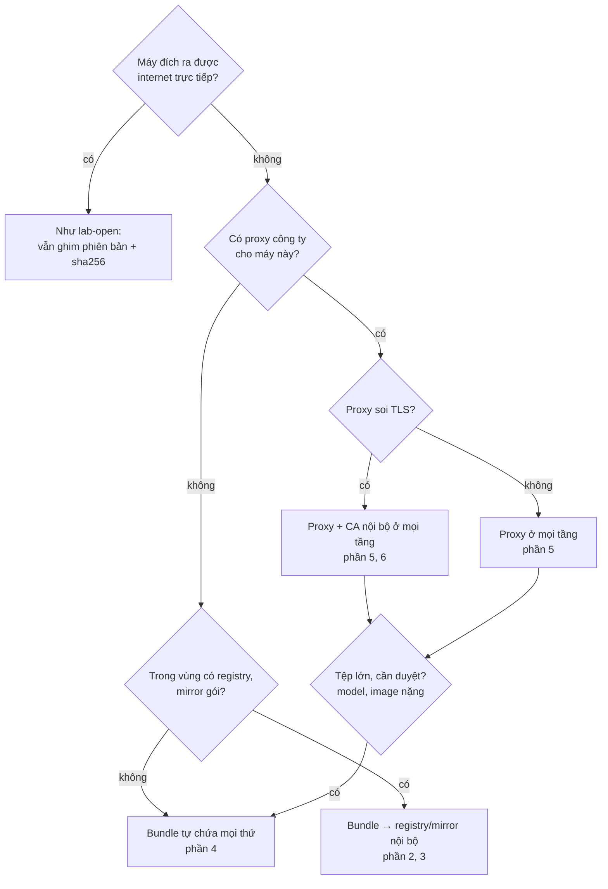
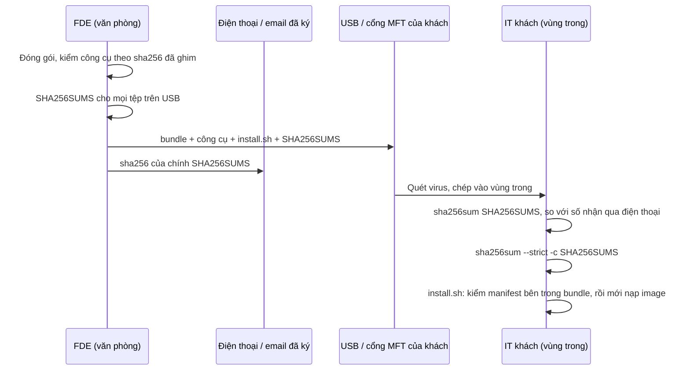
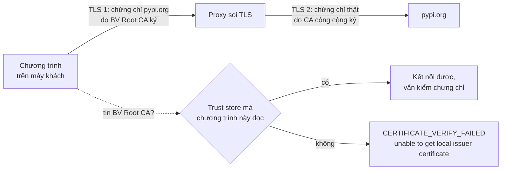

# Air-gapped, proxy và chứng chỉ công ty

Ở module 02 bạn làm ra một bundle "cài được ở mọi nơi". Module này là "mọi nơi" đó: máy không có internet, máy chỉ ra
ngoài qua proxy của công ty, proxy mở cả gói HTTPS ra xem rồi ký lại bằng CA nội bộ, registry nội bộ chạy theo cách của
khách. Hầu hết lỗi ở đây không nằm trong code của bạn mà ở **chỗ một chương trình đọc cấu hình mạng**: biến môi trường
nào, file nào, trust store nào, lúc nào. FDE giỏi không nhớ hết các chỗ đó; họ biết hỏi đúng câu "tiến trình này chạy dưới
ai, đọc cấu hình từ đâu" và có phương án mà An ninh của khách ký được.

Module dùng golden `lab-open`, `hospital`, `lawfirm-staging` (đã dựng ở module 00–02) và bundle `quillo`:

```bash
nice -n 15 uv run python -m fdekit prepare hospital
nice -n 15 uv run python -m fdekit prepare lawfirm-staging
```

Sau module này bạn sẽ:

- Nhận ra khách thuộc kiểu mạng nào (air-gapped hoàn toàn, chỉ qua proxy, có registry/mirror nội bộ) và chọn đường đưa
  phần mềm vào tương ứng.
- Đẩy image vào registry nội bộ, chọn giữa registry HTTP (`insecure-registries`) và registry TLS với CA nội bộ, nói được
  cái giá của từng cách.
- Dựng mirror gói Python kiểu simple index; so sánh với devpi, Nexus/Artifactory, `apt-mirror`/`aptly`, `reposync`.
- Chuyển bundle qua "USB"/cổng MFT với hai lớp kiểm toàn vẹn và một neo tin cậy ngoài kênh.
- Cấu hình proxy cho shell, `sudo`, apt, service systemd, Docker daemon, container; biết chỗ nào **bỏ qua** biến proxy.
- Chẩn đoán `CERTIFICATE_VERIFY_FAILED` sau TLS inspection và tin CA nội bộ đúng chỗ (hệ thống, Python, Docker, container),
  **không bao giờ** bằng cách tắt kiểm chứng chỉ.

## 0. Cài đặt

Hai thứ cần chuẩn bị một lần trên máy bạn (máy có mạng), không tính vào thời gian bài:

**Bundle `quillo` 1.0.0** (bài intermediate 02; ~1,1 GB, vài phút):

```bash
nice -n 15 uv run python tracks/fde/product/release.py build --version 1.0.0 --out tracks/fde/product/dist
uv run python tracks/fde/product/release.py verify tracks/fde/product/dist/quillo-1.0.0.tar
```

**Binary Docker Compose độc lập** để mang vào máy khách không có plugin (bài intermediate 02, capstone). Bản phát hành
hiện tại của Docker Compose là v5.x: vẫn là plugin `docker compose` viết bằng Go (thế hệ "Compose V2"), không phải
`docker-compose` Python cũ.

| Công cụ | Phiên bản đã kiểm | Phát hành | sha256 (`docker-compose-linux-x86_64`) |
| --- | --- | --- | --- |
| Docker Compose | v5.6.1 | 2026-10-21 | `47737f4236e6d3ccea7291995203f8f018058783b4c3a9469119811a0b5db8c0` |

```bash
mkdir -p data/raw/fde-tools/docker-compose-v5.6.1 && cd data/raw/fde-tools/docker-compose-v5.6.1
curl -fLO https://github.com/docker/compose/releases/download/v5.6.1/docker-compose-linux-x86_64
curl -fLO https://github.com/docker/compose/releases/download/v5.6.1/checksums.txt
grep ' \*docker-compose-linux-x86_64$' checksums.txt | sha256sum -c -
echo "47737f4236e6d3ccea7291995203f8f018058783b4c3a9469119811a0b5db8c0  docker-compose-linux-x86_64" | sha256sum -c -
```

Cả hai dòng phải in `OK`; dòng thứ hai so với giá trị ghim ở đây (tệp checksum tải cùng chỗ chỉ chống tải hỏng). Không cần
cài vào máy bạn. Thử: `chmod +x docker-compose-linux-x86_64 && ./docker-compose-linux-x86_64 version`. Gỡ:
`rm -r data/raw/fde-tools/docker-compose-v5.6.1`.

Image mitmproxy và registry phía host đã được `fdekit prepare hospital|lawfirm-staging` kéo sẵn. Bài có proxy cần máy bạn
ra internet (proxy của lab chạy trên máy bạn); không có mạng thì các bài đó skip.

## 1. Ba kiểu "không có internet"

"Máy khách không có internet" là ba tình huống khác nhau, mỗi tình huống một chiến lược. Hỏi rõ ngay ở buổi khảo sát
(module 01), vì câu trả lời đổi cả cách đóng gói lẫn lịch làm việc.

| Kiểu | Ví dụ trong lab | Cái gì đi vào được | Chiến lược |
| --- | --- | --- | --- |
| Air-gapped hoàn toàn | `bank` | Chỉ tệp qua kênh được duyệt (USB, MFT, data diode) | Bundle tự chứa **mọi thứ**, kể cả công cụ (compose, uv); kiểm toàn vẹn ở phía khách |
| Air-gapped có hạ tầng nội bộ | `lawfirm-staging` | Tệp qua kênh duyệt; trong vùng có registry, mirror gói, DNS | Đưa vào một lần, đẩy lên registry/mirror; mọi máy lấy từ đó |
| Ra ngoài qua proxy công ty | `hospital` | HTTP(S) tới tên miền được phép, thường bị soi TLS | Cấu hình proxy + CA đúng chỗ; xin mở đúng tên miền; vẫn ưu tiên offline cho thứ lớn |



Ba điều đúng với cả ba kiểu:

- **Thứ lớn đi offline.** Model vài GB qua proxy soi TLS thì chậm, hay đứt, có khi bị chặn vì quá giới hạn; mang trong
  bundle thì đi cùng đường duyệt với phần còn lại.
- **Mọi thứ ghim phiên bản và sha256**, kể cả khi máy có mạng: "latest" ở văn phòng hôm thứ Hai không phải "latest" ở khách
  hôm thứ Năm.
- **Lỗi mạng lúc cài phải thành lỗi rõ ngay**, không treo: `pip --no-index`, `curl -m`, preflight gọi thử registry trước.

## 2. Registry nội bộ

Ở khách có registry (Harbor, Nexus, GitLab registry, hay `registry:2` đơn giản), quy trình là: `docker load` bundle ở **một**
máy, `docker tag` sang tên registry nội bộ, `docker push`; các máy chạy chỉ `pull` từ đó. `skopeo copy docker-archive:… docker://…`
làm được việc tương tự mà không cần Docker daemon; `oras` đẩy cả tệp không phải image (model, SBOM) vào cùng registry.

Docker chỉ nói HTTP thường với registry ở `127.0.0.0/8`/`::1`; registry nào khác phải là HTTPS có chứng chỉ tin được, nếu
không là lỗi `http: server gave HTTP response to HTTPS client`. Hai cách:

| | `insecure-registries` trong `daemon.json` | Registry TLS + CA nội bộ trong `/etc/docker/certs.d/<host:port>/ca.crt` |
| --- | --- | --- |
| Phía registry | Giữ HTTP | IT cấp chứng chỉ, bật TLS |
| Mỗi máy Docker | Sửa JSON (gộp, không ghi đè cấu hình IT), **restart daemon** | Chép một tệp, Docker đọc mỗi lần kết nối, **không** restart |
| Rủi ro | Image đi không mã hoá, không xác thực máy chủ: ai chen vào mạng thì thay được image | Như registry công cộng |
| Dùng khi | Staging, mạng cô lập, có biên bản chấp nhận rủi ro | Production; khách có PKI |

Restart Docker không phải chuyện nhỏ: không có `live-restore` thì mọi container trên máy dừng theo. Khai đúng **một**
registry (`10.0.2.101:5000`), không bao giờ cả dải (`10.0.0.0/8`). Podman/containerd có cấu hình tương đương
(`/etc/containers/registries.conf` với `insecure = true`; `hosts.toml` của containerd).

Đặt tên trong registry nội bộ theo quy ước của khách (`vendors/quillo-api:1.1.0`), bỏ tên registry gốc (`ghcr.io/…`).
Compose của sản phẩm ghi tên gốc: đừng sửa tệp có trong manifest, chồng một tệp `compose.site.yaml` đổi `image:` từng dịch vụ.

## 3. Mirror gói: apt, dnf, pip

Khi nhiều team trong vùng air-gapped cùng cần gói, bundle cho từng app không còn đủ: khách cần **mirror**. Lựa chọn hay gặp:

| Công cụ | Cho | Kiểu | Hợp khi | Đánh đổi |
| --- | --- | --- | --- | --- |
| Simple index tĩnh (PEP 503) | pip, uv | Thư mục HTML + tệp, phục vụ bằng web server có sẵn | Danh sách gói đã duyệt, nhỏ, ít đổi | Không upload, không cache tự động; tự dựng lại khi thêm gói |
| devpi | pip | Server Python: mirror có cache + index riêng | Khách có máy "cầu nối" ra được PyPI | Thêm một dịch vụ phải vận hành, vá |
| bandersnatch | pip | Chép **toàn bộ** PyPI (hoặc theo danh sách) | Air-gapped lớn, cần nhiều gói | Hàng chục TB nếu chép hết; phải lọc |
| Nexus / Artifactory / Harbor | Mọi loại (apt, yum, PyPI, npm, Docker…) | Kho chung có proxy-cache | Doanh nghiệp đã có | Bản quyền, cấu hình theo từng loại kho |
| `apt-mirror`, `aptly`, `debmirror` | apt | Chép kho Ubuntu/Debian | Máy Ubuntu air-gapped cần vá | Vài trăm GB mỗi bản phát hành; `aptly` có snapshot để "đóng băng" |
| `reposync` + `createrepo_c`, `dnf download` | dnf/yum | Chép kho RHEL/Rocky | Máy Rocky air-gapped | Kho RHEL cần subscription |

Mirror chỉ đáng tin bằng kênh đưa gói vào nó. Simple index đặt `#sha256=` trên mỗi liên kết: `pip` kiểm hash đó khi tải,
nhưng `uv pip install` chỉ kiểm hash có trong tệp requirements. Vì vậy tính toàn vẹn ở khách nên nằm ở **lockfile có hash**
(`uv export`, `pip-compile --generate-hashes`), mirror là lớp thứ hai.

Với apt/dnf, chữ ký GPG của kho là lớp kiểm có sẵn: mirror chép nguyên chữ ký, máy khách kiểm bằng khoá đã cài. Đừng
"sửa" lỗi `NO_PUBKEY` bằng `[trusted=yes]`: đó là `verify=False` của apt.

## 4. Chuyển "USB" và toàn vẹn

Kênh vào vùng air-gapped có giới hạn: dung lượng mỗi tệp (thường 2–4 GB), thời gian quét virus (tới 24 h), người duyệt,
khung giờ. Lên lịch ngược từ ngày cài, có khe gửi lại dự phòng.



Hai lớp toàn vẹn, mỗi lớp bắt một loại lỗi:

1. **Bản chép có giống bản bạn đóng gói?** `SHA256SUMS` của mọi tệp trên USB, kiểm **trước** khi giải nén hay nạp gì, bằng
   `sha256sum` có sẵn ở mọi Linux. Bắt USB lỗi, chép thiếu, máy quét cắt tệp.
2. **Bundle có giống bản công ty phát hành?** `manifest.json` bên trong bundle (module 02), kiểm sau khi giải nén. Công cụ
   kiểm phải chạy được với **Python của khách** (Ubuntu 22.04 có 3.10, `hashlib.file_digest` cần 3.11).

`SHA256SUMS` nằm trên USB nên ai sửa được USB cũng sửa được nó: neo tin cậy là sha256 của chính tệp đó gửi qua **kênh khác**
(đọc qua điện thoại, email đã ký), hoặc chữ ký cosign (module 02). Bí mật (mật khẩu DB, token) không bao giờ đi trên USB:
sinh tại chỗ lúc cài.

Lỗi hay gặp: kiểm sau khi đã `docker load` (image hỏng đã vào máy, có khi đã lên registry dùng chung); sửa một tệp trong
bundle tại chỗ "cho nhanh" (manifest lệch, lần nâng cấp sau installer coi bundle là bị sửa); model bị máy quét cách ly vì
là binary lớn không có chữ ký, phát hiện vào sáng ngày cài.

## 5. Proxy công ty: ai đọc biến nào

`http_proxy`/`https_proxy`/`no_proxy` **không** phải chuẩn; mỗi chương trình tự quyết đọc biến nào, dạng chữ nào, hiểu
`no_proxy` ra sao. Và biến môi trường chỉ đi theo tiến trình con: tiến trình nào không sinh ra từ shell của bạn thì không thấy.

| Chương trình | Đọc gì | Bẫy |
| --- | --- | --- |
| Shell đăng nhập (SSH, console) | `/etc/environment` qua `pam_env`, `~/.profile` | `~/.bashrc` chỉ cho shell tương tác của một user |
| `sudo <lệnh>` | `env_reset`: bỏ gần hết biến | `sudo apt-get` không thấy proxy của bạn; dùng cấu hình riêng của apt hoặc `env_keep` có chủ đích |
| apt | `Acquire::http(s)::Proxy` trong `/etc/apt/apt.conf.d/`, hoặc biến của root | Kho Ubuntu là HTTP, vẫn phải qua proxy |
| Service systemd (dockerd, containerd, app của bạn) | Chỉ `Environment=`/`EnvironmentFile=` của unit, `DefaultEnvironment=` | Không đọc `/etc/environment`, không qua PAM; sửa xong phải `daemon-reload` + restart |
| Docker daemon | Như service systemd; Docker ≥ 23 còn có khoá `proxies` trong `daemon.json` | `docker pull` là **daemon** kéo, không phải CLI của bạn |
| Container (lúc build và lúc chạy) | Không thừa hưởng gì; `--build-arg`, `-e`, hoặc khoá `proxies` trong `~/.docker/config.json` để CLI tự truyền | `ENV http_proxy` trong Dockerfile mang proxy của khách này tới mọi nơi chạy image |
| curl | `http_proxy` (chỉ chữ thường), `HTTPS_PROXY`/`https_proxy`, `NO_PROXY`/`no_proxy` | CIDR trong `no_proxy` chỉ từ curl 7.86 (Ubuntu 20.04 có 7.68) |
| Python `urllib` | Cả hai dạng chữ | `no_proxy` so hậu tố tên, không hiểu CIDR |
| Python `requests` | Như `urllib`, thêm CIDR cho địa chỉ IP | Cấu hình proxy không đụng gì tới CA; lỗi chứng chỉ là chuyện của phần 6 |
| Go (Docker CLI, kubectl, Terraform) | Cả hai dạng chữ, CIDR được | — |
| Java | Bỏ qua biến môi trường; `-Dhttps.proxyHost`, `-Dhttp.nonProxyHosts="localhost\|*.noi-bo"` | Cú pháp `nonProxyHosts` khác hẳn |

Quy tắc thực hành: đặt **cả hai dạng chữ**, cùng giá trị; `no_proxy` liệt kê `localhost,127.0.0.1,::1`, IP cụ thể của
máy và dịch vụ nội bộ, tên miền nội bộ với dấu chấm đầu (`.benhvien.internal`); thêm CIDR **cùng với** IP chứ không thay.
Cấu hình mỗi tầng ở đúng chỗ của nó (`/etc/environment`, apt, drop-in systemd của từng service), idempotent, và kiểm bằng
một phiên đăng nhập **mới**. Proxy cần mật khẩu: xin tài khoản dịch vụ hoặc cho máy chủ đi theo IP; mật khẩu cá nhân
trong `/etc/environment` thì mọi user, mọi `env` dump, mọi support bundle đều thấy.

## 6. TLS inspection và CA nội bộ

Proxy soi TLS là một "kẻ đứng giữa" được công ty cho phép: nó kết thúc TLS từ máy bạn, mở gói ra quét, rồi mở kết nối TLS
mới tới máy chủ thật. Chứng chỉ máy bạn nhận được do **CA của công ty** ký, không phải CA công cộng.



`unable to get local issuer certificate` sau proxy gần như luôn có nghĩa: chương trình này đọc một trust store **không** có
CA của công ty. Câu hỏi chẩn đoán là "chương trình này đọc trust store nào", và câu trả lời khác nhau theo từng tầng:

| Tầng | Trust store | Thêm CA |
| --- | --- | --- |
| Ubuntu/Debian | `/etc/ssl/certs/ca-certificates.crt` | Tệp `.crt` (PEM) vào `/usr/local/share/ca-certificates/`, `update-ca-certificates` |
| Rocky/RHEL | `/etc/pki/ca-trust/extracted/…` | Tệp vào `/etc/pki/ca-trust/source/anchors/`, `update-ca-trust` |
| curl, `ssl`/`urllib` của Python, apt HTTPS | Trust store hệ thống (OpenSSL) | Như trên; `SSL_CERT_FILE` để chỉ định tệp khác |
| Python `requests` | Gói `certifi` (bundle Mozilla đóng kèm), **không** đọc trust store hệ thống và **bỏ qua** `SSL_CERT_FILE` | `REQUESTS_CA_BUNDLE` (hoặc `CURL_CA_BUNDLE`). Giá trị này **thay** cả bundle, nên trỏ vào bundle hệ thống đã gộp CA (`/etc/ssl/certs/ca-certificates.crt`), không vào tệp chỉ có CA của khách. Gói `python3-certifi` của Debian/Ubuntu trỏ sẵn về bundle hệ thống; `certifi` cài bằng pip thì không |
| pip ≥ 24.2 trên Python ≥ 3.10 | Trust store hệ thống qua `truststore`, cộng `certifi` | Bản cũ hơn: `PIP_CERT`/`--cert`; cũng **thay** bundle ⇒ trỏ vào bundle hệ thống đã gộp |
| httpx | `certifi` mặc định | `verify=ssl.create_default_context(cafile="/etc/ssl/certs/ca-certificates.crt")` (bundle hệ thống đã gộp; `cafile=` thay danh sách mặc định) |
| Go (dockerd, kubectl) | Trust store hệ thống, nạp **một lần** lúc khởi động | Thêm vào hệ thống rồi restart tiến trình |
| Docker kéo/đẩy registry | Hệ thống + `/etc/docker/certs.d/<host:port>/ca.crt` | Thư mục `certs.d` không cần restart |
| Container | Trust store **của image**, không phải của máy | Chép CA vào image + `update-ca-certificates`, hoặc mount bundle của máy lúc chạy |
| Node | Bundle đóng kèm Node | `NODE_EXTRA_CA_CERTS=/đường/dẫn/ca.pem` |
| Java | Keystore `cacerts` của JRE | `keytool -importcert -cacerts -alias congty -file ca.pem` |

Khi thêm CA, đặt nó **bên cạnh** các CA công cộng (gộp vào bundle hệ thống), đừng thay cả bundle bằng một tệp chỉ có CA của
khách: thứ chạy được ở khách này sẽ hỏng ở mọi nơi khác. Nhận tệp CA qua email thì đọc fingerprint
(`openssl x509 -noout -fingerprint -sha256 -in ca.pem`) với An ninh qua kênh khác trước khi tin nó.

**Không bao giờ** "sửa" bằng `verify=False`, `curl -k`/`--insecure`, `pip --trusted-host`, `PYTHONHTTPSVERIFY=0`,
`[trusted=yes]` của apt hay `insecure-registries` cho registry công cộng. Chúng chạy được ngay vì
chúng tắt đúng thứ bảo vệ bạn: từ đó chương trình không phân biệt được proxy của khách với bất kỳ kẻ đứng giữa nào, và
dòng đó sẽ ở lại trong code lâu hơn hợp đồng của bạn. Công cụ nào thật sự không cấu hình được CA (ghim chứng chỉ trong
binary) thì xin An ninh **bypass** đúng tên miền đó, có hạn, bằng văn bản; đó là quyết định của họ, không phải của bạn.

## 7. Ôn nhanh: TLS, systemd và image

Phần này chỉ nhắc những gì module dùng. Chuỗi chứng chỉ, CA gốc/trung gian, `openssl s_client -showcerts` để xem ai ký
chứng chỉ máy chủ ở [DevOps 04 — Mạng và giao thức](../../../devops/modules/04-networking-protocols/README.md) (phần TLS
và chứng chỉ). Unit systemd, `systemctl edit` tạo drop-in, `daemon-reload`, `Environment=` ở
[DevOps 01 — Linux và terminal](../../../devops/modules/01-linux-terminal/README.md). Image, layer, `docker build` và
build-arg ở [MLOps 02 — Container cho ML](../../../mlops/modules/02-containers-for-ml/README.md).

## 8. Tài liệu tham khảo

- [roadmap.sh — Forward Deployed Engineer](https://roadmap.sh/forward-deployed-engineer)
- [Docker — Configure the daemon to use a proxy](https://docs.docker.com/engine/daemon/proxy/)
- [Docker — Use a proxy server with the Docker CLI (build và run)](https://docs.docker.com/engine/cli/proxy/)
- [Docker — Test an insecure registry](https://docs.docker.com/reference/cli/dockerd/#insecure-registries)
- [Docker — Verify repository client with certificates (`certs.d`)](https://docs.docker.com/engine/security/certificates/)
- [Docker Compose — Install the plugin manually](https://docs.docker.com/compose/install/linux/#install-the-plugin-manually)
- [Docker Compose — Merge Compose files](https://docs.docker.com/compose/how-tos/multiple-compose-files/merge/)
- [CNCF Distribution — Deploy a registry server](https://distribution.github.io/distribution/about/deploying/)
- [PEP 503 — Simple Repository API](https://peps.python.org/pep-0503/)
- [pip — HTTPS certificates và truststore](https://pip.pypa.io/en/stable/topics/https-certificates/)
- [Requests — SSL Cert Verification](https://requests.readthedocs.io/en/latest/user/advanced/#ssl-cert-verification)
- [curl — Environment variables (`--noproxy`, `NO_PROXY`)](https://everything.curl.dev/usingcurl/proxies/env.html)
- [GitLab — We need to talk: Can we standardize NO_PROXY?](https://about.gitlab.com/blog/we-need-to-talk-no-proxy/)
- [Ubuntu — Install a root CA certificate in the trust store](https://documentation.ubuntu.com/server/how-to/security/install-a-root-ca-certificate-in-the-trust-store/)
- [mitmproxy — How it works (TLS interception)](https://docs.mitmproxy.org/stable/concepts-howmitmproxyworks/)
- [devpi](https://devpi.net/docs/devpi/devpi/stable/%2Bd/index.html), [aptly](https://www.aptly.info/)
