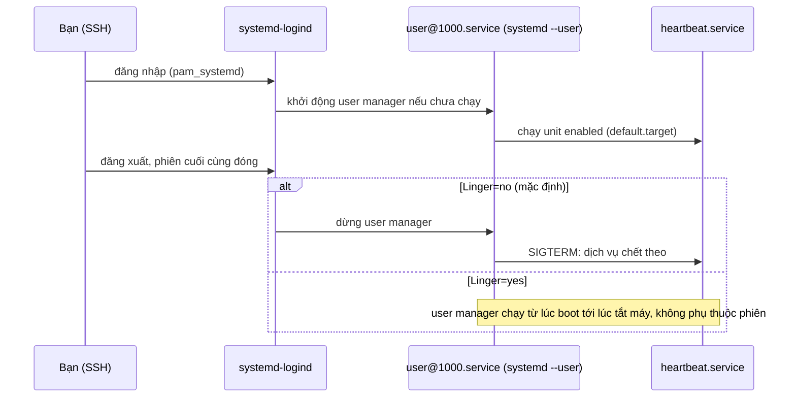
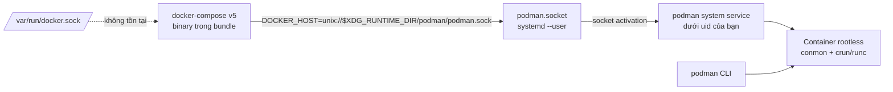
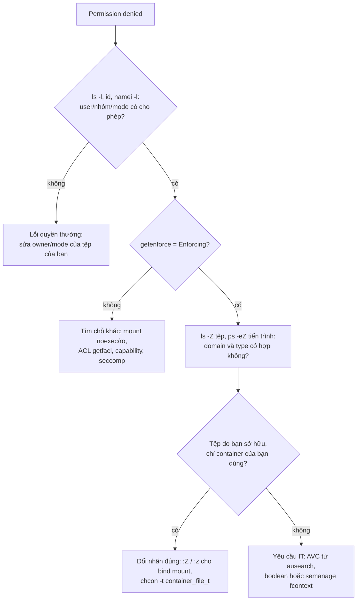

# Máy bị khoá và máy cũ

Module 03 dạy cách đưa phần mềm vào khi **mạng** bị khoá. Module này là khi **chính cái máy** bị khoá: bạn không có root,
SELinux đang enforcing, firewall do một đội khác giữ, hệ điều hành ra đời trước cả phiên bản Python mà app của bạn cần,
`/tmp` không cho chạy chương trình, mỗi tiến trình chỉ được mở 1024 tệp. Ngân hàng, bệnh viện, nhà máy và công ty luật
siết máy như vậy là có lý do; việc của FDE không phải là xin gỡ hết, mà là **làm được việc trong giới hạn đó** và khi thật
sự cần một ngoại lệ thì xin đúng một ngoại lệ, có lý do, có cách kiểm.

Module dùng golden `bank`, `factory`, `lawfirm-hardened`, `hospital` và `lab-open` (đã có từ module 00–03 hoặc dựng thêm):

```bash
nice -n 15 uv run python -m fdekit prepare bank
nice -n 15 uv run python -m fdekit prepare factory
nice -n 15 uv run python -m fdekit prepare lawfirm-hardened
nice -n 15 uv run python -m fdekit prepare hospital
```

Sau module này bạn sẽ:

- Biết một user thường **được** làm gì trên Linux (và cái gì polkit cho thêm), cài phần mềm hoàn toàn trong `$HOME` theo
  quy ước XDG, chạy nó thành dịch vụ bằng `systemd --user` sống qua lúc đăng xuất.
- Chạy container không root bằng Podman rootless (hoặc Docker rootless), nói được subuid, user namespace, cổng dưới 1024,
  socket API của user và vì sao compose "không thấy Docker".
- Đọc nhãn SELinux, chọn `:z`/`:Z` hay boolean, và khi không đọc được AVC thì viết yêu cầu cho IT đủ để họ trả lời trong
  một lượt; không bao giờ `setenforce 0`.
- Đọc cấu hình firewall ở mức đủ để chẩn đoán và viết yêu cầu mở cổng.
- Kiểm tương thích với OS cũ (glibc, Python hệ thống, runtime container cũ) **trước** chuyến đi, và mang theo runtime của
  riêng bạn khi máy khách quá cũ.
- Sống chung với `/tmp` noexec, `ulimit -n` thấp, đĩa gần đầy; nhận ra máy "Linux" thật ra là WSL.

## 0. Cài đặt

Ba thứ tải một lần vào `data/raw/fde-tools/` trên máy bạn (có mạng), không tính vào thời gian bài. Mỗi thứ ghim phiên bản
và sha256; tệp checksum tải cùng chỗ chỉ chống tải hỏng, giá trị ghim ở đây mới là neo tin cậy.

| Công cụ | Phiên bản đã kiểm | Phát hành | Dùng ở bài | sha256 |
| --- | --- | --- | --- | --- |
| Docker Compose (binary độc lập) | v5.6.1 | 2026-10-21 | intermediate 01 | `47737f4236e6d3ccea7291995203f8f018058783b4c3a9469119811a0b5db8c0` |
| BusyBox tĩnh (musl) | 1.35.0 | 2022-01-17 | intermediate 01 (test dựng image nhỏ từ nó) | `6e123e7f3202a8c1e9b1f94d8941580a25135382b99e8d3e34fb858bba311348` |
| python-build-standalone, CPython 3.12.15 `install_only_stripped` | `20261021` | 2026-10-21 | intermediate 02 | `6d7521138fd33afddc1ccd08abb007d9a2829e38117c2576f9efdc0ec73ce772` |

Docker Compose: làm theo phần `0. Cài đặt` của [module 03](../03-airgapped-proxy/README.md) (đã có thì bỏ qua). Hai thứ còn lại:

```bash
mkdir -p data/raw/fde-tools/busybox-1.35.0
curl -fLo data/raw/fde-tools/busybox-1.35.0/busybox \
  https://busybox.net/downloads/binaries/1.35.0-x86_64-linux-musl/busybox
echo "6e123e7f3202a8c1e9b1f94d8941580a25135382b99e8d3e34fb858bba311348  data/raw/fde-tools/busybox-1.35.0/busybox" | sha256sum -c -

mkdir -p data/raw/fde-tools/python-build-standalone-20261021 && cd data/raw/fde-tools/python-build-standalone-20261021
curl -fLo 'cpython-3.12.15+20261021-x86_64-unknown-linux-gnu-install_only_stripped.tar.gz' \
  'https://github.com/astral-sh/python-build-standalone/releases/download/20261021/cpython-3.12.15%2B20261021-x86_64-unknown-linux-gnu-install_only_stripped.tar.gz'
curl -fLO https://github.com/astral-sh/python-build-standalone/releases/download/20261021/SHA256SUMS
grep ' cpython-3.12.15+20261021-x86_64-unknown-linux-gnu-install_only_stripped.tar.gz$' SHA256SUMS | sha256sum -c -
echo "6d7521138fd33afddc1ccd08abb007d9a2829e38117c2576f9efdc0ec73ce772  cpython-3.12.15+20261021-x86_64-unknown-linux-gnu-install_only_stripped.tar.gz" | sha256sum -c -
```

Mọi dòng `sha256sum -c` phải in `OK`. Không cần cài gì vào máy bạn; thử: `tar -xzf cpython-*.tar.gz -C /tmp &&
/tmp/python/bin/python3 -V`. Gỡ: `rm -r data/raw/fde-tools/busybox-1.35.0 data/raw/fde-tools/python-build-standalone-20261021`.

## 1. Không root: bạn còn làm được gì

"Không có sudo" không có nghĩa là không làm được gì. Một user thường trên Linux hiện đại vẫn có khá nhiều quyền, và phần
lớn phần mềm của bạn **không cần** root nếu bạn không tự đòi:

| Việc | User thường | Cần root (hoặc IT) |
| --- | --- | --- |
| Cài chương trình, thư viện, model | `$HOME` (`~/.local/bin`, `~/.local/opt/<app>`, `~/.local/share`) | `/usr`, `/opt`, gói hệ thống (`apt`, `dnf`) |
| Chạy dịch vụ nền tự khởi động | `systemd --user` (phần 2) | Service hệ thống ở `/etc/systemd/system` |
| Sống qua lúc đăng xuất | Linger, nếu polkit cho phép tự bật (phần 2) | `loginctl enable-linger <user>` cho người khác |
| Container | Podman rootless; Docker rootless nếu đã có `newuidmap` và subuid (phần 3) | Thêm dải subuid/subgid, cài `uidmap`, nhóm `docker` |
| Mở cổng mạng | Cổng ≥ 1024 (`net.ipv4.ip_unprivileged_port_start`) | Cổng < 1024, mở firewall, đổi sysctl |
| Đọc log | Journal của chính mình (`journalctl --user`), log app của mình | Journal hệ thống, `/var/log/audit/audit.log` |
| SELinux | Xem nhãn (`ls -Z`, `ps -Z`, `getsebool`), đổi nhãn tệp **của mình** (`chcon`, `:Z`) | `setsebool -P`, `semanage`, module policy |
| Giới hạn tài nguyên | Hạ giới hạn, nâng soft tới hard (`ulimit -n`) | Nâng hard limit, `limits.d`, `LimitNOFILE=` cho service hệ thống |

Hai thói quen đổi hẳn cách bạn làm việc trên máy bị khoá:

- **Hỏi "cái này có thật sự cần root không" trước khi xin.** Installer viết `/opt/<app>`, `systemctl enable` service hệ
  thống, `chown` sang user riêng: phần lớn là thói quen từ máy lab, không phải nhu cầu của app. Một bản cài trong `$HOME`
  với `systemd --user` là thứ IT ngân hàng ký được trong một ngày; một dòng sudoers thì có khi mất một quý.
- **Khi cần, xin đúng một việc, có lệnh cụ thể và cách kiểm.** "Cho em quyền sudo" bị từ chối; "Nhờ anh chạy
  `loginctl enable-linger svc-quillo` (để dịch vụ của user này chạy khi không ai đăng nhập), kiểm bằng
  `loginctl show-user svc-quillo -p Linger` ra `Linger=yes`" thì được làm ngay.

Cài vào `$HOME` cho đúng: theo [XDG Base Directory](https://specifications.freedesktop.org/basedir-spec/latest/) (cấu hình
ở `~/.config/<app>`, dữ liệu `~/.local/share/<app>`, trạng thái và log `~/.local/state/<app>`, binary trên `PATH` ở
`~/.local/bin`), mỗi bản phát hành một thư mục riêng (`~/.local/opt/<app>/releases/<bản>`) và một symlink `current` đổi
nguyên tử như module 02. Đừng dựa vào `PATH` của shell tương tác: service, cron, `env -i` không đọc `~/.bashrc`, nên mọi
đường dẫn trong unit và script là đường dẫn tuyệt đối (hoặc `%h` trong unit). Và hỏi trước một câu: `$HOME` của user dịch
vụ nằm trên đĩa local hay NFS? Home trên NFS (hay gặp ở ngân hàng, trường đại học) làm hỏng container rootless (overlay
không chạy trên NFS), SQLite và mọi thứ cần `flock`.

## 2. `systemd --user`, linger và vòng đời của user manager

Mỗi user đăng nhập có một **user manager** riêng (`user@<uid>.service`, chạy `systemd --user`), quản unit trong
`~/.config/systemd/user/` (và `/etc/systemd/user/`, `/usr/lib/systemd/user/` do IT/gói cài). Nó gần như systemd của hệ
thống: `Restart=`, `journalctl --user -u <unit>`, timer thay cron, socket activation. Khác biệt quan trọng là **vòng đời**:



- **Linger.** Mặc định user manager khởi động khi bạn đăng nhập lần đầu và dừng khi phiên cuối đóng: dịch vụ "chạy ngon
  lúc test" rồi chết ngay khi bạn rời ca. `loginctl enable-linger` giữ user manager chạy từ lúc boot. Tự bật cho chính
  mình được hay không tuỳ polkit của distro (action `org.freedesktop.login1.set-self-linger`): có máy cho, có máy đòi
  admin. Không bật được thì đó là một yêu cầu IT một dòng, kèm lý do.
- **Unit của user không có `multi-user.target`.** Mục `[Install]` phải là `WantedBy=default.target`; `enable` tạo symlink
  trong `~/.config/systemd/user/default.target.wants/`.
- **Đường dẫn trong unit.** `%h` là home, `%U` là uid; `ExecStart=` cần đường dẫn tuyệt đối. Unit không đọc
  `~/.bashrc`: biến môi trường đặt bằng `Environment=`/`EnvironmentFile=%h/.config/<app>/<app>.env`.
- **Gọi được `systemctl --user` hay không.** Cần `XDG_RUNTIME_DIR=/run/user/<uid>` và D-Bus của user, có sẵn khi đăng
  nhập qua SSH/console (PAM tạo). Vào bằng `su - user` hay `sudo -u user` thì không có, và lỗi là `Failed to connect to
  bus`; từ systemd 248 có `systemctl --user -M user@` (Rocky 8 có systemd 239 nên không có), còn không thì
  đăng nhập SSH thẳng bằng user đó.
- **Giới hạn.** User manager có giới hạn riêng (`/etc/systemd/user.conf`, `DefaultLimitNOFILE=`); `LimitNOFILE=` trong
  unit của user chỉ hạ được, không nâng quá hard limit mà user manager nhận. Không có `User=` (đã là bạn rồi), không
  bind cổng < 1024, không `PrivateNetwork=` trên nhiều bản systemd cũ.

Kiểm một dịch vụ user "thật sự chạy được": `systemctl --user is-enabled` và `is-active`, đóng mọi phiên SSH vài chục giây,
đăng nhập lại và so `systemctl --user show -p MainPID` với trước đó. MainPID đổi nghĩa là nó đã chết và được khởi động lại
khi bạn quay về, đúng thứ khách sẽ thấy lúc 2 giờ sáng.

## 3. Container không root: Podman, Docker rootless và compose

Container rootless chạy daemon (hoặc không daemon) và mọi container dưới uid của bạn. Root **trong** container là uid của
bạn ở ngoài; các uid khác trong container ánh xạ sang một dải "subordinate" khai cho bạn:

| Khái niệm | Ở đâu | Ghi nhớ |
| --- | --- | --- |
| User namespace | `podman unshare cat /proc/self/uid_map` | `0 1000 1` (root trong container = bạn) + `1 100000 65536` |
| subuid/subgid | `/etc/subuid`, `/etc/subgid` (`fde:100000:65536`) | IT thêm bằng `usermod --add-subuids`; thiếu thì image có nhiều uid báo `potentially insufficient UIDs or GIDs available in user namespace` |
| `newuidmap`/`newgidmap` | Gói `shadow-utils`/`uidmap`, setuid root | Docker rootless cần; thiếu là việc của IT |
| Storage | `~/.local/share/containers/storage` (Podman), `~/.local/share/docker` | Image đã `podman load` của user này user khác không thấy; home trên NFS thì đổi `graphroot` sang đĩa local |
| Mạng | slirp4netns hoặc pasta, cổng publish qua `rootlessport` | Cổng < 1024 bị từ chối; IP nguồn nhìn từ container là của tiến trình chuyển tiếp |
| Cgroup | cgroup v2 + delegation thì giới hạn được; cgroup v1 (mặc định Rocky/RHEL 8) | Trên cgroup v1, `--memory`/`--cpus` của rootless bị **bỏ qua** kèm cảnh báo |
| API socket | `$XDG_RUNTIME_DIR/podman/podman.sock` (user `podman.socket`), `$XDG_RUNTIME_DIR/docker.sock` | Không có socket ở `/var/run/docker.sock`; client tìm đúng chỗ qua `DOCKER_HOST` |

**Compose trên Podman.** Máy khách không có Docker và không cài được `podman-compose` (gói Python, cần mạng hoặc EPEL).
Đường thực tế là mang binary `docker-compose` độc lập (Go, một tệp, ghim sha256 như module 03) và cho nó nói chuyện với
API tương thích Docker của Podman:



- Socket là unit **user**: `systemctl --user enable --now podman.socket`. Không có linger thì socket và container của bạn
  dừng khi bạn đăng xuất (phần 2).
- `podman compose` (Podman ≥ 4.7) chỉ là vỏ gọi một "provider" bên ngoài (`docker-compose` hoặc `podman-compose`); nó
  không tự chạy compose.
- Khác biệt hay gặp khi đi qua API tương thích: `restart: always` không tự sống lại sau reboot (rootless cần
  `podman-restart.service` của user hoặc Quadlet), `network_mode: host` vẫn là mạng của user namespace, healthcheck chạy
  bằng timer của systemd user, build dùng Buildah phía sau.
- Muốn dịch vụ container "đúng kiểu systemd" trên Podman ≥ 4.4: **Quadlet**, tệp `~/.config/containers/systemd/<tên>.container`
  được sinh thành unit `systemd --user` (thay `podman generate systemd` đã bị đánh dấu deprecated). Compose phù hợp khi
  bundle của sản phẩm đã là compose; Quadlet phù hợp khi bạn chủ động dựng dịch vụ cho máy Podman.
- Docker rootless (`dockerd-rootless-setuptool.sh install`) tồn tại nhưng ở ngân hàng/công ty luật thì hiếm: cần gói
  `docker-ce-rootless-extras`, `uidmap`, subuid, tức là vẫn cần IT. Trên RHEL/Rocky, Podman có sẵn từ kho chính thức và
  được Red Hat hỗ trợ, nên đó là thứ IT chọn.

## 4. SELinux enforcing và firewall

SELinux là kiểm soát truy cập **bắt buộc** (MAC) chồng lên quyền tệp (DAC). Mỗi tiến trình có một domain (`container_t`,
`httpd_t`, `unconfined_t`), mỗi tệp một type (`user_home_t`, `container_file_t`, `etc_t`); policy quyết domain nào làm gì
với type nào. Quyền `rw` của tệp cho phép mà policy không cho thì vẫn là `Permission denied`, và đó là điều làm mất nhiều
giờ nhất ở máy RHEL: thông báo lỗi **giống hệt** lỗi quyền thường.



Những thứ dùng hằng ngày:

- **Đọc nhãn:** `ls -Z`, `ps -eZ`, `id -Z`. Trong home mọi tệp mặc định là `user_home_t`; container rootless chạy là
  `container_t` với cặp category MCS riêng (`s0:c665,c858`). `container_t` đọc được `container_file_t`, không đọc
  `user_home_t`.
- **Bind mount:** hậu tố `:z` đổi nhãn sang `container_file_t` dùng chung (mọi container đọc được), `:Z` đổi sang nhãn
  riêng có MCS của **đúng** container đó. Chỉ dùng cho thư mục của riêng app: `:Z` lên `$HOME`, `/etc` hay một thư mục
  dịch vụ khác đang dùng sẽ đổi nhãn của chúng và làm hỏng thứ khác (có khi hỏng cả đăng nhập SSH nếu là `~/.ssh`).
  Compose viết `./config:/etc/app:ro,Z` (cú pháp ngắn) hoặc `bind: {selinux: Z}` (cú pháp dài).
- **Boolean:** `getsebool -a | grep container` (đọc được không cần root), ví dụ `container_use_devices` (container dùng
  `/dev/dri`, GPU), `container_manage_cgroup`. Bật là `setsebool -P`, việc của IT.
- **Đọc lý do bị chặn (AVC):** `ausearch -m AVC,USER_AVC -ts recent`, `audit2why`, `sealert -l <id>` (gói
  `setroubleshoot`). Tất cả đọc `/var/log/audit/audit.log`, mà user thường **không** đọc được. Khi đó bạn chỉ có triệu
  chứng; viết yêu cầu cho IT: tiến trình nào (`ps -eZ`), tệp nào (`ls -Z`), thời điểm (UTC, để họ lọc `ausearch -ts`),
  lệnh tái hiện, và xin họ gửi lại đúng dòng AVC. Đừng xin `audit2allow -M` tạo module từ AVC: nó cho phép đúng cái đang
  bị chặn, kể cả khi cái bị chặn là sai.
- **Thử giả thuyết trong lab, không ở khách:** `--security-opt label=disable` cho container chạy không nhãn; chạy được
  tức là đúng SELinux. Đó là công cụ chẩn đoán, không phải cách sửa. **Không bao giờ** `setenforce 0`, `SELINUX=permissive`
  hay đề xuất tắt SELinux: ở ngân hàng đó là vi phạm baseline bảo mật, và ở mọi nơi nó che mất lỗi thật.

**Firewall.** Trên RHEL/Rocky là firewalld (backend nftables), Ubuntu hay có `ufw` hoặc không gì cả, nhiều nơi dùng
firewall mạng ở ngoài máy. Không root bạn thường không đọc được ruleset (`nft list ruleset`, `firewall-cmd --list-all`
cần quyền), nên chẩn đoán từ hai đầu: `ss -ltn` trên máy (dịch vụ có nghe đúng địa chỉ không, `127.0.0.1` hay `0.0.0.0`),
rồi `curl -v`/`nc -vz` từ máy client. Nghe đúng mà client nhận `No route to host`/`connection refused` ngay lập tức là
host firewall từ chối (firewalld mặc định `reject`); treo tới timeout là có thứ gì đó `drop` trên đường đi. Yêu cầu mở cổng
gửi IT ghi đủ: máy nguồn (IP/dải cụ thể, không `any`), máy đích, cổng/giao thức, chiều, mục đích, thời hạn, người chịu
trách nhiệm, và lệnh kiểm sau khi mở. Với rootless, cổng publish là cổng ≥ 1024 (ví dụ 18080); nếu người dùng cần 443 thì
IT chuyển tiếp ở firewall/reverse proxy, không phải bạn xin root.

## 5. OS cũ: glibc, Python hệ thống, runtime container cũ

Máy của khách thường cũ hơn máy bạn 3–6 năm, và nhiều khi được giữ cố ý (phần mềm y tế chứng nhận trên Ubuntu 20.04,
ngân hàng chuẩn hoá RHEL 8 tới hết vòng đời 2029). Ba thứ hay gãy:

| Thứ | Triệu chứng | Vì sao | Cách sống chung |
| --- | --- | --- | --- |
| glibc | `version 'GLIBC_2.34' not found (required by ./app)` | Binary/wheel dựng trên máy mới gắn với phiên bản symbol mới nhất nó dùng | Wheel theo thẻ manylinux đúng glibc đích (`manylinux2014` = 2.17, `manylinux_2_28`, `manylinux_2_31`); binary dựng trên OS cũ nhất phải hỗ trợ hoặc trong container manylinux; hoặc binary tĩnh (musl) |
| Python hệ thống | Rocky 8 chỉ có `platform-python` 3.6 cho công cụ hệ thống, `python3` có khi không được cài; Ubuntu 20.04 có 3.8 (hết hỗ trợ từ 10/2024), thiếu `venv`/`pip`; Debian 12+ báo `externally-managed-environment` (PEP 668) | Python hệ thống là của **distro**, phục vụ công cụ của distro | Không cài gói vào Python hệ thống, không dùng `platform-python` cho app. Mang runtime riêng: python-build-standalone (thứ `uv python install` dùng), relocatable, cần glibc ≥ 2.17, cài vào `$HOME` không cần root |
| Runtime container | Docker 20.10 không có plugin compose; seccomp/runc cũ chặn syscall mới (`clone3`) nên image glibc ≥ 2.34 báo `Operation not permitted` khi tạo thread; Podman 1.x trên RHEL 7; cgroup v1 | Runtime đi theo OS, không theo image | Hỏi phiên bản ngay buổi khảo sát; ghi phiên bản tối thiểu trong ma trận hỗ trợ; image gốc cũ hơn khi cần |

Quy trình nên thành thói quen: khảo sát (module 01) ghi `ldd --version`, `python3 -V`, `/etc/os-release` của từng máy;
so với yêu cầu của **từng thành phần** bạn mang tới (wheel nào cần glibc bao nhiêu, app cần Python bao nhiêu, OS nào còn
được hỗ trợ tới ngày triển khai), ra danh sách vấn đề **trước** khi đi. Với máy quá cũ có hai đường: mang runtime của riêng
bạn (Python standalone, binary tĩnh, container) hoặc nói "không hỗ trợ" kèm lý do và ngày; điều không được làm là im lặng
cài rồi để khách phát hiện ở bản nâng cấp sau.

Vòng đời cũng là dữ liệu: `/etc/os-release` của Rocky có `SUPPORT_END`; Ubuntu thì tra lịch phát hành (20.04 hết standard
support 31/05/2025, còn ESM nếu khách mua Ubuntu Pro). Một OS hết hỗ trợ không chặn bạn cài, nhưng phải nằm trong báo cáo
gửi khách: bản vá bảo mật của OS là việc của họ, không phải của sản phẩm.

## 6. `/tmp` noexec, `ulimit`, đĩa gần đầy và Windows/WSL

**`/tmp` noexec.** Baseline CIS mount `/tmp` (và `/dev/shm`, `/var/tmp`) với `noexec,nosuid,nodev`. Mọi thứ giải nén
chương trình vào `/tmp` rồi chạy đều gãy với `Permission denied` (exit 126), kể cả script có shebang: `execve` từ chối
trên mount noexec, trong khi `sh /tmp/x.sh` vẫn chạy (đọc như dữ liệu). Thủ phạm hay gặp: PyInstaller `--onefile`, JNA/thư viện
native của Java, `pip` dựng sdist có bước chạy script, installer giải nén công cụ phụ vào thư mục tạm.
Cách sống chung: thư mục làm việc tạm nằm **cạnh chỗ cài** (`mktemp -d "$HOME/.<app>-stage.XXXXXX"`, cùng filesystem
nên `mv` là đổi tên nguyên tử), tôn trọng `TMPDIR` khi khách đặt, kiểm `findmnt -no OPTIONS --target <dir>` trong
preflight. Không xin remount `/tmp`: đó là baseline, không phải sai sót.

**`ulimit -n` (nofile).** Mỗi tệp, socket, pipe đang mở tốn một file descriptor; giới hạn có **soft** (đang áp) và
**hard** (trần mà user tự nâng soft tới được). Nhiều máy lab có soft 1024 nhưng hard rất cao (Ubuntu 22.04: 1048576), nên
chương trình tự nâng soft lên hard (Go ≥ 1.19 làm việc này tự động, nhiều server Java/C++ cũng vậy) chạy ngon; máy đặt cả
hard 1024 thì cùng chương trình chết với `Too many open files` (EMFILE). Ba tầng cấu hình khác nhau:

| Tiến trình chạy từ | Lấy giới hạn từ | Đổi bằng |
| --- | --- | --- |
| Phiên đăng nhập (SSH, console) | `pam_limits`: `/etc/security/limits.conf`, `limits.d/` | IT sửa; user chỉ `ulimit -n` trong khoảng hard |
| Service hệ thống | `DefaultLimitNOFILE=` của `/etc/systemd/system.conf`, `LimitNOFILE=` của unit (không đọc `limits.conf`) | Drop-in `LimitNOFILE=` của unit (root) |
| `systemd --user` | `DefaultLimitNOFILE=` của `/etc/systemd/user.conf` | Chỉ hạ được trong unit của user |

Xem giới hạn thật của một tiến trình đang chạy: `cat /proc/<pid>/limits`. Ở máy không nâng được, sửa phía chương trình:
giữ ít fd mở cùng lúc (đóng sau khi dùng, xử lý theo đợt), đọc `ulimit -n` và tự điều chỉnh, báo lỗi sớm có số liệu. Chỉ
xin nâng khi phần mềm thật sự cần nhiều kết nối đồng thời (Postgres, Elasticsearch đòi 65535) và kèm con số.

**Đĩa gần đầy.** `df -h` và `df -i` (hết inode trông y hệt hết chỗ); ext4 giữ 5% cho root nên user thường thấy "No space
left on device" sớm hơn `df` gợi ý; journald, log app, image container (`~/.local/share/containers`), bản tải dở là
những thứ phình. Installer cần preflight dung lượng từ manifest trước mọi thay đổi (module 02), và không chép hai lần.

**Windows và WSL.** Khách nói "máy Linux của em" mà thật ra là WSL2 trên laptop Windows của một kỹ sư thì đó là máy dev,
không phải máy chủ. Dấu hiệu: `uname -r` có `microsoft-standard-WSL2`, `/proc/version` chứa `Microsoft`, biến
`WSL_DISTRO_NAME`, ổ Windows ở `/mnt/c`. Khác biệt chính: máy tắt khi đóng terminal hoặc Windows ngủ; systemd chỉ có khi
bật trong `/etc/wsl.conf`; RAM bị giới hạn bởi `.wslconfig`; mạng NAT riêng (cổng mở trong WSL không tự lộ ra mạng công
ty); tệp trên `/mnt/c` chậm và không có quyền POSIX thật; proxy và VPN của công ty thường làm hỏng DNS trong WSL; Docker
Desktop cần license thương mại ở công ty lớn. Nhận ra sớm và nói rõ phạm vi hỗ trợ (dùng để demo, không dùng để chạy thật)
quan trọng hơn làm cho nó chạy.

## 7. Ôn nhanh: container, quyền tệp và systemd

Phần này chỉ nhắc những gì module dùng. Image không chạy root (`USER`, uid cố định), layer, compose nhiều dịch vụ ở
[MLOps 02 — Container cho ML](../../../mlops/modules/02-containers-for-ml/README.md) (phần 1 và 5). Quyền tệp, DAC so với
MAC, `ls -Z`, unit systemd, `journalctl` ở [DevOps 01 — Linux và terminal](../../../devops/modules/01-linux-terminal/README.md)
(phần 2 và 3). Ba điểm cần nối với module này: root trong container rootless là chính bạn ở ngoài (đừng `chown` tệp mount
sang uid lạ, nó sẽ thành uid trong dải subuid và bạn không xoá được bằng `rm`, phải `podman unshare rm`); một image chạy
được dưới Docker root có thể hỏng dưới rootless vì cổng < 1024 hoặc vì cần `CAP_NET_ADMIN`; và mọi thứ systemd làm cho
service hệ thống, `systemd --user` làm được cho bạn, trừ những gì cần quyền hệ thống.

## 8. Tài liệu tham khảo

- [roadmap.sh — Forward Deployed Engineer](https://roadmap.sh/forward-deployed-engineer)
- [Podman — Rootless tutorial](https://github.com/containers/podman/blob/main/docs/tutorials/rootless_tutorial.md)
- [Podman — Shortcomings of rootless Podman](https://github.com/containers/podman/blob/main/rootless.md)
- [Podman — `podman-systemd.unit` (Quadlet)](https://docs.podman.io/en/latest/markdown/podman-systemd.unit.5.html)
- [Podman — `podman-system-service` và socket API](https://docs.podman.io/en/latest/markdown/podman-system-service.1.html)
- [Docker — Rootless mode](https://docs.docker.com/engine/security/rootless/)
- [Docker Compose — Volumes, tuỳ chọn SELinux `z`/`Z`](https://docs.docker.com/reference/compose-file/services/#volumes)
- [Red Hat — Using SELinux (RHEL 8)](https://docs.redhat.com/en/documentation/red_hat_enterprise_linux/8/html/using_selinux/index)
- [Red Hat — Building, running, and managing containers (RHEL 8)](https://docs.redhat.com/en/documentation/red_hat_enterprise_linux/8/html/building_running_and_managing_containers/index)
- [Stop disabling SELinux](https://stopdisablingselinux.com/)
- [systemd — `systemd.exec` (`LimitNOFILE=`)](https://www.freedesktop.org/software/systemd/man/latest/systemd.exec.html)
- [systemd — `loginctl` (`enable-linger`)](https://www.freedesktop.org/software/systemd/man/latest/loginctl.html)
- [Arch Wiki — systemd/User](https://wiki.archlinux.org/title/Systemd/User)
- [XDG Base Directory Specification](https://specifications.freedesktop.org/basedir-spec/latest/)
- [PEP 600 — manylinux tags theo glibc](https://peps.python.org/pep-0600/), [PEP 668 — externally managed environments](https://peps.python.org/pep-0668/)
- [python-build-standalone](https://github.com/astral-sh/python-build-standalone) và [uv — Python versions](https://docs.astral.sh/uv/concepts/python-versions/)
- [firewalld — Documentation](https://firewalld.org/documentation/)
- [Microsoft — Advanced settings configuration in WSL (`wsl.conf`, `.wslconfig`)](https://learn.microsoft.com/en-us/windows/wsl/wsl-config)
- [CIS Benchmarks (mount `/tmp` noexec)](https://www.cisecurity.org/cis-benchmarks)
