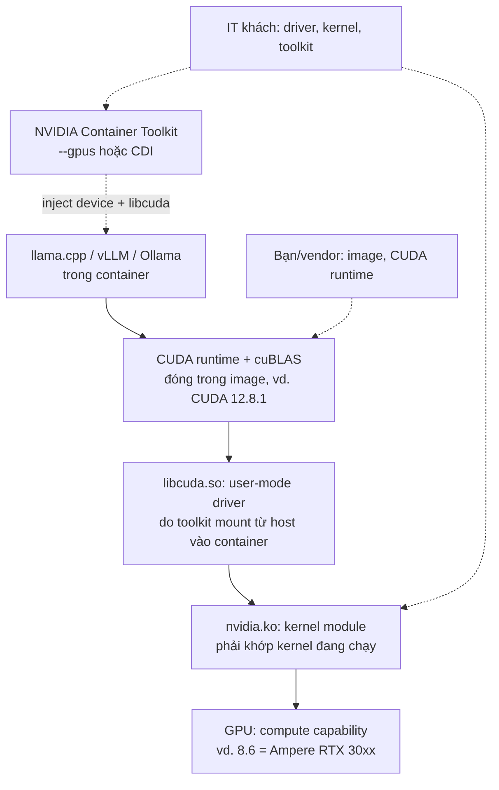
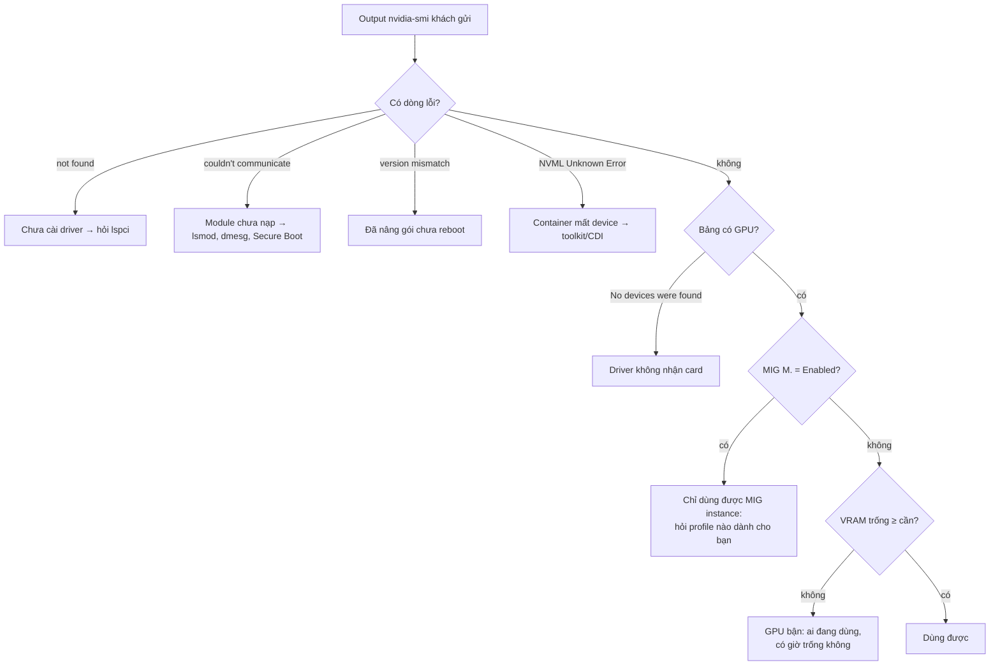
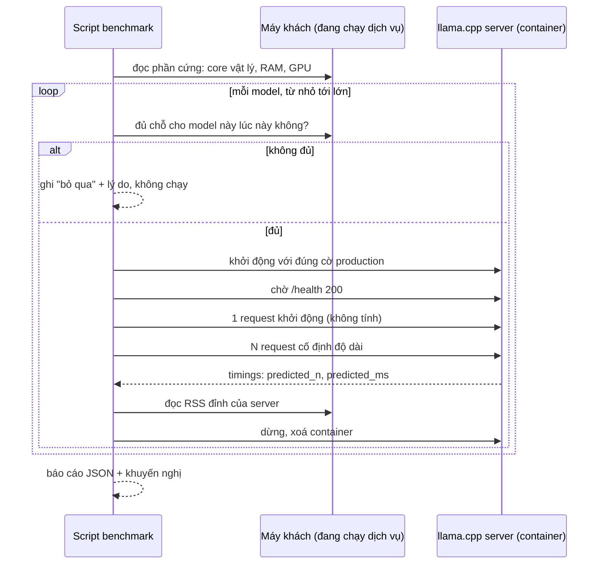

# GPU ở máy khách

Ở văn phòng, "chạy LLM" là `docker run --gpus all` trên một máy có driver mới, CUDA mới, đủ VRAM. Ở máy khách thì GPU có
khi là một card đã mua từ ba năm trước với driver do IT cài một lần rồi không ai dám đụng, có khi là một card "có trong
máy" nhưng driver không chạy, có khi là A100 đã được chia MIG cho ba phòng ban, và rất thường là **không có GPU nào**.
Khách hỏi một câu rất ngắn: "máy này chạy được không, nhanh cỡ nào, nên mua gì thêm". Module này dạy trả lời câu đó bằng
số đo và bảng tương thích có nguồn, không bằng cảm giác.

Sau module này bạn sẽ:

- Vẽ được chuỗi phụ thuộc driver → CUDA trong image → container toolkit/CDI → ứng dụng, và nói chính xác một tổ hợp
  phiên bản có chạy không, chạy với điều kiện gì, vì sao.
- Đọc output của `nvidia-smi` (kể cả khi nó chỉ in một dòng lỗi) ra chẩn đoán và câu hỏi tiếp theo cho khách.
- Định cỡ một LLM theo VRAM/RAM: trọng số theo quantization, KV cache theo context và số request song song, phần phụ;
  biết khi nào chạy CPU là lựa chọn đúng chứ không phải lựa chọn tạm.
- Benchmark tokens/s trên chính máy khách mà không làm hỏng thứ đang chạy, và viết báo cáo năng lực phần cứng có khuyến
  nghị.
- Chọn giữa vLLM, llama.cpp và Ollama cho một triển khai on-prem cụ thể.

## 0. Cài đặt

Mọi bài bắt buộc chạy bằng CPU: laptop của repo có card NVIDIA nhưng driver không chạy (bạn sẽ đọc chính output đó ở bài
basic 03). Các bài trên VM dùng bundle quillo 1.0.0 (image `ghcr.io/ggml-org/llama.cpp:server-b11718` nằm trong bundle ở
`images/llama-cpp-server.tar`) và model đã ghim trong `fdekit.MODELS` (`llm-small` = Qwen2.5-0.5B-Instruct Q4_K_M,
`llm-medium` = Qwen2.5-1.5B-Instruct Q4_K_M).

```bash
nice -n 15 uv run python tracks/fde/product/release.py build --version 1.0.0 --out tracks/fde/product/dist
nice -n 15 uv run python -m fdekit prepare factory
nice -n 15 uv run python -m fdekit prepare lab-open
nice -n 15 uv run python -m fdekit derive 05-gpu-field-factory
nice -n 15 uv run python -m fdekit derive 05-gpu-field-lab
```

Hai snapshot dẫn xuất (`setup/fde/derived/05-gpu-field-*.py`) là máy `factory` và `lab-open` **đang chạy quillo 1.0.0**
bằng compose (llm-small), cộng thêm `llm-medium` ở `~/models/`: đúng tình huống "khách đã chạy sản phẩm, hỏi lên model lớn
hơn được không". Mỗi lần dựng ~1,5 phút, ~3,8 GB mỗi snapshot trong `data/raw/fde-images/derived/`. Bundle dựng lại (sha
đổi) thì test skip kèm đúng lệnh `derive` cần chạy lại. Gỡ: xoá hai tệp `05-gpu-field-*.qcow2` trong thư mục đó.

Bài advanced 01 (tuỳ chọn) cần PC có GPU NVIDIA của bạn: làm theo mục "PC GPU" của
[setup/fde/README.md](../../../../setup/fde/README.md) (bật OpenSSH, user `fde-lab` không sudo, khoá SSH riêng,
`FDE_PC_SSH` trong `setup/.env`). Bộ chấm không bao giờ tự dò hay kết nối PC khi biến chưa đặt.

## 1. Chuỗi phụ thuộc: từ kernel tới tokens

"GPU không chạy" là một câu vô nghĩa cho tới khi bạn biết **tầng nào** gãy. Một request LLM trên GPU đi qua năm tầng, mỗi
tầng do một người khác nhau cài và nâng cấp theo lịch khác nhau:



- **Kernel module (`nvidia.ko`)** gắn với **đúng** kernel đang chạy. Nâng kernel mà không dựng lại module (DKMS lỗi, Secure
  Boot chặn module chưa ký, gói `linux-headers` thiếu) là nguyên nhân số một của "hôm qua chạy, hôm nay không". Laptop
  của repo là ví dụ thật: gói `nvidia-driver 550.163.01` vẫn còn, kernel đã lên `6.12.116+deb13`, `lsmod` không có
  `nvidia`, `/proc/driver/nvidia/version` không tồn tại, `nvidia-smi` in đúng một dòng "couldn't communicate with the
  NVIDIA driver".
- **`libcuda.so` (user-mode driver)** đi cùng gói driver của host, **không** nằm trong image. Container toolkit mount nó
  vào container lúc chạy. Vì vậy phiên bản "driver" là của host, còn phiên bản "CUDA" là của image; hai con số đó gặp
  nhau trong container.
- **CUDA runtime** (cudart, cuBLAS, cuDNN…) nằm trong image. Image `server-cuda-b11718` của llama.cpp có
  `CUDA_VERSION=12.8.1`.
- **Container toolkit** là thứ biến `--gpus all` (hay `--device nvidia.com/gpu=all` với CDI) thành device node + thư viện
  driver trong container. Thiếu nó thì Docker báo `could not select device driver "" with capabilities: [[gpu]]`.
- **Phần cứng**: compute capability quyết định CUDA nào và driver nào còn hỗ trợ card đó.

Hỏi khách theo đúng thứ tự từ dưới lên, mỗi tầng một lệnh: `lspci -nn | grep -i nvidia` (có card không), `lsmod | grep
nvidia` và `cat /proc/driver/nvidia/version` (module có nạp không), `nvidia-smi` (driver và GPU), `nvidia-ctk --version`
và `docker info | grep -i runtime` (toolkit), `docker run --rm --gpus all <image> nvidia-smi` (cả chuỗi). Lệnh cuối cùng
chạy được thì mọi lỗi còn lại là của ứng dụng.

## 2. Ma trận tương thích: driver, CUDA, toolkit, card

Bảng dưới ghim theo tài liệu NVIDIA đọc ngày 2026-11-11 (CUDA Toolkit Release Notes 13.5, CUDA Compatibility Guide,
bulletin bảo mật Container Toolkit). Bài basic 01 dùng đúng bảng này.

**Driver tối thiểu cho từng bản CUDA (Linux x86_64, mốc GA).** Bản update (vd. 12.4 Update 1 cần 550.54.15) chênh không
đáng kể; bài tập dùng mốc GA.

| CUDA | Driver ≥ | CUDA | Driver ≥ | CUDA | Driver ≥ |
| --- | --- | --- | --- | --- | --- |
| 11.0 | 450.51.05 | 12.0 | 525.60.13 | 13.0 | 580.65.06 |
| 11.1 | 455.23 | 12.1 | 530.30.02 | 13.1 | nhánh R590 |
| 11.2 | 460.27.03 | 12.2 | 535.54.03 | 13.2 | nhánh R595 |
| 11.3 | 465.19.01 | 12.3 | 545.23.06 | 13.3 | nhánh R610 |
| 11.4 | 470.42.01 | 12.4 | 550.54.14 | 13.4 | nhánh R615 |
| 11.5 | 495.29.05 | 12.5 | 555.42.02 | 13.5 | nhánh R620 |
| 11.6 | 510.39.01 | 12.6 | 560.28.03 | | |
| 11.7 | 515.43.04 | 12.8 | 570.26 | | |
| 11.8 | 520.61.05 | 12.9 | 575.51.03 | | |

Ba cơ chế tương thích, đừng nhầm:

- **Backward compatibility** (luôn có): driver mới chạy được ứng dụng dựng bằng CUDA cũ hơn. Driver 580 chạy image CUDA
  11.8 bình thường.
- **Minor version compatibility** (từ CUDA 11): trong cùng một major, image dựng với 12.8 vẫn chạy trên driver chỉ đạt mức
  của 12.0, với giới hạn. Mốc tối thiểu theo major: 11.x cần ≥ 450.80.02, 12.x cần ≥ 525.60.13 (≥ 525), 13.x cần ≥ 580.
  Giới hạn: tính năng cần driver mới trả `cudaErrorCallRequiresNewerDriver`, và **PTX không JIT được** trên driver cũ;
  binary phải có sẵn SASS cho đúng kiến trúc card. llama.cpp, PyTorch build sẵn thường có SASS cho các kiến trúc phổ biến
  nên chạy được; kernel tự viết chỉ đóng PTX thì không. Đây là lý do image CUDA 12.8.1 của llama.cpp khai
  `NVIDIA_REQUIRE_CUDA=cuda>=12.8 brand=nvidia,driver>=550,driver<551 …`: toolkit cho phép chạy trên nhánh 550 dù 550 <
  570.26.
- **Forward compatibility** (gói `cuda-compat-<major>-<minor>`): chạy CUDA mới trên driver cũ **khác major**, nhưng chỉ
  cho GPU data center, vài SKU RTX chứng nhận NGC và Jetson, không cho GeForce; và chỉ trên nhánh driver LTS/production
  còn hỗ trợ. Với khách dùng RTX 3060 thì câu trả lời là "nâng driver", không có đường tắt.

**Card nào còn được hỗ trợ.** CUDA 12.0 bỏ Kepler (sm_35, sm_37): CUDA 12.x cần compute capability ≥ 5.0. CUDA 13.0 bỏ
Maxwell, Pascal, Volta (CC < 7.5): GTX 10xx, P100, V100 không dùng được CUDA 13. Về phía driver: từ R495 không còn hỗ trợ
Kepler, và nhánh R580 (LTS, hỗ trợ tới giữa 2028) là nhánh **cuối cùng** hỗ trợ GPU CC < 7.5, nên từ R590 trở đi các card
đó không chạy. Một khách có V100 vì thế bị khoá ở "driver 580 + CUDA ≤ 12.9" tới hết vòng đời card; hãy ghi điều đó vào
báo cáo, đừng đề xuất "nâng driver mới nhất".

**Container toolkit.** Hai cách đưa GPU vào container:

| Cách | Cần | Ghi chú |
| --- | --- | --- |
| `--gpus all` (runtime hook của toolkit) | `nvidia-container-toolkit` | Cách quen thuộc; Docker ≥ 19.03 |
| CDI: `--device nvidia.com/gpu=all` | toolkit ≥ 1.12.0 (`nvidia-ctk cdi generate`), Docker ≥ 25.0 | Docker < 28.3.0 phải bật `"features": {"cdi": true}` trong `daemon.json`; từ 28.3.0 bật sẵn. Podman, containerd dùng CDI tự nhiên. Spec ở `/etc/cdi/nvidia.yaml` phải dựng lại sau mỗi lần nâng driver (toolkit ≥ 1.18 có `nvidia-cdi-refresh.service`) |

Toolkit cũ là rủi ro bảo mật thật, không phải "chỉ cũ": CVE-2024-0132 (sửa ở 1.16.2), CVE-2025-23266 "NVIDIAScape"
(9.0, sửa ở 1.17.8), CVE-2026-24260 (8.5, sửa ở 1.19.1, bulletin 30/06/2026) đều cho container thoát ra host. Toolkit
< 1.19.1 ngày 2026-11-11 là một dòng "cảnh báo" bắt buộc trong báo cáo gửi khách.

Cách hỏi phiên bản khi chỉ có screen-share: `nvidia-smi` (dòng đầu có `Driver Version` và `CUDA Version`; con số CUDA
đó là bản **cao nhất driver hỗ trợ**, không phải CUDA đã cài), `docker image inspect <image> --format '{{json
.Config.Env}}'` (biến `CUDA_VERSION`), `nvidia-ctk --version`, `docker version --format '{{.Server.Version}}'`.

## 3. Đọc `nvidia-smi` như đọc triệu chứng

`nvidia-smi` là lệnh đầu tiên khách gõ giúp bạn, và output của nó (kể cả khi chỉ là một dòng lỗi) nói gần đúng tầng nào
gãy:

| Output | Tầng | Nghĩa thường gặp | Bước tiếp theo |
| --- | --- | --- | --- |
| `nvidia-smi: command not found` | Gói | Chưa cài driver (hoặc không có trên `PATH` của user đó) | `lspci`: có card không; nếu có thì đây là việc cài driver của IT |
| `NVIDIA-SMI has failed because it couldn't communicate with the NVIDIA driver` | Kernel module | Module chưa nạp: kernel mới chưa có module, Secure Boot chặn, `nouveau` chiếm card | `lsmod`, `dmesg \| grep -i nvidia`, `mokutil --sb-state`, `dkms status` |
| `Failed to initialize NVML: Driver/library version mismatch` | Module ↔ thư viện | Gói driver đã nâng, module cũ vẫn trong kernel (chưa reboot) | So `cat /proc/driver/nvidia/version` với bản gói; lên lịch reboot |
| `Failed to initialize NVML: Unknown Error` (trong container) | Toolkit/cgroup | Container mất quyền device sau `systemctl daemon-reload` với cgroup driver systemd | Chạy lại container; cấu hình toolkit theo hướng dẫn của NVIDIA (CDI tránh được lỗi này) |
| `Unable to determine the device handle for GPU…: Unknown Error` | Phần cứng | GPU "rơi khỏi bus" (Xid 79), nguồn, nhiệt | `dmesg` tìm `Xid`; cần reboot, có khi cần kỹ thuật phần cứng |
| `No devices were found` | Driver ↔ card | Driver không nhận card (card quá mới/quá cũ cho driver, card bị passthrough cho VM khác) | `lspci -k` xem driver nào đang giữ card |
| Bảng đầy đủ | Mọi tầng đã chạy | Xem tiếp bộ nhớ, tiến trình, MIG | Xem bên dưới |



Đọc bảng đầy đủ: dòng đầu là `Driver Version` và `CUDA Version` (bản cao nhất driver hỗ trợ). Mỗi GPU chiếm ba dòng: tên
và `Persistence-M`; nhiệt độ, `Perf` (P0 tải nặng … P8 nghỉ), công suất, **Memory-Usage** `used / total`, **GPU-Util**;
dòng ba có **`MIG M.`**. Bảng `Processes` liệt kê ai giữ VRAM, nhưng **chỉ trong PID namespace của bạn**: chạy trong
container thì tiến trình của container khác không hiện ("No running processes found") trong khi `Memory-Usage` vẫn đầy.
Vì vậy "GPU bận" phải đọc từ con số bộ nhớ, không từ danh sách tiến trình.

**MIG (Multi-Instance GPU)** trên A100/H100/H200…: GPU được chia thành các instance cứng (vd. `1g.10gb`), mỗi instance có
bộ nhớ và SM riêng. Khi MIG bật, bảng chính cho thấy GPU gần như trống (vài chục MiB) nhưng bạn **không** dùng được cả GPU;
container chỉ thấy instance được cấp (`NVIDIA_VISIBLE_DEVICES=MIG-<uuid>` hoặc `nvidia.com/mig-1g.10gb` trên K8s), và
GPU-Util báo `N/A`. Câu hỏi đúng với khách là "instance nào dành cho chúng tôi, profile gì", không phải "tắt MIG giúp em"
(việc đó cần quyền admin, dừng mọi workload trên card và thường là quyết định của cả phòng hạ tầng).

Hai thói quen: xin output **nguyên văn** (`nvidia-smi > gpu.txt 2>&1`, gửi tệp), không xin ảnh chụp màn hình; và luôn xin
kèm `nvidia-smi -q -d MEMORY,COMPUTE` khi cần số chính xác thay cho bảng (bảng làm tròn, cắt tên tiến trình).

## 4. Định cỡ LLM theo VRAM và RAM

Bộ nhớ một LLM server cần có ba phần. Bài basic 02 dùng đúng công thức này:

```
weights_mb = params × bits_per_weight / 8 / 1048576        (hoặc kích thước tệp GGUF khi đã có tệp)
kv_mb      = 2 × n_layers × n_kv_heads × head_dim × ctx × batch × kv_bytes / 1048576
total_mb   = weights_mb + kv_mb + overhead_mb
```

- **`bits_per_weight` thực tế, không phải danh nghĩa.** "Q4" không phải 4 bit: k-quant trộn nhiều kiểu, và tensor
  embedding/output thường giữ độ chính xác cao hơn. Tính từ tệp thật (byte × 8 / số tham số): Qwen2.5-7B Q4_K_M
  4.92 bpw, Q8_0 8.51 bpw; model nhỏ còn lệch nhiều hơn vì embedding chiếm tỉ lệ lớn: Qwen2.5-1.5B Q4_K_M 5.80 bpw,
  Qwen2.5-0.5B Q4_K_M 7.96 bpw (hai tệp `llm-medium`, `llm-small` của repo). Có tệp thì dùng kích thước tệp.
- **KV cache** lưu key/value của mọi token trong context cho **mỗi** chuỗi đang chạy. `head_dim = hidden_size /
  n_heads`; `n_kv_heads` nhỏ hơn `n_heads` ở model dùng GQA (Qwen2.5-7B: 28 head, 4 KV head), đó là lý do KV của model
  mới nhỏ hơn nhiều so với công thức cũ dùng `hidden_size`. `kv_bytes` = 2 với f16, ~1,06 với q8_0 (`--cache-type-k
  q8_0`). `batch` ở đây là số chuỗi song song (`-np` của llama.cpp, `max_num_seqs` của vLLM).
- **Overhead**: CUDA context (vài trăm MB mỗi GPU), compute buffer (tỉ lệ với batch xử lý prompt), phân mảnh. Trên CPU
  llama.cpp còn sao chép một phần trọng số sang dạng sắp xếp lại (`CPU_REPACK`) nên RSS lớn hơn tệp.

Vài con số để có cảm giác (overhead 512 MB, context 8192, một chuỗi, f16 KV):

| Model | Quantization | Trọng số | KV 8k | Tổng | Vừa |
| --- | --- | --- | --- | --- | --- |
| Qwen2.5-7B | Q4_K_M (tệp thật) | 4 466 MB | 448 MB | 5 426 MB | RTX 3060 12 GB, còn chỗ cho 4 người × 32k context |
| Qwen2.5-7B | FP16 | 14 515 MB | 448 MB | 15 475 MB | Không vừa 12 GB; vừa L4 24 GB |
| Qwen2.5-32B | ~4.85 bpw | 18 790 MB | 2 048 MB | 21 350 MB | 24 GB, nhưng context tối đa ~21k; KV q8_0 thì 32k vừa |
| Qwen2.5-72B | ~4.85 bpw | 42 033 MB | 2 560 MB | 45 105 MB | 48 GB (2× 24 GB hoặc một L40S/A6000) |

**Chạy CPU.** Không có GPU (hoặc GPU không dùng được) không có nghĩa là không triển khai được. Sinh token là bài toán
**băng thông bộ nhớ**: mỗi token đọc toàn bộ trọng số một lần, nên tokens/s xấp xỉ băng thông RAM chia kích thước model,
và thêm luồng quá số core vật lý (hyper-thread) không giúp gì, thường còn chậm hơn. Đo thật trên `factory` (2 vCPU của
i7-11800H, llama.cpp b11718, `-c 4096 -np 1 -t 2`): `llm-small` 35–50 tokens/s, RSS đỉnh ~625 MB; `llm-medium` 19–25
tokens/s, RSS đỉnh ~1,6–1,75 GB. Người đọc thoải mái ở ~5–10 tokens/s, nên một model 1–3B trên CPU văn phòng là dùng
được cho hỏi đáp tài liệu; model 7B trên 2 core thì không.

**RAM thiếu trên CPU thì chuyện gì xảy ra?** llama.cpp mặc định `mmap` tệp GGUF: trọng số là page cache của tệp, kernel
được quyền bỏ ra khỏi RAM khi thiếu rồi đọc lại từ đĩa khi cần. Hệ quả đo được trên `factory` 3 GB: khi RAM trống còn
vài trăm MB, không tiến trình nào bị OOM-kill, nhưng mọi thứ dùng tệp (trọng số model, cả code của các dịch vụ khác)
bị đọc đi đọc lại từ đĩa, tokens/s rơi 4–8 lần và cả máy chậm theo. Đó là kiểu hỏng khó thấy nhất: không có lỗi trong
log. Bật `--mlock` hay `--no-mmap` thì đổi lại: trọng số thành bộ nhớ không thu hồi được, thiếu RAM là OOM-kill (và OOM
killer có thể chọn tiến trình của khách chứ không phải của bạn). Mặc định của llama.cpp server b11718 cũng đáng nhớ:
không đặt `-c` thì context lấy theo model (32 768 với Qwen2.5) cho 4 slot dùng chung, `llm-medium` khi đó chiếm ~2,4 GB
thay vì ~1,7 GB. Luôn đặt `-c`, `-np`, `-t` tường minh, đúng cấu hình sẽ chạy thật.

## 5. Benchmark và báo cáo năng lực phần cứng

Số đo bạn đưa khách sẽ thành con số trong hợp đồng ("trả lời trong 10 giây") và trong quyết định mua phần cứng. Benchmark
tốt có bốn tính chất: **đúng máy** (máy của khách, không phải máy lab "cấu hình tương tự"), **đúng phần mềm** (đúng image,
đúng model, đúng cờ sẽ chạy thật), **đúng tải** (đúng độ dài prompt và câu trả lời, đúng số người dùng đồng thời) và **không
làm hại** thứ đang chạy trên máy đó.



- **Hai con số khác nhau**: tốc độ xử lý prompt (prompt eval, tokens/s cao, quyết định thời gian tới token đầu khi tài
  liệu dài, quan trọng với RAG) và tốc độ sinh (generation, quyết định cảm giác "gõ ra"). llama.cpp trả cả hai trong
  `timings` (`prompt_per_second`, `predicted_per_second`); đừng chia tổng token cho tổng thời gian request.
- **Cố định độ dài sinh**: `n_predict` cố định + `ignore_eos` để mỗi lần sinh đúng chừng đó token; tắt `cache_prompt` để
  lần sau không ăn may từ cache. Có một request khởi động không tính (trang bộ nhớ, JIT, cache CPU).
- **Đo bộ nhớ đúng cách**: RSS đỉnh của tiến trình server (`VmHWM` trong `/proc/<pid>/status`). Cẩn thận với
  `memory.peak` của cgroup container: page cache được tính cho cgroup **đọc tệp lần đầu**, nên cùng một model đo hai lần
  ra hai số (đo thật: 1 658 MB rồi 1 092 MB).
- **Song song**: CPU chia băng thông, nên 4 request cùng lúc mỗi request chậm đi (đo trên `factory`: `llm-medium` 22
  tokens/s một người, ~11 tokens/s mỗi người khi 4 người). Báo cả hai nếu khách có nhiều người dùng.
- **Sai số**: chạy vài lần, báo trung bình hoặc trung vị và khoảng. Trên VM/máy dùng chung, ±30% giữa hai lần đo là bình
  thường; báo cáo nói rõ điều đó thay vì đưa con số hai chữ số thập phân như thể nó chính xác.

Báo cáo năng lực phần cứng gửi khách (bài advanced 02) trả lời ba câu theo thứ tự: **máy hiện tại làm được gì** (model
nào, tốc độ bao nhiêu, bao nhiêu người cùng lúc, kèm điều kiện đo), **giới hạn và rủi ro** (RAM trống khi có tải khác,
driver/toolkit cũ, CVE, card hết vòng đời), **nếu muốn hơn thì cần gì** (thêm RAM, một GPU cụ thể và VRAM của nó, hay một
model nhỏ hơn), mỗi đề xuất có con số và chi phí ước lượng.

## 6. vLLM, llama.cpp hay Ollama khi triển khai on-prem

Ba lựa chọn hay gặp, mỗi cái giỏi một việc:

| | llama.cpp server | vLLM | Ollama |
| --- | --- | --- | --- |
| Phần cứng | CPU (x86 AVX2/AVX-512, ARM), NVIDIA, AMD, Apple, Vulkan; offload một phần lớp (`-ngl`) | GPU là chính (NVIDIA CC ≥ 7.5 với bản hiện tại, AMD, một số accelerator); có backend CPU nhưng không phải điểm mạnh | Như llama.cpp (dùng ggml phía dưới) |
| Định dạng model | GGUF (một tệp, quantization 2–8 bit) | Safetensors HF; AWQ, GPTQ, FP8 | GGUF qua registry của Ollama hoặc Modelfile |
| Thông lượng nhiều người | Có slot song song, continuous batching cơ bản | Mạnh nhất: PagedAttention, continuous batching, prefix caching, tensor parallel nhiều GPU | Hướng một người dùng/máy dev |
| Đóng gói air-gapped | Một binary hoặc một image + một tệp GGUF; dễ ghim sha256 | Image lớn (vài GB), phụ thuộc chặt phiên bản CUDA/driver; trọng số là cả thư mục | Phải chép kho model `~/.ollama/models`; mặc định kéo model từ internet |
| Hợp với | Máy không GPU, GPU nhỏ, edge, khách cần đơn giản | Server GPU dùng chung cho nhiều người, cần thông lượng | Demo, máy dev, PoC nhanh |

Cách chọn ở hiện trường: không có GPU hoặc GPU < 16 GB và vài người dùng → llama.cpp. Có GPU data center và hàng chục
người dùng đồng thời → vLLM (đo thông lượng thật bằng công cụ benchmark của nó trên GPU của khách). Ollama hợp cho buổi
demo trên laptop, nhưng đừng để nó thành production chỉ vì "đã chạy được": model kéo từ internet không ghim, cấu hình qua
biến môi trường rải rác, và bạn khó trả lời câu "đang chạy đúng bản nào". Dù chọn gì, ghi **một** tổ hợp đã kiểm (image +
digest, driver tối thiểu, toolkit tối thiểu, model + sha256) vào ma trận hỗ trợ, và đọc tài liệu yêu cầu phần cứng của
**đúng bản bạn ghim** (yêu cầu compute capability của vLLM đã đổi giữa các bản).

## 7. Ôn nhanh: serving và quantization

Phần này chỉ nhắc những gì module dùng. Dynamic batching, benchmark latency/throughput (p50/p95, warm-up, đo ở phía
client), execution provider CUDA với fallback CPU, bộ nhớ GPU và FP16/INT8 ở
[MLOps 11 — Serving model Deep Learning](../../../mlops/modules/11-deep-learning-serving/README.md) (phần 3–6). Số học
của quantization, GGUF/llama.cpp và Ollama, cách đo chất lượng sau khi quantize ở
[AI Engineer 10 — Quantization](../../../ai-engineer/modules/10-quantization/README.md) (phần 1, 3 và 7). Điểm cần nối
với module này: chọn quantization là đánh đổi **chất lượng** lấy bộ nhớ và tốc độ, nên khi đề xuất "model 7B Q4 cho vừa
GPU của khách" phải đi kèm một phép đo chất lượng trên dữ liệu của khách (module 09), không chỉ tokens/s.

## 8. Tài liệu tham khảo

- [roadmap.sh — Forward Deployed Engineer](https://roadmap.sh/forward-deployed-engineer)
- [NVIDIA — CUDA Toolkit Release Notes (bảng driver tối thiểu)](https://docs.nvidia.com/cuda/cuda-toolkit-release-notes/index.html)
- [NVIDIA — CUDA Compatibility: minor version compatibility](https://docs.nvidia.com/deploy/cuda-compatibility/minor-version-compatibility.html)
- [NVIDIA — CUDA Compatibility: forward compatibility](https://docs.nvidia.com/deploy/cuda-compatibility/forward-compatibility.html)
- [NVIDIA Developer Blog — Navigating GPU Architecture Support (CUDA 13, nhánh R580)](https://developer.nvidia.com/blog/navigating-gpu-architecture-support-a-guide-for-nvidia-cuda-developers/)
- [NVIDIA — `nvidia-smi` documentation](https://docs.nvidia.com/deploy/nvidia-smi/index.html)
- [NVIDIA — Container Toolkit: Support for Container Device Interface](https://docs.nvidia.com/datacenter/cloud-native/container-toolkit/latest/cdi-support.html)
- [NVIDIA — Security Bulletin: Container Toolkit, July 2025 (CVE-2025-23266)](https://nvidia.custhelp.com/app/answers/detail/a_id/5659)
- [NVIDIA — Security Bulletin: Container Toolkit, June 2026 (CVE-2026-24260)](https://nvidia.custhelp.com/app/answers/detail/a_id/5850)
- [NVIDIA — MIG User Guide](https://docs.nvidia.com/datacenter/tesla/mig-user-guide/index.html)
- [Docker — dockerd reference (CDI)](https://docs.docker.com/reference/cli/dockerd/)
- [llama.cpp — server README (cờ `-c`, `-np`, `-t`, `-ngl`, `/completion`, `timings`)](https://github.com/ggml-org/llama.cpp/blob/master/tools/server/README.md)
- [vLLM — GPU installation (yêu cầu phần cứng)](https://docs.vllm.ai/en/latest/getting_started/installation/gpu.html)
- [Ollama — Documentation](https://github.com/ollama/ollama/tree/main/docs)
- [Hugging Face — Qwen2.5 collection (config.json dùng ở bài basic 02)](https://huggingface.co/collections/Qwen/qwen25-66e81a666513e518adb90d9e)
